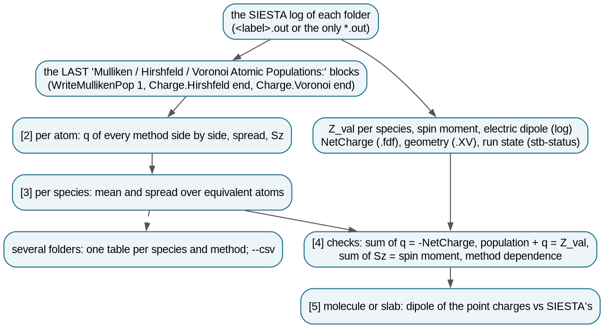
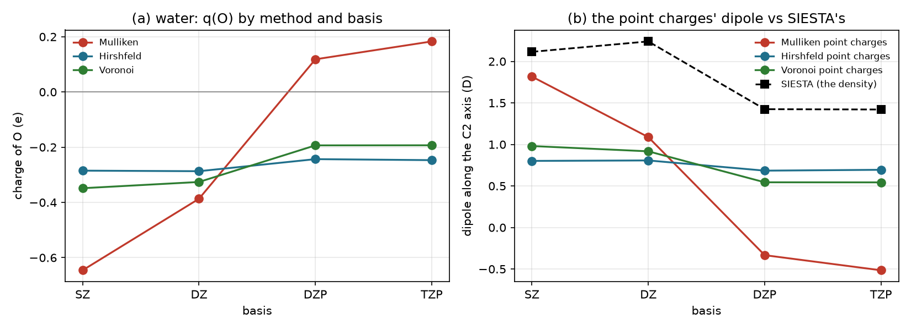
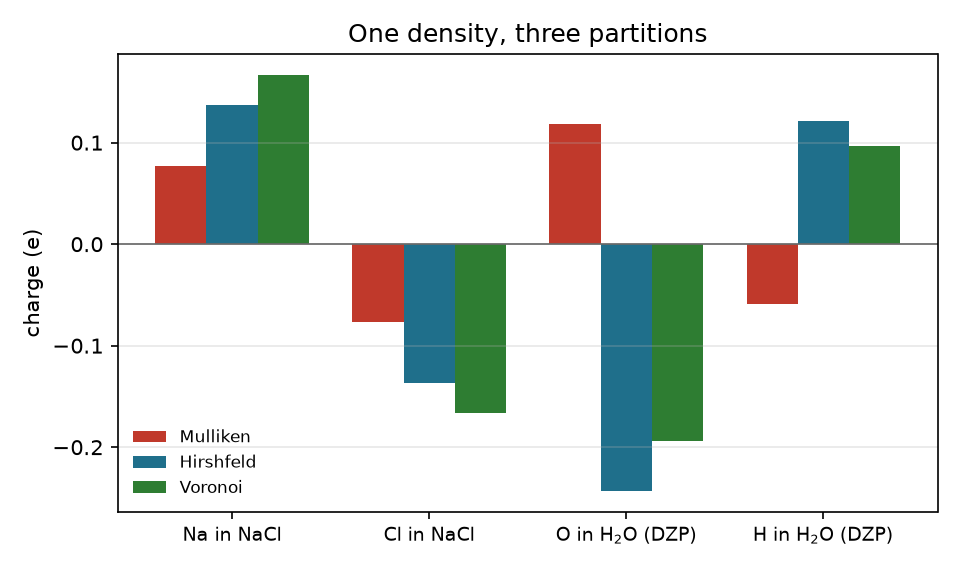

# 2.19 — Native Charges (`stb-nativecharges`)

At the end of a run, SIESTA can print three tables of atomic charges, each from its own way of cutting one electron
density into atoms. `WriteMullikenPop 1` gives Mulliken, `Charge.Hirshfeld end` gives Hirshfeld, and
`Charge.Voronoi end` gives Voronoi. `stb-nativecharges` reads them from the log and compares them:

- **per atom, side by side**, with the spread between the methods, and the spin populations of a spin-polarized run;
- per species, with the spread over equivalent atoms;
- **checks**: the charges add up to the net charge, population + charge = Z_val on every atom, the spin populations add
  up to SIESTA's spin moment;
- for a molecule or a slab, **the dipole of the charges as point charges** against the one SIESTA computes from the
  density;
- for several folders, one table per species and method, and a CSV of every atom.

It computes no new partition: the iterative Hirshfeld-I is `5.17` and Bader is `2.6`.

The example uses real SIESTA 5.4 runs: water with four basis sets, rock-salt NaCl, and the O₂ triplet. They show the
facts to know before using a partial charge. Mulliken charges follow the basis, even in sign. The three methods
disagree by 0.36 e on one atom of water. For an ionic solid they all give a small fraction of the formal ±1. And point
charges miss half of a molecule's dipole. Everything runs in seconds; no SIESTA is needed.

---

## Contents

1. [Theory](#1-theory)
2. [The comparison at a glance](#2-the-comparison-at-a-glance)
3. [Libraries and external dependencies used](#3-libraries-and-external-dependencies-used)
4. [What `stb-nativecharges` does](#4-what-stb-nativecharges-does)
5. [Running it both ways](#5-running-it-both-ways)
6. [Worked example](#6-worked-example)
7. [What to take from the example](#7-what-to-take-from-the-example)
8. [Reproducing the reference data](#8-reproducing-the-reference-data)
9. [Known, deliberate limitations](#9-known-deliberate-limitations)
10. [Step-by-step: charges of your own runs](#10-step-by-step-charges-of-your-own-runs)
11. [Files in this folder](#11-files-in-this-folder)
12. [Running the script](#12-running-the-script)
13. [Flag reference](#13-flag-reference)
14. [What's next](#14-whats-next)
15. [References](#15-references)

---

## 1. Theory

### 1.1 A partial charge is a partition

The electron density ρ(r) is an observable; the charge "of an atom" is not. To get one, ρ has to be divided among the
atoms, and every method does that its own way:

```
q_A = Z_val,A − N_A,     N_A = the share of the valence electrons given to atom A                         (1)
```

SIESTA [1] works with valence electrons and pseudopotentials, so `Z_val` (4 for Si, 6 for O, 9 for Na with its 2s2p
semicore) replaces the atomic number. A positive q means electrons lost. The three partitions SIESTA prints:

| Method | Partition | Depends on | Flag |
|---|---|---|---|
| **Mulliken** [2] | in orbital space: each orbital's population goes to its own atom, each **overlap** population is split half and half between the two atoms | the basis set, strongly | `WriteMullikenPop 1` |
| **Hirshfeld** [3] | in real space, by weights: at every point, atom A gets the fraction ρ⁰_A(r)/Σ_B ρ⁰_B(r) of the density, ρ⁰ the free neutral atoms | the free-atom densities (the "promolecule") | `Charge.Hirshfeld end` |
| **Voronoi** [4] | in real space, by cells: each point goes to the nearest atom | the geometry (all atoms equal size) | `Charge.Voronoi end` |

Each partition has its known biases:

- **Mulliken** has no notion of space. A diffuse or polarization orbital on O that really describes density near H
  still counts as O's, so the charges change with the basis, sometimes in sign (section 6.3).
- **Hirshfeld** weights by neutral free atoms, so it pulls charges toward zero. For ionic solids the result is small
  (section 6.4); the iterative **Hirshfeld-I** [5] corrects this with charged references (`5.17`).
- **Voronoi** cells are equal for a small and a large atom, which biases ionic systems the other way.

None of them is "the" charge. Only differences computed **with one method and one basis** carry meaning: charge
transfer on adsorption, the change along a reaction path.

### 1.2 The checks

For every method:

```
Σ_A q_A = −NetCharge          (0 for a neutral cell)
N_A + q_A = Z_val,A            (population + charge, per atom)
Σ_A Sz_A = S                   (the spin moment, spin-polarized runs)                                    (2)
```

The first two hold by construction when the block is complete. A failure means a truncated log, a mismatched
`Z_val`, or a run that printed its charges before converging. The third checks that the spin populations belong to the
moment SIESTA reports.

### 1.3 The dipole of point charges

For a molecule (or a slab, along its normal), the charges define a dipole if they are placed on the nuclei:

```
p_point = Σ_A q_A (R_A − R_centre)                                                                          (3)
```

SIESTA's own dipole comes from the full density, `p = Σ Z_val R − ∫ρ r`. The two differ by every atom's **own**
dipole, the shape of its share of ρ: lone pairs, polarization. Partial charges that reproduce the molecular dipole
exist (fitted electrostatic-potential charges), but none of the three above is built to. The report gives the
fraction of SIESTA's dipole that each method's point charges carry, along each non-periodic direction.

---

## 2. The comparison at a glance



*Figure 1. What `stb-nativecharges` reads and reports.*

## 3. Libraries and external dependencies used

| Library | Used for |
|---|---|
| `stb.core.siesta_log` | the three population blocks (`get_mulliken_charges`, `get_hirshfeld_charges`, `get_voronoi_charges`), Z_val, spin moment |
| `stb.status` | the run's state, atoms and settings |
| `sisl` [6] | the geometry (`.XV`) for the dipole |
| `numpy` | statistics, dipoles |

## 4. What `stb-nativecharges` does

### 4.1 Step by step

1. **Find the log** of each folder (`<label>.out` or the only `*.out`; the label from the `.fdf` or `-l`).
2. **Read the last** Mulliken, Hirshfeld and Voronoi blocks: the final geometry of a relaxation.
3. **Read** `Z_val` per species, the spin moment and the electric dipole from the log, `NetCharge` and the basis from
   the `.fdf`, the geometry from the `.XV`, the state from `stb-status`.
4. **Report** per atom, per species, the checks and the dipole; for a glob, one table per species and method.

### 4.2 The report, section by section

| Section | What it shows |
|---|---|
| `[0] RUN METADATA` | date, version, target, the three methods and their flags |
| `[1] RUN` | folder, log, state and run type, atoms, basis, spin, net charge, which methods the log has (and the flag for each missing one) |
| `[2] CHARGES PER ATOM` | index, element, Z_val, q of each method, spread; Sz of each method for a spin-polarized run |
| `[3] PER SPECIES` | mean q of each method, with the spread over the atoms of the species |
| `[4] CHECKS` | per method: sum of q, max \|population + q − Z_val\|, sum of Sz; the expected values; the largest method dependence |
| `[5] DIPOLE` | molecule or slab: each method's point-charge dipole along the vacuum axes, \|p\| and the fraction of SIESTA's dipole |
| `[6] SUMMARY & FILES` | how many folders have each method; the CSV |
| `[7] WARNINGS` | every warning, numbered |

With several folders, `[1] CHARGES PER SPECIES` (one row per folder and species, one column per method) replaces
sections 1–5, and `--details` adds the full report of each folder.

### 4.3 Guard rails

The report warns when the log has none of the three blocks (naming the flags to add), when a method's charges do not
add up to the net charge, when Mulliken and Hirshfeld disagree in sign on an atom (a basis artefact), and when the run
did not finish.

## 5. Running it both ways

From the command line:

```bash
stb-nativecharges                                   # this folder
stb-nativecharges --path nacl                       # another folder
stb-nativecharges --path 'h2o_basis/*'              # a series: one table per species and method
stb-nativecharges --path 'h2o_basis/*' --csv charges.csv --details
```

From the menu (`stb-suite`, code `2.19`): the folder or glob, a label, the full reports (for a glob), the CSV and the
report are asked in turn.

## 6. Worked example

`runs/` holds SIESTA 5.4.2 runs [1] (PBE [7], PseudoDojo pseudopotentials [8]), each with the three charge flags,
made by `run_example.sh` in 16 s:

- **`h2o_basis/{SZ,DZ,DZP,TZP}/`**: one water molecule at the experimental geometry (O–H 0.9572 Å, 104.52°) in a
  10 Å box, 250 Ry, with four basis sizes;
- **`nacl/`**: rock-salt NaCl, 2-atom cell, a = 5.64 Å, DZP, 6×6×6 k-points (Na with its 2s2p semicore: Z_val 9);
- **`o2/`**: the O₂ triplet in an 8 Å box, spin-polarized, DZP.

Each keeps only `calc.fdf`, `calc.out` and the `.XV` (256 KB in all).

### 6.1 Water, DZP: the whole report (Case 1)

```bash
stb-nativecharges --path h2o_basis/DZP
```

```
[2] CHARGES PER ATOM
# | el | Z_val | q Mulliken | q Hirshfeld | q Voronoi | spread
1 | O  | 6     | +0.1183    | -0.2433     | -0.1934   | 0.3616
2 | H  | 1     | -0.0592    | +0.1216     | +0.0967   | 0.1808
3 | H  | 1     | -0.0592    | +0.1216     | +0.0967   | 0.1808

[4] CHECKS
method    | sum of q (e) | max |pop + q - Z_val| | sum of Sz
Mulliken  | +0.000000    | 1.1e-16               | -
Hirshfeld | -0.000003    | 0.0e+00               | -
Voronoi   | -0.000003    | 0.0e+00               | -
Method dependence : up to 0.362 e (O1) -- a partial charge is a convention, not an observable

[7] WARNINGS
  1. h2o_basis/DZP: Mulliken and Hirshfeld disagree in SIGN on O1, H2, H3 -- a basis-set artefact of Mulliken
     (diffuse/polarization orbitals); prefer Hirshfeld/Voronoi (or Bader, Hirshfeld-I).
```

Hirshfeld and Voronoi make O negative, as its electronegativity says. Mulliken makes it positive, and with the same
density. All three pass the checks of Eq. 2, so the disagreement is not a bug: it is what each partition means.

### 6.2 The dipole of point charges (Case 2)

```
[5] DIPOLE
source           | along a (D) | along b (D) | along c (D) | |p| (D) | of SIESTA's
Mulliken         | +0.0000     | -0.0000     | -0.3329     | 0.3329  | 23 %
Hirshfeld        | +0.0000     | +0.0000     | +0.6846     | 0.6846  | 48 %
Voronoi          | +0.0000     | +0.0000     | +0.5444     | 0.5444  | 38 %
SIESTA (density) | +0.0000     | +0.0000     | +1.4246     | 1.4246  | 100 %
```

The molecule's C₂ axis is z. Hirshfeld point charges carry under half of the dipole, and Mulliken's point the wrong
way. The missing part is in the shape of each atom's share of the density, mostly the O lone pairs (Eq. 3).

### 6.3 Four basis sets: Mulliken's sign flip (Case 3)

```bash
stb-nativecharges --path 'h2o_basis/*' --csv h2o_basis_charges.csv
```

```
folder        | basis | species | atoms | mean q Mulliken | mean q Hirshfeld | mean q Voronoi
h2o_basis/DZ  | DZ    | O       | 1     | -0.3868         | -0.2870          | -0.3260
h2o_basis/DZP | DZP   | O       | 1     | +0.1183         | -0.2433          | -0.1934
h2o_basis/SZ  | SZ    | O       | 1     | -0.6458         | -0.2850          | -0.3486
h2o_basis/TZP | TZP   | O       | 1     | +0.1831         | -0.2469          | -0.1931
...
```



*Figure 2. Water. (a) The charge of O: Mulliken goes from −0.65 (SZ) to +0.18 (TZP); Hirshfeld stays within
−0.29…−0.24, Voronoi within −0.35…−0.19. (b) The point charges' dipole (Eq. 3) against SIESTA's.*

With a minimal basis (SZ), Mulliken's charges even reproduce 86 % of the dipole. That is a coincidence of a small
basis: as soon as polarization orbitals appear (DZP), the overlap populations shift and Mulliken's O turns positive.
Hirshfeld changes by 0.04 e over the same series. SIESTA's own dipole also depends on the basis: 2.1–2.2 D without
polarization orbitals, 1.42 D with them (experiment 1.85 D [9]). The density changes too; the charges only magnify it.

### 6.4 NaCl: an ionic solid (Case 4)

```
# | el | Z_val | q Mulliken | q Hirshfeld | q Voronoi | spread
1 | Na | 9     | +0.0771    | +0.1370     | +0.1664   | 0.0893
2 | Cl | 7     | -0.0771    | -0.1370     | -0.1664   | 0.0893
```



*Figure 3. One density, three partitions: NaCl and water (DZP).*

A textbook ionic crystal gets charges of ±0.08 to ±0.17, a tenth of the formal ±1. Hirshfeld's neutral reference
atoms pull every charge toward zero. The example of `5.17` computes, for its own NaCl run (a = 5.674 Å), Hirshfeld
±0.14 (the same as here), Hirshfeld-I ±0.51 and Bader ±0.86 [5, 10]. The value depends on the method more than on the
chemistry. "Na loses 0.14 e" is a statement about Hirshfeld, not about sodium.

### 6.5 The O₂ triplet: spin (Case 5)

```
# | el | Z_val | q Mulliken | q Hirshfeld | q Voronoi | spread | Sz Mulliken | Sz Hirshfeld | Sz Voronoi
1 | O  | 6     | +0.0000    | +0.0000     | +0.0000   | 0.0000 | +1.0000     | +1.0000      | +1.0000
2 | O  | 6     | +0.0000    | +0.0000     | +0.0000   | 0.0000 | +1.0000     | +1.0000      | +1.0000
Expected          : sum of q = +0 e; sum of Sz = spin moment 2.00000
```

By symmetry the two atoms share everything: no charge, one unpaired electron each, and the spin populations of every
method add up to SIESTA's moment.

### 6.6 A log without the blocks; the interactive menu (Case 6)

The NaCl log with the three blocks cut out, as SIESTA writes it without the flags (`reference_results/guard_nocharges/`):

```
Mulliken          : not in the log (add WriteMullikenPop 1)
Hirshfeld         : not in the log (add Charge.Hirshfeld end)
Voronoi           : not in the log (add Charge.Voronoi end)
```

`stb-suite` → `2.19` with `h2o_basis/*` gives the same table as Case 3 (`reference_results/menu/report.txt`).

## 7. What to take from the example

- **A partial charge belongs to its method.** On one water molecule the three methods differ by 0.36 e; compare charges
  only within one method and one basis.
- **Mulliken follows the basis**, here even in sign; prefer Hirshfeld or Voronoi for anything quantitative, and
  Hirshfeld-I or Bader for ionic systems.
- **Small charges in an ionic solid** (±0.14 for NaCl) are a feature of the partition, not of the bonding.
- **Point charges are not the dipole**: they carry about half of it here.

## 8. Reproducing the reference data

```bash
source ~/.anaconda3/etc/profile.d/conda.sh && conda activate stb   # or any environment with stb_suite
bash make_reference.sh          # every report into reference_results/<case>/ (seconds, no SIESTA)
bash run_example.sh 4           # runs/ itself (SIESTA 5.x + mpirun, ~16 s)
python3 theory_figures.py       # figures/basis_dependence.png, methods.png
dot -Tpng -Gdpi=150 figures/charges_flowchart.dot -o figures/charges_flowchart.png
```

## 9. Known, deliberate limitations

- **Only what SIESTA printed**: no new partition is computed. Hirshfeld-I is `5.17`, Bader `2.6`.
- **The last block of each kind** is read: the final geometry of a relaxation. Charges along a trajectory need one log
  per step (or `stb-hirshfeld*`).
- **Mulliken's orbital-resolved populations** (`WriteMullikenPop 2`/`3`) are not tabulated; only the atomic charges.
- **The dipole needs vacuum** (a gap of at least 4 Å) and the `.XV`; along periodic directions it is not defined
  this way.
- **Non-collinear spin**: the Sz column is read as printed; the spin direction is not.

## 10. Step-by-step: charges of your own runs

1. **Add the flags** to the `.fdf`: `WriteMullikenPop 1`, `Charge.Hirshfeld end`, `Charge.Voronoi end`.
2. **Run** `stb-nativecharges --path <folder>`: read the checks, the spread and the warnings.
3. **Pick one method** for your comparison (Hirshfeld is the safest of the three) and keep the basis fixed.
4. **For a series** (adsorption, strain, doping), use a glob and `--csv`, and compare differences, not absolute
   values.

## 11. Files in this folder

| File | What it is |
|---|---|
| `README.md` | this tutorial |
| `example_2.19.sh` | the guided walk-through (6 cases, seconds) |
| `runs/` | the six SIESTA 5.4.2 runs (`h2o_basis/*`, `nacl/`, `o2/`: input, log, `.XV`) |
| `run_example.sh` | makes `runs/` (needs SIESTA) |
| `make_reference.sh` | regenerates `reference_results/` |
| `theory_figures.py` | Figures 2 and 3 |
| `figures/` | every figure of this README; `charges_flowchart.dot` is the flowchart's source |
| `reference_results/` | one folder per case: `report.txt`; `h2o_basis/h2o_basis_charges.csv` |

## 12. Running the script

```bash
bash example_2.19.sh                # pauses between cases
yes '' | bash example_2.19.sh       # straight through
```

It needs the `stb_suite` package only (no SIESTA). It starts by wiping its own `output/`, never touches `runs/`, and
takes a few seconds.

## 13. Flag reference

| Flag | Default | What it does |
|---|---|---|
| `--path PATH` | `.` | a folder, or a quoted glob of folders |
| `-l`, `--label LABEL` | from each folder's `.fdf` | SystemLabel override |
| `--details` | off | with several folders, also the full report of each |
| `--csv FILE` | none | every atom's charges (all folders, all methods) as CSV |
| `--save-report` | off | also write `stb_nativecharges_report.txt` (current folder) |
| `--no-intro`, `-v` | | skip the banner; print the version |

## 14. What's next

- **`5.17` (Hirshfeld-I)** computes iterative Hirshfeld charges from SIESTA's density, with charged references.
- **`2.6` (`stb-bader`)** partitions the density by zero-flux surfaces.
- **`5.16` (charge density difference)** shows where charge moves on bonding, without assigning it to atoms.

## 15. References

1. J. M. Soler et al., "The SIESTA method for ab initio order-N materials simulation", *J. Phys.: Condens. Matter*
   **14**, 2745 (2002).
2. R. S. Mulliken, "Electronic population analysis on LCAO–MO molecular wave functions. I", *J. Chem. Phys.* **23**,
   1833 (1955).
3. F. L. Hirshfeld, "Bonded-atom fragments for describing molecular charge densities", *Theor. Chim. Acta* **44**, 129
   (1977).
4. C. Fonseca Guerra, J.-W. Handgraaf, E. J. Baerends, F. M. Bickelhaupt, "Voronoi deformation density (VDD) charges",
   *J. Comput. Chem.* **25**, 189 (2004).
5. P. Bultinck, C. Van Alsenoy, P. W. Ayers, R. Carbó-Dorca, "Critical analysis and extension of the Hirshfeld atoms in
   molecules", *J. Chem. Phys.* **126**, 144111 (2007).
6. N. Papior, sisl: v0.16, https://github.com/zerothi/sisl (2024).
7. J. P. Perdew, K. Burke, M. Ernzerhof, "Generalized gradient approximation made simple", *Phys. Rev. Lett.* **77**,
   3865 (1996).
8. M. J. van Setten et al., "The PseudoDojo: Training and grading a 85 element optimized norm-conserving
   pseudopotential table", *Comput. Phys. Commun.* **226**, 39 (2018).
9. S. A. Clough, Y. Beers, G. P. Klein, L. S. Rothman, "Dipole moment of water from Stark measurements of H₂O, HDO,
   and D₂O", *J. Chem. Phys.* **59**, 2254 (1973).
10. W. Tang, E. Sanville, G. Henkelman, "A grid-based Bader analysis algorithm without lattice bias", *J. Phys.:
    Condens. Matter* **21**, 084204 (2009).
