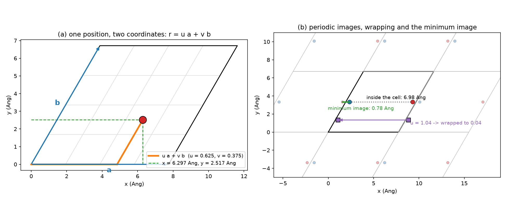
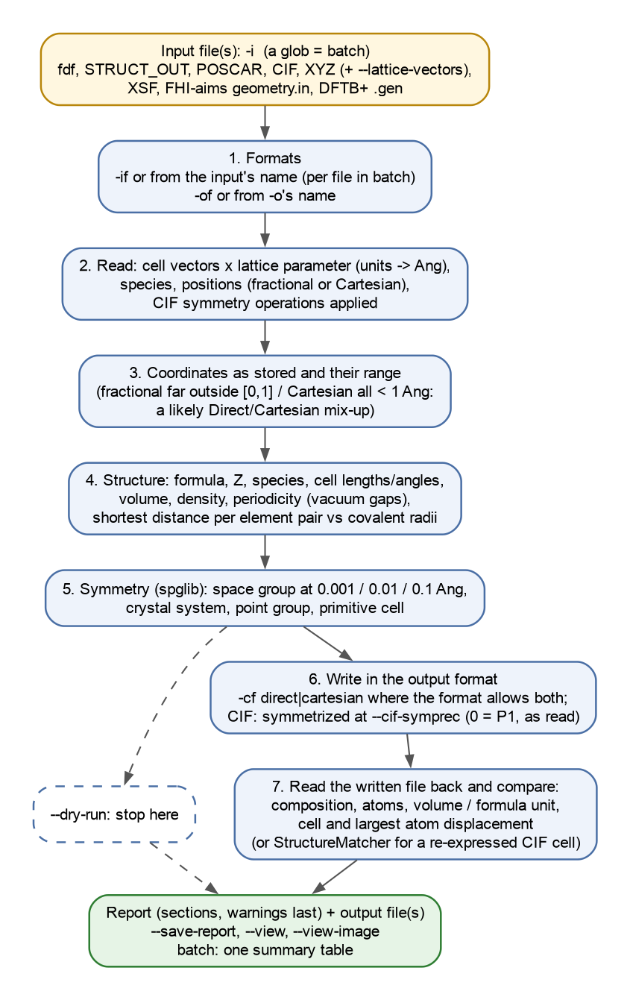
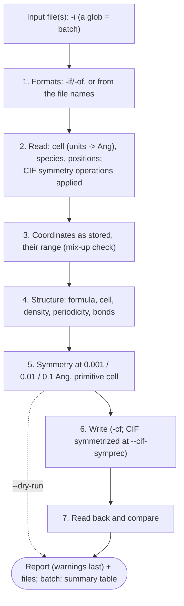
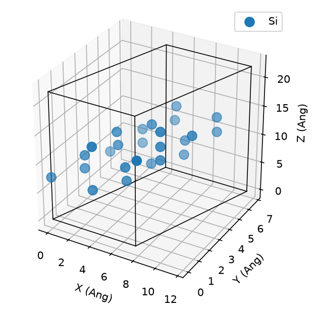
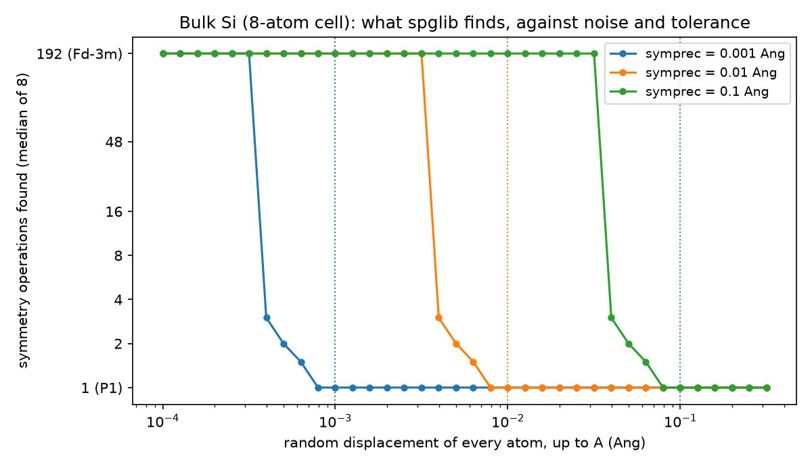

# 3.1 — File Translator (`stb-translate`)

`stb-translate` converts a crystal structure between the file formats used around SIESTA, and tells you what it read
and whether what it wrote is the same structure. It reads and writes:

| Format | Read | Write | Typical file |
|---|---|---|---|
| `fdf` | yes | yes | SIESTA input: `structure.fdf` |
| `siesta` | yes | — | SIESTA output: `<label>.STRUCT_OUT` (the relaxed cell and positions) |
| `poscar` | yes | yes | VASP: `POSCAR`, `CONTCAR`, `*.vasp` |
| `cif` | yes | yes | Crystallographic Information File: databases, papers, VESTA |
| `xyz` | yes | yes | plain XYZ: molecules, visualisers (no cell) |
| `xsf` | yes | yes | XCrySDen |
| `fhi` | yes | yes | FHI-aims `geometry.in` |
| `dftb` | yes | yes | DFTB+ `.gen` |
| `lammps` | — | yes | LAMMPS data file (`atom_style atomic`, metal units) |

Both formats are taken from the file names when `-if`/`-of` are omitted. For every file it reports:

- what was read: the coordinates as stored and their range;
- the structure: composition, cell, volume, density, periodicity, shortest bonds;
- its symmetry at three tolerances;
- a check of the written file, read back and compared with the input.

The check catches the classic mistakes that a conversion makes silently: fractional and Cartesian coordinates mixed
up, a wrong scale factor, a lossy format. While this example was being written, it also caught a real bug: the DFTB+
reader swapped two cell vectors. That bug is now fixed (section 6.10).

The worked example (section 6) uses real structures: bulk Si and a Si(111) slab from the `7.1`/`7.6` examples, and
the `siesta.STRUCT_OUT` of a SIESTA relaxation of a Si adatom on that slab. It adds a few hand-made files that each
show one idea — a CIF from a database, a cell in Bohr, a molecule, noisy and broken files. Everything runs in seconds.

---

## Contents

1. [Theory](#1-theory)
2. [The conversion at a glance](#2-the-conversion-at-a-glance)
3. [Libraries and external dependencies used](#3-libraries-and-external-dependencies-used)
4. [What `stb-translate` does](#4-what-stb-translate-does)
5. [Running it both ways](#5-running-it-both-ways)
6. [Worked example](#6-worked-example)
7. [What to take from the example](#7-what-to-take-from-the-example)
8. [Reproducing the reference data](#8-reproducing-the-reference-data)
9. [Known, deliberate limitations](#9-known-deliberate-limitations)
10. [Step-by-step: converting your own files](#10-step-by-step-converting-your-own-files)
11. [Files in this folder](#11-files-in-this-folder)
12. [Running the script](#12-running-the-script)
13. [Flag reference](#13-flag-reference)
14. [What's next](#14-whats-next)
15. [References](#15-references)

---

## 1. Theory

### 1.1 A crystal in a file

A periodic structure is fully described by three things [1]:

1. **The cell**: three vectors **a**, **b**, **c**. Every lattice point is `n₁a + n₂b + n₃c` with integer `nᵢ`, and the
   crystal repeats itself by every such translation.
2. **The species** of the atoms in one cell.
3. **The positions** of those atoms inside the cell.

Every structure format stores these three, in its own layout and units. Most store nothing else. A few add
information the others cannot carry: symmetry operations (CIF), constraints (POSCAR's selective dynamics), charges,
magnetic moments, velocities. A conversion keeps the three essentials and drops whatever the target format has no
place for.

The cell is conveniently written as a matrix whose **rows** are the vectors:

```
      | ax  ay  az |
  A = | bx  by  bz |        (Angstrom; the volume of the cell is |det A|)
      | cx  cy  cz |
```

### 1.2 Fractional and Cartesian coordinates

A position can be given in two ways:

- **Cartesian** `r = (x, y, z)`, in Å along the fixed axes x, y, z;
- **fractional** `s = (u, v, w)`, along the cell vectors: `r = u a + v b + w c`.

In matrix form, with `r` and `s` as row vectors,

```
  r = s A          s = r A⁻¹
```

For an orthogonal cell this is a scaling of each axis. For an oblique cell — hexagonal, monoclinic, the 60° surface
cell of the example's Si(111) slab — it mixes the axes: a fractional `u` contributes to both `x` and `y` (Figure 1a).
Case 4 does this sum by hand for one atom. Inside the cell every fractional coordinate lies in `[0, 1)`. A value of
4.1 is legal arithmetic but almost never what anyone meant (section 1.6).



*Figure 1. (a) One position of the Si(111) slab's oblique surface cell (γ = 60°), as fractional coordinates
`(u, v) = (0.625, 0.375)` along **a** and **b**, and as Cartesian `(x, y)`. (b) Periodic images of two atoms near
opposite edges of the cell. Inside the cell they are 6.98 Å apart; through the boundary — the minimum image — they are
0.78 Å apart. An atom at `u = 1.04` is the same atom as one at `u = 0.04` (wrapping).*

### 1.3 Units and scale factors

The formats agree that positions are in Å or fractional, but each stores the length scale its own way:

- **SIESTA fdf**: `%block LatticeVectors` multiplied by `LatticeConstant <value> <unit>`. The unit can be Ang, Bohr
  or nm. phonopy's SIESTA writer, for example, uses `LatticeConstant 1.0 Bohr` with the vectors in Bohr
  (1 Bohr = 0.529177 Å).
- **POSCAR**: line 2 is a *scale factor* that multiplies the three vectors (and Cartesian positions). If it is
  negative, it is the cell *volume* in ų instead, and the factor is `(|V| / det A)^(1/3)`.
- **STRUCT_OUT, XSF, FHI-aims, DFTB+, CIF**: lengths in Å. A CIF gives the cell as `a, b, c, α, β, γ` rather than as
  vectors; the reader builds the vectors with **a** along x and **b** in the xy plane.

A wrong scale factor is the second classic mistake (section 1.6). It does not raise any error: it shrinks or swells
the whole crystal.

### 1.4 Periodicity, wrapping and the minimum image

A position outside `[0, 1)` names the same atom as its image inside: `u` and `u − 1` are the same site (Figure 1b).
Some programs write wrapped coordinates, others leave atoms where an MD run or a relaxation moved them.

Distances between atoms must use the **minimum image**: of all the periodic copies of atom *j*, the one closest to
atom *i*. Two atoms on opposite faces of a cell are neighbours, not a cell length apart. Every distance in the report
is taken this way.

A slab, a wire or a molecule is modelled in the same periodic box, with vacuum along the non-periodic directions. The
report calls an axis non-periodic when the atoms leave a gap of at least 10 Å along it. From the number of such axes
it calls the system a 3D bulk, a 2D slab or layer, a 1D wire or a 0D molecule in a box.

### 1.5 Symmetry, tolerance and the primitive cell

A crystal's symmetry is the set of operations — rotations, reflections, inversions, possibly combined with fractional
translations — that map it onto itself. Their group is the **space group**: 230 types in 3D, tabulated in the
International Tables [2]. The report finds it with spglib [3].

**A real structure is never exactly symmetric.** A relaxation, an MD snapshot or a rounded file leaves every atom a
little off its ideal site. spglib therefore asks whether each operation maps every atom onto an atom of the same
species within a **tolerance**, `symprec`, in Å. Figure 3 measures what that means on bulk Si:

- with noise of amplitude *A*, the full symmetry (192 operations, Fd-3m) survives while *A* stays below about 0.4
  `symprec`;
- above that, the detected symmetry collapses within a factor of two, to P1.

So a tolerance much tighter than the noise sees no symmetry. One much looser than real distortions *invents*
symmetry the structure does not have. The report gives the space group at 0.001, 0.01 and 0.1 Å, so the reader can
see where it changes.

The **primitive cell** is the smallest cell that tiles the crystal by lattice translations. The cubic cell of Si has 8
atoms; its primitive cell has 2, so the cubic cell is 4 primitive cells. The report gives the size of the primitive
cell, found at 0.01 Å.

**CIF and symmetry.** A CIF can list only the **asymmetric unit** — the symmetry-distinct atoms — together with the
operations of the space group. The full cell is then generated by applying every operation and removing duplicates
(Case 7: 2 sites of NaCl become 8 atoms). Writing a CIF the other way round means finding the symmetry first:
`stb-translate` lets pymatgen's `CifWriter` [4] do that at `--cif-symprec` (0.01 Å by default). That moves every atom
onto its exact symmetric position and writes the asymmetric unit in the standard setting. It is what a database or a
paper expects. It also changes the data by up to the tolerance, and can rotate or re-choose the cell. `--cif-symprec 0`
writes P1 instead: the cell and the positions exactly as read (Case 6).

### 1.6 What can go wrong silently, and how the report catches it

Most conversion errors produce a file that reads without complaint. The report looks for the symptoms.

| Mistake | What it does | How the report sees it |
|---|---|---|
| Cartesian numbers labelled fractional (`Direct` in a POSCAR) | positions multiplied by the cell: atoms scattered, often into a wrong symmetric pattern | fractional coordinates far outside [0, 1] (> 1.25 or < −0.25) |
| Fractional numbers labelled Cartesian | the whole crystal squeezed into a 1 Å corner | every Cartesian coordinate between 0 and 1 Å in a cell of more than 2 Å |
| Wrong scale factor / unit (Bohr read as Å) | every distance scaled by the same factor | density far from normal; bonds shorter than 0.75 × the sum of the covalent radii [5]; atoms closer than 0.5 Å |
| A lossy or buggy writer/reader | the written file is another structure | the written file is read back and compared: composition, number of atoms, volume per formula unit, cell, largest atom displacement |

The read-back check compares the input with the written file atom by atom. Each input atom is matched to the nearest
output atom of the same element, by minimum image. This works when the cell is unchanged. When the writer re-expresses
the cell, as a symmetrized CIF does, the check uses pymatgen's `StructureMatcher` [4] instead, which recognises the
same crystal in another cell or origin.

### 1.7 What each format stores

| | cell | coordinates | species | extra | notes |
|---|---|---|---|---|---|
| fdf | `LatticeVectors` × `LatticeConstant` (Ang/Bohr/nm) | fractional or Cartesian (`AtomicCoordinatesFormat`) | `ChemicalSpeciesLabel` (Z < 0 = ghost) | — | what SIESTA reads |
| STRUCT_OUT | 3 vectors, Å | fractional | species index + Z | — | what SIESTA writes after each relaxation step |
| POSCAR | 3 vectors × scale (or volume) | Direct or Cartesian (first letter decides) | element line + counts | selective dynamics (read, not carried) | VASP 5 format |
| CIF | a, b, c, α, β, γ | fractional | element per site | symmetry operations, occupancies, labels | the archival format |
| XYZ | none | Cartesian, Å | element | comment line | cell from `--lattice-vectors` |
| XSF | `PRIMVEC` | Cartesian, Å | atomic number | — | XCrySDen |
| FHI-aims | `lattice_vector` | `atom` (Cartesian) or `atom_frac` | element | — | `geometry.in` |
| DFTB+ | origin + 3 vectors | `S` (Cartesian), `F` (fractional), `C` (cluster) | type list | — | `.gen` |
| LAMMPS | box bounds + tilt factors | Cartesian, Å | atom types + masses | — | written by ASE [6] |

LAMMPS needs a "restricted triclinic" box, with **a** along x and **b** in the xy plane. ASE rotates the cell into
that form when needed, so a LAMMPS file can differ from the input by a rigid rotation.

### 1.8 What this tool simplifies — explicitly

- **One structure per file**: no trajectories (that is `stb-ani2traj`).
- **What is not carried over**: constraints, magnetic moments, velocities, charges and fractional occupancies.
  A disordered CIF is read with its sites as listed.
- **CIF output is symmetrized** unless `--cif-symprec 0`.
- **POSCAR is read in the VASP 5 layout**, with the element line; a POSCAR without it (VASP 4) is not understood.

---

## 2. The conversion at a glance





## 3. Libraries and external dependencies used

| Library | Used for |
|---|---|
| ASE [6] | `Atoms`, minimum-image distances, the LAMMPS writer and reader, the 3D views (`--view`, `--view-image`) |
| pymatgen [4] | CIF reading (symmetry expansion) and writing (`CifWriter`), `StructureMatcher`, compositions, the crystal system |
| spglib [3] | space group, number of operations, primitive cell |
| NumPy | coordinates, cell matrices |
| matplotlib | `--view-image` |
| `stb.core` | the `.fdf` reader/writer (`structure_io`, the only one in the suite), vacuum detection (`kspace`), report helpers (`cli`) |

`stb-translate` comes with the base package (`pip install stb_suite`); it needs no ML extra and no SIESTA.

## 4. What `stb-translate` does

### 4.1 Step by step

1. **Formats.**
   - Input: `-if`, else from the name: `.fdf`, `.STRUCT_OUT`, `.vasp`/`POSCAR`/`CONTCAR`, `.cif`, `.xyz`, `.in`,
     `.gen`, `.xsf`. In batch mode this is decided per file.
   - Output: `-of`, else from `-o`'s name: `.fdf`, `.vasp`/`.poscar`/`POSCAR`, `.cif`, `.xyz`, `.in`, `.gen`, `.xsf`,
     `.data`/`.lmp`. Batch mode needs `-of` and `--out-dir`.
2. **Read** with the format's reader. The cell is multiplied by its lattice parameter or scale factor (a negative
   POSCAR scale is a volume), a CIF's symmetry operations are applied, and an XYZ file gets its cell from
   `--lattice-vectors`.
3. **Input section**: file size; the coordinates as the file stores them (read from the file itself); their range,
   with the mix-up check of section 1.6.
4. **Structure section**:
   - formula and number of formula units Z;
   - species with their counts, fractions and masses;
   - cell lengths and angles, the vectors;
   - volume, volume per atom, density;
   - periodicity (section 1.4);
   - the shortest distance for every pair of elements, with its ratio to the covalent bond length.
5. **Symmetry section**: space group and number of operations at 0.001, 0.01 and 0.1 Å; crystal system and point
   group; size of the primitive cell.
6. **Write** (unless `--dry-run`). `-cf direct|cartesian` chooses the coordinates where the format allows both; CIF
   output is symmetrized at `--cif-symprec`.
7. **Output section**: file size; the coordinates as written (read from the file); the read-back check of
   section 1.6.
8. **Summary** (a table per file in batch mode), the files written, and **all warnings** in the last section.
   `--view`/`--view-image` come last, after the report.

### 4.2 The report, section by section

| Section | Content |
|---|---|
| `RUN METADATA` | date, versions (stb, ASE, pymatgen, spglib), input and output with their formats and whether each was given or inferred, `-cf`, CIF symmetry |
| `INPUT` | file and size, format, coordinates as stored, lattice parameter, coordinate range (and the mix-up warning) |
| `STRUCTURE` | formula and Z, species table, cell, vectors, volume, density, periodicity, shortest distance per element pair |
| `SYMMETRY` | space group / number / operations at three tolerances, crystal system, point group, primitive cell |
| `OUTPUT` | file and size, format, coordinates as written, CIF symmetry, the verification table (and a note when the cell was re-expressed) |
| `SUMMARY & FILES` | status, structure, files written, report, options not used; in batch mode a table: input, formula, atoms, space group, output, status |
| `WARNINGS` | every warning, numbered |

In batch mode the `INPUT` to `OUTPUT` sections repeat for each file, titled with its name.

### 4.3 Guard rails

| Situation | Behaviour |
|---|---|
| no format given and an unknown extension | clean error asking for `-if`/`-of` |
| `-o` missing (and not `--dry-run`) | clean error |
| XYZ input without `--lattice-vectors` | clean error |
| a glob with `-o` (one name for many files) | clean error: use `--out-dir` |
| a file that cannot be read | `[FAIL]` for that file; a batch goes on with the others, exit code 1 |
| a written file that is not the input | warning (composition, volume, displacement, or not the same crystal) |
| coordinates or bonds that look like a mix-up | warning |

## 5. Running it both ways

**Command line:**

```bash
stb-translate -i CONTCAR -o structure.fdf                       # both formats from the names
stb-translate -i siesta.STRUCT_OUT -o relaxed.cif --save-report # a relaxation, for a paper or VESTA
stb-translate -i relaxed.STRUCT_OUT -o relaxed_p1.cif --cif-symprec 0   # the CIF exactly as relaxed
stb-translate -i POSCAR -o structure.fdf -cf cartesian          # choose the output coordinates
stb-translate -i water.xyz -o water.fdf --lattice-vectors 15 0 0 0 15 0 0 0 15
stb-translate -i '*.cif' -of fdf --out-dir fdf/                 # batch
stb-translate -i structure.fdf --dry-run                        # report only
stb-translate -i structure.fdf -o s.xsf --view-image s.png      # and a picture
```

**Interactive menu:** run `stb-suite` and type `3.1`. It asks, in this order:

1. the input file and its format (`0` = detect from the name, the default);
2. the output file and its format (`0` = detect from the name, the default);
3. the output coordinates (Cartesian, Direct, or the default);
4. for an XYZ input, the nine components of the lattice vectors;
5. whether to view the structure (window and/or image), and whether to save the report.

## 6. Worked example

All numbers below come from `reference_results/` (`make_reference.sh`) and from the guided script.

### 6.1 A SIESTA relaxation to CIF (Case 2)

`si111_adatom_relaxed.STRUCT_OUT` is what SIESTA wrote at the end of the relaxation of a Si adatom on Si(111) in the
`7.6` example: three cell vectors in Å, then one line per atom with its species index, Z and fractional coordinates.

```bash
stb-translate -i si111_adatom_relaxed.STRUCT_OUT -o si111_adatom.cif
```

```
Input             : si111_adatom_relaxed.STRUCT_OUT -- siesta (auto, from the name 'si111_adatom_relaxed.STRUCT_OUT')
Output            : si111_adatom.cif -- cif (auto, from the name 'si111_adatom.cif')
CIF symmetry      : 0.01 Ang (--cif-symprec)
...
Formula           : Si25 -- reduced Si, Z = 25 formula units
Cell              : a = 7.75023, b = 7.75023, c = 22.11904 Ang; alpha = 90.000, beta = 90.000, gamma = 60.000 deg
Volume            : 1150.6035 Ang^3 (46.0241 Ang^3/atom); density 1.0133 g/cm^3 (mass 702.125 u)
Periodicity       : 2D slab/layer -- vacuum (>= 10 Ang gap) along c
Si-Si | 2.3257         | Si13 - Si17 | 1.05       |
...
0.01          | P3m1        | 156    | 6
Crystal system    : trigonal; point group 3m
Primitive cell    : 25 atoms (symprec 0.01 Ang) -- the input cell is primitive
...
same crystal (StructureMatcher) |         | yes     | rms 5.7e-06 Ang
Note              : the writer re-expressed the cell (the standard setting of a symmetrized CIF): compared as the
                    same crystal up to a change of cell/origin (pymatgen StructureMatcher)
```

The extensions chose both formats. The report sees a slab: the 22 Å cell has 13.7 Å of vacuum along c, so the density
of 1.01 g/cm³ is the density of slab plus vacuum. The relaxed adatom keeps a three-fold axis and three mirrors (P3m1,
6 operations). The CIF is written in P3m1's standard setting, and the check confirms it is the same crystal. With
`--cif-symprec 0` the CIF is P1 instead, in the original cell, and the check runs atom by atom: largest displacement
1.1 × 10⁻⁷ Å, the precision of the numbers written.



*Figure 2. `--view-image si111_adatom.png` of the same run: a 3D snapshot of the slab in its cell, written without a
display.*

### 6.2 One crystal, every output format (Case 3)

`si_bulk.fdf` (bulk Si, 8 atoms) written in all eight output formats, each file read back:

| File | Format | Coordinates written | Largest shift on read-back |
|---|---|---|---|
| `si.cif` | cif | fractional (always) | 0 |
| `si.vasp` | poscar | fractional (Direct, as the input) | 0 |
| `si.xyz` | xyz | Cartesian, Å (always) | 0 |
| `si.xsf` | xsf | Cartesian, Å (always) | 0 |
| `geometry.in` | fhi | fractional (`atom_frac`) | 0 |
| `si.gen` | dftb | fractional (`F`) | 0 |
| `si.data` | lammps | Cartesian, Å | 1.3 × 10⁻¹⁵ Å |
| `si_copy.fdf` | fdf | fractional | 0 |

Every format reproduces the crystal. Bulk Si is already exactly symmetric, so the symmetrized CIF moves nothing. The
formats differ in what they can say: CIF is always fractional, XYZ/XSF/LAMMPS always Cartesian, and the others follow
the input unless `-cf` asks otherwise.

### 6.3 Fractional and Cartesian, by hand (Case 4)

The fifth atom of the slab, written with `-cf direct` and with `-cf cartesian`:

```
fractional :   0.16666667   0.16666667   0.37483566
Cartesian  :   1.93755676   1.11864892   8.29100420
```

With the rows of the cell `a = (7.7502, 0, 0)`, `b = (3.8751, 6.7119, 0)`, `c = (0, 0, 22.1190)`:

```
x = 0.16667 × 7.7502 + 0.16667 × 3.8751 = 1.9376
y = 0.16667 × 6.7119                     = 1.1186
z = 0.37484 × 22.1190                    = 8.2910
```

The `x` coordinate collects contributions from both **a** and **b**: that is the oblique cell. The guided script also
computes `s = r A⁻¹` and gets the fractional coordinates back.

### 6.4 Units: a lattice in Bohr (Case 5)

`si_bohr.fdf` is the 2-atom primitive cell of Si with `LatticeConstant 1.0 Bohr` and the vectors `(0, 5.178, 5.178)` …
in Bohr. Written as a POSCAR:

```
0.529177210903
0.00000000   5.17807400   5.17807400
...
```

The lattice constant became VASP's scale factor, and the vectors were copied unchanged. The report reads the cell as
a = 3.875 Å with 60° angles: the fcc primitive cell. Its volume per atom, 20.574 ų, is that of `si_bulk.fdf`, and its
symmetry is Fd-3m with 48 operations, the point group without the fcc centring translations. Reading the vectors as
Å would give a cell 1.89 times too large in every direction, 6.7 times in volume. `stb.core.structure_io` once had
exactly this bug for phonopy's SIESTA files.

### 6.5 Symmetry and tolerance (Case 6)

`si_noisy_<A>.fdf` is bulk Si with every atom displaced at random by up to *A*. Space group found at each tolerance:

| Noise *A* (Å) | 0.001 Å | 0.01 Å | 0.1 Å | primitive cell at 0.01 |
|---|---|---|---|---|
| 0.002 | P1 | **Fd-3m** | Fd-3m | 2 atoms |
| 0.02 | P1 | P1 | **Fd-3m** | 8 atoms |
| 0.2 | P1 | P1 | P1 | 8 atoms |



*Figure 3. Symmetry operations spglib finds in bulk Si (8-atom cell) against the amplitude of random displacements,
for the three tolerances of the report (median of 8 random draws; the dotted lines mark each tolerance). The full
Fd-3m survives while the noise is below about 0.4 × the tolerance.*

A structure relaxed to 0.01 eV/Å typically carries noise of 10⁻³ Å. 0.01 Å, the default of most tools in the suite,
sees its symmetry; 0.001 Å does not.

Written as a CIF, the 0.002 Å file is symmetrized:

```
largest atom displacement (Ang) |         | 2.64e-03 | symmetrized
Symmetrized       : the CIF writer moved atoms by up to 0.0026 Ang onto their exact symmetric positions
                    (--cif-symprec 0.01); --cif-symprec 0 keeps them as read
```

That is usually what a CIF should contain. When the small distortion is the physics — a Jahn–Teller distortion, a
polar displacement, an MD snapshot — use `--cif-symprec 0`.

### 6.6 A CIF from a database (Case 7)

`nacl_asym.cif` is rock salt as a database writes it: space group Fm-3m, a = 5.64 Å, and only two sites, each with
its multiplicity:

```
  Na  Na0  4  0.00000000  0.00000000  0.00000000  1
  Cl  Cl1  4  0.00000000  0.00000000  0.50000000  1
```

```
Formula           : Cl4Na4 -- reduced NaCl, Z = 4 formula units
Atoms             : 8 (2 species)
Cl-Na | 2.8200         | Cl1 - Na5 | 1.05       |
0.01          | Fm-3m       | 225    | 192
Primitive cell    : 2 atoms (symprec 0.01 Ang) -- the input cell is 4x larger
```

The reader applied the 192 operations and kept the 8 distinct positions of the conventional cell: 4 Na, 4 Cl, Na–Cl
2.82 Å = a/2. SIESTA needs all of them. For a cheaper calculation, the 2-atom primitive cell describes the same
crystal (`stb-unitcell`, `4.7`).

### 6.7 A molecule: XYZ has no cell (Case 8)

```bash
stb-translate -i water.xyz -o water.fdf                       # error: An XYZ input needs --lattice-vectors
stb-translate -i water.xyz -o water.fdf --lattice-vectors 15 0 0 0 15 0 0 0 15
```

```
Periodicity       : 0D molecule/cluster in a box -- vacuum (>= 10 Ang gap) along a, b, c
H-O  | 0.9686         | H1 - O3 | 1.00       |
0.01          | Pmm2        | 25     | 4
```

A plain XYZ file has positions and nothing else, so the box has to be given. In it the report finds vacuum on all
three axes (a 0D system). The "space group" Pmm2 of a lone molecule in a box is its point group, mm2 (C2v), plus the
box's translations.

### 6.8 What the report catches (Case 9)

Both files below read without any error.

**Cartesian numbers under `Direct`** (`si_mixup.vasp`):

```
Coordinate range  : 0.000 .. 4.110 -- fractional coordinates far outside [0, 1]
0.01          | R3m         | 160    | 6
  1. si_mixup.vasp: the coordinates are read as fractional but span 0.00 .. 4.11 -- a Cartesian file labelled
     Direct/Fractional? The structure below is then wrong.
```

The atoms land on scattered sites that happen to form an R3m crystal. Without the warning, it is a plausible-looking
wrong structure.

**Scale factor 0.5 instead of 1.0** (`si_wrongscale.vasp`):

```
Volume            : 20.5735 Ang^3 (2.5717 Ang^3/atom); density 18.1345 g/cm^3 (mass 224.680 u)
Si-Si | 1.1865         | Si1 - Si2 | 0.53       | short
  1. si_wrongscale.vasp: a bond is shorter than 0.75 x the sum of the covalent radii -- check the geometry.
```

The result is a silicon eight times denser than real Si (2.33 g/cm³), with half-length bonds. The symmetry is still a
perfect Fd-3m, because a uniform scale changes no symmetry, so only the density and the bonds can tell.

### 6.9 Batch conversion (Case 10)

```bash
stb-translate -i 'si*.fdf' -of cif --out-dir cif
```

```
input              | formula | atoms | space group (0.01) | output             | status
si111_2x2.fdf      | Si24    | 24    | P-3m1              | si111_2x2.cif      | ok
si_bohr.fdf        | Si2     | 2     | Fd-3m              | si_bohr.cif        | ok
si_bulk.fdf        | Si8     | 8     | Fd-3m              | si_bulk.cif        | ok
si_noisy_0.002.fdf | Si8     | 8     | Fd-3m              | si_noisy_0.002.cif | ok
si_noisy_0.02.fdf  | Si8     | 8     | P1                 | si_noisy_0.02.cif  | ok
si_noisy_0.2.fdf   | Si8     | 8     | P1                 | si_noisy_0.2.cif   | ok
```

Each file gets its own `INPUT`…`OUTPUT` sections, and the summary collects them. A file that fails is marked
`FAILED`, the others are still written, and the exit code is 1.

### 6.10 A bug the read-back check found

The read-back check was added while this example was being prepared, and its first run on the slab flagged the
DFTB+ `.gen` file: the cell read back differed from the cell written. The `.gen` reader took the last three lines of
the file — **a**, **b**, **c** — from the end, as **c**, **b**, **a**:

```
written (fdf):   a = ( 7.750, 0,     0     )    read back (.gen):  a = ( 0,     0,     22.119)
                 b = ( 3.875, 6.712, 0     )                       b = ( 3.875, 6.712, 0     )
                 c = ( 0,     0,     22.119)                       c = ( 7.750, 0,     0     )
```

With fractional coordinates, swapping two vectors builds another crystal. A cubic cell hides the swap, which is why
the existing tests never saw it; any non-cubic `.gen` was silently wrong. It is fixed, and the test now converts a
hexagonal slab fdf → `.gen` → fdf and requires the same cell and positions. A verification step that reads its own
output is cheap; this is what it is for.

## 7. What to take from the example

- **A structure file is a cell, species and positions**, in some units and with fractional or Cartesian coordinates.
  Every format stores a subset of that in its own convention. A conversion keeps the essentials and drops the rest.
- **Let the names choose the formats, and read the report.** The coordinate range, the density and the shortest bonds
  catch the classic mix-ups, which read without errors, before SIESTA runs on them.
- **Symmetry depends on the tolerance.** 0.01 Å suits relaxed structures. A CIF written with a tolerance is
  symmetrized; `--cif-symprec 0` keeps the data exactly as it is.
- **Every written file is read back.** An unexpected shift means a lossy format or a bug, and it found one.

## 8. Reproducing the reference data

```bash
source ~/.anaconda3/etc/profile.d/conda.sh && conda activate stb   # or any environment with stb_suite
python3 make_inputs.py        # the hand-made inputs (seconds)
bash make_reference.sh        # every case into reference_results/<case>/ (report.txt + the files written)
python3 theory_figures.py     # figures/coordinates.png, figures/tolerance.png
dot -Tpng -Gdpi=150 figures/translate_flowchart.dot -o figures/translate_flowchart.png
```

Everything takes seconds and is deterministic: the noisy files use fixed random seeds.

## 9. Known, deliberate limitations

- **One structure per file.** Trajectories (`.ANI`, multi-frame XYZ) go through `stb-ani2traj`.
- **Only the cell, species and positions are carried over.** Constraints, magnetic moments, charges, velocities and
  partial occupancies are dropped. A disordered CIF is read with its sites as listed, not resolved.
- **POSCAR is read in the VASP 5 layout**, with the element line.
- **LAMMPS output may be a rigid rotation of the input** (ASE's restricted-triclinic convention).
- **CIF output is symmetrized by default** (`--cif-symprec`).

## 10. Step-by-step: converting your own files

1. **Name the files after their format** (`.fdf`, `.cif`, `.vasp`/`POSCAR`, `.STRUCT_OUT`, `.xyz`, `.in`, `.gen`,
   `.xsf`, `.data`) and let `stb-translate` infer both formats. Use `-if`/`-of` only for unusual names.
2. **Run `--dry-run` first on anything you did not write yourself.** Read the coordinate range, the density, the
   shortest bonds and the periodicity. Do they describe the material you expect?
3. **Check the symmetry at the three tolerances.** If it changes between 0.01 and 0.1 Å, the structure is slightly
   distorted from a higher symmetry. Decide whether that distortion is physics or noise.
4. **Convert, and read the verification table.** For a CIF, decide between the symmetrized standard setting
   (default) and the data as is (`--cif-symprec 0`).
5. **For SIESTA**: the fdf written here is the structure only. `stb-inputfile` (`1.1`) builds the full `calc.fdf`
   around it, and `stb-kgrid` (`1.3`) chooses its k-points.

## 11. Files in this folder

| File | What it is |
|---|---|
| `README.md` | this tutorial |
| `example_3.1.sh` | the guided walk-through (12 cases, seconds) |
| `si_bulk.fdf` | bulk Si, 8-atom cubic cell, a = 5.48024 Å (the `7.1` training reference) |
| `si111_2x2.fdf` | Si(111) 2×2 slab, 3 bilayers, 24 atoms (from `7.6`) |
| `si111_adatom_relaxed.STRUCT_OUT` | SIESTA relaxation of a Si adatom on that slab (from `7.6`, T4 site) |
| `make_inputs.py` | writes the hand-made inputs below |
| `nacl_asym.cif` | NaCl, Fm-3m, asymmetric unit + symmetry operations |
| `si_bohr.fdf` | Si primitive cell with `LatticeConstant 1.0 Bohr` |
| `water.xyz` | H₂O (needs `--lattice-vectors`) |
| `si_noisy_0.002.fdf`, `si_noisy_0.02.fdf`, `si_noisy_0.2.fdf` | bulk Si with random displacements |
| `si_mixup.vasp`, `si_wrongscale.vasp` | two broken POSCARs (coordinate mix-up, wrong scale) |
| `make_reference.sh` | regenerates `reference_results/` |
| `theory_figures.py` | the figures of section 1 |
| `figures/` | every figure of this README; `translate_flowchart.dot` is the flowchart's source |
| `reference_results/` | one folder per case: `report.txt` and the files written |

## 12. Running the script

```bash
cd examples/3.1-stb-translate
bash example_3.1.sh            # press Enter between cases
yes '' | bash example_3.1.sh   # straight through
```

Each case writes into `output/<case>/`, which is wiped at every start. Case 1 rewrites the hand-made inputs, and the
other cases run `stb-translate` on them; Case 12 drives the menu (`stb-suite`, code 3.1) through a pipe.

## 13. Flag reference

**`stb-translate`**:

- input and output: `-i/--in-file FILE|GLOB` (required) · `-if/--in-format
  {cif,dftb,fdf,fhi,poscar,siesta,xsf,xyz}` · `-o/--out-file FILE` · `-of/--out-format
  {cif,dftb,fdf,fhi,lammps,poscar,xsf,xyz}` · `--out-dir DIR` (batch);
- what is written: `-cf/--coord-format {direct,cartesian}` · `--cif-symprec Å` (0.01; 0 = P1 as read) ·
  `--lattice-vectors AX AY AZ BX BY BZ CX CY CZ` (XYZ input);
- report and viewing: `--dry-run` · `--save-report` · `--view` · `--view-image PATH` · `--no-intro` · `-v`.

## 14. What's next

- **`1.1` (`stb-inputfile`)** builds a complete SIESTA input around the fdf written here.
- **`4.7` (`stb-unitcell`)** reduces a structure to its primitive or conventional cell, the cell sizes the
  `SYMMETRY` section reports.
- **`2.5` (`stb-symmetry`)** analyses the symmetry in depth: Wyckoff positions, layer groups for slabs, distortion
  from the ideal structure.
- **`1.6` (`stb-fetch`)** downloads structures from COD, the Materials Project or OPTIMADE databases, as CIFs like
  the one of section 6.6.

## 15. References

1. N. W. Ashcroft, N. D. Mermin, *Solid State Physics* (Holt, Rinehart and Winston, 1976), chapters 4 and 7.
2. *International Tables for Crystallography*, Vol. A: *Space-group symmetry*, ed. M. I. Aroyo (IUCr/Wiley, 2016).
3. A. Togo, K. Shinohara, I. Tanaka, "Spglib: a software library for crystal symmetry search", *Sci. Technol. Adv.
   Mater.: Methods* **4**, 2384822 (2024).
4. S. P. Ong et al., "Python Materials Genomics (pymatgen): A robust, open-source python library for materials
   analysis", *Comput. Mater. Sci.* **68**, 314 (2013).
5. B. Cordero et al., "Covalent radii revisited", *Dalton Trans.* 2832 (2008).
6. A. H. Larsen et al., "The atomic simulation environment — a Python library for working with atoms", *J. Phys.:
   Condens. Matter* **29**, 273002 (2017).
7. S. R. Hall, F. H. Allen, I. D. Brown, "The crystallographic information file (CIF): a new standard archive file
   for crystallography", *Acta Cryst. A* **47**, 655 (1991).
8. J. M. Soler et al., "The SIESTA method for ab initio order-N materials simulation", *J. Phys.: Condens. Matter*
   **14**, 2745 (2002).
