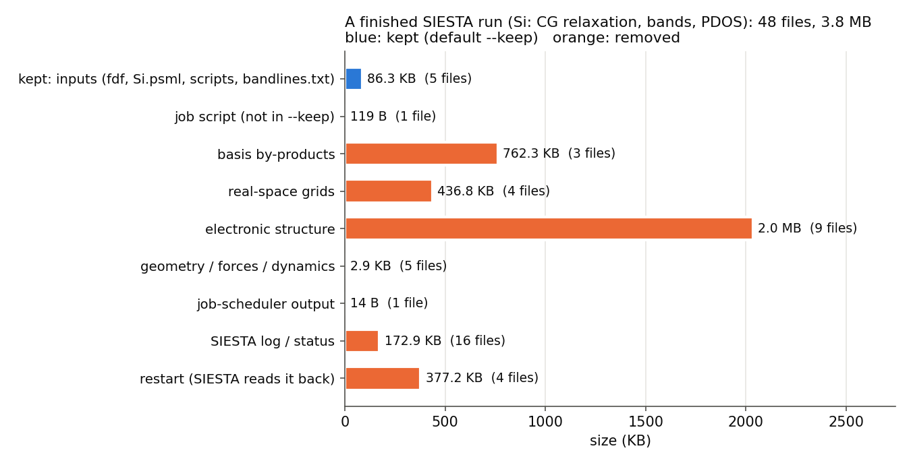
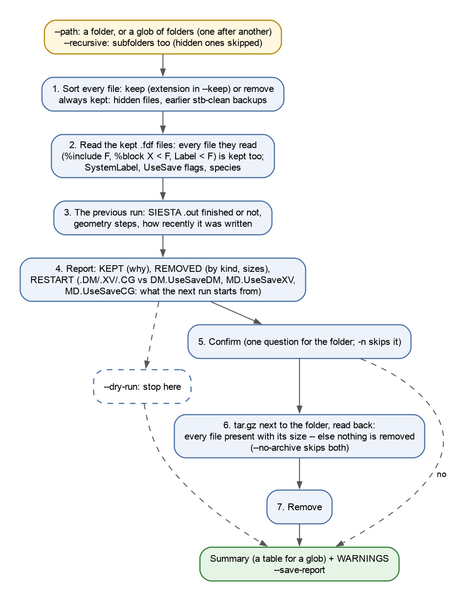
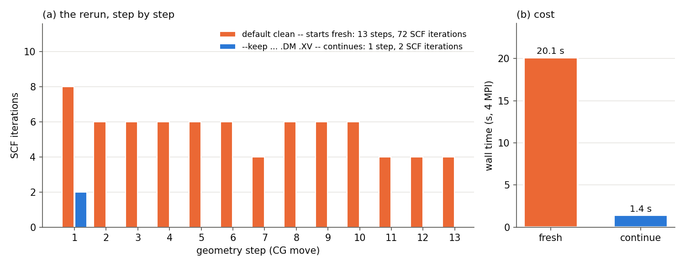

# 3.2 — Clean File Tools (`stb-clean`)

`stb-clean` resets a SIESTA calculation folder for a new run. It keeps the inputs: by default the extensions `.fdf`,
`.psf`, `.psml` and `.sh`, plus every file a kept `.fdf` reads. Everything else is removed: logs, restart files,
bands, densities, basis tables. Before removing anything, it puts those files into a `tar.gz` next to the folder and
reads the archive back to check it. Its report says:

- what the previous run was: finished or not, how many geometry steps, how long ago it was written;
- what stays, and why;
- what goes, sorted by kind and size;
- **what the next run will start from**: SIESTA's restart files (`.DM`, `.XV`, `.CG`) against the fdf flags that
  would read them.

The last point is the one that matters most. Whether a cleaned folder reruns *from scratch* or *continues* the
previous run depends on two or three files that are easy to delete without noticing. The worked example (section 6)
measures the difference on a real run: the same relaxation, run again, takes 13 geometry steps and 72 SCF iterations
from scratch, or 1 step and 2 SCF iterations when `.DM` and `.XV` are kept.

`stb-clean` is for *restarting*, not archiving. To package the results of a finished run, use `stb-archive` (`3.7`).

The example uses one real, finished SIESTA 5.4 run: bulk Si, a variable-cell CG relaxation followed by bands, DOS/PDOS
and the density, which leaves 48 files in its folder. Every case works on a copy of it. Everything runs in seconds;
case 4 also reruns SIESTA (~25 s) when it is installed.

---

## Contents

1. [Theory](#1-theory)
2. [The clean at a glance](#2-the-clean-at-a-glance)
3. [Libraries and external dependencies used](#3-libraries-and-external-dependencies-used)
4. [What `stb-clean` does](#4-what-stb-clean-does)
5. [Running it both ways](#5-running-it-both-ways)
6. [Worked example](#6-worked-example)
7. [What to take from the example](#7-what-to-take-from-the-example)
8. [Reproducing the reference data](#8-reproducing-the-reference-data)
9. [Known, deliberate limitations](#9-known-deliberate-limitations)
10. [Step-by-step: cleaning your own folders](#10-step-by-step-cleaning-your-own-folders)
11. [Files in this folder](#11-files-in-this-folder)
12. [Running the script](#12-running-the-script)
13. [Flag reference](#13-flag-reference)
14. [What's next](#14-whats-next)
15. [References](#15-references)

---

## 1. Theory

### 1.1 What a SIESTA run leaves in its folder

SIESTA [1] reads a few inputs and writes many outputs into the folder it runs in. For the run of this example:

| Kind | Examples | What it is for |
|---|---|---|
| **inputs** | `calc.fdf`, `structure.fdf`, `Si.psml`, `bandlines.txt`, `run.sh` | what you wrote; needed to run again |
| **restart files** | `si.DM`, `si.XV`, `si.CG`, `si.STRUCT_NEXT_ITER` | state SIESTA can read back to continue |
| **logs and status** | `calc.out`, `MESSAGES`, `TIMES`, `CLOCK`, `0_NORMAL_EXIT`, `fdf.*.log` | what happened |
| **geometry, forces** | `si.STRUCT_OUT`, `si.ANI`, `si.FA`, `si.BONDS` | the relaxed structure, the trajectory |
| **electronic structure** | `si.EIG`, `si.bands`, `si.PDOS`, `si.HSX` | eigenvalues, bands, DOS, the Hamiltonian |
| **real-space grids** | `si.RHO`, `si.VT`, `Rho.grid.nc` | the density and the potential on the mesh |
| **basis by-products** | `Si.ion`, `Si.ion.xml`, `Si.ion.nc` | the basis orbitals SIESTA generated |
| **job-scheduler output** | `siesta.err`, `slurm-123.out` | the batch system's own logs |

Most outputs are named after `SystemLabel` (`si.*` here). A few have fixed names (`MESSAGES`, `CLOCK`, ...) or carry
the species label (`Si.ion`). `stb-clean` sorts every file into these kinds from SIESTA's naming conventions alone, so
the report can say what goes, not only how much.



*Figure 1. The 48 files of the finished run in `siesta_run/`, by kind, as `stb-clean` sorts them. The inputs are
86 KB; the electronic structure (`.HSX`, `.PDOS`, ...) and the basis tables are most of the remaining 3.7 MB. For a
real system the grids and the `.HSX`/`.DM` grow quickly with the cell and the k-points.*

### 1.2 Restart files: continuing instead of starting over

SIESTA can start a run from a previous one [1, 4]. It reads three files only when a flag in the fdf asks for it:

| File | Holds | Read when | Without it, the run starts from |
|---|---|---|---|
| `<label>.DM` | the density matrix | `DM.UseSaveDM true` | a superposition of atomic densities |
| `<label>.XV` | positions (and velocities) | `MD.UseSaveXV true` | the geometry written in the `.fdf` |
| `<label>.CG` | the CG optimizer's history | `MD.UseSaveCG true` | a new CG history |

The two conditions combine. A flag that is on reads the file **only if it is still there**, and a file left in the
folder is ignored **unless its flag is on**. So "clean the folder" can mean two different things:

- **start over**: remove the restart files. The next run repeats the relaxation from the `.fdf` geometry and converges
  the density from atomic densities again. This is right when the input changed, for example a new basis, mesh cutoff
  or functional, and the old state no longer belongs to the new calculation.
- **continue**: keep `.DM` and `.XV` (`--keep ... .DM .XV`) with their flags on. The next run starts at the relaxed
  geometry with the converged density. This is right after a crash, a time limit, or a change that does not alter
  the problem, such as more output.

A `.DM` from a different calculation is a valid *starting guess* for the SCF, never part of the answer. A `.XV`,
however, **is** the geometry: a rerun that reads it no longer starts from the `.fdf` structure. The `RESTART` section
of the report shows each file next to its flag so that this choice is visible before the files are gone.

The final geometry of a relaxation is also in `<label>.STRUCT_OUT`. If you want to restart from it without `.XV`,
convert it into an `.fdf` first (`stb-translate`, `3.1`).

### 1.3 What a kept input reads

An fdf file can read other files in three ways:

```
%include structure.fdf                  # the whole file, as if pasted here
%block BandLines < bandlines.txt        # the block's contents from a file
Label < file                            # a value from a file
```

SIESTA follows these when it reads its input. If `bandlines.txt` were removed because `.txt` is not in `--keep`, the
next run would stop at once. `stb-clean` reads the kept `.fdf` files the same way and keeps every file they read,
whatever its extension. It follows the files read by included files too, until nothing new turns up. A file that a
kept input reads but that is *not in the folder* is reported, because the rerun would stop on it as well.

### 1.4 Safety: archive, check, then remove

Removing files cannot be undone, and SIESTA folders are often cleaned in loops over many of them. `stb-clean` follows
these rules:

1. **Report first.** `--dry-run` stops after the report and touches nothing.
2. **Ask.** Without `-n`, it asks once per folder after the report. An answer other than `y`, including no answer at
   all when there is no terminal (end-of-file), cancels.
3. **Archive.** It writes everything that will go into `<folder>_backup_<date>_<time>.tar.gz` **next to** the folder,
   not inside it, so that a later clean of the same folder cannot remove its own backup.
4. **Check.** It reads the archive back: every file must be in it, with its size. If not, nothing is removed.
5. **Remove.**

Some files are never removed, whatever `--keep` says: hidden files (and, with `--recursive`, hidden folders such as
`.git`), earlier `stb-clean` backups, and the files a kept `.fdf` reads.

### 1.5 What this tool simplifies — explicitly

- The **kind** of a file comes from its name, not its contents. Only a file whose name says nothing (`submit.slurm`)
  is opened, to check whether it is a job script.
- The **previous run** is the SIESTA log among the `.out` files. "Finished" means the log ends with SIESTA's end-of-run
  line; the step count comes from its last `Begin CG/FIRE/Broyden/MD` line.
- **"Still running"** is a guess: an unfinished log written in the last two minutes. `stb-clean` cannot see the batch
  queue.

---

## 2. The clean at a glance



*Figure 2. What `stb-clean` does with one folder. With a glob, every folder goes through it in turn and the summary
collects them.*

## 3. Libraries and external dependencies used

| Library | Used for |
|---|---|
| Python standard library (`os`, `glob`, `tarfile`, `re`) | walking the folders, the archive and its check, reading the fdf files |
| `stb.core.cli` | the numbered report, tables, `--save-report` |

Nothing else: no SIESTA, no scientific libraries. `stb-clean` works on any machine where the folders are, including a
cluster's login node.

## 4. What `stb-clean` does

### 4.1 Step by step

1. **Find the folders.** `--path` is a folder or a glob (`'strain_*'`); with a glob, each matching folder is cleaned
   on its own, with its own archive. `--recursive` also takes in the subfolders, as one tree.
2. **Sort every file.** Kept are files with an extension in `--keep`, hidden files and earlier backups. Every other
   file is to be removed.
3. **Read the kept inputs.** In the kept `.fdf` files, the first occurrence of a label wins, as in SIESTA. From them it
   takes the files they read (moved to *kept*), `SystemLabel`, the `UseSave` flags and the species.
4. **Find the previous run.** For each SIESTA log: finished or not, geometry steps, how long ago it was written.
5. **Report**, then **stop** for `--dry-run`.
6. **Ask** (unless `-n`), **archive and check** (unless `--no-archive`), **remove**.

### 4.2 The report, section by section

| Section | What it shows |
|---|---|
| `[0] RUN METADATA` | date, version, target, `--keep`, what is always kept, the mode (dry run, archive, no archive) |
| `[1] FOLDER` | files and sizes, kept vs removed, the SIESTA input and `SystemLabel`, the previous run, `0_NORMAL_EXIT` |
| `[2] KEPT` | every kept file and why: pseudopotential, input, job script, *read by calc.fdf*, hidden, backup; the species with and without a kept pseudopotential |
| `[3] REMOVED` | the files to go, by kind (Figure 1), with sizes and the five largest |
| `[4] RESTART` | `.DM`, `.XV`, `.CG`: kept or removed, the flag that reads it, what the next run starts from |
| `[5] ARCHIVE & REMOVAL` | the archive, its size, the check, the command that restores it, what was removed |
| `[6] SUMMARY & FILES` | totals; for a glob, one row per folder |
| `[7] WARNINGS` | every warning, numbered |

With a glob, sections 1-5 repeat for each folder, so the section numbers keep counting (`[16] SUMMARY` for three
folders).

### 4.3 Guard rails

The report warns when:

- no `.fdf` is kept: there is nothing to rerun from;
- a kept `.fdf` reads a file that is not in the folder;
- a species has no kept `.psf`/`.psml` (fine only if the job script supplies it);
- a file to be removed looks like a job script (`#!` first line, `#SBATCH`/`#PBS`/`#BSUB` lines), with the `--keep`
  that would keep it;
- the SIESTA log did not finish and was written in the last two minutes: the job may still be running;
- a finished run is removed with `--no-archive`, so no copy of its results is left;
- the archive check failed. In that case nothing was removed, and the exit code is 1.

## 5. Running it both ways

From the command line:

```bash
stb-clean --dry-run                                  # this folder: report only
stb-clean --path si_run                              # report, ask, archive + check, remove
stb-clean --path si_run --keep .fdf .psf .psml .sh .DM .XV   # continue from the previous run
stb-clean --path 'strain_*' -n                       # every matching folder, no questions (scripts)
stb-clean --path project --recursive --dry-run       # a whole tree
```

From the menu (`stb-suite`, code `3.2`), the same options are asked in turn: folder or glob (with Tab completion),
extensions to keep, recursive, dry run, archive, confirmation and report. For a dry run, the archive and confirmation
questions are skipped.

## 6. Worked example

`siesta_run/` is a finished SIESTA 5.4.2 run [1] of bulk Si in its 2-atom fcc cell. It is a variable-cell CG
relaxation (PBE [2], DZP, 6×6×6 k-points, 200 Ry mesh) from a = 5.55 Å, 1.3 % above the PBE/DZP minimum, followed by
bands along L–Γ–X, the DOS/PDOS, the density and the potential. The relaxation took 13 CG steps to a = 5.476 Å. The
inputs are `calc.fdf` (it `%include`s `structure.fdf` and reads `bandlines.txt`), two job scripts (`run.sh` for PBS,
`submit.slurm` for Slurm) and the PseudoDojo [3] `Si.psml`. The pseudopotential is not shipped here; each copy takes
it from the suite's bundled bank. The input sets `DM.UseSaveDM true` and `MD.UseSaveXV true`, the usual choice for a
calculation you may need to restart.

The guided script `example_3.2.sh` runs every case on a copy of `siesta_run/` in `output/<case>/`; the
reference reports are in `reference_results/` (written by `make_reference.sh`).

### 6.1 What a finished run leaves behind (Case 1)

```bash
stb-clean --path si_run --dry-run
```

```
[1] FOLDER
Files             : 48 (3.8 MB)
Keep / remove     : 5 kept (86.3 KB), 43 to remove (3.7 MB)
SIESTA input      : calc.fdf, structure.fdf; SystemLabel si
Previous run      : calc.out -- finished normally, 13 geometry steps (last written 2.1 h ago)
Exit marker       : 0_NORMAL_EXIT present (SIESTA ended normally)

[3] REMOVED
kind                           | files | size     | e.g.
restart (SIESTA reads it back) | 4     | 377.2 KB | si.CG, si.DM, si.STRUCT_NEXT_ITER, +1
SIESTA log / status            | 16    | 172.9 KB | 0_NORMAL_EXIT, BASIS_ENTHALPY, BASIS_HARRIS_ENTHALPY, +13
job-scheduler output           | 1     | 14 B     | siesta.err
geometry / forces / dynamics   | 5     | 2.9 KB   | si.ANI, si.BONDS, si.BONDS_FINAL, +2
electronic structure           | 9     | 2.0 MB   | si.DOS, si.EIG, si.HSX, +6
real-space grids               | 4     | 436.8 KB | Rho.grid.nc, TotalPotential.grid.nc, si.RHO, +1
basis by-products              | 3     | 762.3 KB | Si.ion, Si.ion.nc, Si.ion.xml
job script (not in --keep)     | 1     | 119 B    | submit.slurm
total                          | 43    | 3.7 MB   |
```

A 2-atom cell left 48 files. The 5 inputs are 86 KB; the other 43 files, 3.7 MB, are what SIESTA wrote. The report
read the log and found that the run finished after 13 geometry steps, and it found `0_NORMAL_EXIT`. Figure 1 draws
the same table.

### 6.2 `--dry-run`: what stays, and why (Case 2)

```
[2] KEPT
file          | size    | why it stays
Si.psml       | 84.7 KB | pseudopotential
bandlines.txt | 80 B    | read by calc.fdf
calc.fdf      | 921 B   | SIESTA input (.fdf)
run.sh        | 137 B   | job script
structure.fdf | 491 B   | SIESTA input (.fdf)
Protected         : 1 file(s) read by a kept .fdf, kept although their extension is not in --keep
Species           : Si -- pseudopotential kept for Si

[5] ARCHIVE & REMOVAL
Dry run -- nothing archived, nothing removed (43 file(s), 3.7 MB would go).
```

Nothing was touched; the folder still has its 48 files. `bandlines.txt` stays although `.txt` is not in `--keep`,
because `calc.fdf` reads it (section 6.5). The species check confirms that the only species, Si, has its
pseudopotential among the kept files.

### 6.3 The real clean: archive, check, remove; then restore (Case 3)

```bash
stb-clean --path si_run -n --save-report
```

```
[5] ARCHIVE & REMOVAL
Archive           : output/case3/si_run_backup_20261030_163507.tar.gz
                    43 file(s), 1.6 MB (42 % of 3.7 MB)
Verification      : read back, every file present with its size -- ok
Restore with      : tar -xzf output/case3/si_run_backup_20261030_163507.tar.gz -C output/case3/si_run
Removed           : 43 file(s), 3.7 MB freed
```

Left in the folder: `bandlines.txt`, `calc.fdf`, `run.sh`, `Si.psml`, `structure.fdf`, and the report
(`stb_clean_report.txt`, written after the clean so that it does not remove itself). The archive sits next to the
folder and compresses the outputs to 42 %. The script then restores it into a copy of the cleaned folder: the kept
files plus the archive give back the original 48 files, one for one
(`reference_results/clean/restored_files.txt`).

### 6.4 Start fresh, or continue from the previous run (Case 4)

Two copies of the run are cleaned in two ways and run again with SIESTA (4 MPI processes):

```bash
stb-clean --path fresh    -n --no-archive                                  # default --keep
stb-clean --path continue -n --no-archive --keep .fdf .psf .psml .sh .DM .XV
```

The `RESTART` section of each report says what will happen before SIESTA runs:

```
default --keep:
file  | holds                  | after cleaning | fdf flag                     | next run
si.DM | density matrix         | removed        | DM.UseSaveDM true            | starts from a superposition of atomic densities
si.XV | positions + velocities | removed        | MD.UseSaveXV true            | starts from the geometry in the .fdf
si.CG | CG optimizer history   | removed        | MD.UseSaveCG false (default) | starts from a new CG history (flag off anyway)
Note              : the previous run moved the geometry (13 steps); its final geometry is in si.XV and
                    si.STRUCT_OUT, which go -- the next run starts again from the .fdf geometry. ...

--keep .fdf .psf .psml .sh .DM .XV:
si.DM | density matrix         | kept           | DM.UseSaveDM true            | next run reads it
si.XV | positions + velocities | kept           | MD.UseSaveXV true            | next run reads it
```

And the reruns (`siesta_rerun.sh`, data in `reference_results/rerun_*/`):

| Clean | Geometry steps | SCF iterations | Final energy (eV) | Wall time |
|---|---|---|---|---|
| default `--keep` (fresh) | 13 | 72 | −230.035534 | 20.1 s |
| `--keep ... .DM .XV` (continue) | 1 | 2 | −230.035534 | 1.4 s |



*Figure 3. (a) SCF iterations per CG step when the cleaned folder is run again. (b) Wall time on 4 MPI processes.*

Both runs reach the same energy, to the last printed digit, but the costs differ by 14×. Without `.XV` the
relaxation starts again from a = 5.55 Å and repeats all 13 steps (4-8 SCF iterations each, the first from atomic
densities). With `.XV` and `.DM` the first geometry is already relaxed and its density already converged: 2 SCF
iterations confirm both, and the run stops. For a real system the gap is hours, not seconds.

Neither choice is "right". Keep the restart files to continue a calculation, and drop them when the input changed in
a way that makes the old state meaningless. A geometry relaxed with another basis, for example, is not the
relaxed geometry of the new one.

### 6.5 Files a kept `.fdf` reads are protected (Case 5)

`calc.fdf` reads two files:

```
calc.fdf:4:%include structure.fdf
calc.fdf:28:%block BandLines < bandlines.txt
```

The script adds a hidden file (`.notes`) and a line `%include missing_options.fdf` that points to a file which does
not exist (`reference_results/protected/`):

```
.notes        | 17 B    | hidden file (never removed)
bandlines.txt | 80 B    | read by calc.fdf

[7] WARNINGS
  1. protected: a kept .fdf reads 'missing_options.fdf', which is not in the folder.
```

Without this, `bandlines.txt` would have been removed and the rerun would stop while reading its input. The same
applies to a `%block ... < file` with coordinates, or to an included file of basis options. The missing include is
caught before the job is submitted, not after it fails in the queue.

### 6.6 What the report warns about (Case 6)

A careless `--keep .psml` (`reference_results/careless_keep/`):

```
1. si_run: no .fdf input is kept -- there is nothing to rerun from (check --keep).
2. si_run: 'run.sh' looks like a job script and will be removed -- add its extension to --keep (--keep .psml .sh).
3. si_run: 'submit.slurm' looks like a job script and will be removed -- add its extension to --keep (--keep .psml .slurm).
```

A run that stopped half-way, its `calc.out` cut at 60 KB and just written (`reference_results/running/`):

```
Previous run      : calc.out -- did NOT finish, 10 geometry steps (last written 0 min ago)
1. crashed: calc.out did not finish and was written 0 s ago -- is the job still running? Cleaning would delete files it is writing.
```

`submit.slurm` is flagged in every case with the default `--keep`, because `.slurm` is not in it. The report
recognises the file by its `#SBATCH` lines and lists it as *job script (not in --keep)* in `REMOVED`.

### 6.7 Several folders at once: a glob (Case 7)

Three copies (`strain_m1`, `strain_0`, `strain_p1`), cleaned in one call that also keeps `.slurm`:

```bash
stb-clean --path 'strain_*' -n --keep .fdf .psf .psml .sh .slurm
```

```
[16] SUMMARY & FILES
folder    | kept | removed | size   | archive                                 | status
strain_0  | 6    | 42      | 3.7 MB | strain_0_backup_20261030_163523.tar.gz  | ok
strain_m1 | 6    | 42      | 3.7 MB | strain_m1_backup_20261030_163523.tar.gz | ok
strain_p1 | 6    | 42      | 3.7 MB | strain_p1_backup_20261030_163524.tar.gz | ok

Removed           : 126 file(s), 11.1 MB freed
[17] WARNINGS
  none
```

Each folder gets its own report sections and its own archive, and the summary collects them. Quote the glob, so that
`stb-clean` expands it rather than the shell. A folder whose archive check fails is marked `FAILED`, keeps all its
files, and makes the exit code 1.

### 6.8 A project tree: `--recursive` (Case 8)

A `project/` holding two runs (`relax/`, `bands/`), a `.git/` folder, a hidden `.notes` and an earlier backup
(`reference_results/recursive/`):

```
Files             : 98 (7.6 MB) -- including subdirectories
Keep / remove     : 12 kept (185.0 KB), 86 to remove (7.4 MB)
Previous run      : bands/calc.out -- finished normally, 13 geometry steps
Previous run      : relax/calc.out -- finished normally, 13 geometry steps

.notes                              | 22 B    | hidden file (never removed)
bands/bandlines.txt                 | 80 B    | read by bands/calc.fdf
relax/bandlines.txt                 | 80 B    | read by relax/calc.fdf
relax_backup_20260101_120000.tar.gz | 12.4 KB | earlier stb-clean backup (never removed)
```

`.git/` is never entered, so its files are not even counted. Each `bandlines.txt` is protected by the `calc.fdf` of
its own subfolder. The tree is treated as one folder with one archive: for several independent runs side by side, a
glob (section 6.7) gives one report and one archive per run.

### 6.9 The confirmation (Case 9)

```
43 file(s) will be removed:
  0_NORMAL_EXIT
  ...
  ... and 23 more

Delete these 43 file(s)? [y/N] n
Cancelled -- nothing archived, nothing removed.
```

The question comes after the report, once per folder; the default is no. In a script with no terminal, the question
reads end-of-file and cancels, so a forgotten `-n` never deletes anything. Use `-n` when the deletion is intended.

### 6.10 The interactive menu (Case 10)

`stb-suite` → `3.2` with a dry run gives the same report as the command line:

```
Mode              : dry run (nothing touched)
Dry run -- nothing archived, nothing removed (43 file(s), 3.7 MB would go).
Would remove      : 43 file(s), 3.7 MB -- rerun without --dry-run
```

## 7. What to take from the example

- A SIESTA folder is a few kilobytes of inputs and megabytes (or gigabytes) of outputs. `stb-clean` keeps the inputs
  and whatever they read, puts the rest into a checked archive next to the folder, and removes it.
- **Read the `RESTART` section before cleaning.** With `.DM`/`.XV` removed, the next run starts from scratch; with
  them kept and their flags on, it continues. On this run that was 13 steps against 1, at the same final energy.
- A relaxed geometry removed together with `.XV` and `.STRUCT_OUT` is lost unless the archive is kept. Convert it into
  an `.fdf` first if the next run should start from it.
- Use `--dry-run` on anything you care about. The warnings catch a forgotten `--keep`, a job script about to go, an
  include that is missing and a job that may still be running.

## 8. Reproducing the reference data

```bash
source ~/.anaconda3/etc/profile.d/conda.sh && conda activate stb   # or any environment with stb_suite
bash make_reference.sh        # every report into reference_results/<case>/ (seconds, no SIESTA)
bash siesta_rerun.sh 4        # reference_results/rerun_fresh|rerun_continue/ (SIESTA 5.x + mpirun, ~25 s)
python3 theory_figures.py     # figures/run_contents.png, figures/rerun.png
dot -Tpng -Gdpi=150 figures/clean_flowchart.dot -o figures/clean_flowchart.png
```

The reports contain dates, archive names and "written N h ago" lines that change from run to run; everything else is
deterministic. `siesta_run/` itself was produced with SIESTA 5.4.2 from `calc.fdf` + `structure.fdf` (`run.sh`).

## 9. Known, deliberate limitations

- **The kind of a file comes from its name.** A file with an unusual name lands in `other`. That does not change
  whether it is kept, which depends only on `--keep`.
- **`--recursive` treats the tree as one folder**: one report, one archive, and the `RESTART` section uses the first
  `SystemLabel` it finds. For several independent runs, use a glob.
- **"Still running" is a two-minute guess.** A job that has been waiting in a queue, or one that writes rarely, is not
  detected. Check the queue before cleaning a folder a job may use.
- **The archive goes into the parent folder**, which must be writable and have room for it (here 42 % of what is
  removed).
- **The tool does not judge whether a restart is physically valid.** It shows what the next run will read; whether a
  `.DM` or `.XV` from the previous input still belongs to the new one is your decision (section 1.2).

## 10. Step-by-step: cleaning your own folders

1. **Run `stb-clean --dry-run`** in the folder, or with `--path` and a glob for many folders.
2. **Read `KEPT`**: is every input there, including the files your `.fdf` reads and your job script? If not, add its
   extension to `--keep`.
3. **Read `RESTART` and decide**: continue (`--keep ... .DM .XV`) or start over (the default).
4. **Check the warnings**, especially a job that may still be running.
5. **Run it without `--dry-run`.** Keep the `*_backup_*.tar.gz` until the new run has finished, then delete it
   yourself.

## 11. Files in this folder

| File | What it is |
|---|---|
| `README.md` | this tutorial |
| `example_3.2.sh` | the guided walk-through (10 cases, seconds; case 4 reruns SIESTA when available) |
| `siesta_run/` | the finished SIESTA 5.4.2 run (bulk Si, CG relaxation + bands + PDOS; 47 files, `Si.psml` not shipped) |
| `make_reference.sh` | regenerates the reports in `reference_results/` |
| `siesta_rerun.sh` | the reruns of section 6.4 (needs SIESTA) |
| `theory_figures.py` | Figures 1 and 3 |
| `figures/` | every figure of this README; `clean_flowchart.dot` is the flowchart's source |
| `reference_results/` | one folder per case: `report.txt`, and the folder listings after it (`files_after.txt`, `archive_contents.txt`, `restored_files.txt`); `rerun_*/` hold the reruns' `calc.out` and `CLOCK` |

## 12. Running the script

```bash
bash example_3.2.sh                # pauses between cases
yes '' | bash example_3.2.sh       # straight through
```

It needs the `stb_suite` package only; SIESTA is optional (case 4). It starts by wiping its own `output/`, never
touches `siesta_run/`, and takes a few seconds.

## 13. Flag reference

| Flag | Default | What it does |
|---|---|---|
| `--path PATH` | `.` | the folder, or a quoted glob of folders cleaned one after another |
| `--keep EXT ...` | `.psml .psf .fdf .sh` | extensions to keep; add `.DM .XV` to continue, `.slurm`/`.pbs` for job scripts |
| `--recursive` | off | the subfolders too (hidden ones are skipped) |
| `--dry-run` | off | report only; nothing archived or removed |
| `--no-archive` | off | no backup; the removed files cannot be recovered |
| `-n`, `--no-confirm` | off | do not ask before removing (for scripts) |
| `--save-report` | off | also write `stb_clean_report.txt` (in the folder; in the current folder for a glob) |
| `--no-intro`, `-v` | | skip the banner; print the version |

## 14. What's next

- **`3.6` (`stb-status`)** summarises many run folders at once (run type, SCF, forces, energy), a quick way to see
  which ones finished before cleaning or rerunning them.
- **`3.7` (`stb-archive`)** packages a *finished* calculation with a manifest. Use it to keep results, and
  `stb-clean` to prepare a rerun.
- **`3.1` (`stb-translate`)** converts `<label>.STRUCT_OUT` into an `.fdf`, to restart from a relaxed geometry
  without its `.XV`.

## 15. References

1. J. M. Soler et al., "The SIESTA method for ab initio order-N materials simulation", *J. Phys.: Condens. Matter*
   **14**, 2745 (2002).
2. J. P. Perdew, K. Burke, M. Ernzerhof, "Generalized gradient approximation made simple", *Phys. Rev. Lett.* **77**,
   3865 (1996).
3. M. J. van Setten et al., "The PseudoDojo: Training and grading a 85 element optimized norm-conserving
   pseudopotential table", *Comput. Phys. Commun.* **226**, 39 (2018).
4. A. García et al., "SIESTA: Recent developments and applications", *J. Chem. Phys.* **152**, 204108 (2020).
