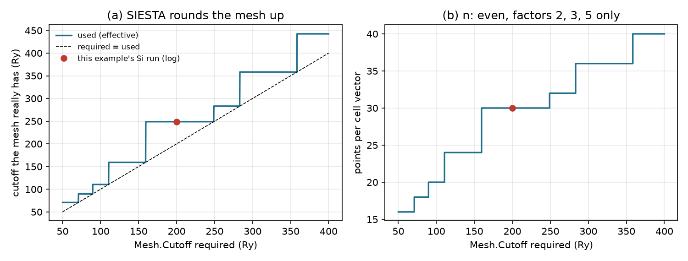
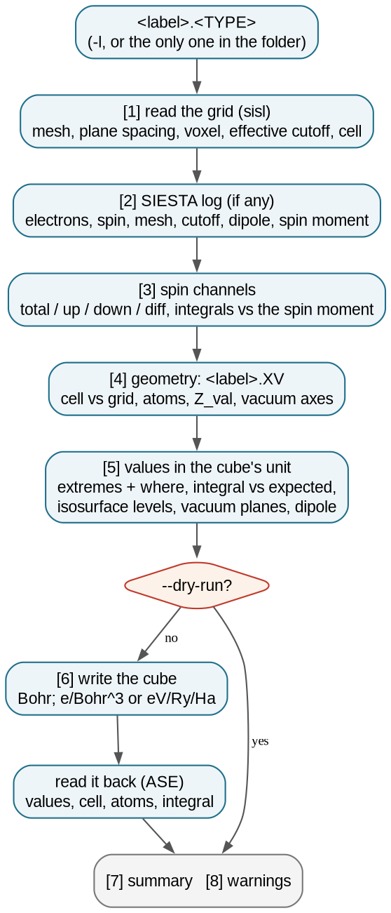
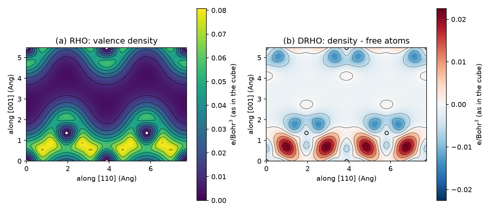
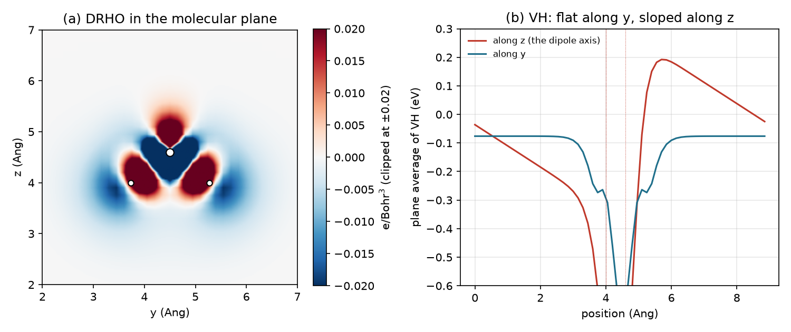
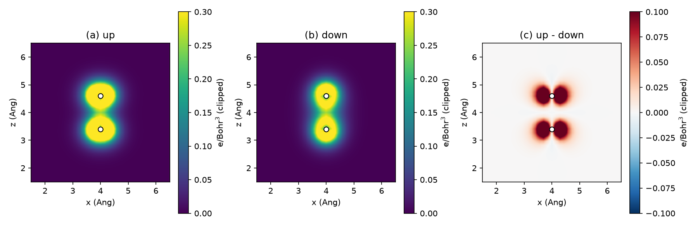

# 3.3 — Grid to Cube Converter (`stb-cube`)

`stb-cube` writes one of SIESTA's real-space grid files (`<label>.RHO`, `.DRHO`, `.BADER`, `.TOCH`, `.IOCH`, `.RHOXC`,
`.RHOINIT`, `.LDOS`, `.VT`, `.VH`, `.VNA`) as a Gaussian cube file, the format that VESTA, VMD, XCrySDen, Multiwfn and
the Bader codes read. On the way it reports what the grid is:

- the quantity, its unit and the fdf flag that wrote it;
- the mesh, the spacing between grid planes and the **cutoff the mesh really has**, compared with SIESTA's log;
- the geometry the grid belongs to, checked against the grid's own cell;
- the values in the cube's unit: extremes and where they are, the **integral against what it must be** (the valence
  electrons for `RHO`, zero for `DRHO`, valence + core electrons for `BADER`, ...), and isosurface levels to start from;
- for a spin-polarized run, every channel (up, down, total, up − down) against SIESTA's spin moment;
- for a molecule or a slab, the potential in the vacuum and the **dipole from the grid**, compared with SIESTA's;
- a read-back of the cube that was written, with an independent reader.

Converting is the easy part. The report is there because a cube file carries no units and no provenance. A cube in the
wrong unit or with a stale geometry opens without complaint and looks plausible. The worked example (section 6) shows
the classic case: the same Si density written the naive way integrates to 54 electrons instead of 8.

The example uses three real, finished SIESTA 5.4 runs, each a few seconds of SIESTA: bulk Si with every grid SIESTA can
write, a water molecule in a box, and the spin-polarized O₂ triplet. Everything runs in seconds; no SIESTA is needed.

---

## Contents

1. [Theory](#1-theory)
2. [The conversion at a glance](#2-the-conversion-at-a-glance)
3. [Libraries and external dependencies used](#3-libraries-and-external-dependencies-used)
4. [What `stb-cube` does](#4-what-stb-cube-does)
5. [Running it both ways](#5-running-it-both-ways)
6. [Worked example](#6-worked-example)
7. [What to take from the example](#7-what-to-take-from-the-example)
8. [Reproducing the reference data](#8-reproducing-the-reference-data)
9. [Known, deliberate limitations](#9-known-deliberate-limitations)
10. [Step-by-step: converting your own grids](#10-step-by-step-converting-your-own-grids)
11. [Files in this folder](#11-files-in-this-folder)
12. [Running the script](#12-running-the-script)
13. [Flag reference](#13-flag-reference)
14. [What's next](#14-whats-next)
15. [References](#15-references)

---

## 1. Theory

### 1.1 SIESTA's real-space mesh

SIESTA [1] expands the Kohn-Sham orbitals in numerical atomic orbitals, but computes the density, the Hartree and the
exchange-correlation potentials on a uniform real-space mesh [1, 4]. The mesh divides each cell vector `a_i` into `n_i`
intervals; a grid value `f_jkl` sits at

```
r_jkl = (j/n_1) a_1 + (k/n_2) a_2 + (l/n_3) a_3,        0 ≤ j < n_1,  0 ≤ k < n_2,  0 ≤ l < n_3          (1)
```

The grid is periodic: the point `j = n_1` is the point `j = 0` again and is not stored. The fineness is set by
`Mesh.Cutoff` (`E_cut`, in Ry), the kinetic energy of the shortest plane wave the mesh can represent. With `b_i` the
reciprocal vectors (2π included) in 1/Bohr, a mesh of `n_i` points along `a_i` holds waves up to `|G| = n_i |b_i| / 2`,
so

```
E_mesh = min_i ( n_i |b_i| / 2 )²   (Ry, with b_i in 1/Bohr)                                            (2)
```

SIESTA takes the smallest `n_i ≥ 2 √E_cut / |b_i|` that is even and has no prime factor other than 2, 3 and 5 (for its
FFTs). The mesh therefore always has **more** cutoff than requested, and SIESTA prints both
(`InitMesh: Mesh cutoff (required, used)`). `stb-cube` computes `E_mesh` from the grid alone; for the three
runs here it reproduces the log's value to the last digit (248.851, 122.834 Ry). The rule above, with the three runs as
a check, is in `theory_figures.py`.



*Figure 1. (a) The cutoff the mesh really has against `Mesh.Cutoff`, for this example's Si cell. (b) Points per cell
vector. The required 200 Ry gives 30 points and 248.9 Ry, the red dot read from the log.*

The **spacing between grid planes** along `a_i` is `1 / (n_i |a*_i|)`, with `a*_i` the reciprocal
vector without the 2π. In a non-orthogonal cell it is shorter than `|a_i| / n_i` (0.105 Å against
0.129 Å in the Si cell). The plane spacing, not the length along the vector, is the resolution that matters for an
isosurface.

### 1.2 What each grid file holds

Each file is written by its own fdf flag:

| File | fdf flag | Quantity | Integrates to |
|---|---|---|---|
| `.RHO` | `SaveRho` | valence electron density ρ | the valence electrons N |
| `.DRHO` | `SaveDeltaRho` | ρ minus the sum of free-atom densities | 0 |
| `.BADER` | `SaveBaderCharge` | ρ plus model core charges | N + core electrons = N + Σ (Z − Z_val) |
| `.TOCH` | `SaveTotalCharge` | ρ plus the ionic (pseudo-core) charge | 0 for a neutral cell |
| `.IOCH` | `SaveIonicCharge` | the ionic charge alone, negative | −Σ Z_val |
| `.RHOXC` | `SaveRhoXC` | the density XC sees (valence + partial core correction) | — |
| `.RHOINIT` | `SaveInitialChargeDensity` | the sum of free-atom densities | Σ Z_val |
| `.LDOS` | `%block LocalDensityOfStates` | local density of states in an energy window | the states in the window |
| `.VT` | `SaveTotalPotential` | Kohn-Sham potential: Hartree + local pseudopotential + XC | — |
| `.VH` | `SaveElectrostaticPotential` | electrostatic potential: Hartree + local pseudopotential | — |
| `.VNA` | `SaveNeutralAtomPotential` | neutral-atom potential (free atoms' electrostatic potential) | — |

Charges follow SIESTA's convention: electrons positive, ions negative. Two consequences:

- **`DRHO` is the bonding picture.** The free atoms' densities are spherical, so Δρ shows only what bonding
  moved, without the large atomic background.
- **`BADER` exists for the Bader codes.** A valence pseudo-density has no maximum at the nucleus (it is small inside the
  core), so the zero-flux surfaces of a Bader analysis would be wrong. The model core charges put a maximum back at each
  atom [5].

### 1.3 Units: the 6.75 trap

SIESTA writes its grids in atomic units: the cell in Bohr, densities in e/Bohr³, potentials in Ry. sisl [6], which
`stb-cube` uses to read them, converts on reading to Å, e/ų and eV. A cube file has its lengths in Bohr, and **its
values carry no unit at all**. Every program that integrates a cube assumes values that match its lengths, so a density
must be in e/Bohr³.

Writing sisl's e/ų values next to Bohr lengths gives a cube that looks right in every viewer but is too large by
1/0.529177³ = 6.748. Its integral is 54 electrons where there are 8 (case 2). `stb-cube` divides densities back to
e/Bohr³ and checks the integral of the cube it wrote. Potentials have no length in their unit; they are written in eV
by default, or in Ry or Ha (`--potential-unit`). The unit is written in the cube's first comment line, so it travels
with the file.

### 1.4 The cube format

```
STB-CUBE 1.9: si.RHO -- valence electron density -- lengths in Bohr, values in e/Bohr^3   <- comment 1 (free)
OUTER LOOP: X, MIDDLE LOOP: Y, INNER LOOP: Z                                              <- comment 2 (Gaussian's)
    2     0.000000     0.000000     0.000000         <- number of atoms, origin (Bohr)
   30     0.000000     0.172469     0.172469         <- n1 and the voxel vector a1/n1 (Bohr)
   30     0.172469     0.000000     0.172469         <- n2, a2/n2
   30     0.172469     0.172469     0.000000         <- n3, a3/n3
   14    14.000000     0.000000     0.000000     0.000000    <- Z, charge, x y z (Bohr), one line per atom
   14    14.000000     2.587035     2.587035     2.587035
  2.24566e-03   5.13189e-03   1.40397e-02   2.82055e-02   4.39712e-02   5.58762e-02      <- values, z fastest
```

The values follow with x slowest and z fastest, six per line; each new (x, y) column starts a new line. The voxel
vectors can be non-orthogonal, as here (the fcc primitive cell). Ghost atoms (Z ≤ 0) are left out, since the format has
no ghost species. Text cubes are about three times the size of SIESTA's binary grids (370 KB against 113 KB here).

### 1.5 Spin

A collinear spin-polarized run stores two components, ρ↑ and ρ↓. `--spin` chooses what goes
into the cube:

| `--spin` | density | potential |
|---|---|---|
| `total` | ρ↑ + ρ↓ | (V↑ + V↓) / 2 |
| `up`, `down` | one channel | one channel |
| `diff` | m = ρ↑ − ρ↓, the magnetization density | V↑ − V↓, the exchange splitting |

A potential's total is the **average**: summing two potentials would double the potential. `∫ m d³r` is the net spin
moment SIESTA prints; `∫ |m| d³r` is larger wherever some region is polarized against the net
moment. Non-collinear and spin-orbit runs store four components (charge and a spin vector), which an up/down split does
not describe; `stb-cube` writes their total charge and says so.

### 1.6 The checks

**Integral.** `∫ f d³r ≈ ΔV Σ_jkl f_jkl`, with `ΔV` the voxel volume. On a
periodic grid this sum is exact for the band-limited part of `f`, so `RHO` reproduces N to about 1e-5 e.
`TOCH`/`IOCH` are an exception: their ionic charges are narrow Gaussians that the mesh samples with an error of a few
1e-3 e.

**Dipole.** For a molecule or a slab, the dipole along a non-periodic direction is

```
p = Σ_I Z_val,I r_I − ∫ ρ(r) r d³r                                                                       (3)
```

with positions measured from the atoms' centre by the minimum-image convention. `DRHO` gives the same `p` without
the point charges, because free atoms have no dipole. Along a periodic direction a dipole is not defined this way (it
depends on where the cell is cut), so `stb-cube` reports only the components normal to the periodic planes. It compares
them with SIESTA's own `Electric dipole (Debye)` line.

**Vacuum level.** Far from a neutral molecule or slab, the electrostatic potential should be flat; the plane average
there is the vacuum level that a work function is measured from. A dipole across a periodic box makes it slope instead.
For a slab, `Slab.DipoleCorrection` removes the slope; for a molecule in a box there is no single vacuum level. The
report gives, for each vacuum axis, the plane average at the plane farthest from the atoms and how much it varies
within ±1 Å.

**Isosurface levels.** A level `c` encloses the fraction `∫_{f>c} f d³r / ∫ f d³r` of the charge.
The report gives the levels that enclose 50, 90 and 99 % (of `∫|f|` for a signed grid, as ±c), in the
cube's unit, as a starting point in VESTA or VMD.

### 1.7 What this tool simplifies — explicitly

- **The geometry comes from `<label>.XV`**, the last one SIESTA wrote. If the grid is from an earlier step (or
  another run), the atoms in the cube are wrong; the cell check catches a different cell, not moved atoms.
- **The log is the only `.out` next to the grid**, or `<label>.out`. With several `.out` files and none named after
  the label, the checks against SIESTA's numbers are skipped.
- **The dipole needs vacuum** (a gap of at least 4 Å along an axis) and charge that does not cross the box boundary.
- **Non-collinear spin**: the total charge only (section 1.5).

---

## 2. The conversion at a glance



*Figure 2. What `stb-cube` does with one grid file. The numbers are the report's sections.*

## 3. Libraries and external dependencies used

| Library | Used for |
|---|---|
| `sisl` [6] | reading SIESTA's binary grids (`.RHO`, `.VT`, ...), `.XV` and `.HSX` |
| `numpy` | statistics, integrals, dipole, isosurface levels |
| `ase` [7] | reading the written cube back, independently of the writer |
| `stb.core` | the SIESTA log parsers, vacuum detection, the numbered report |

The cube is written by `stb-cube` itself, so that the header lines, the precision (six significant digits) and the units
are under its control.

## 4. What `stb-cube` does

### 4.1 Step by step

1. **Find the file.** `<label>.<TYPE>` from `-l` (which may include a folder), or the only `*.<TYPE>` in the current
   folder.
2. **Read the grid** with sisl: mesh, cell, number of spin components.
3. **Read the SIESTA log**, if one is next to the grid: electrons, spin configuration, mesh and cutoff, dipole, spin
   moment.
4. **Pick the spin channel** and read it.
5. **Read the geometry** from `<label>.XV`; compare its cell with the grid's.
6. **Compute** the statistics, the integral against what it must be, isosurface levels, vacuum planes and the dipole.
7. **Write the cube** (unless `--dry-run`) and **read it back** with ASE.

### 4.2 The report, section by section

| Section | What it shows |
|---|---|
| `[0] RUN METADATA` | date, versions, input, grid type, spin channel requested, unit, output |
| `[1] INPUT GRID` | file, quantity, fdf flag, stored unit, components, mesh, plane spacing, voxel volume, effective cutoff, cell |
| `[2] SIESTA RUN` | the log, finished or not, electrons, spin, mesh and cutoff against the grid's |
| `[3] SPIN` | the spin configuration and where it was read; for two components, every channel's integral against SIESTA |
| `[4] GEOMETRY` | the `.XV`, cell against the grid, dimensionality and vacuum axes, the atoms with Z and Z_val |
| `[5] VALUES` | min/max and where (nearest atom), mean, spread, integral vs expected, negative values, isosurface levels; vacuum planes and dipole when there is vacuum |
| `[6] OUTPUT` | the cube: size, units, header, the read-back check, the cube's own integral |
| `[7] SUMMARY & FILES` | the conversion in one line and the commands to open it |
| `[8] WARNINGS` | every warning, numbered |

### 4.3 Guard rails

The report warns when:

- the integral differs from what the grid must integrate to (a different run, an unconverged SCF or a too coarse mesh);
- the `.XV` cell differs from the grid's (the atoms would be placed wrongly), or there is no `.XV` (no atoms);
- the log's mesh or cutoff differs from the grid's, or the log did not finish;
- `--spin` is given for an unpolarized grid, or for a non-collinear one;
- the up − down integral differs from SIESTA's spin moment;
- the dipole from the grid differs from SIESTA's (charge leaking across the box boundary, or a different run);
- a density is negative, or the density in the vacuum plane is not negligible (box too small);
- the cube read back differs from what was written.

A missing grid file stops with the list of grid files that are there and the flag that writes the one asked for.

## 5. Running it both ways

From the command line:

```bash
stb-cube -t RHO                                    # the only *.RHO in this folder -> <label>_RHO.cube
stb-cube -l si -t DRHO                             # si.DRHO -> si_DRHO.cube
stb-cube -l run/h2o -t VH --potential-unit Ha      # a run in another folder; potential in Hartree
stb-cube -l o2 -t RHO --spin diff                  # magnetization density -> o2_RHO_diff.cube
stb-cube -l si -t BADER --dry-run                  # report only
```

From the menu (`stb-suite`, code `3.3`), the same options are asked in turn: grid type (a numbered list with each
type's fdf flag), label (Enter for the only file of that type), spin channel, potential unit (for a potential), output
name, dry run and report.

## 6. Worked example

`siesta_runs/` holds three finished SIESTA 5.4.2 runs [1], PBE [2], DZP basis, PseudoDojo pseudopotentials [3]:

- **`si/`** — bulk Si in its 2-atom fcc cell at the PBE/DZP lattice constant (5.476 Å), 6×6×6 k-points,
  `Mesh.Cutoff 200 Ry`, a single point that saves every grid SIESTA can write (`RHO`, `DRHO`, `BADER`, `TOCH`, `IOCH`,
  `VT`, `VH`, `VNA`).
- **`h2o/`** — a water molecule in a 9 Å cubic box, Γ only, 100 Ry, relaxed (CG): `RHO`, `DRHO`, `VH`.
- **`o2/`** — O₂ in an 8 Å box, spin-polarized, 120 Ry: the triplet ground state, `RHO` with two components and
  `o2.HSX`.

Each folder keeps its `calc.fdf`, `calc.out`, `.XV` and grids (4.9 MB in all; the pseudopotentials are not shipped,
`run_all.sh` copies them from the suite's bundled bank). The guided script `example_3.3.sh` runs every case on a copy
in `output/<case>/`; the reference reports are in `reference_results/` (written by `make_reference.sh`).

### 6.1 Bulk Si: the valence density, the whole report (Case 1)

```bash
stb-cube -l si -t RHO
```

```
[1] INPUT GRID
Mesh              : 30 x 30 x 30 = 27000 points
Plane spacing     : 0.1054 / 0.1054 / 0.1054 Ang along a / b / c
Voxel volume      : 0.00152 Ang^3 (0.01026 Bohr^3)
Effective cutoff  : 248.851 Ry (min over a/b/c of 248.9 / 248.9 / 248.9 Ry)
Cell angles       : alpha = 60.00, beta = 60.00, gamma = 60.00 deg

[2] SIESTA RUN
Electrons         : 8.000000 (valence)
Mesh (log)        : 30 x 30 x 30 -- same as the grid
Mesh cutoff (log) : required 200.000 Ry, used 248.851 Ry -- from the grid 248.851 Ry (agrees)

[5] VALUES
               | value (e/Bohr^3) | where
minimum        | 0.0022457        | (0.000, 0.000, 0.000) Ang, 0.000 Ang from Si1
maximum        | 0.080880         | (2.190, 2.190, 0.548) Ang, 0.948 Ang from Si1
Integral          : 7.999999 e  (positive part 8.0000, negative part 0.0000)
Expected          : 8.000000 e (valence electrons (log)) -- difference -1.21e-06 e (agrees)
Isosurface levels : 0.0456 (50 %), 0.0146 (90 %), 0.00525 (99 %) e/Bohr^3

[6] OUTPUT
File              : si_RHO.cube (369.6 KB)
Read-back check   : read again with ASE's cube reader -- ok
                    values agree to 6.2e-07 of the largest; cell, 2 atoms and atomic numbers as written
Integral (cube)   : 7.999999 e  (values x voxel volume in Bohr^3)
```

The requested 200 Ry became 248.9 Ry: 30 points per vector is the first allowed mesh above 200 Ry (Figure 1). The
grid integrates to the 8 valence electrons to 1e-6, and so does the cube, integrated with its own Bohr voxels.

The extremes are physics, not noise. The **minimum** of the valence density is *at* the nucleus: a pseudopotential
removes the core, and the valence pseudo-density is small there. The **maximum** is on the Si–Si bond, 0.95 Å from the
atom (the bond is 2.37 Å). Figure 3(a) shows both, in a cube read back from disk.



*Figure 3. Bulk Si in the (1-10) plane, which contains the zig-zag chains of bonds, read from the cubes `stb-cube`
wrote. (a) `RHO`: the density is low at the atoms (white circles) and high on the bonds. (b) `DRHO`: charge gathered at
the bond centres (red) and taken from the atoms' surroundings (blue).*

### 6.2 Units: what a naive conversion writes (Case 2)

sisl can write a cube in one line (`grid.write("x.cube")`). Done that way, the cell goes out in Bohr and the values stay
in sisl's e/ų (`reference_results/units/integrals.txt`):

```
naive.cube    max  0.54581   sum x voxel (Bohr^3) =  53.9867 e
si_RHO.cube   max  0.08088   sum x voxel (Bohr^3) =   8.0000 e
```

The naive cube is 6.748 times too large (section 1.3). It shows the same isosurfaces at levels 6.75 times higher, so
nothing looks wrong in a viewer. Any program that integrates it, a Bader code for example, gets 54 electrons.

### 6.3 Every grid of one run (Case 3)

The Si run saved eight grids. Each one checked against what it must integrate to (`reference_results/si_all/`):

| Grid | Integral (e) | Expected (e) | Note |
|---|---|---|---|
| `RHO` | 7.999999 | 8 (valence electrons) | |
| `DRHO` | 0.000000 | 0 | +0.459 e gathered, 0.459 e taken |
| `BADER` | 27.9998 | 28 = 8 + 2 × (14 − 4) | maximum 19.3 e/Bohr³ at the nucleus |
| `TOCH` | −0.0058 | 0 (neutral) | ionic Gaussians sampled on the mesh |
| `IOCH` | −8.0058 | −8 | same mesh error |

and the three potentials, in eV:

| Grid | min | max | mean |
|---|---|---|---|
| `VT` | −94.17 (at the nucleus) | −5.27 | −17.87 |
| `VH` | −76.00 (at the nucleus) | −0.92 | −8.68 |
| `VNA` | −75.57 (at the nucleus) | −0.30 | −8.68 |

`DRHO` shows that bonding moved 0.46 e per cell out of 8: this is the covalent bond charge of Figure 3(b). `BADER` has
the 20 core electrons back, and its maximum sits on the nucleus, as a Bader analysis needs. `VH` and `VNA` have the same
cell average because `V_H = V_NA + V_Hartree[Δρ]` and the Hartree potential of Δρ averages to
zero in SIESTA. In a bulk cell that average is a convention, not a vacuum level.

### 6.4 A molecule in a box: water (Case 4)

```bash
stb-cube -l h2o -t RHO
stb-cube -l h2o -t DRHO
stb-cube -l h2o -t VH --potential-unit Ha
```

The molecule leaves vacuum along all three axes, so the report adds the dipole and the vacuum planes:

```
Dimensionality    : 0D (e.g., a molecule) -- vacuum along a, b, c (gap >= 4 Ang)
Integral          : 8.000014 e
Dipole            : from the grid -- density + valence point charges Z_val at the atoms; ...
component  | grid (Debye) | SIESTA (Debye) | difference
a: along x | 0.00000      | 0.00000        | +3.7e-09
b: along y | 0.00000      | 0.00000        | +6.4e-09
c: along z | -1.43364     | -1.43365       | +1.1e-05
```

The dipole from the grid agrees with SIESTA's to 1e-5 D. That is a check that the grid, the geometry and the log
belong together. `DRHO` gives −1.43365 D without any point charges, and shows that bonding moved 0.478 e. Figure 4(a)
shows where: into the O–H bonds and the lone-pair region above O, out of the space around the O core and
behind each H.

The electrostatic potential (`VH`, here in Hartree):

```
axis | frac  | gap (Ang) | plane mean (Ha) | variation +-1 Ang | max |value| in plane
a    | 0.000 | 9.00      | -9.0832e-05     | 1.87e-07          | 0.00461
b    | 0.000 | 7.46      | -0.0027989      | 1.98e-07          | 0.00884
c    | 0.977 | 8.40      | -9.1786e-04     | 0.00572           | 0.00253
Not flat along c  : the plane mean changes by 0.00572 Ha within +-1 Ang -- a dipole across a periodic box ...
```

Along x and y the plane average is flat in the vacuum. Along z, the dipole axis, it slopes by 0.156 eV per 2 Å: the
periodic images of the dipole set up a field across the box (Figure 4(b)). There is no single vacuum level for this
molecule. For a polar slab the same slope is what `Slab.DipoleCorrection` removes. Before reading a work function, check
that this line is absent.



*Figure 4. Water, from the cubes. (a) `DRHO` in the molecular plane (red: gained, blue: lost). (b) Plane averages of
`VH`: flat along y, a straight slope along z, where the dipole points.*

### 6.5 Spin: the O₂ triplet (Case 5)

```bash
stb-cube -l o2 -t RHO --spin diff
```

```
Spin configuration (from calc.out): polarized
channel           | integral (e) | SIESTA  |
total (up + down) | 12.0000      | 12.0000 |
up                | 7.0000       | 7.0000  |
down              | 5.0000       | 5.0000  |
up - down         | 2.0000       | 2.0000  | <- written
Absolute moment   : 2.0328 e (integral of |up - down|; ...)
Spin moment (log) : 2.00000 -- grid 2.00000 (agrees)
```

The SIESTA column comes from the log: the electron count and the spin moment, `N↑ = (N + S)/2`. O₂ has two unpaired
electrons in its π* orbitals, so S = 2. `∫|m| = 2.033 > 2`: a little density (0.016 e) is polarized *against* the
moment, on the bond axis just outside the atoms. The four cubes (`total`, `up`, `down`, `diff`) get
their own names, `o2_RHO_up.cube` and so on.



*Figure 5. O₂ in a plane containing the bond. (a) Up and (b) down densities. (c) The magnetization density: the two
π* lobes on each atom, perpendicular to the bond.*

### 6.6 What the report catches (Case 6)

A grid that was not saved (`reference_results/guard_missing/`):

```
[FAIL] Input file 'si.LDOS' not found. Grid files in .: BADER, DRHO, IOCH, RHO, TOCH, VH, VNA, VT.
       SIESTA writes it only with %block LocalDensityOfStates.
```

A stale `.XV` from another run (`guard_stale/`; O₂'s geometry next to the Si grid):

```
Cell vs grid      : DIFFERENT (largest difference 8.0000 Ang)
  1. lattice mismatch between the RHO grid and 'si.XV' (largest difference 8.0000 Ang) -- they may not belong
     to the same calculation; atom positions in the cube may be wrong.
```

No `.XV` (`guard_noxv/`): the cube is written without atoms, and the report says so. `--spin diff` on the
unpolarized Si (`guard_spin/`): the total is written instead, with a warning. Two `*.RHO` files and no `-l`
(`guard_ambiguous/`): it stops and lists them.

### 6.7 Labels and folders (Case 7)

`-l` may include a folder: `stb-cube -l si/si -t VT` reads `si/si.VT`, finds `si/calc.out`, and writes `si/si_VT.cube`
(and with `--save-report`, `si/stb_cube_report.txt`) next to the input (`reference_results/label_path/`). Without `-l`,
the only file of that type in the current folder is used:

```
Input             : h2o.DRHO  (the only *.DRHO here)
```

### 6.8 The interactive menu (Case 8)

`stb-suite` → `3.3`, type 10 (`VH`), label `h2o`, unit `Ha` gives the same report as the command line
(`reference_results/menu/report.txt`):

```
Grid type         : VH -- electrostatic potential (Hartree + local part of the pseudopotentials)
Potential unit    : Ha in the cube
Output            : h2o_VH.cube
```

## 7. What to take from the example

- A cube carries no units. `stb-cube` writes densities in e/Bohr³ (lengths are Bohr) and says so in the file. The naive
  conversion is 6.75 times too large and still looks right.
- **Read the integral line.** Each grid type must integrate to something known: 8, 0, 28, −8 for this Si. A mismatch
  means a different run, an unconverged SCF or a coarse mesh.
- The **effective cutoff** is the mesh's real resolution, always above `Mesh.Cutoff`.
- For a molecule or slab, the **dipole from the grid** agreeing with SIESTA's proves that grid, geometry and log belong
  together. A **sloped vacuum potential** means no well-defined vacuum level.
- For spin, write `diff` for the magnetization density; its integral is the spin moment.

## 8. Reproducing the reference data

```bash
source ~/.anaconda3/etc/profile.d/conda.sh && conda activate stb   # or any environment with stb_suite
bash make_reference.sh          # every report into reference_results/<case>/ (seconds, no SIESTA)
bash siesta_runs/run_all.sh 4   # the three SIESTA runs (SIESTA 5.x + mpirun, ~10 s), pruned to what is shipped
python3 theory_figures.py       # figures/mesh_cutoff.png, si_density.png, h2o.png, o2_spin.png
dot -Tpng -Gdpi=150 figures/cube_flowchart.dot -o figures/cube_flowchart.png
```

The reports' dates are replaced by `<date>`; everything else is deterministic.

## 9. Known, deliberate limitations

- **The geometry is the last `.XV`** (section 1.7): a grid saved at an earlier step of a relaxation gets the final atoms.
- **Non-collinear and spin-orbit grids**: the total charge only; no magnetization vector cubes.
- **One file per call.** Loop in the shell for many (`for t in RHO DRHO VH; do stb-cube -l si -t $t; done`).
- **Text cubes are large**: about 13 bytes per point, three times the binary grid. A 200³ mesh gives a 100 MB cube.
- **No cube is cropped or coarsened.** The cube has exactly SIESTA's mesh, so it can be integrated; for a smaller file,
  lower `Mesh.Cutoff` in a dedicated run.
- **The dipole and the vacuum planes need 4 Å of vacuum** along an axis; a narrower gap is treated as periodic.

## 10. Step-by-step: converting your own grids

1. **Make SIESTA write the grid**: the fdf flag of section 1.2 (`SaveRho true`, ...).
2. **Run `stb-cube -l <label> -t <TYPE> --dry-run`** next to the run, with its `.XV` and log.
3. **Read `[2]` and `[5]`**: the mesh and cutoff agree with the log, the integral is what it must be, no warning about
   the `.XV`.
4. **Write the cube** (drop `--dry-run`) and open it. Start the isosurface at one of the levels the report gives.
5. **For a molecule or slab**, check the dipole line and the vacuum planes before using the potential's vacuum level.

## 11. Files in this folder

| File | What it is |
|---|---|
| `README.md` | this tutorial |
| `example_3.3.sh` | the guided walk-through (8 cases, seconds) |
| `siesta_runs/` | the three finished SIESTA 5.4.2 runs (`si/`, `h2o/`, `o2/`: input, log, `.XV`, grids) and `run_all.sh` |
| `make_reference.sh` | regenerates `reference_results/` |
| `theory_figures.py` | Figures 1, 3, 4, 5 (from the cubes `stb-cube` writes) |
| `figures/` | every figure of this README; `cube_flowchart.dot` is the flowchart's source |
| `reference_results/` | one folder per case: `report.txt`, `cube_header.txt` (the first lines of a cube), `units/integrals.txt` |

## 12. Running the script

```bash
bash example_3.3.sh                # pauses between cases
yes '' | bash example_3.3.sh       # straight through
```

It needs the `stb_suite` package only (no SIESTA). It starts by wiping its own `output/`, never touches
`siesta_runs/`, and takes a few seconds.

## 13. Flag reference

| Flag | Default | What it does |
|---|---|---|
| `-l`, `--label LABEL` | the only `*.<TYPE>` here | SystemLabel of the run; may include a folder (`run/si`) |
| `-t`, `--type TYPE` | required | `RHO`, `DRHO`, `BADER`, `TOCH`, `IOCH`, `RHOXC`, `RHOINIT`, `LDOS`, `VT`, `VH`, `VNA` (any case) |
| `-o`, `--output FILE` | `<label>_<TYPE>.cube` | output; `<label>_<TYPE>_<spin>.cube` for a spin channel other than total |
| `--spin CH` | `total` | `total`, `up`, `down`, `diff` (spin-polarized grids) |
| `--potential-unit U` | `eV` | `eV`, `Ry` or `Ha`, for `VT`/`VH`/`VNA` |
| `--dry-run` | off | report only; no cube |
| `--save-report` | off | also write `stb_cube_report.txt` next to the input |
| `--no-intro`, `-v` | | skip the banner; print the version |

## 14. What's next

- **`2.6` (`stb-bader`)** runs a Bader analysis on `RHO`/`BADER`.
- **`2.8` (`stb-density`)** draws 2D maps and planar averages of a `.RHO` directly, and density differences.
- **`2.7` (`stb-workfunction`)** reads the vacuum level of a slab from its potential (`.VT`); section 6.4 shows why
  the potential must be flat in the vacuum first.
- **`5.16` (charge density difference)** builds a Δρ between a system and its fragments, as a cube.

## 15. References

1. J. M. Soler et al., "The SIESTA method for ab initio order-N materials simulation", *J. Phys.: Condens. Matter*
   **14**, 2745 (2002).
2. J. P. Perdew, K. Burke, M. Ernzerhof, "Generalized gradient approximation made simple", *Phys. Rev. Lett.* **77**,
   3865 (1996).
3. M. J. van Setten et al., "The PseudoDojo: Training and grading a 85 element optimized norm-conserving
   pseudopotential table", *Comput. Phys. Commun.* **226**, 39 (2018).
4. A. García et al., "SIESTA: Recent developments and applications", *J. Chem. Phys.* **152**, 204108 (2020).
5. W. Tang, E. Sanville, G. Henkelman, "A grid-based Bader analysis algorithm without lattice bias", *J. Phys.:
   Condens. Matter* **21**, 084204 (2009).
6. N. Papior, sisl: v0.16, https://github.com/zerothi/sisl (2024).
7. A. H. Larsen et al., "The atomic simulation environment — a Python library for working with atoms", *J. Phys.:
   Condens. Matter* **29**, 273002 (2017).
