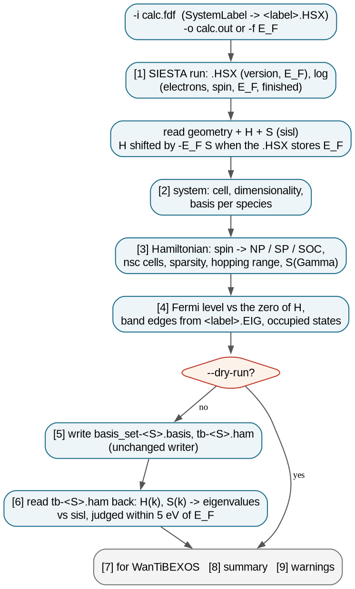
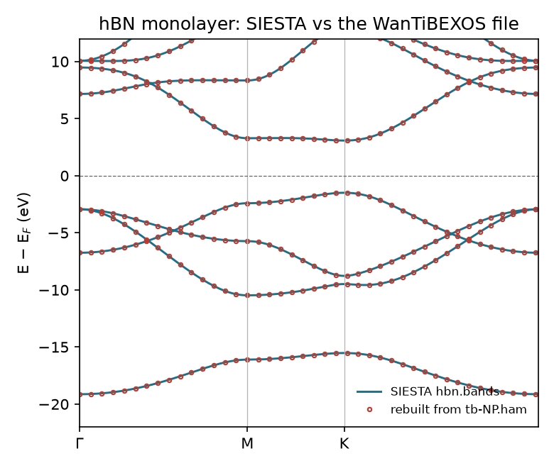
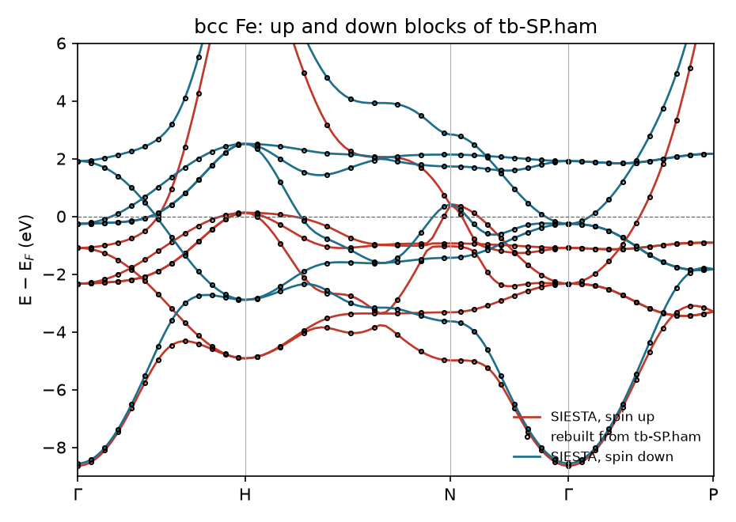
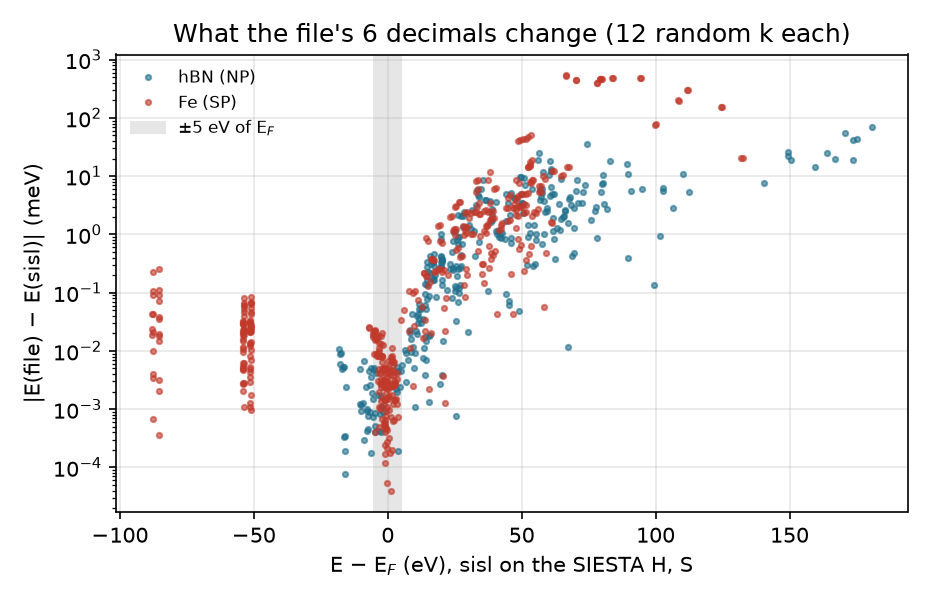

# 3.4 — Wantibexos Interface (`stb-siesta2wtb`)

`stb-siesta2wtb` takes the Hamiltonian and overlap that SIESTA saves in real space (`<label>.HSX`, written with
`SaveHS true`) and writes them as the tight-binding files of WanTiBEXOS [1], a code for excitonic and optical
properties from tight-binding Hamiltonians:

- `tb-<S>.ham`: the spin type, a scissor shift, the Fermi level, the lattice vectors, then every element of H and S
  between the orbitals of the unit cell and those of each neighbouring cell;
- `basis_set-<S>.basis`: one line per orbital, with species, position, `l`, `m` and spin.

`<S>` is `NP` (no spin), `SP` (collinear spin) or `SOC` (non-collinear and spin-orbit). Its report says what went
into the files:

- the system: cell, dimensionality, the basis of each species;
- the Hamiltonian: spin type, how many neighbouring cells it reaches, how sparse it is, the longest hopping, how close
  the basis is to linear dependence;
- the Fermi level, **what energy is the zero of the matrix elements**, the band edges from SIESTA's `.EIG`, and the
  number of occupied states;
- **a read-back check**: H(k) and S(k) are rebuilt from the written `.ham` and their eigenvalues compared with sisl's
  on the SIESTA matrices, at several k-points;
- what to put in the WanTiBEXOS input (`PARAMS_FILE`, `SYSDIM`, how many valence and conduction bands exist).

The example uses two real, finished SIESTA 5.4 runs with `SaveHS true`: an hBN monolayer (`NP`, a 2D insulator, the
kind of system WanTiBEXOS is used for) and ferromagnetic bcc Fe (`SP`). The bands rebuilt from the written files
reproduce SIESTA's to 0.1 meV near the Fermi level (section 6). Everything runs in about 20 seconds; no SIESTA is needed.

---

## Contents

1. [Theory](#1-theory)
2. [The conversion at a glance](#2-the-conversion-at-a-glance)
3. [Libraries and external dependencies used](#3-libraries-and-external-dependencies-used)
4. [What `stb-siesta2wtb` does](#4-what-stb-siesta2wtb-does)
5. [Running it both ways](#5-running-it-both-ways)
6. [Worked example](#6-worked-example)
7. [What to take from the example](#7-what-to-take-from-the-example)
8. [Reproducing the reference data](#8-reproducing-the-reference-data)
9. [Known, deliberate limitations](#9-known-deliberate-limitations)
10. [Step-by-step: exporting your own Hamiltonian](#10-step-by-step-exporting-your-own-hamiltonian)
11. [Files in this folder](#11-files-in-this-folder)
12. [Running the script](#12-running-the-script)
13. [Flag reference](#13-flag-reference)
14. [What's next](#14-whats-next)
15. [References](#15-references)

---

## 1. Theory

### 1.1 A SIESTA Hamiltonian is already a tight-binding model

SIESTA [2] expands the Kohn-Sham states in numerical atomic orbitals `φ_μ`, each centred on an atom and strictly
zero beyond a cutoff radius. A Bloch state is

```
ψ_nk(r) = Σ_μ c_μ,nk Σ_R e^{ik·R} φ_μ(r − τ_μ − R)                                                       (1)
```

and the Kohn-Sham equation becomes a generalized eigenproblem of small matrices:

```
H(k) c = E S(k) c,     H_μν(k) = Σ_R e^{ik·R} H_μν(R),     S_μν(k) = Σ_R e^{ik·R} S_μν(R)              (2)
```

with `H_μν(R) = ⟨φ_μ(0)|Ĥ|φ_ν(R)⟩` and `S_μν(R) = ⟨φ_μ(0)|φ_ν(R)⟩`. Because the orbitals have finite range, only
a few cells `R` give non-zero elements. **Eq. 2 is a tight-binding model**, with first-principles parameters and no
fitting. A Wannier-function model [3] has to be constructed from the plane-wave bands; here the model is already
there. `SaveHS true` makes SIESTA write `H(R)` and `S(R)` to `<label>.HSX`, and `stb-siesta2wtb` writes them out
again in WanTiBEXOS's format.

Two differences from a Wannier model follow:

- **The basis is not orthogonal.** `S(R)` is not the identity, so every element of `H` comes with its `S`, and the
  bands come from Eq. 2, not from `H(k) c = E c`.
- **The basis has as many orbitals as SIESTA used** (13 per atom for B or N with DZP), not just a few bands around
  the gap. The highest of the resulting bands lie 50 to 150 eV above the Fermi level and have no physical meaning.

### 1.2 The neighbouring cells: `nsc`

sisl [4] stores `H(R)` for an auxiliary supercell of `nsc = n_1 × n_2 × n_3` cells, every `R` for which some orbital
of the unit cell overlaps some orbital of cell `R`. The file has one block per cell, `(dim)²` lines each, zeros
included:

```
lines = n_1 n_2 n_3 × dim²,     dim = N_orb (NP)  or  2 N_orb (SP, SOC)                                   (3)
```

The cutoff radii set `nsc`. In a 2D cell with 20 Å of vacuum it is `5 × 5 × 1`; in bulk Fe it is `9 × 9 × 9`, and the
file has a million lines (section 6.2). `PAO.EnergyShift` sets the radii; a larger value gives shorter orbitals and
a smaller file.

### 1.3 Spin

| SIESTA `Spin` | sisl components | file type | matrix | layout |
|---|---|---|---|---|
| `none` | 1 | `NP` | N × N | |
| `polarized` | 2 (up, down) | `SP` | 2N × 2N | up block (orbitals 1..N), then down block (N+1..2N); no up-down coupling |
| `non-collinear` | 4 | `SOC` | 2N × 2N | up-down blocks |
| `spin-orbit` | 8 | `SOC` | 2N × 2N | up-down blocks, complex |

### 1.4 The energy zero and the Fermi level

The file's header has a Fermi level `E_F`, given with `-o calc.out` (read from SIESTA's log) or `-f`. The matrix
elements have an energy zero of their own, and the two need not be the same:

- An `.HSX` of version 1 or 2 (SIESTA ≥ 4.1) stores the run's Fermi level, and sisl, which reads it, **shifts the
  Hamiltonian on reading**: `H → H − E_F S`. The matrix elements in the file are then referred to E_F. A state at the
  Fermi level has `E = 0`.
- An `.HSX` of version 0 has no Fermi level; the elements are then on SIESTA's absolute scale.

The report says which case applies (`Energy zero of H`) and warns when the header's E_F is not the zero of H. With
an `.HSX` that stores E_F and `-o calc.out`, the header carries E_F although H is already referred to it. A program
that subtracts the header's E_F from H then moves every band by `−E_F` (+4.02 eV for the hBN here). With `-f 0` the
header matches H. Check how the version of WanTiBEXOS you use treats the header's Fermi level (section 6.3).

### 1.5 The read-back check

The written `.ham` is read again, and for each of four k-points (Γ, (½,0,0), (⅓,⅓,0) and a general point, with
`k = 0` along vacuum axes) Eq. 2 is solved with the file's numbers. The eigenvalues are compared with sisl's, which
come from the SIESTA matrices directly. The check is judged **within 5 eV of the Fermi level**. The file has 6
decimals (`%12.6f`). Where the basis is nearly linearly dependent, the smallest eigenvalue of `S(k)` is ~10⁻³, and the
rounding of `S` moves the highest, unphysical bands by tens to hundreds of meV. Near the Fermi level the change is
below 0.1 meV (section 6.4). The report gives both numbers, the smallest eigenvalue of `S(Γ)`, the number of states
below the Fermi level at each k, and the hermiticity of the rebuilt matrices.

---

## 2. The conversion at a glance



*Figure 1. What `stb-siesta2wtb` does. The numbers are the report's sections; the files themselves are written by the
same code as before this report existed.*

## 3. Libraries and external dependencies used

| Library | Used for |
|---|---|
| `sisl` [4] | reading the `.fdf`, `.HSX` (H, S, E_F, geometry, basis) and `H.eigh(k)` for the check |
| `numpy`, `scipy` | building H(k), S(k) from the file, the generalized eigenproblem |
| `pandas` | reading the `.ham` back quickly (falls back to `numpy.loadtxt`) |
| `stb.core` | the SIESTA log parsers (`get_fermi_energy`, `read_eig_gap`, ...), vacuum detection, the report |

WanTiBEXOS itself is not needed to write the files.

## 4. What `stb-siesta2wtb` does

### 4.1 Step by step

1. **Find the run.** `SystemLabel` from the `.fdf` (`-i`) gives `<label>.HSX`. The log is `-o`, or else
   `<label>.out` or the only `*.out` (used only for the report).
2. **Read** geometry, H and S with sisl.
3. **Describe** the system, the basis, the Hamiltonian's range, the Fermi level and its reference.
4. **Write** `basis_set-<S>.basis` and `tb-<S>.ham` in the current folder (not with `--dry-run`).
5. **Check** the written `.ham` (not with `--no-check`).

### 4.2 The report, section by section

| Section | What it shows |
|---|---|
| `[0] RUN METADATA` | date, versions, input and `SystemLabel`, where the Fermi level comes from, the mode |
| `[1] SIESTA RUN` | the `.HSX` (size, date), `SaveHS` in the input, the log (version, finished, electrons, spin, E_F, spin moment), the energy zero of H |
| `[2] SYSTEM` | cell, dimensionality, per species: Z, atoms, orbitals, basis shells; orbitals in the cell |
| `[3] HAMILTONIAN` | spin → file type and matrix size, orthogonality, `nsc` and cells, stored elements, longest hopping, on-site energies, the spectrum of `S(Γ)`, the spin layout |
| `[4] FERMI LEVEL AND BAND EDGES` | E_F written and its source, its relation to the zero of H, VBM/CBM/gap from `<label>.EIG`, occupied states |
| `[5] OUTPUT FILES` | both files, sizes, write times, the header, the number of lines (or what would be written) |
| `[6] READ-BACK CHECK` | header and line count read back, non-zero lines, eigenvalues vs sisl per k, hermiticity, verdict |
| `[7] FOR WANTIBEXOS` | `PARAMS_FILE`, `SYSDIM`, the valence/conduction states available for `NBANDSV`/`NBANDSC`, the energy reference |
| `[8] SUMMARY & FILES` | the files and the system in one line |
| `[9] WARNINGS` | every warning, numbered |

### 4.3 Guard rails

The report warns when:

- the header's Fermi level is not the zero of the matrix elements (section 1.4), or no Fermi level was given for a
  Hamiltonian on SIESTA's absolute scale;
- the SIESTA log did not finish;
- `S(Γ)` has an eigenvalue below 10⁻³ (nearly linearly dependent basis: the 6 decimals move the highest bands);
- for an insulator, the number of states below the Fermi level at Γ is not the number of occupied states;
- the file read back does not reproduce sisl's eigenvalues within 1 meV, 5 eV around E_F.

It stops, with the reason, when the input or the `-o` log is missing, or when there is no Hamiltonian (no `.HSX`: the
run needs `SaveHS true`).

## 5. Running it both ways

From the command line:

```bash
stb-siesta2wtb -i calc.fdf -o calc.out              # Fermi level from the log
stb-siesta2wtb -i calc.fdf -f 0                     # header E_F = 0, the zero of H for a modern .HSX
stb-siesta2wtb -i calc.fdf -o calc.out --dry-run    # report only
stb-siesta2wtb -i calc.fdf -o calc.out --no-check   # skip the read-back (very large files)
```

From the menu (`stb-suite`, code `3.4`): the `.fdf`, the log (optional), a Fermi level by hand (optional), dry run,
read-back check and report are asked in turn.

## 6. Worked example

`siesta_runs/` holds two finished SIESTA 5.4.2 runs [2], PBE [5], DZP basis, `PAO.EnergyShift 0.02 Ry`, PseudoDojo
pseudopotentials [6], both with `SaveHS true` and a band structure:

- **`hbn/`** — an hBN monolayer, a = 2.51 Å, 20 Å of vacuum, 15×15×1 k-points. SIESTA gives a direct gap of 4.569 eV
  at K, the usual PBE value.
- **`fe/`** — ferromagnetic bcc Fe, a = 2.83 Å, 14³ k-points, 0.01 Ry Methfessel-Paxton smearing. The spin moment is
  2.22 μ_B.

Each folder keeps `calc.fdf`, `calc.out`, `.XV`, `.HSX`, `.EIG`, `.KP` and `.bands` (1.9 MB in all; the pseudopotentials
are not shipped, `run_all.sh` copies them from the suite's bundled bank). The guided script `example_3.4.sh` runs every
case on a copy in `output/<case>/`; the reference reports are in `reference_results/`.

### 6.1 hBN: the whole report (Case 1)

```bash
stb-siesta2wtb -i calc.fdf -o calc.out
```

```
[1] SIESTA RUN
Hamiltonian       : hbn.HSX (210.4 KB, written <date>)
Fermi level (log) : -4.022238 eV
Energy zero of H  : the run's Fermi level -- hbn.HSX (version 2) stores E_F = -4.022238 eV and sisl shifts H by -E_F S

[2] SYSTEM
Dimensionality    : 2D (e.g., a slab or surface) -- vacuum along c
species | Z | atoms | orbitals | basis shells         | r_c (Ang)
B       | 5 | 1     | 13       | 2s(2z) 2p(2z) 3d(1z) | -
N       | 7 | 1     | 13       | 2s(2z) 2p(2z) 3d(1z) | -

[3] HAMILTONIAN
Spin (sisl)       : Spin{unpolarized} -> WanTiBEXOS type NP, 26 x 26 matrices
Orthogonal basis  : no -- the overlap S goes into the file with H
Neighbour cells   : nsc = 5 x 5 x 1 = 25 cells (all R with an orbital overlapping one of the cell)
Stored elements   : 10688 of 16900 (63.2 %) per spin component
Longest hopping   : 5.225 Ang (orbital centres; the range of the basis)
S(Gamma) spectrum : 6.56e-04 to 4.881 (smallest eigenvalue: how close the basis is to linear dependence)

[4] FERMI LEVEL AND BAND EDGES
SIESTA .EIG       : VBM -5.5166, CBM -0.9475 eV -> gap 4.5691 eV (direct; smallest direct 4.5691 eV; 113 k-points)
Occupied states   : 4 of 26 per k (8 electrons, 2 per state)

[5] OUTPUT FILES
Hamiltonian       : tb-NP.ham (1.3 MB, 0.5 s)
Body              : 16900 lines 'R_x R_y R_z i j ReH ImH S' (R in Ang, H in eV), every i, j of every cell, zeros included

[6] READ-BACK CHECK
k                     | states < E_F | max |dE| within 5 eV of E_F (meV) | max |dE| all (meV) | worst band at E - E_F (eV)
(0.000, 0.000, 0.000) | 4            | 0.006                             | 161.2              | +74.0
(0.500, 0.000, 0.000) | 4            | 0.006                             | 38.9               | +173.6
(0.333, 0.333, 0.000) | 4            | 0.005                             | 28.5               | +71.7
(0.130, 0.270, 0.000) | 4            | 0.001                             | 14.7               | +159.3
Verdict           : ok -- within 5 eV of E_F the file reproduces the SIESTA bands to 0.006 meV

[7] FOR WANTIBEXOS
PARAMS_FILE       : tb-NP.ham
SYSDIM            : 2D (from the vacuum axes)
Valence states    : 4 occupied of 26 -- NBANDSV can be at most 4, NBANDSC at most 22
```

DZP gives 13 orbitals per atom: two radial functions (`2z`) for 2s and for 2p, and one shell of 3d polarization
orbitals. The polarization shell shows as `3d(1z)`, since the `.HSX` does not mark it as such. The orbitals reach
5.2 Å, so H couples the cell to its 24 nearest cells in the plane (`5 × 5 × 1`) and none across the vacuum. The file
holds 16 900 lines, 31 % of them non-zero. The 4 occupied states are the σ and π bands of the 8 valence electrons, at
every k checked. The first lines of the file (`reference_results/hbn/tb_head.txt`):

```
NP                                                       <- type
    0.000000                                             <- scissor (eV)
   -4.022238                                             <- E_F written (eV)
    2.510000     0.000000     0.000000                   <- a_1 (Ang)
   -1.255000     2.173724     0.000000                   <- a_2
    0.000000     0.000000    20.000000                   <- a_3
26                                                       <- matrix size
25                                                       <- cells
# rcell_x rcell_y rcell_z i j ReH ImH S
    0.000000     0.000000     0.000000 1 1    -9.667332     0.000000     1.000000    <- B 2s, on-site: E - E_F, S = 1
    0.000000     0.000000     0.000000 1 2    -7.776185     0.000000     0.934106    <- B 2s zeta 1 - zeta 2
```

`R` is the Cartesian position of cell `R` (Å). `i` is in the unit cell, `j` in cell `R`.



*Figure 2. hBN: SIESTA's own bands (`hbn.bands`, lines) and the eigenvalues of Eq. 2 rebuilt from `tb-NP.ham` at the
same k-points (circles). Within 5 eV of E_F they agree to 0.063 meV along the whole path. `theory_figures.py` draws it.*

### 6.2 bcc Fe: two spin blocks (Case 2)

```
species | Z  | atoms | orbitals | basis shells                       | r_c (Ang)
Fe      | 26 | 1     | 19       | 3s(1z) 3p(1z) 3d(2z) 4s(2z) 4p(1z) | -
Spin (sisl)       : Spin{polarized} -> WanTiBEXOS type SP, 38 x 38 matrices
Neighbour cells   : nsc = 9 x 9 x 9 = 729 cells (all R with an orbital overlapping one of the cell)
Stored elements   : 12423 of 263169 (4.7 %) per spin component
Longest hopping   : 8.004 Ang (orbital centres; the range of the basis)
Layout            : up block (orbitals 1..N), then down block (N+1..2N); no up-down coupling
SIESTA .EIG       : metallic on the SCF k-mesh (1484 k-points; gap 0.003 eV, below the k-mesh/smearing resolution)
Hamiltonian       : tb-SP.ham (83.9 MB, 12.1 s)
Body              : 1052676 lines 'R_x R_y R_z i j ReH ImH S' (R in Ang, H in eV), every i, j of every cell, zeros included
Non-zero lines    : 15054 (1.4 %)
Verdict           : ok -- within 5 eV of E_F the file reproduces the SIESTA bands to 0.033 meV
```

Fe has 19 orbitals, including the 3s and 3p semicore shells of the PseudoDojo pseudopotential. Its diffuse 4s and 4p
orbitals reach 8 Å, so the file spans 729 cells: one million lines, 84 MB, of which 1.4 % are non-zero. Orbital 1 is
the spin-up 3s, orbital 20 the spin-down 3s:

```
0.000000  0.000000  0.000000  1  1  -87.667130  0.000000  1.000000      <- 3s up
0.000000  0.000000  0.000000 20 20  -85.145302  0.000000  1.000000      <- 3s down
```

Even the deep 3s level is split by 2.5 eV by the exchange field of the 3d electrons. For a metal, the number of states
below E_F changes from one k to the next (14 to 18 here). The report does not compare it with the 16 occupied states,
and says the `.EIG` "gap" of 3 meV is below the k-mesh resolution.



*Figure 3. Fe: SIESTA's up (red) and down (blue) bands, and the eigenvalues of each spin block of `tb-SP.ham` (circles).
Within 5 eV of E_F they agree to 0.12 meV along the path. The down d bands sit about 2 eV above the up ones: the
exchange splitting behind the 2.22 μ_B moment.*

### 6.3 The Fermi level and the zero of H (Case 3)

Both `.HSX` files here are version 2: they store E_F, and the matrix elements in the file are referred to it. The
on-site energy of B 2s, −9.667 eV, is measured from E_F. With `-o calc.out`, the header also carries E_F = −4.022 eV:

```
Reference         : H in the file is already referred to E_F (0 eV = -4.0222 eV absolute); the header adds E_F = -4.0222 eV
  2. the matrix elements are already referred to the Fermi level (sisl shifted them by -E_F S, E_F = -4.0222 eV from
     hbn.HSX), and the header also carries E_F = -4.0222 eV: a reader that subtracts the header's E_F from H moves
     every band by +4.0222 eV (with -f 0 the header would match H).
```

With `-f 0` (`reference_results/hbn_f0/`) the header says `0.000000`, and with neither `-o` nor `-f`
(`hbn_nofermi/`) 0.0 is written and the report says it matches H:

```
Reference         : header E_F = 0.0 matches H, which is already referred to E_F
```

For hBN, a shift of +4.02 eV would put the valence-band maximum at K (−1.49 eV from E_F) at +2.53 eV, above zero. A
program that counts the states below zero as occupied would then see 2 of them at Γ and 3 at M and K, instead of 4.
Which header is right depends on how the reading program uses it, and the report gives what is needed to decide.

### 6.4 What 6 decimals do (Case 4)



*Figure 4. For 12 random k-points, the change of each eigenvalue between the file and sisl, against its energy. Within
5 eV of E_F (grey) every change is below 0.05 meV. Tens to hundreds of meV appear only 30–150 eV above E_F.*

The file has 6 decimals. Rounding `S` matters where `S(k)` is nearly singular (smallest eigenvalue 6.6 × 10⁻⁴ in hBN,
2.5 × 10⁻³ in Fe at Γ). Those directions are combinations of diffuse orbitals that make the highest bands. The bands an
exciton calculation uses, a few eV around the gap, are reproduced to 10⁻⁵–10⁻⁴ eV. The report's `READ-BACK CHECK`
gives both numbers, and the worst band's energy, for each k.

### 6.5 What the report catches (Case 5)

A run without `SaveHS` (`reference_results/guard_nohsx/`):

```
Hamiltonian       : no hbn.HSX next to the input -- sisl will look for another H source
[FAIL] No Hamiltonian found for 'calc.fdf' (no hbn.HSX): rerun SIESTA with SaveHS true.
```

A log that is not there (`guard_badlog/`):

```
[FAIL] SIESTA output 'siesta.out' (-o) not found.
```

And for hBN's nearly dependent basis, a warning that the 6 decimals perturb the highest bands, with the read-back
check measuring by how much.

### 6.6 The interactive menu (Case 6)

`stb-suite` → `3.4`: the `.fdf`, the log and the defaults give the same report as the command line
(`reference_results/menu/report.txt`).

## 7. What to take from the example

- A SIESTA Hamiltonian in a localized basis is a tight-binding model as it stands; `stb-siesta2wtb` writes it with
  its overlap, every neighbouring cell included.
- **Read the read-back verdict**: the bands rebuilt from the file reproduce SIESTA's to ~0.1 meV within 5 eV of E_F
  (hBN, Fe). The large differences sit only in unphysical bands far above E_F.
- **Read the energy reference**: with a modern `.HSX` the matrix elements are already referred to E_F. Decide whether
  the header should carry E_F (`-o`) or 0 (`-f 0`) for the program that reads it.
- The file size grows with `nsc × dim²`. Diffuse orbitals (bulk metals, small `PAO.EnergyShift`) make files of
  100 MB and more; `--dry-run` says how large before writing.

## 8. Reproducing the reference data

```bash
source ~/.anaconda3/etc/profile.d/conda.sh && conda activate stb   # or any environment with stb_suite
bash make_reference.sh          # every report into reference_results/<case>/ (~30 s, no SIESTA)
bash siesta_runs/run_all.sh 4   # the two SIESTA runs (SIESTA 5.x + mpirun, ~3 min), pruned to what is shipped
python3 theory_figures.py       # figures/hbn_bands.png, fe_bands.png, precision.png (~40 s)
dot -Tpng -Gdpi=150 figures/wtb_flowchart.dot -o figures/wtb_flowchart.png
```

The reports' dates and timings are replaced by `<date>` and `<t>`; everything else is deterministic.

## 9. Known, deliberate limitations

- **Spin-orbit and non-collinear Hamiltonians are not part of this example.** The suite's bundled pseudopotentials are
  scalar-relativistic; a `SOC` run needs fully relativistic ones. The read-back check works the same way for them.
- **The writer is unchanged by the report.** It writes every element of every cell, zeros included, with 6 decimals,
  and it loops in Python: 12 s for Fe, about a minute for a 182-orbital cell (200 MB).
- **The files go into the current folder** with fixed names (`tb-<S>.ham`, `basis_set-<S>.basis`); a second run in
  the same folder overwrites them.
- **The check uses four k-points.** A problem confined to other k-points would be missed. The bands of Figures 2 and 3
  check whole paths.
- **The basis shells come from the `.HSX`**: polarization orbitals appear as ordinary single-ζ shells, and cutoff radii
  are not stored there (`r_c` shows `-`).

## 10. Step-by-step: exporting your own Hamiltonian

1. **Run SIESTA with `SaveHS true`** (and the k-grid and basis you want the model to have).
2. **Run `stb-siesta2wtb -i calc.fdf -o calc.out --dry-run`**: check the spin type, the file size, the occupied states.
3. **Decide the header's Fermi level** (section 1.4): `-o calc.out`, or `-f 0` when the reading program subtracts it
   from an H already referred to E_F.
4. **Write and check**: drop `--dry-run`; read `[6] READ-BACK CHECK`.
5. **In WanTiBEXOS**, use `PARAMS_FILE`, `SYSDIM` and the valence/conduction counts of section `[7]`.

## 11. Files in this folder

| File | What it is |
|---|---|
| `README.md` | this tutorial |
| `example_3.4.sh` | the guided walk-through (6 cases, about 20 s) |
| `siesta_runs/` | the two finished SIESTA 5.4.2 runs (`hbn/`, `fe/`: input, log, `.XV`, `.HSX`, `.EIG`, `.KP`, `.bands`) and `run_all.sh` |
| `make_reference.sh` | regenerates `reference_results/` |
| `theory_figures.py` | Figures 2, 3, 4 (from the files the tool writes) |
| `figures/` | every figure of this README; `wtb_flowchart.dot` is the flowchart's source |
| `reference_results/` | one folder per case: `report.txt`; `tb_head.txt` and `basis_head.txt` (the first lines of each file), `fe/down_block_line.txt` |

## 12. Running the script

```bash
bash example_3.4.sh                # pauses between cases
yes '' | bash example_3.4.sh       # straight through
```

It needs the `stb_suite` package only (no SIESTA, no WanTiBEXOS). It starts by wiping its own `output/`, never
touches `siesta_runs/`, and takes about 20 seconds (the Fe file is 84 MB).

## 13. Flag reference

| Flag | Default | What it does |
|---|---|---|
| `-i`, `--input FDF` | required | the SIESTA input; its `SystemLabel` names the `.HSX` |
| `-o`, `--output LOG` | none | SIESTA log; the Fermi level written to the header is read from it |
| `-f`, `--fermi-level E` | none | Fermi level for the header (eV), instead of `-o` |
| `--dry-run` | off | report only; nothing written |
| `--no-check` | off | skip the read-back check |
| `--save-report` | off | also write `stb_wtb_report.txt` (current folder) |
| `-q`, `--quiet` | off | no banner |
| `--no-intro`, `-v` | | skip the banner; print the version |

With neither `-o` nor `-f`, the header's Fermi level is 0.0.

## 14. What's next

- **`2.1` (`stb-bands`)** plots SIESTA's own `.bands`, the reference that Figures 2 and 3 compare with.
- **`5.14` (optical properties)** computes the dielectric function with SIESTA itself (independent particles), a
  baseline for an excitonic calculation.
- **`3.1` (`stb-translate`)** converts the structure, if WanTiBEXOS or another code needs it in another format.

## 15. References

1. A. C. Dias, J. F. R. V. Silveira, F. Qu, "WanTiBEXOS: a Wannier based Tight Binding code for electronic band
   structure, excitonic and optoelectronic properties of solids", *Comput. Phys. Commun.* **285**, 108636 (2023).
2. J. M. Soler et al., "The SIESTA method for ab initio order-N materials simulation", *J. Phys.: Condens. Matter*
   **14**, 2745 (2002).
3. N. Marzari, A. A. Mostofi, J. R. Yates, I. Souza, D. Vanderbilt, "Maximally localized Wannier functions: Theory
   and applications", *Rev. Mod. Phys.* **84**, 1419 (2012).
4. N. Papior, sisl: v0.16, https://github.com/zerothi/sisl (2024).
5. J. P. Perdew, K. Burke, M. Ernzerhof, "Generalized gradient approximation made simple", *Phys. Rev. Lett.* **77**,
   3865 (1996).
6. M. J. van Setten et al., "The PseudoDojo: Training and grading a 85 element optimized norm-conserving
   pseudopotential table", *Comput. Phys. Commun.* **226**, 39 (2018).
