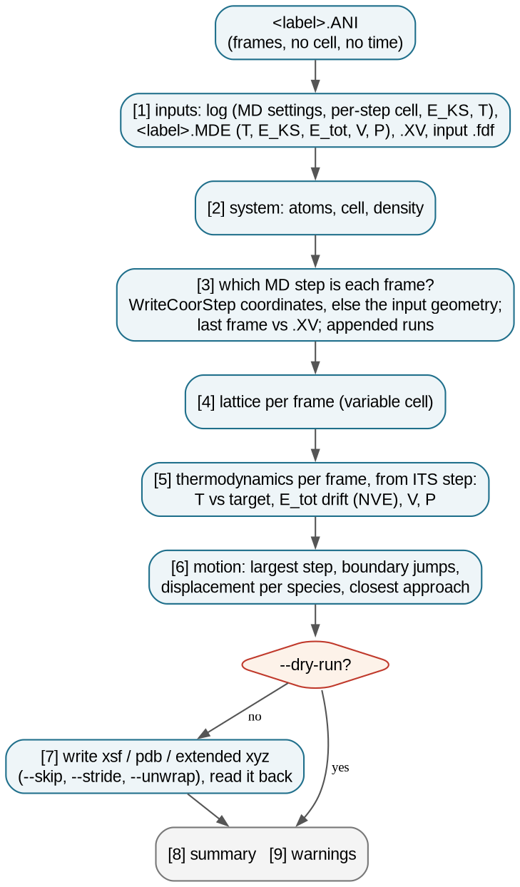
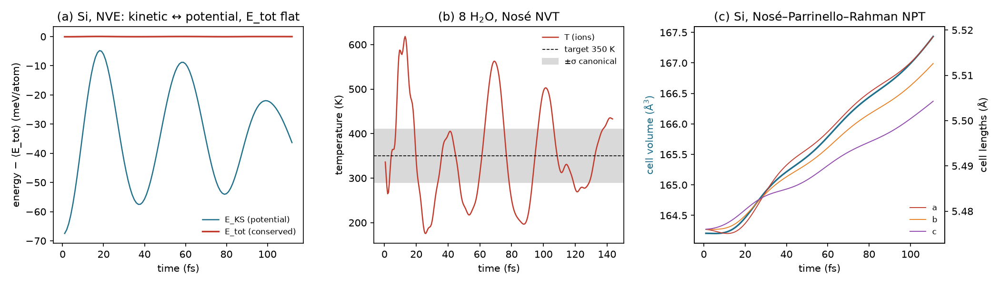

# 3.5 — AIMD Trajectory Converter (`stb-ani2traj`)

A SIESTA molecular-dynamics run writes its frames to `<label>.ANI` (with `WriteMDXmol true`): a plain multi-frame
XYZ file, with no cell, no time and no energies. `stb-ani2traj` writes the same frames as a trajectory that viewers
show with its periodic box: multi-frame XSF, multi-model PDB, or extended XYZ. The cell of each frame comes from the
log, so a variable-cell run is right frame by frame. The extended XYZ also carries each frame's MD step, time,
temperature, energies, volume and pressure. The report says:

- what the run was: the ensemble, the time step, how long it ran, whether it finished;
- **which MD step each frame is**: SIESTA writes a frame *after* moving the atoms, checked on every run;
- how the cell changed (variable-cell runs);
- the thermodynamics from `<label>.MDE`: the temperature against the target and the spread a canonical ensemble
  should have, and the drift of the total energy in NVE;
- how the atoms moved: the largest step between frames, boundary crossings, displacement per species, the closest
  approach of two atoms;
- a read-back of the written file.

The example uses three real SIESTA 5.4 AIMD runs: 8 water molecules with a Nosé thermostat (NVT), 8-atom Si with
velocity Verlet (NVE), and 8-atom Si with Nosé–Parrinello–Rahman (NPT, a variable cell). Everything runs in seconds;
no SIESTA is needed.

---

## Contents

1. [Theory](#1-theory)
2. [The conversion at a glance](#2-the-conversion-at-a-glance)
3. [Libraries and external dependencies used](#3-libraries-and-external-dependencies-used)
4. [What `stb-ani2traj` does](#4-what-stb-ani2traj-does)
5. [Running it both ways](#5-running-it-both-ways)
6. [Worked example](#6-worked-example)
7. [What to take from the example](#7-what-to-take-from-the-example)
8. [Reproducing the reference data](#8-reproducing-the-reference-data)
9. [Known, deliberate limitations](#9-known-deliberate-limitations)
10. [Step-by-step: converting your own run](#10-step-by-step-converting-your-own-run)
11. [Files in this folder](#11-files-in-this-folder)
12. [Running the script](#12-running-the-script)
13. [Flag reference](#13-flag-reference)
14. [What's next](#14-whats-next)
15. [References](#15-references)

---

## 1. Theory

### 1.1 What a SIESTA MD run writes

SIESTA [1] integrates Newton's equations for the nuclei on the Born–Oppenheimer surface. At every MD step it
converges the electrons, computes the forces and moves the atoms by one time step `Δt`. The trajectory and its
companions:

| File | Written with | What it holds |
|---|---|---|
| `<label>.ANI` | `WriteMDXmol true` | one XYZ frame per step: species and Cartesian positions (Å); **no cell** |
| `<label>.MDE` | `WriteMDHistory true` | one row per step: T (K), E_KS (eV), E_tot (eV), V (ų), P (kBar) |
| `<label>.MD` | `WriteMDHistory true` | positions, velocities and cell per step (binary) |
| `<label>.XV` | always | the last geometry with velocities (the restart file) |
| `<label>.out` (log) | always | the MD settings (`redata:`), and per step the cell (`outcell:`), E_KS, T; the coordinates with `WriteCoorStep true` |

Without `WriteMDXmol` there is no `.ANI` at all, and without `WriteMDHistory` no `.MDE`. `stb-ani2traj` stops with a
message naming the flag.

### 1.2 Ensembles

| `MD.TypeOfRun` | Ensemble | What is conserved or controlled |
|---|---|---|
| `Verlet` | NVE | the total energy `E_tot = E_KS + E_kin` |
| `Nose` | NVT | T fluctuates around `MD.TargetTemperature` (Nosé thermostat [2]) |
| `ParrinelloRahman` | NPH | the cell moves to balance `MD.TargetPressure` [3] |
| `NoseParrinelloRahman` | NPT | both |
| `Anneal` | — | velocities and/or cell rescaled towards a target |

Two checks follow from statistical mechanics:

- **NVE**: `E_tot` must not drift. A drift of more than a few meV/atom/ps means the time step or the SCF tolerance is
  too large.
- **NVT**: the instantaneous temperature of N atoms in a canonical ensemble fluctuates with a relative spread of

```
σ_T / ⟨T⟩ = √( 2 / (3N − 3) )                                                                            (1)
```

  (3N − 3 degrees of freedom, the centre-of-mass motion removed): 0.17 for 24 atoms, 0.31 for 8. A short run, or a
  thermostat that has not settled, swings more.

### 1.3 Which MD step is each frame?

At step `s` SIESTA has the geometry `r(s)`. It converges the electrons, prints the cell, E_KS and T of that geometry,
moves the atoms to `r(s+1)`, and only then writes a frame to the `.ANI` and the geometry to the `.XV`. So:

```
.ANI frame k  =  r(k+1)  =  the geometry AFTER step k                                                     (2)
```

The first frame is not the input geometry, and the last frame is the `.XV`. A frame must therefore get the energy
and temperature of step `k+1`, not of step `k`. Pairing frame `k` with step `k` puts every value one step late, which
in a fast oscillation (Figure 1(a)) is a visible phase error. `stb-ani2traj` checks Eq. 2 on every run, against the
per-step coordinates of the log when `WriteCoorStep true` (agreement to 10⁻⁶ Å in all three runs here), else against
the input geometry, and the last frame against the `.XV`. Time is measured from the input geometry: frame `k` is at
`t = k Δt`.

### 1.4 The cell and the formats

The `.ANI` has no cell. The log prints it at every step (`outcell:`), so each frame can get the cell of its own step.
For a fixed cell this is the same cell every time; for a variable cell (NPH, NPT) it is the only correct choice.
Without a log, one static cell is taken from the `.XV` or the input `.fdf`, which is wrong for a variable cell, and the
report says so.

| Format | Cell | Per-frame values | Precision | Read by |
|---|---|---|---|---|
| `xsf` (AXSF) | per frame (`PRIMVEC`) | — | full | OVITO [4], VMD, XCrySDen |
| `pdb` | per frame (`CRYST1`) | — | 3 decimals (10⁻³ Å) | VMD [5], OVITO |
| `xyz` (extended) | per frame (`Lattice="..."`) | MD step, time, T, E_KS, E_tot, V, P | full | OVITO, ASE; VMD ignores the cell |

### 1.5 Wrapped and unwrapped positions

An atom that crosses a face of the cell can be written in two ways: continuing outside the cell, or wrapped back to the
opposite face. A wrapped trajectory has jumps of a whole cell length, which break an MSD or a movie. `--unwrap` removes
them: each frame's displacement from the previous one is taken by the minimum-image convention. SIESTA does **not**
wrap the `.ANI` positions: atoms that start on a face vibrate to negative fractional coordinates and stay there
(section 6.4). The report counts both the jumps and the positions outside the cell. With no jumps, `--unwrap` changes
nothing.

---

## 2. The conversion at a glance



*Figure 2. What `stb-ani2traj` does. The numbers are the report's sections.*

## 3. Libraries and external dependencies used

| Library | Used for |
|---|---|
| `sisl` [6] | reading the `.ANI` frames, the `.XV` and the input geometry |
| `ase` [7] | writing and reading back xsf / pdb / extended xyz, minimum-image distances |
| `numpy` | cells, displacements, statistics, linear fits |
| `stb.core` | the SIESTA log parsers (`get_md_trajectory`, `get_mde_trajectory`), `unwrap_trajectory`, the report |

## 4. What `stb-ani2traj` does

### 4.1 Step by step

1. **Find the run**: `<label>.ANI` from `-l` (which may include a folder), or the only `*.ANI` here; the log (`--log`,
   `<label>.out` or the only `*.out`), the input `.fdf` (`--fdf`, `<label>.fdf`, or the `.fdf` whose `SystemLabel` is
   the label), `<label>.MDE` and `<label>.XV`.
2. **Read the MD settings** from the log's `redata:` block (dynamics, time step, temperatures), else the `.fdf`.
3. **Match frames to MD steps** (Eq. 2) and give each frame the cell of its step.
4. **Summarize** the lattice, the thermodynamics and the motion.
5. **Write** the frames kept (`--skip`, then `--stride`; `--unwrap`), and **read them back**.

### 4.2 The report, section by section

| Section | What it shows |
|---|---|
| `[0] RUN METADATA` | date, versions, input, output and format, frames kept, unwrap |
| `[1] INPUTS` | the `.ANI` (frames × atoms), the `.fdf`, the log (version, steps, finished), the `.MDE`, the `.XV`, the dynamics and ensemble, time step, temperatures |
| `[2] SYSTEM` | atoms, cell and volume of the first frame, density, dimensionality |
| `[3] FRAMES AND MD STEPS` | frames, log steps, `.MDE` rows, which step each frame is and how it was checked, time span, last frame vs `.XV`, frames kept |
| `[4] LATTICE` | where the cell comes from; for a variable cell, a, b, c and V along the run |
| `[5] THERMODYNAMICS` | T, E_KS, E_tot, V, P per frame kept: first, last, mean, std, min, max, drift per ps; T fluctuation vs Eq. 1, T vs target, E_tot drift in NVE |
| `[6] MOTION` | largest step between frames (and the speed it implies), boundary jumps, positions outside the cell, displacement per species, closest approach |
| `[7] OUTPUT` | the file, what each frame carries, the read-back check |
| `[8] SUMMARY & FILES` | the run in one line, the file, the viewer commands |
| `[9] WARNINGS` | every warning, numbered |

### 4.3 Guard rails

The report warns when:

- the log did not finish;
- the `.ANI` has more frames than the log has steps (SIESTA **appends** to an existing `.ANI` when a run is restarted
  in the same folder);
- the last frame is not the `.XV` (another run, or a restart);
- a variable-cell run gets a static cell (no log);
- which MD step each frame is cannot be checked;
- an NVE run's total energy drifts by more than 5 meV/atom/ps;
- an atom moves more than 0.3 Å between frames (time step too large, or frames missing), or two atoms come within
  0.5 Å (a run that blew up);
- the file read back differs from what was written.

It stops when the `.ANI` is missing (naming `WriteMDXmol`), when no cell can be found, or when `--skip` leaves no frame.

## 5. Running it both ways

From the command line:

```bash
stb-ani2traj -l water                          # water.ANI -> water_traj.xsf
stb-ani2traj -l si -of xyz                     # extended XYZ: cell, time, T, E_KS, E_tot, V, P per frame
stb-ani2traj -l run/water -of pdb --skip 100 --stride 5
stb-ani2traj --dry-run                         # the only *.ANI here; report only
```

From the menu (`stb-suite`, code `3.5`): the label (Enter for the only `*.ANI`), the format, the frames to skip, the
stride, `--unwrap`, the output name, dry run and report are asked in turn.

## 6. Worked example

`siesta_runs/` holds three SIESTA 5.4.2 AIMD runs [1], PBE [8], DZP basis (`PAO.EnergyShift 0.02 Ry`), PseudoDojo
pseudopotentials [9], all with `WriteMDXmol`, `WriteMDHistory` and `WriteCoorStep`:

- **`water_nvt/`** — 8 H₂O molecules in a 6.21 Å cube (1.00 g/cm³), Γ point, Nosé thermostat at 350 K, Δt = 0.5 fs:
  288 steps, 144 fs.
- **`si_nve/`** — 8-atom cubic Si (a = 5.476 Å), 2×2×2 k-points, velocity Verlet from 600 K, Δt = 1 fs: 113 steps.
- **`si_npt/`** — the same cell, Nosé–Parrinello–Rahman at 900 K and 0 GPa, Δt = 1 fs: 111 steps.

The runs were stopped before the number of steps their inputs ask for (300 and 200), to keep the example small. Their
logs therefore end mid-step, and every report carries the warning that the log did not finish, as it would for a job
killed by the queue. Each folder keeps `calc.fdf`, `calc.out`, `.ANI`, `.MDE` and `.XV` (2.9 MB in all; the
pseudopotentials are not shipped, `run_all.sh` copies them from the suite's bundled bank).

### 6.1 Water, NVT: the whole report (Case 1)

```bash
stb-ani2traj -l water
```

```
[1] INPUTS
Trajectory        : water.ANI (278.7 KB, 288 frames x 24 atoms)
Input .fdf        : ./calc.fdf
SIESTA log        : ./calc.out (SIESTA 5.4.2), 289 MD steps, NOT finished
Thermodynamics    : water.MDE (288 rows: T, E_KS, E_tot, V, P per step)
Dynamics          : Nose thermostat MD run -> NVT (Nose thermostat)
Time step         : 0.5 fs

[2] SYSTEM
Atoms             : 24 (O8H16)
Cell (frame 1)    : a = 6.2100, b = 6.2100, c = 6.2100 Ang, V = 239.483 Ang^3
Density           : 0.9993 g/cm^3 (0.1002 atoms/Ang^3)

[5] THERMODYNAMICS
      | unit  | first      | last       | mean       | std    | min        | max        | drift /ps
T     | K     | 336.29     | 432.89     | 351.20     | 109.59 | 175.69     | 618.20     | -1.4e+02
E_KS  | eV    | -3847.1587 | -3851.6170 | -3850.4712 | 1.2578 | -3851.6505 | -3846.9362 | -27.19
P     | kBar  | 12.77      | -6.01      | -3.98      | 8.59   | -20.07     | 13.29      | +84
T fluctuation     : 0.312 relative; canonical expectation sqrt(2/(3N-3)) = 0.170 for 24 atoms
T vs target       : mean 351.2 K vs 350 K (+1.2 K)

[6] MOTION
Largest step      : 0.0396 Ang between consecutive frames (H14, frames 18->19) -> up to 7913 m/s
Displacement, first -> last frame kept (unwrapped):
O       | 8     | 0.633     | 0.831
H       | 16    | 0.956     | 1.992
Closest approach  : 0.914 Ang (O22-H24, frame 4)

[7] OUTPUT
File              : water_traj.xsf (458.0 KB, 288 frames, xsf)
Read-back check   : read again with ASE -- ok
```

The `.fdf` is `calc.fdf`, found by its `SystemLabel`. The mean temperature is on target (351 K for 350 K), but in
144 fs it swings twice as much as Eq. 1 allows for 24 atoms (Figure 1(b)): the Nosé thermostat exchanges energy with
the atoms in slow oscillations, and the run is far too short to average them out. The hydrogens move most, up to
2 Å, as the molecules rotate. The largest step, 0.04 Å per 0.5 fs, is safe. The closest approach, 0.91 Å, is an O–H
bond at its most compressed. The xsf (`reference_results/water/xsf_head.txt`) starts with `ANIMSTEPS 288` and gives
the cell of every frame.

### 6.2 Which MD step is each frame? (Case 2)

```
[3] FRAMES AND MD STEPS
Frames in .ANI    : 288
MD steps in log   : 289 (steps 1-289)
Rows in .MDE      : 288 (steps 1-288)
Frame <-> step    : frame k is the geometry AFTER MD step k (= the geometry of step k+1) -- checked against the
                    log's per-step coordinates (WriteCoorStep), largest difference 5.0e-07 Ang
                    each frame gets the cell, energies and temperature of ITS step
Time span         : 0.5 to 144 fs (0.1435 ps; t = 0 at the input geometry)
Last frame vs .XV : 4.9e-07 Ang apart (same geometry)
```

The coordinates SIESTA prints at the start of step k+1 match frame k to 5 × 10⁻⁷ Å, the precision of the files. The
last frame is the `.XV`, and the log has one more step than the `.ANI` has frames: step 289 had started when the run
was stopped. The same holds for both Si runs (5 × 10⁻⁷ and 10⁻⁶ Å). Earlier versions of this tool gave frame k the
energy and temperature of step k, one step late.

### 6.3 Si, NPT: a cell that changes (Case 3)

```bash
stb-ani2traj -l si -of xyz
```

```
[4] LATTICE
Source            : per frame, from the log's 'outcell' block of each frame's MD step
          | first    | last     | mean     | std    | min      | max
a (Ang)   | 5.4760   | 5.5186   | 5.4954   | 0.0136 | 5.4751   | 5.5186
b (Ang)   | 5.4760   | 5.5126   | 5.4927   | 0.0112 | 5.4760   | 5.5126
c (Ang)   | 5.4760   | 5.5043   | 5.4892   | 0.0082 | 5.4760   | 5.5043
V (Ang^3) | 164.2062 | 167.4343 | 165.6733 | 0.9865 | 164.2037 | 167.4343
Volume change     : +1.97 % first -> last, 0.60 % fluctuation

[7] OUTPUT
Per frame         : cell, positions as in the .ANI; E_KS, E_tot, MD_step, Pressure_kBar, Temp_ion, Time, Volume
```

The first frame's header line (`reference_results/si_npt/xyz_head.txt`):

```
Lattice="5.475974 -1.5e-05 -3e-06 -1.5e-05 5.475999 1.5e-05 -3e-06 1.5e-05 5.476018" Properties=species:S:1:pos:R:3
E_KS=-919.10391 Temp_ion=894.28 E_tot=-918.29475 Volume=164.206 Pressure_kBar=-0.383 MD_step=2 Time=1.0 pbc="T T T"
```

At 900 K the cell expands by 2 % in 110 fs and has not stopped (Figure 1(c)): thermal expansion, with the
Parrinello–Rahman cell still on its way to the new volume. The three axes grow differently and the cell picks up small
shear components, because 8 atoms are few. The temperature of this run swings from 76 to 2638 K (relative spread
0.71, against 0.31 for 8 atoms): thermostat, barostat and 8 atoms are a small, strongly coupled system. Each frame of
the xyz carries its own cell and values, and `MD_step=2` on the first frame is Eq. 2 at work.

### 6.4 Si, NVE: energy conservation; positions and `--unwrap` (Case 4)

```
T     | K     | 596.19    | 321.20    | 292.56    | 146.05 | 42.97     | 596.19    | -3.7e+02
E_KS  | eV    | -919.1056 | -918.8564 | -918.8305 | 0.1324 | -919.1056 | -918.6042 | +0.3366
E_tot | eV    | -918.5662 | -918.5658 | -918.5658 | 0.0002 | -918.5662 | -918.5654 | +0.0005231
E_tot drift (NVE) : +0.065 meV/atom/ps; fluctuation 0.026 meV/atom

[6] MOTION
Boundary jumps    : 0 coordinate jumps of more than half a cell between consecutive frames
Outside the cell  : 290 atom-frames with a fractional coordinate outside [0, 1)
                    positions are not wrapped into the cell, so atoms move continuously already: --unwrap changes nothing here
```

The run starts from the perfect crystal with velocities for 600 K. Half the kinetic energy turns into potential
energy, so the temperature settles near 300 K and the two energies trade places in the vibrations of the cell
(Figure 1(a)). `E_tot` stays flat to 0.03 meV/atom, and drifts by 0.065 meV/atom/ps: the 1 fs step and the
10⁻⁵ density-matrix tolerance conserve energy well. Four of the eight atoms start on cell faces and vibrate to negative
fractional coordinates, 290 atom-frames in all, with no jump. That is direct evidence that SIESTA does not wrap the
`.ANI` (section 1.5). `--unwrap` (`reference_results/si_nve_unwrap/`) gives the same positions.



*Figure 1. Read back from the extended-XYZ files `stb-ani2traj` wrote. (a) Si NVE: E_KS oscillates, E_tot is flat. (b)
Water NVT: T around the 350 K target; grey is the canonical spread of Eq. 1 for 24 atoms. (c) Si NPT: volume and cell
lengths of each frame.*

### 6.5 Equilibration and stride, PDB (Case 5)

```bash
stb-ani2traj -l water -of pdb --skip 100 --stride 5
```

```
Kept              : 38 frames (indices 101..286 of 288, every 5)
Read-back check   : read again with ASE -- ok
                    38 frames; positions to 5.0e-04 Ang, cell parameters to 0.0e+00 (the pdb writer's precision)
```

`--skip` drops the first frames, typically the equilibration; `--stride` then keeps every fifth. The thermodynamics
of `[5]` and the motion of `[6]` describe only the frames kept. PDB has 3 decimals, so positions read back to
5 × 10⁻⁴ Å. That is fine for viewing, but use xsf or xyz for analysis.

### 6.6 What the report catches (Case 6)

The NPT run without its log (`reference_results/guard_nolog/`):

```
Source            : one static cell (log has no usable per-step cell) -- si.XV
  1. a variable-cell run but no per-step cell in the log: every frame gets the same cell, which is wrong for this run.
```

The NVE `.ANI` with a copy of itself appended, as SIESTA does when a run is restarted in the same folder
(`guard_appended/`):

```
Frames in .ANI    : 226
MD steps in log   : 114 (steps 1-114)
  2. si.ANI has 226 frames but the log only 114 MD steps: SIESTA APPENDS to an existing .ANI, so frames of an
     earlier run are probably at the start of the file.
```

A run without `WriteMDXmol` (`guard_missing/`):

```
[FAIL] Input file 'nothing.ANI' not found: SIESTA writes it only with WriteMDXmol true (and <label>.MDE with
       WriteMDHistory true).
```

### 6.7 The interactive menu (Case 7)

`stb-suite` → `3.5`, Enter for the label (the only `*.ANI`), format 3 (xyz) and the defaults give the same report as
the command line (`reference_results/menu/report.txt`).

## 7. What to take from the example

- `.ANI` has no cell; the converted trajectory has the cell of every frame's own MD step, and the extended XYZ also
  the time and thermodynamics.
- **Frame k is the geometry after step k.** Each frame gets the values of step k+1, and the last frame is the `.XV`.
- **Read `THERMODYNAMICS` before using a run**: E_tot drift in NVE (0.065 meV/atom/ps here), T against the target and
  the canonical spread in NVT, and whether the volume has settled in NPT (here it had not).
- SIESTA does not wrap positions; `--unwrap` is for trajectories something else wrapped.

## 8. Reproducing the reference data

```bash
source ~/.anaconda3/etc/profile.d/conda.sh && conda activate stb   # or any environment with stb_suite
bash make_reference.sh          # every report into reference_results/<case>/ (seconds, no SIESTA)
bash siesta_runs/run_all.sh 4   # the three AIMD runs (SIESTA 5.x + mpirun; the full inputs take ~30 min)
python3 theory_figures.py       # figures/thermo.png
dot -Tpng -Gdpi=150 figures/ani2traj_flowchart.dot -o figures/ani2traj_flowchart.png
```

`run_all.sh` runs the inputs to their last step (300 and 200). The shipped runs were stopped at 288, 113 and 111 steps,
so a full rerun gives longer trajectories than the reference reports describe. The reports' dates are replaced by
`<date>`; everything else is deterministic.

## 9. Known, deliberate limitations

- **The runs are short** (110–144 fs): long enough to show every section of the report, not for converged averages.
  The water temperature and the NPT volume have not equilibrated, and the report shows it.
- **Thermodynamics are summaries**: RDF, MSD/diffusion and VDOS are `stb-aimdAnalysis` (`2.18`).
- **Frame ↔ step without `WriteCoorStep`** is inferred from the first frame against the input geometry; restarts that
  begin from an `.XV` make that comparison meaningless, and the report says what it assumed.
- **An appended `.ANI` is flagged, not split**: cut the earlier frames with `--skip`.
- **pdb has 3 decimals**; xsf/pdb carry no per-frame values.

## 10. Step-by-step: converting your own run

1. **Run SIESTA with `WriteMDXmol true`, `WriteMDHistory true`** (and `WriteCoorStep true` to have the frames checked).
2. **Run `stb-ani2traj -l <label> --dry-run`** in the run folder: check the ensemble, the frame ↔ step line, the
   thermodynamics and the motion.
3. **Choose the frames**: `--skip` the equilibration, `--stride` for a lighter file.
4. **Choose the format**: xsf for OVITO/VMD/XCrySDen, pdb for VMD, xyz for OVITO with the per-frame values or for
   analysis in Python.
5. **Write it** (drop `--dry-run`) and open it with the command the report prints.

## 11. Files in this folder

| File | What it is |
|---|---|
| `README.md` | this tutorial |
| `example_3.5.sh` | the guided walk-through (7 cases, seconds) |
| `siesta_runs/` | the three SIESTA 5.4.2 AIMD runs (`water_nvt/`, `si_nve/`, `si_npt/`: input, log, `.ANI`, `.MDE`, `.XV`) and `run_all.sh` |
| `make_reference.sh` | regenerates `reference_results/` |
| `theory_figures.py` | Figure 1 (from the extended XYZ files the tool writes) |
| `figures/` | every figure of this README; `ani2traj_flowchart.dot` is the flowchart's source |
| `reference_results/` | one folder per case: `report.txt`; `xsf_head.txt`, `xyz_head.txt`, `pdb_head.txt` (the first lines of each format) |

## 12. Running the script

```bash
bash example_3.5.sh                # pauses between cases
yes '' | bash example_3.5.sh       # straight through
```

It needs the `stb_suite` package only (no SIESTA). It starts by wiping its own `output/`, never touches
`siesta_runs/`, and takes a few seconds.

## 13. Flag reference

| Flag | Default | What it does |
|---|---|---|
| `-l`, `--label LABEL` | the only `*.ANI` here | SystemLabel of the run; may include a folder |
| `-of`, `--out-format` | `xsf` | `xsf`, `pdb` or `xyz` (extended, with per-frame values) |
| `-o`, `--output FILE` | `<label>_traj.<ext>` | output file, next to the `.ANI` by default |
| `--skip N` | 0 | drop the first N frames (before `--stride`) |
| `--stride N` | 1 | keep every Nth frame |
| `--unwrap` | off | remove boundary jumps (minimum-image displacements) |
| `--fdf FILE` | `<label>.fdf`, or the `.fdf` with that `SystemLabel` | input `.fdf` (MD settings, fallback cell) |
| `--log FILE` | `<label>.out`, or the only `*.out` | SIESTA log (per-step cell, MD settings) |
| `--dry-run` | off | report only |
| `--save-report` | off | also write `stb_ani2traj_report.txt` next to the `.ANI` |
| `--no-intro`, `-v` | | skip the banner; print the version |

## 14. What's next

- **`2.18` (`stb-aimdAnalysis`)** computes the RDF, MSD/diffusion coefficient and VDOS of the same trajectory.
- **`7.2` (`stb-mlmd`)** runs MD with a MACE potential; its trajectories use the same three formats.
- **`3.6` (`stb-status`)** summarizes the state of many run folders, finished or not.

## 15. References

1. J. M. Soler et al., "The SIESTA method for ab initio order-N materials simulation", *J. Phys.: Condens. Matter*
   **14**, 2745 (2002).
2. S. Nosé, "A unified formulation of the constant temperature molecular dynamics methods", *J. Chem. Phys.* **81**,
   511 (1984).
3. M. Parrinello, A. Rahman, "Polymorphic transitions in single crystals: A new molecular dynamics method",
   *J. Appl. Phys.* **52**, 7182 (1981).
4. A. Stukowski, "Visualization and analysis of atomistic simulation data with OVITO–the Open Visualization Tool",
   *Modelling Simul. Mater. Sci. Eng.* **18**, 015012 (2010).
5. W. Humphrey, A. Dalke, K. Schulten, "VMD: Visual molecular dynamics", *J. Mol. Graph.* **14**, 33 (1996).
6. N. Papior, sisl: v0.16, https://github.com/zerothi/sisl (2024).
7. A. H. Larsen et al., "The atomic simulation environment — a Python library for working with atoms", *J. Phys.:
   Condens. Matter* **29**, 273002 (2017).
8. J. P. Perdew, K. Burke, M. Ernzerhof, "Generalized gradient approximation made simple", *Phys. Rev. Lett.* **77**,
   3865 (1996).
9. M. J. van Setten et al., "The PseudoDojo: Training and grading a 85 element optimized norm-conserving
   pseudopotential table", *Comput. Phys. Commun.* **226**, 39 (2018).
