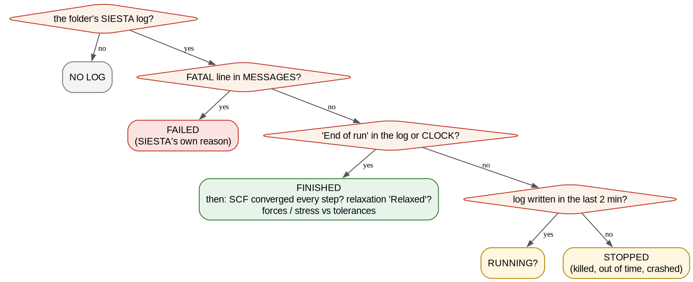
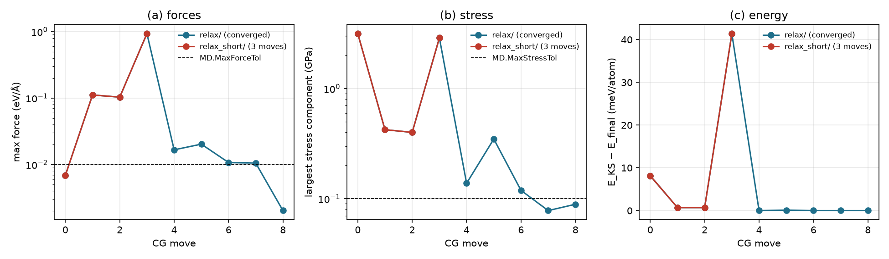
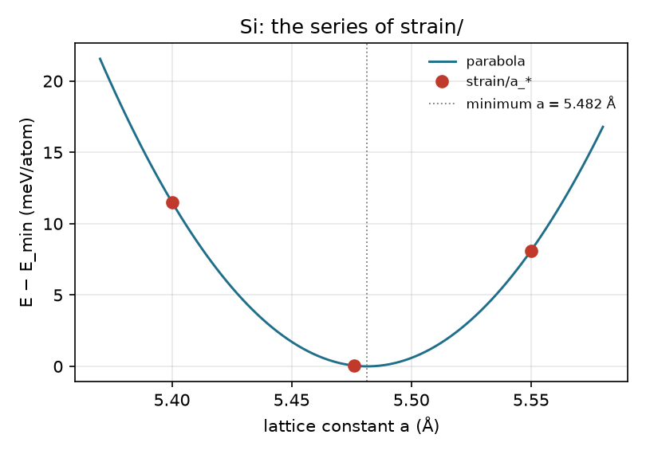

# 3.6 — Status Checker (`stb-status`)

After a batch of SIESTA jobs the questions are always the same: which runs finished, which failed and why, which are
still running, did the SCF and the relaxation converge, and what came out. `stb-status` answers them from the files
SIESTA leaves in a folder (the log, `MESSAGES`, `CLOCK`, the `.EIG`, the `.XV`, ...). For one folder it gives a full
report:

- the **state**: finished, failed (with SIESTA's own reason), probably still running, or stopped;
- the run: SIESTA version, processes, start and end, wall time;
- the system: atoms, cell, electrons, spin, XC functional, k-points, mesh cutoff;
- the **progress**: steps done against those requested. For a relaxation it also gives SIESTA's own verdict, the last
  force and stress against their tolerances, and a table of every move;
- the SCF: iterations per step, the tolerance SIESTA actually used, failures;
- the results: energies, Fermi level, band gap, spin moment, forces, pressure;
- the output files present, each with **the suite tool that reads it**.

For several folders (a glob, or `--recursive`) it gives one table, with each energy relative to the lowest one of the
same composition and level of theory. `--csv` saves that table.

The example is a small "project" of real SIESTA 5.4 runs, each finished in seconds. It covers a single point with
bands, a relaxation that converges and one that runs out of moves, an SCF that fails, an MD run, a spin-polarized
metal, and a series of three lattice constants. Everything runs in seconds; no SIESTA is needed.

---

## Contents

1. [Theory](#1-theory)
2. [The diagnosis at a glance](#2-the-diagnosis-at-a-glance)
3. [Libraries and external dependencies used](#3-libraries-and-external-dependencies-used)
4. [What `stb-status` does](#4-what-stb-status-does)
5. [Running it both ways](#5-running-it-both-ways)
6. [Worked example](#6-worked-example)
7. [What to take from the example](#7-what-to-take-from-the-example)
8. [Reproducing the reference data](#8-reproducing-the-reference-data)
9. [Known, deliberate limitations](#9-known-deliberate-limitations)
10. [Step-by-step: checking your own runs](#10-step-by-step-checking-your-own-runs)
11. [Files in this folder](#11-files-in-this-folder)
12. [Running the script](#12-running-the-script)
13. [Flag reference](#13-flag-reference)
14. [What's next](#14-whats-next)
15. [References](#15-references)

---

## 1. Theory

### 1.1 What SIESTA leaves behind, and what each file says

| File | What `stb-status` reads from it |
|---|---|
| the log (`<label>.out` or the job's own name, e.g. `calc.out`) | version, `Running on N nodes`, `Start of run` / `End of run`, the `redata:` settings (spin, SCF limits and tolerance, dynamics, tolerances, number of moves), k-points, mesh, every geometry step (SCF iterations, `SCF cycle converged`, E_KS, forces, stress, pressure), the final-energy block, `Relaxed` / `Final (unrelaxed)` coordinates, warnings |
| `MESSAGES` | SIESTA 5's own summary: `INFO: Job completed`, or `FATAL: <reason>` |
| `CLOCK` | wall time, and an `End of run` line when the job ended |
| `<label>.EIG` | eigenvalues on the SCF k-mesh: the band gap |
| `<label>.XV` | the last geometry: atoms and cell |
| `<label>.MDE` | for MD: temperature and energies per step |

The log's name is found as `<label>.out`, or the only `*.out` in the folder. The label comes from the folder's `.fdf`
(`SystemLabel`, or `--label`).

### 1.2 The state of a run

```
log?  no  -> NO LOG
      yes -> FATAL line in MESSAGES?        yes -> FAILED   (SIESTA's reason, e.g. SCF_NOT_CONV)
             'End of run' in log or CLOCK?   yes -> FINISHED
             log written in the last 2 min?  yes -> RUNNING?
                                             no  -> STOPPED  (killed, out of queue time, crashed silently)
```

`RUNNING?` has a question mark because the tool cannot see the batch queue: it only knows the log is growing. A
FINISHED run still needs two more checks before its result is usable:

- **SCF**: every geometry step should say `SCF cycle converged after N iterations`. When it does not and
  `SCF.MustConverge` is on (the default), SIESTA aborts, which gives a FAILED run. When it is off, the run goes on with
  an unconverged density, and the report flags every such step.
- **Relaxation**: SIESTA ends a relaxation with `outcoor: Relaxed atomic coordinates` when forces and stress are
  below `MD.MaxForceTol`/`MD.MaxStressTol`. It ends with `outcoor: Final (unrelaxed)` when it used up `MD.NumCGsteps`.
  The job ends normally in both cases. The report gives SIESTA's verdict, the last force (the largest atomic force) and
  stress (the largest component of the stress tensor), each against its tolerance.

### 1.3 The values SIESTA actually used

Every setting is reported as the log's `redata:` block gives it, not as the `.fdf` says. SIESTA reads the **first**
occurrence of a label in the `.fdf`, so a value appended at the end of a file that already sets it is silently ignored.
The failed run of this example has that trap (section 6.4).

### 1.4 Comparing runs: relative energies

Total energies of different runs can be compared only at the same level of theory and composition. In a table of
several folders, `dE` is the energy per atom above the lowest folder with the same element fractions **and** the same
XC functional, spin treatment, mesh cutoff and basis (`PAO.BasisSize`, `PAO.EnergyShift`). A different setting
starts a new group with its own zero. MD runs are left out, because their energy is that of a single instant.

---

## 2. The diagnosis at a glance



*Figure 1. How the state of a folder is decided. A FINISHED run is then checked for SCF convergence in every step and,
for a relaxation, for SIESTA's own verdict and the tolerances.*

## 3. Libraries and external dependencies used

| Library | Used for |
|---|---|
| Python standard library | reading the logs, MESSAGES and CLOCK, walking folders, CSV |
| `numpy` | statistics, forces, cells |
| `sisl` [1] | reading the `.XV` |
| `stb.core` | `siesta_log` (`find_out_file`, `read_eig_gap`, `get_spin_moment`, `get_mde_trajectory`), `structure_io`, the report |

It runs on a cluster's login node next to the runs: no SIESTA, no GPU, a few seconds per hundred folders.

## 4. What `stb-status` does

### 4.1 Step by step

1. **Find the folders**: `--path` (a folder or a glob), or every non-hidden folder below it with a `.out` or `.fdf`
   (`--recursive`).
2. **For each**: find the label, the log and the input; read the log in one pass, then `MESSAGES`, `CLOCK`, `.EIG`,
   `.XV`.
3. **Decide the state** (section 1.2) and collect the warnings.
4. **Print** the full report for one folder, or one table for several (`--details` adds the full report of each).

### 4.2 The report, section by section

One folder:

| Section | What it shows |
|---|---|
| `[0] RUN METADATA` | date, version, target |
| `[1] RUN` | folder, label, input, log, **state** and reason, processes, start, end, wall time |
| `[2] SYSTEM` | atoms, last cell, electrons, spin, XC, k-points, mesh cutoff required and used |
| `[3] PROGRESS` | run type; relaxation: moves vs the maximum, variable cell, SIESTA's verdict, force and stress vs tolerances; MD: steps vs requested, T and E_tot from the `.MDE`; a table of every step |
| `[4] SCF` | iterations in total and per step, converged steps, the tolerance and limit SIESTA used |
| `[5] RESULTS` | total and band-structure energies, Fermi level, energy per atom, band gap, spin moment, forces (max, net), pressure, dipole, log warnings |
| `[6] FILES & NEXT STEPS` | folder size; each analysis output and the suite tool that reads it |
| `[7] SUMMARY & FILES` | the verdict |
| `[8] WARNINGS` | every warning, numbered |

Several folders: `[1] FOLDERS` replaces sections 1–6. It holds one row per folder: state, type (with the relaxation
verdict), steps, SCF, energy, `dE`, last max force, last pressure, gap and wall time, plus the counts of each state.

### 4.3 Guard rails

The report warns when a run failed (with SIESTA's reason), is probably still running or stopped, has unconverged SCF
steps, ended a relaxation unrelaxed, has a net force above 0.05 eV/Å (mesh too coarse or SCF unconverged), or has no
log at all.

## 5. Running it both ways

From the command line:

```bash
stb-status                                   # this folder, the full report
stb-status --path relax                      # another folder
stb-status --path 'strain/a_*'               # several folders: one table, relative energies
stb-status --path project --recursive        # every run folder below project/
stb-status --path project --recursive --csv status.csv --details
```

From the menu (`stb-suite`, code `3.6`): the folder or glob, whether to go recursive, a label, the CSV file and the
report are asked in turn.

## 6. Worked example

`project/` holds nine SIESTA 5.4.2 runs [2] (PBE [3], DZP basis, PseudoDojo pseudopotentials [4]), all made by
`run_project.sh` in under two minutes on 4 processes:

| Folder | What it is |
|---|---|
| `bulk_sp/` | Si, 2-atom fcc cell, a = 5.476 Å, single point with bands and the density |
| `relax/` | Si from a = 5.55 Å, variable-cell CG relaxation (`MD.MaxForceTol 0.01 eV/Ang`, `MD.MaxStressTol 0.1 GPa`) |
| `relax_short/` | the same relaxation with `MD.NumCGsteps 3` |
| `scf_fail/` | Si with `MaxSCFIterations 3`: the SCF cannot converge |
| `md/` | Si, 8 atoms, velocity Verlet from 600 K, 20 steps |
| `fe_spin/` | bcc Fe, ferromagnetic |
| `strain/a_5.40/`, `a_5.476/`, `a_5.55/` | Si single points at three lattice constants |

Each folder keeps its input, log, `MESSAGES`, `CLOCK` and small outputs (`.XV`, `.EIG`, `.bands`, ...); 1.6 MB in all,
and the pseudopotentials are not shipped. The guided script `example_3.6.sh` runs every case on a copy in
`output/`; the reference reports are in `reference_results/`.

### 6.1 A converged relaxation: the whole report (Case 1)

```bash
stb-status --path project/relax
```

```
[1] RUN
State             : FINISHED
Processes         : 4 MPI
Started           : 30-OCT-2026  20:42:03
Ended             : 30-OCT-2026  20:42:15
Wall time         : 11.8 s (CLOCK)

[3] PROGRESS
Run type          : relaxation (CG coord. optimization)
Moves             : 8 of at most 30 (plus the input geometry)
Variable cell     : yes
Relaxation        : converged ('Relaxed atomic coordinates')
Max force (last)  : 0.0020 eV/Ang vs tolerance 0.01 (ok)
Max stress (last) : 0.0890 GPa (largest component) vs tolerance 0.1 GPa (ok)
step | SCF its | E_KS (eV) | max F (eV/Ang) | P (kBar) | net F
0    | 8       | -230.0192 | 0.0068         | -31.51   | 0.0000
1    | 8       | -230.0341 | 0.1112         | -0.89    | 0.0001
...
8    | 4       | -230.0355 | 0.0020         | -0.89    | 0.0000

[4] SCF
Iterations        : 48 in 9 step(s); per step min 4, mean 5.3, max 8
Tolerance         : dDmax < 1e-05, at most 1000 iterations (failure aborts the run)

[5] RESULTS
Total energy      : -230.035507 eV
Fermi level       : -4.180341 eV
Band gap (.EIG)   : 0.9406 eV (indirect; VBM -4.6468, CBM -3.7062 eV; 108 k-points)
```

The input cell (a = 5.55 Å) starts under −31.5 kBar of tension. After 8 moves the cell has relaxed (a = 3.8742·√2 =
5.479 Å) with both tolerances met, and SIESTA wrote `Relaxed atomic coordinates`. The first SCF needs 8 iterations;
the later ones, starting from the previous density, need 4. The net force stays below 2 × 10⁻⁴ eV/Å: the mesh is fine
enough.



*Figure 2. The two relaxations move by move, read with `stb-status`'s own log parser: (a) max force, (b) largest
stress component, both against their tolerances (dashed), (c) energy above the final one. The CG line search overshoots
at move 3; `relax/` recovers at move 4, `relax_short/` stops there.*

### 6.2 A single point: results and what to do next (Case 2)

```
[5] RESULTS
Total energy      : -230.035330 eV
Fermi level       : -4.177431 eV
Band gap (.EIG)   : 0.9355 eV (indirect; VBM -4.6394, CBM -3.7039 eV; 108 k-points)
Max force         : 0.006896 eV/Ang (net 0.000010)
Pressure          : 2.0864 kBar (0.2086 GPa)

[6] FILES & NEXT STEPS
output           | files                | read by
band structure   | si.bands             | stb-bands (2.1)
eigenvalues      | si.EIG               | band gap here; stb-dos (2.2)
real-space grids | si.RHO               | stb-cube (3.3), stb-bader (2.6), stb-density (2.8)
final geometry   | si.STRUCT_OUT, si.XV | stb-translate (3.1)
```

The gap from the SCF k-mesh is 0.94 eV, indirect (PBE puts silicon's gap at ~0.6 eV with converged plane waves; the
DZP basis and the 6×6×6 mesh, which misses the conduction-band minimum near X, both raise it). The last table lists
what the folder can be used for next.

### 6.3 A relaxation that ran out of moves (Case 3)

```
Moves             : 3 of at most 3 (plus the input geometry)
Relaxation        : NOT converged ('Final (unrelaxed)')
Max force (last)  : 0.9318 eV/Ang vs tolerance 0.01 (above)
Max stress (last) : 2.8790 GPa (largest component) vs tolerance 0.1 GPa (above)
Verdict           : FINISHED -- but see the warnings
  1. relaxation NOT converged: SIESTA wrote 'Final (unrelaxed)' coordinates after 3 of 3 moves -- raise
     MD.NumCGsteps or restart from the .XV.
```

The job ended normally, with `MESSAGES` saying `Job completed`, so a check of the exit status alone would call it a
success. But the structure is not relaxed. Worse, the third move was a line-search overshoot (Figure 2), so the run
stopped 41 meV/atom above the minimum with forces of 0.93 eV/Å, *further* from the answer than after move 1.

### 6.4 A failed SCF (Case 4)

```
State             : FAILED
                    SCF_NOT_CONV: SCF did not converge in maximum number of steps (required).
[4] SCF
Iterations        : 3 in 1 step(s); per step min 3, mean 3.0, max 3
Converged steps   : 0 of 1
Tolerance         : dDmax < 1e-05, at most 3 iterations (failure aborts the run)
```

The reason is SIESTA's own, from `MESSAGES`. The tolerance line holds a lesson. This `calc.fdf` sets
`SCF.DM.Tolerance 1.0d-5` and, at its end, `SCF.DM.Tolerance 1.0d-8`. SIESTA keeps the first occurrence, so the run
used 10⁻⁵; the report shows the value from the log, not the one at the end of the input. The run failed on
`MaxSCFIterations 3` alone.

### 6.5 Running, or stopped? (Case 5)

The script copies `relax/` and cuts its log after move 4, with no `End of run` anywhere. Written seconds ago:

```
State             : RUNNING?
                    log written 1 s ago, no end of run yet
E_KS (last step)  : -229.952700 eV (no final-energy block: the run did not finish)
```

The same folder, with the log's date set three hours back:

```
State             : STOPPED
                    no end of run, log last written 3.00 h ago -- killed, out of time, or crashed
```

A job killed by the queue's time limit leaves exactly this: a log that stops mid-run and no `FATAL` line.

### 6.6 A series: relative energies (Case 6)

```bash
stb-status --path 'project/strain/a_*'
```

```
folder  | state    | type         | steps | SCF | E (eV)    | dE (meV/atom) | max F | P (kBar) | gap (eV) | wall
a_5.40  | FINISHED | single point | 1     | ok  | -230.0124 | 11.5          | 0.007 | 43.4     | 0.864    | 2.0 s
a_5.476 | FINISHED | single point | 1     | ok  | -230.0353 | 0.0           | 0.007 | 2.1      | 0.935    | 2.0 s
a_5.55  | FINISHED | single point | 1     | ok  | -230.0192 | 8.1           | 0.007 | -31.5    | 1.002    | 1.8 s
```

The middle lattice constant is the lowest, and the pressure changes sign between it and 5.55 Å. A parabola through
the three energies puts the minimum at a = 5.482 Å (Figure 3), and the relaxation of section 6.1 at 5.479 Å. The gap
opens with the lattice constant, as silicon's indirect gap does (it closes under pressure).



*Figure 3. The three single points of `strain/` (energy per atom) and the parabola through them.*

### 6.7 The whole project (Case 7)

```bash
stb-status --path project --recursive --csv project_status.csv
```

```
folder         | state    | type                     | steps | SCF | E (eV)     | dE (meV/atom) | max F | P (kBar) | gap (eV) | wall
bulk_sp        | FINISHED | single point             | 1     | ok  | -230.0353  | 0.1           | 0.007 | 2.1      | 0.935    | 2.0 s
fe_spin        | FINISHED | single point             | 1     | ok  | -3408.6740 | 0.0           | 0.000 | -61.5    | metal    | 32.3 s
md             | FINISHED | MD                       | 20    | ok  | -918.5653  | -             | 2.289 | 2.3      | 1.800    | 34.4 s
relax          | FINISHED | relaxation (relaxed)     | 8     | ok  | -230.0355  | 0.0           | 0.002 | -0.9     | 0.941    | 11.8 s
relax_short    | FINISHED | relaxation (not relaxed) | 3     | ok  | -229.9527  | 41.4          | 0.932 | 27.4     | 0.792    | 6.1 s
scf_fail       | FAILED   | single point             | 1     | NO  | -          | -             | -     | -        | -        | -
strain/a_5.40  | FINISHED | single point             | 1     | ok  | -230.0124  | 11.6          | 0.007 | 43.4     | 0.864    | 2.0 s
...
States            : 1 FAILED, 8 FINISHED
```

Every Si run with the same settings shares one energy zero, the relaxed structure. `fe_spin` is its own group
(another element, spin-polarized, another mesh), and so would be a run with another basis. The MD row has no `dE`. Its
"max F" of 2.3 eV/Å is that of a hot instant, not a sign of a problem. The failed SCF is red and the unrelaxed
relaxation yellow. `project_status.csv` (`reference_results/project/`) holds the same table.

### 6.8 The interactive menu (Case 8)

`stb-suite` → `3.6`, folder `project`, recursive yes, gives the same table (`reference_results/menu/report.txt`).

## 7. What to take from the example

- **FINISHED is not usable.** A relaxation can end normally and unrelaxed, here 41 meV/atom from the minimum; read the
  relaxation verdict and the SCF line.
- **A failure carries SIESTA's reason** (`MESSAGES`); an unfinished log is `RUNNING?` or `STOPPED` by its age.
- **The report shows what SIESTA used**, from the log; a duplicated fdf label is a silent trap.
- **Compare energies only within a group**: same composition, XC, spin, mesh, basis; the table does that for you.

## 8. Reproducing the reference data

```bash
source ~/.anaconda3/etc/profile.d/conda.sh && conda activate stb   # or any environment with stb_suite
bash make_reference.sh          # every report into reference_results/<case>/ (seconds, no SIESTA)
bash run_project.sh 4           # project/ itself (SIESTA 5.x + mpirun, ~2 min)
python3 theory_figures.py       # figures/relax_progress.png, strain_energy.png
dot -Tpng -Gdpi=150 figures/status_flowchart.dot -o figures/status_flowchart.png
```

Dates and the age of a log in the reports are replaced by `<date>`/`<age>`; the rest is deterministic.

## 9. Known, deliberate limitations

- **`RUNNING?` is a guess** from the age of the log (2 minutes): the tool does not see the batch queue. A job that
  writes rarely can look stopped.
- **One log per folder**: `<label>.out` or the only `*.out`. A folder with several `.out` files and none named after
  the label is reported as having no log; rename it or pass `--label`.
- **Settings come from the log's `redata:` block**: a log cut before it (a run that died while reading its input) has
  none.
- **Relative energies trust the grouping** (composition, XC, spin, mesh, basis): k-points, pseudopotentials and other
  settings are not compared. Keep a series' other settings equal.
- **No restart files are judged**: whether a `.DM` or `.XV` still belongs to the input is `stb-clean`'s question
  (`3.2`).

## 10. Step-by-step: checking your own runs

1. **One run**: `stb-status --path <folder>`. Read `State`, then `PROGRESS` and `SCF`.
2. **A batch**: `stb-status --path '<pattern>'` or `--path <root> --recursive`. Read the colours and `States`.
3. **Failed or stopped runs**: the reason line, then the log near its end; restart from the `.XV`/`.DM`
   (`stb-clean --keep ... .DM .XV`).
4. **A series**: read `dE` and `P` across it; save it with `--csv`.

## 11. Files in this folder

| File | What it is |
|---|---|
| `README.md` | this tutorial |
| `example_3.6.sh` | the guided walk-through (8 cases, seconds) |
| `project/` | the nine SIESTA 5.4.2 runs (inputs, logs, MESSAGES, CLOCK, small outputs) |
| `run_project.sh` | builds and runs `project/` (needs SIESTA) |
| `make_reference.sh` | regenerates `reference_results/` |
| `theory_figures.py` | Figures 2 and 3 |
| `figures/` | every figure of this README; `status_flowchart.dot` is the flowchart's source |
| `reference_results/` | one folder per case: `report.txt`; `project/project_status.csv` |

## 12. Running the script

```bash
bash example_3.6.sh                # pauses between cases
yes '' | bash example_3.6.sh       # straight through
```

It needs the `stb_suite` package only (no SIESTA). It starts by wiping its own `output/`, never touches `project/`,
and takes a few seconds.

## 13. Flag reference

| Flag | Default | What it does |
|---|---|---|
| `--path PATH` | `.` | a folder, or a quoted glob of folders |
| `--recursive` | off | every non-hidden folder below `--path` with a `.out` or `.fdf` |
| `-l`, `--label LABEL` | from each folder's `.fdf` | SystemLabel override for every folder |
| `--details` | off | with several folders, also the full report of each |
| `--csv FILE` | none | also write the summary table as CSV |
| `--save-report` | off | also write `stb_status_report.txt` (current folder) |
| `--no-intro`, `-v` | | skip the banner; print the version |

## 14. What's next

- **`3.2` (`stb-clean`)** resets a folder for a rerun, keeping `.DM`/`.XV` to continue a stopped one.
- **`3.7` (`stb-archive`)** packages a finished run with its essential outputs.
- **`5.15` (EOS)** turns a series like `strain/` into V0, B0 and B0′ properly.

## 15. References

1. N. Papior, sisl: v0.16, https://github.com/zerothi/sisl (2024).
2. J. M. Soler et al., "The SIESTA method for ab initio order-N materials simulation", *J. Phys.: Condens. Matter*
   **14**, 2745 (2002).
3. J. P. Perdew, K. Burke, M. Ernzerhof, "Generalized gradient approximation made simple", *Phys. Rev. Lett.* **77**,
   3865 (1996).
4. M. J. van Setten et al., "The PseudoDojo: Training and grading a 85 element optimized norm-conserving
   pseudopotential table", *Comput. Phys. Commun.* **226**, 39 (2018).
