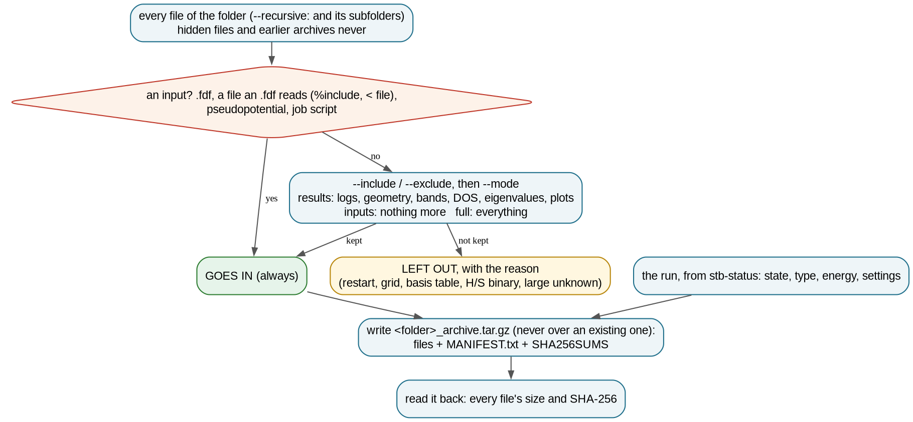
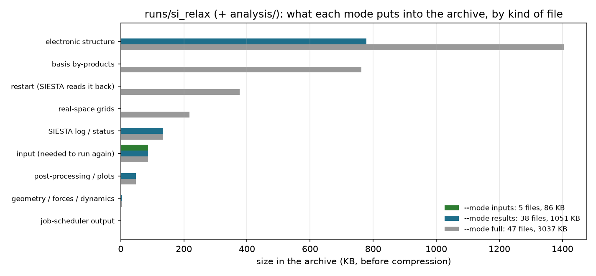

# 3.7 — Archive Packager (`stb-archive`)

`stb-archive` packages a SIESTA calculation folder into a `.tar.gz` for sharing or for the record. It sorts every file
by kind and puts in what you need, with a reason for each file:

- **what the input needs to run again**, always: the `.fdf` files, every file they read (`%include`, `< file`), the
  pseudopotentials, the job script;
- the results, by default: logs, geometry and trajectory, bands, DOS, PDOS, eigenvalues, plots;
- not the files SIESTA regenerates (basis tables, density matrix, H/S binaries, real-space grids), unless asked.

The archive explains and checks itself. Its `MANIFEST.txt` gives what the run was (state, settings, energy, gap, from
`stb-status`), and every file with its size, kind and SHA-256. Its `SHA256SUMS` is checked with `sha256sum -c` after
extraction. Before the report says ok, the tool reads the archive back and compares every file's checksum. It never
writes over an existing archive. `stb-archive` is the complement of `stb-clean` (`3.2`), which removes outputs to
prepare a rerun.

The example uses a real SIESTA 5.4 run kept exactly as SIESTA left it: 47 files, 3 MB. The default archive takes 38 of
them and compresses them to 269 KB. An inputs-only archive of 86 KB, unpacked elsewhere and run again, gives the same
relaxation to the last digit. Everything runs in seconds; Case 4 also reruns SIESTA (~15 s) when it is installed.

---

## Contents

1. [Theory](#1-theory)
2. [The archive at a glance](#2-the-archive-at-a-glance)
3. [Libraries and external dependencies used](#3-libraries-and-external-dependencies-used)
4. [What `stb-archive` does](#4-what-stb-archive-does)
5. [Running it both ways](#5-running-it-both-ways)
6. [Worked example](#6-worked-example)
7. [What to take from the example](#7-what-to-take-from-the-example)
8. [Reproducing the reference data](#8-reproducing-the-reference-data)
9. [Known, deliberate limitations](#9-known-deliberate-limitations)
10. [Step-by-step: archiving your own runs](#10-step-by-step-archiving-your-own-runs)
11. [Files in this folder](#11-files-in-this-folder)
12. [Running the script](#12-running-the-script)
13. [Flag reference](#13-flag-reference)
14. [What's next](#14-whats-next)
15. [References](#15-references)

---

## 1. Theory

### 1.1 Three kinds of file in a SIESTA folder

A finished SIESTA [1] folder holds three kinds of file, with very different value:

| Kind | Examples | Size here | Worth keeping? |
|---|---|---|---|
| **inputs** | `calc.fdf`, `structure.fdf`, `bandlines.txt`, `Si.psml`, `submit.slurm` | 86 KB | always: without them the run cannot be repeated |
| **results** | `calc.out`, `MESSAGES`, `.XV`, `.STRUCT_OUT`, `.ANI`, `.EIG`, `.bands`, `.PDOS(.xml)`, plots | ~1 MB | yes: what you look at, cite and compare |
| **regenerable bulk** | `Si.ion*` (basis tables), `.DM`, `.CG`, `.HSX`, `.RHO`, `*.grid.nc` | ~2 MB | rarely: SIESTA writes them again from the inputs |

In real calculations the third kind grows fastest: grids scale with the mesh, `.HSX`/`.DM` with the system and the
range of the basis. That is why the default archive leaves it out, while `--include` (for example `--include .RHO`
for a Bader analysis to be redone without SIESTA) or `--mode full` keeps it.

The kind of each file comes from SIESTA's naming conventions (`stb.core.run_files`, shared with `stb-clean`). A file
that only its content can classify is opened: a small text file starting with `#!` or holding scheduler directives is
a job script.

### 1.2 Rerunnable: what the input really needs

An `.fdf` can read other files:

```
%include structure.fdf                  # the whole file, as if pasted here
%block BandLines < bandlines.txt        # a block's contents from a file
```

`bandlines.txt` has no telling extension, but without it the input stops at once. `stb-archive` follows these
references the way SIESTA does, through included files too, and every file they read goes in, whatever its kind. It
then checks that the archive *can* rerun the calculation: there is at least one `.fdf`, every file read exists, and
every species of `%block ChemicalSpeciesLabel` has a `.psf`/`.psml`. Section 6.4 tests this claim by running SIESTA
from the archive.

### 1.3 Integrity: SHA-256 and the read-back

A cryptographic hash such as SHA-256 [2] maps a file to 256 bits. Any change to the file, even one byte, changes the
hash, and two different files practically never share one. The archive stores the hash of every file twice: in
`MANIFEST.txt`, with sizes and kinds for a reader, and in `SHA256SUMS`, in the format of the coreutils
`sha256sum -c` [3]:

```
d2f6...e1a3  calc.fdf
8773...9a28  CLOCK
```

Before reporting ok, `stb-archive` reads the written archive back and recomputes every member's hash. After
extraction, anyone can repeat the check with `sha256sum -c SHA256SUMS`, which reports every file `OK`, or `FAILED` for
a file that changed (section 6.2). The archive itself gets a hash in the report, to quote when the archive is shared.

### 1.4 Never overwrite

An archive is often the only copy left once a folder is cleaned or a scratch disk purged. So the default name
`<folder>_archive.tar.gz` becomes `<folder>_archive_1.tar.gz`, `_2`, ... when it exists, and an explicit `-o` that
exists is refused unless `--force`. Earlier archives and `stb-clean` backups in the folder are never packed into a new
one.

---

## 2. The archive at a glance



*Figure 1. How each file is decided, and what the archive holds.*

## 3. Libraries and external dependencies used

| Library | Used for |
|---|---|
| Python standard library (`tarfile`, `hashlib`, `os`) | the archive, SHA-256, walking the folder |
| `stb.core.run_files` | the kind of each file, the files an `.fdf` reads, job-script detection (shared with `stb-clean`) |
| `stb.status` | the run summary of the manifest (state, settings, energy, gap) |
| `stb.core.cli` | the numbered report |

No SIESTA, no scientific libraries: it runs on a cluster's login node next to the runs.

## 4. What `stb-archive` does

### 4.1 Step by step

1. **List the files**: the folder (`--recursive`: and its subfolders), never hidden files or earlier archives.
2. **Sort them**: inputs (always in), then `--exclude`/`--include`, then the mode (`results`, `inputs`, `full`).
3. **Check rerunnability**: `.fdf` present, every file it reads present, a pseudopotential per species.
4. **Summarize the run** with `stb-status`: state, type, settings, energy, gap, forces; warn if it did not finish, or if
   a relaxation did not converge.
5. **Write** `<folder>_archive.tar.gz` (one top folder named after the source; never over an existing archive), with
   `MANIFEST.txt` and `SHA256SUMS`.
6. **Read it back** and compare every file's size and SHA-256.

### 4.2 The report, section by section

| Section | What it shows |
|---|---|
| `[0] RUN METADATA` | date, version, target, mode, `--include`/`--exclude`, what always and never goes in |
| `[1] FOLDER <path>` | files and size, how many go in and out, the run (state, type, SIESTA, energy) |
| `[2] GOING IN` | every input and why it is one; the results by kind; **Rerunnable**; subfolders left out without `--recursive` |
| `[3] LEFT OUT` | by kind, with sizes and the reason; the largest files; the `--include` that would add them back |
| `[4] ARCHIVE` | the file, members, size and compression, the archive's SHA-256, the read-back verification, the restore command |
| `[n] SUMMARY & FILES` | the archives written; for a glob, one row per folder |
| `[n+1] WARNINGS` | every warning, numbered |

With a glob, sections 1–4 repeat for each folder.

### 4.3 Guard rails

The report warns when:

- the archive could not rerun the calculation (a missing pseudopotential or a missing file read by an `.fdf`, or no
  `.fdf`);
- the run did not finish, or failed, or its relaxation did not converge (`stb-status`'s verdict);
- an `-o` archive exists (nothing is written);
- the read-back check fails (the exit code is then 1);
- nothing would go in.

## 5. Running it both ways

From the command line:

```bash
stb-archive --path si_relax --dry-run           # what would go in, and why
stb-archive --path si_relax --recursive         # results mode, with subfolders -> si_relax_archive.tar.gz
stb-archive --path si_relax --include .RHO      # also the density
stb-archive --path si_relax --mode inputs       # only what reruns it
stb-archive --path 'strain/a_*'                 # one archive per folder
```

Restoring and checking:

```bash
tar -xzf si_relax_archive.tar.gz && cd si_relax && sha256sum -c SHA256SUMS
```

From the menu (`stb-suite`, code `3.7`): the folder or glob, the mode, subfolders, extra suffixes in or out, dry run
and report are asked in turn.

## 6. Worked example

`runs/si_relax/` is a SIESTA 5.4.2 run of bulk Si (PBE [4], DZP, PseudoDojo [5]), made by `run_example.sh`. It is a
variable-cell CG relaxation from a = 5.55 Å, followed by bands, DOS/PDOS, the density and H/S (`SaveRho`, `SaveHS`).
Its inputs are `calc.fdf`, which `%include`s `structure.fdf` and reads `bandlines.txt`, and the Slurm script
`submit.slurm`. `analysis/` holds a band-structure plot and its data. The folder is kept exactly as SIESTA left it,
47 files and 3 MB, except for `Si.psml`. The pseudopotential is an input and must go into the archive, but the
repository does not keep it: the scripts copy it in from the suite's bundled bank. `runs/strain/a_*` are three single
points (trimmed of their regenerable files for the repository).

### 6.1 What would go in: `--dry-run` (Case 1)

```bash
stb-archive --path si_relax --dry-run
```

```
[1] FOLDER si_relax
Files             : 45 (2.9 MB)
Going in          : 36 files (1003.2 KB); left out 9 (1.9 MB)
The run           : FINISHED, relaxation, SIESTA 5.4.2, E = -230.0355 eV

[2] GOING IN
input         | size    | why
Si.psml       | 84.7 KB | pseudopotential
bandlines.txt | 65 B    | read by calc.fdf
calc.fdf      | 768 B   | SIESTA input
structure.fdf | 375 B   | SIESTA input
submit.slurm  | 123 B   | job script
kind                           | files | size     | e.g.
electronic structure           | 8     | 778.0 KB | si.DOS, si.EIG, si.KP, +5
SIESTA log / status            | 16    | 134.4 KB | 0_NORMAL_EXIT, BASIS_ENTHALPY, BASIS_HARRIS_ENTHALPY, +13
geometry / forces / dynamics   | 5     | 2.5 KB   | si.ANI, si.BONDS, si.BONDS_FINAL, +2
Rerunnable        : yes -- every .fdf, the files they read and a pseudopotential for every species
Subfolders        : analysis -- not included (--recursive takes them)

[3] LEFT OUT
kind                           | files | size     | why
basis by-products              | 3     | 762.3 KB | basis table (SIESTA regenerates it)
electronic structure           | 1     | 628.3 KB | H/S or wavefunction binary (large)
restart (SIESTA reads it back) | 3     | 376.6 KB | restart file (regenerable by rerunning)
real-space grids               | 2     | 218.4 KB | real-space grid (large)
Largest           : si.HSX (628.3 KB), si.DM (375.9 KB), Si.ion (366.3 KB)
Add back with     : --include .CG .DM .HSX .RHO .STRUCT_NEXT_ITER .grid.nc .ion .ion.nc .ion.xml  (or --mode full)
```

`bandlines.txt` is an input because `calc.fdf` reads it, and `submit.slurm` because its content is a job script. The
`.XV` (the relaxed geometry) goes in, while the other restart files stay out. Two thirds of the folder are regenerable
and stay out. The subfolder is not taken without `--recursive`, and the report says so instead of dropping it
silently.

### 6.2 The archive, the manifest and the checksums (Case 2)

```bash
stb-archive --path si_relax --recursive
```

```
[4] ARCHIVE
Archive           : si_relax_archive.tar.gz
                    40 members (38 files + MANIFEST.txt + SHA256SUMS), 269.4 KB (26 % of 1.0 MB)
Verification      : read back, every file's size and SHA-256 compared -- ok
Restore with      : tar -xzf si_relax_archive.tar.gz && cd si_relax && sha256sum -c SHA256SUMS
```

The manifest (`reference_results/archive/MANIFEST.txt`) starts with the run:

```
THE RUN (stb-status)
State             : FINISHED
Run type          : relaxation
SIESTA            : 5.4.2, 4 MPI processes
XC functional     : GGA Perdew, Burke & Ernzerhof 1996
k-points          : 108
Mesh cutoff       : 200 Ry required, 248.0 Ry used
Relaxation        : converged
Total energy      : -230.035507 eV
Band gap (.EIG)   : 0.9406 eV
```

and goes on with every file (SHA-256, size, kind, reason), every file left out, and how to restore. After extraction
`sha256sum -c SHA256SUMS` reports `OK` for each file. With one byte appended to `si.EIG` it reports:

```
si.EIG: FAILED
sha256sum: WARNING: 1 computed checksum did NOT match
```

The archive is one folder, `si_relax/`, so it unpacks next to other archives without mixing files
(`reference_results/archive/members.txt`).

### 6.3 The three modes (Case 3)

| `--mode` | Files | Size (before compression) | For |
|---|---|---|---|
| `inputs` | 5 | 86 KB | reproducing the run (section 6.4) |
| `results` (default) | 38 | 1.0 MB | sharing, papers, the record |
| `full` | 47 | 3.0 MB | everything, e.g. to move a folder |

`--include .RHO` adds the density to the results (39 files, 1.1 MB). Figure 2 shows what each mode takes, by kind.



*Figure 2. `runs/si_relax` (with `analysis/`) by kind of file, and what each mode puts into the archive, from
`stb-archive`'s own selection.*

### 6.4 Does an inputs-only archive reproduce the run? (Case 4)

`rerun_from_archive.sh` archives the folder with `--mode inputs`, unpacks it in an empty folder and runs SIESTA there
(`reference_results/rerun/comparison.txt`):

```
files unpacked from the inputs-only archive: MANIFEST.txt, SHA256SUMS, Si.psml, bandlines.txt, calc.fdf,
structure.fdf, submit.slurm
original: E_total -230.035507 eV, 8 CG moves, relaxed: True, Fermi -4.180341 eV
rerun   : E_total -230.035507 eV, 8 CG moves, relaxed: True, Fermi -4.180341 eV
difference: +0.000 meV
```

The 86 KB give back the whole calculation: the same 8 moves and the same energy to the last printed digit. The rerun
used the same SIESTA build and number of processes. Another build or machine can differ in the last digits, so the
manifest records the version and the processes.

### 6.5 Never overwritten (Case 5)

```
Name              : an archive with the default name exists -- writing si_relax_archive_1.tar.gz (never overwritten)
Not written       : 'si_relax_archive.tar.gz' exists (pass --force to overwrite)
```

### 6.6 What the report catches (Case 6)

Without the pseudopotential (`reference_results/guard_nopsml/`), and without the file `calc.fdf` reads
(`guard_noref/`):

```
1. nopsml: no pseudopotential (.psf/.psml) for Si -- the archive cannot rerun the calculation without it.
1. noref: an .fdf reads bandlines.txt, which is not in the folder -- the archive cannot rerun the calculation.
```

A run that never finished (`guard_unfinished/`, the log cut after move 4 and three hours old):

```
1. unfinished: the run is STOPPED (no end of run, log last written 3.00 h ago -- killed, out of time, or crashed)
   -- archiving an unfinished or failed run.
```

### 6.7 A series: one archive per folder (Case 7)

```bash
stb-archive --path 'strain/a_*'
```

```
folder         | run      | files | size     | archive                | archive size | check
strain/a_5.40  | FINISHED | 27    | 221.4 KB | a_5.40_archive.tar.gz  | 60.6 KB      | ok
strain/a_5.476 | FINISHED | 27    | 221.4 KB | a_5.476_archive.tar.gz | 60.6 KB      | ok
strain/a_5.55  | FINISHED | 27    | 221.4 KB | a_5.55_archive.tar.gz  | 60.7 KB      | ok
```

### 6.8 The interactive menu (Case 8)

`stb-suite` → `3.7`, folder `si_relax`, mode 2 (`inputs`), dry run, gives the same report as the command line
(`reference_results/menu/report.txt`).

## 7. What to take from the example

- **Inputs always go in**, including the files the `.fdf` reads and the job script; the report checks that the
  archive can rerun the calculation, and here an 86 KB archive did, exactly.
- The default archive keeps inputs and results (1 MB here) and leaves the regenerable two thirds out, each file with a
  reason; `--include` or `--mode full` changes that.
- **The archive is verified** before ok and checks itself after extraction (`sha256sum -c`). It also explains itself
  (`MANIFEST.txt`).
- It never overwrites an archive.

## 8. Reproducing the reference data

```bash
source ~/.anaconda3/etc/profile.d/conda.sh && conda activate stb   # or any environment with stb_suite
bash make_reference.sh          # every report and listing into reference_results/<case>/ (seconds, no SIESTA)
bash rerun_from_archive.sh 4    # reference_results/rerun/ (SIESTA 5.x + mpirun, ~15 s)
bash run_example.sh 4           # runs/ itself (SIESTA, ~30 s)
python3 theory_figures.py       # figures/contents.png
dot -Tpng -Gdpi=150 figures/archive_flowchart.dot -o figures/archive_flowchart.png
```

Dates, scratch paths and the hash of the archive itself (which contains a date) are replaced by `<date>`, `<work>` and
`<sha>`; the per-file checksums are deterministic.

## 9. Known, deliberate limitations

- **The kind of a file comes from its name** (and, for job scripts, its first lines). An unknown file goes in below
  1 MB and stays out above it in `results` mode, and the report lists it either way.
- **Pseudopotentials are found by species label** (`Si.psml` for species `Si`, the name SIESTA looks for by default);
  a pseudopotential under another name is reported missing although present.
- **Rerunnable is about files**, not about the environment: the same SIESTA version and build are needed for identical
  numbers (the manifest records the version and the processes).
- **One archive per folder** with a glob; for a whole project tree in one archive, use `--recursive` on its root.
- **The archive's own hash changes every time** (the manifest holds the date); the per-file hashes do not.

## 10. Step-by-step: archiving your own runs

1. **Check the run** (`stb-status`, `3.6`): finished, SCF converged, relaxed.
2. **`stb-archive --path <folder> --dry-run`**: read `GOING IN` (is every input there? `Rerunnable: yes`?) and
   `LEFT OUT` (anything you need later? add it with `--include`).
3. **Write it** (drop `--dry-run`; `--recursive` for subfolders) and keep the hash the report prints.
4. **Before deleting the folder**, unpack the archive somewhere and run `sha256sum -c SHA256SUMS`.
5. **Then clean or remove** the folder (`stb-clean`, `3.2`).

## 11. Files in this folder

| File | What it is |
|---|---|
| `README.md` | this tutorial |
| `example_3.7.sh` | the guided walk-through (8 cases, seconds; case 4 reruns SIESTA when available) |
| `runs/` | `si_relax/` (the full SIESTA 5.4.2 run, as SIESTA left it, minus `Si.psml`) and `strain/a_*` (trimmed) |
| `run_example.sh` | makes `runs/` (needs SIESTA) |
| `make_reference.sh` | regenerates `reference_results/` |
| `rerun_from_archive.sh` | the rerun of section 6.4 (needs SIESTA) |
| `theory_figures.py` | Figure 2 |
| `figures/` | every figure of this README; `archive_flowchart.dot` is the flowchart's source |
| `reference_results/` | one folder per case: `report.txt`; `archive/` also `members.txt`, `MANIFEST.txt`, `sha256sum_check.txt`, `sha256sum_tampered.txt`; `rerun/comparison.txt` |

## 12. Running the script

```bash
bash example_3.7.sh                # pauses between cases
yes '' | bash example_3.7.sh       # straight through
```

It needs the `stb_suite` package (SIESTA only for case 4). It starts by wiping its own `output/`, never touches
`runs/`, and takes a few seconds (plus ~15 s with SIESTA).

## 13. Flag reference

| Flag | Default | What it does |
|---|---|---|
| `--path PATH` | `.` | the folder, or a quoted glob of folders (one archive each) |
| `--mode` | `results` | `results`, `inputs` or `full` |
| `--include SFX ...` | none | also files ending with these (e.g. `.RHO .HSX`) |
| `--exclude SFX ...` | none | leave out files ending with these (inputs always go in) |
| `--recursive` | off | the files of subfolders too (hidden ones skipped), in the same archive |
| `-l`, `--label LABEL` | from the `.fdf` | SystemLabel for the run summary |
| `-o`, `--output FILE` | `<folder>_archive.tar.gz` | the archive's name (not with a glob) |
| `--force` | off | overwrite an existing archive of that name |
| `--dry-run` | off | report only; nothing written |
| `--save-report` | off | also write `stb_archive_report.txt` (current folder) |
| `--no-intro`, `-v` | | skip the banner; print the version |

## 14. What's next

- **`3.6` (`stb-status`)** checks the runs before archiving them.
- **`3.2` (`stb-clean`)** resets a folder for a rerun after its results are archived.
- **`3.1` (`stb-translate`)** converts the relaxed `.STRUCT_OUT` into a CIF to publish next to the archive.

## 15. References

1. J. M. Soler et al., "The SIESTA method for ab initio order-N materials simulation", *J. Phys.: Condens. Matter*
   **14**, 2745 (2002).
2. National Institute of Standards and Technology, "Secure Hash Standard (SHS)", FIPS PUB 180-4 (2015).
3. GNU coreutils manual, "sha2 utilities: Print or check SHA-2 digests", https://www.gnu.org/software/coreutils/.
4. J. P. Perdew, K. Burke, M. Ernzerhof, "Generalized gradient approximation made simple", *Phys. Rev. Lett.* **77**,
   3865 (1996).
5. M. J. van Setten et al., "The PseudoDojo: Training and grading a 85 element optimized norm-conserving
   pseudopotential table", *Comput. Phys. Commun.* **226**, 39 (2018).
