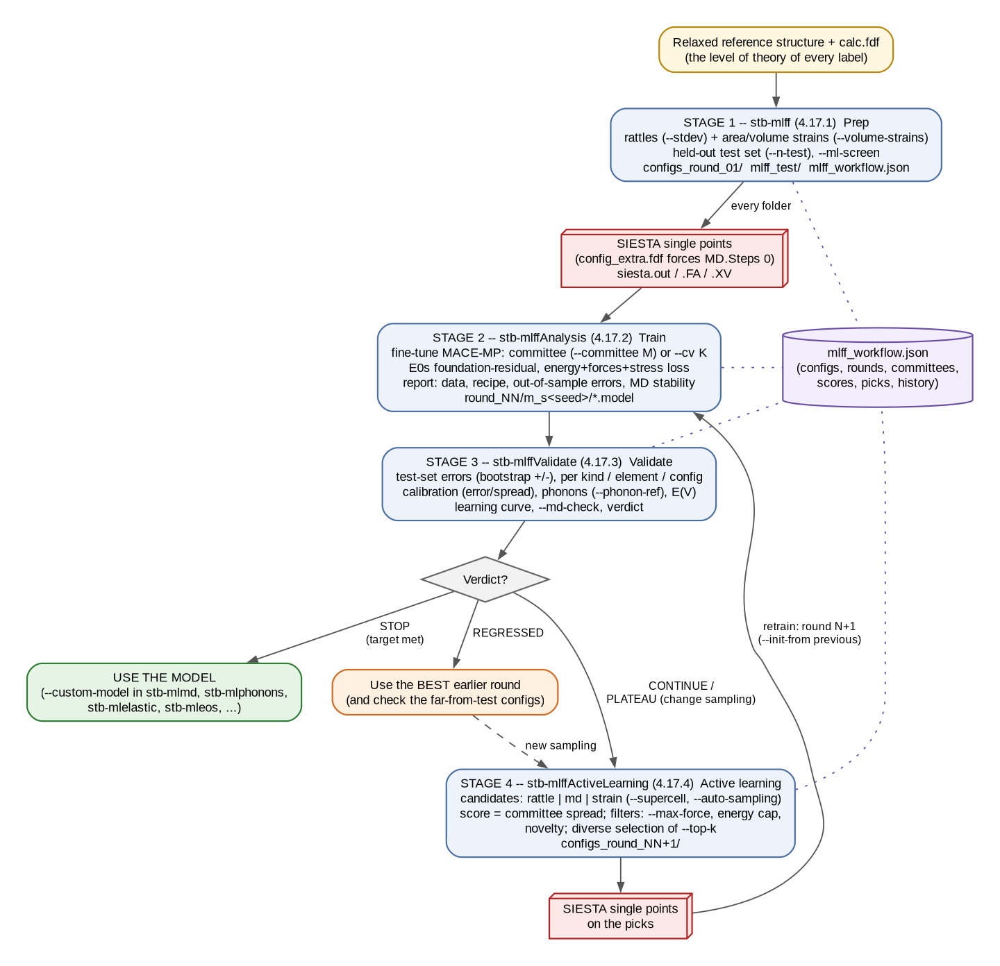
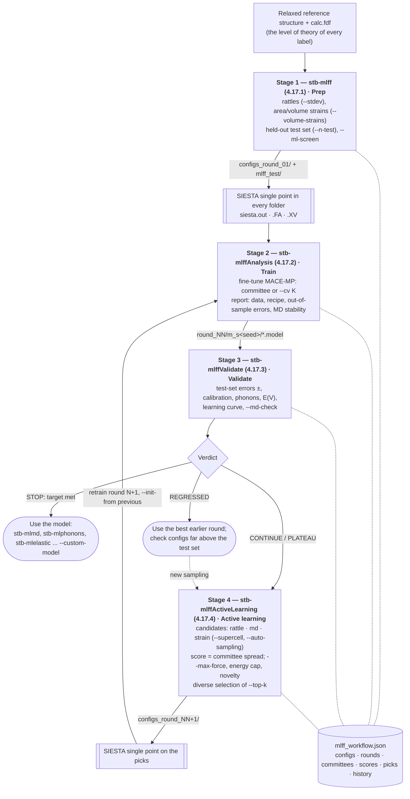
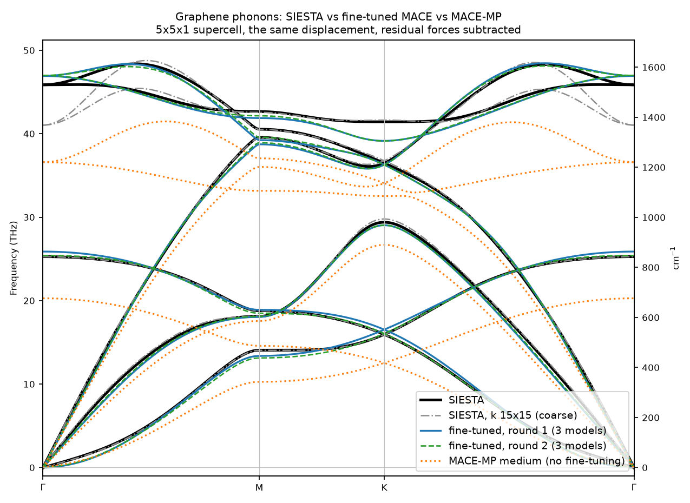
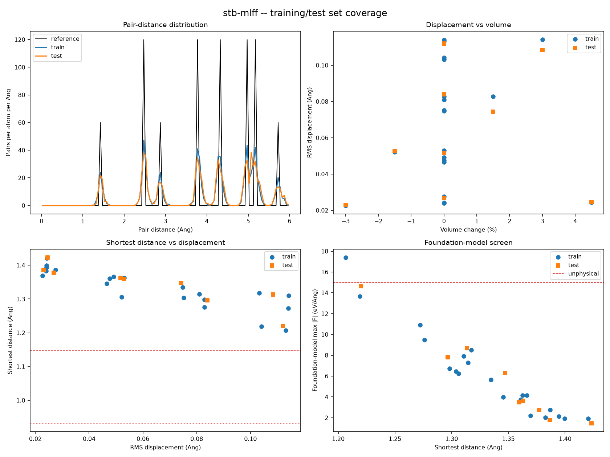
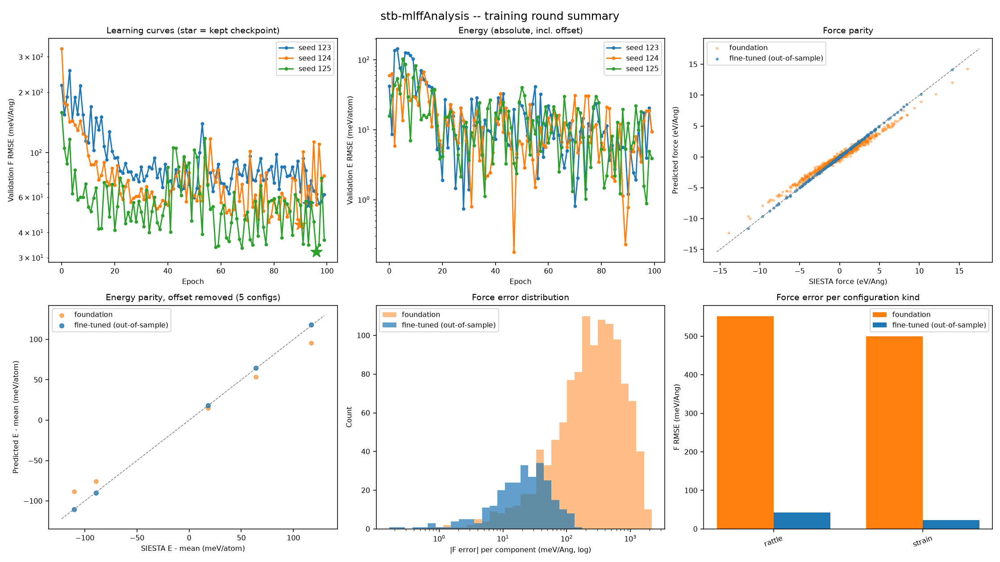
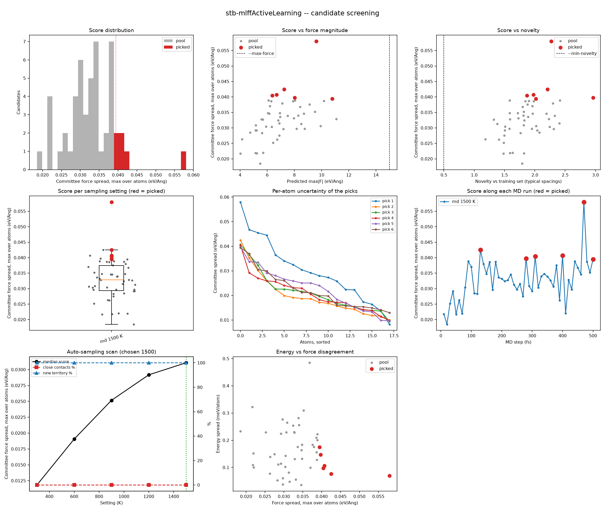
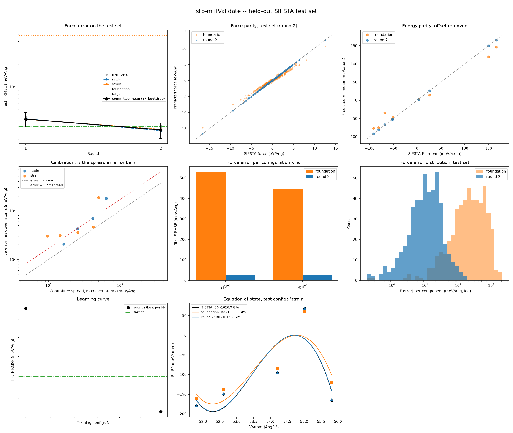

# 4.17 — Workflow: Custom ML Force Field (`stb-mlff` / `stb-mlffAnalysis` / `stb-mlffValidate` / `stb-mlffActiveLearning`)

This workflow turns SIESTA single points into a **machine-learned force field**
that you can run a thousand times faster than SIESTA itself, and tells you how far
to trust it. It has four stages that talk to each other through one state file,
`mlff_workflow.json`:

| Stage | Command | Code | What it does |
|---|---|---|---|
| 1 · Prep | `stb-mlff` | `4.17.1` | writes the SIESTA folders of the training set (rattled and strained copies of a relaxed structure) and of a held-out test set |
| 2 · Train | `stb-mlffAnalysis` | `4.17.2` | fine-tunes a **committee** of MACE models (MACE-MP foundation model) on the finished SIESTA runs, one *round* at a time |
| 3 · Validate | `stb-mlffValidate` | `4.17.3` | scores every round on the test set — forces, energies, stress, phonons against SIESTA, equation of state, an MD check — and says STOP / CONTINUE / PLATEAU / REGRESSED |
| 4 · Active learning | `stb-mlffActiveLearning` | `4.17.4` | lets the committee find the configurations it is unsure of (with MD, rattles or strains *run with the model*) and writes them as the next SIESTA folders |

It answers a question none of `4.1`–`4.16` does: not one property of one structure,
but **a potential-energy surface** you can then use for everything the
`5.x` ML Simulations tools do — molecular dynamics (`stb-mlmd`), phonons
(`stb-mlphonons`), elastic constants (`stb-mlelastic`), equations of state
(`stb-mleos`), melting, diffusion — at the level of theory of *your* SIESTA
calculation instead of the foundation model's.

The worked example (Section 8) runs the whole loop for real on **graphene**, in a
3×3 supercell (18 atoms): 30 SIESTA single points, a committee trained and
validated against a SIESTA phonon calculation, one active-learning round driven by
molecular dynamics, a second round, and an MD check labelled by SIESTA. Section 9
keeps a **real failure** — active learning that sampled too hard and made the
model worse — because it teaches more than the success. Before either, Section 8.1
shows that the SIESTA labels themselves needed a convergence check.

All four stages live in this one folder and this one tutorial — same reasoning as
`4.1`–`4.16`: each stage's output exists only to feed the next.

## 1. Theory

**Symbols at a glance**

| Symbol | Meaning |
|---|---|
| `R = {r_i}` | the atomic positions of one configuration (plus its cell) |
| `E(R)` | the potential-energy surface (PES): total energy as a function of `R` |
| `F_i = −∂E/∂r_i` | force on atom `i` |
| `σ = (1/V) ∂E/∂ε` | stress (derivative with respect to a homogeneous strain `ε`) |
| `ε_i` | energy contribution of atom `i` in a local (atomic) decomposition |
| `r_c` | cutoff radius of an atomic environment |
| `E0_Z` | reference ("isolated atom") energy of element `Z` |
| `N` | number of atoms of a configuration; `N_train` = training configurations |
| `σ_F` | committee spread: standard deviation of the predicted force over the models |
| `ν` | novelty of a configuration: distance of its environments to the training set |
| `k_B` | Boltzmann's constant, 0.08617 meV/K |

### 1.1 Why a machine-learned force field

Every SIESTA single point solves the Kohn–Sham equations: the cost grows roughly as
`N³` with the number of atoms, and one 18-atom graphene cell with a 10×10 k-grid takes
~30–60 s on two cores (Section 8). A molecular-dynamics run needs `10⁵–10⁶` steps,
a converged phonon calculation hundreds of displaced supercells, a melting or
diffusion study both — orders of magnitude beyond what direct DFT can afford.

A **machine-learned interatomic potential** (MLIP) is a fitted function `E_ML(R)`
that reproduces the DFT potential-energy surface `E_DFT(R)` — energies, forces and
stresses — at a small fraction of the cost (here ~0.1 s for 18 atoms on a CPU, a
few hundred times cheaper than SIESTA, much more on a GPU, and linear in `N`
instead of cubic) [23, 28]. It does **not** replace the
DFT level of theory: it *interpolates* it. Everything the MLIP knows comes from
the DFT labels it was trained on, so the central questions of this workflow are
*which configurations to compute with SIESTA*, *how good the fit is*, and
*where it can be trusted*.

### 1.2 The locality ansatz

All modern MLIPs (Behler–Parrinello [1], GAP [2], ACE [3], NequIP [4], MACE [5])
start from the same decomposition:

```
E(R) = Σ_i ε( environment of atom i within r_c )                            (1)
F_i  = −∂E/∂r_i ,      σ_αβ = (1/V) ∂E/∂ε_αβ                                (2)
```

Three consequences matter in practice:

1. **Extensivity and transferability in size.** Because `E` is a sum of local terms,
   a model trained on 18-atom cells can be run on 10⁴ atoms. It is only reliable
   there if the *local environments* of the large system look like those in the
   training set.
2. **Forces and stresses come for free** as exact derivatives of the same function,
   so the dynamics conserves energy (Section 1.10). They are also by far the
   richest labels: one configuration gives one energy but `3N` force components
   (18 atoms → 54 numbers) and 6 stress components.
3. **What a periodic training cell can teach is limited by its periodicity.** In a
   cell of `n×n` primitive cells, every displacement pattern is periodic with that
   supercell: only phonons with wavevectors commensurate with it
   (`q = (m₁/n, m₂/n)`) are ever sampled. The 2-atom graphene cell sees only Γ;
   the 3×3 cell of this example also contains **K = (1/3, 1/3)**, where graphene's
   highest optical branch has its Kohn anomaly [24]; M = (1/2, 0) needs an even `n`.
   The cutoff `r_c` is not the limit — the *training data* are.

### 1.3 MACE: an equivariant message-passing network

MACE [5] builds `ε_i` in two message-passing layers. In each layer, every atom
collects, from each neighbour within `r_c` (6 Å for MACE-MP), a radial function of
the distance times spherical harmonics of the bond direction, and combines them
into **many-body** features (products of up to four of them: body order up to 5
per layer, as in the atomic cluster expansion [3]). Features transform under
rotations as tensors of definite order, so the energy is exactly invariant and
the forces exactly equivariant under rotations, translations, reflections and
permutations of identical atoms (E(3) symmetry). After two layers an atom "sees"
up to `2 r_c` = 12 Å, but its energy remains a smooth function of its environment.

### 1.4 Foundation models, and what fine-tuning must fix

**MACE-MP-0** [6] is a MACE model trained once on ~1.5 million DFT configurations
of the Materials Project (MPtrj [7], PBE/PBE+U with PAW pseudopotentials in a
plane-wave code). It knows "chemistry in general" — carbon bonds, graphitic
layers — and is a good starting point. It is not a SIESTA model:

- **Different level of theory.** Basis (plane waves vs SIESTA's numerical atomic
  orbitals), pseudopotentials, `Mesh.Cutoff`, k-sampling, smearing: all change
  the PES slightly. On this example the raw foundation model has a force error
  of hundreds of meV/Å against SIESTA (Section 8.4).
- **A different energy zero.** A total energy contains a large per-element
  constant: SIESTA's absolute energies and the foundation model's differ by
  ~10⁵ meV/atom. Only *energy differences* are physical. We write

  ```
  E_SIESTA(R) = Σ_Z n_Z E0_Z  +  E_int(R)                                  (3)
  ```

  and fine-tuning has to put `E0_Z` on SIESTA's scale. Stage 2's default
  (`--e0s foundation-residual`) fits `E0_Z` by least squares to
  `E_SIESTA − E_int,foundation` over the training set *before* training, so the
  first epoch starts with the foundation model's own error on energy differences
  (tens of meV/atom) instead of the whole offset (the `average` option assumes
  `E_int = 0` and starts eV/atom off). **For a one-element system the `E0` and the
  mean interaction energy cannot be separated** (every configuration has the
  same stoichiometry): only their sum is fixed, which is harmless — energy
  differences between configurations of that composition are all that is
  predicted.

**Fine-tuning** continues training the pretrained weights on the SIESTA labels with
a small learning rate (`--lr 0.001`; 0.01 destroys what pretraining learned in the
first epochs). The result is a model on SIESTA's PES that keeps the foundation's
general shape where the training set is silent — the reason why even 21
configurations give a usable model.

### 1.5 The loss function

Training minimizes a weighted sum over the training configurations:

```
L = w_E Σ_c ((E_ML − E_DFT)/N_c)²  +  w_F Σ_c Σ_i |F_ML,i − F_DFT,i|² / (3N_c)
    + w_σ Σ_c |σ_ML − σ_DFT|²                                                   (4)
```

Energies per atom (eV/atom), forces (eV/Å) and stresses (eV/ų) live on very
different numerical scales: a 1 GPa stress is 0.006 eV/ų, so with `w_σ` = 100 the
stress term is ~2 % of the loss and has no effect. Stage 2 uses `--loss stress`
with `--stress-weight 1e4` by default (measured on a bulk-Si benchmark). Two
practical consequences of (4):

- **Large forces dominate.** The force term is a sum of *squared* errors, and a
  model's error grows with the force magnitude. One configuration with 15 eV/Å
  forces weighs as much as many near-equilibrium ones. This is why adding very
  distorted configurations can make a model *worse* near equilibrium
  (Section 9).
- **A validation split chooses the epoch.** Each committee member keeps a random
  fraction of the training configurations (`--valid-fraction`) out of the fit and
  keeps the epoch with the lowest validation loss; with `--cv K` the
  configurations are dealt into `K` folds, so every configuration is predicted
  once by a model that never saw it (the **out-of-sample** error of Stage 2).

### 1.6 Designing the training set: displacement, energy and temperature

A rattled configuration (Gaussian displacements of standard deviation `s` on every
Cartesian component of every atom) is a crude stand-in for a thermal snapshot.
In the harmonic approximation each vibrational degree of freedom holds `k_BT/2` of
potential energy on average, so per atom

```
⟨E − E_0⟩ / N  ≈  (3/2) k_B T          ⇔          T ≈ ΔE / (1.5 k_B)          (5)
```

This turns the energy above the reference — which Stage 1 measures with the
foundation model (`--ml-screen`) and Stage 4 with the committee — into a
**temperature you can judge**: for graphene 50 meV/atom ↔ 390 K, 200 meV/atom ↔
1550 K, and graphene melts near 4500 K (~580 meV/atom). Graphene's atoms at 300 K
move ~0.05 Å in the plane and more out of it, so rattles of 0.015–0.06 Å per
component span roughly 100–1700 K (Section 8.2's table measures it). A 0.15 Å
rattle of the 2-atom cell compresses bonds to 1.19 Å (a triple bond) at
1–2 eV/atom, ~10⁴ K: no simulation near room temperature will ever visit it
(Section 9).

Three axes of the training set:

| Axis | Stage 1 option | Teaches | Without it |
|---|---|---|---|
| Displacement amplitude | `--stdev` (several values) | the curvature and anharmonicity of the PES around the structure | one temperature only |
| Cell volume / shape | `--volume-strains`, Stage 4 `--sampling-method strain` | `E(V)`, bulk modulus, pressure, thermal expansion | a model that knows one volume (its stress is noise) |
| Cell size | the `-s` supercell, Stage 4 `--supercell` | phonons at more q-points, longer-range correlations | only Γ (2-atom graphene) |

For a 2D material the volume strain is an **area strain**: only the periodic
axes are scaled, the vacuum keeps its size (Stage 1 detects the vacuum axis).

### 1.7 Measuring the error: what each number means

For a set of configurations (train, validation or test):

```
F RMSE = sqrt( Σ_c Σ_i |ΔF_i|² / (3 Σ_c N_c) )        (meV/Å)
E RMSE = sqrt( ⟨ (ΔE/N)² ⟩ )                          (meV/atom)                (6)
```

- **E abs vs E rel.** With one element, a constant energy offset per atom is not
  determined by the data (Section 1.4). Stages 3 and 4 report the absolute error
  and the error after removing that constant (*E rel*): only *E rel* affects
  energy differences, reaction energies or `E(V)`.
- **F rel** = F RMSE / RMS SIESTA force: the error relative to the forces actually
  present. 30 meV/Å means a lot on a configuration with 0.1 eV/Å forces, little on
  one with 3 eV/Å.
- **The error of the error.** A test set of `n` configurations measures an RMSE with
  a statistical uncertainty; Stage 3 estimates it by **bootstrap** (resampling the
  test configurations): the `+/-` column. Two rounds whose difference is below it
  are indistinguishable on this test set.
- **Train < out-of-sample < test.** The training error measures the fit, the
  out-of-sample error (Stage 2) the interpolation inside the training
  distribution, the **test** error (Stage 3, never-trained configurations) the
  generalization. The ratio test / out-of-sample is the generalization gap.
- **Per kind, per element, per config.** An average hides a failure mode: Stage 3
  breaks the error down by configuration kind (`rattle`, `strain`, active-learning
  picks, MD frames), element and configuration, and correlates it with the force
  magnitude and the novelty.

### 1.8 Committees and uncertainty

A single model cannot tell you where it is wrong. A **committee** of `M` models
trained on the same data with different random seeds (different weights at the
start of fine-tuning, different train/valid splits) agrees where the data constrain
it and disagrees where they do not ("query by committee" [8, 9]). The spread

```
σ_F,i = sqrt( (1/M) Σ_m |F_m,i − F̄_i|² ),         F̄_i = (1/M) Σ_m F_m,i           (7)
```

is an **uncertainty indicator**, not an error bar. Its scale has to be calibrated:
Stage 3 computes the ratio *true error / spread* on the test set (a calibrated
committee gives ~1; fine-tuned seeds of one foundation model are often
over-confident, ratio > 1 [10]) and the correlation between spread and error, per
configuration and per atom. Stage 4 uses that ratio to turn a spread into an
estimated error. The committee **mean** is also a better model than any member
(averaging cancels part of the independent errors: "+29 % from averaging" in
Section 9).

### 1.9 Active learning

Instead of guessing more configurations, ask the model where it is uncertain
[9, 11, 12]:

1. **Generate candidates** cheaply with the model itself: rattles, MD
   trajectories at chosen temperatures, strained cells — thousands of evaluations,
   no SIESTA.
2. **Score** each with the committee spread (`--score force|energy|both`).
3. **Filter**: drop the unphysical ones (`--max-force`, `--max-energy`), and those
   whose atomic environments are already in the training set
   (`--min-novelty`). Novelty `ν` is measured with a model-independent fingerprint
   (the sorted distances of each atom to its 16 nearest neighbours) in units of
   the training set's own typical spacing: `ν ≈ 1` is as far as two independent
   training configurations are from each other.
4. **Select** a batch (`--top-k`): `greedy` takes the highest scores; `diverse`
   (default) multiplies the score by `min(1, ν/D)` against the training set *and
   the picks so far*, so it does not take five copies of the same distortion.
5. **Label** the picks with SIESTA, retrain, validate — and repeat.

**The trap: uncertainty grows with distortion.** A committee always disagrees most
on the most distorted geometries, so "pick the most uncertain" alone drifts
towards ever higher energies — geometries no simulation of interest visits, which
then dominate the loss (Section 1.5). Stage 4 therefore caps every pick's predicted
energy above the reference at `min(--max-energy, --frontier × the training set's
90th-percentile energy)`: each round extends the labelled range by one step
(default ×1.5) instead of jumping. Section 9 shows the trap on real data: two
rounds of 0.15 Å rattles of the 2-atom cell (picks at 1.2–2.4 eV/atom) made the
test force error grow from 21 to 37 meV/Å.

### 1.10 Physical validation

Low force errors on configurations like the training ones are necessary, not
sufficient. Stage 3 adds the checks that matter for use:

- **Phonons** (`--phonon-ref`): the committee-mean model on the *same* displaced
  supercells as a finished SIESTA phonon calculation (`4.4`), frequencies compared
  q-point by q-point. The harmonic force constants
  `Φ_ij = −∂F_i/∂u_j ≈ −ΔF_i/Δu_j` (finite displacements, phonopy [13]) give the
  dynamical matrix `D(q) = Σ_j Φ_0j e^{iq·R_j}/√(m m')`, whose eigenvalues are `ω²`.
  The **residual forces** of the undisplaced supercell — tiny per atom, but summed
  over a sublattice — are subtracted on both sides (`perfect_supercell/`).
- **Equation of state** of the test strains: a Birch–Murnaghan fit [14] (equation
  (8) below) compares `V0` and `B0` of SIESTA, every round and the foundation model. For a
  2D cell `V` is proportional to the area (the vacuum is fixed), so `B0` is a 3D
  number of the cell including vacuum — compare it between models, not with a
  bulk modulus.
- **MD stability** (Stage 2): a short NVT then NVE run with each model; blow-up
  criteria (atoms closer than 0.6× their starting distance) and the **NVE energy
  drift** (forces are exact derivatives, so a good model conserves the total
  energy to < ~1 meV/atom/ps at 1 fs).
- **MD check** (`--md-check`): an NVT trajectory run *with the model*, frames
  labelled by SIESTA — the error along the trajectory is the test closest to real use.
- **Learning curve**: test error against `N_train` across rounds, fitted as
  `F = a N^−b` (a power law is the usual empirical form [15]). A curve that does not fall says the
  *sampling* limits the model, not the amount of data; one that **rises** says the
  new data pull the model away from the test region (Section 9).

The Birch–Murnaghan form used by Stage 3:

```
E(V) = E0 + (9 V0 B0 / 16) { [(V0/V)^{2/3} − 1]³ B0' + [(V0/V)^{2/3} − 1]² [6 − 4 (V0/V)^{2/3}] }   (8)
```

### 1.11 When to stop

Stage 3 gives a verdict on the history of rounds: **STOP** (`--target-force` met),
**REGRESSED** (the latest round is worse than the best earlier one by more than the
plateau threshold: use the earlier models), **PLATEAU** (the last round gained less
than `--plateau` %, default 5 %: change the sampling, not the amount) or
**CONTINUE**. Stage 4 adds its own: if even the most uncertain candidate's
*estimated* error is below the target, another round will not help in that region.

### 1.12 What this workflow simplifies — explicitly

- **One level of theory.** All labels come from one SIESTA setup; the model cannot
  be better than that (basis, functional, pseudopotential). Stage 2 checks that every
  folder really used the same settings.
- **MACE fine-tuning only**, starting from MACE-MP (small/medium/large) or from the
  previous round; no training from scratch, no other architecture.
- **Committee uncertainty**, not a Bayesian or ensemble-of-architectures one; members
  fine-tuned from the same foundation model are correlated (Section 8.5).
- **Novelty is geometric** (neighbour distances), not chemical; it does not see
  charge or magnetic states.
- **Single points only.** Every folder is a single point (`config_extra.fdf`), never a
  relaxation or an AIMD run; `--from-aimd` reuses an existing SIESTA trajectory.
- **No long-range electrostatics or dispersion beyond the receptive field** (~12 Å)
  other than what the model absorbs. Dispersion enters only through the labels:
  `stb-mlff --d3` adds Grimme's DFT-D3 [27] to every SIESTA folder and the
  workflow keeps it in every later one (Section 11); the model is then PBE+D3.

### 1.13 A calculation you can check by hand

Take the numbers of Section 8.

1. **Rattle → temperature.** Stage 1's foundation screen gives `mlff_config_002`
   (0.03 Å) +52 meV/atom. Equation (5): `T = 52 / (1.5 × 0.08617) = 402 K`.
2. **Area strain.** `--volume-strains +3` scales the two in-plane axes by
   `(1.03)^{1/2} = 1.01489`: `a = 7.4504 × 1.01489 = 7.561 Å` for the 3×3 cell,
   the vacuum stays at 20.000 Å (Stage 1's table: V = 990.24 ų = 1.03 × 961.40).
3. **Cost.** 30 SIESTA single points × ~35 s ≈ 18 min on two cores; one committee
   evaluation of the same 18 atoms ~0.1 s (Stage 4: 99 ms per model evaluation), so
   a 50-candidate active-learning screen costs less than two SIESTA runs.
4. **Bootstrap.** Stage 3 gives round 1 a test F RMSE of 37.3 ± 8.2 meV/Å from 9
   configurations: a relative uncertainty of 22 %, close to the `1/√(2n)` = 24 %
   expected for an RMSE over `n` = 9 independent configurations. A later round must
   beat 37 by more than ~8 meV/Å before the difference means anything.

## 2. Libraries and external dependencies used

- **SIESTA** [16, 17] is *not* called by the suite: you run it in every folder the
  stages write. It provides the labels — total energy (`siesta.out`), forces
  (`siesta.FA`), stress (`siesta.out`) and the geometry it actually used
  (`siesta.XV`). The reference data of Section 8 were produced with SIESTA 5.4.2,
  GGA-PBE [18], a DZP basis and the bundled `virtual_vault` carbon pseudopotential.
- **[mace-torch](https://github.com/ACEsuit/mace)** [5, 6] — the MACE architecture,
  the MACE-MP foundation checkpoints (`small`, `medium`, `large`), `mace_run_train`
  (the training driver Stage 2 calls once per committee member) and
  `MACECalculator` (an ASE calculator for every evaluation in Stages 2–4). It needs
  **PyTorch**; both come with the optional `ml` extra (`pip install stb_suite[ml]`).
- **[ASE](https://wiki.fysik.dtu.dk/ase/)** [19] — `Atoms`, the extended-XYZ
  training files, Langevin/Velocity-Verlet MD (stability tests, Stage 4 `md`
  sampling, `--md-check`), `rattle`, `EquationOfState`, the viewer.
- **[phonopy](https://phonopy.github.io/phonopy/)** [13] — the force constants and
  band structures of Stage 3's phonon comparison, on the displacements of a
  finished `4.4` (`stb-phononsCreate`) folder.
- **numpy / SciPy** [20] — statistics (bootstrap, correlations, least squares of
  the E0s, the power-law learning curve), neighbour lists.
- **[pymatgen](https://pymatgen.org/)** [21] — structure handling shared with the
  rest of the suite (`.fdf` ↔ `Atoms`).
- **[matplotlib](https://matplotlib.org/)** [22] — the PNG summary figures (one per
  stage; `--show` also opens them). Stage 1 additionally writes gnuplot
  `.dat/.gplot` coverage plots, like the other `4.x` prep stages.

## 3. The workflow at a glance





The four stages never call each other: they communicate through **one state
file**, `mlff_workflow.json`, inside the run folder (`mlff_runs/` by default). Every
stage reads what the earlier ones did from it and appends what it did, so the
defaults "just work" (Stage 2 knows which folders to train on, Stage 3 which rounds
and which test set to score, Stage 4 which committee and which reference to use).
Every stage still accepts explicit paths (`--path`, `--model`, `--test-path`, `-s/-c`)
and works without the file.

### 3.1 The run folder

```
mlff_runs/
├── mlff_workflow.json            <- the state file (paths relative to it; .bak kept)
├── stb_mlff_report.txt           <- Stage 1 report (--save-report)
├── coverage/                     <- Stage 1 plots: gnuplot .dat/.gplot + mlff_coverage.png
├── configs_round_01/             <- configs that train round 1 (Stage 1)
│   └── mlff_config_001/ ...      <- calc.fdf  structure.fdf  config_extra.fdf  C.psf  (+ SIESTA output)
├── configs_round_02/             <- Stage 4's picks that train round 2 (numbering continues)
│   └── mlff_config_022/ ...
├── mlff_test/                    <- held-out test set (Stage 1, never trained on)
│   └── test_001/ ...
├── round_01/                     <- Stage 2, round 1
│   ├── m_s123/ m_s124/ m_s125/   <- one committee member per seed (mace_run_train work dir)
│   │   └── mlff_model_compiled.model
│   ├── mlff_training.png         <- 6-panel training summary
│   └── stb_mlffAnalysis_report.txt
├── round_02/ ...
├── md_check/rNN_<T>K/frame_NNN/  <- Stage 3 --md-check frames (their own set)
├── mlff_validation.png           <- Stage 3 figure
├── stb_mlffValidate_report.txt
├── mlff_al_rNN_<run>.png         <- Stage 4 figure (+ _pool.dat with --save-data)
└── stb_mlffActiveLearning_report.txt
```

The `configs_round_NN/` layout answers the practical question *"where do I run
SIESTA now?"*: always in the newest `configs_round_NN/` (and, after Stage 1, in
`mlff_test/`). Every stage prints that folder in its warnings section, and Stage 2
refuses to train a new round while the folder meant for it has unfinished runs
(`--skip-unlabelled` trains without them).

### 3.2 What the state file holds

```
{ "format": "stb-mlff-workflow", "version": 1,
  "reference": { "file": "../structure.fdf", "calc": "../calc.fdf", "pseudo_dir": "virtual_vault", ... },
  "configs":   [ { "path": "configs_round_01/mlff_config_001", "set": "train", "kind": "rattle",
                   "round": 0, "origin": "rattle 0.015 Ang", "geometry": {...}, "ml_screen": {...} }, ... ],
  "rounds":    [ { "round": 1, "dir": "round_01", "configs": [...], "committee": [ {seed, model}, ... ],
                   "settings": {...}, "training_errors": {...}, "model_checks": {...},
                   "validation": {...}, "active_learning": [ {...picks, pool statistics...} ] }, ... ],
  "history":   [ { "time": ..., "stage": "prep|train|validate|active_learning", "argv": [...] }, ... ] }
```

`set` is `train`, `test` or `md_check`; `kind` is `rattle`, `strain`, `aimd`,
`al-rattle`, `al-md`, `al-strain`; `round` is the round that *proposed* the config
(0 = Stage 1). Writes are atomic (temp file + rename), and `history` keeps the exact
command line of every call — the provenance of every model.

## 4. Stage 1: training and test configurations (`stb-mlff`, code `4.17.1`)

### 4.1 What it does

Reads the reference — the suite's usual pair `-s structure.fdf -c calc.fdf`
(`calc.fdf` must `%include` the structure file; it is copied verbatim and only the
structure file is rewritten per folder) or one self-contained `--file` — and writes:

- `--n-configs` **rattled** copies, the `--stdev` values cycled round-robin
  (Gaussian displacement of every Cartesian component, seed `--seed + i` for
  config `i`);
- one **strained** copy per `--volume-strains` value (cell scaled by
  `(1 + p/100)^{1/d}` on the `d` periodic axes, atoms rattled with the cycled
  `--stdev`);
- `--n-test` **held-out test** configurations drawn the same way with an
  independent seed (`--seed + 777000`) into `mlff_test/` — never trained on;
- optionally frames of an existing SIESTA AIMD run (`--from-aimd LABEL`).

Every folder gets a `config_extra.fdf`, `%include`d on top of `calc.fdf`, that forces
a single point (`MD.TypeOfRun CG`, `MD.Steps 0`, `MD.NumCGsteps 0`,
`MD.VariableCell false`): SIESTA's fdf reader is first-occurrence-wins, so a
relaxation template cannot move the sampled geometry.

### 4.2 The report

`[0]` metadata · `[1]` the reference (formula, cell, dimensionality, shortest
distances) · `[2]` the calculation settings every folder inherits (and the k-grid as
`k × a`) · `[3]` the sampling plan (with the RMS shift each `--stdev` means, and
whether the test set allows Stage 3's `E(V)` fit) · `[4]` generation · `[5]` every
written folder **read back** (volume, displacement from the reference `u_rms`/`u_max`,
shortest distance `d_min`, novelty vs the earlier configs, and with `--ml-screen`
the foundation model's energy above the reference and its largest force) · `[6]`
coverage of train vs test, close contacts, near-duplicates · `[7]` files · `[8]`
next steps · `[9]` **all** warnings.

### 4.3 Why the checks

| Check | Catches |
|---|---|
| `d_min` < 80 % (yellow) / 65 % (red) of the reference | close contacts: SCF trouble, irrelevant geometries |
| novelty < `--dup-threshold` (0.25) | near-duplicates: SIESTA time that adds nothing |
| test config outside the training V/u range | a test set that measures extrapolation |
| `--ml-screen`: `Fmax > 15 eV/Å` or `ΔE > 1000 meV/atom` | unphysical configurations before paying SIESTA (one shared definition across the 4 stages: `UNPHYSICAL_FMAX`, `UNPHYSICAL_DE`) |
| fewer than 20 training configs | a quick test, not a production model |
| fewer than 5 test volumes | Stage 3 cannot fit Birch–Murnaghan (4 parameters) |

## 5. Stage 2: training a committee (`stb-mlffAnalysis`, code `4.17.2`)

### 5.1 What it does

1. Collects the training configurations (from the JSON: every `set = train`
   folder of the rounds so far, else `--path` / `mlff_config_*`), reads energy,
   forces and stress, and checks **the level of theory** of every folder
   (settings in SIESTA's reading order, the k-sampling as `k × a` in reference
   cells, the `PAO.Basis` block and the md5 of each pseudopotential file).
2. Splits train/valid **in Python** for each member (seed `--seed + m`;
   `mace_run_train --valid_fraction` is silently ignored once a `--valid_file` is
   given), or deals `--cv K` folds.
3. Fits the **foundation-residual E0s** (Section 1.4) and writes them explicitly.
4. Runs `mace_run_train` once per member, fine-tuning from the MACE-MP checkpoint
   (`--foundation-model`, default `medium`) or from the previous round
   (`--init-from previous`), with energy + forces + stress loss
   (`--stress-weight 1e4`), `--lr 0.001`, `--epochs 100`. **Not**
   `--multiheads_finetuning` / `--E0s foundation`: they keep the foundation's energy
   scale, which is not SIESTA's.
5. Evaluates every member on every configuration: train/valid errors, the
   **out-of-sample pool** (each configuration scored by the members that did not
   train on it), per kind, against the raw foundation model; committee spread vs
   held-out error.
6. Runs an **MD stability test** per model (NVT then NVE in an auto supercell of the
   reference, blow-up criteria, NVE drift, ms/step and ns/day).
7. Records the round in the JSON.
8. Writes the **model card** of every member, `round_NN/m_s<seed>/mlff_model_card.json`
   (Section 5.3), next to the model file.

### 5.2 The report

`[0]` metadata · `[1]` training data per kind (energy spread, forces, pressure,
volume; SCF convergence read from each log) and the level-of-theory check · `[2]`
the training setup (recipe, E0s, splits) · `[3]` training, one line per member
(learning history from `results/*_train.txt`, kept epoch, time) · `[4]` errors on
the data: every model on every config, the out-of-sample pool per kind vs the
foundation, the worst configs · `[5]` committee (spread vs held-out error) · `[6]`
comparison with earlier rounds · `[7]` model checks: MD stability and speed · `[8]`
summary and files · `[9]` next steps · `[10]` **all** warnings. Figure
`round_NN/mlff_training.png` (6 panels); `--view-worst N` writes and opens the worst
configs with the per-atom force error as colour.

### 5.3 The model card: a model is always used with its JSON

A `.model` file holds weights and nothing else. So each member gets a card next to it
that records where those weights come from and where they can be trusted:

| Section | What it holds |
|---|---|
| `model` | file names + **SHA-256** of the plain and the compiled `.model`, seed, architecture (cutoff, parameters, layers), foundation model and starting weights |
| `committee` | size, round, the sibling models and cards, the member with the lowest validation force error, committee spread |
| `elements`, `energy` | the elements trained on; the per-element `E0` (eV) and the statement that energies are SIESTA absolute energies — only differences are physical |
| `level_of_theory` | SIESTA version, XC, basis, `Mesh.Cutoff`, k-sampling, spin, smearing, `PAO.Basis`/pseudopotential md5, **whether the labels include DFT-D3** |
| `reference_structure`, `training_data` | the reference cell and dimensionality; configs per kind, atoms per element, which labels (stress) were used, SCF failures, every config folder |
| `domain` | the **trained range**: elements, area/volume per atom of the periodic axes, shortest distance, largest SIESTA force, energy and pressure ranges |
| `recipe`, `metrics`, `checks` | epochs/kept epoch/lr/loss/stress weight/device and the exact `mace_run_train` command; train, validation, out-of-sample and foundation errors; MD stability and speed |
| `validation` | filled by `stb-mlffValidate`: test-set errors, E(V), phonons, calibration, verdict |
| `usage`, `provenance` | recommended dtype, notes ("trained without stress", "PBE+D3 already", "failed the stability check"), the workflow file, round, command line, software versions |

Every tool that takes `--custom-model` now **also requires** `--custom-model-card`
(`--ml-custom-model-card` in `stb-adsorb`/`stb-stackingfault`, `--mace-custom-model-card`
in `stb-xrdsearch`, `--custom-model-cards` in `stb-mlconvergence`):

```bash
stb-mlmd --file si.fdf --custom-model round_03/m_s124/mlff_model_compiled.model \
         --custom-model-card round_03/m_s124/mlff_model_card.json
```

The pair is checked before anything runs: a card of another model — or of the same
model retrained — is refused (SHA-256). Then the card is used while the model runs:
it prints the summary above the report, never adds a second D3 correction to a model
whose labels already include it, stops with a clear message for an element the model
was not trained on, and warns (once) when the cell size or the shortest bond is outside
the trained range or the predicted forces exceed 1.5 times the largest training force.
Models trained before the cards existed get theirs with
`stb-mlffAnalysis --make-cards [ROUND]` (no training; the numbers come from the workflow
file, the ranges from the SIESTA folders), and `stb-mlffValidate` refreshes the
`validation` section of every card of the rounds it scores.

## 6. Stage 3: validation on the held-out test set (`stb-mlffValidate`, code `4.17.3`)

### 6.1 What it does

Scores the committee mean — and every member — of every round on the test set:
energy (absolute and offset-removed), forces, stress, per kind, per element, per
config; the bootstrap `+/-`; the calibration of the spread; a comparison of the test
set with the training set of the detailed round (level of theory, range, the
configs far above the test set in energy). Optionally:

| Option | Adds |
|---|---|
| `--phonon-ref DIR` | phonons vs a finished `4.4` folder, q-point by q-point (Section 1.10) |
| (test strains with ≥ 5 volumes) | Birch–Murnaghan `V0`, `B0` of SIESTA, every round, the foundation |
| (3+ rounds of different size) | learning curve `F = a N^−b`, configs needed for `--target-force` |
| `--compare A B` | two rounds config by config and per kind |
| `--md-check` | NVT frames with the best model → SIESTA folders in `md_check/` (the only option that writes folders) |
| `--target-force F` | the STOP criterion |

**The best model.** Every run also picks the one model to use and copies it, with its
card, to `<run folder>/best_model/` (`mlff_model_compiled.model`, `mlff_model.model`,
`mlff_model_card.json`), replacing what the previous run left there. *Best* is the
round with the lowest committee-mean test force RMSE among the rounds scored in that run
and, inside it, the single member with the lowest test force RMSE (a member that failed
Stage 2's MD stability check only wins if all did). The card there carries a `selection`
section (round, seed, why, the rounds compared, test scores, the verdict of the latest
round) and the JSON state file a `best` entry, so `--custom-model best_model/mlff_model_compiled.model
--custom-model-card best_model/mlff_model_card.json` is always the current answer. Run
without `--rounds` to compare every round (a restricted run says so in `[13]`).

### 6.2 The report

`[0]` metadata · `[1]` test set (and its comparison with the training set) · `[2]`
the models scored · `[3]` test errors of every round (the table to read first) ·
`[4]` the detailed round per kind / element / config, with error-vs-force and
error-vs-novelty correlations and the generalization gap · `[5]` committee
(members, averaging gain, calibration) · `[6]` phonons · `[7]` equation of state ·
`[8]` MD check · `[9]` round comparison · `[10]` history, learning curve and verdict
· `[11]` summary · `[12]` next steps · `[13]` **all** warnings. Scores are stored per
round (and per config) in the JSON; `mlff_validation.png` has 6 panels plus a third
row with whichever of learning curve / E(V) / MD check / comparison is available.

## 7. Stage 4: active learning (`stb-mlffActiveLearning`, code `4.17.4`)

### 7.1 What it does

1. Loads the committee of the latest round (or `--round K`), the reference, the
   pseudopotential source and the training set from the JSON; reads the stored
   quality (Stage 2 out-of-sample, Stage 3 test error, verdict, calibration).
2. Evaluates the reference cell and the training set with the committee: the
   **energy scale** of the round (the training set's 90th-percentile energy above
   the reference, as a temperature).
3. Builds a candidate pool with the model — `--sampling-method rattle` (stdev
   `--stdev`), `md` (one NVT trajectory per `--md-temperature`, a frame every
   `--stride` steps; `--md-ensemble npt` for bulk) or `strain` (random symmetric
   strain up to `--strain-max` on the periodic axes, rattled) — optionally in a
   `--supercell NA NB NC` (written with the reference k-grid divided by the
   supercell). `--auto-sampling` first scans `--scan-values` and chooses the setting
   (Section 1.9).
4. Scores every candidate (`--score force|energy|both`; the energy spread after
   removing each member's constant offset), filters (`--max-force`, the energy cap,
   `--min-novelty`) and selects `--top-k` (`--selection diverse|greedy`).
5. Writes the picks into `configs_round_NN+1/` (wrapped into the cell, single-point
   `config_extra.fdf`, a strained pick's own cell) and records them in the JSON as
   training configs proposed by this round. `--dry-run` writes nothing.

**Seeds.** The effective seed is `--seed + 1000 × (round the picks will train)` —
every round screens a fresh pool — and rattle candidates add their own +30000, so
they never repeat Stage 1's displacement directions (Stage 1 rattles config `i`
with seed `42 + i`; with a shared seed, candidate `i` used to be training config `i`
along the very same direction).

### 7.2 The report

`[0]` metadata (committee, sampling, score, selection, output folder) · `[1]`
reference, committee quality, calibration, training range and **energies** ·
`[2]` the pool (auto-sampling scan, per setting max|F| / spread / novelty / d_min,
energy above the reference, spread-vs-force correlation, new territory, beyond
training) · `[3]` the selection funnel (skipped by force, energy cap, novelty) and
the comparison with a greedy pick · `[4]` every pick (estimated error, novelty, d_min,
pool rank, worst atom, beyond-training flags F/d/E, energies as temperatures) · `[5]`
is another round worth it (`--target-force`: STOP / SMALL / CONTINUE / UNSURE) · `[6]`
the active-learning history of the workflow · `[7]` SIESTA cost estimate (median
training wall time scaled as `N³`) · `[8]` summary and files · `[9]` next steps ·
`[10]` **all** warnings.

## 8. Worked example: graphene, end to end, with real SIESTA labels

The goal: a SIESTA-quality force field for **graphene up to ~1500 K**, good enough
for its phonons and for molecular dynamics, with a force error below
**30 meV/Å** (`--target-force 30`) on configurations it never saw.

| Choice | Value | Why |
|---|---|---|
| Level of theory | PBE, DZP, `PAO.EnergyShift 0.005 Ry`, `Mesh.Cutoff 320 Ry`, 300 K smearing, `virtual_vault` C pseudopotential | one SIESTA setup for every label; `calc.fdf` |
| k-points | **30×30 per primitive cell** (`kgrid 10 10 1` in the 3×3 cell) | Section 8.1 — 15×15 gives wrong phonons |
| Training cell | **3×3 supercell, 18 atoms** (`stb-supercell -d 3 3 1`) | contains the K-point phonons; the 2-atom cell only Γ (Sections 1.2, 9) |
| Model | MACE-MP **medium**, committee of 3, 100 epochs | defaults of Stage 2 |
| Machine | 2 CPU cores, no GPU | everything below is reproducible on a laptop |

Reference data (everything in `reference_results/`): 30 single points for round 1,
6 active-learning picks for round 2, 6 MD-check frames, and the SIESTA phonon
calculation (`4.4`, 5×5 supercell). SIESTA 5.4.2, `mpirun -np 2`, 30–60 s per
18-atom single point, ~2 min per 50-atom phonon supercell.

### 8.1 Before any training: are the labels right?

A model trained on SIESTA can only be as good as SIESTA's own answer at the chosen
settings, so the level of theory comes first. Graphene has a trap here. It is a
**semimetal**: its valence and conduction bands touch at the Dirac point K. The
highest optical phonon at Γ (the E2g mode, the Raman G band, 1580 cm⁻¹ = 47.4 THz
measured) couples strongly to the electrons near K — the **Kohn anomaly** [24, 25] —
and that coupling is exactly the part of the electronic structure a coarse k-grid
gets wrong.

The check (`reference_results/kgrid_e2g/`, `e2g_frozen_phonon.py`): displace the two
atoms of the primitive cell by `+u` and `−u` along x — the E2g pattern — and read the
restoring force; for this two-atom mode `ω² = −(F₁ − F₂)/(m · 2u)`. Eight SIESTA
single points (a few seconds each):

```
$ python e2g_frozen_phonon.py reference_results/kgrid_e2g
k-grid (primitive) | u (Ang) | E2g (THz) | (cm^-1) | contains K?
----------------------------------------------------------------
           15 x 15 |   0.005 |     43.38 |    1447 | yes
           15 x 15 |   0.010 |     45.24 |    1509 | yes
           16 x 16 |   0.005 |     47.42 |    1582 | no
           16 x 16 |   0.010 |     47.33 |    1579 | no
           30 x 30 |   0.005 |     46.46 |    1550 | yes
           30 x 30 |   0.010 |     46.84 |    1562 | yes
           45 x 45 |   0.005 |     46.96 |    1566 | yes
           45 x 45 |   0.010 |     47.08 |    1570 | yes
```

- A Monkhorst–Pack grid divisible by 3 contains K **exactly**. With a coarse one
  (15×15) and 300 K of electronic smearing, the few k-points at and next to the
  Dirac point carry far too much weight: the E2g frequency is **softened by up to
  4 THz and depends on the amplitude** (a harmonic frequency must not). A finite
  supercell calculation with an equivalent sampling — the 5×5 phonon supercell
  with a 3×3 grid, where one displaced atom is a much weaker Γ perturbation —
  gave **41.0 THz** at Γ, in line with the trend of the amplitude (43.4 THz at
  0.005 Å). With the 30×30 sampling the same 5×5 calculation gives **45.9 THz**
  (`reference_results/phonons/`).
- A grid that misses K (16×16) looks converged at once — for the wrong reason: it
  misses the anomaly instead of resolving it.
- 30×30 and 45×45 agree within 0.5 THz and lose most of the amplitude dependence:
  **converged, ~47 THz (1565 cm⁻¹)**, in line with other PBE calculations and with
  experiment.

So this example uses **30×30 per primitive cell** everywhere: `kgrid 10 10 1` in the
3×3 training cell (`calc.fdf`), `6 6 1` in the 5×5 phonon supercell. The
primitive-cell run of Section 9 used 15×15 — its phonon "errors" are partly the
reference's. Stage 2's level-of-theory check measures the k-sampling as `k × a` in
reference cells (here 75 Å), so a folder written with a different grid is flagged.

### 8.2 Stage 1: the configurations

```
$ stb-supercell -f graphene.fdf -d 3 3 1 -o structure.fdf        # 18-atom reference
$ stb-mlff -s structure.fdf -c calc.fdf --pseudo-dir virtual_vault --n-configs 16 \
      --stdev 0.015 0.03 0.045 0.06 --volume-strains -3 -1.5 1.5 3 4.5 --n-test 9 \
      --ml-screen --export-traj --save-report
```

```
[1] REFERENCE STRUCTURE
Formula           : C18 (18 atoms: C 18)
Cell a, b, c      : 7.4503  7.4503  19.9998 Ang
Dimensionality    : 2D (e.g., a slab or surface) -- vacuum along c
Shortest distances: C-C 1.434 Ang

[2] CALCULATION SETTINGS (inherited by every folder)
k-grid               : 10 x 10 x 1  (k x a = 74.5  74.5  20.0 Ang)
Run type             : single point in every folder (config_extra.fdf)
Pseudopotentials     : bundled bank 'virtual_vault' -> C.psf (140 KiB)
Dispersion           : none (no DFT-D3; --d3 adds it -- for layered or vdW-bonded systems)

[3] SAMPLING PLAN
Kind   | Count | Parameters
rattle | 16    | 0.015 Ang x4, 0.03 Ang x4, 0.045 Ang x4, 0.06 Ang x4 (RMS shift ~ 0.026, 0.052, 0.078, 0.104 Ang)
strain | 5     | volume -3, -1.5, +1.5, +3, +4.5 % (+ rattle)
test   | 9     | same kinds, cycled, independent seed
Volume strains    : periodic axes only (the vacuum keeps its size) -- an area strain for a 2D cell
Test-set E(V)     : yes -- Stage 3 fits it on the test strains
```

The foundation-model screen of `[5]` turns each amplitude into an energy, and
equation (5) into a temperature (medians of the four configurations of each):

| `--stdev` (Å) | RMS shift (Å) | `dE_ML` (meV/atom) | ≈ T (K) | max force (eV/Å) |
|---|---|---|---|---|
| 0.015 | 0.026 | 10–16 | 80–120 | 2–3 |
| 0.03 | 0.052 | 37–52 | 290–400 | 4 |
| 0.045 | 0.078 | 87–141 | 670–1100 | 6–7 |
| 0.06 | 0.104 | 166–221 | 1300–1700 | 8–17 |

So this training set covers graphene from ~100 K to ~1700 K. One configuration
(`mlff_config_012`, 0.06 Å) is flagged: `Fmax_ML` 17.4 eV/Å, above the workflow's
"unphysical" line of 15 eV/Å, although its energy (+209 meV/atom) is ordinary — one
bond compressed to 1.21 Å. It was kept (SIESTA converged it in 13 SCF iterations); the
first attempt with `--stdev` up to 0.08 Å had **four** such configurations (Case 2
of the script) and was redone with smaller amplitudes before any SIESTA run —
exactly what `--ml-screen` is for.

The 21 training folders go to `mlff_runs/configs_round_01/`, the 9 test folders to
`mlff_runs/mlff_test/`; `mlff_configs.xsf` holds all 31 structures for VESTA/OVITO.

### 8.3 SIESTA

```
$ for d in mlff_runs/configs_round_01/mlff_config_* mlff_runs/mlff_test/test_*; do
      (cd $d && mpirun -np 2 siesta < calc.fdf > siesta.out); done
```

All 30 converged, in 10–16 SCF iterations. Every folder's `calc.fdf` is the template
with one line on top, `%include config_extra.fdf`, which forces the single point:

```
$ cat mlff_runs/configs_round_01/mlff_config_001/config_extra.fdf
# Auto-generated -- forces a single-point evaluation (no relaxation): this
# folder is one independent, uncoupled sample point, not something SIESTA
# should be moving on its own.
MD.TypeOfRun          CG
MD.Steps              0
MD.NumCGsteps         0
MD.VariableCell       false
```

### 8.4 Stage 2: round 1

```
$ stb-mlffAnalysis --committee 3 --device cpu --save-data --save-report
```

```
[1] TRAINING DATA
Labels            : 21 energies, 1134 force components, 126 stress components
Kind   | N  | E - E_min (meV/atom) | F_rms (eV/Ang) | F_max (eV/Ang) | P (GPa)        | V/atom (Ang^3)
rattle | 16 | 0.0 .. 265.4         | 1.44 .. 7.52   | 2.53 .. 19.58  | +0.01 .. +1.22 | 53.411 .. 53.411
strain | 5  | 16.5 .. 274.6        | 1.33 .. 6.04   | 2.46 .. 11.58  | -2.65 .. +2.18 | 51.809 .. 55.814
Level of theory   : ElectronicTemperature 300 K, Mesh.Cutoff 320 Ry, PAO.Basis block none, PAO.BasisSize DZP
                    PAO.EnergyShift 0.005 Ry, SCF tolerance 1.0e-5 eV, Spin non-polarized, XC.authors PBE
                    XC.functional GGA, k x a (Ang) 73 73 G
[OK] Same level of theory in all 21 folders (settings, k-sampling, basis, pseudopotential files).

[3] TRAINING
Member 1/3 -- seed 123: 19 train / 2 valid (valid: mlff_config_007, mlff_config_008)
  E0s             : C -154.1633 eV ('average' -154.8587); start E RMSE 18.2 meV/atom
Seed | Train/valid | Start E (meV/at) | Val F start | Val F kept | Kept epoch | Time (s) | Model
123  | 19/2        | 18.2             | 739         | 55         | 93/99      | 485      | ok
124  | 19/2        | 18.6             | 641         | 44         | 90/99      | 446      | ok
125  | 19/2        | 19.4             | 611         | 32         | 96/99      | 445      | ok

[4] ERRORS ON THE DATA (independent evaluation, every model on every config)
Out-of-sample pool: 5/21 configs were held out by at least one member
Kind   | N | F RMSE fine-tuned | E RMSE fine-tuned* | F RMSE foundation | F gain
rattle | 4 | 43.2              | 0.7                | 678.1             | +94 %
strain | 1 | 23.0              | 0.7                | 463.4             | +95 %
ALL    | 5 | 40.0              | 0.7                | 640.9             | +94 %

[5] COMMITTEE
Spread vs error   : correlation +0.96 over 5 held-out configs (error / spread ~ 1.1x)

[7] MODEL CHECKS: MD STABILITY & SPEED
MD cell           : reference structure x 2x2x1 = 72 atoms; NVT 400 fs at 300 K, then NVE 200 fs (1 fs steps)
Seed | Status | T mean (K) | d_min/start | F_max (eV/Ang) | NVE drift (meV/atom/ps) | ms/step
123  | OK     | 271        | 0.94        | 5.44           | +0.01                   | 202.9
```

How to read it:

- **The E0s.** The fitted `E0(C)` = −154.163 eV puts the foundation model's own
  interaction energy on SIESTA's scale: the starting error on energy differences is
  18 meV/atom *before any epoch*. The `average` alternative (−154.859 eV) would start
  0.7 eV/atom off (Section 1.4).
- **Training works.** Each member's validation force error falls from 610–740
  meV/Å (the foundation model) to 32–55 meV/Å; the kept epoch is near the end
  (90–96 of 100), so more epochs might still help a little.
- **Fine-tuning is the point.** The raw MACE-MP medium has a force error of
  ~640 meV/Å against these SIESTA labels: a different basis, pseudopotential and
  smearing make a different PES. After fine-tuning: 40 meV/Å, energies to
  0.7 meV/atom.
- **Few out-of-sample configs.** With a 10 % validation split and 3 members, only
  5 of 21 configs were ever held out; `--cv 5` would give all 21 an
  out-of-sample prediction. The test set (Stage 3) is the real judge.
- **MD stability.** NVT at 300 K then NVE in a 72-atom cell: no blow-up, NVE drift
  0.01 meV/atom/ps (exact forces conserve energy), ~0.2 s per step for 72 atoms on
  the CPU.

### 8.5 Stage 3: round 1 on the test set, phonons, E(V)

```
$ stb-mlffValidate --phonon-ref phonons/phonon_runs --target-force 30 --save-data --save-report
```

```
[3] TEST ERRORS (committee mean, every round)
Model      | E abs   | E rel | F RMSE | +/- | F MAE | F max | F rel % | S RMSE | vs found.
round 1    | 1.14    | 0.71  | 37.3   | 8.2 | 24.5  | 193   | 1.7     | 0.076  | +92 %
foundation | (scale) | 17.99 | 484.9  | -   | 343.5 | 2061  | 21.7    | 0.622  | -

[4] ROUND 1 IN DETAIL
Error vs force    : corr(config F RMSE, SIESTA max|F|) = +0.86 -- the error grows with how far the config is from equilibrium
Error vs novelty  : corr(config F RMSE, Stage-1 novelty) = +0.96 -- configs unlike the training set are predicted worse
Generalization    : test F 37.3 vs Stage-2 out-of-sample 40.0 meV/Ang (0.93x)

[5] COMMITTEE (round 1)
Averaging         : committee mean 37.3 vs mean member 39.0, best member 38.5 meV/Ang (+4 % from averaging)
True error/spread : 3.5x (median over configs with spread >= 1 meV/Ang) -- an error bar from the spread is ~3.5 x spread
Correlation       : per config +0.95; per atom +0.68

[6] PHONONS vs SIESTA
Residual forces  : subtracted (undisplaced supercell, max 0.0049 eV/Ang per atom) -- SIESTA's and each model's own
Round   | RMSE | Acoustic | Optical | Shift | Max |dev| | Top (ML/ref)  | Min (ML/ref)  | Imag. q
round 1 | 0.48 | 0.33     | 0.60    | -0.22 | 2.15      | 48.33 / 48.31 | +0.37 / +0.93 | 0

[10] ROUND HISTORY, LEARNING CURVE & VERDICT
[CONTINUE] First scored round -- run an active-learning round (4.17.4), label it, train (4.17.2) and validate again to see the trend.
```

- **Test error 37.3 ± 8.2 meV/Å**, 1.7 % of the RMS SIESTA force, energy differences
  to 0.7 meV/atom, stress to 0.08 GPa. The test error matches the out-of-sample one
  (0.93×): no overfitting. 37 is above the 30 meV/Å target: **CONTINUE**.
- **Where the error is.** It grows with the force (corr +0.86) and above all with
  novelty (+0.96): the two worst test configs are the most distorted ones
  (`test_004`, 0.06 Å, 16.6 eV/Å; `test_008`, +3 % strain with 0.06 Å). This is
  what more data in that region should fix.
- **The committee is over-confident**: its spread ranks the configurations
  correctly (corr +0.95 per config) but is **3.5× smaller** than the true error.
  Three seeds fine-tuned from the same foundation model are nearly the same model
  (Section 1.8). Stage 4 uses this calibration to turn spreads into error
  estimates.
- **Phonons: 0.48 THz RMSE** over the whole Brillouin zone (8×8 q-mesh, frequencies
  up to 48 THz: 1 %), no imaginary mode, the top of the optical branch exact (48.33
  vs 48.31 THz), a small systematic softening (−0.22 THz). The model never saw a
  phonon calculation: this is a genuine test of its curvature.
- **E(V) is not meaningful here** — and the report says why. Stage 1 rattles the
  strained configurations too (with the cycled `--stdev`), and in graphene the
  rattle energy (up to 260 meV/atom) dwarfs the area-strain energy, so the
  Birch–Murnaghan fit has R² 0.67 and a negative `B0`, for SIESTA as for the
  models. Read it only as "the models reproduce SIESTA on the same configs" (V0
  within 0.01 %, `B0` within 0.2 % of SIESTA's fit; the foundation 16 % off). For a
  clean E(V), run a separate Stage 1 with one small `--stdev` (e.g. 0.005 Å) and
  strains only.

### 8.6 Stage 4: active learning with molecular dynamics

```
$ stb-mlffActiveLearning --sampling-method md --auto-sampling --top-k 6 --save-data --save-report
```

```
[1] REFERENCE, COMMITTEE & TRAINING SET
Committee quality : out-of-sample F 40.0 meV/Ang (4.17.2), test F 37.3 meV/Ang (4.17.3), verdict CONTINUE
Calibration       : true error ~ 3.5 x spread on the test set (4.17.3) -- used below to turn a spread into an error estimate
Training energies : 90 % within 263, all within 289 meV/atom above the reference (model-predicted; ~2036 / ~2232 K as 3/2 kT per atom)
Energy cap        : picks at most 395 meV/atom above the reference (~3054 K as 3/2 kT; --frontier 1.5 x the training set's 90th percentile 263)

[2] CANDIDATE POOL
Auto-sampling scan (12 candidates per setting, a fresh seed):
Setting K | N  | Score med/max | max|F| med | E med (meV/atom) | New % | Close % | MD
300       | 12 | 0.012 / 0.019 | 3.32       | 37 (~288 K)      | 100   | 0       | ok
600       | 12 | 0.019 / 0.025 | 4.69       | 76 (~589 K)      | 100   | 0       | ok
900       | 12 | 0.025 / 0.033 | 5.44       | 111 (~861 K)     | 100   | 0       | ok
1200      | 12 | 0.029 / 0.042 | 5.90       | 144 (~1114 K)    | 100   | 0       | ok
1500      | 12 | 0.031 / 0.046 | 6.79       | 184 (~1423 K)    | 100   | 0       | ok
Chosen            : 1500 K -- highest median score among the settings whose median energy stays within --frontier 1.5 x
                    the training set's 90th-percentile energy (263 -> 395 meV/atom above the reference), ...
T target (K) | Steps run | Frames | T inst (K)   | Status
1500         | 500/500   | 50     | 1240 +/- 324 | completed
Spread vs force   : corr +0.52 -- the spread carries information beyond the force magnitude
Energy above ref. : median 168, max 264 meV/atom (model-predicted; median ~1300 K as 3/2 kT); 0 above the cap (395)

[4] PICKED CONFIGURATIONS
# | Origin             | Score | Est. err | E spr | max|F| | Novelty | d_min | Rank | Worst atom | Range
1 | md 1500 K step 470 | 0.058 | 201      | 0.07  | 9.61   | 2.27    | 1.291 | 1    | C12        | in
2 | md 1500 K step 130 | 0.042 | 147      | 0.08  | 7.25   | 1.96    | 1.323 | 2    | C3         | in
...
Energy above ref. : picks 162 .. 264 meV/atom (~1256 .. 2040 K as 3/2 kT); training set up to 289
Diversity         : each pick vs the other picks, novelty min 1.73, median 2.12
```

- **MD with the model, not with SIESTA.** The whole screen — five short scan
  trajectories, a 500-step NVT run at the chosen temperature, 110 committee
  evaluations — took 3.6 min on the CPU, about what SIESTA needs for five of
  these single points.
- **The temperatures are physical by construction**: the scan's median energies
  (37 → 184 meV/atom) are, within ~5 %, the `(3/2) k_B T` of equation (5) at the
  thermostat temperature — the MD samples what graphene really visits at 300–1500 K.
- **The energy cap did not bind** here (picks 162–264 meV/atom, cap 395): MD at
  1500 K stays inside the training range (`Range: in` for every pick) while
  sampling **correlated, collective** distortions a rattle never produces (novelty
  1.5–3.0: 100 % of the pool is new territory). Compare Section 9, where the cap
  is what stops a runaway.
- **The spread is informative** (corr +0.52 with the force, not ~1): MD frames
  differ in *which* environments they contain, not only in how distorted they are.
- With the calibration, the most uncertain candidate has an estimated error of
  ~200 meV/Å on its worst atom — far above the 30 meV/Å target, so a round is
  worth it.

The 6 picks are written to `mlff_runs/configs_round_02/` (`mlff_config_022`–`027`,
the numbering continues), recorded in the JSON as training configs proposed by
round 1.

### 8.7 Round 2: label, retrain, compare

```
$ for d in mlff_runs/configs_round_02/mlff_config_*; do (cd $d && mpirun -np 2 siesta < calc.fdf > siesta.out); done
$ stb-mlffAnalysis --committee 3 --device cpu --init-from previous --save-data --save-report
$ stb-mlffValidate --phonon-ref phonons/phonon_runs --target-force 30 --compare 1 2 --save-data --save-report
```

```
[3] TEST ERRORS (committee mean, every round)
Model      | E abs   | E rel | F RMSE | +/- | F MAE | F max | F rel % | S RMSE | vs found.
round 1    | 1.14    | 0.71  | 37.3   | 8.2 | 24.5  | 193   | 1.7     | 0.076  | +92 %
round 2    | 2.81    | 0.50  | 26.8   | 6.2 | 17.2  | 173   | 1.2     | 0.058  | +94 %
foundation | (scale) | 17.99 | 484.9  | -   | 343.5 | 2061  | 21.7    | 0.622  | -

[5] COMMITTEE (round 2)
True error/spread : 1.7x (median over configs with spread >= 1 meV/Ang)
Correlation       : per config +0.85; per atom +0.57

[6] PHONONS vs SIESTA
Round   | RMSE | Acoustic | Optical | Shift | Max |dev| | Top (ML/ref)  | Min (ML/ref)  | Imag. q
round 1 | 0.48 | 0.33     | 0.60    | -0.22 | 2.15      | 48.33 / 48.31 | +0.37 / +0.93 | 0
round 2 | 0.43 | 0.31     | 0.52    | -0.25 | 2.16      | 48.03 / 48.31 | +0.42 / +0.93 | 0

[9] ROUND COMPARISON
Overall           : F 37.3 -> 26.8 meV/Ang (-28.2 %), E rel 0.71 -> 0.50 meV/atom, S 0.076 -> 0.058 GPa
Configs           : 8 better, 0 worse, 1 within +/-10 % (of 9)
Kind   | N | F round 1 | F round 2 | Change  | Better | Worse
rattle | 4 | 37.6      | 26.2      | -30.5 % | 4      | 0
strain | 5 | 37.1      | 27.3      | -26.3 % | 4      | 0

[10] ROUND HISTORY, LEARNING CURVE & VERDICT
Round | Train cfgs | F RMSE | +/- | vs prev | E rel | S RMSE | Phonons | Spread
1     | 21         | 37.3   | 8.2 | -       | 0.71  | 0.076  | 0.48    | 27.2
2     | 27         | 26.8   | 6.2 | -28.2 % | 0.50  | 0.058  | 0.43    | 32.0
[STOP] Target met: test F RMSE 26.8 <= 30 meV/Ang -- stop here and use the model.
```

Six MD-sampled configurations — 29 % more data — cut the test force error by
**28 %**, improved **every** test configuration but one (which stayed equal), the
energy differences by 30 %, the stress by 24 % and the phonons by 10 %. Note that the
test set contains **no MD frames**: the MD picks improved rattles and strains alike,
because they taught the model environments (collective distortions) that both
contain. The difference, 10.5 meV/Å, is larger than either bootstrap error bar
(8.2, 6.2): it is real. The committee also became better calibrated (true error /
spread 3.5 → 1.7). The verdict is **STOP**: 26.8 ≤ 30 meV/Å.

**The dispersion itself.** Stage 3 compares frequencies on a q-mesh and reports
numbers; `phonon_dispersion_compare.py` draws the bands along Γ–M–K–Γ for every
model on the same displaced 5×5 supercell (each with its own undisplaced-supercell
forces subtracted), together with the SIESTA reference and the coarse-k SIESTA
calculation of Section 8.1:

```
$ python phonon_dispersion_compare.py --phonon-dir phonons/phonon_runs --workflow mlff_runs/mlff_workflow.json \
      --rounds 1 2 --extra-ref <15x15 phonon_runs> "SIESTA, k 15x15 (coarse)" -o figures/phonon_dispersion.png
model                                        RMSE  max|d|  Gamma E2g   K top   M top  (THz)
SIESTA                                       0.00    0.00      45.86   41.42   42.66
SIESTA, k 15x15 (coarse)                     0.92    4.83      41.03   41.63   42.56
fine-tuned, round 1 (3 models)               0.62    2.28      46.93   39.14   41.88
fine-tuned, round 2 (3 models)               0.56    2.29      46.98   39.13   42.15
MACE-MP medium (no fine-tuning)              4.88    9.73      36.59   34.07   37.05
```



- The fine-tuned models follow SIESTA over the whole Brillouin zone (RMSE along the
  path 0.6 THz; on Stage 3's q-mesh 0.43–0.48 THz); the raw MACE-MP medium is 5–10
  THz too soft in the optical branches — the level-of-theory gap of Section 1.4, seen
  in the physics.
- The coarse-k SIESTA (grey) dips near Γ: the Kohn-anomaly artifact of Section 8.1.
- At **Γ** the models give 47.0 THz, closer to the converged frozen phonon of Section 8.1
  (46.5–47.1 THz) than the 5×5 SIESTA supercell itself (45.9 THz, a one-atom
  displacement in a finite supercell).
- At **K** the models are ~2.3 THz below SIESTA in the highest (TO) branch, where the
  Kohn anomaly at K acts: the largest remaining difference. The 3×3 training cell
  contains K, but only 27 configurations sample it; an active-learning round aimed at it
  (MD in a `--supercell`) would be the next step if that branch matters.

### 8.8 The MD check: the model on its own trajectory

The test set was drawn like the training set. The test closest to real use is a
trajectory **run with the model**, whose frames SIESTA then labels:

```
$ stb-mlffValidate --md-check --md-check-temperature 600 --md-check-frames 6 --target-force 30
#   -> mlff_runs/md_check/r02_600K/frame_000 .. frame_005 (recorded as their own set, never the test set)
$ for d in mlff_runs/md_check/*/frame_*; do (cd $d && mpirun -np 2 siesta < calc.fdf > siesta.out); done
$ stb-mlffValidate --phonon-ref phonons/phonon_runs --target-force 30 --compare 1 2 --save-report
```

```
[8] MD CHECK (error along a trajectory run with the model)
Run r02_600K: NVT 600.0 K with round 2's model (round_02/m_s123/mlff_model_compiled.model), 6 frame(s) of 18 atoms
t (fs) | T (K) | Fmax ref | F round 2 | Found. F | dE    | Spread
333    | 552   | 3.63     | 16.9      | 326.0    | +0.02 | 18.6
667    | 422   | 5.07     | 15.7      | 368.7    | -0.26 | 26.4
1000   | 477   | 5.06     | 19.3      | 376.3    | -0.36 | 23.4
1333   | 710   | 5.02     | 17.4      | 383.7    | +0.17 | 26.2
1667   | 604   | 4.43     | 19.0      | 390.8    | +0.06 | 24.3
2000   | 468   | 3.96     | 13.3      | 325.4    | +0.37 | 24.9
Trend             : first third 16.3 -> last third 16.2 meV/Ang (1.0x), corr(t, F) -0.23; test set 26.8
```

Over 2 ps at 600 K the force error stays at **13–19 meV/Å** with **no growth** along
the trajectory (first third 16.3, last third 16.2), below the test-set value — the
MD visits milder configurations than the test set's largest rattles — and 20×
below the foundation model's 330–390 meV/Å; energies within 0.4 meV/atom. A model
drifting into a region it does not know would show the error rising with `t`;
this one does not. `--md-check-to-train` would move these six labelled frames into
the training set of a next round.

The figures of the run (all written by the stages themselves):

| Stage 1 coverage | Stage 2 round 1 |
|---|---|
|  |  |
| **Stage 4 screening (round 1 → 2)** | **Stage 3 validation (rounds 1 and 2)** |
|  |  |

### 8.9 How far to trust each number

| Quantity | Round 2 | Trust it for |
|---|---|---|
| Forces | 26.8 ± 6.2 meV/Å (1.2 % of the RMS force) | MD and relaxations of graphene up to ~1500 K |
| Energy differences | 0.5 meV/atom | relative energies of distorted configurations of this phase |
| Stress | 0.06 GPa (of a cell with 20 Å vacuum) | in-plane stress trends; not a bulk property |
| Phonons | 0.43 THz RMSE (q-mesh), 0.56 THz along Γ–M–K–Γ, no imaginary modes; K-point TO branch ~2 THz soft | the full dispersion, at the SIESTA level of Section 8.1 |
| E(V) | not tested cleanly (Section 8.5) | — run a strain-only Stage 1 first |
| Outside the training range | **nothing** | defects, edges, other phases, bilayers, > ~2000 K |

The model is exactly as good as SIESTA at these settings, *in the region it was
trained on*. For a bilayer or graphite the interlayer interaction needs dispersion
in the labels (`stb-mlff --d3`, Section 11) and stacked configurations in the
training set.

### 8.10 What to take from the example

1. **Converge the labels first** (Section 8.1): the model inherits every error of
   the reference calculation.
2. **Choose the cell for the physics you need**: the 3×3 cell gives K-point phonons
   that the 2-atom cell can never teach.
3. **Translate amplitudes into temperatures** (equation (5)) and sample the range
   you will use — no more.
4. **Trust the test set, not the training error**, and its error bar: 37.3 ± 8.2
   vs 26.8 ± 6.2 is a real improvement; 37 vs 35 would not be.
5. **Let the model propose its own data with MD** at the temperatures of interest —
   one round of six configurations reached the target here.
6. **Validate physics, not only RMSEs**: the phonons against an independent SIESTA
   calculation, and an MD check.

## 9. A real failure: active learning that sampled too hard

`reference_results/primitive_too_hard/` is a complete run on the **2-atom primitive
cell** of graphene, with the older Stage 4 rule for `--auto-sampling` ("the highest
committee spread that is still physical"). It is kept because every number in it
illustrates a section of the theory.

### 9.1 What was done

| Step | Command (abridged) | Result |
|---|---|---|
| Stage 1 | `stb-mlff --n-configs 10 --stdev 0.05 --volume-strains -4 -2 2 4 --n-test 8` | 14 training + 8 test configs, 2 atoms each, 0–373 meV/atom |
| Stage 2, round 1 | `--cv 5` (5 fold models) | out-of-sample F 18.5 meV/Å |
| Stage 4 → round 2 | `--auto-sampling` (rattle) → **0.15 Å** chosen, 5 picks | picks **1.26–1.92 eV/atom** above the lowest config |
| Stage 4 → round 3 | again 0.15 Å, 5 picks | picks **0.59–2.39 eV/atom** |
| Stage 3 | all three rounds | **REGRESSED** |

The SIESTA labels of the picks (`reference_results/primitive_too_hard/mlff_runs/configs_round_0{2,3}/`):
C–C distances down to **1.19 Å** (a triple bond; graphene's is 1.434 Å), the two
sublattices shifted by up to **0.74 Å** out of the plane — a uniformly buckled sheet,
since in a 2-atom cell every neighbour of an A atom is the same B atom — and energies
corresponding, by equation (5), to **~9 700–18 500 K**. Graphene melts near 4500 K.

### 9.2 What Stage 3 says about it

```
Model      | E abs   | E rel | F RMSE | +/- | F MAE | F max | F rel % | S RMSE | vs found.
round 1    | 11.18   | 0.65  | 21.3   | 3.3 | 15.5  | 58    | 0.7     | 0.087  | +98 %
round 2    | 19.65   | 1.05  | 31.1   | 5.9 | 22.4  | 85    | 1.0     | 0.173  | +96 %
round 3    | 56.11   | 2.49  | 37.5   | 7.9 | 25.1  | 117   | 1.2     | 0.214  | +96 %
foundation | (scale) | 37.51 | 852.1  | -   | 655.5 | 1975  | 28.4    | 0.697  | -

Far from the test : 9 training config(s) lie more than one test-set energy spread above the highest
                    test energy: mlff_config_020 (+2016), mlff_config_015 (+1545), mlff_config_021 (+1519), ...
[REGRESSED] Round 3 (F 37.5 meV/Ang) is 76 % WORSE than round 1 (21.3): ... Use round 1's models
Learning curve    : F = 1.31 N^+1.06 over 3 training-set sizes (R2 0.99 ...)
                    the test error GROWS with the training-set size -- the added configs pull the
                    model away from the test region
```

Every column got worse — forces, energy differences, stress — and the error bars
do not overlap: the regression is real, not noise. The phonons went the same way: against a SIESTA 5×5 phonon calculation at the
same level of theory, RMSE 1.60 THz for round 1, 2.39 THz for round 3 (that reference
used this run's 15×15 k-grid, itself questionable: Section 8.1). The stage-2 out-of-sample error (18.5 → 42.1 → 107 meV/Å) had already
shown it: the new configurations were not like the old ones.

### 9.3 Why

1. **The score rewards distortion.** The committee spread correlated **+0.93** with the
   largest predicted force over the candidate pool: "most uncertain" meant "most
   distorted" (Section 1.9). The scan made it explicit: median spread 0.026 eV/Å at
   0.03 Å, 0.19 at 0.15 Å, 0.31 at 0.3 Å (with one candidate at 3780: a blow-up) —
   and 0.15 Å was the largest setting still under the force and close-contact limits.
2. **The loss is dominated by large forces** (Section 1.5). Five configurations with
   8–14 eV/Å forces outweigh fourteen with 3–8 eV/Å; the model spent its capacity
   there.
3. **The 2-atom cell cannot be helped by more rattles.** Every rattle of it is a
   Γ-point distortion; larger amplitudes only climb the same Γ modes higher. What
   the model was missing — K and M phonons, local bond disorder — needs a
   **supercell** (Section 1.2), which is what Section 8 does.

### 9.4 What the workflow does about it now

- **An energy cap on every pick**: at most `min(--max-energy, --frontier ×` the
  training set's 90th-percentile energy`)` above the reference. On this run's round-1
  committee (Case 8 of the script; its output is below this list), the picks
  now sit at 0.28–0.55 eV/atom — one step beyond the labelled range,
  not 1–2 eV/atom away from it.
- **Stage 3 names the cause**: the *Far from the test* line in `[1]`, a REGRESSED
  verdict that points at it, and a learning curve written `N^+b` when it rises.
- **Every energy is also given as a temperature**, the number to judge it by.

What Stage 4 prints for it:

```
Training energies : 90 % within 371, all within 393 meV/atom above the reference (~2871 / ~3038 K)
Energy cap        : picks at most 557 meV/atom above the reference (~4306 K as 3/2 kT;
                    --frontier 1.5 x the training set's 90th percentile 371)
Setting Ang (stdev) | ... | E med (meV/atom) | ...
0.03                | ... | 23 (~180 K)      |
0.05                | ... | 64 (~493 K)      |
0.1                 | ... | 253 (~1959 K)    |
0.15                | ... | 562 (~4344 K)    |
0.2                 | ... | 981 (~7589 K)    |
0.3                 | ... | 2175 (~16824 K)  |
Chosen            : 0.1 Ang -- highest median score among the settings whose median energy stays
                    within --frontier 1.5 x the training set's 90th-percentile energy (371 -> 557 ...)
Energy above ref. : picks 281 .. 545 meV/atom (~2177 .. 4220 K as 3/2 kT); training set up to 393
```

The lesson is the same for any material: **decide the temperature (or strain)
range the model is for, and keep the training set — and the active-learning
picks — inside it, plus a margin.**

## 10. Reproducing the reference data

Everything in `reference_results/` was computed with the inputs of this folder,
SIESTA 5.4.2 (`mpirun -np 2`) and stb 1.9.28x on 2 CPU cores; nothing in it is
fabricated. To regenerate it:

```bash
# --- the reference structure (already relaxed with 30x30 k: forces < 0.005 eV/Ang) -------
stb-supercell -f graphene.fdf -d 3 3 1 -o structure.fdf

# --- 8.1: the E2g k-grid study (8 primitive-cell single points, seconds each) -----------
python e2g_frozen_phonon.py --write e2g --structure graphene.fdf --calc calc_primitive.fdf \
    --pseudo <path to C.psf> --kgrids 15 16 30 45 --amplitudes 0.005 0.01
for d in e2g/k*; do (cd $d && mpirun -np 2 siesta < calc.fdf > siesta.out); done
python e2g_frozen_phonon.py e2g

# --- the SIESTA phonon reference (4.4): 5x5 supercell, 6x6x1 k = 30x30 per primitive cell --
mkdir phonons && cp graphene.fdf phonons/structure.fdf && cp calc_phonons.fdf phonons/calc.fdf
(cd phonons && stb-phononsCreate -dim 5 5 1 -s structure.fdf -c calc.fdf -p virtual_vault --kgrid 6 6 1)
for d in phonons/phonon_runs/disp-* phonons/phonon_runs/perfect_supercell; do
    (cd $d && mpirun -np 2 siesta < calc.fdf > siesta.out); done

# --- the workflow: Sections 8.2-8.8, in order -------------------------------------------
stb-mlff -s structure.fdf -c calc.fdf --pseudo-dir virtual_vault --n-configs 16 \
    --stdev 0.015 0.03 0.045 0.06 --volume-strains -3 -1.5 1.5 3 4.5 --n-test 9 \
    --ml-screen --export-traj --save-report
#   SIESTA in mlff_runs/configs_round_01/* and mlff_runs/mlff_test/*
stb-mlffAnalysis --committee 3 --device cpu --save-data --save-report
stb-mlffValidate --phonon-ref phonons/phonon_runs --target-force 30 --save-data --save-report
stb-mlffActiveLearning --sampling-method md --auto-sampling --top-k 6 --save-data --save-report
#   SIESTA in mlff_runs/configs_round_02/*
stb-mlffAnalysis --committee 3 --device cpu --init-from previous --save-data --save-report
stb-mlffValidate --phonon-ref phonons/phonon_runs --target-force 30 --compare 1 2 --save-data --save-report
python phonon_dispersion_compare.py --phonon-dir phonons/phonon_runs --rounds 1 2 -o figures/phonon_dispersion.png
stb-mlffValidate --md-check --md-check-temperature 600 --md-check-frames 6 --target-force 30
#   SIESTA in mlff_runs/md_check/*/frame_*
stb-mlffValidate --phonon-ref phonons/phonon_runs --target-force 30 --compare 1 2 --save-report
```

Training is stochastic (seeds fix the splits and the initial order, but threads on
a CPU do not reproduce bit-for-bit): rerunning Stage 2 gives errors within a few
meV/Å of the ones quoted, and Stage 4 then picks different (equivalent) frames.
That is why `reference_results/graphene_3x3/mlff_runs/` keeps two snapshots of the
state file — `mlff_workflow.after_stage1.json` and `mlff_workflow.after_stage4.json`
— with which the script relabels exactly the reference run's folders. The trained
models are not shipped (~160 MB per round); the reports of every stage are.

## 11. Known, deliberate limitations

- **One level of theory, chosen by you.** The model reproduces SIESTA at the
  settings of `calc.fdf`; it cannot correct the basis, the functional or an
  unconverged k-grid (Section 8.1). Stage 2 refuses to hide a mixed data set: the
  level-of-theory check lists every folder that differs.
- **Dispersion is in the labels or not at all.** `stb-mlff --d3` writes `DFTD3 .true.`
  into every folder's `config_extra.fdf` and records it in the JSON; Stage 4's picks
  and Stage 3's MD-check frames inherit it, Stages 2–3 check it. The model is then
  PBE+D3 — never add a D3 correction on top of it (`dispersion=True` in MACE, or
  torch-dftd), it would count twice. Its range is limited by the model's receptive
  field (~12 Å for MACE-MP: 2 layers × 6 Å), shorter than D3's own: fine for
  interlayer distances, approximate for long-range adsorption energies.
- **The test set is drawn like the training set** (same kinds, independent seed). It
  measures interpolation; MD-check frames and phonons are the tests closer to use.
  An MD trajectory far outside the training range is not caught by any of them —
  watch the energies (Stage 4 gives them as temperatures).
- **Rattled strains** (Stage 1): the strain configurations are rattled too, which
  makes the test-set E(V) noisy for a soft deformation (Section 8.5).
- **Committee uncertainty from seeds** of one foundation model: correlated members,
  over-confident spreads before calibration (3.5× here in round 1).
- **One element, one composition** in this example: the E0 and the mean interaction
  energy are then not separable (only energy differences are defined), which the
  reports state as `E abs` vs `E rel`.
- **CPU training is slow** (~8 min per member per round here, two cores); Stage 2
  auto-detects a GPU (`--device cuda`).
- **2D stress and E(V) include the vacuum**: compare models with SIESTA, not with a
  bulk modulus.

## 12. Step-by-step: building a force field for your own material

1. **Decide the use** — which phase(s), which temperatures, which properties
   (phonons? diffusion? melting?) — and therefore the region of configuration
   space the model must cover. Everything below follows from it.
2. **Converge the SIESTA settings for that property first** (`4.5-convergence`;
   for a metal or semimetal check the k-grid on a sensitive quantity as in Section
   8.1). Relax the reference structure at those settings.
3. **Choose the training cell**: large enough to contain the phonons and local
   environments you need (a 2×2×2 diamond cell, a 3×3 or 4×4 graphene cell), small
   enough for SIESTA.
4. **Stage 1** with several `--stdev` (from ~0.3× to ~1× the thermal amplitude at
   your highest temperature), 5+ `--volume-strains` for a bulk material, `--n-test`
   for a test set, `--ml-screen` to catch unphysical configs, and `--d3` if
   dispersion matters. Read `[5]`: turn `dE_ML` into temperatures.
5. **SIESTA** in every folder Stage 1 names.
6. **Stage 2**: the committee (3 members, or `--cv 5` with few configs). Read `[1]`
   (one level of theory?), `[3]` (did training converge?), `[4]` (out-of-sample
   errors), `[7]` (stable MD?).
7. **Stage 3** with `--target-force` and, if you can afford one, a SIESTA phonon
   reference (`--phonon-ref`). Read `[3]` with its `+/-`, `[4]` (where the error
   is), `[5]` (calibration), `[10]` (the verdict).
8. **Stage 4** with `--sampling-method md` at the temperatures of interest (or
   `--auto-sampling`), `--supercell` if you need longer wavelengths; check `[1]`
   (energy cap), `[4]` (picks' energies as temperatures). Run SIESTA in the new
   `configs_round_NN/`.
9. **Repeat 6–8** (`--init-from previous`) until STOP — or until PLATEAU tells you
   to change the sampling. If REGRESSED: go back to the best round and read the
   *Far from the test* line.
10. **Final checks**: `stb-mlffValidate --md-check` (an MD run with the model,
    labelled by SIESTA) at your use temperature; then use the model:
    `--custom-model round_NN/m_s<seed>/mlff_model_compiled.model --custom-model-card round_NN/m_s<seed>/mlff_model_card.json` in `stb-mlmd`,
    `stb-mlphonons`, `stb-mlelastic`, `stb-mleos`, ...

## 13. Files in this folder

| File | What it is |
|---|---|
| `README.md` | this tutorial |
| `example_4.17.sh` | guided, runnable walk-through (10 cases) |
| `graphene.fdf` | relaxed graphene primitive cell (a = 2.4835 Å, 20 Å vacuum) |
| `structure.fdf` | its 3×3 supercell, 18 atoms — the reference of Stages 1 and 4 |
| `calc.fdf` | SIESTA template of every training/test folder (k 10×10×1 = 30×30 per primitive cell) |
| `calc_phonons.fdf` | template of the SIESTA phonon reference (primitive cell, k 30×30) |
| `calc_primitive.fdf` | the primitive-cell template of Section 9 and of the k-grid study (k 15×15, relaxation settings) |
| `e2g_frozen_phonon.py` | helper: Γ E2g frequency by frozen phonon (Section 8.1) |
| `phonon_dispersion_compare.py` | helper: the phonon dispersion of SIESTA vs every round vs MACE-MP (Section 8.7; needs the trained models) |
| `figures/` | the flowchart (`mlff_flowchart.png`, from `mlff_flowchart.dot`), the summary figures of Section 8 and the phonon dispersion |
| `reference_results/graphene_3x3/` | the run of Section 8: every SIESTA folder (outputs only), the stage reports, the state file and two snapshots of it |
| `reference_results/phonons/` | the finished SIESTA phonon reference (5×5 supercell) |
| `reference_results/kgrid_e2g/` | the 8 single points of the k-grid study |
| `reference_results/primitive_too_hard/` | the run of Section 9 (2-atom cell, 3 rounds) |
| `output/` | created by the script (git-ignored) |

## 14. Running the script

```bash
bash example_4.17.sh
```

It runs in **about a minute** and never runs SIESTA. Cases 1, 3, 9 and 10 are
live and take seconds: Stage 1 on the graphene 3×3 cell, its folders labelled
with the finished runs of `reference_results/` after checking the geometries are
identical, the k-grid study, and the menu path. Case 8 runs one whole turn of the
loop — train, validate, active learning (`--dry-run`) — on the 2-atom primitive-cell
data with a **tiny recipe** (2 models, 5 epochs, ~45 s): its errors mean nothing,
its mechanics and the energy cap are the point. Cases 2 and 4–7 show the real
reports of Section 8's full run (~1 h of CPU training), stored in
`reference_results/graphene_3x3/mlff_runs/`. Case 8 needs the `ml` extra
(`pip install stb_suite[ml]`) and is skipped without it.

It pauses between cases (`[Press Enter to continue]`); `yes '' | bash example_4.17.sh`
runs it straight through. It starts by wiping its own `output/`, and leaves
`output/run/mlff_runs/` labelled and ready: `cd output/run && stb-mlffAnalysis
--committee 3` trains the real round 1 yourself (~25 min on 2 cores). It sets
`MPLBACKEND=Agg`, so `--show` is a no-op; on a desktop:

```bash
cd output/primitive && stb-mlffValidate --show    # the 6-panel validation figure (Case 8's models)
stb-mlffValidate --view-worst 3                   # the worst test configs, coloured by error
cd ../run && stb-mlff -s structure.fdf -c calc.fdf --pseudo-dir virtual_vault -o view_only --view
```

## 15. Flag reference

**`stb-mlff`** (Stage 1) — `-s FILE` (default `structure.fdf`) · `-c CALC` (default
`calc.fdf`) · `--file FDF` (one self-contained .fdf instead) · `--pseudo-dir SRC`
(bank or folder) · `--n-configs N` (10) · `--stdev Å ...` (0.05) · `--volume-strains
% ...` · `--n-test N` (0) · `--from-aimd LABEL` + `--n-samples N` · `--d3` · `-o DIR`
(`mlff_runs`) · `--workflow JSON` · `--seed N` (42) · `--ml-screen` + `--ml-model` +
`--ml-device` · `--dup-threshold X` (0.25) · `--export-traj [FILE]` · `--no-plots` ·
`--show` · `--view` · `--save-report` · `--no-intro` · `-v`.

**`stb-mlffAnalysis`** (Stage 2) — `--workflow JSON` · `--path GLOB` · `--skip-unlabelled`
· `--committee M` (3) · `--make-cards [ROUND]` (cards only, no training) · `--cv K` · `--foundation-model {small,medium,large}` (medium) ·
`--init-from foundation|previous|PATH` · `--epochs N` (100) · `--batch-size N` · `--lr X`
(0.001) · `--e0s {foundation-residual,average}` · `--stress-weight W` (1e4) ·
`--no-stress-training` · `--valid-fraction F` · `--device {cpu,cuda}` (auto) · `--name` ·
`--seed N` (123) · `-o DIR` · `--skip-foundation-comparison` · `--no-stability` ·
`--stability-temperature K` · `--stability-steps N` · `--view-worst N` · `--show` ·
`--save-data` · `--export-lammps` · `--save-report` · `--no-intro` · `-v`.

**`stb-mlffValidate`** (Stage 3) — `--workflow JSON` · `--rounds K ...` · `--detail-round K`
· `--model PATH ...` · `--test-path GLOB` · `--phonon-ref DIR` + `--phonon-mesh NA NB NC` ·
`--target-force meV/Å` · `--plateau %` (5) · `--foundation-model` ·
`--skip-foundation-comparison` · `--device` (cpu) · `--png FILE` · `--show` ·
`--save-data` · `--view-worst N` · `--compare A B` · `--md-check` +
`--md-check-temperature K` (300) + `--md-check-steps N` (2000) + `--md-check-frames N`
(8) + `--md-check-supercell NA NB NC` · `--md-check-to-train` · `--save-report` ·
`--no-intro` · `-v`.

**`stb-mlffActiveLearning`** (Stage 4) — `--workflow JSON` · `--round K` · `--model PATH
...` · `-s/-c` or `--file` · `--pseudo-dir` · `--supercell NA NB NC` ·
`--sampling-method {rattle,md,strain}` · `--stdev Å ...` · `--md-temperature K ...` ·
`--md-steps N` (500) · `--stride N` (10) · `--md-ensemble {nvt,npt}` + `--md-pressure GPa` ·
`--strain-max %` (3) · `--auto-sampling` + `--scan-values V ...` + `--scan-n N` (12) ·
`--score {force,energy,both}` · `--selection {diverse,greedy}` + `--diversity D` (1) ·
`--n-candidates N` · `--top-k N` (5) · `--min-novelty X` · `--train-path GLOB` ·
`--max-force eV/Å` (15) · `--max-energy meV/atom` (1000) · `--frontier F` (1.5) ·
`--target-force meV/Å` · `--d3` · `--seed N` (42) · `--device` (cpu) · `-o DIR` ·
`--dry-run` · `--show` · `--save-data` · `--view-picks` · `--save-report` ·
`--no-intro` · `-v`.

## 16. What's next

- Use the model: `5.1 stb-mlmd` (MD at the temperatures it was trained for),
  `5.2 stb-mlphonons` (phonons in large supercells, thermal properties),
  `5.3 stb-mlelastic`, `5.11 stb-mleos` — each with `--custom-model` and its `--custom-model-card`, and with the
  comparison against the raw foundation model built in.
- `4.4-phonons` is the SIESTA phonon workflow used here as the reference; `4.5-convergence`
  the discipline of Section 8.1 for the ground state.
- For a bilayer, graphite or an adsorbate, start Stage 1 with `--d3` and include
  the stackings/sites in the training set; for a defect or a surface, put them in
  the reference cell — the model only knows the environments it was shown.

## 17. References

1. J. Behler, M. Parrinello, *Generalized neural-network representation of
   high-dimensional potential-energy surfaces*, Phys. Rev. Lett. **98**, 146401 (2007).
2. A. P. Bartók, M. C. Payne, R. Kondor, G. Csányi, *Gaussian approximation
   potentials: the accuracy of quantum mechanics, without the electrons*, Phys. Rev.
   Lett. **104**, 136403 (2010).
3. R. Drautz, *Atomic cluster expansion for accurate and transferable interatomic
   potentials*, Phys. Rev. B **99**, 014104 (2019).
4. S. Batzner *et al.*, *E(3)-equivariant graph neural networks for data-efficient and
   accurate interatomic potentials*, Nat. Commun. **13**, 2453 (2022).
5. I. Batatia, D. P. Kovács, G. N. C. Simm, C. Ortner, G. Csányi, *MACE: Higher order
   equivariant message passing neural networks for fast and accurate force fields*,
   Adv. Neural Inf. Process. Syst. **35** (NeurIPS 2022).
6. I. Batatia *et al.*, *A foundation model for atomistic materials chemistry*,
   arXiv:2401.00096 (2023).
7. B. Deng *et al.*, *CHGNet as a pretrained universal neural network potential for
   charge-informed atomistic modelling*, Nat. Mach. Intell. **5**, 1031 (2023) (the
   MPtrj data set).
8. H. S. Seung, M. Opper, H. Sompolinsky, *Query by committee*, Proc. 5th Annual
   Workshop on Computational Learning Theory (COLT), 287 (1992).
9. E. V. Podryabinkin, A. V. Shapeev, *Active learning of linearly parametrized
   interatomic potentials*, Comput. Mater. Sci. **140**, 171 (2017).
10. F. Musil, M. J. Willatt, M. A. Langovoy, M. Ceriotti, *Fast and accurate
    uncertainty estimation in chemical machine learning*, J. Chem. Theory Comput.
    **15**, 906 (2019).
11. J. S. Smith, B. Nebgen, N. Lubbers, O. Isayev, A. E. Roitberg, *Less is more:
    sampling chemical space with active learning*, J. Chem. Phys. **148**, 241733 (2018).
12. C. Schran, K. Brezina, O. Marsalek, *Committee neural network potentials control
    generalization errors and enable active learning*, J. Chem. Phys. **153**, 104105
    (2020).
13. A. Togo, I. Tanaka, *First principles phonon calculations in materials science*,
    Scr. Mater. **108**, 1 (2015).
14. F. Birch, *Finite elastic strain of cubic crystals*, Phys. Rev. **71**, 809 (1947).
15. C. Cortes, L. D. Jackel, S. A. Solla, V. Vapnik, J. S. Denker, *Learning curves:
    asymptotic values and rate of convergence*, Adv. Neural Inf. Process. Syst. **6**,
    327 (1994).
16. J. M. Soler *et al.*, *The SIESTA method for ab initio order-N materials
    simulation*, J. Phys.: Condens. Matter **14**, 2745 (2002).
17. A. García *et al.*, *Siesta: Recent developments and applications*, J. Chem. Phys.
    **152**, 204108 (2020).
18. J. P. Perdew, K. Burke, M. Ernzerhof, *Generalized gradient approximation made
    simple*, Phys. Rev. Lett. **77**, 3865 (1996).
19. A. H. Larsen *et al.*, *The atomic simulation environment*, J. Phys.: Condens.
    Matter **29**, 273002 (2017).
20. P. Virtanen *et al.*, *SciPy 1.0*, Nat. Methods **17**, 261 (2020).
21. S. P. Ong *et al.*, *Python Materials Genomics (pymatgen)*, Comput. Mater. Sci.
    **68**, 314 (2013).
22. J. D. Hunter, *Matplotlib: A 2D graphics environment*, Comput. Sci. Eng. **9**, 90
    (2007).
23. V. L. Deringer, M. A. Caro, G. Csányi, *Machine learning interatomic potentials as
    emerging tools for materials science*, Adv. Mater. **31**, 1902765 (2019).
24. S. Piscanec, M. Lazzeri, F. Mauri, A. C. Ferrari, J. Robertson, *Kohn anomalies and
    electron-phonon interactions in graphite*, Phys. Rev. Lett. **93**, 185503 (2004).
25. M. Lazzeri, F. Mauri, *Nonadiabatic Kohn anomaly in a doped graphene monolayer*,
    Phys. Rev. Lett. **97**, 266407 (2006).
26. J. Maultzsch, S. Reich, C. Thomsen, H. Requardt, P. Ordejón, *Phonon dispersion in
    graphite*, Phys. Rev. Lett. **92**, 075501 (2004).
27. S. Grimme, J. Antony, S. Ehrlich, H. Krieg, *A consistent and accurate ab initio
    parametrization of density functional dispersion correction (DFT-D) for the 94
    elements H-Pu*, J. Chem. Phys. **132**, 154104 (2010).
28. O. T. Unke *et al.*, *Machine learning force fields*, Chem. Rev. **121**, 10142 (2021).
29. H. J. Monkhorst, J. D. Pack, *Special points for Brillouin-zone integrations*, Phys.
    Rev. B **13**, 5188 (1976).
