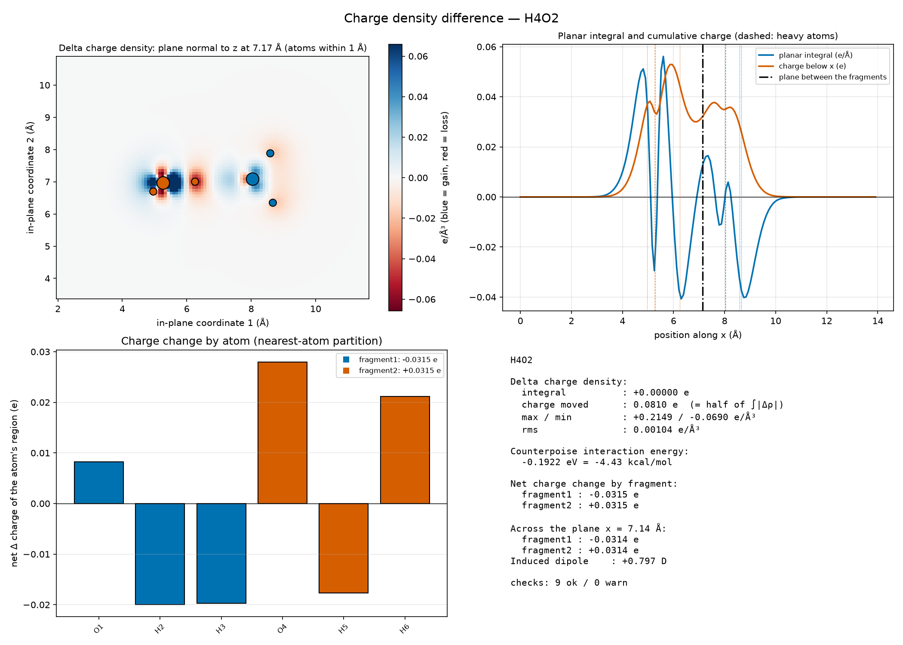
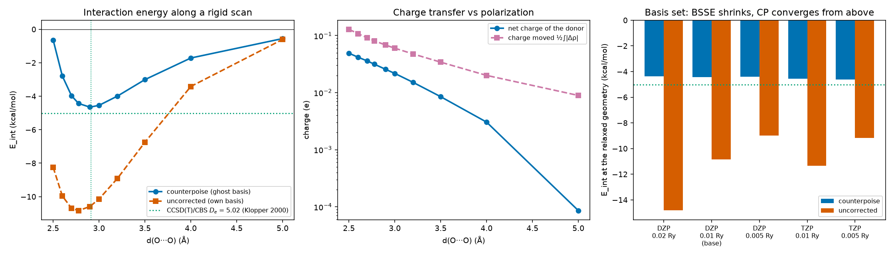
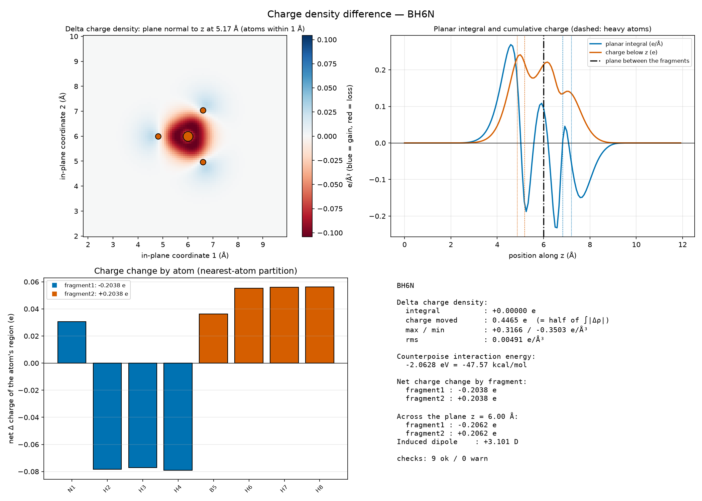
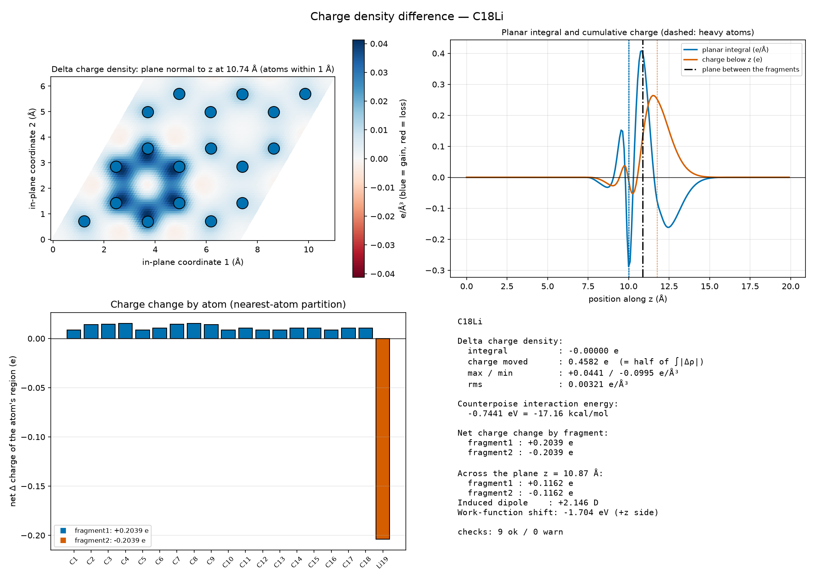

# 4.19 — Workflow: Charge Density Difference (`stb-chargediffPrep` / `stb-chargediffAnalysis`)

This workflow has 2 stages: **Stage 1** (`stb-chargediffPrep`, code `4.19.1`) takes a
**combined structure** — two molecules, a molecule on a surface, two layers, any system made
of `N ≥ 2` fragments — and a fragment split, and writes `N + 1` ready-to-run SIESTA folders:
one with the whole system and one per fragment, each fragment keeping the atoms of all the
others as **ghost atoms**, every folder with the same cell, mesh and level of theory, the
template untouched and everything mandatory in a `config_extra.fdf`. **Stage 2**
(`stb-chargediffAnalysis`, code `4.19.2`) reads the finished runs back and computes the
**charge density difference**

```
Δρ(r) = ρ_combined(r) − Σ_i ρ_fragment_i(r)
```

with what you need to read it and to trust it: the consistency of the runs (grid, cell,
mesh SIESTA actually used, level of theory, pseudopotentials, SCF, electron count), the
**counterpoise-corrected interaction energy** from the same runs, the statistics of `Δρ`,
the charge gained or lost by each fragment and atom, the charge that crossed the plane
between two fragments, the **dipole** the rearrangement induces (checked against SIESTA's
own dipoles) and the work-function shift it causes, a 2D map, a planar profile, a Gaussian
cube for isosurfaces and a 4-panel dashboard.

It answers a question none of `4.1`–`4.18` does: not how strongly two things bind (that is
`4.8` adsorption, `4.3` cohesive energy) but **where the electrons go when they meet** — which
regions gain and lose charge, how much moves, how much crosses from one fragment to the other,
and what dipole that leaves behind. The worked example (Section 5) runs the whole thing for
real, with SIESTA, on three systems that span the chemistry of an interface — a hydrogen bond
(the water dimer), a dative bond (ammonia borane) and an alkali atom on a 2D sheet (Li on
graphene) — plus three studies on the water dimer (basis set, mesh, distance) that show what
the numbers depend on.

Both stages live in this one folder and this one tutorial — same reasoning as `4.1`–`4.5`,
`4.15`–`4.18`: Stage 1's output exists only to feed Stage 2.

## 1. Theory

**Symbols at a glance**

| Symbol | Meaning |
|---|---|
| `ρ_AB(r)`, `ρ_A(r)` | electron density of the combined system and of fragment A (e/ų) |
| `Δρ(r)` | charge density difference; `> 0` where the electrons accumulate |
| `Q_moved = ½ ∫ abs(Δρ)` | the charge moved by the interaction (e) |
| `Δq_A` | net charge change of fragment A (e; `> 0`: it gained electrons) |
| `ρ̄(z)`, `λ(z)` | planar average of `Δρ`, and its planar integral `λ = A ρ̄` (e/Å) |
| `ΔQ(z)` | charge below the plane at `z`, `∫ λ dz'` (e) |
| `Δμ` | dipole induced by the rearrangement (e Å, or Debye: 1 e Å = 4.803 D) |
| `ΔΦ` | work-function shift caused by `Δμ` (eV) |
| `E_X(Y)` | energy of fragment X computed in the basis of the set of atoms Y (eV) |
| `E_int`, `E_def`, `E_bind` | interaction, deformation and binding energies (eV or kcal/mol; 1 eV = 23.06 kcal/mol) |
| BSSE | basis-set superposition error |
| `A` | cell area normal to the profile axis (Ų) |

### 1.1 What the difference shows

Bring two fragments `A` and `B` together, keep their geometries, and let the electrons relax. The
density of the pair is not the sum of the densities of the parts: some electrons moved. The
difference

```
Δρ(r) = ρ_AB(r) − ρ_A(r) − ρ_B(r)                                            (1)
```

evaluated with every density **at the same atomic positions**, isolates that rearrangement from
everything that was already there. Its integral is zero — nothing is created, only moved:

```
∫ Δρ d³r = N_AB − N_A − N_B = 0                                                (2)
```

What the map shows depends on the interaction:

- **Polarization** — each fragment's cloud is distorted by the field of the other: gain and loss
  side by side *inside the same fragment*, a dipole-like pattern. Present in every interaction.
- **Charge transfer** — electrons cross from one fragment to the other: a net gain on one side and
  a net loss on the other. Large for a dative bond or an alkali on a surface, a few hundredths of an
  electron for a hydrogen bond.
- **Covalent bonding** — accumulation between the atoms that bond, depletion from the lone pair or
  orbital that formed it.
- **Pauli repulsion** — depletion where two closed shells overlap, pushing density back onto each
  fragment.

The magnitude of the effect is condensed in the **charge moved**,

```
Q_moved = ∫_{Δρ>0} Δρ d³r = −∫_{Δρ<0} Δρ d³r = ½ ∫ |Δρ| d³r                    (3)
```

which counts polarization and transfer together, and in the **net charge change of each fragment**
`Δq_A`, which only counts the transfer (Section 1.5) but needs a rule to decide which part of space
belongs to whom (Section 1.6).

`Δρ` of fragments is different from the *deformation density* `ρ − Σ ρ_atom` of crystallography,
which subtracts spherical free atoms and shows every bond of the system. This workflow subtracts the
fragments you choose, so only the interaction between them remains; split the system into single
atoms (`--fragment-sizes 1,1,1,...`) and you get the deformation density back.

### 1.2 Three conditions for a meaningful subtraction

Eq. 1 is evaluated **point by point** on SIESTA's real-space grid. That only works if:

1. **The same geometry.** The fragments are not relaxed apart: `ρ_A` is computed with the atoms of
   `A` exactly where they are in `AB`. (The energy of relaxing them is a separate quantity, Section 1.4.)
2. **The same grid.** Every density must sit on the same grid points. SIESTA builds its grid from the
   cell and `Mesh.Cutoff`; the same cell and the same cutoff give the same grid. Stage 1 forces
   `MeshCutoff` into every folder, and Stage 2 checks the mesh SIESTA actually used — which is not the
   requested one: SIESTA rounds up to a grid that fits the cell (320 Ry requested, 361 Ry used for the
   14 Å box of the example). A different grid is refused (it cannot be subtracted); a different cutoff
   with the same grid is flagged.
3. **The same basis.** SIESTA expands the orbitals in numerical atomic orbitals (NAOs) centred on
   the atoms. A fragment computed alone has only its own orbitals; in the complex it can also use its
   partner's. Section 1.3.

There is also the **egg-box effect**: the integration grid is fixed in space while the atoms are not,
so energies and densities depend slightly on where the atoms sit relative to the grid points. Because
every folder has the atoms at the same place on the same grid, this error is the same in every term of
Eq. 1 and largely cancels — one more reason the three conditions matter.

### 1.3 Ghost atoms and the basis-set superposition error

In a finite atom-centred basis the energy of a fragment is lowered when extra basis functions are
nearby, whether or not they belong to anything physical. In the complex, `A` borrows `B`'s orbitals (and
vice versa) and is artificially stabilized; the energy difference `E_AB − E_A − E_B` then includes a
spurious attraction, the **basis-set superposition error** (BSSE). The **counterpoise** correction of
Boys and Bernardi [1] computes every fragment in the *full* basis of the complex:

```
E_int(CP)  = E_AB(AB) − E_A(AB) − E_B(AB)                                      (4)
E_int(raw) = E_AB(AB) − E_A(A) − E_B(B)
BSSE       = E_int(CP) − E_int(raw) = [E_A(A) − E_A(AB)] + [E_B(B) − E_B(AB)] ≥ 0   (5)
```

where `E_X(Y)` is the energy of `X` in the basis of the atoms `Y`. The partner's orbitals are supplied
by **ghost atoms**: in SIESTA, a species with a *negative* atomic number in `%block
ChemicalSpeciesLabel` places its orbitals at the atom's position with no nucleus and no electrons. Stage
1 always does this — every fragment folder contains every other fragment as ghosts — so

- the **density** of each fragment is computed in the same basis as the combined system, and `Δρ`
  contains no basis artefact near the partner;
- the three energies of the runs **are** the counterpoise interaction energy (Eq. 4): Stage 2 reports it
  at no extra cost.

The BSSE shrinks as the basis grows (Section 5.3 measures it); in the complete-basis limit it vanishes and
the two energies of Eq. 4 coincide. Whether the full counterpoise *over*corrects has been debated for decades
[2, 3]; for density functionals a systematic assessment [4] finds that counterpoise-corrected interaction
energies with a double-ζ basis are close to the complete-basis values — and SIESTA's DZP is a double-ζ basis.

### 1.4 Interaction energy and binding energy

`E_int` of Eq. 4 is evaluated at the geometry of the complex. The fragments are not at their own equilibrium
there: their geometries are *deformed* by the interaction. The energy needed to deform them is

```
E_def = Σ_X [ E_X(X; geometry in the complex) − E_X(X; relaxed alone) ]  ≥ 0      (6)
```

computed in the fragments' own basis [5], and the **binding energy** — what you would measure to separate
the complex into relaxed fragments — is

```
E_bind = E_int(CP) + E_def,          D_e = −E_bind                                  (7)
```

For a hydrogen bond `E_def` is a small correction; for a dative bond it can be a large fraction of `E_int`
(Section 5.5). Stage 2 reports `E_int` and says so; the example computes `E_def` from relaxed monomers.

### 1.5 Planar averages, the charge across a plane, and the induced dipole

For a layered system — a slab and an adsorbate, two layers, two molecules facing each other — the natural
view of `Δρ` is its **planar average** along the normal `z`:

```
λ(z) = ∫∫_cell Δρ(x, y, z) dx dy                     (e/Å)                         (8)
ΔQ(z) = ∫_0^z λ(z') dz'                               (e)                           (9)
```

`ΔQ(z)` is the charge that sits below the plane at height `z`: if the two fragments are separated along
`z`, its value at a plane between them is the **net charge transferred**, with no partition of space
needed — only the choice of the plane, which Stage 2 puts halfway between the two fragments' closest atoms
along the axis. Where `λ` is non-zero at that plane the number depends on the plane; it is unambiguous when
`λ` vanishes in a vacuum gap between the fragments.

The first moment of the profile is the **dipole induced** by the rearrangement,

```
Δμ_z = −∫ z λ(z) dz                    (electrons counted positive; e Å)           (10)
```

measured from the middle of the vacuum so the cell boundary does not cut the system. Since the nuclei are the
same in the combined system and in the fragments, `Δμ` must equal the difference of the total dipoles SIESTA
prints in each run, `μ_AB − Σ μ_X`: Stage 2 checks it (Section 4.3), a strong test of the whole chain (grids,
units, signs). For a **periodic 2D system** a dipole layer of density `Δμ/A` makes the electrostatic potential
jump across the layer (Helmholtz):

```
ΔΦ = −e Δμ_z / (ε0 A) = −180.95 eV Å · Δμ_z(e Å) / A(Ų)                          (11)
```

the change of the work function on the `+z` side relative to the `−z` side. An alkali atom that gives its
electron to the surface points `Δμ` away from the surface and *lowers* the work function on its side — the
classic alkali-adsorption effect [6].

### 1.6 Charges of fragments and atoms: a partition is a choice

The *net* charge of a fragment inside a complex is not an observable: it needs a rule that assigns each
point of space to a fragment or an atom. Every rule gives a different number [7]:

- **Voronoi / nearest atom** — each grid point belongs to the nearest atom. Simple, parameter-free,
  works on `Δρ` directly. The one Stage 2 uses (`[5]` of the report).
- **Bader** (QTAIM) — the zero-flux surfaces of the total density [8] (`stb-bader`, 3.6).
- **Hirshfeld** — shares each point in proportion to free-atom densities [9] (`stb-hirshfeld`).
- **Mulliken** — partitions the basis functions, not space; strongly basis-dependent.

Two things make the numbers of this workflow more robust than an absolute charge: they are *differences*
(of the same partition applied to `ρ_AB` and to `Σ ρ_X`), so much of the arbitrariness cancels; and the
plane-integrated value of Section 1.5 needs no partition at all. In the example they agree to 1e-4 e for the
water dimer, whose fragments are well separated along the axis (Section 5.2). For a partition into atoms
there is no such cross-check: compare atoms within one system, and systems with the same rule.

### 1.7 What SIESTA's density is, and the units

The `.RHO` file is the **valence** pseudo-density on the real-space grid: the core electrons of the
pseudopotential are not in it, so the total is the number of valence electrons (16 for the water dimer; 75 for Li on 3×3 graphene, whose
PseudoDojo Li has its 1s in the valence: 18 × 4 + 3), and near a nucleus the density is the
smooth pseudo-density, not the all-electron cusp. Features of `Δρ` within a few tenths of an ångström of a
nucleus are real *pseudo*-valence rearrangements but should not be compared with an all-electron density
there.

Units: SIESTA's grid, read by sisl, is in e/ų; the report and the `.dat` files use e/ų. A Gaussian **cube**
file carries its lattice in bohr and, by convention, its values in **e/bohr³** — `1 e/bohr³ = 6.748 e/ų` —
and Stage 2 writes it that way, so isosurface levels typed in VESTA or VMD and charges integrated there are
right. The report prints a first isosurface level in that unit.

**Spin.** For spin-polarized runs (`--force-spin`), `Δρ` is the difference of the total densities (up +
down); `--spin` gives instead the difference of the spin densities `m = ρ↑ − ρ↓`, which shows where a moment
appears or disappears (Section 5.6).

### 1.8 Where the electrons can go: what the map is not

- `Δρ` is the response **at a fixed geometry**: it does not contain the rearrangement caused by the atoms
  moving (that is in `E_def`, not in `Δρ`).
- It depends on the **functional**: semilocal functionals (PBE) delocalize electrons too easily and
  overestimate charge transfer between fragments with very different electronegativity (the
  self-interaction error); hybrid functionals reduce it. The example's numbers are PBE numbers.
- It depends on the **basis** a little even with ghosts (a richer basis polarizes more freely; Section 5.3)
  and on the **mesh** very little once the three conditions of Section 1.2 hold (Section 5.4).
- Dispersion (van der Waals) does not change the density in a semilocal functional with an additive D3
  correction: `--force-vdw` changes energies and, through relaxation, geometries — not `Δρ` at a given
  geometry.

### 1.9 A calculation you can check by hand

From the report of the water dimer (Section 5.2) — three energies and nothing else:

```
E_AB(AB)  = −962.477198 eV       E_A(AB) = −481.249919 eV       E_B(AB) = −481.035089 eV
E_int(CP) = −962.477198 + 481.249919 + 481.035089 = −0.192190 eV = −4.43 kcal/mol
```

and from the runs without ghost atoms (`fragmentN_alone/`, Section 5.3), `E_A(A) = −481.004966` and `E_B(B) = −481.002416`
eV, Eq. 5 gives the BSSE: `0.244953 + 0.032673 = 0.277626 eV = 6.40 kcal/mol`. The dipole check is just as direct: SIESTA prints `Electric dipole (Debye)` in each `calc.out`; subtract
the fragments' from the combined one and compare with the `Induced dipole` line of `[5]`.

## 2. Libraries and external dependencies used

- **SIESTA** [10, 11] itself is *not* called by the suite. It does the real work: one SCF calculation per
  folder, writing the density on the real-space grid (`<label>.RHO`, because `SaveRho` is forced) and the log
  (`calc.out`) with the energy, the electron count, the mesh used, the SCF convergence and the dipole. The
  reference data of Section 5 was produced with SIESTA 5.4.2, GGA-PBE [12], PseudoDojo norm-conserving
  pseudopotentials [13] and Monkhorst–Pack k-grids [14].
- **[sisl](https://zerothi.github.io/sisl/)** [15] — reads the `.RHO` grids (any spin layout) and writes the
  cube file.
- **numpy** — the subtraction, the integrals, the nearest-atom partition (on fractional coordinates, minimum
  image), the planar profile and its moments.
- **[ASE](https://wiki.fysik.dtu.dk/ase/)** [16] / **[pymatgen](https://pymatgen.org/)** [17] — structure
  reading, closest contact between fragments, dimensionality (Stage 1), the `--view` window.
- **[matplotlib](https://matplotlib.org/)** [18] — the fragment figure of Stage 1 and the dashboard of Stage 2
  (`--png` / `--show`). The `.dat`/`.gplot` pair (`--save-gnuplot`) is for gnuplot, which the suite never
  invokes.

## 3. Stage 1: generating the folders (`stb-chargediffPrep`, code `4.19.1`)

### 3.1 What it does

`stb-chargediffPrep` takes the **combined structure** (`-s`, default `structure.fdf`; the real geometry —
relax it first), a **fragment split** and your **template** (`--calc`, default `calc.fdf`), and writes

```
<output-dir>/                         (default chargediff_run)
    combined/      structure.fdf (all atoms real), calc.fdf, config_extra.fdf, one pseudopotential per label
    fragment1/     structure.fdf (fragment 1 real, every other fragment as ghosts), calc.fdf, config_extra.fdf, ...
    fragment2/     ...
    chargediff_manifest.json          the split, read by Stage 2
    chargediff_fragments.png          with --png: the system projected on xy/xz/yz, atoms coloured by fragment
    chargediff_prep_report.txt        with --save-report
    references.bib
```

Three ways to split:

| Option | Split | Use it for |
|---|---|---|
| `--fragment-sizes N1,N2,...` | by atom count, in file order | molecules, any system whose atoms are listed fragment by fragment |
| `--fragment-species 'C;B,N'` | by element, `;` between fragments | heterostructures whose fragments share no element |
| `--fragment-manifest [PATH]` | the slab/adsorbate split `stb-adsorb` (4.8) records next to each site | an adsorption site |

Every species of every fragment gets **its own label**, as in the adsorption workflow: `O_frag1`, `H_frag2`, and in
the folders where they are ghosts `O_frag2_ghost`, with the same pseudopotential file renamed after the label
(`-p dojo`, `-p virtual_vault` or a folder). A ghost label has a negative atomic number in `%block
ChemicalSpeciesLabel` (Section 1.3). The atom order of the structure is kept in every folder, so atom `i` is the same
atom everywhere.

### 3.2 `config_extra.fdf`: everything mandatory, the template untouched

Every folder's `calc.fdf` is `%include config_extra.fdf` followed by your template byte for byte. SIESTA's fdf
reader is first-occurrence-wins, so the forced values beat the template's — even a template written for a
relaxation:

| Directive | Forced | Why |
|---|---|---|
| `MD.VariableCell` | `false` | the cell is shared by all folders |
| `MD.TypeOfRun` / `MD.Steps` | `CG` / `0` | single point: the geometry is the one you gave (Section 1.2) |
| `MeshCutoff` | `--mesh-cutoff` (default 400 Ry) | the same real-space grid in every folder (Section 1.2) |
| `SaveRho` | `true` | SIESTA must write the `.RHO` Stage 2 reads |
| `Spin polarized` | inherited, or `--force-spin` / `--no-force-spin` | the same spin treatment everywhere |
| `Slab.DipoleCorrection` | inherited, or `--force-dipole` / `--no-force-dipole` | for a slab with a dipole |
| `DFTD3 .true.` | inherited, or `--force-vdw` / `--no-force-vdw` | dispersion (energies only, Section 1.8) |

"Inherited" means: whatever the combined system's own `config_extra.fdf` next to `-s` says (for example a site of
`stb-adsorb`), so the fragments run at the level of theory of the calculation they came from. Everything else —
functional, basis, k-grid, SCF settings — is the template's, identical in all folders.

### 3.3 The report, live

```text
[2] FRAGMENT DEFINITION
------------------------------------------------------------
  Split by        : atom counts 3,3 (in file order)
  Fragments       : 2
Folder     | Formula | Atoms | Atom indices | Species labels (real) | Valence e-
fragment1/ | H2O     | 3     | 1-3          | H_frag1, O_frag1      | 8
fragment2/ | H2O     | 3     | 4-6          | H_frag2, O_frag2      | 8
  Valence electrons: 16 in total (the combined system's SCF must find this number; each fragment folder finds only its
  own, ghost atoms carry no electrons).
  Closest contact between fragments: 1.810 Ang (O1 - H5)

[3] LEVEL OF THEORY AND FORCED SETTINGS
------------------------------------------------------------
  Read from the template (identical in every folder):
XC functional ... GGA / PBE    Basis ... split DZP, PAO energy shift 0.01 Ry    SCF k-grid ... 1x1x1
  Every folder's config_extra.fdf (%include'd on top of calc.fdf, which is the template untouched):
Directive               | Forced value | Template had        | Why
MD.VariableCell         | false        | (absent)            | the cell is shared by all folders
MD.TypeOfRun / MD.Steps | CG / 0       | (absent) / (absent) | single point: the geometry is the one you gave
MeshCutoff              | 320 Ry       | 320 Ry              | the SAME real-space grid in every folder, or the densities cannot be subtracted
SaveRho                 | true         | (absent)            | SIESTA must write the .RHO that Stage 2 reads
Spin polarized          | no           | non-polarized       | inherited from the combined folder's config_extra.fdf
...

[4] FOLDERS WRITTEN
------------------------------------------------------------
Folder     | Real atoms | Ghost atoms | Species labels (SystemLabel entries)           | Files
combined/  | all 6 real | none        | O, H                                           | 5
fragment1/ | 3 real     | 3 ghost     | O_frag1, H_frag1, O_frag2_ghost, H_frag2_ghost | 7
fragment2/ | 3 real     | 3 ghost     | O_frag1_ghost, H_frag1_ghost, O_frag2, H_frag2 | 7
```

(`[0]` is the run metadata, `[1]` the combined structure — formula, lattice, dimensionality —, `[5]` the figure,
`[6]` the references, `[7]` the summary with the next steps and every warning again.)

### 3.4 Validation

A split that does not cover every atom exactly once (sizes that do not add up, a species missing from
`--fragment-species` or in two groups, a manifest whose counts disagree with the structure) is refused before
anything is written; so is a missing structure or template. `--fragment-species` cannot separate two fragments
that share an element (sulfur in both layers of MoS₂/WS₂, hydrogen in both halves of ammonia borane): use
`--fragment-sizes`. A pseudopotential that cannot be found is warned about, per label.

### 3.5 Running it both ways

```bash
stb-chargediffPrep -s water_dimer.fdf --fragment-sizes 3,3 --calc calc.fdf -p dojo --mesh-cutoff 320 --png --save-report
stb-suite            # then: 4 (Workflow) -> 19 (Charge Density Difference) -> 1 (Stage 1)   (or type 4.19.1)
```

## 4. Stage 2: analyzing the results (`stb-chargediffAnalysis`, code `4.19.2`)

### 4.1 Before running Stage 2

Run SIESTA in every folder (`combined/` and each fragment):

```bash
for d in chargediff_run/*/; do (cd $d && mpirun -np 4 siesta calc.fdf > calc.out); done
```

Stage 2 needs, in each folder, the `.RHO` (forced by Stage 1) and one `*.out` log (for the energy, the
electron count, the mesh, the SCF convergence and the dipole; without it those parts are skipped, not
fatal). `--dir` is the folder Stage 1 wrote into; the split is read from `chargediff_manifest.json`.

### 4.2 Report structure

| Section | Content |
|---|---|
| `[0]` | run metadata |
| `[1]` | the system: cell, grid (shape, spacing, voxel), SIESTA version, one line per folder (atoms real/ghost, `∫ρ`, SIESTA's electron count, energy) |
| `[2]` | the **consistency checks** (Section 4.3) |
| `[3]` | the **counterpoise interaction energy** (Eq. 4) in eV, kcal/mol, kJ/mol |
| `[4]` | statistics of `Δρ`: integral, charge moved (Eq. 3), rms, the extremes with the nearest atom, an isosurface level |
| `[5]` | charge change by **atom and fragment** (nearest-atom partition), the **planar view**: separating plane, charge across it, induced dipole, work-function shift |
| `[6]` | the map (slice, profile or 3D) and the cube |
| `[7]` | references |
| `[8]` | summary and files |
| `[9]` | every warning again |

### 4.3 `[2]`: is the subtraction legitimate?

| Check | Passes when | If it fails |
|---|---|---|
| Same real-space grid in every folder | the `.RHO` shapes agree (otherwise Stage 2 stops: nothing to subtract) | rerun with the same `MeshCutoff` and cell |
| Same cell in every folder | within 1e-3 Å (otherwise it stops) | the folders come from different structures |
| Same level of theory | functional, basis, smearing, k-grid, spin, D3 ... read from each folder's `config_extra.fdf` + `calc.fdf` in SIESTA's reading order | a folder was edited: rerun it |
| Same pseudopotential files | the set of pseudopotential contents (md5) is the same | labels differ by design, contents must not |
| Same mesh actually used by SIESTA | the `Mesh cutoff (required, used)` lines agree | rerun with the same `MeshCutoff` |
| SCF converged in every run | each log has `SCF cycle converged` | more iterations, smaller mixing |
| Electron count of the combined `.RHO` equals the sum over fragments | `abs(ΔN) < 1e-3 e` | a wrong electron count in one run (charge, pseudopotential) |
| Net `Δρ` vanishes | `abs(∫Δρ) < 1e-3 e` (Eq. 2) | same |
| Induced dipole equals SIESTA's own dipoles | within 0.005 e Å or 5 % (Eq. 10) | a run without the dipole line, or a profile axis without vacuum |

A grid integral of a folder's density that differs from SIESTA's electron count by more than 5e-3 e is flagged too.

### 4.4 `[5]`: where the charge went

The nearest-atom partition (Section 1.6) of `Δρ`, atom by atom and summed per fragment, then the **planar view**
along the profile axis — by default the lattice axis along which the fragments' centres are farthest apart; `--axis`
chooses it:

- **Separating plane** — halfway across the gap between the two fragments' closest atoms along the axis (only for two
  fragments that do not overlap along it), and the net charge on each side (Eq. 9): the partition-free charge transfer,
  printed next to the partition's;
- **Induced dipole** (Eq. 10) when the axis has vacuum, with SIESTA's value from the logs;
- **Work-function shift** (Eq. 11) when the two other axes are periodic (a slab).

### 4.5 Maps and files

| Option | Writes |
|---|---|
| (default) slice | `<dir>_chargediff_slice.dat`: a plane normal to `--axis` (default z) at `--pos` (default: the plane with the largest `∫ abs(Δρ)`) |
| `--profile` | `<dir>_chargediff_profile.dat`: the planar average along `--axis` |
| `--3d [--iso-min X]` | `<dir>_chargediff_3d.dat`: the grid points with `abs(Δρ) ≥ X` |
| (default) cube | `<dir>_chargediff.cube`, in e/bohr³ (`--no-cube` to skip) |
| `--show` / `--png` | the 4-panel dashboard on screen / `<dir>_chargediff_summary.png` (without a display `--show` saves the PNG) |
| `--save-gnuplot` | a `.gplot` next to the `.dat` (`--contour` overlays contours, `--vmin/--vmax` fix the colour range) |
| `--save-data` | `<dir>_chargediff_atoms.csv` (charge change per atom) + `<dir>_chargediff_results.json` (every number of the report) |
| `--save-report` | `chargediff_analysis_report.txt` |

The **dashboard**: the slice with the atoms near it (zoomed on the atoms of an isolated system); the planar integral
`λ(z)` and the cumulative charge `ΔQ(z)` with every atom and the separating plane marked; the charge change by atom,
coloured by fragment; a summary (integral, charge moved, extremes, `E_int`, charge by fragment and across the plane,
dipole, work-function shift, checks).

### 4.6 Guard rails

A grid or cell that differs between folders stops the run with an `[ERROR]` (the subtraction is impossible); a missing
`chargediff_manifest.json` too; `--spin` on runs that are not all spin-polarized too. Everything else — a different
setting, an unconverged SCF, a missing log, an electron count that does not add up — is a **warning** in `[2]` and again
in `[9]`, and the analysis goes on.

### 4.7 Running it both ways

```bash
stb-chargediffAnalysis --dir chargediff_run --png --save-data --save-report
stb-chargediffAnalysis --dir chargediff_run --profile --axis 2 --save-gnuplot --show
stb-suite            # then: 4 -> 19 -> 2  (or type 4.19.2): it asks for the mode, axis, position and outputs
```

## 5. Worked example: three bonds, end to end

### 5.1 Set-up

Three systems, chosen to span the strength and the nature of an interaction:

| System | Bond | Fragments | Cell | Template |
|---|---|---|---|---|
| water dimer (H₂O)₂ | hydrogen bond | acceptor H₂O / donor H₂O (`--fragment-sizes 3,3`) | 14 Å cube | `calc.fdf` |
| ammonia borane H₃N–BH₃ | dative bond | NH₃ / BH₃ (`--fragment-sizes 4,4`) | 12 Å cube | `calc.fdf` |
| Li on 3×3 graphene | alkali on a 2D sheet | C₁₈ / Li (`--fragment-sizes 18,1`) | 7.40 × 7.40 Å, 20 Å along c | `calc_graphene.fdf` |

All with SIESTA 5.4.2, PBE [12], PseudoDojo pseudopotentials [13] (Li with its 1s in the valence: 3 electrons), DZP
basis with `PAO.EnergyShift 0.01 Ry`. The molecules: Γ only, `MeshCutoff 320 Ry` (SIESTA uses 361 Ry for the 14 Å box),
300 K smearing. Li on graphene: a 6×6×1 k-grid, `MeshCutoff 300 Ry` (322 Ry used), spin-polarized (the isolated Li has one
unpaired electron) and the slab dipole correction, both forced in every folder by `--force-spin --force-dipole`;
`PAO.Polarization.NonPerturbative true`, because SIESTA cannot build the perturbative polarization orbital of this Li.
Each complex was relaxed first (CG, fixed cell, 0.01 eV/Å), and the monomers H₂O, NH₃, BH₃ alone (for `E_def`). The
geometries are sensible: O···O = 2.777 Å (Section 5.4 explains why it is short), B–N = 1.642 Å against ≈ 1.67 Å from
the microwave spectrum [19], Li 1.743 Å above a sheet that stays flat (0.003 Å of corrugation).

```bash
stb-chargediffPrep -s water_dimer.fdf --fragment-sizes 3,3 --calc calc.fdf -p dojo --mesh-cutoff 320 -o water
for d in water/*/; do (cd $d && mpirun -np 2 siesta calc.fdf > calc.out); done
stb-chargediffAnalysis --dir water --png --save-data --save-report
```

Every set also ran each fragment **without** its ghost atoms (`fragmentN_alone/`, `build_inputs.py alone`) — the
uncorrected energy of Eq. 4 — so the BSSE is measured, not assumed.

### 5.2 The water dimer: a hydrogen bond

Stage 2 on the three finished runs (`[1]`–`[3]`, shortened):

```text
Folder     | Atoms | Basis            | ∫rho (e) | SIESTA electrons | E_KS (eV)
combined/  | 6     | all atoms real   | 16.0000  | 16.0000          | -962.477198
fragment1/ | 3     | 3 real + 3 ghost | 8.0000   | 8.0000           | -481.249919
fragment2/ | 3     | 3 real + 3 ghost | 8.0000   | 8.0000           | -481.035089

Same real-space grid in every folder                                          | OK     | 160x160x160
Same mesh actually used by SIESTA                                             | OK     | 361.0 Ry
Electron count of the combined .RHO equals the sum over fragments (< 0.001 e) | OK     | 16.0000 vs 16.0000 e
Net Delta rho vanishes (|integral| < 0.001 e)                                 | OK     | +6.70e-07 e
Induced dipole from Delta rho equals SIESTA's own dipoles (along x)           | OK     | +0.797 vs +0.797 D
   (and the 4 other checks: cell, level of theory, pseudopotentials, SCF -- all OK)

E_int (CP)     : -0.1922 eV = -4.43 kcal/mol = -18.54 kJ/mol
```

and what moved (`[4]`, `[5]`):

```text
Charge moved   : 0.0810 e gained = 0.0810 e lost (half of the integral of |Delta rho|)
maximum (gain) | +0.21494        | 5.51 7.00 7.17 | O4 (O_frag2), 0.25 Ang
minimum (loss) | -0.06902        | 5.25 6.74 7.17 | O4 (O_frag2), 0.24 Ang
fragment1     : -0.03148 e (loses electrons)          <- the acceptor
fragment2     : +0.03148 e (gains electrons)          <- the donor
Separating plane: x = 7.140 Ang, halfway across the 1.79 Ang between the two fragments' closest atoms along x
Charge across  : fragment1 side -0.03145 e; fragment2 side +0.03145 e
Induced dipole : +0.1660 e Ang = +0.797 D along +x (electrons pushed toward -x); SIESTA's dipoles give +0.797 D
```



*Fig. 1 — The dashboard of the water dimer (`--png`). The donor (orange) is on the left, its bonding H at x ≈ 6.3 Å; the
acceptor (blue) on the right. Slice through the molecular plane; planar integral and cumulative charge along x with the
separating plane; charge change per atom; summary.*

Reading it:

- **The pattern is the textbook one.** Along the O–H···O line: the bonding H of the donor *loses* density (red, x ≈ 6.3 Å),
  the region between it and the acceptor oxygen *gains* (the acceptor's lone pair pushed toward the proton, x ≈ 7.3 Å),
  and the donor oxygen gains strongly — the O–H bond polarizes toward O as the proton is pulled away. The
  extremes sit within 0.25 Å of the donor oxygen, where the (pseudo-)valence density is large; their magnitude says little
  (Section 1.7), the 1e-3 e/ų contour over 1 % of the box says where the effect lives.
- **Net transfer: 0.031 e from the acceptor to the donor** — the direction of the charge-transfer (n → σ*) picture of the
  hydrogen bond: the acceptor's lone pair donates into the donor's O–H antibond. The partition-free value across the
  plane between the molecules is the same to 3e-5 e: the two molecules are well separated along x and both rules see the
  same thing.
- **The charge moved (0.081 e) is 2.6× the net transfer**: most of what happens is polarization *inside* each molecule
  (Section 1.1).
- **The induced dipole, 0.797 D, is SIESTA's own number** to the last digit: the dipole of the dimer minus those of the
  two ghosted monomers. The grids, the units, the signs and the planar integration are all checked by this one line.
- **Energies:** `E_int(CP) = −4.43 kcal/mol` at the relaxed geometry. With the deformation of the monomers (0.08
  kcal/mol, from `relax/h2o`) the binding energy is `−4.35 kcal/mol`, against the CCSD(T) complete-basis
  `D_e = 5.02 ± 0.05 kcal/mol` [20]. Section 5.4 shows the geometry is part of that difference.

### 5.3 The basis-set superposition error, measured

`python3 study_table.py` collects every set; `[A]` and `[B]`:

| System | `E_int` CP | `E_int` raw | BSSE | `E_def` | `E_bind` | charge moved (e) | fragments (e) |
|---|---|---|---|---|---|---|---|
| (H₂O)₂ | −4.43 | −10.83 | +6.40 | +0.08 | −4.35 | 0.081 | −0.031 / +0.031 |
| H₃N–BH₃ | −47.57 | −55.58 | +8.01 | +12.46 | −35.11 | 0.447 | −0.204 / +0.204 |
| Li / graphene 3×3 | −17.16 | −22.63 | +5.47 | +0.33 | −16.83 | 0.458 | +0.204 / −0.204 |

(kcal/mol; "raw" is Eq. 4 with each fragment in its own basis, `E_bind = E_int(CP) + E_def`.)

| Water dimer, basis (same geometry) | `E_int` CP | `E_int` raw | BSSE | charge moved (e) | donor (e) |
|---|---|---|---|---|---|
| DZP, 0.02 Ry | −4.36 | −14.80 | +10.44 | 0.0804 | +0.0308 |
| **DZP, 0.01 Ry (base)** | −4.43 | −10.83 | +6.40 | 0.0810 | +0.0315 |
| DZP, 0.005 Ry | −4.41 | −9.00 | +4.59 | 0.0817 | +0.0318 |
| TZP, 0.01 Ry | −4.55 | −11.34 | +6.79 | 0.0822 | +0.0312 |
| TZP, 0.005 Ry | −4.62 | −9.17 | +4.55 | 0.0833 | +0.0317 |



*Fig. 2 — The water dimer: interaction energy along a rigid O···O scan, with and without the counterpoise correction
(left); net charge transfer and charge moved along the same scan, log scale (middle); the five basis sets (right). Dotted
green: the CCSD(T)/CBS `D_e` and `R_e` [20]. `python3 study_table.py --png`.*

- **The BSSE is larger than the interaction itself** with SIESTA's default orbitals: 6.4 kcal/mol for a 4.4 kcal/mol bond,
  10.4 with the shorter orbitals of `PAO.EnergyShift 0.02 Ry`. Without the ghost atoms the water dimer would come out bound
  by 9–15 kcal/mol — two to three times too much — and the number would depend mostly on the orbital radii.
- **It is not shared equally.** Of the 0.278 eV, 0.245 eV is the acceptor's (its energy drops that much when the donor's
  orbitals are added) and 0.033 eV the donor's: the donor's hydrogen sits 1.79 Å from the acceptor's oxygen, right in its
  lone-pair region, and its orbitals are what the acceptor borrows. Ammonia borane shows the same asymmetry (0.277 eV for
  NH₃, 0.070 eV for BH₃).
- **Longer orbitals reduce it** (10.4 → 6.4 → 4.6 kcal/mol from 0.02 to 0.005 Ry, for both DZP and TZP), and a larger basis
  does not by itself: TZP at 0.01 Ry has as much BSSE as DZP. In NAO bases the *range* of the orbitals matters more than
  their number for this error.
- **The counterpoise value hardly moves**: −4.36 to −4.62 kcal/mol over five bases, approaching the reference from above as
  the basis grows — the behavior expected of a CP-corrected DFT interaction energy [4]. The density does not move either:
  the net transfer varies by 3 % and the charge moved by 4 % across the bases. With the ghosts in place, `Δρ` is a basis-
  converged quantity well before the energy is.

### 5.4 The mesh, and the distance

`[C]` repeats the base set at five `MeshCutoff` values:

| `MeshCutoff` (Ry) | used | `E_int` CP | `∫Δρ` (e) | charge moved (e) | donor (e) | max (e/ų) |
|---|---|---|---|---|---|---|
| 150 | 164.5 | −4.43 | +1.1e-6 | 0.0809 | +0.0319 | 0.2045 |
| 200 | 203.1 | −4.43 | −2.7e-7 | 0.0810 | +0.0319 | 0.2041 |
| **320** | 361.0 | −4.43 | +6.7e-7 | 0.0810 | +0.0315 | 0.2149 |
| 450 | 456.9 | −4.43 | −4.9e-7 | 0.0810 | +0.0315 | 0.2174 |
| 600 | 657.9 | −4.43 | +2.1e-7 | 0.0810 | +0.0317 | 0.2142 |

Because every term of Eq. 1 is computed with the atoms at the same place on the same grid, the egg-box error cancels:
`E_int` does not change in the second decimal from 150 to 600 Ry, nor does the charge moved. What changes is the *peak*
value (by 6 %), a point property sampled on a grid of spacing 0.14 → 0.07 Å near a nucleus, and the per-fragment charge in
the fourth decimal. The column *used* is the cutoff SIESTA actually used (the grid has to fit the cell): two runs with
"the same" requested cutoff in different cells can differ, which is why Stage 2 compares the used value. Case 7 of the
script edits one log to another mesh and shows the warning.

`[D]`: the donor moved rigidly along O···O (the monomers keep their geometry in the dimer):

| d(O···O) (Å) | `E_int` CP | `E_int` raw | −BSSE | donor (e) | charge moved (e) |
|---|---|---|---|---|---|
| 2.50 | −0.64 | −8.25 | −7.61 | +0.0491 | 0.1288 |
| 2.60 | −2.79 | −9.96 | −7.17 | +0.0417 | 0.1077 |
| 2.70 | −3.97 | −10.69 | −6.72 | +0.0359 | 0.0912 |
| **2.777** | −4.43 | −10.83 | −6.40 | +0.0315 | 0.0810 |
| 2.90 | **−4.65** | −10.59 | −5.94 | +0.0256 | 0.0681 |
| 3.00 | −4.54 | −10.14 | −5.60 | +0.0217 | 0.0600 |
| 3.20 | −3.99 | −8.91 | −4.92 | +0.0151 | 0.0475 |
| 3.50 | −3.01 | −6.75 | −3.74 | +0.0085 | 0.0342 |
| 4.00 | −1.72 | −3.42 | −1.70 | +0.0030 | 0.0200 |
| 5.00 | −0.55 | −0.61 | −0.05 | +0.0001 | 0.0089 |

- **The counterpoise curve has its minimum at 2.90 Å** (−4.65 kcal/mol), next to the CCSD(T) equilibrium distance of 2.912
  Å [20]; the uncorrected curve has it at 2.78 Å, which is exactly where the *uncorrected* relaxation of Section 5.1 stopped.
  The BSSE grows as the molecules approach (from 0.05 kcal/mol at 5 Å to 7.6 at 2.5 Å) and so pulls the geometry in: a
  relaxation with a small NAO basis and no counterpoise gives intermolecular distances that are too short. The geometry of
  the base case is therefore 0.13 Å too short, and its `E_int` (−4.43) is not the minimum of the CP surface (−4.65).
- **Charge transfer is short-ranged, polarization is not.** The net charge of the donor decays exponentially, `q(R) ∝
  exp(−R/0.36 Å)` beyond 2.9 Å — it needs the orbitals of the two molecules to overlap — and is 1e-4 e at 5 Å. The
  charge moved falls from 0.13 to 0.009 e but much more slowly (Fig. 2, middle): at 5 Å, where nothing crosses any more,
  each molecule is still polarized by the other's dipole. This is the separation of polarization and charge transfer of
  Section 1.1, made visible.

### 5.5 Ammonia borane: a dative bond

The same workflow on H₃N–BH₃ (Case 9 of the script):

```text
E_int (CP)     : -2.0628 eV = -47.57 kcal/mol = -199.03 kJ/mol
Charge moved   : 0.4465 e gained = 0.4465 e lost
maximum (gain) | +0.31659        | 6.00 6.00 5.75 | B5 (B_frag2), 0.57 Ang
minimum (loss) | -0.35030        | 6.00 6.00 6.58 | N1 (N_frag1), 0.24 Ang
fragment1     : -0.20375 e (loses electrons)          <- NH3
fragment2     : +0.20375 e (gains electrons)          <- BH3
Separating plane: z = 5.999 Ang, halfway across the 1.64 Ang between the two fragments' closest atoms along z
Charge across  : fragment1 side -0.20621 e; fragment2 side +0.20621 e
Induced dipole : +0.6456 e Ang = +3.101 D along +z; SIESTA's dipoles give +3.101 D
```



*Fig. 3 — Ammonia borane: BH₃ (orange) below, NH₃ (blue) above along z. The planar integral shows the depletion on the
nitrogen's side and the accumulation on boron's side of the B–N bond.*

- **The donation is visible on the B–N axis**: the largest loss is 0.24 Å from N *on the boron side* (the lone pair leaves),
  the largest gain 0.57 Å from B *toward N* (it arrives in boron's empty p orbital and builds the B–N bond). 0.21 e
  crosses the plane between the fragments — seven times the hydrogen bond's — and it is the hydrogens of NH₃ that lose most
  in the partition (−0.078 e each) while those of BH₃ gain (+0.056 e each): the whole NH₃ becomes more positive, the whole
  BH₃ more negative, as in the familiar zwitterionic picture H₃N⁺–BH₃⁻.
- **The deformation energy is a large part of the story.** BH₃ is planar alone and pyramidal in the complex: 12.5 kcal/mol
  to bend it (NH₃: 0.05). `E_int(CP) = −47.6` but `E_bind = −35.1 kcal/mol`. For a dative bond, an interaction energy at
  the complex geometry is *not* the bond strength; the report says so in `[3]`, the example computes the difference.
- **Against the literature.** The binding energy, 35.1 kcal/mol, is close to the MP4 `D_e` of 34.7 kcal/mol [21]; the best
  ab initio binding *enthalpy* is −27.5 ± 0.5 kcal/mol [22], which includes zero-point and thermal terms that reduce the
  electronic `D_e` by several kcal/mol, so the two are not directly comparable. PBE is expected to do reasonably for this
  bond; the B–N distance (1.642 Å, ≈ 1.67 Å measured [19]) is slightly short.

### 5.6 Li on graphene: an interface, a profile, a dipole

Case 10 of the script, with `--profile --axis 2`:

```text
Same mesh actually used by SIESTA                                             | OK     | 322.4 Ry
Electron count of the combined .RHO equals the sum over fragments (< 0.001 e) | OK     | 75.0000 vs 75.0000 e
Induced dipole from Delta rho equals SIESTA's own dipoles (along z)           | OK     | +2.146 vs +2.146 D
E_int (CP)     : -0.7441 eV = -17.16 kcal/mol = -71.79 kJ/mol
19 | Li      | Li_frag2 | fragment2 | -0.20395
Separating plane: z = 10.873 Ang, halfway across the 1.74 Ang between the two fragments' closest atoms along z
Charge across  : fragment1 side +0.11618 e; fragment2 side -0.11618 e
                 (nearest-atom partition above: fragment1 +0.20395 e; fragment2 -0.20395 e)
Induced dipole : +0.4467 e Ang = +2.146 D along +z (electrons pushed toward -z); SIESTA's dipoles give +2.146 D
Work function  : the dipole layer shifts the vacuum level by -1.704 eV on the +z side relative to the -z side
```



*Fig. 4 — Li on 3×3 graphene: the slice 0.74 Å above the sheet (the hexagon under Li gains, in blue), the planar integral and
the cumulative charge along z with the separating plane, the charge change per atom.*

- **Electrons go from Li to the sheet, and mostly to the hexagon under it** (Fig. 4, slice). The induced dipole points
  away from the sheet (2.15 D, again equal to SIESTA's), and the Helmholtz estimate (Eq. 11) gives a work function **1.70 eV
  lower** on the Li side at this coverage (one Li per 47.4 Ų) — the alkali effect [6]. To compute the vacuum-level
  difference itself, use `stb-workfunction` on the combined run's electrostatic potential.
- **How much charge was transferred depends on what you ask.** The nearest-atom partition gives 0.204 e, the plane halfway
  between Li and the sheet 0.116 e. Neither is wrong: the 2s orbital of a free Li atom is so diffuse that a good part of it
  already lies below that plane in the *isolated* fragment, so the plane counts only the change, while the partition counts
  the change inside Li's Voronoi cell. A Bader analysis of the total density would give yet another number — the common
  statement that Li on graphene is "almost fully ionized" refers to that partition of the total density, not to a
  difference. SIESTA's Mulliken analysis of a similar system gave 0.39 e [24]. Quote the number together with its definition
  (Section 1.6).
- **Energies.** `E_int(CP) = −0.744 eV`, the deformation of the sheet is negligible (0.014 eV), so `E_bind = −0.73 eV`;
  without the counterpoise correction the same runs give −0.97 eV. Other GGA calculations report about 1.0–1.1 eV for Li at
  the hollow site of graphene [23, 24] (other codes, bases and coverages; the SIESTA one [24] does not say it applies a
  counterpoise correction). Our two numbers bracket the range; with a diffuse 2s electron and a DZP basis this is a case
  where the counterpoise correction may overshoot, and a larger basis or a plane-wave check would settle it.
- **Spin, and a caveat.** The isolated Li carries 1 μB, the sheet with the Li ghost none, so the spin-density difference
  (`--spin`) integrates to the disappearance of the Li moment. Here it integrates to −1.17 μB, not −1.00: the single point
  of the combined system converged to a weakly polarized state (−0.17 μB) that lies 10 meV *below* the non-magnetic state
  the relaxation ended in. This metallic 3×3 cell with a 6×6 k-grid may have a weak spin instability, or the two SCF runs found
  different local minima; these runs cannot tell which. It shifts `E_int` by ≈ 0.01 eV and leaves the charge density
  difference essentially unchanged, but it is the kind of thing `--spin` is for: check the moments of every run (the script
  prints them) before reading a spin-density map.

### 5.7 How far to trust each number

| Quantity | What moves it (this example) | Verdict |
|---|---|---|
| `∫Δρ`, electron counts | nothing (1e-6 e) | a check, not a result |
| induced dipole | nothing: equal to SIESTA's to 0.001 D | reliable whenever the axis has vacuum |
| `E_int` (CP) | basis ±0.13 kcal/mol, mesh < 0.01, geometry 0.2 (water) | good to a few tenths of kcal/mol for a given geometry |
| `E_int` (raw) | basis: 9 to 15 kcal/mol for the same bond | do not use with NAO bases |
| `E_bind` | `E_def` from relaxed monomers; the geometry of the complex (relaxed without CP: too short) | relax with care; for dative bonds `E_def` is essential |
| charge moved | basis 4 %, mesh 0.1 % | robust |
| net transfer, plane-integrated | basis 3 %, mesh 1 % | robust *as defined* |
| net transfer, partitioned | the partition rule (factor 2 for Li/graphene) | quote with its definition |
| extreme values of `Δρ` | mesh 6 %, near the nuclei (pseudo-valence) | locate features, do not quote |
| work-function shift (Eq. 11) | coverage, depolarization | an estimate; compute it with `stb-workfunction` |

### 5.8 What to take from the example

1. The ghost atoms are not optional with a NAO basis: the BSSE of the water dimer is larger than its interaction energy, and
   it pulls relaxed geometries in. The same runs that give `Δρ` give the counterpoise energy for free.
2. Read `[2]` first. The checks are cheap and they catch every mistake that makes a difference map meaningless — another grid,
   another mesh, another level of theory, a wrong electron count. The dipole check closes the loop: one number computed two
   independent ways.
3. Polarization and charge transfer are different things: the charge moved counts both, the charge across a plane only the
   transfer, and their ratio (2.6 for the hydrogen bond at equilibrium, ~90 at 5 Å) says which dominates.
4. A net charge is a definition. For two well-separated fragments the partition and the plane agree (water, ammonia borane);
   for a diffuse donor on a surface they differ by a factor of two (Li). Report the definition with the number.
5. An interaction energy at the complex geometry is not a binding energy: add the deformation of the fragments (12.5
   kcal/mol for BH₃).

## 6. Reproducing the reference data

`reference_results/` holds every finished SIESTA run of Section 5, so Stage 2 works out of the box without a SIESTA
installation.

| Folder | What | Contents |
|---|---|---|
| `relax/water_dimer`, `relax/nh3bh3`, `relax/li_graphene` | CG relaxations (fixed cell) of the three complexes | `calc.fdf`, `template.fdf`, start `structure.fdf`, `relaxed.fdf`, `calc.out` |
| `relax/h2o`, `relax/nh3`, `relax/bh3` | the monomers relaxed alone (for `E_def`) | same |
| `graphene_flat/` | the flat 3×3 sheet before Li (for the sheet's `E_def`) | `calc.fdf`, `template.fdf`, `structure.fdf`, `calc.out` |
| `water/`, `nh3bh3/`, `li_graphene/` | the three cases | `chargediff_manifest.json`, the prep report, per folder `structure.fdf`, `calc.fdf`, `config_extra.fdf`, `calc.out`, **`siesta.RHO.xz`**; `fragmentN_alone/` (no ghosts); `analysis/` (report, CSV, JSON) |
| `water_mesh150` ... `water_mesh600` | the dimer at `MeshCutoff` 150, 200, 450, 600 Ry | as above, without the `.RHO` |
| `water_dzp_s002`, `water_dzp_s0005`, `water_tzp_s001`, `water_tzp_s0005` | the dimer with four other basis sets | same |
| `water_r2.50` ... `water_r5.00` | the donor moved rigidly to `d(O···O)` = 2.5–5.0 Å | same |

The density grids of the three main cases are stored compressed (`xz`); `example_4.19.sh` unpacks them into `output/`
(`xz -d siesta.RHO.xz` by hand). The studies keep their analysis results (report, CSV, JSON) and the SIESTA logs but not the
grids, to keep the repository small; `make_reference.sh` regenerates everything:

```bash
bash make_reference.sh                 # ~2 h on 2 cores; writes reference_run/ and reference_results/
```

It relaxes the three complexes and the monomers, runs `stb-chargediffPrep` for every set (the commands of Section 5),
SIESTA in each folder, `build_inputs.py alone` for the fragments without ghosts, and `stb-chargediffAnalysis --save-data
--save-report`. Computed with SIESTA 5.4.2 (conda-forge build, GNU 14.3, MPI), `mpirun -np 2`.

## 7. Known, deliberate limitations

- **Frozen geometry.** `Δρ` and `E_int` are at the geometry of the complex; the relaxation of the fragments is in `E_def`
  (Section 1.4), which Stage 2 does not compute (it needs relaxed fragments: separate runs).
- **The partition is geometric.** The per-atom and per-fragment charges of `[5]` use the nearest-atom rule; they are not
  Bader or Hirshfeld charges (Section 1.6). The plane-integrated value is partition-free but needs the fragments to be
  separable along an axis.
- **Valence pseudo-density.** No core electrons, a smooth density near the nuclei (Section 1.7).
- **One functional.** PBE delocalizes charge; the charge transferred between very different fragments is overestimated
  (Section 1.8). The workflow reports what the functional gives.
- **Same grid required.** The fragments must be computed in the same cell with the same cutoff; a fragment computed in a
  smaller box cannot be used.
- **The dipole and the work-function shift** need vacuum along the profile axis; the work-function shift is the
  Helmholtz estimate for a periodic layer, not a computed vacuum-level difference.
- **No convergence by itself.** The tool reports what the mesh, the basis and the geometry do (Section 5); you decide how
  far to push them.

## 8. Step-by-step: running this workflow on your own system

1. **Relax the combined system** at the level of theory you will use (and the fragments alone, if you want `E_def`).
2. **Write a `calc.fdf` with the physics only** — functional, basis, k-grid, smearing, `Spin` — and `%include
   structure.fdf`. List the atoms fragment by fragment if you will split by count.
3. **Run Stage 1** with `-p <bank>` and a `--mesh-cutoff` you have converged (Section 5.4). Read `[2]` (is the split what
   you meant? the electron counts?) and `[3]` (what is forced, what is inherited). Use `--png` to see the split.
4. **Run SIESTA** in `combined/` and every fragment folder.
5. **Run Stage 2** with `--png --save-data`. Read `[2]` first (every check OK?), then `[3]`, `[4]`, `[5]`. For an interface,
   add `--profile --axis N`.
6. **Visualize** the cube in VESTA (isosurface level from `[4]`, in e/bohr³) — positive (gain) and negative (loss) lobes in
   two colours.
7. **Test what the picture depends on** (Section 5): the mesh, the basis, the distance. A feature that survives them is
   physics.

## 9. Files in this folder

| File | What it is |
|---|---|
| `README.md` | this tutorial |
| `example_4.19.sh` | guided, runnable walk-through (11 cases) |
| `study_table.py` | helper of the script: collects every reference set (energies, BSSE, deformation, charges) into the tables of Section 5 and draws `figures/water_studies.png` |
| `build_inputs.py` | helper of `make_reference.sh`: start structures, the distance scan, the fragments without ghosts, the monomers |
| `make_reference.sh` | regenerates `reference_results/` with SIESTA (Section 6) |
| `water_dimer.fdf` | the water dimer (acceptor O H H, donor O H H), 14 Å box |
| `nh3bh3.fdf` | ammonia borane, staggered start geometry, 12 Å box |
| `li_graphene.fdf` | Li above a hollow site of 3×3 graphene, 20 Å along c |
| `calc.fdf`, `calc_graphene.fdf` | the templates: PBE, DZP, `PAO.EnergyShift 0.01 Ry`; the second spin-polarized with a 6×6 k-grid |
| `reference_results/` | real finished SIESTA runs (Section 6) |
| `figures/` | the dashboards of the three cases and the water-dimer studies |
| `output/` | created by the script (git-ignored) |

## 10. Running the script

```bash
bash example_4.19.sh
```

It pauses between cases (`[Press Enter to continue]`); `yes '' | bash example_4.19.sh` runs it straight through. It starts
by wiping its own `output/`. Cases 1–3 run Stage 1 (no SIESTA needed); Cases 4–11 run Stage 2 on `reference_results/`. It
sets `MPLBACKEND=Agg`, so `--show` is replaced by `--png` in the script; try it on a desktop:

```bash
cp -r reference_results/water /tmp/w && xz -d /tmp/w/*/siesta.RHO.xz && stb-chargediffAnalysis --dir /tmp/w --show
```

## 11. Flag reference

**`stb-chargediffPrep`** — `-s STRUCTURE` (default `structure.fdf`) · one of `--fragment-sizes N1,N2,...`,
`--fragment-species 'El,El;El'`, `--fragment-manifest [PATH]` · `--calc CALC` (default `calc.fdf`) · `--mesh-cutoff RY`
(default 400) · `-p PSEUDO` (bank or folder; default: the structure's folder) · `--force-spin`/`--no-force-spin` ·
`--force-dipole`/`--no-force-dipole` · `--force-vdw`/`--no-force-vdw` · `--output-dir DIR` (default `chargediff_run`) ·
`--show` · `--png` · `--view` · `--save-report` · `--no-intro` · `-v`.

**`stb-chargediffAnalysis`** — `--dir DIR` (default `chargediff_run`) · `-o OUTPUT_DIR` (default `.`) · `--profile` |
`--3d` · `-a/--axis {0,1,2}` · `-p/--pos ANG` · `--spin` · `--iso-min RHO` · `--no-cube` · `--vmin`/`--vmax` · `--contour` ·
`--show` · `--png` · `--save-gnuplot` · `--save-data` · `--save-report` · `--no-intro` · `-v`.

## 12. What's next

- `4.8-adsorption` gives the adsorption energy of a molecule on a surface with its BSSE correction; its sites carry the
  `fragment_manifest.json` that `--fragment-manifest` reads, so a site's `Δρ` is one command away.
- `stb-bader` (3.6) and the Hirshfeld tools give atomic charges by other partitions (Section 1.6): compare.
- `stb-density` (3.8) maps a single density (or the difference of two `.RHO` files with `--rho2`, without ghosts or checks);
  `stb-workfunction` (3.7) computes the work function from the electrostatic potential — the direct counterpart of Eq. 11.
- `4.9-neb`: follow `Δρ` along a reaction path by running this workflow on the images.

## 13. References

1. S. F. Boys, F. Bernardi, *The calculation of small molecular interactions by the differences of separate total energies.
   Some procedures with reduced errors*, Mol. Phys. **19**, 553 (1970).
2. J. Collins *et al.*, *The full versus the virtual counterpoise correction for basis set superposition error in
   self-consistent field calculations*, Chem. Phys. Lett. (1986). doi:10.1016/0009-2614(86)87014-2
3. M. Gutowski *et al.*, *Does the Boys and Bernardi function counterpoise method actually overcorrect the basis set
   superposition error?*, Chem. Phys. Lett. (1986). doi:10.1016/0009-2614(86)80221-4
4. M. Gray *et al.*, *Systematic evaluation of counterpoise correction in density functional theory*, J. Chem. Theory
   Comput. (2022). doi:10.1021/acs.jctc.2c00883
5. I. Mayer *et al.*, *Monomer geometry relaxation and the basis set superposition error*, Chem. Phys. Lett. (1992).
   doi:10.1016/0009-2614(92)85415-7
6. N. D. Lang, *Theory of work-function changes induced by alkali adsorption*, Phys. Rev. B **4**, 4234 (1971).
7. K. B. Wiberg, P. R. Rablen, *Comparison of atomic charges derived via different procedures*, J. Comput. Chem. **14**,
   1504 (1993). doi:10.1002/jcc.540141213
8. R. F. W. Bader, *Atoms in Molecules: A Quantum Theory*, Oxford University Press (1990).
9. F. L. Hirshfeld, *Bonded-atom fragments for describing molecular charge densities*, Theor. Chim. Acta **44**, 129 (1977).
10. J. M. Soler *et al.*, *The SIESTA method for ab initio order-N materials simulation*, J. Phys.: Condens. Matter **14**,
    2745 (2002).
11. A. García *et al.*, *Siesta: Recent developments and applications*, J. Chem. Phys. **152**, 204108 (2020).
12. J. P. Perdew, K. Burke, M. Ernzerhof, *Generalized gradient approximation made simple*, Phys. Rev. Lett. **77**, 3865
    (1996).
13. M. J. van Setten *et al.*, *The PseudoDojo: Training and grading a 85 element optimized norm-conserving pseudopotential
    table*, Comput. Phys. Commun. **226**, 39 (2018). doi:10.1016/j.cpc.2018.01.012
14. H. J. Monkhorst, J. D. Pack, *Special points for Brillouin-zone integrations*, Phys. Rev. B **13**, 5188 (1976).
15. sisl — https://zerothi.github.io/sisl/ (N. Papior).
16. A. H. Larsen *et al.*, *The atomic simulation environment*, J. Phys.: Condens. Matter **29**, 273002 (2017).
17. S. P. Ong *et al.*, *Python Materials Genomics (pymatgen)*, Comput. Mater. Sci. **68**, 314 (2013).
18. J. D. Hunter, *Matplotlib: A 2D graphics environment*, Comput. Sci. Eng. **9**, 90 (2007).
19. L. R. Thorne, R. D. Suenram, F. J. Lovas, *Microwave spectrum, torsional barrier, and structure of BH₃NH₃*, J. Chem. Phys.
    **78**, 167 (1983) (B–N ≈ 1.67 Å).
20. W. Klopper *et al.*, *Computational determination of equilibrium geometry and dissociation energy of the water dimer*,
    Phys. Chem. Chem. Phys. **2**, 2227 (2000). doi:10.1039/a910312k —
    CCSD(T): `R_e = 2.912 ± 0.005 Å`, `D_e = 21.0 ± 0.2 kJ/mol` (5.02 kcal/mol).
21. J. Binkley *et al.*, *A theoretical study of the properties of BH₃NH₃*, J. Chem. Phys. (1983). doi:10.1063/1.446117 —
    MP4 B–N dissociation energy 34.7 kcal/mol.
22. J. A. Plumley *et al.*, *Covalent and ionic nature of the dative bond and account of accurate ammonia borane binding
    enthalpies*, J. Phys. Chem. A (2007). doi:10.1021/jp074937z — binding enthalpy −27.5 ± 0.5 kcal/mol.
23. C. Uthaisar *et al.*, *Lithium adsorption on zigzag graphene nanoribbons*, J. Appl. Phys. (2009). doi:10.1063/1.3265431 —
    Li at the hollow site of graphene: 1.04 eV (PBE), 1.55 eV (LSDA).
24. G. Kaur *et al.*, *Structures and energetics of lithium adatom and its dimer on graphene — a DFT study*, Appl. Surf. Sci.
    (2015). doi:10.1016/j.apsusc.2014.07.108 — SIESTA, GGA: ≈ 1.07 eV, Mulliken transfer ≈ 0.39 e.
