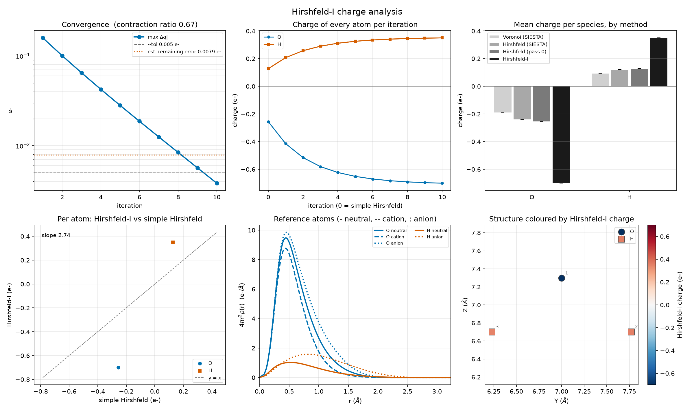
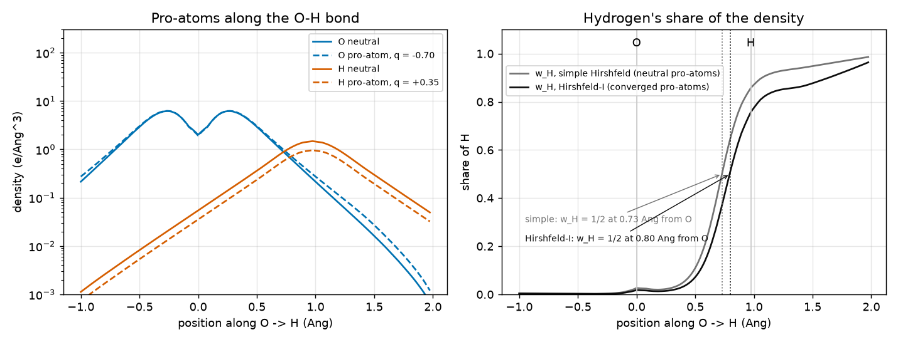
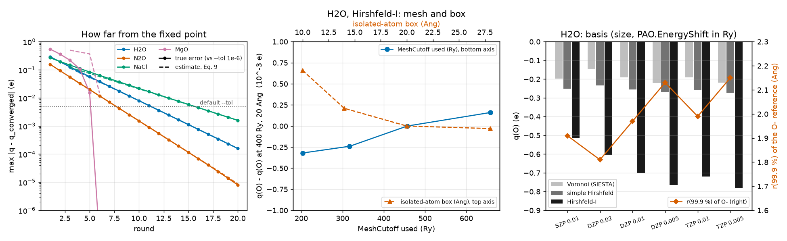
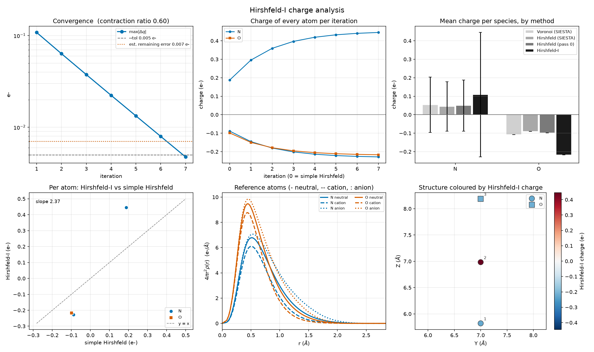
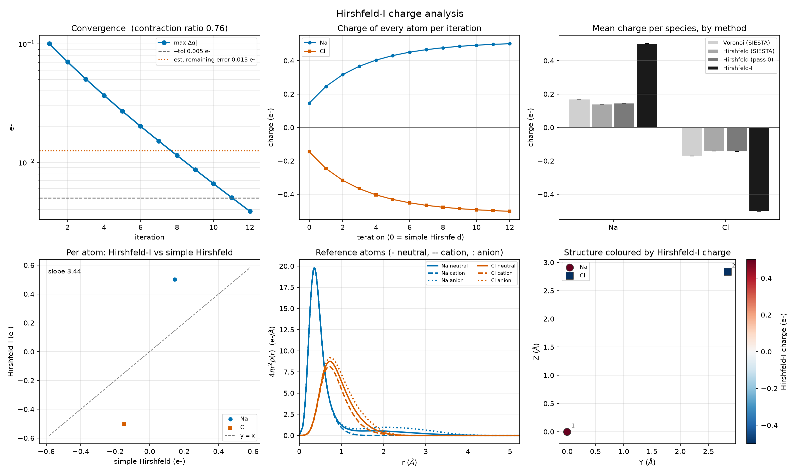
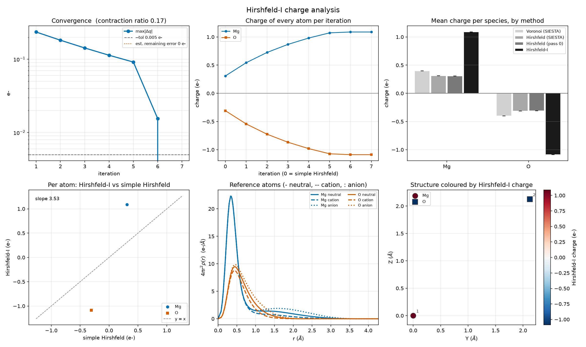

# 4.20 — Workflow: Hirshfeld-I Charges (`stb-hirshfeldPrep` / `stb-hirshfeldIons` / `stb-hirshfeldAnalysis`)

This workflow computes **Hirshfeld-I** (iterative Hirshfeld) atomic charges [5] from a SIESTA density, in 3 stages.
**Stage 1** (`stb-hirshfeldPrep`, code `4.20.1`) takes your relaxed structure and template and writes the system as a
single point that saves its density, plus one isolated **neutral atom** per element. **Stage 2**
(`stb-hirshfeldIons`, code `4.20.2`), after SIESTA ran there, writes the **cation and the anion** of every element.
**Stage 3** (`stb-hirshfeldAnalysis`, code `4.20.3`) builds a spherical reference from each isolated atom and
iterates the stockholder partition until every reference holds as many electrons as the atom it defines:

```
q_A = Z_A − ∫ w_A(r) ρ(r) d³r,     w_A = ρ_A⁰ / Σ_B ρ_B⁰,     ρ_A⁰ = (1 − |q_A|) ρ_neutral + |q_A| ρ_ion
```

It reports the charges next to Voronoi, SIESTA's own Hirshfeld and simple Hirshfeld (neutral references) of the
same density, with what you need to trust them: a check of every reference atom (electrons, radius, SCF), the
history of the iteration and an estimate of **how far the charges still are from the fixed point** when it stops,
the charge balance, a dipole check, and an optional dashboard.

It answers a question the rest of section 4 does not: not an energy or a spectrum, but **how many electrons each
atom owns** — the number behind "the oxygen of water carries −0.7 e", oxidation-state arguments, charge transfer at
an interface, or the point charges of a force field. Section 1 explains why that number needs a definition and what
this one is; the worked example (Section 5) runs all three stages for real with SIESTA on water, N₂O (two atoms of
one element with opposite charges), the NaCl crystal and MgO (charges beyond ±1), plus mesh, box and basis studies
of water that show what the numbers depend on.

The three stages live in this one folder and this one tutorial — same reasoning as `4.8`, `4.17`: each stage's
output exists only to feed the next.

## 1. Theory

**Symbols at a glance**

| Symbol | Meaning |
|---|---|
| `ρ(r)` | electron density of the system (the valence pseudo-density SIESTA writes, e/ų) |
| `ρ_A⁰(r)` | the **pro-atom**: a spherical reference density of atom `A`, centred on its nucleus |
| `ρ⁰(r) = Σ_A ρ_A⁰` | the **promolecule**: all pro-atoms superposed at the atomic positions (every periodic image included) |
| `w_A(r) = ρ_A⁰/ρ⁰` | Hirshfeld weight of atom `A` at `r`, `0 ≤ w_A ≤ 1`, `Σ_A w_A = 1` |
| `N_A`, `q_A` | population of atom `A` (e) and its charge `q_A = Z_A − N_A` (`> 0`: it lost electrons) |
| `Z_A` | valence charge of `A`'s pseudopotential (`Z_val`: O 6, H 1, Na 9, Mg 10, Cl 7) |
| `ρ_X^{0}, ρ_X^{+}, ρ_X^{−}` | spherically averaged density of the isolated neutral atom, cation and anion of element `X` |
| `f = min(abs(q), 1)` | the fraction of the ion mixed into a pro-atom |
| `Δq_n` | `max_A abs(q_A^(n) − q_A^(n−1))`, the step of iteration `n` (e) |
| `r` | the **contraction ratio** of the iteration, `Δq_n / Δq_{n−1}` |
| `μ` | dipole moment (Debye; 1 e Å = 4.803 D) |

### 1.1 An atomic charge is a partition, not an observable

The density `ρ(r)` of a molecule or a crystal is an observable; the charge of one of its atoms is not. To say that
the oxygen of water carries `−0.7 e` you must first say **which electrons belong to the oxygen**, that is, cut the
density into atomic pieces `ρ_A(r)` that add up to the whole:

```
ρ(r) = Σ_A ρ_A(r),        N_A = ∫ ρ_A(r) d³r,        q_A = Z_A − N_A                         (1)
```

There are many ways of cutting, and each gives its own numbers [1, 2]:

- **Space is divided into regions**, one per atom, with sharp boundaries: Voronoi cells (each point goes to the
  nearest nucleus; SIESTA's `Charge.Voronoi`), Bader basins (the zero-flux surfaces of `ρ` [3]; `stb-bader`, 3.6).
- **The basis set is divided**, not space: Mulliken and Löwdin populations. They need no grid but depend strongly
  on the basis.
- **Every point is shared** among all atoms with smooth weights `w_A(r)`, `ρ_A = w_A ρ`: the **stockholder**
  family — Hirshfeld [4], Hirshfeld-I [5], iterated stockholder (ISA) [6], MBIS [7], DDEC [8].

This workflow computes **Hirshfeld-I** charges, a member of the last family, and reports next to them the
simple Hirshfeld, Voronoi and (in the example) Bader charges of the same density, so the numbers can be compared
partition by partition.

### 1.2 The Hirshfeld (stockholder) partition

Hirshfeld's idea [4] is to share the density at each point **in proportion to what the free atoms would have put
there**. Place a spherical reference atom `ρ_A⁰` on every nucleus, add them up into the promolecule `ρ⁰`, and give
atom `A` the fraction

```
w_A(r) = ρ_A⁰(|r − R_A|) / ρ⁰(r),          ρ⁰(r) = Σ_B ρ_B⁰(|r − R_B|)                       (2)

N_A = ∫ w_A(r) ρ(r) d³r                                                                       (3)
```

of the real density there — like the shareholders of a company, each gets a share of the profit proportional to
its investment, hence the name. The weights add up to one at every point, so `Σ_A N_A = ∫ρ` exactly, whatever the
pro-atoms are: the charges always sum to the total charge.

The partition has a clean justification: the Hirshfeld atoms are the pieces `ρ_A` that **stay as close as possible
to the free atoms**, in the sense that they minimize the information distance (Kullback–Leibler divergence) to the
pro-atoms,

```
Σ_A ∫ ρ_A(r) ln[ ρ_A(r) / ρ_A⁰(r) ] d³r     subject to   Σ_A ρ_A = ρ                          (4)
```

and Eq. 2 is the exact minimizer [9]. The atoms overlap smoothly (no sharp boundary), are transferable between
similar environments, and need nothing but the density and the pro-atoms.

What they need **is a choice of pro-atoms**, and that is the weak point. The usual choice is the **neutral** free
atoms. It is known to make charges too small [5, 10]: the weight function is built from neutral atoms, so a region
where the oxygen of water has gained density is still shared as if the oxygen were neutral; the partition is
*biased toward neutrality*. It is also arbitrary (why neutral? why not the ions, or a different neutral state?) and
breaks for a charged system, where `∫ρ⁰ ≠ ∫ρ`.

### 1.3 Hirshfeld-I: make the pro-atoms consistent with the atoms they produce

Bultinck *et al.* [5] removed the arbitrariness with one condition: **each pro-atom must hold as many electrons as
the atom it defines**,

```
∫ ρ_A⁰ d³r = N_A                                                                               (5)
```

A pro-atom with a non-integer population is built by interpolating linearly between the isolated atoms of the
two integer charge states that bracket it. This workflow keeps the states −1, 0 and +1 of every element and builds,
for an atom with charge `q`,

```
ρ_A⁰(q) = (1 − f) ρ_X^{0} + f ρ_X^{±},       f = min(abs(q), 1),   ± = sign of q                     (6)
```

which integrates to `Z_A − q` exactly for `abs(q) ≤ 1` — the linear interpolation is what keeps Eq. 5 exact. Eq. 5
is then solved by iteration:

```
q^(0)     = simple Hirshfeld (neutral pro-atoms, f = 0)
q^(n+1)   = Hirshfeld partition (Eqs. 2-3) with the pro-atoms ρ_A⁰(q_A^(n)) of Eq. 6                    (7)
stop when Δq_n = max_A abs(q_A^(n) − q_A^(n−1)) < tol
```

Each atom chooses its **own** ion — its cation when it is positive, its anion when negative — so two atoms of the
same element can lean in opposite directions (the two nitrogens of N₂O do, Section 5.4). That is why Stage 2 writes
both ions of every element.

The self-consistent charges do not depend on the starting point [11] (no promolecule to choose), are only slightly
basis dependent, work for charged systems, are larger in magnitude than the simple Hirshfeld ones, and reproduce
the molecular electrostatic potential about as well as charges fitted to it [12]. Whether the solution is always
unique is not proven in general [13]; a counterexample with symmetry-equivalent atoms getting different charges
has been reported for some materials [8]. The workflow starts every atom from simple Hirshfeld, so
symmetry-equivalent atoms start equal and stay equal.

### 1.4 How far from converged: the contraction ratio

Near its solution the iteration of Eq. 7 behaves like a linear map: the error of every round is a fixed fraction
`r` of the previous one (the largest eigenvalue of the map's Jacobian),

```
e_n ≈ r e_{n−1},          Δq_n = e_{n−1} − e_n ≈ e_n (1 − r) / r                                (8)

e_n ≈ Δq_n · r / (1 − r)        (the remaining error after round n)                              (9)
```

So the usual stopping rule `Δq_n < tol` does **not** bound the error of the charges: it bounds the last step, and
at `r = 0.68` (water) the charges are still `0.68 / 0.32 ≈ 2.1 × tol` away from the fixed point when it fires. Stage 3
measures `r` from the last three steps, prints the estimate of Eq. 9, and warns — with the `--tol` that would make
the *error* small — when the estimate exceeds the tolerance (not below 0.001 e). The estimate needs no new SIESTA
run, and Section 5.3 checks it against the converged answer. `r` itself says how hard the partition is: it
approaches 1 when the charge transfer is large and the anion reference is very different from the neutral atom.

### 1.5 Periodic systems

Nothing in Eqs. 2–7 needs a molecule: in a crystal the promolecule is the sum of the pro-atoms of **every
periodic image** of every atom,

```
ρ⁰(r) = Σ_A Σ_T ρ_A⁰(|r − R_A − T|),        w_A(r) = Σ_T ρ_A⁰(|r − R_A − T|) / ρ⁰(r)             (10)
```

and `N_A` is integrated over one cell [14]. Stage 3 sums every image within the reach of each pro-atom (the radius
beyond which it vanishes, a few Å for SIESTA's confined orbitals, Section 1.6). For a molecule in a large box that
is only the nearest image; in the 2-atom cell of rock salt a point near a Cl sees six Na neighbours at 2.8 Å, each a
different image of the same atom. (The first version of the workflow kept only the nearest image; Section 5.5
shows what that did to NaCl.)

### 1.6 Reference atoms with SIESTA

The pro-atoms are computed, not tabulated: one SIESTA run per element and charge state, a single atom in a cubic
box (`--vacuum`, default 20 Å), at the level of theory of the system. Several consequences are worth knowing:

- **Valence pseudo-densities.** SIESTA's `.RHO` holds only the electrons of the pseudopotential's valence, so
  `Z_A` is `Z_val` and the core is in neither `ρ` nor `ρ⁰`. Semicore states are valence when the pseudopotential
  includes them: the PseudoDojo Na has 9 electrons (2s² 2p⁶ 3s¹), Mg 10; their cations are then Na⁺ with 8 and
  Mg⁺ with 9. Using pseudo-valence densities for Hirshfeld-I in solids was shown to reproduce the all-electron
  charges to good accuracy [15].
- **The same mesh, basis and functional** as the system (Stage 1 forces the same `MeshCutoff` into every folder,
  the template supplies the rest). The isolated atoms are run **spin-polarized** with Γ only.
- **Confined orbitals confine the reference.** SIESTA's numerical atomic orbitals are strictly zero beyond a
  cutoff radius set by `PAO.EnergyShift` (Section 5.7), so the density of every reference atom vanishes beyond it
  too — a few Å, far inside the box. A free anion is a delicate object (the extra electron of O⁻ is weakly bound;
  O²⁻ is not bound at all in vacuum), and in a plane-wave code its density spreads over the whole box [14]; here the
  basis keeps it on the atom. The anion reference is therefore as confined as the basis, and the charges inherit a
  basis dependence through it.
- **The bare proton.** H has `Z_val = 1`, so H⁺ has no electrons: its density is exactly zero and no SIESTA run is
  needed (SIESTA could not converge it anyway). Stage 2 skips the folder; Stage 3 uses `ρ_H^{+} = 0`, so a positive
  hydrogen's pro-atom is `(1 − q) ρ_H^{0}`.
- **Spherical averages.** An open-shell atom (O, N, Cl) is not spherical in a spin-polarized SCF: Stage 3 averages
  each reference over angles in shells 0.25 grid spacings wide (empty shells dropped) and checks that the profile
  still holds `Z_val`, `Z_val − 1` and `Z_val + 1` electrons (`[2]` of the report).

### 1.7 Charges beyond ±1

Eq. 6 stops at the ions: when `abs(q) > 1`, the pro-atom is the ion itself (`f = 1`). The partition still returns
whatever charge the density gives, but Eq. 5 no longer holds (`N_A ≠ ∫ρ_A⁰`), and the true Hirshfeld-I value
would need the next ion, Mg²⁺ or O²⁻. Mg²⁺ is an ordinary closed shell; O²⁻ is not bound in vacuum and must be
stabilized artificially, and different stabilizations give different charges — the main known ambiguity of
Hirshfeld-I for oxides, which motivated the Hirshfeld-E scheme [16]. Stage 3 flags every such atom (`(capped)` in
`[5]` and a warning). MgO in Section 5.6 is the case.

### 1.8 What point charges can and cannot reproduce

Atomic charges are often used to build the electrostatics of a model (force fields, the dipole of a molecule).
The dipole of a molecule is exactly

```
μ = Σ_A q_A R_A  +  Σ_A μ_A,        μ_A = −∫ (r − R_A) ρ_A(r) d³r                                  (11)
```

— the point charges plus the dipole of each atomic piece (the asymmetry of its cloud around its own nucleus). Any
partition satisfies Eq. 11 with its own `q_A` and `μ_A`; the point-charge term alone depends on how much of the
dipole the partition put into the charges. Stage 3 prints the point-charge dipole of every method next to SIESTA's
dipole of the full density, along the axes where a dipole is defined (non-periodic ones). Neither "closer is
better" nor "larger is better" is a law: Hirshfeld charges are known to be too small to give the dipole by
themselves, Hirshfeld-I charges are larger and leave a smaller, opposite atomic-dipole term [10, 12]. The comparison
says which charges carry the electrostatics in a given molecule (Section 5.2).

### 1.9 A calculation you can check by hand

The water molecule of Section 5.2: `[4]` of its report (and `hirshfeld_iterations.dat`) lists the step of every round,
and the last three are

```
Δq_8 = 0.008415    Δq_9 = 0.005665    Δq_10 = 0.003820 e
r ≈ 0.005665/0.008415 = 0.673,   0.003820/0.005665 = 0.674
e_10 ≈ 0.003820 × 0.673 / (1 − 0.673) = 0.0079 e              (Eq. 9; the report prints 0.0079)
```

so `q(O) = −0.7002 e` after round 10 should be `≈ −0.708 e` at the fixed point — the run at `--tol 1e-6` gives
`−0.7082` (Section 5.3). The charges add up: `q(O) + 2 q(H) = −0.7002 + 2 × 0.3501 = 0.0000 e`. And the reference of the
oxygen at the end, `0.70 anion` in `[5]`, is Eq. 6 with `f = 0.70`: `0.30 ρ_O^0 + 0.70 ρ_O^−`, which holds
`0.30 × 6 + 0.70 × 7 = 6.70` electrons — its population, as Eq. 5 demands.

## 2. Libraries and external dependencies used

- **SIESTA** [18, 19] itself is *not* called by the suite. It does the real work: one SCF per folder — the system, and
  every element as an isolated neutral atom, cation and anion — writing the density on its real-space grid
  (`<label>.RHO`, because `SaveRho` is forced) and the log (`calc.out`) with `Z_val`, the SCF convergence, its own
  Hirshfeld and Voronoi charges and the dipole. The reference data of Section 5 was produced with SIESTA 5.4.2,
  GGA-PBE [20], PseudoDojo norm-conserving pseudopotentials [21] and Monkhorst–Pack k-grids [22].
- **[sisl](https://zerothi.github.io/sisl/)** [23] — reads the `.RHO` grids (spin up + down).
- **numpy** — the radial profiles, the promolecule on the grid with its periodic images, the weights and the
  integrals of Eqs. 2–3, the iteration.
- **[pymatgen](https://pymatgen.org/)** [24] / **ASE** [25] — structure reading and the dimensionality of the cell
  (which axes have vacuum, for the dipole check).
- **[matplotlib](https://matplotlib.org/)** [26] — the 6-panel dashboard of Stage 3 (`--png` / `--show`).

## 3. Stages 1 and 2: the folders

The reference atoms cannot all be written at once: whether an element needs its ions at all, and how each ion
behaves, is only known after the neutral atoms ran. So there are two writing stages, with SIESTA between them:

```
stb-hirshfeldPrep  ->  SIESTA in combined/, neutral/*  ->  stb-hirshfeldIons  ->  SIESTA in ions/*/*  ->  stb-hirshfeldAnalysis
   (4.20.1)                                                  (4.20.2)                                       (4.20.3)
```

### 3.1 Stage 1 (`stb-hirshfeldPrep`, code `4.20.1`)

Takes the **relaxed** structure (`-s`, default `structure.fdf`) and your template (`--calc`, default `calc.fdf`; it must
`%include structure.fdf` and use an implicit basis such as `PAO.BasisSize DZP`, which works for any subset of the
elements) and writes

```
<output-dir>/                          (-O, default hirshfeld_study)
    combined/        structure.fdf, calc.fdf, config_extra.fdf, the pseudopotentials
    neutral/<El>/    one isolated atom per element, in a cubic box of side --vacuum
    hirshfeld_manifest.json            what Stage 2 reads (paths RELATIVE to the study: copy or move it freely)
    hirshfeld_prep_report.txt          with --save-report
```

Every `calc.fdf` is `%include config_extra.fdf` above your template, untouched; SIESTA's fdf reader is
first-occurrence-wins, so the forced settings beat the template's:

| Directive | `combined/` | `neutral/<El>/` (and the ions) | Why |
|---|---|---|---|
| `MD.VariableCell false`, `MD.TypeOfRun CG`, `MD.Steps 0` | forced | forced | a single point at the geometry given |
| `MeshCutoff` | `--mesh-cutoff` (400 Ry) | the same | every density on a comparably fine grid |
| `SaveRho true` | forced | forced | Stage 2/3 read the `.RHO` |
| `Charge.Hirshfeld end`, `Charge.Voronoi end` | forced | — | SIESTA's own charges of the same density, for comparison |
| `kgrid.MonkhorstPack` | the template's | `[1 1 1]` | one atom in a box needs Γ only |
| `Spin` | the template's | `polarized` (also written into `calc.fdf`) | an isolated atom is usually an open shell |

The box (`--vacuum`, 20 Å) only has to hold the atom: SIESTA's atom densities vanish beyond the orbital radii (≈ 2–4 Å
here), so 10 Å would do (Section 5.7); Stage 3 checks it.

### 3.2 Stage 2 (`stb-hirshfeldIons`, code `4.20.2`)

After SIESTA ran in `combined/` and every `neutral/<El>/`, Stage 2 (`-O` the same study) reads `Z_val` of every element
from the log of `combined/` (`--ref` for a log not named `*.out`), the neutral densities, and writes

```
ions/<El>/cation/    NetCharge +1  (Z_val - 1 electrons)
ions/<El>/anion/     NetCharge -1  (Z_val + 1 electrons)
hirshfeld_ions_manifest.json
```

for **every** element — both ions, because in Stage 3 each atom chooses its own (Section 1.3). The exception is an element
with `Z_val ≤ 1` (H): its cation has no electrons at all, an exactly zero density, so no folder is written and Stage 3
uses zero. Its report also previews the simple-Hirshfeld charges of `combined/` (pass 0, what Stage 3 starts from) next
to SIESTA's own, and counts how many atoms of each element lean positive or negative.

### 3.3 Running them

```bash
stb-hirshfeldPrep -s structure.fdf --calc calc.fdf -p dojo --save-report         # Stage 1
for d in hirshfeld_study/combined hirshfeld_study/neutral/*; do (cd $d && mpirun -np 4 siesta calc.fdf > calc.out); done
stb-hirshfeldIons -O hirshfeld_study -p dojo --save-report                        # Stage 2
for d in hirshfeld_study/ions/*/*; do (cd $d && mpirun -np 4 siesta calc.fdf > calc.out); done
stb-suite            # or: 4 (Workflow) -> 20 (Hirshfeld-I) -> 1 / 2   (4.20.1, 4.20.2)
```

The isolated-atom runs are small (one atom, Γ only): a few seconds to a few minutes each. An anion can need more SCF
iterations than the neutral atom (Na⁻ took 25); `[2]` of Stage 3 reports each one.

## 4. Stage 3: the analysis (`stb-hirshfeldAnalysis`, code `4.20.3`)

### 4.1 What it does

Reads every reference folder, builds its radial profile (Section 1.6), reads `combined/`'s density, runs simple
Hirshfeld (pass 0) and iterates Hirshfeld-I (Eq. 7) until `max|Δq| < --tol` (default 0.005 e) or `--max-iter` (20). The
iteration is cheap — seconds for the molecules of Section 5 — and needs no new SIESTA run, so `--tol` can be tightened at
will (Section 5.3).

### 4.2 Report structure

| Section | Content |
|---|---|
| `[0]` | run metadata |
| `[1]` | the combined system: periodicity, grid, `Z_val` per element, electrons in the density, SCF |
| `[2]` | every **reference atom**: target electrons, on the grid, in the radial profile, the radius holding 99.9 % against the box, grid spacing, SCF |
| `[3]` | the iteration, round by round, with the atom that moved most |
| `[4]` | **convergence history**: the step and its ratio to the previous one, the contraction ratio, the estimated remaining error (Eq. 9) |
| `[5]` | per atom: Voronoi and Hirshfeld (SIESTA), simple Hirshfeld, Hirshfeld-I, their difference, the population, the reference used (`0.70 anion` = 30 % neutral + 70 % anion; `(capped)` past ±1) |
| `[6]` | per element: mean, spread, how many atoms are cation- or anion-like, means of the other methods, the Hirshfeld-I / Hirshfeld ratio |
| `[7]` | charge balance: total charge by every method, electrons assigned, simple Hirshfeld here vs SIESTA's |
| `[8]` | the **dipole check** along the non-periodic axes (Section 1.8) |
| `[9]` | summary and files written |
| `[10]` | every warning |

### 4.3 The checks

| Check | Warns when | What to do |
|---|---|---|
| electrons in the combined density vs `Σ Z_val` | they differ by > 0.02 e | a charged run (then the charges add up to it) or a `Z_val` that does not match |
| SCF of `combined/` and of every reference | not confirmed in the log | converge it: the charges are only as good as the density |
| electrons of each reference on its grid vs `Z_val`, `Z_val ∓ 1` | > 0.02 e | a wrong charge state or pseudopotential |
| the radial profile vs the grid | > max(0.02 e, 0.5 %) | a mesh too coarse to average the atom |
| the radius holding 99.9 % vs the box | > 80 % of the inradius | a larger `--vacuum` |
| electrons assigned to no atom | > 0.02 e | density where no reference reaches |
| `abs(q) > 1` | always | the reference stops at ±1 (Section 1.7) |
| the estimated remaining error | > `--tol` (and > 0.001 e) | it prints the `--tol` that would make the error small |
| not converged within `--max-iter` | always | more rounds |

A missing reference `.RHO` stops it with an `[ERROR]` naming the folder: a reference cannot be guessed.

### 4.4 Output files (all opt-in)

| Option | Writes |
|---|---|
| `--save-data` | `hirshfeld_charges.dat` (per atom: every method, population, reference), `hirshfeld_iterations.dat` (every atom's charge per round), `hirshfeld_charges.xyz` (extended XYZ with the charges as per-atom columns; `ase gui` colours atoms by them) |
| `--png` / `--show` | the 6-panel dashboard `hirshfeld_analysis.png`: convergence with the tolerance and the estimated error, each atom's charge per round, the mean charge per element by method, Hirshfeld-I vs simple Hirshfeld per atom, the reference profiles `4πr²ρ(r)`, the structure coloured by charge (`--show` without a display saves the PNG) |
| `--save-report` | `hirshfeld_analysis_report.txt` |

### 4.5 Running it both ways

```bash
stb-hirshfeldAnalysis -O hirshfeld_study --save-data --png --save-report
stb-hirshfeldAnalysis -O hirshfeld_study --tol 1e-4 --max-iter 100          # tighter, seconds more
stb-suite            # then: 4 -> 20 -> 3  (4.20.3): it asks for the folder, tolerance and outputs
```

## 5. Worked example: four systems, end to end

### 5.1 Set-up

| System | Why | Cell | Template |
|---|---|---|---|
| H₂O | a polar molecule; the base case of every study | 14 Å cube | `calc.fdf` |
| N₂O | two atoms of one element with opposite charges | 14 Å cube | `calc.fdf` |
| NaCl | an ionic crystal: periodic images, semicore Na | 2-atom fcc primitive cell | `calc_bulk.fdf` |
| MgO | an oxide whose charges pass ±1 | 2-atom fcc primitive cell | `calc_bulk.fdf` |

All with SIESTA 5.4.2, PBE [20], PseudoDojo pseudopotentials [21] (`Z_val`: H 1, N 5, O 6, Na 9, Mg 10, Cl 7 — Na and
Mg with their 2s 2p semicore), DZP basis with `PAO.EnergyShift 0.01 Ry`, `MeshCutoff 400 Ry`, 300 K smearing; the
molecules at Γ, the crystals with an 8×8×8 Monkhorst–Pack grid [22]. Each structure was relaxed first with the same
template (the molecules at fixed cell, 0.01 eV/Å; the crystals with the cell, 0.05 GPa): O–H 0.975 Å and 104.4°
(experiment 0.958 Å, 104.5° [28]), N–N 1.163 and N–O 1.203 Å (1.128 and 1.184 Å [28]), `a` = 5.674 Å for NaCl and
4.250 Å for MgO (5.64 and 4.21 Å measured; PBE overestimates lattice constants by about this much). The isolated
atoms sit in 20 Å boxes (the default).

```bash
stb-hirshfeldPrep -s relaxed.fdf --calc calc.fdf -p dojo -O h2o --mesh-cutoff 400 --save-report
for d in h2o/combined h2o/neutral/*; do (cd $d && mpirun -np 4 siesta calc.fdf > calc.out); done
stb-hirshfeldIons -O h2o -p dojo --save-report
for d in h2o/ions/*/*; do (cd $d && mpirun -np 4 siesta calc.fdf > calc.out); done
stb-hirshfeldAnalysis -O h2o --save-data --png --save-report
```

### 5.2 Water: the three stages

**Stage 1** writes `combined/`, `neutral/O/` and `neutral/H/`; the isolated atoms get, in their `config_extra.fdf`,

```text
MD.VariableCell false        MD.TypeOfRun CG    MD.Steps 0      kgrid.MonkhorstPack [1 1 1]
MeshCutoff 400 Ry            SaveRho true       Spin polarized
```

**Stage 2**, after SIESTA, reads `Z_val` from the log, previews pass 0 and writes the ions:

```text
Idx | Elem | Z_val | Population(e-) | Charge(e-) | Native Hirshfeld(e-)
1   | O    | 6.0   | 6.2555         | -0.2555    | -0.2421
2   | H    | 1.0   | 0.8723         | +0.1277    | +0.1211
  [OK] O: ions/O/cation/ (NetCharge +1.0), ions/O/anion/ (NetCharge -1.0)
  [OK] H: ions/H/anion/ (NetCharge -1.0); cation SKIPPED (Z_val=1 -- NetCharge +1.0 would leave 0 electrons ...)
```

**Stage 3** first checks the five references SIESTA computed (and the exact zero of H⁺):

```text
Elem | State   | Target N | N on grid | N radial  | Radial-target | r99.9%(Ang) | Box inradius(Ang) | Spacing(Ang) | SCF conv.
O    | neutral | 6        | 6.0000    | 6.0053    | +0.0053       | 1.91        | 10.00             | 0.0800       | yes (9)
O    | cation  | 5        | 5.0000    | 5.0052    | +0.0052       | 1.81        | 10.00             | 0.0800       | yes (9)
O    | anion   | 7        | 7.0000    | 7.0054    | +0.0054       | 1.97        | 10.00             | 0.0800       | yes (13)
H    | neutral | 1        | 1.0000    | 1.0015    | +0.0015       | 2.39        | 10.00             | 0.0800       | yes (6)
H    | cation  | 0        | 0 (exact) | 0 (exact) | -             | -           | -                 | -            | -
H    | anion   | 2        | 2.0000    | 2.0012    | +0.0012       | 2.49        | 10.00             | 0.0800       | yes (12)
```

Every reference holds exactly its electrons (`NetCharge −1` gives 7.0000 on O: the sign convention is right), the
spherical averages hold them to 0.1 %, and 99.9 % of each atom lies within 2.5 Å — a fifth of its box. Then the
iteration:

```text
Iteration | max|Delta q| (e-) | Ratio to previous | Atom that moved most
1         | 0.159092          | -                 | #1 (O)
2         | 0.100813          | 0.634             | #1 (O)
...
9         | 0.005665          | 0.673             | #1 (O)
10        | 0.003820          | 0.674             | #1 (O)
Converged after 10 iteration(s) (max|Delta q| < 0.005 e-).
Contraction ratio      : 0.673 (each step ~67 % of the previous)
Est. remaining error   : 0.0079 e- on the slowest atom, distance to the converged charges
```

and the charges, with the dipole check:

```text
Idx | Elem | Voronoi(e-) | Hirsh. SIESTA(e-) | Simple Hirshfeld(e-) | Hirshfeld-I(e-) | HI - H(e-) | Pop. HI(e-) | Reference
1   | O    | -0.1905     | -0.2421           | -0.2555              | -0.7002         | -0.4447    | 6.7002      | 0.70 anion
2   | H    | +0.0953     | +0.1211           | +0.1277              | +0.3501         | +0.2224    | 0.6499      | 0.35 cation
3   | H    | +0.0953     | +0.1211           | +0.1277              | +0.3501         | +0.2224    | 0.6499      | 0.35 cation

Component (Debye) | Voronoi (SIESTA) | Hirshfeld (SIESTA) | Simple Hirshfeld (pass 0) | Hirshfeld-I | SIESTA (density)
|mu|              | 0.547            | 0.695              | 0.733                     | 2.010       | 1.430
```



*Fig. 1 — The dashboard of water (`--png`): the step per round with the tolerance and the estimated remaining error;
the charge of each atom per round (0 = simple Hirshfeld); the mean charge per element by method; Hirshfeld-I against
simple Hirshfeld per atom (slope 2.74); the reference atoms `4πr²ρ(r)` (neutral, cation, anion); the molecule coloured
by charge.*

Reading it:

- **Hirshfeld-I is 2.7× simple Hirshfeld**: O −0.70 against −0.26. The iteration moves the oxygen steadily away from
  neutral (Fig. 1, second panel) and stops at a reference that is 70 % O⁻. Fig. 2 shows why the numbers change: with the
  oxygen's reference made more negative (more diffuse) and the hydrogens' smaller (`(1 − 0.35) ρ_H^0`, H⁺ has no
  density), the point where the hydrogen's share of the density falls to one half moves from 0.73 to 0.80 Å along the
  0.975 Å bond — the oxygen owns more of the bond.
- **Simple Hirshfeld here and SIESTA's own agree** (−0.256 and −0.242): both use neutral references, SIESTA its own
  free-atom densities from the basis, this tool the SCF atoms of `neutral/`; the 0.013 e difference is that choice.
  Voronoi gives less (−0.19), a different partition altogether (the cell of each nucleus, [27]).
- **The dipole:** SIESTA's dipole of the density is 1.43 D (the experiment gives 1.855 D [28]: DZP is short of diffuse
  functions, Section 5.7). Point charges alone give 0.55–0.73 D with the neutral-reference methods and 2.01 D with
  Hirshfeld-I: by Eq. 11, the Hirshfeld atoms carry a large atomic-dipole term in the same direction (+0.70 D), the
  Hirshfeld-I atoms a smaller one in the opposite direction (−0.58 D). Neither set of point charges *is* the dipole;
  Hirshfeld-I's are the ones that put most of the electrostatics into the charges [12].



*Fig. 2 — Left: the pro-atoms along the O→H bond, neutral (solid) and at the converged charges (dashed); SIESTA's
pseudo-density of O has a dip at the nucleus, where the core was removed. Right: the hydrogen's weight `w_H` (Eq. 2)
with neutral pro-atoms and with the converged Hirshfeld-I ones. `python3 study_table.py --png`.*

### 5.3 How converged is "converged"

The report's warning on water: *"The last step was 0.0038 e-, but at a contraction ratio of 0.67 the charges are still
~0.0079 e- from the converged Hirshfeld-I values (1.6 x --tol). For the error itself to be below 0.005 e-, rerun with
--tol 0.0024"*. Each system was also run at `--tol 1e-6` (`analysis_tight/`), which gives the true error of every round
(`study_table.py` `[C]`):

| Round | H₂O step | estimate (Eq. 9) | true error | | NaCl step | estimate | true error |
|---|---|---|---|---|---|---|---|
| 8 | 0.00842 | 0.0171 | 0.0174 | | 0.01143 | 0.0348 | 0.0371 |
| 10 | **0.00382** | **0.0079** | **0.0080** | | 0.00661 | 0.0210 | 0.0218 |
| 12 | 0.00174 | 0.0036 | 0.0036 | | **0.00387** | **0.0126** | **0.0129** |
| 14 | 0.00080 | 0.0017 | 0.0017 | | 0.00228 | 0.0075 | 0.0076 |



*Fig. 3 — Left: the true distance of the charges from the fixed point per round (solid) and the estimate of Eq. 9 (dashed)
for the four systems. Middle: q(O) of water against the mesh and the isolated-atom box, in 10⁻³ e. Right: q(O) for six
basis sets, with the radius that holds 99.9 % of the O⁻ reference. `python3 study_table.py --png`.*

- **The stopping rule is not the error.** At the default `--tol 0.005` the charges of water are 0.008 e from the fixed
  point, those of NaCl 0.013 e (2.6 × tol): the iteration contracts slowly (ratio 0.67 and 0.76) and the last step is only
  a fraction `1 − r` of the error.
- **Eq. 9 predicts it.** For water and N₂O the estimate agrees with the true error to 1 % from round 3 on. For NaCl it is
  2–7 % low, because the ratio itself still creeps up (0.70 → 0.77): the iteration is not yet in its linear regime, and a
  ratio that grows makes the geometric sum an underestimate. The suggested `--tol` (0.0015 for NaCl) gets the error
  below 0.005 e anyway.
- **It costs nothing to ask for more.** The iteration needs no SIESTA run: water to 10⁻⁶ e in 32 rounds, N₂O in 24, NaCl
  in 44 — seconds each. The converged charges: H₂O O −0.7082, H +0.3541; NaCl ±0.5143.
- **MgO breaks the assumption** (Fig. 3, the steep line): its charges pass ±1 in round 5, the references stop changing
  (Section 1.7) and the iteration lands on its fixed point in one step. The ratio and the estimate of the earlier rounds
  meant nothing; the report gives the ratio of the last rounds (0.17) and an estimate of 0.

### 5.4 N₂O: two nitrogens of opposite sign

```text
Idx | Elem | Z(Ang) | Voronoi(e-) | Hirsh. SIESTA(e-) | Simple Hirshfeld(e-) | Hirshfeld-I(e-) | Reference
1   | N    | 5.8200 | -0.0953     | -0.0886           | -0.0886              | -0.2284         | 0.23 anion
2   | N    | 6.9834 | +0.2037     | +0.1787           | +0.1873              | +0.4452         | 0.45 cation
3   | O    | 8.1862 | -0.1084     | -0.0902           | -0.0987              | -0.2169         | 0.22 anion
Species highlighted above converged with atoms genuinely leaning toward BOTH ion states ...

Component (Debye) | Voronoi (SIESTA) | Hirshfeld (SIESTA) | Simple Hirshfeld (pass 0) | Hirshfeld-I | SIESTA (density)
along c           | -0.094           | -0.026             | -0.075                    | +0.023      | +0.269
```

- **The central N is positive, the terminal N negative**, by every method: the familiar resonance picture N⁻=N⁺=O ↔
  N≡N⁺–O⁻ puts the positive formal charge on the central atom. Each atom chose its own ion — the terminal N mixes in N⁻,
  the central N mixes in N⁺ — which is exactly what a one-ion-per-element shortcut cannot do and why Stage 2 writes both.
  `[6]` flags such an element. Converged: −0.2323, +0.4523, −0.2200.



*Fig. 4 — N₂O (`--png`): the two nitrogens leave simple Hirshfeld in opposite directions from the first round on (second
panel), which is why the per-species bar of N carries a large spread; the per-atom panel shows the central N far above
the diagonal and the terminal N and O below it.*

- **No point-charge set gives the dipole.** SIESTA's dipole is 0.27 D (0.161 D measured [28]); the point charges give
  between −0.09 and +0.02 D — not even the sign agrees across methods. In a linear molecule with nearly balanced
  charges the dipole is a small difference of atomic dipoles (Eq. 11), and charges alone cannot represent it. This is a
  limit of point charges, not of the partition; use `[8]` to see when it applies.

### 5.5 NaCl: a crystal, and why every periodic image counts

```text
Periodicity    : 3D (non-periodic axes: none)
Na   | neutral | 9  | 9.0000  | 9.0156  | +0.0156 | 3.81 | ...
Na   | cation  | 8  | 8.0000  | 8.0155  | +0.0155 | 1.45 | ...
Na   | anion   | 10 | 10.0000 | 10.0157 | +0.0157 | 4.02 | ...

Idx | Elem | Voronoi(e-) | Hirsh. SIESTA(e-) | Simple Hirshfeld(e-) | Hirshfeld-I(e-) | Reference
1   | Na   | +0.1702     | +0.1400           | +0.1457              | +0.5014         | 0.50 cation
2   | Cl   | -0.1702     | -0.1400           | -0.1457              | -0.5014         | 0.50 anion
```

- **The semicore electrons are valence here.** The Na reference holds 9 electrons (2s² 2p⁶ 3s¹), its cation 8; the 3s
  electron makes the neutral atom large (99.9 % within 3.81 Å), the cation small (1.45 Å). Hirshfeld-I gives Na +0.51
  (converged +0.514), 3.5× simple Hirshfeld.



*Fig. 5 — NaCl (`--png`): a slower iteration (ratio 0.76) whose last step is below `--tol` while the estimated error is
0.013 e; the reference atoms show the Na 3s tail of the neutral atom (and of Na⁻) that the cation has lost.*

- **Bader gives ±0.86** on the same density (`stb-bader`, Section 5.8). Different partitions, different numbers (Section
  1.1): in a crystal the Bader basin of Na⁺ is bounded by the density minimum between the ions, while the Hirshfeld weights
  share the overlap region smoothly. Neither is "the" ionic charge; compare like with like.
- **Every image matters.** The primitive cell is 4 Å across and each Cl has 6 Na neighbours at 2.84 Å, all images of the
  same atom. The first version of Stage 3 counted only the nearest image of each atom at every grid point. On this density it
  gave simple Hirshfeld ±0.333 — more than twice SIESTA's own ±0.140 — and Hirshfeld-I ±0.555. Summing every image within
  the reach of each reference (Eq. 10) gives ±0.146, next to SIESTA's, and ±0.514. For a molecule in a box the two are the
  same; `test/4-workflow/20-hirshfeld/analysis/check_core_numerics.py` now checks a small periodic cell with an exact answer.

### 5.6 MgO: beyond ±1

```text
Idx | Elem | Voronoi(e-) | Hirsh. SIESTA(e-) | Simple Hirshfeld(e-) | Hirshfeld-I(e-) | Pop. HI(e-) | Reference
1   | Mg   | +0.3990     | +0.3139           | +0.3082              | +1.0880         | 8.9120      | 1.00 cation (capped)
2   | O    | -0.3990     | -0.3139           | -0.3082              | -1.0880         | 7.0880      | 1.00 anion (capped)
[WARNING 1] 2 atom(s) ended with |q| > 1 e- (#1 Mg +1.088, #2 O -1.088): the reference is capped at the +-1 ion, so these
charges are not fully self-consistent -- a +-2 ion reference would be needed for them.
```

- **The charge passes 1 and the reference stops.** With Mg⁺ and O⁻ as references the partition still gives ±1.088, but
  the oxygen's reference holds 7 electrons and the oxygen 7.088: Eq. 5 is not satisfied. A Mg²⁺ / O²⁻ reference would
  move the charge further; how far depends on how O²⁻ — unbound in vacuum — is stabilized, the known ambiguity of
  Hirshfeld-I for oxides [14, 16]. Read ±1.09 as a lower bound of the Hirshfeld-I value, and compare oxides with each other
  at the same setting.



*Fig. 6 — MgO (`--png`): the step shrinks slowly until round 5, then drops to zero once both charges pass 1 and the
references are capped (first panel); the Mg reference atoms show the semicore 2p peak at 0.3 Å and the 3s shell beyond
1 Å that the cation loses.*

- Bader gives ±1.74 on the same density, Voronoi ±0.40: the spread between partitions is larger than in NaCl, and the
  ordering (Voronoi < Hirshfeld < Hirshfeld-I < Bader) is the same in both crystals.

### 5.7 What the charges depend on: mesh, box, basis

Eleven more complete studies of water (every folder recomputed, `study_table.py` `[D]`–`[F]`, Fig. 3):

| `MeshCutoff` (Ry, used) | grid spacing (Å) | simple Hirshfeld | Hirshfeld-I | | box (Å) | Hirshfeld-I |
|---|---|---|---|---|---|---|
| 200 (203) | 0.117 | −0.2557 | −0.7006 | | 10 | −0.6996 |
| 300 (317) | 0.093 | −0.2556 | −0.7005 | | 14 | −0.7000 |
| **400 (457)** | 0.078 | −0.2555 | **−0.7002** | | **20** | **−0.7002** |
| 600 (658) | 0.065 | −0.2554 | −0.7001 | | 28 | −0.7003 |

| Basis, `PAO.EnergyShift` | Voronoi | SIESTA Hirshfeld | simple Hirshfeld | Hirshfeld-I | r99.9 % of O⁻ (Å) | μ HI points (D) | μ SIESTA (D) |
|---|---|---|---|---|---|---|---|
| SZP, 0.01 Ry | −0.197 | −0.250 | −0.250 | −0.515 | 1.91 | 1.48 | 1.26 |
| DZP, 0.02 Ry | −0.146 | −0.210 | −0.234 | −0.603 | 1.81 | 1.73 | 1.30 |
| **DZP, 0.01 Ry** | −0.191 | −0.242 | −0.255 | **−0.700** | 1.97 | 2.01 | 1.43 |
| DZP, 0.005 Ry | −0.220 | −0.262 | −0.268 | −0.765 | 2.13 | 2.20 | 1.51 |
| TZP, 0.01 Ry | −0.190 | −0.246 | −0.260 | −0.720 | 1.99 | 2.07 | 1.43 |
| TZP, 0.005 Ry | −0.219 | −0.266 | −0.272 | −0.783 | 2.15 | 2.25 | 1.51 |

- **The mesh and the box do not matter.** From 200 to 600 Ry the charge moves by 5 × 10⁻⁴ e; from a 10 to a 28 Å box by
  7 × 10⁻⁴ e (the box only shifts the grid points relative to the atom). SIESTA's atoms vanish beyond their orbital radii,
  ≈ 2.5 Å, so any box that holds them is the same box. The defaults (400 Ry, 20 Å) are generous; 300 Ry and 14 Å would do.
- **The basis does — through the reference atoms.** Hirshfeld-I goes from −0.52 (SZP) to −0.78 (TZP, 0.005 Ry), simple
  Hirshfeld only from −0.23 to −0.27. What moves it most is `PAO.EnergyShift`, the confinement of the orbitals: from 0.02 to
  0.005 Ry the O⁻ reference grows from 1.81 to 2.13 Å and q(O) from −0.60 to −0.77; at the same shift DZP → TZP changes it by
  only 0.02. In SIESTA the anion reference is exactly as diffuse as the basis allows (Section 1.6), so the iterative
  scheme inherits a basis dependence that is small for Hirshfeld-I in Gaussian-basis codes [11]. The density itself
  improves along the same path (SIESTA's dipole 1.26 → 1.51 D, toward the 1.855 D measured): the charges of the longer
  orbitals are the better ones, and they are not converged at the default `0.01 Ry`.
- **Compare charges only at one basis.** A trend across molecules or sites computed with the same basis is robust; an
  absolute Hirshfeld-I charge carries an uncertainty of ±0.1 e from the basis alone.

### 5.8 Why not Bader on SIESTA's density?

`stb-bader` on the `combined/` densities gives NaCl ±0.86 and MgO ±1.74, but for water **O −2.000, H +1.000**: the
hydrogens get no electrons at all. That is not a bug of the partition, it is the density. Along the O–H bond SIESTA's
valence pseudo-density rises to 5.5 e/ų in the oxygen's shell, 0.3 Šfrom O, and then *decreases monotonically* through the
proton (1.77 e/ų at the H nucleus) — the pseudo-hydrogen has no density maximum of its own once it sits in the tail of
the oxygen. Bader needs one maximum per atom; without it the hydrogen's basin is empty. (Plane-wave codes add the core
charge back for the same reason before running Bader [29].) The stockholder partition needs no maximum: it shares
every point by the reference atoms, and the hydrogens get 0.65 electrons each. For light atoms next to heavy ones on a
pseudo-density, Hirshfeld-I is the real-space partition that works.

### 5.9 How far to trust each number

| Quantity | What moves it (this example) | Verdict |
|---|---|---|
| electrons of every reference, the charge balance | nothing (to 10⁻⁴ e) | a check, not a result |
| Hirshfeld-I at the default `--tol` | 0.008 (water) – 0.013 e (NaCl) from the fixed point | read the estimate, tighten `--tol` (seconds) |
| Hirshfeld-I vs mesh, box | < 10⁻³ e | converged at the defaults |
| Hirshfeld-I vs basis | ±0.1 e (EnergyShift 0.02–0.005 Ry) | compare at one basis |
| Hirshfeld-I past ±1 | the reference stops at the ion | a lower bound (MgO) |
| simple Hirshfeld vs SIESTA's own | 0.006–0.013 e (another neutral reference) | consistent |
| point-charge dipole | atomic dipoles: −0.6 D (water), all of it (N₂O) | not the molecule's dipole |
| Bader on the pseudo-density | no basin for H next to O | ionic solids only |

### 5.10 What to take from the example

1. Hirshfeld-I charges are 2.2–3.5× the simple Hirshfeld ones in these four systems: the neutral reference really does pull
   the stockholder charges toward zero, and the iteration removes the arbitrariness.
2. `max|Δq| < tol` is not the error. Read `[4]`: the contraction ratio and the estimated remaining error tell how far the
   charges still are, and tightening `--tol` costs seconds.
3. Read `[2]` before the charges: every reference must hold its electrons and fit in its box.
4. In SIESTA the references are confined by the basis, so the basis — mostly `PAO.EnergyShift` — moves Hirshfeld-I charges
   by ±0.1 e. Compare charges at one basis.
5. Two atoms of one element can have opposite charges (N₂O): each atom chooses its own ion, which is why every element gets
   both. Past ±1 (MgO) the reference stops: a lower bound.
6. A charge is a definition: Voronoi, Hirshfeld, Hirshfeld-I and Bader differ by factors of 2–4 on the same density. Quote
   the method with the number.

## 6. Reproducing the reference data

`reference_results/` holds every finished SIESTA run of Section 5, so Stage 3 works out of the box without a SIESTA
installation.

| Folder | What | Contents |
|---|---|---|
| `relax/h2o`, `relax/n2o`, `relax/nacl`, `relax/mgo` | the relaxations | `calc.fdf`, `template.fdf`, start `structure.fdf`, `relaxed.fdf`, `calc.out` |
| `h2o/`, `n2o/`, `nacl/`, `mgo/` | the four studies | both manifests and the Stage 1/2 reports; per folder (`combined/`, `neutral/<El>/`, `ions/<El>/<cation\|anion>/`) `structure.fdf`, `calc.fdf`, `config_extra.fdf`, `calc.out`, **`siesta.RHO.xz`**; `analysis/` (report, `.dat`, `.xyz`, dashboard), `analysis_tight/` (`--tol 1e-6`), `bader/` |
| `h2o_mesh200`, `h2o_mesh300`, `h2o_mesh600` | water at `MeshCutoff` 200, 300, 600 Ry | as above, without the `.RHO` |
| `h2o_box10`, `h2o_box14`, `h2o_box28` | the isolated atoms in 10, 14, 28 Å boxes | same |
| `h2o_szp_s001`, `h2o_dzp_s002`, `h2o_dzp_s0005`, `h2o_tzp_s001`, `h2o_tzp_s0005` | five other basis sets | same |

The density grids of the four studies are stored compressed (`xz`): SIESTA's density is exactly zero beyond the orbital
radii, so a 20 Å box compresses to ~100–600 kB. `example_4.20.sh` unpacks them into `output/` (`xz -d siesta.RHO.xz` by
hand). The studies keep their inputs, logs and analysis results but not the grids; `make_reference.sh` regenerates
everything:

```bash
bash make_reference.sh ~/scratch/hi_run      # ~1.5 h on 12 cores; then trims into reference_results/
NP=4 JOBS=3 bash make_reference.sh           # MPI ranks per SIESTA run, runs at a time
```

It relaxes the four structures, runs the three stages for each study (the commands of Section 5.1), `stb-bader` on the four
`combined/` densities and Stage 3 again at `--tol 1e-6`. Computed with SIESTA 5.4.2 (conda-forge build, MPI), 3 runs of
`mpirun -np 4` at a time. One run (the H atom at 600 Ry) aborted with `double free` after a converged SCF on 4 ranks and
finished on 2; the script retries a failed run once on 2 ranks.

## 7. Known, deliberate limitations

- **References up to ±1.** Charges past ±1 are flagged and are a lower bound (Section 1.7); there is no ±2 reference.
- **Linear interpolation between neutral and ion.** The pro-atom of Eq. 6, as in the original method [5]; other choices
  (fractional-occupation atoms [12], Hirshfeld-E [16], ISA/MBIS [6, 7]) give other charges.
- **Spherical references, spin-summed.** Each reference is the angular average of a spin-polarized atom; spin
  populations are not partitioned [17].
- **Valence pseudo-densities.** Charges are relative to `Z_val`; the core is in neither density (Section 1.6).
- **Basis-confined references** (Section 5.7): the charges inherit the orbital range.
- **Point-charge dipoles** leave out the atomic dipoles (Section 1.8); the check is along non-periodic axes only.
- **Uniqueness** of the fixed point is not proven in general [13]; every run starts from simple Hirshfeld.

## 8. Step-by-step: running this workflow on your own system

1. **Relax the structure** with the template you will use; Stage 1 does not relax.
2. **Write a `calc.fdf` with the physics only**, `%include structure.fdf`, an implicit basis (`PAO.BasisSize`), your
   functional, k-grid, spin.
3. **Run Stage 1** with `-p <bank>` (`--mesh-cutoff` 300–400 Ry is plenty, Section 5.7); run SIESTA in `combined/` and every
   `neutral/<El>/`.
4. **Run Stage 2**; run SIESTA in every `ions/<El>/<cation|anion>/` (anions may need more SCF iterations).
5. **Run Stage 3** with `--save-data --png`. Read `[2]` (every reference OK?), `[4]` (the estimated remaining error;
   rerun with the suggested `--tol` if asked), `[5]`–`[7]`, then `[10]`.
6. **Test the basis** if absolute charges matter (Section 5.7): `PAO.EnergyShift` first.
7. **Quote the method** with the number, and compare charges computed the same way.

## 9. Files in this folder

| File | What it is |
|---|---|
| `README.md` | this tutorial |
| `example_4.20.sh` | guided, runnable walk-through (10 cases) |
| `study_table.py` | collects the reference runs into the tables of Section 5 (`[A]`–`[F]`) and draws `figures/h2o_studies.png` and `figures/stockholder_weights.png` |
| `build_inputs.py` | helper of `make_reference.sh`: the start structures (a G2 molecule in a box, a rock-salt primitive cell) |
| `make_reference.sh` | regenerates `reference_results/` with SIESTA (Section 6) |
| `h2o.fdf`, `n2o.fdf`, `nacl.fdf`, `mgo.fdf` | the start structures (`reference_results/relax/*/relaxed.fdf` are the relaxed ones) |
| `calc.fdf`, `calc_bulk.fdf` | the templates: PBE, DZP, `PAO.EnergyShift 0.01 Ry`; the second with an 8×8×8 k-grid |
| `reference_results/` | real finished SIESTA runs (Section 6) |
| `figures/` | the dashboards of the four systems and the two figures of `study_table.py` |
| `output/` | created by the script (git-ignored) |

## 10. Running the script

```bash
bash example_4.20.sh
```

It pauses between cases (`[Press Enter to continue]`); `yes '' | bash example_4.20.sh` runs it straight through. It starts by
wiping its own `output/`. Cases 1–2 run Stages 1 and 2 (no SIESTA needed); Cases 3–10 run Stage 3 on `reference_results/`. It
sets `MPLBACKEND=Agg`, so `--show` is replaced by `--png` in the script; try it on a desktop:

```bash
cp -r reference_results/h2o /tmp/h2o && find /tmp/h2o -name '*.xz' -exec xz -d {} \; && stb-hirshfeldAnalysis -O /tmp/h2o --show
```

## 11. Flag reference

**`stb-hirshfeldPrep`** — `-s/--structure` (default `structure.fdf`) · `--calc` (default `calc.fdf`) · `--mesh-cutoff RY`
(default 400) · `--vacuum ANG` (isolated-atom box, default 20) · `-p/--pseudo-dir` (bank or folder; default: the structure's
folder) · `-O/--output-dir` (default `hirshfeld_study`) · `--save-report` · `--no-intro` · `-v`.

**`stb-hirshfeldIons`** — `-O/--output-dir` (the study, default `hirshfeld_study`) · `-p/--pseudo-dir` · `--ref OUT` (the log
to read `Z_val` from) · `--save-report` · `--no-intro` · `-v`.

**`stb-hirshfeldAnalysis`** — `-O/--output-dir` (the study) · `--tol E` (default 0.005 e) · `--max-iter N` (default 20) ·
`--ref OUT` · `--save-data` · `--png` · `--show` · `--save-report` · `--no-intro` · `-v`.

## 12. What's next

- `stb-bader` (3.6) partitions the same density by zero-flux surfaces — fine for ionic solids, not for H on a pseudo-density
  (Section 5.8); `stb-nativecharges` reads SIESTA's own Hirshfeld, Voronoi and Mulliken charges.
- `4.19-chargediff` shows *where* the electrons moved between two fragments, partition-free in the planar view — a
  complement to atomic charges at an interface.
- `4.8-adsorption`: run this workflow on an adsorption site to quantify the charge transfer to the adsorbate.

## 13. References

1. K. B. Wiberg, P. R. Rablen, *Comparison of atomic charges derived via different procedures*, J. Comput. Chem. **14**,
   1504 (1993). doi:10.1002/jcc.540141213
2. F. Heidar-Zadeh *et al.*, *Information-theoretic approaches to atoms-in-molecules: Hirshfeld family of partitioning
   schemes*, J. Phys. Chem. A (2017). doi:10.1021/acs.jpca.7b08966
3. R. F. W. Bader, *Atoms in Molecules: A Quantum Theory*, Oxford University Press (1990).
4. F. L. Hirshfeld, *Bonded-atom fragments for describing molecular charge densities*, Theor. Chim. Acta **44**, 129 (1977).
5. P. Bultinck, C. Van Alsenoy, P. W. Ayers, R. Carbó-Dorca, *Critical analysis and extension of the Hirshfeld atoms in
   molecules*, J. Chem. Phys. **126**, 144111 (2007). doi:10.1063/1.2715563
6. T. C. Lillestolen, R. J. Wheatley, *Redefining the atom: atomic charge densities produced by an iterative stockholder
   approach*, Chem. Commun. 5909 (2008). doi:10.1039/b812691g
7. T. Verstraelen *et al.*, *Minimal basis iterative stockholder: atoms in molecules for force-field development*, J. Chem.
   Theory Comput. **12**, 3894 (2016). doi:10.1021/acs.jctc.6b00456
8. T. A. Manz, N. Gabaldon Limas, *Introducing DDEC6 atomic population analysis: part 1*, RSC Adv. **6**, 47771 (2016).
   doi:10.1039/c6ra04656h
9. R. F. Nalewajski, R. G. Parr, *Information theory, atoms in molecules, and molecular similarity*, Proc. Natl. Acad. Sci.
   USA **97**, 8879 (2000). doi:10.1073/pnas.97.16.8879
10. E. R. Davidson, S. Chakravorty, *A test of the Hirshfeld definition of atomic charges and moments*, Theor. Chim. Acta
    **83**, 319 (1992). doi:10.1007/bf01113058
11. P. Bultinck, P. W. Ayers, S. Fias, K. Tiels, C. Van Alsenoy, *Uniqueness and basis set dependence of iterative
    Hirshfeld charges*, Chem. Phys. Lett. **444**, 205 (2007). doi:10.1016/j.cplett.2007.07.014
12. S. Van Damme, P. Bultinck, S. Fias, *Electrostatic potentials from self-consistent Hirshfeld atomic charges*, J. Chem.
    Theory Comput. **5**, 334 (2009). doi:10.1021/ct800394q
13. L. Pujal *et al.*, *Constrained iterative Hirshfeld charges: a variational approach*, J. Chem. Phys. (2022).
    doi:10.1063/5.0089466
14. D. E. P. Vanpoucke, P. Bultinck, I. Van Driessche, *Extending Hirshfeld-I to bulk and periodic materials*, J. Comput.
    Chem. **34**, 405 (2013). doi:10.1002/jcc.23088
15. D. E. P. Vanpoucke, I. Van Driessche, P. Bultinck, *Reply to "Comment on 'Extending Hirshfeld-I to bulk and periodic
    materials'"*, J. Comput. Chem. (2013). doi:10.1002/jcc.23193 — pseudo-valence densities reproduce the
    all-electron Hirshfeld-I charges; NaF, NaCl, MgO, SrTiO₃.
16. T. Verstraelen *et al.*, *Hirshfeld-E partitioning: AIM charges with an improved trade-off between robustness and
    accurate electrostatics*, J. Chem. Theory Comput. (2013). doi:10.1021/ct4000923
17. D. Geldof *et al.*, *An extension of the Hirshfeld method to open shell systems using fractional occupations*, J. Chem.
    Theory Comput. (2011). doi:10.1021/ct100743h
18. J. M. Soler *et al.*, *The SIESTA method for ab initio order-N materials simulation*, J. Phys.: Condens. Matter **14**,
    2745 (2002).
19. A. García *et al.*, *Siesta: Recent developments and applications*, J. Chem. Phys. **152**, 204108 (2020).
20. J. P. Perdew, K. Burke, M. Ernzerhof, *Generalized gradient approximation made simple*, Phys. Rev. Lett. **77**, 3865
    (1996).
21. M. J. van Setten *et al.*, *The PseudoDojo: Training and grading a 85 element optimized norm-conserving pseudopotential
    table*, Comput. Phys. Commun. **226**, 39 (2018). doi:10.1016/j.cpc.2018.01.012
22. H. J. Monkhorst, J. D. Pack, *Special points for Brillouin-zone integrations*, Phys. Rev. B **13**, 5188 (1976).
23. sisl — https://zerothi.github.io/sisl/ (N. Papior).
24. S. P. Ong *et al.*, *Python Materials Genomics (pymatgen)*, Comput. Mater. Sci. **68**, 314 (2013).
25. A. H. Larsen *et al.*, *The atomic simulation environment*, J. Phys.: Condens. Matter **29**, 273002 (2017).
26. J. D. Hunter, *Matplotlib: A 2D graphics environment*, Comput. Sci. Eng. **9**, 90 (2007).
27. C. Fonseca Guerra, J.-W. Handgraaf, E. J. Baerends, F. M. Bickelhaupt, *Voronoi deformation density (VDD) charges:
    assessment of the Mulliken, Bader, Hirshfeld, Weinhold, and VDD methods for charge analysis*, J. Comput. Chem. **25**,
    189 (2004). doi:10.1002/jcc.10351
28. NIST Computational Chemistry Comparison and Benchmark Database (CCCBDB), experimental geometries and dipole moments
    (H₂O: 1.855 D, r(OH) 0.958 Å, 104.5°; N₂O: 0.161 D, r(NN) 1.128 Å, r(NO) 1.184 Å). https://cccbdb.nist.gov
29. W. Tang, E. Sanville, G. Henkelman, *A grid-based Bader analysis algorithm without lattice bias*, J. Phys.: Condens.
    Matter **21**, 084204 (2009).
