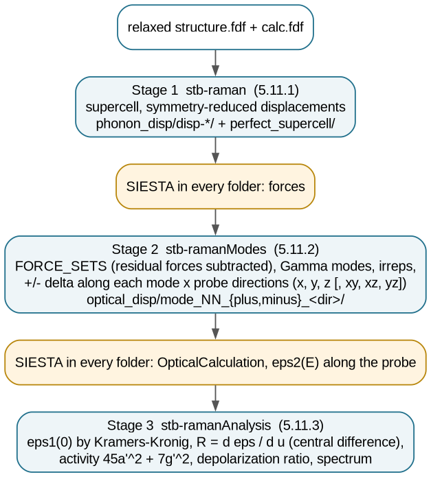
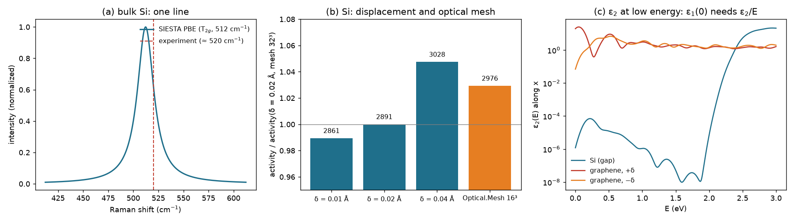

# 5.11 — Workflow: Raman Spectrum (`stb-raman` / `stb-ramanModes` / `stb-ramanAnalysis`)

The non-resonant, first-order Raman spectrum of a crystal or molecule, entirely from SIESTA, in three
stages: **Stage 1** (`stb-raman`, code `5.11.1`) displaces atoms to get the phonons; **Stage 2**
(`stb-ramanModes`, `5.11.2`) finds the Γ-point modes, classifies them by symmetry, and displaces the cell
by ±δ along each mode, with an optical calculation in every folder; **Stage 3** (`stb-ramanAnalysis`,
`5.11.3`) turns the change of the dielectric constant into a Raman tensor per mode, an activity, a
depolarization ratio and a spectrum. SIESTA runs in between.

This folder ships the finished SIESTA runs (`runs/`, made by `run_example.sh`) of **bulk silicon** — one
Raman line, T₂g at about 520 cm⁻¹ in experiment [4], with a tensor that has only off-diagonal entries — and of
the **graphene monolayer**, where the selection rules can be checked mode by mode. No SIESTA is needed to
follow the tutorial.



## Contents

1. [Theory](#1-theory)
2. [The workflow at a glance](#2-the-workflow-at-a-glance)
3. [Libraries and external dependencies used](#3-libraries-and-external-dependencies-used)
4. [Stage 1: phonon displacements (`stb-raman`, `5.11.1`)](#4-stage-1-phonon-displacements-stb-raman-5111)
5. [Stage 2: modes and optical folders (`stb-ramanModes`, `5.11.2`)](#5-stage-2-modes-and-optical-folders-stb-ramanmodes-5112)
6. [Stage 3: tensor, activity, spectrum (`stb-ramanAnalysis`, `5.11.3`)](#6-stage-3-tensor-activity-spectrum-stb-ramananalysis-5113)
7. [Worked example](#7-worked-example)
8. [What to take from the example](#8-what-to-take-from-the-example)
9. [Reproducing the reference data](#9-reproducing-the-reference-data)
10. [Known, deliberate limitations](#10-known-deliberate-limitations)
11. [Step by step: your own structure](#11-step-by-step-your-own-structure)
12. [Files in this folder](#12-files-in-this-folder)
13. [Running the script](#13-running-the-script)
14. [What's next](#14-whats-next)
15. [References](#15-references)

## 1. Theory

### 1.1 Raman scattering

Light of frequency ω_L scattered by a crystal comes out mostly at ω_L (Rayleigh), and a small part at
ω_L − ω_ν (Stokes) or ω_L + ω_ν (anti-Stokes), having created or absorbed a vibration of frequency ω_ν.
The photon carries almost no momentum on the scale of the Brillouin zone, so in **first-order** Raman
only q ≈ 0 phonons — the **Γ-point modes** — take part, one at a time. Overtones and the D/2D bands of
graphene are second-order processes and are not computed here.

### 1.2 The Raman tensor (Placzek approximation)

When ħω_L is well below the electronic gap, the electrons follow the nuclei adiabatically and the
scattered field comes from the change of the electronic polarizability along the mode [1]:

```
α_ij(Q_ν) = α_ij(0) + (∂α_ij/∂Q_ν) Q_ν + ...        R_ij(ν) ∝ ∂ε∞_ij / ∂Q_ν           (1)
```

In a crystal α is the electronic susceptibility, χ = (ε∞ − 1)/4π, so the **Raman tensor** of mode ν is
the derivative of the high-frequency (clamped-ion) dielectric tensor along the mode. It is a symmetric
3×3 tensor, and the light polarizations select its components: a line is seen with incident
polarization **e**_L and analysed polarization **e**_S with intensity ∝ |**e**_S · R · **e**_L|² [1, 6].
Raman activity is therefore **first order** in the atomic displacement — through ∂α/∂Q, not through α.

### 1.3 Powder (orientational) averages

For a randomly oriented sample — a powder, a liquid, a polycrystal — the measured quantities are the
rotational invariants of R [2, 7]:

```
a  = (Rxx + Ryy + Rzz) / 3                                                         (2)
γ² = ½[(Rxx−Ryy)² + (Ryy−Rzz)² + (Rzz−Rxx)²] + 3(Rxy² + Rxz² + Ryz²)                (3)
S  = 45 a² + 7 γ²         (activity)        ρ = 3γ² / (45a² + 4γ²)   (depolarization) (4)
```

ρ lies between 0 and 3/4: totally symmetric modes (a ≠ 0) are **polarized** (ρ < 3/4), every other mode
has a traceless tensor (a = 0) and is **depolarized**, ρ = 3/4 exactly. Both S and ρ are invariant under
rotations of the crystal, and also under the choice of basis inside a degenerate set of modes — which is
why one partner of a degenerate set is enough (Section 5.3).

### 1.4 Selection rules

A mode can be Raman-active only if its irreducible representation (irrep) appears in the representation
of the quadratic functions x², y², z², xy, xz, yz [2, 3]. In a centrosymmetric crystal Raman-active modes
are even (g) and IR-active ones odd (u): the two spectroscopies see different modes (mutual exclusion,
the reason NaCl's T₁u mode in `5.12-ir` is Raman-silent). Group theory also fixes the **shape** of each
tensor [2]:

| crystal | mode | irrep | Raman | tensor shape (Cartesian axes of the crystal) |
|---|---|---|---|---|
| Si (O_h) | optical, 520 cm⁻¹ | T₂g (×3) | active | `[[0,0,0],[0,0,d],[0,d,0]]`, `[[0,0,d],[0,0,0],[d,0,0]]`, `[[0,d,0],[d,0,0],[0,0,0]]` |
| graphene (D₆h) | G, in plane, ~1580 cm⁻¹ | E₂g (×2) | active | `[[a,0,0],[0,−a,0],[0,0,0]]`, `[[0,a,0],[a,0,0],[0,0,0]]` |
| graphene (D₆h) | ZO, out of plane | B₂g (B₁g in Phonopy's axes) | **silent** | 0 |

Silicon's T₂g tensors have **no diagonal entries at all** in the cubic axes: a calculation that probes only
the diagonal (εxx, εyy, εzz) sees nothing (Section 7.4).

### 1.5 The finite-difference recipe of this workflow

Stage 2 displaces the cell along the eigendisplacement of the mode by ±δ (δ = the largest atomic
displacement, `--displacement`, default 0.02 Å) and asks SIESTA, in each folder, for the imaginary part
of the dielectric function ε₂(E) along a probe direction **n** (`Optical.Vector`, polarized). Stage 3
obtains the static electronic constant from the Kramers–Kronig relation,

```
ε₁(0) = 1 + (2/π) ∫₀^∞ ε₂(E′)/E′ dE′                                               (5)
```

and the tensor by central differences:

```
R_nn = [ε_nn(+δ) − ε_nn(−δ)] / 2δ        n = x, y, z  (diagonal)                    (6)
R_ij = R_nn − (R_ii + R_jj)/2            n = (x̂_i + x̂_j)/√2  (face diagonals)        (7)
```

The default probes x, y, z (6 folders per mode, the diagonal of R); `--full-tensor` adds the three face
diagonals (12 folders) and gives the full tensor and the exact invariants (2)–(4). R is in Å⁻¹ per Å of
the largest atomic displacement: activities compare modes of one calculation, they are not absolute
cross sections.

### 1.6 What the numbers inherit

- **ε from SIESTA's optical module** is an independent-particle, Kohn–Sham result (no local fields, no
  excitons) and depends on `Optical.Mesh` and the basis exactly as in `5.14-optical`. PBE overestimates
  ε∞ (Si: 13.5 here, 11.7 in experiment), so R is overestimated too; relative intensities are more
  reliable than absolute ones.
- **Frequencies** come from the finite-displacement force constants of Stage 1 (harmonic, PBE): typically
  1–3 % soft.
- **A zero-gap system** (graphene, a metal) has no finite ε₁(0) in the clamped-ion, interband picture: the
  integral (5) is controlled by the broadening and the k-mesh near E = 0 (Section 7.6).

## 2. The workflow at a glance

| Stage | Command | Reads | Writes | Then |
|---|---|---|---|---|
| 1 | `stb-raman` | `structure.fdf`, `calc.fdf` | `raman_study/phonon_disp/disp-*/`, `perfect_supercell/` | SIESTA in each (forces) |
| 2 | `stb-ramanModes` | the finished `disp-*` runs, a `calc.fdf` for the optical runs | `raman_study/optical_disp/mode_NN_{plus,minus}_<dir>/`, `raman_stage2.txt` | SIESTA in each (ε₂) |
| 3 | `stb-ramanAnalysis` | the finished optical runs, `raman_stage2.txt` | the report, `plot/raman_spectrum.{dat,gplot}` | — |

## 3. Libraries and external dependencies used

- **Phonopy** — supercells, symmetry-reduced displacements, `FORCE_SETS`, Γ-point modes and their irreps
  (through `core/phonon_workflow.py`, shared with `5.4-phonons` and `5.12-ir`).
- **spglib** (through Phonopy) — space and point group; `core/raman_symmetry.py` decides which irreps are
  Raman-active from the characters of the quadratic functions.
- **SIESTA** — every force and every ε₂(E) (`OpticalCalculation`).
- **NumPy/SciPy** — Kramers–Kronig transform (`core/dielectric.py`), finite differences, spectrum.
- **ASE** — the mode animations (`--export-animations`, `.axsf`).
- **matplotlib / gnuplot** — `--view` and `--save-gnuplot` of Stage 3.

## 4. Stage 1: phonon displacements (`stb-raman`, `5.11.1`)

The same machinery as `stb-phononsCreate` (`5.4-phonons`): a supercell (`-dim`, default 2 2 2), atoms
displaced by `-d` (default 0.02 Å), only the symmetry-inequivalent displacements written
(`--symprec`, default 0.01 Å), and the undisplaced supercell (`perfect_supercell/`) whose residual forces
Stage 2 subtracts. Every folder gets a `config_extra.fdf` that forces a single point and a k-grid sized to
the supercell (`--kgrid`, or `--kgrid-density`, default 0.2 Å⁻¹), `%include`d at the top of your
`calc.fdf`.

Only **Γ-point** frequencies are needed. For a bulk crystal the unit cell already gives them exactly
(every cell moves in phase), so `-dim 1 1 1` is enough; a supercell matters for the force constants
themselves only when they are long-ranged (metals, polar crystals). Two choices here travel to Stage 2:
`--symprec` (pass the same value to both) and the k-grid of the force runs, which sets the frequencies.

## 5. Stage 2: modes and optical folders (`stb-ramanModes`, `5.11.2`)

### 5.1 What it does

1. builds `FORCE_SETS` from the finished `disp-*` runs, subtracting the residual forces of
   `perfect_supercell/`;
2. computes the Γ-point modes, drops the three acoustic ones (and the rotations of a molecule), and
   reports frequency, irrep and Raman activity by symmetry (`[1]`, `[1b]`);
3. writes, for each selected mode, the cell displaced by ±δ with an optical calculation in each folder:
   `config_extra.fdf` forces a single point, the SCF k-grid (Section 5.2), and the optical block
   (`OpticalCalculation T`, `Optical.PolarizationType polarized`, `Optical.Vector` = the probe,
   `Optical.Mesh`, `Optical.Broaden`, `Optical.NumberOfBands`).

### 5.2 The SCF k-grid of the optical runs

The optical runs use your `calc.fdf` on the unit cell. If it has a k-grid, it is kept. **If it has none**,
SIESTA would sample Γ only, so Stage 2 suggests one (density 0.2 Å⁻¹, vacuum axes 1), forces it and warns;
`--kgrid` / `--kgrid-density` set it explicitly. (Before 2.0.0 the template's absence of a grid went
unnoticed: every optical run of such a template was a Γ-only SCF.)

### 5.3 Cutting the cost — all exact, from group theory

| option | what it skips | silicon |
|---|---|---|
| `--use-symmetry` | modes whose irrep is Raman-silent | none (T₂g is active) |
| `--skip-degenerate` | all but one partner of a degenerate set (S and ρ are invariants) | 2 of 3 |
| `--reduce-components` | probes of a 1-D irrep whose tensor shape is fixed up to a scale | — |
| (default) diagonal only | the face-diagonal probes (6 instead of 12 folders per mode) | **wrong for T₂g** |

For silicon: 3 modes × 12 folders = 36 single points become 12 with `--use-symmetry --skip-degenerate`.

### 5.4 Settings of the optical runs

`--optical-mesh` (default 10³) is the most important one — ε₁(0) converges with it as in `5.14-optical`;
`--optical-broaden` (default 0.2 eV) and `--optical-nbands` (default: all bands of the basis) follow.
`--displacement` (δ) must be small enough to stay linear and large enough to beat the numerical noise of
ε (Section 7.5). `--export-animations` writes each mode as an `.axsf` animation.

## 6. Stage 3: tensor, activity, spectrum (`stb-ramanAnalysis`, `5.11.3`)

### 6.1 The report

| section | content |
|---|---|
| `[0] RUN METADATA` | directory, label, modes, δ (read from Stage 2's report) |
| `[1] READING RUNS` | per mode: R (diagonal, and off-diagonal with the full tensor), activity, ρ; SCF and missing-folder warnings; degenerate partners reuse their representative (`[derived]`) |
| `[2] RAMAN-ACTIVE MODES SUMMARY` | one row per mode; whether the activity is exact (full tensor) or approximate (diagonal only) |
| `[3] SPECTRUM` | Lorentzian sum (`--linewidth`, default 10 cm⁻¹), optional Stokes factor n+1 (`--temperature`), peaks; `--experimental FILE` overlays a measured spectrum and matches peaks |
| `[4] SUMMARY & FILES` | what was written (`--save-gnuplot`: `plot/raman_spectrum.dat` + `.gplot`; `--save-report`) |

### 6.2 The diagonal-only warning

A diagonal-only run of a mode whose tensor is purely off-diagonal returns an activity at the level of
numerical noise — and a "polarized" label, since the noise is not traceless. Stage 3 now compares the
change of the diagonal of ε across ±δ with ε itself and, below 10⁻⁴, warns that the mode is either
Raman-inactive or needs `--full-tensor`, instead of letting it read as "no Raman line" (Section 7.4).

## 7. Worked example

### 7.1 Set-up

| | silicon (`inputs/si`) | graphene (`inputs/graphene`) |
|---|---|---|
| cell | primitive fcc, 2 atoms, relaxed: a₀ = 5.4911 Å (exp. 5.431) | 2 atoms, a = 2.502 Å, 20 Å along c |
| level of theory | PBE, TZP (PAO.EnergyShift 0.005 Ry), 300 Ry, PseudoDojo | PBE, DZP (0.01 Ry), 320 Ry, `virtual_vault` psf |
| Stage 1 | `-dim 1 1 1`, k 11×11×11 | `-dim 2 2 1`, k 8×8×1 (suggested) |
| Stage 2 | k 11³, full tensor, one T₂g partner, Optical.Mesh 32³, broadening 0.1 eV, 16 bands | template's k 15×15×1, full tensor, all 3 modes, Optical.Mesh 60×60×1, 0.1 eV |
| SIESTA runs | 2 + 12 (+ 36 for the convergence studies) | 2 + 36 |

SIESTA 5.4.2, 2 MPI processes: a Si optical single point takes about a minute, a graphene one 8 s. Every report below is
in `reference_results/`.



### 7.2 Stage 1 on silicon (Case 1)

`reference_results/si/stage1.txt`. Symmetry leaves **one** displacement of the 12 a 2-atom cell could need
("92 % fewer independent SIESTA runs"), plus `perfect_supercell/`: two force runs, 40 s.

### 7.3 Stage 2: the modes and the folders (Case 2)

`reference_results/si/stage2.txt`:

```
Residual forces  : subtracted (undisplaced supercell, max 0.0003 eV/Ang per atom)
  mode   1 (band   3) :    15.3574 THz (  512.268 cm^-1)  (T2g) [Raman-active]
  mode   2 (band   4) :    15.3574 THz (  512.268 cm^-1)  (T2g) [Raman-active]
  mode   3 (band   5) :    15.3574 THz (  512.268 cm^-1)  (T2g) [Raman-active]
Space group       : Fd-3m (227)          Point group : m-3m
  mode   1 (T2g) -> also covers mode(s) 2, 3 by symmetry (no folders written for them)
Folders to write  : 12 independent single-point SIESTA runs
```

The optical phonon comes out at **512.3 cm⁻¹**, 1.5 % below the measured ≈ 520 cm⁻¹ [4] — the usual PBE
softening (the lattice constant is 1.1 % too large). Without `--kgrid` the template's missing grid is caught
(`reference_results/si/stage2_nokgrid.txt`):

```
SCF k-grid forced : 10x10x10 -- auto-suggested, density 0.2 1/Ang (the template defines no k-grid)
[WARNING] The template defines no SCF k-grid: a suggested one is forced (SIESTA alone would sample Gamma only).
```

### 7.4 Stage 3: the tensor of silicon (Case 3), and the diagonal-only trap (Case 4)

`reference_results/si/stage3.txt`:

| | Rxx | Ryy | Rzz | Rxy | Rxz | Ryz | activity | ρ |
|---|---|---|---|---|---|---|---|---|
| T₂g (×3) | 0.0014 | 0.0032 | 0.0017 | 1.642 | **11.618** | 0.0015 | 2891.2 | 0.7500, depolarized |

ε₁(0) of the twelve displaced cells is 13.25–13.71 (experiment ≈ 11.7: PBE overestimates it, Section 1.6).
Everything the table says follows from Section 1.4:

- the **diagonal is zero** within 10⁻³ Å⁻¹ (numerical noise against an off-diagonal 10⁴ times larger): a T₂g
  tensor has no diagonal entries in the cubic axes, so a = 0 and **ρ = 3/4 exactly**;
- Phonopy's eigenvector of the representative is an arbitrary combination of the three T₂g partners, so the
  tensor is a mix of the xz and xy shapes (11.6 and 1.6). Only the invariant matters: Rxy² + Rxz² + Ryz² = 137.7
  for any choice, and S = 7·3·137.7 = 2891 — the reason one partner is enough (`--skip-degenerate`);
- one line, at 512 cm⁻¹ (figure, panel a).

**The diagonal-only trap.** The default of `stb-ramanModes` probes x, y and z only. Analysed alone, the same
six runs give (`reference_results/si_diagonal/stage3.txt`):

```
  1     15.3574     512.27      0.001430      0.003210      0.001681      0.000219            0.0396    polarized
[WARNING] Mode(s) 1: zero diagonal response within numerical noise (see [1]). Their activity and rho above say
nothing about an off-diagonal tensor -- rerun stb-ramanModes with --full-tensor before reading them as Raman-silent.
```

An activity of 2×10⁻⁴ instead of 2891, labelled "polarized": the strongest line of silicon reads as no line at
all. The warning is new in 2.0.0. **For any degenerate (E, T) mode, and for any crystal whose axes are not the
tensor's principal axes, use `--full-tensor`.**

### 7.5 How converged is the tensor (Case 5)

| study | δ (Å) | Optical.Mesh | activity | vs main |
|---|---|---|---|---|
| `si_d001` | 0.01 | 32³ | 2860.5 | −1.1 % |
| `si` (main) | 0.02 | 32³ | 2891.2 | — |
| `si_d004` | 0.04 | 32³ | 3028.3 | +4.7 % |
| `si_mesh16` | 0.02 | 16³ | 2975.7 | +2.9 % |

The activity grows as δ² (ε is not linear in the displacement beyond first order): from the two smallest δ the
δ → 0 limit is 2850, so the default δ = 0.02 Å is 1.4 % high and 0.04 Å already 6 %. Halving the optical mesh
moves it by 3 %. Both are small against what the level of theory does to ε itself (Section 1.6): for relative
intensities the defaults are fine, for absolute ones converge `Optical.Mesh` first.

### 7.6 Graphene: selection rules, and the limit of the method (Case 6)

Stage 2 (`reference_results/graphene/stage2.txt`, point group 6/mmm) finds the out-of-plane ZO mode at
845 cm⁻¹ and the in-plane E₂g pair — the G line — at **1537.8 cm⁻¹** (experiment 1582 cm⁻¹ [5], 2.8 % low).
Every mode was probed with the full tensor, without the symmetry shortcuts, so the rules can be checked:

| mode | cm⁻¹ | Rxx | Ryy | Rzz | Rxy | Rxz | Ryz | activity | ρ |
|---|---|---|---|---|---|---|---|---|---|
| ZO | 844.9 | 0 | 0 | 0 | 0 | 0.00003 | 0.006 | 0.0007 | 0.75 |
| E₂g (1) | 1537.8 | 949 | 7033 | 0.0001 | 3009 | 0 | 0 | 8.1×10⁸ | 0.35 |
| E₂g (2) | 1537.8 | −1556 | 194 | 0 | 122 | 0 | 0 | 2.9×10⁷ | 0.41 |

- **What holds:** the ZO mode is Raman-silent (activity 7×10⁻⁴), and the E₂g tensors live in the plane
  (Rzz = Rxz = Ryz = 0), as symmetry requires.
- **What does not:** an E₂g tensor must be traceless (Rxx = −Ryy, ρ = 3/4) and the two partners must have the
  same activity. Here they differ by a factor of 28, and the report says so:

```
[WARNING] Degenerate modes 2, 3 (46.10 THz) have activities 8.145e+08, 2.89e+07: they must be equal (activity is an
invariant of the degenerate set). The tensor is not reliable -- typical of a zero-gap system (graphene, a metal) ...
```

The reason is in panel (c) of the figure. In silicon ε₂(E) vanishes below the gap and the Kramers–Kronig
integral (5) is well defined. Graphene has no gap: its ε₂ stays near 20 as E → 0, so ε₁(0) = 1 + (2/π)∫ε₂/E dE
diverges, and the finite value SIESTA's mesh and broadening give it depends on how the Dirac cones of the
displaced cells fall on the mesh — the ±δ cells differ by a factor of 20 at the lowest energies. The G line of
graphene is measured **resonantly** (visible light, above any gap); the static, non-resonant Placzek
recipe of this workflow does not describe it. For graphene, take the **frequencies and the selection rules**,
not the intensities.

### 7.7 The interactive menu (Case 7)

`stb-suite` → `5.11.3` asks for the directory, the output file name, the linewidth, the temperature, an
experimental spectrum, gnuplot and preview, and runs the same command: `reference_results/menu/report.txt`
has the same table as Case 3.

## 8. What to take from the example

- The Raman tensor is the derivative of ε∞ along a mode; group theory fixes its shape, and the shape decides
  how many probe directions you need. A T₂g or E mode needs `--full-tensor`; the diagonal default can return
  "no line" for the strongest line of the crystal.
- `--use-symmetry` and `--skip-degenerate` are exact: for Si they cut 36 optical runs to 12.
- Check the invariants: ρ = 3/4 for a non-totally-symmetric mode, equal activities for degenerate partners.
  Stage 3 checks the second for you.
- δ = 0.02 Å is accurate to about 1 %; converge `Optical.Mesh` for absolute numbers.
- Frequencies are 1–3 % soft with PBE. Intensities are meaningful for insulators and semiconductors only.

## 9. Reproducing the reference data

- `bash make_reference.sh` regenerates `reference_results/` from `runs/` in seconds (no SIESTA).
- `bash run_example.sh [NPROC]` reruns every SIESTA calculation of `runs/` with the suite's own commands
  (about 50 min for silicon and 25 min for graphene on 2 cores); it keeps only what the stages read and gzips
  `siesta.EPSIMG`. **Every optical run also writes `siesta.contrib.EPSIMG`, 1.4 GB for the Si mesh**: the script
  deletes it as soon as each run finishes — do the same in your own studies.
- `python3 results_figures.py` redraws `figures/results.png`; `dot -Tpng figures/raman_flowchart.dot` the
  flowchart.

## 10. Known, deliberate limitations

- **Non-resonant, first-order, Placzek**: no resonance, no second-order bands (graphene's D and 2D lines),
  intensities as activities, without the ω_L and (ω_L − ω_ν)⁴ factors of absolute cross sections.
- **Independent-particle ε∞** from SIESTA's optical module: no local fields, no excitons; PBE overestimates
  ε∞ and its derivatives.
- **Zero-gap systems** (metals, graphene): ε₁(0) is not defined; Stage 3 flags the symptom when degenerate
  partners disagree, but a non-degenerate mode of a metal has no such check.
- **Polar crystals**: no LO–TO splitting (no non-analytic correction), as in `5.4-phonons` and `5.12-ir`.
- **Harmonic** frequencies; supercell, δ, `Optical.Mesh` and the k-grids are yours to converge.
- **`Diag.ParallelOverK true` in a template** makes SIESTA 5.4's optical calculation abort on more than one
  process ("cdiag: Error in Cholesky factorisation"); every optical folder now forces it off in
  `config_extra.fdf` (the graphene template of this example has it on).

## 11. Step by step: your own structure

1. Relax the structure; write `structure.fdf` and a `calc.fdf` that `%include`s it (Section "Recommended input
   layout" of the guides).
2. `stb-raman -s structure.fdf -c calc.fdf -p dojo -dim 1 1 1 --kgrid NX NY NZ` (a supercell only for
   long-ranged force constants); run SIESTA in `raman_study/phonon_disp/*/`.
3. `stb-ramanModes --directory raman_study -c calc.fdf --kgrid NX NY NZ --full-tensor --use-symmetry
   --skip-degenerate --optical-mesh M M M`; check `[1b]` (the point group you expect) and the irreps; run SIESTA in
   `raman_study/optical_disp/*/`, deleting each `siesta.contrib.EPSIMG`.
4. `stb-ramanAnalysis --directory raman_study --save-gnuplot` (`--temperature 300` for the Stokes factor,
   `--experimental FILE` to overlay a measurement); check ρ and the degenerate-partner line.
5. Rerun Stage 2–3 with a larger `--optical-mesh` (and δ = 0.01) until the activities stop moving.

## 12. Files in this folder

| | |
|---|---|
| `README.md` | this guide |
| `example_5.11.sh` | the guided walkthrough (7 cases, no SIESTA) |
| `inputs/si/`, `inputs/graphene/` | `structure.fdf` + `calc.fdf` of the two systems |
| `runs/` | the finished SIESTA runs: `si` (main), `si_d001`, `si_d004`, `si_mesh16`, `graphene` |
| `reference_results/` | every report and spectrum of the tutorial |
| `run_example.sh`, `make_reference.sh`, `results_figures.py` | regenerate `runs/`, `reference_results/`, the figure |
| `figures/` | flowchart and results figure |

## 13. Running the script

```bash
bash example_5.11.sh            # pauses between cases
yes '' | bash example_5.11.sh   # straight through
```

It works in `output/` (wiped at the start) on a copy of `runs/`, so it can be rerun at any time; it needs
`stb_suite` (no SIESTA).

## 14. What's next

- `5.12-ir`: the same Stage-1 phonons with IR intensities (Born charges); for a centrosymmetric crystal the
  IR- and Raman-active modes are disjoint — run both on one structure as a check.
- `5.14-optical`: converge `Optical.Mesh`, the basis and the bands on ε(E) itself before the Raman runs.
- `5.4-phonons`: the full phonon dispersion and DOS, from the same kind of displacements.

## 15. References

1. G. Placzek, *Rayleigh-Streuung und Raman-Effekt*, in *Handbuch der Radiologie* **6**, 205 (1934).
2. R. Loudon, *The Raman effect in crystals*, Adv. Phys. **13**, 423 (1964).
3. F. A. Cotton, *Chemical Applications of Group Theory*, 3rd ed. (Wiley, 1990).
4. M. Hart, R. L. Aggarwal and B. Lax, *Temperature dependence of Raman scattering in silicon*, Phys. Rev. B
   **1**, 638 (1970).
5. A. C. Ferrari *et al.*, *Raman spectrum of graphene and graphene layers*, Phys. Rev. Lett. **97**, 187401 (2006).
6. D. Porezag and M. R. Pederson, *Infrared intensities and Raman-scattering activities within
   density-functional theory*, Phys. Rev. B **54**, 7830 (1996).
7. D. A. Long, *The Raman Effect* (Wiley, 2002).
