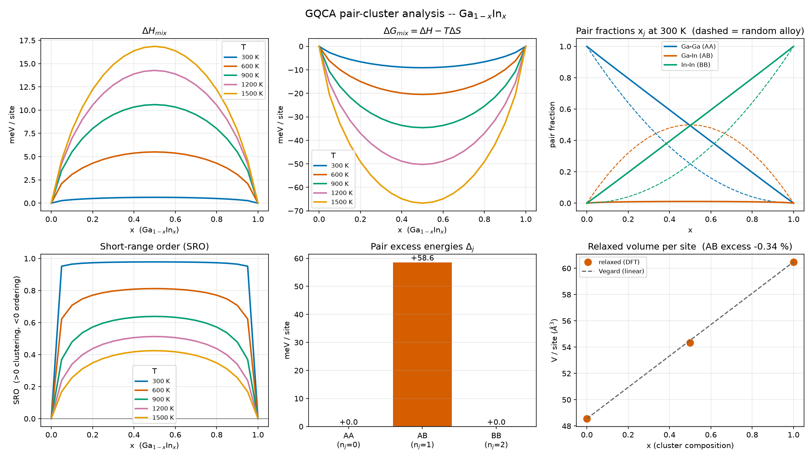

# 5.13 — Workflow: GQCA, Generalized Quasi-Chemical Approximation (`stb-gqca` / `stb-gqcaAnalysis`)

This workflow has 2 stages: **Stage 1** (`stb-gqca`, code `5.13.1`) takes the
structure of a host crystal and a `calc.fdf`, picks one sublattice, and writes
**three** ready-to-relax SIESTA folders — the two pure end-members (AA, BB)
and one ordered 50:50 compound (AB). **Stage 2** (`stb-gqcaAnalysis`, code
`5.13.2`) reads the three finished relaxations back and, from just their three
energies, reports the mixing enthalpy, entropy and free energy of the
substitutional alloy **A(1−x)B(x) at every composition x and temperature T**,
a short-range-order (SRO) parameter, an equivalent regular-solution
interaction parameter, and a set of sanity checks, tables, plots and
relaxed structures.

It answers a question none of `5.1`–`6.2` does: not how a *given* structure
responds, but **how an alloy of two species will arrange itself** — does it
prefer unlike neighbours (ordering), like neighbours (clustering/phase
separation), or neither (an ideal solution) — at the cost of only three DFT
relaxations, whatever the composition you eventually care about. The worked
example (Section 5) runs the whole thing for real, with SIESTA, on two
textbook III-V alloys that behave in opposite ways: Ga(1−x)In(x)As (size
mismatched, tends to cluster) and Ga(1−x)Al(x)As (lattice matched, nearly
ideal).

Both stages live in this one folder and this one tutorial — same reasoning as
`5.1`–`5.5`: Stage 1's output exists only to feed Stage 2.

## 1. Theory

**Symbols at a glance** (all energies are per alloy-sublattice site unless stated):

| Symbol | Meaning |
|---|---|
| A, B | the two alloy species on the chosen sublattice (`--sublattice`, `--species-b`) |
| `x` | alloy composition: fraction of the sublattice occupied by B |
| `N` | cluster size; here `N = 2` (nearest-neighbour pairs) |
| `j`, `n_j` | pair type: number of B atoms in the pair (0 = AA, 1 = AB, 2 = BB) |
| `g_j` | degeneracy of pair type `j`: `[1, 2, 1]` |
| `e_j` | energy per sublattice site of reference structure `j` (`cluster_n{j}`) |
| `Δ_j` | excess of `e_j` over the linear interpolation of the end-members, eq. (2) |
| `x_j` | fraction of pairs that are of type `j` (the pair populations) |
| `η` | Lagrange multiplier ("chemical activity" of B) fixing the composition, eq. (1) |
| `ΔH`, `ΔS`, `ΔG` | mixing enthalpy, entropy, free energy per site, eqs. (4)–(6) |
| `SRO` | short-range-order parameter, eq. (7): `> 0` clustering, `< 0` ordering |
| `Ω`, `T_c` | regular-solution interaction parameter and critical temperature, eqs. (9)–(10) |

### 1.1 Why alloys are hard, and where GQCA sits

A substitutional alloy A(1−x)B(x) is a crystal whose lattice sites are fixed
but whose *occupation* is not: each site of one sublattice holds an A or a B.
With `N` sites there are `C(N, xN)` arrangements — astronomically many — and
the real, finite-temperature crystal samples all of them with Boltzmann
weights. Two exact-in-principle routes exist and both are expensive: compute
the energy of an enormous number of supercells with DFT, or fit those
energies to a **cluster expansion** [9] and run Monte Carlo on the fit. A
cheaper route in the same spirit is a **special quasirandom structure**
(SQS) [10]: a single, well-chosen supercell whose correlation functions
mimic a random alloy at one composition, giving the *enthalpy of the random
alloy* — but nothing about how the alloy actually orders or clusters.

The **quasi-chemical approximation** sits at the other end of the cost
scale. Its lineage is old: Bethe [5] treated a binary alloy as a set of
nearest-neighbour pairs; Fowler and Guggenheim [4, 3] turned that into a
mass-action statistical theory; Sher, van Schilfgaarde, Chen and Chen [1, 2]
generalized it to clusters of any size and to *first-principles* cluster
energies — hence **Generalized** Quasi-Chemical Approximation. That is what
this workflow implements in its simplest form, the **pair cluster** (N = 2).
Its appeal is economy: all the DFT you need is the energy of three small,
ordered structures.

### 1.2 The physical picture: a gas of independent pairs

Look at the alloy not as a lattice of atoms but as a collection of
nearest-neighbour **pairs** (bonds). Every pair is in one of three states,
labelled by its number of B atoms `n_j`:

```
n_j = 0  (AA)        n_j = 1  (AB)        n_j = 2  (BB)
degeneracy g = [1, 2, 1]
```

(`g_j = C(N, j)`: an AB pair can be read in two orders, AA and BB in one
[1].) The central approximation is that these pairs are **statistically
independent "molecules"** whose populations `x_j` (fractions of pairs in each
state, `Σ_j x_j = 1`) are set by thermal equilibrium, subject to one
constraint — the alloy contains the right overall amount of B:

```
Σ_j (n_j / N) x_j = x                                                    (1)
```

The chemistry is exactly that of a reaction between molecules:

```
2 AB  <==>  AA + BB
```

If forming unlike (AB) pairs is energetically costly the equilibrium shifts
right (AA and BB pairs dominate: **clustering**); if AB pairs are favourable
it shifts left (**ordering**); if it is energetically free the populations
are the purely statistical (binomial) ones — a **random** alloy.

### 1.3 The equations

**(a) Excess energy of each pair.** Let `e_j` be the energy of the reference
structure that realizes pair type `j`, normalized per alloy-sublattice site
(Stage 2 does this normalization — the three cells have different sizes).
Subtract the linear interpolation between the two pure end-members:

```
Δ_j = e_j − (1 − n_j/N) e_0 − (n_j/N) e_N                                (2)
```

By construction `Δ_0 = Δ_N = 0`; the whole alloy is then controlled by one
number for N = 2, `Δ_1` (Sher et al. [1]; restated as Eq. 4 of Ferreira et
al. [33]). Note the interpolation is in the **local cluster composition**
`n_j/N`, not in the target alloy composition `x`.

**(b) Mass-action equilibrium.** The thermal weight of a pair cluster is set by
the energy of the **whole N-site cluster**, `N Δ_j` (the `Δ_j` of (2) is per
site). Minimizing the free energy of the cluster gas subject to (1) with a
Lagrange multiplier `η` (the "chemical activity" of B) gives the
Boltzmann-like populations

```
x_j(η, T) = g_j η^{n_j} exp(−N Δ_j / k_B T) / Z,    Z = Σ_j g_j η^{n_j} exp(−N Δ_j / k_B T)   (3)
```

and `η` is fixed by inserting (3) into (1) (an independent open-source
implementation of the same formalism is described in [34]). `stb-gqcaAnalysis` solves this
root problem with Brent's method [30] in `ln η` (the root is unique because
the mean composition is monotonic in `η`). When all `Δ_j = 0`, `η = x/(1−x)`
and (3) collapses to the binomial distribution
`x_j = C(N, j) x^j (1−x)^{N−j}` — the random-alloy reference used for SRO
and as an analytic test of the code.

**(c) Thermodynamic functions.**

```
ΔH_mix = Σ_j x_j Δ_j                                  (per site)         (4)
ΔS_mix = −(k_B / N) Σ_j x_j ln( x_j / g_j )           (per site)         (5)
ΔG_mix = ΔH_mix − T ΔS_mix                            (per site)         (6)
```

(The sum in (5) is the entropy of the cluster gas **per cluster**; dividing by
`N` makes it per site, like (4). For `Δ_j = 0` it reduces *exactly* to the
ideal-solution entropy `−k_B [x ln x + (1−x) ln(1−x)]` per site — see
Section 1.7-ii for why this matters.) The populations (3) are precisely the
minimizer of `ΔH_mix − T ΔS_mix` under constraint (1); `Δ_1/k_B T` therefore
enters as `N Δ_1 / k_B T`.

**(d) Short-range order.** The fraction of unlike pairs, `x_1`, compared with
its random value `x_1^rand = 2x(1−x)` gives a Warren–Cowley-style parameter
[7, 8]:

```
SRO = ( x_1^rand − x_1 ) / x_1^rand                                      (7)
```

`SRO = 0` is a random alloy; **`SRO > 0`: fewer unlike pairs than random
(clustering)**; **`SRO < 0`: more (ordering)** — the sign convention of
Cowley's α parameters. (The normalization is provisional, Section 1.7.)

### 1.4 Reading the equations

**The equilibrium constant.** From (3) with `Δ_0 = Δ_2 = 0`:

```
K(T) ≡ x_0 x_2 / x_1²  =  (g_0 g_2 / g_1²) exp(2NΔ_1 / k_B T)  =  ¼ exp(4Δ_1 / k_B T)     (8)
```

independent of `x` — the law of mass action for `2 AB ⇌ AA + BB`. At
`Δ_1 = 0`, `K = ¼` (random). `Δ_1 > 0` raises K above ¼ (clustering);
`Δ_1 < 0` lowers it (ordering). The only energy scale that matters is
`N Δ_1 / k_B T` (cluster energy over `k_B T`), which is why the report prints that
ratio at each temperature.

**Limits.** `T → ∞`: every `exp(−N Δ_j/k_B T) → 1`, the populations become
binomial and `SRO → 0`: thermal disorder always wins eventually. `T → 0`:
for `Δ_1 > 0` the AB fraction `x_1 → 0` (the alloy segregates into AA and BB
domains); for `Δ_1 < 0` and `x = ½`, `x_1 → 1` (a perfectly ordered AB
compound).

**The regular-solution equivalent.** In the random limit,
`x_1 = 2x(1−x)` and (4) gives

```
ΔH_mix^rand(x) = 2 Δ_1 x (1−x)  ≡  Ω x (1−x),     Ω = 2 Δ_1                   (9)
```

i.e. the familiar *regular solution* [35] with interaction parameter
`Ω = 2Δ_1` (`Ω > 0`: unlike atoms repel). A regular solution phase-separates
below the critical temperature

```
T_c = Ω / (2 k_B) = Δ_1 / k_B                                            (10)
```

`stb-gqcaAnalysis` prints (9)–(10) as an *estimate* — a regular-solution
statement derived from `Δ_1`, **not** a result of the GQCA free energy
itself, which cannot show a gap (Section 1.7). Historically this is the
language of III-V alloy miscibility work, where Stringfellow derived Ω for
the ternary and quaternary III-V systems from a strain-energy model [14]
(Ho and Stringfellow applied the same regular-solution reasoning to the
nitride alloy GaInN [15]).

### 1.5 What `Δ_1` contains, and why the cells must really relax

`Δ_1` bundles two contributions. A **chemical** one (are Ga–As–In bonds
intrinsically more or less favourable than Ga–As–Ga and In–As–In?) and an
**elastic** one: A and B atoms want different bond lengths, and mixing them
forces the crystal to strain. For isovalent semiconductor alloys the elastic
part usually dominates and scales roughly with the *square* of the
size mismatch, as in Keating's valence-force-field picture [12] and the
bond-length studies of Martins and Zunger [13]. This is why Ga(1−x)In(x)As
(≈ 7 % mismatch) is expected to have a sizeable positive `Δ_1` and
Ga(1−x)Al(x)As (≈ 0.1 %) a tiny one — the two cases of Section 5.

The consequence for the calculation is non-negotiable: **each of the three
reference structures must be relaxed at its own equilibrium lattice
constant**. The three generally have different cells (GaAs 5.65 Å, InAs
6.06 Å, and something in between for the ordered compound). If you evaluated
all three at one fixed lattice constant you would add a large, spurious
strain energy to `e_0` or `e_2` and corrupt `Δ_1`. Stage 1 therefore forces
`MD.TypeOfRun CG` and `MD.VariableCell T` for bulk inputs (Section 3.2).
Vegard's law [16] — the lattice constant of an alloy interpolates linearly
between its end-members — is the natural benchmark for the relaxed volumes,
and Stage 2 reports the deviation of the AB cell from it.

### 1.6 Choosing the three structures

The end-members are trivial: every site of the chosen sublattice is set to A
(`cluster_n0`) or to B (`cluster_n2`). The AB structure is the interesting
one. A pair cluster with exactly one A and one B has the *only* interior
composition a 2-site cluster has — 50 % B — so `cluster_n1` is always built at
50:50, **whatever alloy composition you ultimately care about**: the target
`x` is swept entirely in Stage 2. The three DFT runs are the complete input
to the whole `x`–`T` surface.

But 50:50 composition is not enough: a *random* 50:50 mixture has, on
average, as many AA and BB bonds as AB ones. The structure must realize the
**local** AB environment — every nearest-neighbour pair unlike. `stb-gqca`
enumerates all symmetrically distinct ordered 50:50 arrangements at the
smallest cell that reaches exactly 50 % B (Hart–Forcade derivative-structure
enumeration [18] as implemented in icet [19]) and keeps the one whose
nearest-neighbour **pair correlation** is closest to −1 (the value for
"every pair unlike"; 0 for a random alloy at 50:50).

Whether −1 is reachable depends on the lattice, and this is a genuine
piece of geometry, not a software limit:

| Sublattice | Connectivity | Best AB pair correlation |
|---|---|---|
| simple cubic | bipartite (2-colourable: a checkerboard) | −1 exactly |
| FCC (zincblende/rocksalt cations), triangular, HCP | contains triangles (odd cycles) | > −1: **frustrated** |

Triangles cannot be 2-coloured so that all three bonds are unlike. This is
the same frustration that stops the antiferromagnetic Ising model on a
triangular lattice from reaching perfect Néel order [17]. For GaAs's FCC
cation sublattice the best 50:50 cell reaches a pair correlation of only
−1/3 (deviation 0.667 from the ideal). The consequence is stated plainly in
every report: `cluster_n1`'s environment is *not purely* AB, so `Δ_1` is a
less clean estimate than on a bipartite lattice — qualitatively meaningful,
not a rigorous bound. `stb-gqca` also runs a bounded probe at twice the cell
size and reports whether a larger cell would improve the ordering
(`[NOTE] Delta_1 sensitivity check`).

**2D inputs** (a vacuum-padded monolayer such as MoS2) are detected
automatically from the vacuum gap along one axis; the enumeration is
restricted in-plane so the vacuum direction is never tiled. Cell relaxation is
left **off** for 2D (positions only) — see Section 7 for why.

### 1.7 What the model assumes, and where it is not (yet) trustworthy

**(i) The three energies are per sublattice site.** Stage 2 divides each
`FreeEng` by that folder's own count of sublattice (A + B) atoms, because the
three cells differ in size. This is `e_j` in (2).

**(ii) The entropy normalization — a bug found and fixed while writing this
tutorial.** Equation (5)'s sum is the Boltzmann entropy of the cluster gas per
**cluster**. An earlier version of the solver used it as if it were per
**site** while the energies (2)/(4) are per site, and used the per-site `Δ_j` as
if it were the cluster energy in the weights (3). The giveaway: for a *random*
alloy (all `Δ_j = 0`) the old `ΔS_mix` was exactly **2× the ideal-solution
entropy per site** (at `x = 0.5`: 0.1195 meV/K instead of 0.0597 meV/K), and
the old results at temperature `T` were those of the correct model at `2T` —
i.e. it understated clustering/ordering at any given `T`. The fix (weights with
`N Δ_j`, entropy divided by `N`) is checked in the test-suite two ways: the
random-alloy entropy equals the exact ideal value per site (`x = 0.25, 0.5,
0.75`), and the closed-form populations coincide with an independent numerical
minimization of `ΔH − TΔS` per site. `Δ_j`, `Ω`, `T_c`, lattice constants and
volumes were never affected. What remains `[UNVERIFIED]` is the *closed form
beyond the random limit* (an independent-cluster entropy; no
Guggenheim-type overlap correction, [3, 4]) — flagged in the code, the CLI help
and every report — so `ΔS_mix`, `ΔG_mix` and the temperature dependence of
`x_j`/SRO are semi-quantitative, while `Δ_j`, `Ω`, `T_c` and the geometry are
direct.

**(iii) The model cannot show a miscibility gap.** With (4)–(5), the free energy
as a function of composition is the minimum, over the pair populations
`{x_j}` subject to the linear constraints `Σ x_j = 1` and
`Σ (n_j/N) x_j = x`, of the function `Σ_j x_j Δ_j + (k_B T / N) Σ_j x_j ln(x_j/g_j)`.
That function is jointly convex in `{x_j}`, and minimizing a jointly convex
function over linear constraints yields a function that is convex in the
constraint parameters (Boyd and Vandenberghe [36], §3.2.5). Hence
`ΔG_mix(x)` is **provably convex for any `Δ_j`**: the common-tangent search in
the report's `[7]` will essentially never find a gap, however repulsive the
alloy. That is an intrinsic property of an independent-cluster model, not a
physical claim that the alloy is miscible. The model captures *short-range
order*, not genuine phase separation, which needs correlations between
clusters (cluster-variation, cluster-expansion + Monte Carlo — Kikuchi [6],
Sanchez, Ducastelle and Gratias [9]). The regular-solution `T_c` of (10) is
offered precisely to fill that gap *as an estimate*.

**(iv) SRO normalization.** Equation (7) is a provisional Warren–Cowley-style
definition; its sign convention is Cowley's [7] but its normalization has not
been pinned to a primary source (`[UNVERIFIED]`).

**(v) Frustrated lattices** (Section 1.6) make `Δ_1` a less clean estimate.

**(vi) Everything is equilibrium thermodynamics at 0 K energies.** There are
no vibrational contributions to `Δ_j`, and epitaxial or kinetically frozen
samples need not follow the equilibrium populations.

### 1.8 What this workflow simplifies — explicitly

- **Pair clusters only (N = 2).** Larger clusters (the tetrahedral cluster
  natural for zincblende, N = 4 [1, 2]) capture more of the local
  environment but need many more reference structures.
- **One reference structure for AB**, and a frustrated one on FCC/triangular
  lattices (Section 1.6).
- **No gap, no true phase diagram** (Section 1.7-iii).
- **Cluster energies come from a single relaxed ordered cell**, not from an
  average over disordered configurations — an SQS [10] or a cluster expansion
  [9] would give the *random-alloy* energy directly and is the natural
  cross-check.
- **Spin, magnetism and charged defects are not treated**; the template's own
  settings (e.g. `Spin`) are applied identically to all three folders.

### 1.9 A calculation you can check by hand

Take the InGaAs numbers of Section 5.2 — `Δ_1 = 58.60 meV` per site, composition
`x = ½`, temperature `T = 600 K` — and reproduce one row of the report's
table (Section 4.6) with a pocket calculator. `k_B T = 51.70 meV` and the cluster
energy is `N Δ_1 = 117.20 meV`.

1. **Equilibrium constant**, eq. (8): `K = ¼ exp(2 N Δ_1 / k_B T) = ¼ exp(4.534) = ¼ × 93.1 = 23.27`.
   (Compare the random alloy, `K = ¼`: here AA + BB pairs are favoured ~93-fold
   over AB pairs.)
2. **Populations.** At `x = ½` the composition constraint (1) forces
   `x_0 = x_2 = (1 − x_1)/2`, so `K = x_0 x_2 / x_1² = [(1 − x_1)/(2 x_1)]²`.
   Hence `(1 − x_1)/(2 x_1) = √K = 4.824` and
   `x_1 = 1 / (1 + 2 × 4.824) = 0.0939`, `x_0 = x_2 = 0.4530`.
3. **Short-range order**, eq. (7): `x_1^rand = 2 × ½ × ½ = 0.5`, so
   `SRO = (0.5 − 0.0939) / 0.5 = +0.812`.
4. **Enthalpy**, eq. (4): `ΔH = x_1 Δ_1 = 0.0939 × 58.60 = 5.50 meV/site`
   (only the unlike pairs cost energy).
5. **Entropy**, eq. (5): `Σ x_j ln(x_j/g_j) = 2 × 0.4530 ln 0.4530 + 0.0939 ln(0.0939/2) = −0.7174 − 0.2872 = −1.0046`,
   so `ΔS = (k_B/2) × 1.0046 = 0.0433 meV/K` and `−TΔS = −25.97 meV`.
6. **Free energy**, eq. (6): `ΔG = 5.50 − 25.97 = −20.47 meV/site`.

Every number above is the `T = 600` row of the `x = 0.500` table in Section 4.6
(`x_1 = 0.0939`, `SRO = +0.8122`, `H_mix = +5.504`, `S_mix = 0.0433`,
`-T*S = -25.973`, `G_mix = -20.469`). Seeing the tool's output follow from three
lines of algebra is the best way to trust it — and to understand what to expect
from your own alloy: a large `N Δ_1 / k_B T` empties the AB column and drives the
SRO toward +1; a small one leaves everything near the random values.

**Physical reading.** At 600 K only 9 % of the nearest-neighbour cation pairs
are In–Ga although a random alloy would have 50 %: the lattice has *segregated
locally*, forming In-rich and Ga-rich patches, because each unlike pair costs
the elastic energy of squeezing a large In atom next to a small Ga atom. Heat
reduces the penalty relative to `k_B T`, so the patches dissolve gradually
(SRO 0.98 at 300 K, 0.42 at 1500 K) — but never completely, which is why the
alloy has a finite critical temperature `T_c` below which a *macroscopic*
miscibility gap opens (Section 1.4, equation (10)).

## 2. Libraries and external dependencies used

- **[icet](https://icet.materialsmodeling.org/)** [19] is the engine of
  Stage 1: it builds the cluster space of the chosen sublattice, enumerates
  every symmetrically distinct ordered 50:50 arrangement (Hart–Forcade
  derivative structures [18]) and evaluates each candidate's nearest-neighbour
  **cluster vector**, the pair correlation used to pick `cluster_n1`
  (Section 1.6). It is an optional dependency (`core.deps.require_icet`):
  Stage 1 prints an install hint if it is missing; Stage 2 does not need it.
- **[pymatgen](https://pymatgen.org/)** [26] and **[ASE](https://wiki.fysik.dtu.dk/ase/)**
  [27] — structure conversion (`.fdf` ↔ pymatgen ↔ ASE), formula/lattice
  bookkeeping, `AseAtomsAdaptor`, CIF/XSF/XYZ/VASP writers for
  `--export-relaxed`, and the interactive 3D viewer behind `--view`.
- **[spglib](https://spglib.readthedocs.io/)** [28] — symmetry analysis used
  internally by icet/pymatgen when reducing the host cell to its primitive
  cell.
- **[sisl](https://zerothi.github.io/sisl/)** [32] — reads SIESTA's `.XV` file
  (relaxed positions **and** cell) for `--view` / `--export-relaxed`.
- **numpy** / **[SciPy](https://scipy.org/)** [29] — array maths; `scipy.optimize.brentq`
  solves the mass-action root `η(x, T)` (Section 1.3, [30]).
- **[matplotlib](https://matplotlib.org/)** [31] — the 6-panel dashboard
  (`--png` / `--show`). Gnuplot (external, never invoked by the suite) is only
  used if you run the generated `.gplot` yourself.
- **SIESTA** [20, 21] itself — *not* called by the suite. You run it on the three
  folders; Stage 2 only parses its output (`calc.out`, `.XV`). The reference
  data of Section 5 was produced with SIESTA 5.4.2, GGA-PBE [22],
  PseudoDojo norm-conserving pseudopotentials [23], and Monkhorst–Pack k-grids
  [24].

## 3. Stage 1: generating the three cluster structures (`stb-gqca`, code `5.13.1`)

### 3.1 What it does

Reads the host structure (`-f`, `.fdf`) and the `calc.fdf` template (`-c`,
**default `calc.fdf`** in the current directory), and writes, under `-O`
(default `gqca_study`):

```
gqca_study/
├── gqca_stage1.txt        <- the full Stage 1 report (also printed on screen)
├── cluster_n0/            <- AA: the whole sublattice set to species A
├── cluster_n1/            <- AB: the ordered 50:50 structure (Section 1.6)
└── cluster_n2/            <- BB: the whole sublattice set to species B
        structure.fdf  calc.fdf  config_extra.fdf  <pseudopotentials>
```

It never runs SIESTA. `-p/--pseudo-dir` takes a bundled bank (`dojo`) or a
folder of your own `.psml/.psf` files and copies the right ones into each
folder.

### 3.2 Forcing the relaxation: `config_extra.fdf`

Every folder gets a `config_extra.fdf` and a `calc.fdf` whose **first line** is
`%include config_extra.fdf`; the rest of `calc.fdf` is your template, byte for
byte. This is the suite's standard mechanism (same as `5.1`–`5.4`): SIESTA's fdf
reader is *first-occurrence-wins* for a repeated label, so a directive in
`config_extra.fdf` beats the same directive anywhere in your template — without
editing the template. Live, for this tutorial's own InGaAs `cluster_n1`:

```
$ cat gqca_study/cluster_n1/config_extra.fdf
# Auto-generated by stb-gqca -- forces a real relaxation of this cluster.
# %included at the top of calc.fdf, so it wins over any same-name directive in the
# template (SIESTA's fdf reader is first-occurrence-wins). The template is untouched.
MD.TypeOfRun          CG
MD.NumCGsteps         150
MD.VariableCell       T
kgrid.MonkhorstPack   [8  8  6]
```

What is forced and why:

| Directive | Value | Reason |
|---|---|---|
| `MD.TypeOfRun` | `CG` | a real relaxation, never a single point (Section 1.5) |
| `MD.NumCGsteps` | your template's value if `> 0`, else `200` | SIESTA's default is **0** (no relaxation): a template left at 0 would silently skip the relaxation |
| `MD.VariableCell` | `T` (3D input only) | each cluster relaxes to its own lattice constant; left unforced for a 2D input (Section 7) |
| `kgrid.MonkhorstPack` | recomputed **per folder** from `--kdensity` | the three cells differ in size and shape |

A hostile template shows the mechanism at work — `kgrid [1 1 1]`,
`MD.NumCGsteps 0`, `MD.TypeOfRun Broyden` all lose (Case 2 of the script):

```
Directive in config_extra.fdf | Value                | Template had | Effect
MD.TypeOfRun                  | CG                   | Broyden      | overrides
MD.NumCGsteps                 | 200                  | 0            | raised (a value of 0 / absent = no relaxation; default 200)
MD.VariableCell               | T                    | (absent)     | added
kgrid.MonkhorstPack           | per folder (see [4]) | present      | overrides, density 0.2 1/Ang
```

(An earlier version of the tool *appended* the k-grid and run type to the end of
`calc.fdf`; with first-occurrence-wins semantics a template that already had a
`kgrid` kept its own grid. The `%include`-on-top mechanism fixes that.)

### 3.3 The report, live

```
$ stb-gqca -f structure.fdf --sublattice Ga --species-b In -p dojo --no-intro

[1] INPUT STRUCTURE
Formula         : Ga4 As4  (8 atoms)
Lattice (Ang)   : a=5.6533  b=5.6533  c=5.6533
Cell volume     : 180.6783 Ang^3
Species | Z  | Atoms | Role
Ga      | 31 | 4     | alloy sublattice (A)
As      | 33 | 4     | host (kept fixed)
Detected (input) : 3D (bulk material)
Cell treatment   : MD.VariableCell T (full cell relaxes)

[2] PAIR ORBIT
Shortest sublattice-sublattice distance : 3.9975 Ang
Orbit radius    : 1.9987 Ang
Pair states      : n_j=0 (AA), n_j=1 (AB), n_j=2 (BB), A=Ga, B=In

Written structures:
Folder     | Pair       | Formula   | Atoms | A/B sites | x_B(sub) | a b c (Ang)       | V (Ang^3) | V/site | k-grid
cluster_n0 | AA (Ga-Ga) | Ga4As4    | 8     | 4/0       | 0.00     | 5.653 5.653 5.653 | 180.68    | 45.17  | 6x6x6
cluster_n1 | AB (Ga-In) | In1Ga1As2 | 4     | 1/1       | 0.50     | 3.997 3.997 5.653 | 90.34     | 45.17  | 8x8x6
cluster_n2 | BB (In-In) | In4As4    | 8     | 0/4       | 1.00     | 5.653 5.653 5.653 | 180.68    | 45.17  | 6x6x6

AB ordering (cluster_n1):
  Cell size searched     : 2x primitive (primitive cell = 2 atom(s); smallest size reaching exactly 50% B)
  Candidates evaluated   : 2 symmetrically distinct
  Pair correlation       : -0.3333  (ideal AB = -1.0000)
  Deviation from ideal   : 0.6667  (geometrically frustrated sublattice -- Delta_1 less clean)
```

How to read it. The 50:50 cell has **4 atoms** (1 In + 1 Ga + 2 As) — half the
size of the 8-atom end-member cells, because it comes from icet's enumeration
on the *primitive* cell; this is why Stage 2 normalizes per sublattice site.
The two enumerated candidates are the layered (001) CuAu-I-type ordering and
one other; the best has pair correlation −1/3 (each cation has 8 unlike and 4
like nearest cation neighbours), a deviation of 0.667 from the ideal −1, the
frustration of Section 1.6. The k-grids (`6×6×6`, `8×8×6`) come from the same
density (`--kdensity 0.2`) applied to different cells.

### 3.4 `--kdensity`: how dense a k-grid

The default `0.2` 1/Å is the suite's usual starting point (same convention as
`stb-kgrid`; `stb-phononsCreate`, `stb-ir`, `stb-raman` and `stb-cohesive` use
the same). The earlier default of `0.04` (28×28×28 for this 8-atom cell) was
five times too dense. Case 3 of the script shows the three grids for 0.5, 0.2
and 0.1:

```
--kdensity 0.5   3x3x3 | 4x4x3 | 3x3x3
--kdensity 0.2   6x6x6 | 8x8x6 | 6x6x6        (default)
--kdensity 0.1   12x12x12 | 16x16x12 | 12x12x12
```

Whether `0.2` is dense enough for *your* mixing energy is a convergence
question, answered in Section 5.4 with a real number.

### 3.5 Three lattices, three behaviours

Case 4 of the script runs Stage 1 on three fixtures and compares the
`Pair correlation` line:

| Fixture | Sublattice | AB pair correlation | Cell treatment |
|---|---|---|---|
| `cubic.fdf` (Na → K) | simple cubic, bipartite | **−1.0000** (ideal reached) | 3D, full cell |
| `structure.fdf` (Ga → In) | FCC, frustrated | −0.3333 | 3D, full cell |
| `mos2.fdf` (Mo → W) | triangular, frustrated, 2D | −0.3333 | **positions only** |

For the 2D MoS2 monolayer a `[KNOWN LIMITATION]` note is printed: cell
relaxation is left off, so the in-plane lattice mismatch between the two
end-members is *not* captured (Section 7).

### 3.6 Validation

`stb-gqca` refuses, with a clear `[ERROR]` and exit status 1: a sublattice
species not present in the structure, `--sublattice` equal to `--species-b`, a
missing structure file, and a missing calc template (the `calc.fdf` default
not being in the current directory — the message says so and points to `-c`).

### 3.7 Running it both ways

`stb-suite` → `5.13.1` asks the same questions as guided prompts; its
calc.fdf prompt now accepts a blank answer for the default, and its k-density
advanced prompt also defaults to `0.2`. Case 6 of the script drives it with
piped answers and diffs the generated folders against the direct CLI run.

## 4. Stage 2: analyzing the results (`stb-gqcaAnalysis`, code `5.13.2`)

### 4.1 Before running Stage 2: run SIESTA in the three folders

```
for c in n0 n2 n1; do (cd gqca_study/cluster_$c && mpirun -np 4 siesta calc.fdf > calc.out); done
```

Each is a short bulk relaxation (a few CG steps; minutes on a laptop for
8-atom cells). Stage 2 expects `calc.out` in each folder (`--file` changes the
name) plus the `structure.fdf`/`calc.fdf`/`config_extra.fdf` Stage 1 wrote.

### 4.2 Report structure

```
[0] RUN METADATA
[1] LEVEL OF THEORY               <- the 3 folders compared, setting by setting
[2] CLUSTER ENERGIES, CONVERGENCE & RELAXED GEOMETRY
[3] MIXING ENERGIES               <- Delta_j in eV/meV/kJ/mol/kcal/mol; Omega, T_c
[4] COMPOSITION / TEMPERATURE GRID  <- tables at --x-target compositions
[5] SANITY DIAGNOSTICS
[6] INTERPRETATION                <- plain-language reading of the numbers
[7] MISCIBILITY GAP (COMMON-TANGENT)
[8] SUMMARY & FILES
```

**No arguments are required**: `stb-gqcaAnalysis` alone reads `./gqca_study`,
the `calc.out` files, and sweeps 300–1500 K in 5 points (`--temp` for one
temperature, `--temp-min/--temp-max/--temp-points` for your own sweep).
`--x-target 0.25 0.5 0.75` adds one detailed table per composition.

### 4.3 `[1]` — is the comparison legitimate?

Mixing energies only mean something if the three clusters were computed
**identically**. Stage 2 reads each folder's `config_extra.fdf` + `calc.fdf`
(first-occurrence-wins, exactly as SIESTA would) and tabulates the settings
that matter:

```
Setting                | cluster_n0    | cluster_n1    | cluster_n2    | Consistency
XC functional          | GGA           | GGA           | GGA           |
XC authors             | PBE           | PBE           | PBE           |
Basis size             | DZP           | DZP           | DZP           |
Mesh cutoff            | 250 Ry        | 250 Ry        | 250 Ry        |
Variable cell          | T             | T             | T             |
k-grid                 | 6x6x6         | 8x8x6         | 6x6x6         | differs (k-grid follows each cell)
All 3 folders share the same level of theory (k-grid aside, which is density-based per cell).
```

If any other setting differs, that row turns yellow with `DIFFERS` and a
`[WARNING]` follows (Case 10b of the script edits `Mesh.Cutoff` in one folder
to show it). The k-grid is *expected* to differ.

### 4.4 `[2]` — converged? relaxed to what?

Live, on this tutorial's real InGaAs data:

```
Cluster    | Job completed | SCF converged | Geom. moves | Max force (eV/Ang) | Stress xx yy zz (kbar)
cluster_n0 | yes           | yes (7 it.)   | 4           | 0.0000             | +0.10 +0.10 +0.10
cluster_n1 | yes           | yes (10 it.)  | 10          | 0.0120             | +0.46 +0.63 +0.63
cluster_n2 | yes           | yes (8 it.)   | 10          | 0.0001             | -0.06 -0.06 -0.07

Cluster    | Input cell a b c  | Relaxed cell a b c | V/site relaxed | dV vs input
cluster_n0 | 5.653 5.653 5.653 | 5.791 5.791 5.791  | 48.557         | +7.50 %
cluster_n1 | 3.997 3.997 5.653 | 4.258 4.258 5.995  | 54.333         | +20.29 %
cluster_n2 | 5.653 5.653 5.653 | 6.231 6.231 6.231  | 60.485         | +33.91 %

Effective lattice mismatch  (V_BB/V_AA)^(1/3) - 1 : +7.60 %
AB volume vs Vegard (linear) average          : -0.34 %  (V_AB = 54.333 vs 54.521 Ang^3/site)
```

What to check: forces below the `MD.MaxForceTol` you asked for (here 0.02
eV/Å; a `[WARNING]` appears above `--force-tolerance`, default 0.05), residual
stresses of a fraction of a kbar (the relaxation really reached the cell
minimum), SCF confirmed. The **effective mismatch** (cube root of the
volume-per-site ratio) is the number to compare with the experimental
lattice-constant mismatch; the **AB volume versus Vegard** [16] tells you the
alloy cell follows the linear law (−0.34 % is excellent).

### 4.5 `[3]` — the three numbers that carry the method

```
j | Pair       | Delta_j (eV) | Delta_j (meV) | kJ/mol | kcal/mol
0 | AA (Ga-Ga) | +0.000000    | +0.00         | +0.00  | +0.00
1 | AB (Ga-In) | +0.058598    | +58.60        | +5.65  | +1.35
2 | BB (In-In) | +0.000000    | +0.00         | +0.00  | +0.00

Regular-solution equivalent (random-mixing limit of this model, H = Omega x (1-x)):
  Omega = 2*Delta_1            : +117.20 meV/site  (+2.70 kcal/mol, +11.31 kJ/mol)
  H_mix(x=0.5, random limit)   : +29.30 meV/site
  T_c = Omega / (2 kB)         : 680 K
```

`Δ_0` and `Δ_2` are zero by definition (they are the reference); everything
rests on `Δ_1`. `Ω` and `T_c` are equations (9)–(10).

### 4.6 `[4]` — what happens along the temperature axis

```
  x = 0.500   [random-alloy reference: x_0=0.250, x_1=0.500, x_2=0.250]
T (K) | x_0    | x_1    | x_2    | H_mix   | S_mix  | -T*S    | G_mix   | SRO     | N*Delta_1/kT
300   | 0.4947 | 0.0106 | 0.4947 | +0.623  | 0.0324 | -9.721  | -9.098  | +0.9787 | 4.53
600   | 0.4530 | 0.0939 | 0.4530 | +5.504  | 0.0433 | -25.973 | -20.469 | +0.8122 | 2.27
900   | 0.4096 | 0.1808 | 0.4096 | +10.593 | 0.0502 | -45.204 | -34.611 | +0.6384 | 1.51
1200  | 0.3782 | 0.2435 | 0.3782 | +14.271 | 0.0538 | -64.541 | -50.270 | +0.5129 | 1.13
1500  | 0.3562 | 0.2877 | 0.3562 | +16.858 | 0.0557 | -83.580 | -66.723 | +0.4246 | 0.91
```

At 300 K only **1 %** of the pairs are unlike (a random alloy would have 50 %):
**SRO = +0.98**, essentially fully clustered; as T rises `x_1` climbs toward 0.5
and SRO falls toward 0. `H_mix` rises because more unlike (costly) pairs appear,
and `S_mix` tends to the ideal value `k_B ln 2 = 0.0597 meV/K` at `x = ½`
(0.0557 meV/K at 1500 K). The `S_mix`, `-T*S`, `G_mix` columns and the *speed*
of the SRO decay depend on the independent-cluster entropy flagged in
Section 1.7-ii (semi-quantitative); `H_mix` for a given set of populations, and
all of `[3]`, do not.

### 4.7 `[5]`–`[7]` — sanity checks, interpretation, and the gap search

`[5]` checks the pure-A and pure-B limits, `Σ x_j = 1`, the composition mass
balance of equation (1), `Δ_0 = Δ_2 = 0`, and that all clusters converged.
`[6]` turns the signs and magnitudes into sentences (clustering vs ordering,
`N Δ_1/kT`, SRO vs T, the regular-solution `T_c`). `[7]` is the common-tangent
search, which always reports "fully miscible" by Section 1.7-iii.

### 4.8 The optional extras

| Flag | What you get |
|---|---|
| `--png` | `<dir>/<output>_summary.png`: the 6-panel dashboard (ΔH(x), ΔG(x), pair fractions vs random, SRO(x), pair excess energies, relaxed volume vs Vegard) |
| `--show` | the same dashboard in a window (needs a display; with none it says so and still saves with `--png`) |
| `--plot-temp T` | temperature of the single-T panels (nearest sampled T) |
| `--view` | each relaxed structure in ASE's 3D viewer, one after the other |
| `--export-relaxed [cif\|xsf\|xyz\|vasp]` | the 3 relaxed structures (positions **and** cell, from `.XV`) in `<dir>/relaxed/` |
| `--save-report` | the text report as `<dir>/gqca_stage2.txt` |
| `-o NAME` | base name of the `.csv/.dat/.gplot/.png` outputs |

Always written: `gqca_results.csv` (every (x, T) point), `gqca_results_clusters.csv`
(one row per cluster), `gqca_results.dat` + `.gplot` (all temperatures, solid =
ΔH, dashed = ΔG; run `gnuplot gqca_results.gplot`).

### 4.9 Guard rails

Case 10 of the script shows three realistic failures: results missing (clean
`[ERROR]`, exit 1), one folder computed with a different `Mesh.Cutoff`
(`DIFFERS` row + `[WARNING]` in `[1]`), and a `calc.out` that never confirmed
SCF convergence (`[WARNING]` in `[2]` and `WARN` in `[5]`). All advisory except
the first: the numbers are still computed, but you are told not to trust them.

### 4.10 Running it both ways

`stb-suite` → `5.13.2` asks for the directory, output name, temperature mode
(single / custom sweep / default sweep), target compositions and the optional
extras above. Case 11 of the script drives it with piped answers and compares
the resulting CSV with the CLI's, byte for byte.

## 5. Worked example: two real alloys, end-to-end, with the problems left in

This is **not illustrative data**. Everything below was produced by running this
folder's own `structure.fdf`/`calc.fdf` through `stb-gqca`, SIESTA 5.4.2 and
`stb-gqcaAnalysis` (Section 6). Two alloys of the GaAs host were studied, chosen
because they sit at opposite ends of the size-mismatch scale — and the exercise
also exposed one result that does **not** match expectation, which is left in
deliberately, because finding out *why* is part of using this workflow.

### 5.1 Set-up

| | |
|---|---|
| Host / sublattice | GaAs zincblende, 8-atom cubic cell; alloy on the Ga (cation) sublattice |
| Alloys | Ga(1−x)In(x)As (`--species-b In`), Ga(1−x)Al(x)As (`--species-b Al`) |
| DFT | SIESTA 5.4.2, GGA-PBE [22], PseudoDojo [23] (Ga, In with semicore d), DZP basis (TZP for the convergence runs), `Mesh.Cutoff 250 Ry`, 25 meV electronic temperature, k-density 0.2 1/Å (6×6×6 / 8×8×6 grids) |
| Relaxation | `MD.TypeOfRun CG`, `MD.VariableCell T`, force tolerance 0.02 eV/Å, stress tolerance 0.1 GPa, forced by `config_extra.fdf` |
| Cost | 3 relaxations per alloy; ~15 min per alloy (DZP) on 2 cores |

### 5.2 Ga(1−x)In(x)As: a size-mismatched alloy (the clean case)

The three relaxations all converged (SCF confirmed, residual force ≤ 0.012 eV/Å,
residual stresses < 1 kbar). Relaxed lattice constants and the effective
mismatch (Section 4.4 shows the full tables):

| | DZP | TZP | experiment [25] |
|---|---|---|---|
| a(GaAs) | 5.791 Å (+2.4 %) | 5.739 Å (+1.5 %) | 5.653 Å |
| a(InAs) | 6.231 Å (+2.9 %) | 6.192 Å (+2.2 %) | 6.058 Å |
| mismatch (InAs/GaAs − 1) | **+7.6 %** | +7.9 % | +7.2 % |
| AB cell vs Vegard [16] | −0.34 % | — | — |

The absolute lattice constants are overestimated, as expected for a GGA with a
modest basis (a plane-wave PBE calculation gives 5.668 Å for GaAs [37]); the
**mismatch** — the physically relevant quantity for the strain part of `Δ_1` — is
close to experiment, and the ordered alloy cell sits within 0.4 % of Vegard's
law.

The mixing energies (DZP, from the Stage 2 report):

```
Delta_1 = +58.60 meV/site     (TZP: +51.7)
Omega   = 2*Delta_1 = 117.2 meV/site = 2.70 kcal/mol     (TZP: 103.3 meV)
T_c     = Omega/(2 kB) = 680 K                           (TZP: 600 K)
```

`Δ_1 > 0`: unlike In–Ga neighbours are *unfavourable* → a tendency to
clustering. At `x = 0.5` and 300 K only 1 % of the pairs are In–Ga (50 % in a
random alloy), SRO = +0.98, relaxing toward random as the temperature rises
(table of Section 4.6). The dashboard summarizes it:



*Top row:* `ΔH_mix(x)` for the five temperatures (always positive, symmetric
because `Δ_0 = Δ_2 = 0`); `ΔG_mix(x)`; the pair fractions at 300 K against the
random reference (dashed): AA and BB pairs over-represented, AB suppressed.
*Bottom row:* SRO vs `x`; the only non-zero excess energy `Δ_1` (the bar);
and the relaxed volume per site against Vegard's line (three DFT points on
the line).

### 5.3 Ga(1−x)Al(x)As: the "ideal" alloy that is not — and what was tried

AlAs and GaAs are lattice matched to ~0.1 % experimentally [25], so there is
almost no elastic energy to pay and Ga(1−x)Al(x)As is the textbook
**near-ideal solid solution** (Chen and Sher [2]; Stringfellow [14]). The
expectation is a `Δ_1` of at most a few meV. The workflow gives something else:

| Run | basis / mesh | a(GaAs) | a(AlAs) | mismatch | `Δ_1` (meV/site) |
|---|---|---|---|---|---|
| `algaas` | DZP / 250 Ry | 5.791 | 5.716 | −1.29 % | **39.9** |
| `algaas_tzp` | TZP / 250 Ry | 5.739 | 5.716 | −0.40 % | **29.0** |
| `algaas_mesh450` | DZP / 450 Ry | 5.787 | 5.714 | −1.25 % | **43.0** |

(experiment: AlAs is 0.14 % *larger* than GaAs.) `Δ_1` is clearly **not**
near zero, nor converged. The investigation, with what each test did to
`Δ_1` of AlGaAs unless stated:

| Hypothesis | Test | Result |
|---|---|---|
| elastic (strain) energy | coherent-strain estimate, ε ≈ 0.65 %, biaxial modulus ≈ 1.2×10¹¹ Pa, 48 ų/cation (an order-of-magnitude estimate, not a calculation) | ≲ 2 meV: **cannot explain** 40 meV |
| k-point sampling | InGaAs, density 0.15 → 0.2 (8×8×8 → 6×6×6): `Δ_1` 57.8 → 58.6 meV | **0.8 meV** (Section 5.4) |
| cell shape / grid mismatch between the 4-atom and 8-atom cells | GaAs and AlAs *inside the 4-atom `cluster_n1` cell* vs the 8-atom cell | per-site energies agree to **−3.0 / −2.5 meV** |
| integration mesh (egg-box) | `Mesh.Cutoff` 250 → 450 Ry | **+3.1 meV** (wrong direction) |
| basis incompleteness | DZP → TZP | **−10.9 meV** (and GaAs `a`: 5.791 → 5.739 Å) |

So three suspects are excluded to within a few meV, and the basis is
responsible for about a quarter of the effect. **About 29 meV/site remains
unexplained** at TZP. It cannot be attributed from the data in hand; plausible
(untested) candidates are the localized-basis description of the mixed
Ga–As–Al environment with semicore-d pseudopotentials, or a genuine
deficiency of this level of theory for the Ga–Al interaction. The
recommended follow-up is an independent check of `Δ_1(AlGaAs)` with a
plane-wave code, or an SQS [10] / cluster-expansion [9] estimate of the
random-alloy enthalpy, before using the workflow's `Δ_1` for AlGaAs. For
InGaAs the TZP value changed `Δ_1` by −7 meV (−12 %) — the qualitative
conclusion (clustering, `T_c` of several hundred K) survives, the digits do
not.

> **The lesson of this section.** A workflow can run flawlessly and print a
> self-consistent report and still hand you a number that a known physical
> fact contradicts. `Δ_1` is a ~10⁻⁵ relative difference of three total energies:
> converge it with respect to **basis, mesh and k-points** (Cases 3 and 9 of
> the script), compare with a *known* system first (a nearly ideal alloy is a
> good null test), and trust only what survives.

### 5.4 k-point convergence of `Δ_1`

With the older default (density 0.15, grids 8×8×8 / 11×11×8) the InGaAs run
gave `Δ_1 = 57.78 meV`; with the current default (0.2; 6×6×6 / 8×8×6) it gives
`58.60 meV` — a **0.8 meV (1.4 %)** change for a ~40 % cheaper calculation.
The default is adequate for a semiconductor; for a metal, tighten `--kdensity`
and repeat. (The 0.15 run used the same settings but the earlier,
append-to-`calc.fdf` mechanism of Stage 1.)

### 5.5 How far to trust each number

| Quantity | Reliability |
|---|---|
| relaxed lattice constants, mismatch, volumes, Vegard deviation, convergence status | direct DFT outputs; compare with experiment as in 5.2 |
| `Δ_1`, `Ω`, `T_c` | quantitative **only after convergence** (basis/mesh/k, Section 5.3) and for a lattice where the AB structure is acceptable (Section 1.6); here ±10 meV set-up dependent |
| `ΔS_mix`, `ΔG_mix`, rate of SRO/`x_j` relaxation with T | **semi-quantitative**: consistent per-site normalization (Section 1.7-ii) but an independent-cluster closed form still flagged `[UNVERIFIED]` |
| miscibility gap from the common-tangent search | **not available** in this model (Section 1.7-iii); use `T_c` |

### 5.6 Comparison with the literature

What can be said, and what cannot:

- **Lattice constants** are compared with experiment [25] in 5.2 and with a
  plane-wave PBE value for GaAs [37]; the basis-set overestimate (DZP +2.4 %,
  TZP +1.5 % vs +0.4 % for plane waves) is typical of SIESTA at this level.
- **Qualitative behaviour of InGaAs** — positive mixing enthalpy, tendency to
  clustering, a critical temperature of several hundred kelvin for the
  equivalent regular solution — is the picture of strain-driven III-V
  miscibility gaps developed by Stringfellow [14] and by first-principles
  work of the Zunger group [10, 11, 13]. A few kcal/mol is the order of
  magnitude of strain-energy estimates of `Ω` for III-V ternaries [14]; this
  workflow gives 2.4–2.7 kcal/mol.
- **No quantitative comparison is made**: a primary-source value of `Ω` or of
  `ΔH_mix(x = ½)` for Ga(1−x)In(x)As could not be retrieved while writing this
  tutorial, and none is quoted from memory. The numbers to compare with are
  Stringfellow's `Ω` for the Ga–In–As system [14] and SQS/cluster-expansion
  mixing enthalpies [10, 11, 38] — compare `Ω x(1−x)` of equation (9) with
  them.
- **AlGaAs** contradicts the established near-ideal behaviour ([2, 14]); this
  is reported as an open problem (Section 5.3), not as a result.

## 6. Reproducing the reference data

`reference_results/` holds finished SIESTA runs, so Stage 2 works out of the box
without a SIESTA installation. Each subfolder contains, per cluster, the exact
`structure.fdf`, `calc.fdf`, `config_extra.fdf`, the full `calc.out` and the
relaxed `siesta.XV` (pseudopotentials omitted to keep the repository small; they
are regenerated by `-p dojo`).

| Folder | Alloy | Basis | Notes |
|---|---|---|---|
| `ingaas/` | Ga(1−x)In(x)As | DZP | main worked example |
| `algaas/` | Ga(1−x)Al(x)As | DZP | the "ideal-solution" case that is not (Section 5.3) |
| `ingaas_tzp/` | Ga(1−x)In(x)As | TZP | basis convergence (Section 5.3) |
| `algaas_tzp/` | Ga(1−x)Al(x)As | TZP | basis convergence (Section 5.3) |
| `algaas_mesh450/` | Ga(1−x)Al(x)As | DZP, `Mesh.Cutoff 450 Ry` | mesh convergence (Section 5.3) |

To regenerate any of them yourself (this folder's `structure.fdf` and `calc.fdf`
are the inputs; replace `In` by `Al` for the other alloy; edit
`PAO.BasisSize` for TZP, `Mesh.Cutoff` for the mesh test):

```bash
stb-gqca -f structure.fdf --sublattice Ga --species-b In -p dojo -O ingaas
for c in n0 n2 n1; do
  (cd ingaas/cluster_$c && mpirun -np 2 siesta calc.fdf > calc.out 2> calc.err)
done
stb-gqcaAnalysis --directory ingaas --x-target 0.25 0.5 0.75 --png
```

Computed with SIESTA 5.4.2 (conda-forge build, GNU 14.3, MPI), `mpirun -np 2` on
a 2-core machine: about 15 minutes per alloy with DZP; TZP and the 450 Ry mesh run took similar order of time.
The numbers in this README were produced from exactly these files.

## 7. Known, deliberate limitations

- **The independent-cluster entropy is still `[UNVERIFIED]`** (Section 1.7-ii):
  per-site normalization is now consistent and exact in the random limit, but
  the closed form beyond it (no Guggenheim overlap correction) is not checked
  against the primary source; treat `ΔS_mix`, `ΔG_mix` and the temperature
  dependence of `x_j`/SRO as semi-quantitative.
- **No miscibility gap is possible in this model** (Section 1.7-iii); use the
  regular-solution `T_c` of equation (10) as an estimate, or a cluster
  expansion + Monte Carlo [9, 11, 38] / the cluster-variation method [6] for a
  real phase diagram.
- **One reference structure for AB, frustrated on FCC/triangular lattices**
  (Section 1.6). Under a simple pair-bond counting, the CuAu-I-type cell of
  GaAs's FCC cation sublattice has 8 unlike and 4 like neighbour bonds per
  cation (pair correlation −1/3), so `Δ_1` measures the energy of a structure that
  is only 2/3 "AB", not a pure AB pair; the report states the deviation but
  does not rescale `Δ_1`.
- **2D inputs: positions-only relaxation.** For a vacuum-padded cell,
  `MD.VariableCell` is not forced because the exact SIESTA syntax for freezing
  only the vacuum axis could not be confirmed. The in-plane lattice mismatch
  between the two end-members is therefore *not* captured for 2D alloys — an
  accuracy limitation, not a crash.
- **Basis set and pseudopotentials matter at the tens-of-meV level**
  (Section 5.3): `Δ_1` is a small difference of large energies. Always check
  convergence with respect to basis size and mesh cut-off before quoting it.
- **Zero-temperature electronic energies only.** No phonon (vibrational)
  free-energy contribution; equilibrium populations only (kinetically frozen or
  epitaxial samples need not follow them).
- **Spin-polarized and magnetic alloys** are not special-cased: whatever the
  template says is applied identically to the three folders.

## 8. Step-by-step: running this workflow on your own alloy

1. **Choose the host and the sublattice.** Prepare a *relaxed* host structure
   (`structure.fdf`) containing the sublattice whose sites will be randomly
   occupied by A (the species already there, `--sublattice`) and B
   (`--species-b`). Substitution on the anion sublattice works the same way.
2. **Write a production-quality `calc.fdf`** (functional, basis, mesh cut-off,
   SCF settings; a `MD.NumCGsteps` of 100–200 and the force/stress tolerances).
   Test basis and mesh convergence on the *end-member* first (`5.5-convergence`).
   Do not set the run type, `VariableCell` or the k-grid: Stage 1 forces them.
3. **Generate the three folders:**
   `stb-gqca -f structure.fdf --sublattice A --species-b B -p dojo`.
   Read the report: the pair-correlation line (is the AB ordering ideal?), the
   cluster table, and any `[NOTE]`/`[WARNING]`.
4. **Run SIESTA in `cluster_n0`, `cluster_n2`, `cluster_n1`** (Section 4.1).
5. **Inspect `[1]` and `[2]` of the Stage 2 report first:** same level of
   theory? SCF converged? forces/stresses small? A relaxed cell that follows
   Vegard?
6. **Read the physics:** `Δ_1` and its sign (clustering or ordering), the regular-
   solution `Ω` and `T_c`, and the tables at your target compositions
   (`--x-target`).
7. **Check convergence of `Δ_1`** against the k-density (`--kdensity`), the mesh
   cut-off and the basis (Sections 5.3–5.4) before drawing conclusions.
8. **Cross-check** against an SQS or cluster-expansion calculation [10, 9, 38] and
   against experiment when available (Section 5.6).

## 9. Files in this folder

| File | What it is |
|---|---|
| `README.md` | this tutorial |
| `example_5.13.sh` | guided, runnable walk-through (12 cases) |
| `compare_runs.py` | helper of the script: side-by-side summary of several Stage 2 runs |
| `structure.fdf` | GaAs zincblende host (the example's main input) |
| `calc.fdf` | the SIESTA template used for all reference runs |
| `cubic.fdf`, `mos2.fdf` | extra Stage 1 fixtures (bipartite lattice; 2D monolayer), Section 3.5 |
| `reference_results/` | real finished SIESTA runs (Section 6) |
| `figures/ingaas_dashboard.png` | the dashboard of Section 5.2 (`--png` output on `reference_results/ingaas`) |
| `output/` | created by the script (git-ignored) |

## 10. Running the script

```bash
bash example_5.13.sh
```

It pauses between cases (`[Press Enter to continue]`); `yes '' | bash example_5.13.sh`
runs it straight through. It starts by wiping its own `output/`. Cases 1–6 run
Stage 1 (no SIESTA needed); Cases 7–12 run Stage 2 on `reference_results/`. It
sets `MPLBACKEND=Agg`, so `--show`/`--view` are no-ops in the script; try them
yourself on a desktop:

```bash
stb-gqcaAnalysis --directory reference_results/ingaas --show --view
```

## 11. Flag reference

**`stb-gqca`** — `-f FILE` host structure · `--sublattice SPECIES` · `--species-b SPECIES`
· `-c CALC` (default `calc.fdf`) · `-p PSEUDO` (bank or folder) · `--kdensity D`
(default 0.2 1/Å) · `--vacuum-gap Å` (2D detection, default 10) · `-O DIR` (default
`gqca_study`) · `--no-intro` · `-v`.

**`stb-gqcaAnalysis`** — `--directory DIR` (default `gqca_study`) · `--file NAME`
(default `calc.out`) · `--x-min/--x-max/--x-points` · `--x-target X [X ...]` ·
`--temp T` or `--temp-min/--temp-max/--temp-points` (default sweep 300–1500 K, 5
points) · `--force-tolerance eV/Å` · `-o NAME` · `--png` · `--show` ·
`--plot-temp T` · `--view` · `--export-relaxed [cif|xsf|xyz|vasp]` ·
`--save-report` · `--no-intro` · `-v`.

## 12. What's next

- Section 5's lesson applies to every energy-difference workflow in the suite:
  converge basis and mesh on the *difference*, not just the total energy
  (`5.5-convergence`).
- For a quantitative random-alloy enthalpy, build an SQS with `4.6-stb-sqs` and
  compare with `Ω x(1−x)` from this workflow.
- To follow a mixed system's lattice with composition, `5.15`'s equation-of-state
  workflow and `5.1`/`5.2` (strain, elastic constants) apply to any alloy
  structure you generate.

## 13. References

1. A. Sher, M. van Schilfgaarde, A.-B. Chen, W. Chen, *Quasichemical approximation
   in binary alloys*, Phys. Rev. B **36**, 4279 (1987). doi:10.1103/PhysRevB.36.4279
2. A.-B. Chen, A. Sher, *Semiconductor Alloys: Physics and Materials Engineering*,
   Plenum Press, New York (1995).
3. E. A. Guggenheim, *Mixtures*, Oxford University Press (1952).
4. R. H. Fowler, E. A. Guggenheim, *Statistical Thermodynamics*, Cambridge
   University Press (1939).
5. H. A. Bethe, *Statistical theory of superlattices*, Proc. R. Soc. Lond. A **150**,
   552 (1935).
6. R. Kikuchi, *A theory of cooperative phenomena*, Phys. Rev. **81**, 988 (1951).
7. J. M. Cowley, *An approximate theory of order in alloys*, Phys. Rev. **77**, 669
   (1950).
8. B. E. Warren, *X-ray Diffraction*, Addison-Wesley (1969).
9. J. M. Sanchez, F. Ducastelle, D. Gratias, *Generalized cluster description of
   multicomponent systems*, Physica A **128**, 334 (1984).
10. A. Zunger, S.-H. Wei, L. G. Ferreira, J. E. Bernard, *Special quasirandom
    structures*, Phys. Rev. Lett. **65**, 353 (1990).
11. L. G. Ferreira, S.-H. Wei, A. Zunger, *First-principles calculation of alloy
    phase diagrams: The renormalized-interaction approach*, Phys. Rev. B **40**,
    3197 (1989).
12. P. N. Keating, *Effect of invariance requirements on the elastic strain energy
    of crystals with application to the diamond structure*, Phys. Rev. **145**, 637
    (1966).
13. J. L. Martins, A. Zunger, *Bond lengths around isovalent impurities and in
    semiconductor solid solutions*, Phys. Rev. B **30**, 6217 (1984).
14. G. B. Stringfellow, *Calculation of ternary phase diagrams of III-V systems*,
    J. Phys. Chem. Solids **33**, 665 (1972); *Miscibility gaps in quaternary III/V
    alloys*, J. Cryst. Growth **27**, 21 (1974).
15. I.-H. Ho, G. B. Stringfellow, *Solid phase immiscibility in GaInN*, Appl. Phys.
    Lett. **69**, 2701 (1996). doi:10.1063/1.117683
16. L. Vegard, *Die Konstitution der Mischkristalle und die Raumfüllung der Atome*,
    Z. Phys. **5**, 17 (1921).
17. G. H. Wannier, *Antiferromagnetism. The triangular Ising net*, Phys. Rev. **79**,
    357 (1950).
18. G. L. W. Hart, R. W. Forcade, *Algorithm for generating derivative structures*,
    Phys. Rev. B **77**, 224115 (2008).
19. M. Ångqvist *et al.*, *ICET – a Python library for constructing and sampling
    alloy cluster expansions*, Adv. Theory Simul. **2**, 1900015 (2019).
20. J. M. Soler *et al.*, *The SIESTA method for ab initio order-N materials
    simulation*, J. Phys.: Condens. Matter **14**, 2745 (2002).
21. A. García *et al.*, *Siesta: Recent developments and applications*, J. Chem.
    Phys. **152**, 204108 (2020).
22. J. P. Perdew, K. Burke, M. Ernzerhof, *Generalized gradient approximation made
    simple*, Phys. Rev. Lett. **77**, 3865 (1996).
23. M. J. van Setten *et al.*, *The PseudoDojo: Training and grading a 85 element
    optimized norm-conserving pseudopotential table*, Comput. Phys. Commun. **226**,
    39 (2018). doi:10.1016/j.cpc.2018.01.012
24. H. J. Monkhorst, J. D. Pack, *Special points for Brillouin-zone integrations*,
    Phys. Rev. B **13**, 5188 (1976).
25. I. Vurgaftman, J. R. Meyer, L. R. Ram-Mohan, *Band parameters for III–V compound
    semiconductors and their alloys*, J. Appl. Phys. **89**, 5815 (2001).
26. S. P. Ong *et al.*, *Python Materials Genomics (pymatgen)*, Comput. Mater. Sci.
    **68**, 314 (2013).
27. A. H. Larsen *et al.*, *The atomic simulation environment*, J. Phys.: Condens.
    Matter **29**, 273002 (2017).
28. A. Togo, I. Tanaka, *Spglib: a software library for crystal symmetry search*,
    arXiv:1808.01590 (2018).
29. P. Virtanen *et al.*, *SciPy 1.0*, Nat. Methods **17**, 261 (2020).
30. R. P. Brent, *Algorithms for Minimization without Derivatives*, Prentice-Hall
    (1973).
31. J. D. Hunter, *Matplotlib: A 2D graphics environment*, Comput. Sci. Eng. **9**, 90
    (2007).
32. sisl — https://zerothi.github.io/sisl/ (N. Papior).
33. Ferreira *et al.*, extended GQCA (EGQCA) restatement of the Sher *et al.*
    formalism, Mater. Today Phys. (2024), as cited in `core/gqca_solver.py`
    (Eqs. 3, 4, 13–15 of that paper are the ones the solver was checked against).
34. Rao *et al.*, Acta Mater. (2022), and the open-source reference
    implementation WMD-group/GQCA_alloys, as cited in `core/gqca_solver.py`.
35. D. R. Gaskell, *Introduction to the Thermodynamics of Materials*, Taylor &
    Francis (regular solutions).
36. S. Boyd, L. Vandenberghe, *Convex Optimization*, Cambridge University Press
    (2004), §3.2.5.
37. A PAW study comparing the LDA, PBE and PBEsol lattice constants of GaAs
    (PBE 5.668 Å vs. experiment 5.648 Å at 0 K) —
    https://www.nanotechnology.hu/reprint/MatSciEngB_91_83.pdf (found in a
    web search; full bibliographic details not verified).
38. A. van de Walle, M. Asta, G. Ceder, *The Alloy Theoretic Automated Toolkit*,
    Calphad **26**, 539 (2002).

