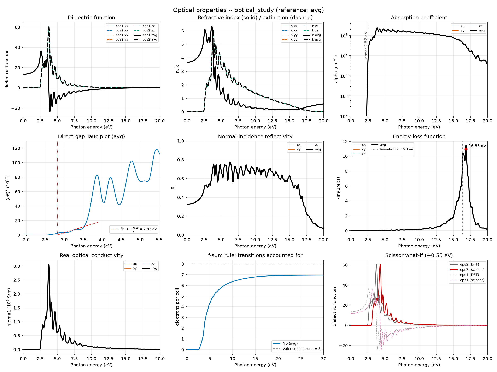
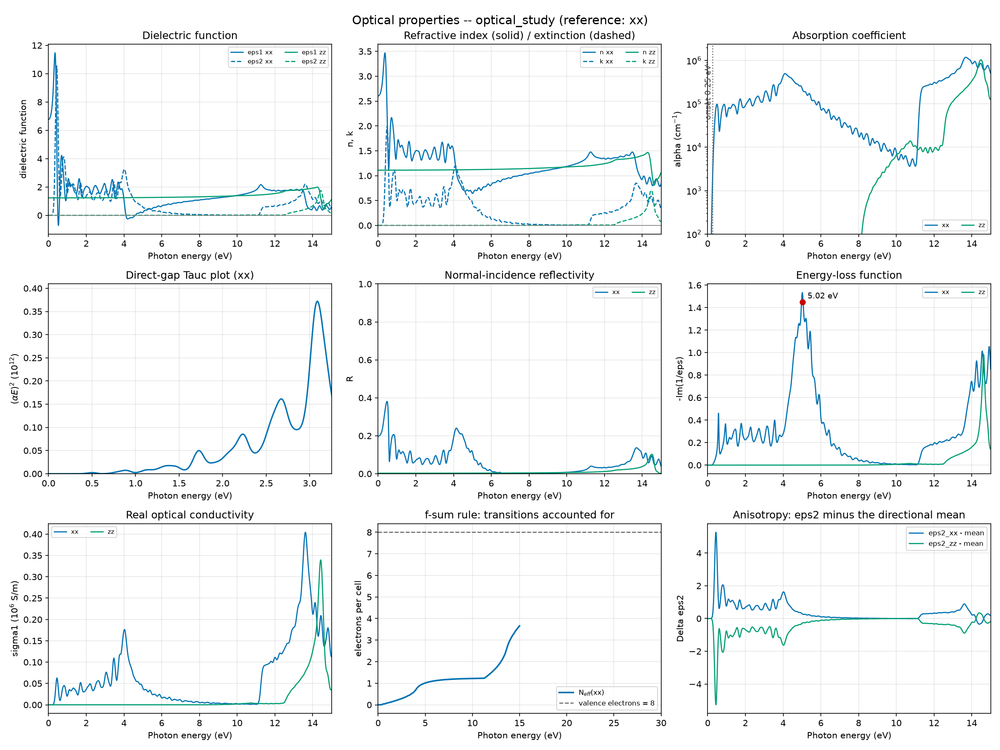

# 5.14 — Workflow: Optical Properties (`stb-optical` / `stb-opticalAnalysis`)

This workflow has 2 stages: **Stage 1** (`stb-optical`, code `5.14.1`) takes an
**already relaxed** structure and a `calc.fdf` template and writes one
ready-to-run SIESTA folder per requested polarization direction (`xx`, `yy`,
`zz`, and the biaxial `xy`, `xz`, `yz`), each asking SIESTA for its
linear-response optical module. **Stage 2** (`stb-opticalAnalysis`, code
`5.14.2`) reads the finished runs back and turns SIESTA's imaginary dielectric
function into the full set of linear optical properties — real part by
Kramers–Kronig, refractive index and extinction coefficient, absorption
coefficient, reflectivity, energy-loss function, optical conductivity — plus
the quantities that tell you whether to trust them: sum rules, absorption
edge, plasmon, anisotropy checked against the crystal symmetry, a
what-if scissor shift, and a 9-panel dashboard.

It answers a question none of `5.1`–`5.13` does: not how a structure is
deformed, bound, or ordered, but **how it responds to light** — what it
absorbs, reflects, and at which photon energies. The worked example
(Section 5) runs the whole thing for real, with SIESTA, on bulk silicon
(where the textbook answer is known) and on a graphene monolayer (to show what
changes in two dimensions, and in a semimetal), including the convergence study that decides
whether a peak position can be believed.

Both stages live in this one folder and this one tutorial — same reasoning as
`5.1`–`5.5` and `5.13`: Stage 1's output exists only to feed Stage 2.

## 1. Theory

**Symbols at a glance**

| Symbol | Meaning |
|---|---|
| `ħω`, `E` | photon energy (eV) |
| `ε(E) = ε₁ + iε₂` | complex relative dielectric function (a 3×3 tensor in general) |
| `N = n + ik` | complex refractive index, `N² = ε` |
| `α` | absorption coefficient (cm⁻¹) |
| `R` | normal-incidence reflectivity |
| `L = −Im(1/ε)` | energy-loss function |
| `σ₁` | real part of the optical conductivity (S/m) |
| `Ω` | cell volume |
| `ħω_p` | plasma energy of the valence electrons |
| `N_eff(E)` | number of electrons accounted for by transitions up to `E` (f-sum rule) |
| `e` | unit polarization vector of the light (`Optical.Vector`) |

### 1.1 What light does to a solid, and what is measured

In the linear regime a solid answers an oscillating electric field with an
induced polarization proportional to it. The frequency-dependent proportionality
is the **complex dielectric function**

```
ε(E) = ε₁(E) + i ε₂(E)                                                    (1)
```

`ε₂` measures **absorption** (energy taken from the light by exciting electrons)
and `ε₁` measures **dispersion** (how much the light is slowed and
polarizes the medium). The two are not independent: causality ties them by the
Kramers–Kronig relations (Section 1.3). Every other linear optical
observable is a function of `ε` (Section 1.4) — which is why a single quantity,
`ε₂(E)`, is all SIESTA has to compute.

Experimentally, `ε` is obtained by ellipsometry or by reflectance/transmittance
spectroscopy (Aspnes and Studna's 1983 tables for Si and the III-V
semiconductors [1] are the standard reference). Optical properties are the
fingerprint of the electronic structure: the position of the absorption edge
gives the (direct) gap, the sharp peaks are interband critical points (van Hove
singularities of the joint density of states), the zero of `ε₁` with a peak of
the loss function marks a collective **plasmon**.

### 1.2 From the band structure to `ε₂`: independent-particle interband absorption

SIESTA's optical module computes `ε₂` in the **independent-particle
(random-phase, no local fields) approximation**: a photon of energy `E` and
polarization `e` lifts an electron from an occupied band `v` to an empty band `c`
at the same crystal momentum `k` (vertical transitions), with a rate given by
Fermi's golden rule:

```
ε₂(E) = (π e² / ε₀ m² ω² Ω) Σ_k w_k Σ_{v,c} |⟨ck| e·p |vk⟩|² δ( E_c(k) − E_v(k) − E )     (2)
```

(spin degeneracy included in the sum over states; `p` is the momentum operator,
`ω = E/ħ`.) Two ingredients, both from the ground-state DFT calculation:

- the **energies** `E_c(k) − E_v(k)`: the Kohn–Sham band gaps, which fix *where* the
  peaks fall;
- the **matrix elements** `|⟨c|e·p|v⟩|²` (transition probabilities, also
  selection rules: a transition not allowed for the chosen polarization
  contributes nothing), which fix *how strong* they are.

The delta function becomes a Gaussian of width `Optical.Broaden` (the
experimental/lifetime broadening stand-in), and the `k` sum runs over the
mesh `Optical.Mesh` — **independent of the SCF k-grid** (Section 1.10). The
peaks of `ε₂` are the interband critical points: where `E_c − E_v` is
stationary in `k` the joint density of states has a van Hove singularity (in
silicon, `E₁ ≈ 3.4 eV` along Λ and `E₂ ≈ 4.3 eV` near X and Σ [1]).

### 1.3 From `ε₂` to `ε₁`: Kramers–Kronig

Causality (the response cannot precede the field) forces

```
ε₁(E) = 1 + (2/π) P ∫₀^∞  E' ε₂(E') / (E'² − E²)  dE'                         (3)
```

(`P` is the principal value). `stb-opticalAnalysis` evaluates (3) by numerical
quadrature on SIESTA's energy grid (0.01 eV steps up to 136 eV by default).
Two consequences matter in practice. The **static dielectric constant**,

```
ε₁(0) = 1 + (2/π) ∫₀^∞ ε₂(E')/E' dE'                                         (4)
```

weights low-energy transitions most, so it is controlled by the **gap** (a
too-small DFT gap overestimates it). And because the integral extends to
infinity, an `ε₂` truncated at a finite energy or by too few bands gives a
slightly wrong `ε₁` everywhere — one reason Stage 2 reports a sum-rule check
(Section 1.5).

### 1.4 Everything else follows from `ε`

With `N² = ε`:

```
n = sqrt( (|ε| + ε₁) / 2 ),   k = sqrt( (|ε| − ε₁) / 2 )                        (5)
α(E) = 4π k E / (hc)         (Beer–Lambert, I ∝ e^{−αx}; hc = 1.2398×10⁻⁴ eV·cm)  (6)
R(E) = ((n − 1)² + k²) / ((n + 1)² + k²)   (normal incidence, vacuum/solid)       (7)
L(E) = −Im(1/ε) = ε₂ / (ε₁² + ε₂²)                                              (8)
σ₁(E) = ε₀ ω ε₂                                                                 (9)
```

`R` is the fraction of normally incident light reflected at a clean flat
surface — it is *not* the reflectance of a thin film or a rough surface
(Section 1.11). `L` is what fast electrons (EELS) lose energy to: it peaks at
**volume plasmons**, where `ε₁` crosses zero while `ε₂` is small. `σ₁` is the
optical conductivity. For a non-metal, `ε₂ = 0` below the gap, so `α = 0`
and the crystal is transparent there.

### 1.5 Sum rules, the plasmon, and the Penn model

The **f-sum rule** says that the total oscillator strength of a system equals
its number of electrons. Applied to the valence electrons of density
`N_val/Ω`:

```
∫₀^∞ E ε₂(E) dE = (π/2) (ħω_p)² ,    ħω_p = ħ sqrt( N_val e² / (ε₀ m Ω) )        (10)
```

Define the cumulative `N_eff(E) = (2 ε₀ m Ω / π ħ²) ∫₀^E E' ε₂(E') dE'`: how many
electrons' transitions are already included up to `E`. A complete calculation
has `N_eff(∞) → N_val`; the shortfall measures a **truncated** spectrum (too few
bands, too small an energy range, or — the usual limit in LCAO codes — an
incomplete basis). SIESTA prints its own version of the check
(`Optical: Checking f-sum rule`, 1 = complete) and Stage 2 recomputes `N_eff`
independently from `ε₂` so the two can be compared.

`ħω_p` of (10), computed for the valence-electron density, is the **free-electron
plasma energy**: in a simple sp metal or semiconductor the volume plasmon
(maximum of `L`) sits close to it. And a quick one-oscillator estimate links the
static constant to an average gap, the **Penn model** [2]:

```
ε₁(0) ≈ 1 + (ħω_p / E_P)²    ⇒    E_P = ħω_p / sqrt( ε₁(0) − 1 )                   (11)
```

(`E_P`, the "Penn gap", is not a band gap but a measure of where the transition
weight sits; ~4–5 eV for silicon.)

### 1.6 The dielectric tensor, polarization directions, and symmetry

In an anisotropic crystal `ε` is a symmetric 3×3 tensor. SIESTA computes the
response `eᵀ ε e` along **one** polarization vector `e` per run (`Optical.Vector`),
so the full tensor needs several runs:

- the diagonal components `ε_xx, ε_yy, ε_zz` come directly from `e = x̂, ŷ, ẑ`;
- an off-diagonal component is reached with the **bisector trick**: along
  `e = (x̂ + ŷ)/√2` the response is `(ε_xx + ε_yy)/2 + ε_xy`, hence

```
ε_xy = ε_(bisector xy) − (ε_xx + ε_yy)/2                                      (12)
```

and the same for `xz` and `yz`. This is what Stage 1's biaxial directions and
Stage 2's automatic reconstruction do.

**Crystal symmetry** reduces the number of runs. The tensor must be invariant
under every symmetry operation of the crystal, which leaves:

| Crystal system | Independent components | Form (axes along the symmetry axes) |
|---|---|---|
| cubic | 1 | `ε_xx = ε_yy = ε_zz`, off-diagonal 0 |
| tetragonal, hexagonal, trigonal | 2 | `ε_xx = ε_yy` (⊥ axis), `ε_zz` (∥ axis) |
| orthorhombic | 3 | `ε_xx`, `ε_yy`, `ε_zz` distinct |
| monoclinic | 4 | three diagonal + one off-diagonal |
| triclinic | 6 | all |

`stb-optical` finds this for *your cell in its own Cartesian orientation* (it
projects the tensor onto the subspace invariant under the detected space group,
so it also works when the axes are not aligned) and tells you the minimal
direction set. `stb-opticalAnalysis` then **checks the finished spectra against
it**: components that symmetry makes equal must agree, and components it forbids
must vanish — an end-to-end test of the calculation (Section 5.2 shows silicon
passing it to 10⁻⁸). A powder or polycrystal measures the **isotropic average**
(`avg`, a third of the trace), which Stage 2 also builds.

### 1.7 The absorption edge: onset, Tauc, direct vs indirect

Below the gap there is no absorption; the edge's shape depends on the type of
transition. For **direct allowed** transitions between parabolic bands

```
α(E) E ∝ (E − E_g)^{1/2}    ⇒    (αE)² is linear in E and extrapolates to E_g      (13)
```

(the **Tauc plot**; for indirect gaps `(αE)^{1/2}` is used instead). Stage 2
reports the **onset** (the energy where `ε₂` reaches 5 % of its maximum) and the
direct Tauc estimate. Two cautions. (i) Real band edges are not parabolic
(silicon's edge is steep and structured), so the Tauc number is **indicative**.
(ii) In the independent-particle approximation only **vertical** transitions
exist: **indirect gaps are invisible** — silicon's 1.17 eV indirect gap, which
needs a phonon, does not appear; the first absorption is its direct gap, about
2.5 eV in this calculation (Section 5.2).

### 1.8 What DFT-level optics gets right, and what it does not

Equation (2) fed by Kohn–Sham bands is a very good *qualitative* and often good
*semi-quantitative* description of the optical response of sp semiconductors and
metals, but it has well-known limitations, each flagged in the report:

1. **The gap problem.** Semilocal DFT (LDA/GGA) underestimates band gaps
   (silicon: ~0.6 eV against 1.17 eV). Since `ε₂` peaks sit at the transition
   energies, the whole spectrum is **red-shifted** by roughly the gap error and
   `ε₁(0)` is **overestimated** (equation (4)). The fix is a quasiparticle (GW)
   correction; a cheap stand-in is the **scissor operator**: a rigid upward shift
   `Δ` of the conduction bands. With position-matrix elements kept it amounts to
   `ε₂'(E) = ε₂(E − Δ)` (Levine and Allan [3]; see also Godby, Schlüter and Sham
   [4]), which Stage 2 offers as `--scissor` — a what-if, not a prediction.
2. **No excitons.** Equation (2) treats the excited electron and the hole as
   non-interacting. Their attraction moves spectral weight toward lower energy,
   enhances the lowest peaks (silicon's `E₁`) and creates bound exciton states
   *below* the gap — decisive for low-dimensional materials. Capturing it needs the
   Bethe–Salpeter equation (Rohlfing and Louie [5]; Onida, Reining and Rubio
   [6]), outside this workflow.
3. **No local-field effects.** The macroscopic response also includes the
   response to the microscopic fluctuations of the field (Adler [7], Wiser [8]);
   neglecting them (the independent-particle approximation) matters for
   anisotropic and layered systems and for `ε₁(0)`.
4. **No intraband (Drude) term.** Only interband transitions are computed, so a
   metal's low-energy free-carrier response is absent (`ε₂` is non-zero down to 0
   eV only through interband tails).
5. **No phonon-assisted absorption, no temperature, no spin–orbit coupling.**
   Indirect edges and band-edge tails, thermal broadening and spin–orbit
   splittings are not included.
6. **The velocity operator with non-local pseudopotentials.** The velocity is
   `i[H, r]/ħ`, equal to `p/m` only for a local potential; with non-local
   (norm-conserving) pseudopotentials the momentum matrix elements need a
   commutator correction (Read and Needs [9]). How the code treats it is a
   detail of SIESTA's implementation (see its manual).
7. **A finite, localized basis.** Unoccupied bands are only as good as the basis
   (SIESTA's LCAO set). Practically: the f-sum rule cannot reach 1 once the basis
   is exhausted, and a confined basis (large `PAO.EnergyShift`) can shift peaks
   (Section 5.4).
8. **Normal-incidence reflectivity of a perfect flat surface**, nothing else
   (no angle, no film interference, no roughness).

### 1.9 Two-dimensional and zero-dimensional systems

A slab or monolayer is simulated as a periodic supercell with vacuum. SIESTA's
`ε_SC` is then the response of the **whole cell**, material plus vacuum, so it is
diluted by the vacuum (and the result scales with the arbitrary cell height).
The intrinsic response of the layer is restored by treating cell and layer as a
capacitor stack. For a layer of thickness `t` in a cell of height `c` (Laturia,
Van de Put and Vandenberghe [10]; Yang and Gao [11]):

```
in-plane (E continuous):        ε_2D,∥(E) = 1 + (c/t) ( ε_SC,∥(E) − 1 )
out-of-plane (D continuous):    ε_2D,⊥(E) = [ 1 + (c/t) ( 1/ε_SC,⊥(E) − 1 ) ]⁻¹        (14)
```

`t` is **not** auto-estimated, because the "thickness" of a 2D material is not one
well-defined number (atomic span? plus van der Waals radii? the bulk
interlayer distance?) — `--thickness` is yours to choose, and the corrected
values scale with it. For an isolated **molecule** (vacuum on all three axes) the
box is the dilute limit: the molecular polarizability follows from
`α(E) = ε₀ Ω (ε_SC(E) − 1)`, reported in ų. **1D** systems (wires) are not
corrected: the literature approach is not a simple generalization of (14) and has
not been verified for this tool.

### 1.10 The numerical parameters, and what each one controls

| Parameter | Where | What it controls | How to converge |
|---|---|---|---|
| SCF k-grid | `kgrid.MonkhorstPack` (Stage 1 forces one if the template has none) | the ground-state density and bands | density ~0.2 1/Å for semiconductors; check with a denser grid |
| **`Optical.Mesh`** | `--optical-mesh` | the `k` sum of (2): **smoothness of `ε₂` and peak heights/positions** | the most important: double it until peaks stop moving (Section 5.3); spacing ≲ 0.07 1/Å for silicon |
| `Optical.Broaden` | `--optical-broaden` | Gaussian width of every transition | 0.05–0.2 eV; smaller than the mesh can resolve gives spikes |
| `Optical.NumberOfBands` | `--optical-nbands` | conduction bands entering the sum: **energy range** | more than the occupied number; check the f-sum |
| Basis size and `PAO.EnergyShift` | `calc.fdf` | quality of the **unoccupied** bands | TZP and a small shift (≤ 0.01 Ry); check peaks |
| `Mesh.Cutoff` | `calc.fdf` | real-space integration grid | little effect here (Section 5.3) |
| Scissor | `--scissor` (Stage 2) | rigid conduction-band shift | a what-if, never a convergence knob |

The **SCF k-grid is not the optical mesh**: the SCF only needs enough points to
converge the density; the optical sum (2) is a much more demanding integral of a
sharply structured function and needs a mesh typically several times denser.

### 1.11 What this workflow simplifies — explicitly

- **Independent-particle only**: no excitons, no local fields, no quasiparticle
  correction (only the post-processing scissor).
- **Linear, vertical interband response of a perfect crystal**: no Drude term, no
  phonons, no temperature, no spin–orbit, no disorder.
- **One polarization per folder**, repeating the same ground-state SCF in each
  (an economical use of the SCF would reuse it; here independence is the point).
- **Normal-incidence reflectivity only.**
- **2D/0D via a user-chosen thickness / the dilute limit** (Section 1.9); no 1D.
- **A single relaxed geometry**: nothing here relaxes the structure (that is why
  Stage 1 requires a relaxed input).

### 1.12 A calculation you can check by hand

The silicon numbers of Section 5.2 let you re-derive a row of the report with a
pocket calculator. Take the 4.3 eV row: `ε₁ = −16.121`, `ε₂ = 15.042`.

1. `|ε| = √(16.121² + 15.042²) = 22.05`.
2. Equation (5): `n = √((22.05 − 16.121)/2) = √2.965 = 1.722`,
   `k = √((22.05 + 16.121)/2) = √19.09 = 4.369`.
3. Equation (6): `α = 4π k E / hc = 4π × 4.369 × 4.3 / 1.2398×10⁻⁴ = 1.904×10⁶ cm⁻¹`.
4. Equation (7): `R = ((1.722−1)² + 4.369²) / ((1.722+1)² + 4.369²) = (0.521 + 19.09)/(7.41 + 19.09) = 0.740`.
5. Static limit: `n(0) = √ε₁(0) = √13.441 = 3.666`, so `R(0) = (2.666/4.666)² = 0.3265`.
6. Penn gap, equation (11): `ħω_p = 16.32 eV` (8 valence electrons in 41.39 ų),
   `E_P = 16.32/√(13.441 − 1) = 4.63 eV`.

Each is the corresponding entry of the Stage 2 tables (`n = 1.7216`, `k = 4.3686`,
`α = 1.904e+06`, `R = 0.7401`, `R(0) = 0.3265`, Penn gap `4.63 eV`): the tool is
nothing more mysterious than equations (3)–(11) applied to `ε₂`.

## 2. Libraries and external dependencies used

- **SIESTA** [12, 13] itself is *not* called by the suite. It does the real work:
  the ground-state calculation and, with `OpticalCalculation T`, the interband
  optical module that writes `<SystemLabel>.EPSIMG` (the energy grid and `ε₂`) and,
  in `calc.out`, the `Optical:` block (polarization, bands, energy range,
  broadening, scissor, mesh and the **f-sum check**). The reference data of Section
  5 was produced with SIESTA 5.4.2, GGA-PBE [14], PseudoDojo norm-conserving
  pseudopotentials [15] and Monkhorst–Pack k-grids [16].
- **numpy** / **[SciPy](https://scipy.org/)** [17] — the Kramers–Kronig quadrature,
  the f-sum integral, Gaussian smoothing and peak finding
  (`scipy.signal.find_peaks`), constants.
- **[pymatgen](https://pymatgen.org/)** [18] / **[spglib](https://spglib.readthedocs.io/)**
  [19] — the space-group and symmetry operations that turn the crystal into the
  list of independent tensor components (Section 1.6).
- **[ASE](https://wiki.fysik.dtu.dk/ase/)** [20] and **[sisl](https://zerothi.github.io/sisl/)**
  [21] — structure I/O; sisl reads SIESTA's `.XV` in this tutorial's helper scripts.
- **[matplotlib](https://matplotlib.org/)** [22] — the dashboard (`--png` / `--show`).
  The `.dat/.gplot` pairs are for gnuplot, which the suite never invokes.

## 3. Stage 1: generating the direction folders (`stb-optical`, code `5.14.1`)

### 3.1 What it does

Reads an **already relaxed** structure (`-f`, `.fdf`) and the `calc.fdf` template
(`-c`, default `calc.fdf`), and writes, under `-O` (default `optical_study`), one
folder per requested direction:

```
optical_study/
├── optical_stage1.txt        <- the Stage 1 report (with --save-report)
├── dir_xx/ dir_yy/ dir_zz/   <- diagonal components (Optical.Vector = x, y, z)
└── dir_xy/ dir_xz/ dir_yz/   <- biaxial bisectors (for eps_ij, Section 1.6)
        structure.fdf  calc.fdf  config_extra.fdf  <pseudopotentials>
```

It never runs SIESTA and never moves an atom: every folder holds the *same*
structure. `--directions` selects which folders (default `xx yy zz`); `-p`
copies PseudoDojo (or your own) pseudopotentials.

### 3.2 `config_extra.fdf`: everything mandatory, the template untouched

Each folder's `calc.fdf` is your template with `%include config_extra.fdf` added
on the first line; the forced directives live in `config_extra.fdf`. SIESTA's fdf
reader is *first-occurrence-wins*, so they override whatever the template says.
Live, for the biaxial `xy` folder of silicon:

```
$ cat optical_study/dir_xy/config_extra.fdf
# Ground-state SCF k-grid (explicit --kgrid) -- takes precedence over --calc's own grid.
kgrid.MonkhorstPack   [11  11  11]

# Auto-generated -- forces a single-point evaluation (no relaxation): this
# folder is one independent, uncoupled sample point, not something SIESTA
# should be moving on its own.
MD.TypeOfRun          CG
MD.Steps              0
MD.NumCGsteps         0
MD.VariableCell       false

OpticalCalculation T
Optical.PolarizationType    polarized
Optical.Broaden       0.1 eV
%block Optical.Mesh
  32  32  32
%endblock Optical.Mesh
%block Optical.Vector
  0.7071  0.7071  0.0000
%endblock Optical.Vector
Optical.NumberOfBands  16
```

| Directive | Forced value | Why |
|---|---|---|
| `kgrid.MonkhorstPack` | the template's own grid is kept; **forced** when the template has none, or with `--kgrid X Y Z` / `--kgrid-density D` | the SCF needs a k-grid — SIESTA would otherwise sample Γ only; suggested at density 0.2 1/Å, **1 division on a vacuum axis** |
| `MD.TypeOfRun CG`, `MD.Steps 0`, `MD.NumCGsteps 0`, `MD.VariableCell false` | single point | the geometry is evaluated as given — verified with SIESTA: a template with `MD.NumCGsteps 40` and `MD.VariableCell T` still runs one single point |
| `OpticalCalculation T` | — | switches the optical module on |
| **`Optical.PolarizationType polarized`** | — | without it SIESTA defaults to `polycrystal` and **silently ignores `Optical.Vector`**: all directions would return the identical isotropic result |
| `Optical.Broaden`, `Optical.Mesh`, `Optical.NumberOfBands` | `--optical-broaden` (0.2 eV), `--optical-mesh` (10 10 10), `--optical-nbands` (SIESTA default: all) | Section 1.10 |
| `Optical.Vector` | one per folder | the polarization direction |

### 3.3 The report, live

```
$ stb-optical -f structure.fdf -p dojo --directions xx yy zz xy xz yz --kgrid 11 11 11 \
      --optical-mesh 32 32 32 --optical-broaden 0.1 --optical-nbands 16 --no-intro

[1] INPUT STRUCTURE
Lattice (Ang)   : a=3.8828  b=3.8828  c=3.8828
Angles (deg)    : alpha=60.00  beta=60.00  gamma=60.00
Species | Z  | Atoms | Valence e- | Total e- | Valence from
Si      | 14 | 2     | 4          | 8        | Si.psml
Valence electrons : 8  ->  4 occupied band(s) in a spin-unpolarized calculation
Detected : 3D (bulk material)

[3] OPTICAL PARAMETERS (applied identically to every direction)
Optical.Mesh | Divisions | Spacing (1/Ang) | Assessment
axis a       | 32        | 0.0619          | fine
axis b       | 32        | 0.0619          | fine
axis c       | 32        | 0.0619          | fine
Optical k-points  : 32768 total (independent of the SCF k-grid)
Bands included    : 16 = 4 occupied + 12 unoccupied

[5] DIRECTIONS & DIELECTRIC-TENSOR MAPPING
  Space group           : Fd-3m (No. 227), cubic -- 48 operations at symprec 0.01 Ang
  Independent components: 1 of 6
  Non-zero components   : eps_xx=eps_yy=eps_zz
  Zero by symmetry      : eps_xy, eps_xz, eps_yz
  Minimal direction set : xx
[NOTE] yy zz xy xz yz follow from symmetry, so they are redundant; computing them is a
consistency check (identical results expected), not new information.
```

How to read it. **[1]** reads the valence electron count from the pseudopotential
(`z-pseudo` of the `.psml`), so the number of occupied bands is known and
`Optical.NumberOfBands` can be checked against it (16 bands = 4 occupied + 12
conduction). **[3]** assesses the optical mesh per axis by its k-point *spacing*
`|bᵢ|/nᵢ` (fine ≤ 0.07, coarse > 0.12 1/Å — a rule of thumb from converging this
very crystal, Section 5.3) and counts the optical k-points. **[5]** applies
Section 1.6: silicon needs one direction; this tutorial computes all six on
purpose, as a consistency test.

### 3.4 The advisories

Printed where they apply and summarized at the end: an `Optical.Mesh` coarse along
some axis; `Optical.NumberOfBands` not exceeding the occupied bands (**no
conduction states: no absorption at all**) or leaving only a few; a broadening
below 0.05 eV (a forest of spikes unless the mesh is very dense) or above 0.3 eV
(washes out structure); a vacuum axis with more than one mesh division (no
dispersion there, wasted time); a missing pseudopotential; a spin-polarized
template (not special-cased) and a minimal basis (poor conduction bands).

### 3.5 Bulk, slab, molecule

A vacuum-padded cell is detected from the gap along each axis (`--vacuum-gap`,
default 10 Å): one vacuum axis → 2D, two → 1D, three → 0D, each with its own
limitation note (Section 1.9) and a hint for Stage 2. A vacuum axis gets a single
SCF k-point division. No direction is ever skipped for a 2D input, including
out-of-plane.

### 3.6 Validation

`stb-optical` refuses, with a clear `[ERROR]`: a missing structure, a missing calc
template (the `calc.fdf` default not being in the current directory — the message
says so), and an unknown direction (argparse: `invalid choice`).

### 3.7 Running it both ways

`stb-suite` → `5.14.1` asks the same questions as guided prompts (its advanced
step now also asks for the SCF k-grid). Case 7 of the script drives it with piped
answers and diffs the generated folders against the direct CLI run.

## 4. Stage 2: analyzing the results (`stb-opticalAnalysis`, code `5.14.2`)

### 4.1 Before running Stage 2

Run SIESTA in each folder:

```
for d in optical_study/dir_*; do (cd $d && mpirun -np 4 siesta calc.fdf > calc.out); done
```

Each folder must end with `<SystemLabel>.EPSIMG` (the energy grid and `ε₂`) and a
`calc.out` whose `Optical:` block carries the f-sum check. Stage 2 detects each
folder's direction from its **own `Optical.Vector`**, not from its name, so renamed
folders work; folders without an `.EPSIMG` are skipped with a warning.

### 4.2 Report structure

```
[0] RUN METADATA
[1] SYSTEM & CALCULATION      <- structure, ground state, per-folder Optical settings, symmetry
[2] DATA QUALITY & CONVERGENCE <- SCF, SIESTA's f-sum check, N_eff(E) from eps2
[3] STATIC RESPONSE & ABSORPTION EDGE   <- eps1(0), n, R, onset, Tauc, Penn gap, Kohn-Sham gap
[4] SPECTRAL FEATURES         <- eps2 peaks, alpha/R/eps1 maxima, plasmon, eps1 zeros
[5] ANISOTROPY & SYMMETRY CHECKS
[6] OFF-DIAGONAL DIELECTRIC TENSOR (eps_ij RECONSTRUCTION)
[7] OPTICAL CONSTANTS AT SELECTED ENERGIES
[8] DIMENSIONALITY CORRECTION        <- only with --dimensionality-correction
[9] SCISSOR WHAT-IF                  <- only with --scissor
[10] EXPERIMENTAL COMPARISON         <- only with --experimental
[11] INTERPRETATION
[12] SUMMARY & FILES
```

Numbering follows what is present. **No arguments beyond `--directory`** are
needed (default `optical_study`). Warnings are printed where they apply and
repeated in a count at the end.

### 4.3 `[1]`–`[2]`: is the calculation what you think, and is it complete?

`[1]` reads the structure, the ground state (functional, basis, mesh cut-off,
k-grid) and, for **each** folder, the optical settings *as SIESTA ran them* —
mesh, broadening, bands, scissor — from `calc.out`. If the folders were not run
with identical optical settings a warning says the comparison between directions
(anisotropy, `ε_ij`) is no longer legitimate (Case 14c of the script).

`[2]` is the **convergence section**: per folder the SCF status, SIESTA's own
f-sum check, and `N_eff(E_max)` recomputed from `ε₂` (Section 1.5):

```
Dir | SCF ok | f-sum (SIESTA) | N_eff(E_max) | N_eff/N_val | E range (eV) | Points | Step (eV)
xx  | yes    | 0.8703         | 6.962        | 0.870       | 0.00-136.0   | 13606  | 0.0100
```

The independent estimate `6.962 = 0.8703 × 8` agrees with SIESTA's number to the
printed digits — a check that the energy grid, the volume and the constants are
all consistent. The `[WARNING]` below 0.9 says what it means: the transition sum
is incomplete, and — an important refinement found while building this tutorial —
*more bands help only while fewer than all are used; beyond that the basis is the
limit* (Section 5.4).

### 4.4 `[3]`: static response, edge, and the Kohn–Sham gap

For each direction and the isotropic average: `ε₁(0)`, `n(0)`, `R(0)`, the
`ε₂` **onset**, the direct-gap **Tauc** estimate and the **Penn gap** (Section
1.5/1.7). From the folder's `.EIG` it also reads the **Kohn–Sham gap on the SCF
k-mesh**, fundamental and smallest direct, and uses it to say what the edge means:

```
Kohn-Sham band gap (SCF k-mesh, 666 points): fundamental 0.644 eV (indirect); smallest direct gap 2.527 eV.
Reference spectrum 'avg': the absorption edge starts at 2.52 eV (wavelength 492 nm). It matches the
smallest direct Kohn-Sham gap (2.53 eV): the edge is direct, and the indirect gap is invisible here.
```

For a **metal or semimetal** (zero Kohn–Sham gap) the tool refuses to call the
onset a gap: it is set by the smallest transition the optical mesh samples and by
the broadening, and the Tauc/Penn columns are blanked (Section 5.6).

### 4.5 `[4]`–`[7]`: features, symmetry, tensor, constants

`[4]` lists the peaks of `ε₂` (position, height, FWHM, and `ε₁, n, k, α, R` at
each), the maxima of `α`, `R` and `ε₁`, the zero crossings of `ε₁`, and the
loss-function maximum compared with the free-electron plasmon (only for a 3D cell:
in a vacuum-padded cell the electron density is not the material's). Peaks are
located on a Gaussian-smoothed curve (`--smoothing`, 0.05 eV) so a spiky spectrum
does not fool the finder. `[5]` compares directions with the symmetry (Section
1.6), `[6]` reconstructs `ε_ij` and checks it vanishes when symmetry demands, `[7]`
tabulates `ε₁, ε₂, n, k, α, R, L` at the energies you choose (`--energies`, default
`0 1 2 3 4 5 10`, with the wavelength).

### 4.6 The optional extras

| Flag | What you get |
|---|---|
| `--png` / `--show` | the 9-panel dashboard (`ε`, `n/k`, `α` with its onset, Tauc, `R`, loss, `σ₁`, f-sum accumulation, scissor/off-diagonal/anisotropy) saved / opened with matplotlib |
| `--scissor EV` | a what-if: `ε₂'(E) = ε₂(E − EV)`, `ε₁` by Kramers–Kronig, with a before/after table and an overlay (Section 5.5) |
| `--dimensionality-correction` (+ `--thickness Å`) | the intrinsic 2D function (equation 14) or the molecular polarizability |
| `--experimental PATH` | overlay and peak matching of a measured spectrum (single-valued `--plot-quantity`) |
| `--energy-min/--energy-max` | trim the data used by every analysis |
| `--energies`, `--n-peaks`, `--smoothing`, `--plot-emax` | table energies, peaks listed, peak-finding smoothing, dashboard range |
| `--plot-quantity {…,all}` | which `.gplot` is written (default `eps`) |

Always written: `optical_results.csv` (every direction and energy),
`optical_results_summary.csv` (one row per direction with the static numbers, the
`N_eff` and the Kohn–Sham gaps), a `.dat` per direction and per reconstructed
component, and the gnuplot scripts.

### 4.7 Guard rails

Case 14 of the script shows what Stage 2 flags from the files alone: folders with
no `.EPSIMG` (skipped; with none usable it stops), an SCF that never confirmed
convergence, folders run with different optical settings, and a symmetry-forbidden
`ε_ij` that is not zero. The unit tests also cover the Kohn–Sham gap reading for an
insulator and a semimetal.

### 4.8 Running it both ways

`stb-suite` → `5.14.2` asks the directory, the quantity to plot, the optional
extras (screen/PNG dashboard, scissor, selected energies) and the advanced
settings. Case 14 drives it with piped answers and checks it writes the same
dashboard and scissor spectrum as the CLI run.

## 5. Worked example: bulk silicon and graphene, end to end

Everything below was produced by running this folder's own inputs through
`stb-optical`, SIESTA 5.4.2 and `stb-opticalAnalysis` (Section 6). Silicon is the
textbook case, with a symmetry check built in; graphene shows a 2D semimetal.

### 5.1 Set-up

| | Silicon | Graphene |
|---|---|---|
| Structure | diamond, 2-atom primitive cell, relaxed with SIESTA | 2 atoms, 20 Å cell along c |
| DFT | GGA-PBE, TZP, `PAO.EnergyShift` 0.005 Ry, `Mesh.Cutoff` 300 Ry, 25 meV | GGA-PBE, TZP, 0.01 Ry, 300 Ry |
| Pseudopotentials (Section 7) | PseudoDojo (`-p dojo`) | `virtual_vault` PSF carbon (`-p virtual_vault`) |
| SCF k-grid | 11×11×11 (`--kgrid`) | 24×24×1 (`--kgrid`) |
| Optical | mesh 32³ (32 768 k), broaden 0.1 eV, 16 bands | mesh 72×72×1, broaden 0.1 eV, 24 bands |
| Directions | all six (a consistency test; 1 would do) | `xx`, `zz` (hexagonal) |
| Cost | ~1–2 min per folder | ~17 s per folder |

Step 1 (relaxation). Silicon: variable-cell CG from the experimental 5.431 Å gives
**a₀ = 5.4911 Å** (+1.1 %; PBE overestimates), residual stress < 0.5 kbar. Graphene:
the two atoms are fixed by symmetry, so only the lattice constant needs finding —
an energy scan (`reference_results/graphene/a0_scan.csv`) puts the minimum at
**2.4815 Å**, shipped as 2.48 Å.

### 5.2 Silicon: the textbook case, and a built-in test

All six folders ran in a total of a few minutes. First the **consistency test** of
Section 1.6 (cubic Fd-3m): the three diagonal spectra agree to `5×10⁻⁸` of their
norm (`ε₁(0) = 13.4410` in all), and the reconstructed off-diagonal components are
`5.6×10⁻⁵` of the maximum `ε₂` — zero to the noise. This validates the folders,
the settings, the bisector trick and the reconstruction at once.

The static and edge numbers (isotropic average):

| Quantity | This calculation | Reference |
|---|---|---|
| `ε₁(0)` | 13.44 | ≈ 11.7 (experiment, from memory — not verified here) |
| `n(0)`, `R(0)` | 3.666, 0.3265 | — |
| Kohn–Sham gap | 0.644 eV indirect, 2.527 eV smallest direct | 1.17 eV indirect (experiment); PBE ≈ 0.6 eV |
| `ε₂` onset | **2.52 eV** (492 nm) | matches the 2.53 eV direct KS gap |
| Penn gap | 4.63 eV | ~4–5 eV |
| strongest `ε₂` peak | **3.75 eV** (`ε₂ = 58`, FWHM 0.47) | `E₂` ≈ 4.2–4.3 eV [1] |
| `E₁` | a shoulder at ≈ 3.2–3.4 eV | ≈ 3.4 eV [1] |
| `α` maximum | 2.4×10⁶ cm⁻¹ at 3.86 eV | — |
| loss-function maximum | **16.85 eV** (FWHM 1.3 eV) | ≈ 16.7 eV (experiment, from memory); free-electron 16.32 eV |
| `ε₁` zero crossings | 3.76 eV (falling), 16.53 eV (rising) | — |
| f-sum | `N_eff = 6.962 = 0.870 × 8`, SIESTA 0.8703 | 1 |

How to read it. **The edge**: the first absorption is at 2.52 eV, equal to the
smallest *direct* Kohn–Sham gap, and the indirect 0.64 eV gap is invisible (Section
1.7). **The red shift**: the strongest peak is at 3.75 eV against ≈ 4.2–4.3 eV
measured, a deficit of about 0.5 eV — almost exactly the gap error (1.17 − 0.64 =
0.53 eV), the expected behavior of independent-particle optics on a semilocal
ground state; `ε₁(0)` is correspondingly too large. **The plasmon**: the loss
maximum sits at 1.03× the free-electron value, the signature of a collective
valence-electron plasmon. The dashboard summarizes it:



*Top row:* the dielectric function, `n`/`k`, and `α` on a log scale with the onset;
*middle:* the direct-gap Tauc plot (the fit extrapolates to 2.82 eV, 0.3 eV above the
onset — a reminder that silicon's steep edge is not parabolic), `R`, and the loss
function with the plasmon marked against the free-electron value (dotted);
*bottom:* `σ₁`, the f-sum accumulation (flattening at 7.0 of 8 electrons) and the
scissor what-if of Section 5.5.

### 5.3 Convergence: which knob moves which number

The most important lesson of this tutorial. Eleven re-runs of `dir_xx`, each
changing **one** setting of the production calculation (all analysed with
`--energy-max 30`; the production row too):

```
run         what differs from production    eps1(0)   main eps2 peak (eV)  loss peak (eV)   f-sum
production  (baseline)                       13.441        3.75 ( 58.1)       16.85   0.870
mesh16      Optical.Mesh = 16                13.460        3.66 ( 53.1)       16.91   0.871
mesh24      Optical.Mesh = 24                13.441        3.83 ( 52.9)       16.71   0.870
mesh48      Optical.Mesh = 48                13.441        3.74 ( 56.2)       16.74   0.870
shift020    EnergyShift = 0.02 Ry            12.994        3.78 ( 54.6)       16.78   0.859
shift010    EnergyShift = 0.01 Ry            13.317        3.76 ( 56.5)       16.84   0.868
shift002    EnergyShift = 0.002 Ry           13.428        3.74 ( 58.6)       16.81   0.871
dzp         basis = DZP                      13.319        3.75 ( 58.0)       16.55   0.867
allbands    bands = 26                       13.442        3.75 ( 58.1)       16.84   0.880
broaden005  Broaden (eV) = 0.050             13.438        3.75 ( 62.4)       16.84   0.870
broaden020  Broaden (eV) = 0.200             13.455        3.74 ( 48.4)       16.82   0.870
cut450      Mesh.Cutoff = 450 Ry             13.441        3.75 ( 58.1)       16.85   0.870
```

What each row teaches:

- **The optical mesh sets the peak position and smoothness.** At 16 and 24 divisions
  the strongest peak lands at 3.66 and 3.83 eV (and its height drops from 58 to 53);
  at 32 and 48 it is 3.75 and 3.74 eV — converged to 0.01 eV. A coarse mesh can
  move a peak by 0.1 eV or more, and nothing in a single run tells you so: you have
  to repeat it. (In earlier exploratory runs on a 20×20×20 mesh the same peak came
  out between 3.8 and 4.0 eV depending on the basis — an artifact of the mesh, which
  is why those numbers are not quoted.)
- **The broadening sets the heights, not the positions**: 0.05 eV gives a peak of
  62, 0.2 eV of 48; positions agree to 0.01 eV.
- **The basis moves `ε₁(0)` and the f-sum, not the peak positions** (at a converged
  mesh): a confined basis (`PAO.EnergyShift` 0.02 Ry) lowers `ε₁(0)` by 3 % and the
  f-sum from 0.871 to 0.859; the result is converged by 0.005 Ry. DZP is within 1 %
  of TZP on `ε₁(0)`.
- **The number of bands barely matters once there are enough**: all 26 bands raise
  the f-sum from 0.870 to only 0.880 and leave `ε₁(0)` unchanged — the remaining
  deficit is the basis' (Section 5.4).
- **`Mesh.Cutoff`** (300 → 450 Ry) changes nothing visible.

The SCF k-grid is a separate matter: 11×11×11 here (spacing 0.18 1/Å); the
optical mesh is 32×32×32, about three times denser.

### 5.4 The f-sum rule: bands or basis?

SIESTA reports 0.870 (6.96 of 8 electrons) — the transition sum is incomplete. The
natural reaction is to add bands. Section 5.3 shows the answer: with all 26 bands
the check only reaches 0.880. In a localized basis the number of states is finite
(26 here for two atoms in TZP), and once they are all used the sum rule is bounded
by what that basis can represent in the continuum. The way to raise it is a richer
basis (more zetas, polarization, a smaller `PAO.EnergyShift`), at the price of
cost. The practical consequence: `ε₁(0)` computed at an incomplete sum is slightly
**underestimated at high energy weight** — small next to the gap error, but worth
knowing, and why Stage 2 prints the check for every folder.

### 5.5 Comparing with experiment, and the scissor what-if

The honest comparison of Section 5.2: edge at the direct Kohn–Sham gap, a peak
0.5 eV low, `ε₁(0)` too high. The scissor what-if shifts `ε₂` rigidly by the gap
error (here +0.55 eV) and re-derives `ε₁`:

```
Quantity                 | DFT    | scissor +0.55 eV
eps1(E->0)               | 13.441 | 11.869
n(E->0)                  | 3.666  | 3.445
R(E->0)                  | 0.3265 | 0.3026
eps2 onset (eV)          | 2.52   | 3.07
strongest eps2 peak (eV) | 3.75   | 4.30
loss peak (eV)           | 16.85  | 17.78
```

The peak moves to 4.30 eV and `ε₁(0)` to 11.9 — both in the experimental range
(≈ 4.2–4.3 eV and ≈ 11.7). It also pushes the plasmon to 17.8 eV, *away* from the
measured ≈ 16.7 eV: a rigid shift is right for the low-energy interband structure
and wrong at high energy (the self-energy correction is energy dependent). That
asymmetry is the reminder of what the scissor is: a diagnostic of *where* the gap
error puts the peaks, not a substitute for GW — and, for silicon, not a cure for
the missing excitonic enhancement of `E₁` (Section 1.8).

### 5.6 Graphene: a 2D semimetal, and what the correction does

Graphene is a zero-gap semimetal with a Dirac cone at K: the Kohn–Sham bands touch
the Fermi level (gap `2×10⁻⁵ eV` on the 24×24 SCF mesh). The report says so, and
calls the `ε₂` onset (0.25 eV) *not a gap*: it is the smallest transition the 72×72
optical mesh samples around the Dirac point (the nearest k-points to K are not at K)
— and the sharp low-energy peak (0.44 eV in this calculation) is the same sampling
artifact, which is why the report does not list sub-1 eV peaks as strongest
structure for a metal. A converged Dirac region needs a much denser mesh or a
dedicated treatment.

What the calculation gets right is the structure of the spectrum:

| Feature | This calculation | Reference |
|---|---|---|
| in-plane `π → π*` interband peak (`σ₁`, `ε₂`) | **4.02 eV** | ≈ 4.6 eV measured (from memory, check [25]), with an excitonic origin (a saddle-point exciton, [24, 25]); independent-particle DFT puts it near 4 eV |
| in-plane loss maximum (the `π` plasmon) | **5.02 eV** | ≈ 5 eV (EELS, from memory) |
| `σ*` onset and peak | ≈ 11 eV, 13.6 eV | `σ → σ*` region |
| out-of-plane `ε_zz` | structureless below the `σ` threshold (≈ 12 eV) | `π` orbitals are perpendicular: a transition with `e ∥ z` between the two is symmetry forbidden at low energy |

The raw supercell numbers are diluted by the vacuum (`ε₁(0)_xx = 6.77`,
`ε₁(0)_zz = 1.23` in a 20 Å cell); the correction restores the intrinsic 2D function,
and its dependence on the thickness you supply is the central caveat. In-plane the
correction is linear: `ε_∥,2D(0) = 1 + (c/t)(ε_SC − 1) = 35.4` for `t = 3.35 Å`
(the graphite interlayer distance) — a number that scales with `t` and is not a
property of the sheet alone. Out-of-plane it is a complex *inversion* and ill
conditioned:

```
--thickness 3.35   Direction zz (perpendicular) -- eps1_2D(E->0) = -7.6335 (raw supercell: 1.2337)
--thickness 6.7    Direction zz (perpendicular) -- eps1_2D(E->0) =  2.3015 (raw supercell: 1.2337)
```

With `t = 3.35 Å` the corrected static `ε_zz` is **negative** (unphysical): the cell's
out-of-plane polarizability is larger than a 3.35 Å slab of *any* dielectric could
give, i.e. the `π` cloud extends beyond that nominal thickness. With `t = 6.7 Å` the
number is sensible (2.3). That is precisely why `--thickness` is left to you
(Section 1.9).

A final check against a known number. For a free-standing sheet in the thin-sheet
limit the absorbance is `A(E) = E t ε₂,2D(E) / ħc`, and for graphene in the visible
the measured value is the universal `πα = 2.3 %` (Nair et al. [23]):

```
E = 1.0 eV   A = 1.55 %
E = 1.5 eV   A = 2.07 %
E = 2.0 eV   A = 2.76 %
E = 3.0 eV   A = 5.04 %
universal value pi*alpha = 2.29 %
```

The calculation brackets the universal value around 1.5–2 eV (2.1–2.8 %) and rises
toward the `π → π*` peak — what experiment shows, though experiment is flatter and
the low-energy side here is depressed by the same Dirac-sampling limitation. The
dashboard:



### 5.7 How far to trust each number

| Quantity | Reliability |
|---|---|
| the consistency tests (symmetry, `N_eff`, `ε_ij ≈ 0`), edge = direct KS gap | solid: they test the calculation itself |
| peak **positions** | converge with `Optical.Mesh` (verify: 32 and 48 agree); then a systematic red shift ≈ the DFT gap error |
| peak **heights**, `α`, `R` maxima | depend on the broadening and the mesh; qualitative |
| `ε₁(0)`, `n(0)`, `R(0)` | overestimated by the small gap (13.4 vs ≈ 11.7); semi-quantitative |
| scissor results | a what-if, right for the low-energy interband structure, wrong at the plasmon |
| 2D corrected values | scale with the thickness you choose; the out-of-plane one can be unphysical |
| anything below the first few tenths of eV of a metal/semimetal | a mesh artifact |

### 5.8 What to take from the example

Three habits the numbers above justify: **converge the optical mesh first**, by
doubling and looking at where the peaks go; **read the sum rule and the Kohn–Sham
gap before the pretty plots**; and **compare with experiment keeping the
independent-particle red shift and the missing excitons in mind** — the same
discipline that turned a plausible-looking number into a checked one in `5.13`.

## 6. Reproducing the reference data

`reference_results/` holds finished SIESTA runs, so Stage 2 works out of the box
without a SIESTA installation.

| Folder | What | Contents |
|---|---|---|
| `si/relax/` | step 1: variable-cell relaxation of bulk Si | `structure.fdf` (start), `calc.fdf`, `calc.out`, `siesta.XV` |
| `si/optical_study/` | the 6 direction folders of Case 1 | per `dir_*`: `structure.fdf`, `calc.fdf`, `config_extra.fdf`, `calc.out`, `siesta.EPSIMG` (`dir_xx` also `siesta.EIG`, the Kohn–Sham eigenvalues) |
| `si/convergence/<run>/dir_xx/` | 11 single-change re-runs of `dir_xx` | same files; `siesta.EPSIMG` **trimmed to 30 eV** |
| `graphene/a0_scan.csv` | step 1: energy vs lattice constant of graphene (minimum at 2.4815 Å) | 5 points |
| `graphene/optical_study/` | the xx and zz folders | per `dir_*`: as above; `dir_xx` also has `siesta.EIG` |

Pseudopotentials are omitted to keep the repository small (`-p dojo` /
`-p virtual_vault` regenerate them). To regenerate everything yourself (the folder
`optical_study/` is created by Stage 1):

```bash
# --- silicon -------------------------------------------------------------
mkdir relax && cp si_start.fdf relax/structure.fdf && cp calc_relax.fdf relax/calc.fdf
(cd relax && stb-pseudo -f structure.fdf -p dojo -o . && mpirun -np 2 siesta calc.fdf > calc.out)
#  ... turn relax/siesta.XV into structure.fdf (a0 = 5.4911 Ang; shipped as structure.fdf)
stb-optical -f structure.fdf -p dojo --directions xx yy zz xy xz yz --kgrid 11 11 11 \
            --optical-mesh 32 32 32 --optical-broaden 0.1 --optical-nbands 16
for d in optical_study/dir_*; do (cd $d && mpirun -np 2 siesta calc.fdf > calc.out); done
# --- graphene monolayer (virtual_vault carbon: Section 7) ------------------
stb-optical -f graphene.fdf -c calc_graphene.fdf -p virtual_vault --directions xx zz --kgrid 24 24 1 \
            --optical-mesh 72 72 1 --optical-broaden 0.1 --optical-nbands 24
for d in optical_study/dir_*; do (cd $d && mpirun -np 2 siesta calc.fdf > calc.out); done
```

Computed with SIESTA 5.4.2 (conda-forge build, GNU 14.3, MPI), `mpirun -np 2` on a
2-core machine: about 1–2 minutes per silicon direction folder, 17 s per graphene
folder. The convergence runs change exactly one setting of `dir_xx` each (listed in
Section 5.4). Their `siesta.EPSIMG` files are cut at 30 eV to keep the repository
small, so every convergence row is analysed with `--energy-max 30` (the
production row too).

## 7. Known, deliberate limitations

Most limitations are those of the method (Section 1.8); what to remember when
using the numbers:

- **Independent-particle optics.** No excitons, no local fields, no quasiparticle
  correction: the spectrum is red-shifted by about the DFT gap error and `ε₁(0)` is
  overestimated. The `--scissor` what-if is a post-processing shift of `ε₂`, not a
  GW calculation; it moves peaks rigidly and shifts high-energy features too far
  (Section 5.5).
- **Low-dimensional materials are the worst case**: the excitonic binding of a 2D
  semiconductor is hundreds of meV and the independent-particle `ε₂` misses the
  bound exciton peaks entirely (Section 5.6). The 2D correction restores the
  intrinsic `ε`, not the physics that is absent.
- **No intraband (Drude) term, no phonon-assisted/indirect absorption, no
  temperature, no spin–orbit coupling.** Indirect gaps are invisible; metals lack
  their free-carrier response.
- **The optical mesh is the dominant numerical parameter**, and its convergence is
  *not* reported by the tool (it cannot know): a spiky `ε₂` is a hint, but only
  re-running with a denser mesh proves it (Section 5.3). Peak positions from a
  coarse mesh can be off by tenths of an eV.
- **The basis limits the unoccupied bands and the sum rule.** SIESTA's f-sum check
  cannot reach 1 once the basis is exhausted: more bands do not help beyond that
  (the number of bands is not the limit — silicon with all 26 bands only goes from
  0.870 to 0.880), a larger basis / smaller `PAO.EnergyShift` does.
- **Pseudopotentials and the relaxed geometry.** Spectra inherit the quality of the
  ground state; check the relaxed structure against a known value before trusting
  them. In this example silicon uses the PseudoDojo set, whose relaxed lattice constant
  (5.49 Å, +1.1 %) is in line with PBE, while for graphene the `virtual_vault` PSF
  carbon gives a₀ = 2.48 Å (PBE ≈ 2.47 Å) where the PseudoDojo carbon put the minimum
  near 2.50 Å with the same basis; in a separate test on another layered material a
  PseudoDojo pseudopotential gave a clearly wrong bond length in this SIESTA set-up
  (not investigated further). Bank quality is not guaranteed — verify.
- **`R` is normal-incidence reflectivity of a perfect flat surface**; `α` assumes a
  homogeneous bulk absorber.
- **2D thickness is yours to choose** and the corrected values scale with it; **1D
  is not corrected**; **0D** gives the dilute-limit polarizability only.
- **The input must be relaxed**: the tool evaluates the geometry as given and
  has no way to know the structure is not at equilibrium (a stretched cell shifts
  the whole spectrum).
- **Spin-polarized/magnetic systems** are not special-cased.
- **Each folder repeats the same SCF.** Independent and simple, but wasteful for
  many directions; the symmetry analysis tells you which ones you can skip.

## 8. Step-by-step: running this workflow on your own crystal

1. **Relax the structure** at the level of theory you will use for the optics
   (functional, basis, pseudopotentials). Optical spectra are extremely sensitive
   to the cell: a few-percent lattice error shifts every peak.
2. **Write a `calc.fdf` with the physics only**: functional, basis (TZP with
   `PAO.EnergyShift` ≤ 0.01 Ry is a good start for the unoccupied bands),
   `Mesh.Cutoff`, `Spin`. No k-grid, no MD directives: Stage 1 handles them (or give
   `--kgrid`).
3. **Run Stage 1** with the directions your symmetry requires
   (`stb-optical` tells you the minimal set) and read its report: the optical mesh
   assessment, the bands included, every advisory.
4. **Run SIESTA** in each `dir_*` folder.
5. **Run Stage 2** and read, in this order: *data quality* (SCF, the f-sum check),
   *system & calculation* (same settings in every folder?), then the physics.
6. **Check the symmetry consistency** of the tensor: if it fails, something differs
   between folders.
7. **Converge** the optical mesh first (double it until peaks stop moving), then
   the basis (`PAO.EnergyShift`), then bands and broadening. Re-run Stage 1 with the
   new value and compare the Stage 2 numbers as Section 5.4 does.
8. **Interpret with the limitations in mind**: compare edge and peak positions with
   experiment *including the expected DFT red shift*, use `--scissor` to see where
   they would land, and do not quote `ε₁(0)` or exciton-sensitive features as
   predictions.

## 9. Files in this folder

| File | What it is |
|---|---|
| `README.md` | this tutorial |
| `example_5.14.sh` | guided, runnable walk-through (14 cases) |
| `convergence_table.py` | helper of the script: side-by-side summary of several Stage 2 runs |
| `structure.fdf` | relaxed bulk silicon — the main input of Stage 1 |
| `calc.fdf` | ground-state template for the silicon optical folders |
| `si_start.fdf`, `calc_relax.fdf` | step 1: the experimental-lattice starting structure and the relaxation input |
| `graphene.fdf`, `calc_graphene.fdf` | graphene monolayer (the 2D case) and its template |
| `h2o.fdf` | water molecule in a box (0D fixture, Stage 1 only) |
| `reference_results/` | real finished SIESTA runs (Section 6) |
| `figures/` | the dashboards of Sections 5.2 and 5.6 |
| `output/` | created by the script (git-ignored) |

## 10. Running the script

```bash
bash example_5.14.sh
```

It pauses between cases (`[Press Enter to continue]`); `yes '' | bash example_5.14.sh`
runs it straight through. It starts by wiping its own `output/`. Cases 1–7 run
Stage 1 (no SIESTA needed); Cases 8–14 run Stage 2 on `reference_results/`. It sets
`MPLBACKEND=Agg`, so `--show` is a no-op in the script; try it on a desktop:

```bash
stb-opticalAnalysis --directory reference_results/si/optical_study --show --scissor 0.55
```

## 11. Flag reference

**`stb-optical`** — `-f FILE` relaxed structure · `-c CALC` (default `calc.fdf`) ·
`-p PSEUDO` (bank or folder) · `--directions {xx,yy,zz,xy,xz,yz} ...` (default `xx yy zz`) ·
`--kgrid NX NY NZ` · `--kgrid-density D` (1/Å) · `--optical-mesh NX NY NZ` (default 10 10 10) ·
`--optical-broaden EV` (default 0.2) · `--optical-nbands N` · `--vacuum-gap Å` (default 10) ·
`-O DIR` (default `optical_study`) · `--save-report` · `--no-intro` · `-v`.

**`stb-opticalAnalysis`** — `--directory DIR` (default `optical_study`) · `--file NAME`
(default `calc.out`) · `-l LABEL` · `--energy-min/--energy-max EV` (trim the data) ·
`--plot-quantity {eps,n_k,alpha,R,L,sigma1,all}` · `--experimental PATH` (+
`--peak-prominence F`) · `--dimensionality-correction` (+ `--thickness Å` for 2D) ·
`--energies EV ...` · `--n-peaks N` · `--smoothing EV` · `--scissor EV` · `--show` ·
`--png` · `--plot-emax EV` · `-o NAME` · `--save-report` · `--no-intro` · `-v`.

## 12. What's next

- For a quantitative comparison with experiment, add a quasiparticle (GW) gap or at
  least a scissor, and for bound excitons a Bethe–Salpeter calculation — outside
  this suite.
- `2.2-stb-dos` and `2.1-stb-bands` show the band structure and DOS behind the
  critical points that appear as peaks here; `5.5-convergence` is the same
  convergence discipline applied to the ground state.
- The Raman workflow (`5.11`) uses the same `Optical.*` machinery to get the
  dielectric derivatives of the Raman tensor.

## 13. References

1. D. E. Aspnes, A. A. Studna, *Dielectric functions and optical parameters of Si,
   Ge, GaP, GaAs, GaSb, InP, InAs, and InSb from 1.5 to 6.0 eV*, Phys. Rev. B **27**,
   985 (1983).
2. D. R. Penn, *Wave-number-dependent dielectric function of semiconductors*, Phys.
   Rev. **128**, 2093 (1962).
3. Z. H. Levine, D. C. Allan, *Linear optical response in silicon and germanium
   including self-energy effects*, Phys. Rev. Lett. **63**, 1719 (1989).
4. R. W. Godby, M. Schlüter, L. J. Sham, *Self-energy operators and
   exchange-correlation potentials in semiconductors*, Phys. Rev. B **37**, 10159
   (1988).
5. M. Rohlfing, S. G. Louie, *Electron-hole excitations and optical spectra from
   first principles*, Phys. Rev. B **62**, 4927 (2000).
6. G. Onida, L. Reining, A. Rubio, *Electronic excitations: density-functional versus
   many-body Green's-function approaches*, Rev. Mod. Phys. **74**, 601 (2002).
7. S. L. Adler, *Quantum theory of the dielectric constant in real solids*, Phys. Rev.
   **126**, 413 (1962).
8. N. Wiser, *Dielectric constant with local field effects included*, Phys. Rev.
   **129**, 62 (1963).
9. A. J. Read, R. J. Needs, *Calculation of optical matrix elements with nonlocal
   pseudopotentials*, Phys. Rev. B **44**, 13071 (1991).
10. A. Laturia, M. L. Van de Put, W. G. Vandenberghe, *Dielectric properties of
    hexagonal boron nitride and transition metal dichalcogenides: from monolayer to
    bulk*, npj 2D Mater. Appl. **2**, 6 (2018).
11. Yang and Gao, npj 2D Mater. Appl. **5**, 78 (2021) (method to restore the intrinsic
    dielectric functions of 2D materials in periodic calculations), as cited in the
    tool's `--help`.
12. J. M. Soler *et al.*, *The SIESTA method for ab initio order-N materials
    simulation*, J. Phys.: Condens. Matter **14**, 2745 (2002).
13. A. García *et al.*, *Siesta: Recent developments and applications*, J. Chem. Phys.
    **152**, 204108 (2020).
14. J. P. Perdew, K. Burke, M. Ernzerhof, *Generalized gradient approximation made
    simple*, Phys. Rev. Lett. **77**, 3865 (1996).
15. M. J. van Setten *et al.*, *The PseudoDojo: Training and grading a 85 element
    optimized norm-conserving pseudopotential table*, Comput. Phys. Commun. **226**,
    39 (2018). doi:10.1016/j.cpc.2018.01.012
16. H. J. Monkhorst, J. D. Pack, *Special points for Brillouin-zone integrations*,
    Phys. Rev. B **13**, 5188 (1976).
17. P. Virtanen *et al.*, *SciPy 1.0*, Nat. Methods **17**, 261 (2020).
18. S. P. Ong *et al.*, *Python Materials Genomics (pymatgen)*, Comput. Mater. Sci.
    **68**, 314 (2013).
19. A. Togo, I. Tanaka, *Spglib: a software library for crystal symmetry search*,
    arXiv:1808.01590 (2018).
20. A. H. Larsen *et al.*, *The atomic simulation environment*, J. Phys.: Condens.
    Matter **29**, 273002 (2017).
21. sisl — https://zerothi.github.io/sisl/ (N. Papior).
22. J. D. Hunter, *Matplotlib: A 2D graphics environment*, Comput. Sci. Eng. **9**, 90
    (2007).
23. R. R. Nair *et al.*, *Fine structure constant defines visual transparency of
    graphene*, Science **320**, 1308 (2008).
24. L. Yang, J. Deslippe, C.-H. Park, M. L. Cohen, S. G. Louie, *Excitonic effects on
    the optical response of graphene and bilayer graphene*, Phys. Rev. Lett. **103**,
    186802 (2009).
25. K. F. Mak, J. Shan, T. F. Heinz, *Seeing many-body effects in single- and
    few-layer graphene: observation of two-dimensional saddle-point excitons*, Phys.
    Rev. Lett. **106**, 046401 (2011).
26. A. H. Castro Neto, F. Guinea, N. M. R. Peres, K. S. Novoselov, A. K. Geim, *The
    electronic properties of graphene*, Rev. Mod. Phys. **81**, 109 (2009).
27. M. Fox, *Optical Properties of Solids*, Oxford University Press (2010); F. Wooten,
    *Optical Properties of Solids*, Academic Press (1972) — the textbook relations (5)–(9).

