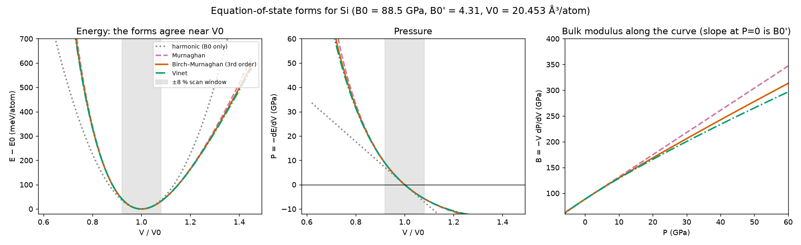
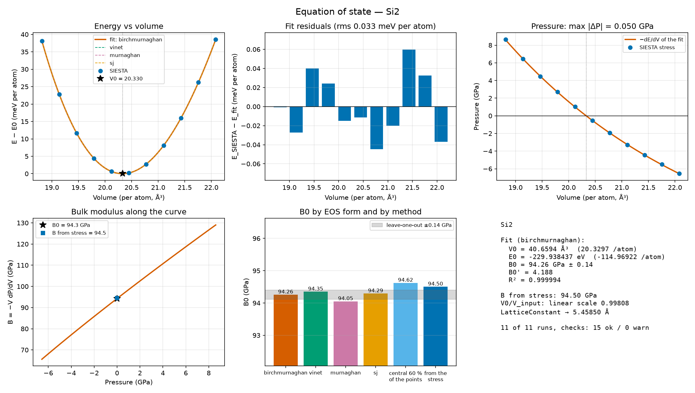
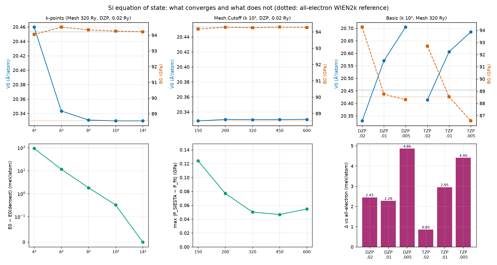

# 5.15 — Workflow: Equation of State (`stb-eosInputs` / `stb-eosAnalysis`)

This workflow has 2 stages: **Stage 1** (`stb-eosInputs`, code `5.15.1`) takes an
**already relaxed** bulk structure and a `calc.fdf` template and writes one
ready-to-run SIESTA folder per scanned volume — the cell scaled isotropically,
your template untouched, a `config_extra.fdf` that fixes the cell and makes every
folder a single point, and the pseudopotentials. **Stage 2** (`stb-eosAnalysis`,
code `5.15.2`) reads the finished runs back and fits an **equation of state**
`E(V)` — equilibrium volume `V0`, energy `E0`, bulk modulus `B0` and its pressure
derivative `B0'` — plus the quantities that tell you whether to trust it: SIESTA's
own pressure (from the stress tensor) against `−dE/dV` of the fit, a second bulk
modulus from the stress alone, leave-one-out uncertainties, residuals, the
consistency of the level of theory across folders, the suggested new lattice
constant, a pass/warn table of checks, and a 6-panel dashboard.

It answers a question none of `5.1`–`7.1` does in this form: not how a structure
responds to a small strain (that is `5.2` elastic constants), nor what a single
relaxed cell costs (`5.3` cohesive energy), but **how the energy of the crystal
depends on its volume over a finite range** — the curve from which the lattice
constant, the compressibility, the pressure at any volume and the volume at any
pressure follow. The worked example (Section 5) runs the whole thing for real, with
SIESTA, on bulk silicon: a 14-setup convergence study (k-points, mesh, basis) and the
comparison with an all-electron calculation, which turns out to teach more about
how to judge a basis set than about silicon.

Both stages live in this one folder and this one tutorial — same reasoning as
`5.1`–`5.5`, `5.13` and `5.14`: Stage 1's output exists only to feed Stage 2.

## 1. Theory

**Symbols at a glance**

| Symbol | Meaning |
|---|---|
| `V`, `V0` | cell volume; its value at the energy minimum (ų; per atom when stated) |
| `E(V)`, `E0` | total energy of the cell at volume `V`; its minimum (eV) |
| `P = −dE/dV` | pressure of the static lattice (GPa; `1 eV/ų = 160.2177 GPa`) |
| `B = −V dP/dV = V d²E/dV²` | bulk modulus at volume `V`; `B0 = B(V0)` (GPa) |
| `B0' = dB/dP` | pressure derivative of the bulk modulus at `P = 0` (dimensionless) |
| `σ` | SIESTA's stress tensor (eV/ų): positive means the cell is under tension |
| `P_SIESTA = −tr(σ)/3` | the pressure each run reports through its own stress |
| `x = V0/V` | compression ratio |
| `f = [(V0/V)^(2/3) − 1] / 2` | Eulerian finite strain |
| `Δ` | Delta-test distance between two equations of state (meV/atom) |
| `N` | number of atoms of the cell |

### 1.1 Why an equation of state

At zero temperature and with the nuclei held at their lattice sites (the *static
lattice*), a crystal at volume `V` has the energy `E(V)` obtained by relaxing
everything else. That one function holds:

- the **equilibrium volume** `V0`, hence the lattice constant of the material at the
  level of theory used;
- the **cohesive-energy minimum** `E0` (a reference for energy differences between
  phases);
- the **bulk modulus** `B0` — how hard it is to compress — and its pressure
  derivative `B0'` — how fast it hardens;
- the **pressure** at any volume, `P = −dE/dV`, and by inversion the **volume under
  any pressure**.

It is the input of many other calculations: the quasi-harmonic approximation (`stb-mlphonons
--qha` scans exactly this volume range), thermal expansion, the transition pressure
between two phases (the crossing of their enthalpies, Section 1.10), the volume at
which a high-pressure experiment is to be simulated. And it is the cheapest honest
test of a SIESTA setup: pseudopotential, basis, mesh cutoff and k-sampling all leave a
mark on `V0` and `B0` that can be compared with experiment and with other codes
(Section 1.8).

One SIESTA run gives one point `E(V)`. A scan of 9–11 volumes and a fit gives the curve.

### 1.2 Thermodynamics in four lines

For the static lattice the pressure, the bulk modulus and its derivative are

```
P(V)  = −dE/dV                                                              (1)
B(V)  = −V dP/dV = V d²E/dV²                                                (2)
B0'   = dB/dP at P = 0                                                      (3)
H(P)  = E(V) + P V      (enthalpy; at T = 0 it is the Gibbs energy)        (4)
```

At zero external pressure the equilibrium volume satisfies `dE/dV = 0`; under an
external pressure `P` it satisfies `dE/dV = −P`, i.e. it minimizes `H`. Near the
minimum a parabola is the first approximation,

```
E(V) ≈ E0 + (B0 / 2 V0) (V − V0)²          so       B0 ≈ V0 · d²E/dV²          (5)
```

and its failure — the curve is stiffer when compressed than when expanded —
is exactly what `B0'` measures (about 4 for most solids: Section 5.2 finds 4.1–4.3
for silicon). A solid's `B` rises with pressure; the energy is therefore *not*
symmetric about `V0`, and a fit that forgets it returns a wrong `B0`.

### 1.3 What the SIESTA runs give, and how the cell is scaled

Each folder is one SCF calculation at a fixed cell: the total (free) energy `E`, the
atomic forces and the stress tensor `σ` come out of the same run. This workflow
scales the cell **isotropically**,

```
L = L0 · (1 + ε_V / 100)^(1/3)          on every lattice vector                     (6)
```

with `ε_V` the volume strain in percent (from `−strain_range` to `+strain_range`),
the same convention as `stb-mlphonons --qha`. The *shape* of the cell
(its angles and axis ratios) is kept, and the atomic positions are fractional, so
they scale for free: for a crystal whose atoms have no free internal coordinates
(diamond, fcc, bcc, rocksalt...) every folder is already the relaxed structure at
its volume, and one SCF each is enough (**single point**, the default). If the
crystal has free internal coordinates (wurtzite, rutile, quartz...), `--relax-positions`
lets the ions relax at each volume, *with the cell fixed*: letting the cell relax
would undo the scan.

Two routes to the pressure exist inside every run: the derivative of the energy
across the scan (Eq. 1) and the stress tensor of each run,

```
P_SIESTA = −tr(σ) / 3                                                       (7)
```

(`σ > 0`: the cell is under tension, it wants to shrink; so a cell *larger* than `V0` has
`σ > 0` and `P < 0`). Stage 2 compares them (Section 1.6).

### 1.4 Equation-of-state forms

An equation of state is a function `E(V; E0, V0, B0, B0')` with four parameters, fitted
by least squares to the scanned points. The ones `stb-eosAnalysis` offers (via ASE's
`EquationOfState`, [15]):

**Murnaghan** [1] — assumes the bulk modulus is linear in pressure, `B(P) = B0 + B0' P`:

```
E(V) = E0 + (B0 V / B0') [ (V0/V)^B0' / (B0' − 1) + 1 ] − B0 V0 / (B0' − 1)         (8)
P(V) = (B0 / B0') [ (V0/V)^B0' − 1 ]
```

**Birch–Murnaghan, third order** [2] — the finite-strain (Eulerian) expansion of the
energy carried to third order in `f`:

```
E(V) = E0 + (9 V0 B0 / 16) { [(V0/V)^(2/3) − 1]³ B0' + [(V0/V)^(2/3) − 1]² [6 − 4 (V0/V)^(2/3)] }   (9)
     = E0 + (9/2) V0 B0 f² + (9/2) V0 B0 (B0' − 4) f³
P(V) = (3 B0 / 2) (x^(7/3) − x^(5/3)) { 1 + (3/4)(B0' − 4)(x^(2/3) − 1) },        x = V0/V
```

It is the default of the suite and of the Delta test [7]. Setting `B0' = 4` removes the
cubic term: the *second-order* Birch–Murnaghan form.

**Vinet** [3] — the "universal" form derived from an exponential interatomic
potential, better behaved than Birch–Murnaghan for strong compression:

```
E(V) = E0 + (9 B0 V0 / ξ²) { 1 + [ξ (1 − X) − 1] exp[ξ (1 − X)] },      X = (V/V0)^(1/3),  ξ = (3/2)(B0' − 1)    (10)
```

**Stabilized jellium (`sj`)** [5] — a polynomial in `V^(−1/3)`, motivated by the
stabilized-jellium model; ASE's fit returns `V0`, `E0` and `B0` but no `B0'`, which the
report then prints as `-`.

Near the minimum all four coincide to within the numerical noise of the SCF: with the
parameters of silicon, Birch–Murnaghan and Vinet differ by at most 0.05 meV/atom inside a ±8 %
window of volume (Murnaghan, the stiffest, by 0.11), by 0.8 and 1.7 meV/atom at ±15 %, by 3 and 6
meV/atom at ±20 %, and by tens of meV beyond ±30 % (Fig. 1). That is
why `--eos all` is a *robustness check of the fit*, not a physical choice: if the forms agree on
`B0` (the report tests 1 %), the result does not depend on the functional form; if they
do not, the scan is too wide or too narrow. `B0'` is the poorly determined parameter:
it controls the *asymmetry* of the curve, which a ±8 % window barely samples.



*Fig. 1 — The four equation-of-state forms for silicon's parameters (all-electron
reference `V0 = 20.453 ų/atom`, `B0 = 88.5 GPa`, `B0' = 4.31`; `theory_figures.py`). The
grey band is the ±8 % scan of the example. The harmonic approximation (Eq. 5) is the dotted
parabola.*

### 1.5 Fitting, and how sure the numbers are

The fit is a non-linear least squares in the **energies**, `min Σ [E_i − E(V_i; E0, V0, B0, B0')]²`.
Energies — not pressures — are fitted because they are the quantity SIESTA converges
to the tightest tolerance; the pressure of each run is kept as an independent check
(Section 1.6). Four parameters need at least 4 volumes; the tool asks for 5 and defaults
to 9. A scan has to satisfy three practical conditions:

- it must **bracket the minimum**: points on both sides of `V0`, at least two each —
  otherwise `V0` is an extrapolation and `B0` is dominated by one branch of the curve;
- it must be **wide enough** that the curvature stands above the SCF noise (a few
  percent in volume is the usual lower bound), and **narrow enough** to stay where the
  chosen form is accurate (up to ~10 % is typical; Section 1.4);
- an **odd number** of volumes keeps the input volume itself in the scan.

*Uncertainty.* The report gives the **leave-one-out** (jackknife) standard error of `V0`
and `B0`: the fit is repeated with each point removed in turn, and

```
σ_jack = sqrt( (n − 1)/n · Σ_i (θ_i − θ̄)² )                                 (11)
```

with `θ_i` the parameter without point `i` [21]. It measures how much a single run can
move the answer — it is a statement about the *scan*, not about the physics: it says
nothing about the basis, the pseudopotential or the functional, which usually dominate
(Section 5.5). A second diagnostic, the **window sensitivity**, refits with the central
60 % of the points only: a `B0` that moves by more than ~2 % means the answer depends on
how far from `V0` you look, i.e. the curve is not described by the chosen form over the
whole range.

*The parabolic limit* (Eq. 5) is the by-hand check of Section 1.12.

### 1.6 Two routes to the pressure: the stress and `−dE/dV`

SIESTA prints the stress tensor of every run. For an atom-centred basis whose orbitals
keep their *shape and range* when the cell is scaled, the stress is the exact derivative
of the energy with respect to the strain — apart from the real-space mesh (Section
1.7) and the SCF tolerance — so `P_SIESTA` (Eq. 7) must coincide with `−dE/dV`
(Eq. 1) evaluated on the fitted curve. Stage 2 prints both for every volume and flags
the maximum difference. This is a strong test: two different observables of the same
SCF calculation, one of them not used in the fit.

It is also worth contrasting with plane-wave codes: there the number of plane waves changes
with the volume at a fixed cutoff, so the stress and `−dE/dV` differ by the *Pulay stress*
(finite-basis-set correction [6]) unless the cutoff is converged or the number of plane
waves is held constant. SIESTA's orbitals are tied to the atoms, so this particular
inconsistency is absent; the residual disagreement points to the mesh, the SCF or a poor fit.

The stress gives a **second bulk modulus** from the same runs: fit `P_SIESTA(V)` with a
cubic polynomial (a quadratic over ±8 % truncates the curvature of `P(V)` and overestimates `B` by ~2 %) and take `B = −V dP/dV` at `V0` (the report calls it *B0 from the stress alone*).
It uses no energy at all; a `B0` that disagrees by more than a few percent with the
energy route is a diagnostic, not a competition.

### 1.7 What moves `V0` and `B0`: the numerical settings

Everything below is a *convergence parameter* of the SIESTA calculation, not a physical
one; the point of the example (Section 5) is to measure how much each moves the answer.

- **K-point sampling.** A semiconductor with a gap converges quickly (smooth integrand);
  a metal needs a much denser grid and a smearing (`ElectronicTemperature`), and its
  `E(V)` is correspondingly noisier. The grid is the *same* in every folder: a scaled cell
  with the same divisions samples the scaled Brillouin zone consistently.
- **Mesh cutoff.** SIESTA evaluates the Hartree and exchange-correlation terms on a
  real-space grid whose spacing is set by `Mesh.Cutoff`. A scaled cell at the same cutoff
  gets a grid of *another integer size*, so `E(V)` carries a small, irregular noise (the
  egg-box effect [10]) that a finer mesh reduces. It acts on the energy and, slightly
  differently, on the stress: it is the main source of any residual `P_SIESTA ≠ −dE/dV`.
- **Basis set.** Numerical atomic orbitals (NAOs) of finite range. Their size
  (`PAO.BasisSize`: SZ < DZ < DZP < TZP...) and, above all, their **radii**, set by
  `PAO.EnergyShift` (the energy a confined orbital is allowed to rise: a *smaller* shift
  means *longer* orbitals) change the equilibrium volume and the stiffness. Short orbitals
  overlap little: the basis functions of neighbouring atoms lend variational freedom to one
  another more when the atoms are compressed (the basis-set superposition error), which
  favours small volumes. Hence a poor or short basis tends to give a `V0` that is too
  small and a `B0` that is too large; a longer basis moves both toward the complete-basis
  value, and — as the example shows — may overshoot. Basis convergence is the slowest of the
  three.
- **Pseudopotential and functional.** Norm-conserving PseudoDojo pseudopotentials [13]
  with PBE [12] are used here. Any other choice changes `V0` and `B0` systematically: that
  is the physics of the approximation, not a convergence error.

### 1.8 Comparing with experiment and with an all-electron calculation

Two comparisons, with different meanings.

**Against experiment.** A static-lattice DFT calculation at 0 K differs from a
laboratory measurement by (i) the functional's own error — PBE overestimates lattice
constants by about 1 % and underestimates bulk moduli by about 10 % for silicon (Section
5.6) — and (ii) the thermal and zero-point motion the experiment contains and the static lattice
does not. For silicon the zero-point correction is small; for light elements (diamond) it matters.
So agreement within a few percent of experiment says the setup is sane, not that it is converged.

**Against an all-electron calculation of the *same functional*.** This isolates the
numerical error of the pseudopotential-plus-basis machinery from the physics of PBE.
The standard tool is the **Delta test** [7, 8, 9]: the root-mean-square energy difference
between the two equations of state, integrated over ±6 % of the mean volume,

```
Δ = sqrt( ∫ [E_a(V) − E_b(V)]² dV / (0.12 V̄0) ),      V̄0 = (V0,a + V0,b) / 2         (12)
```

with each curve referred to its own minimum (this is how ASE's `deltacodesdft.delta` and the
`calcDelta` package evaluate it). `Δ` in meV/atom condenses `V0`, `B0` and `B0'` into one
number. In the Delta test, the reference is the all-electron WIEN2k calculation; for silicon
its numbers are `V0 = 20.4530 ų/atom`, `B0 = 88.545 GPa` and `B0' = 4.31` ([9], file
`WIEN2k.txt`). The example (Section 5.6) uses exactly this reference.

*Why `B0` alone is a poor figure of merit.* `B` depends strongly on the volume at which
it is evaluated: `dB/dV ≈ −B0 B0'/V0`, so a `V0` that is wrong by 1 % moves `B0` by `B0'` % ≈
4 % (about 4 GPa for silicon) *in the other direction*. A basis that makes `V0` too large and
`B` at a given volume unchanged will look as though it fixed `B0`. `V0`, `B0` at the same volume
and `Δ` must be read together.

### 1.9 Non-cubic crystals and internal coordinates

The isotropic scaling (Eq. 6) keeps the shape of the cell. For a cubic crystal that is the
whole story. For a hexagonal, tetragonal or lower-symmetry one it is a *constrained path*:
`c/a` (and any angle) stays at the input's value, although the fully relaxed solid under
pressure would change it. The `B0` obtained is the modulus along that path, not
the hydrostatic bulk modulus — the two differ by an amount that depends on how soft `c/a` is
(large for layered materials). The report prints a note whenever the crystal is not cubic. To
get the hydrostatic curve, relax the shape at each volume
(SIESTA's `MD.VariableCell` with `Constant.Volume`, outside this workflow), or at least
relax `c/a` at `V0` first and scan from there.

Internal coordinates are a separate issue: with free coordinates a single point is not
the relaxed energy at that volume, so use `--relax-positions`; the report's residual-force
check flags a scan that needs it.

### 1.10 Target pressure, enthalpy and phase stability

The fit is also a pressure–volume relation. `--target-pressure P1 P2 ...` inverts
`P(V) = −dE/dV` of the fit and reports, for each pressure, the volume and the linear
scale `L/L(V0) = (V/V0)^(1/3)` of the cell — for example the lattice constant to use for a
calculation at 5 GPa. Pressures outside the range the scan covered (`P(V)` at the ends of the
scanned volumes) are flagged **EXTRAPOLATED**: there the equation of state's *form* decides the
answer, not the data.

A transition between two phases at `T = 0` happens where their enthalpies cross,
`H_1(P) = E_1(V_1) + P V_1 = H_2(P)`: run this workflow for each phase with the same
settings and compare `H(P)` — the common tangent construction in `E(V)`.

### 1.11 What this workflow simplifies — explicitly

- **Static lattice**: no zero-point energy, no thermal pressure; it is the 0 K curve. Finite
  temperature needs phonons (`5.4`, `stb-mlphonons --qha`).
- **Isotropic scaling only**: Section 1.9.
- **Four-parameter empirical forms**: none of them is exact; their agreement is evidence,
  not proof (and `B0'` is the weakest parameter).
- **The jackknife** quantifies the scan's sensitivity to single points, not the systematic
  error of the setup.
- **Single point by default**: valid only when atoms have no free internal coordinates.
- **No automatic convergence**: the tool reports what a setting does (Section 5); you decide
  how far to push it.
- **One SIESTA output file per folder** (`calc.out`) is the source of energy, volume and stress.

### 1.12 A calculation you can check by hand

Take three consecutive rows of the table of the example's base scan (Section 5.2) — the volume
of the input cell and its two neighbours:

| `V` (ų) | `E` (eV) |
|---|---|
| 40.2401 | −229.937172 |
| 40.8944 | −229.938064 |
| 41.5487 | −229.933014 |

With a step `h = 0.6543 ų`, the second finite difference is

```
E'' ≈ (E₋ + E₊ − 2 E₀) / h² = (−229.937172 − 229.933014 + 2·229.938064) / 0.6543² = 0.013879 eV/Å⁶
B(40.894) = V E'' = 40.894 · 0.013879 · 160.2177 = 90.9 GPa
```

and the central difference of the energy gives the pressure,

```
P(40.894) = −(E₊ − E₋)/(2h) · 160.2177 = −0.509 GPa
```

For comparison, the full Birch–Murnaghan fit of the 11 points gives `B = 92.0 GPa` and `P = −0.54 GPa`
at that volume, SIESTA's own stress gives `P_SIESTA = −0.52 GPa`, and the parabola through the three
points above gives `V0 = 40.666 ų` against `40.659 ų` of the fit. Three numbers, no software:
`B` is right to ~1 %, the pressure to 0.03 GPa, and the equilibrium volume to 0.02 %. The
`1 %` in `B` is the asymmetry of the curve (`B0'`) that the parabola ignores.

## 2. Libraries and external dependencies used

- **SIESTA** [10, 11] itself is *not* called by the suite. It does the real work: the
  SCF calculation of each volume, writing `calc.out` with the free energy, the cell
  (`outcell:` block), the forces and the stress tensor. The reference data of Section 5 was
  produced with SIESTA 5.4.2, GGA-PBE [12], PseudoDojo norm-conserving pseudopotentials [13]
  and Monkhorst–Pack k-grids [14].
- **[ASE](https://wiki.fysik.dtu.dk/ase/)** [15] — `ase.eos.EquationOfState` fits the four
  forms (`stb.core.eos_fit`); `ase.utils.deltacodesdft.delta`
  evaluates Eq. 12 in `convergence_table.py`; `ase.neighborlist` gives the shortest bond.
- **numpy** / **[SciPy](https://scipy.org/)** [16] — the cubic splines that turn the fitted
  curve into `P(V)` and `B(V)`, the polynomial fits of the pressure, the leave-one-out refits.
- **[pymatgen](https://pymatgen.org/)** [17] / **[spglib](https://spglib.readthedocs.io/)**
  [18] — space group and crystal system, density, structure reading.
- **[matplotlib](https://matplotlib.org/)** [19] — the dashboard (`--png` / `--show`). The
  `.dat/.gplot` pair (`--save-gnuplot`) is for gnuplot, which the suite never invokes.

## 3. Stage 1: generating the volume folders (`stb-eosInputs`, code `5.15.1`)

### 3.1 What it does

`stb-eosInputs` takes an **already relaxed** structure (`-f`, fractional coordinates, bulk only)
and your `calc.fdf` template (`-c`, default `./calc.fdf`) and, for each of `--n-volumes` volumes
between `−--strain-range` and `+--strain-range` percent, writes

```
<output-dir>/vol_<pct>/
    structure.fdf        the structure, ONLY %block LatticeVectors scaled (Eq. 6)
    calc.fdf             '%include config_extra.fdf' + your template, untouched
    config_extra.fdf     the forced directives (Section 3.2)
    <species>.psml       the pseudopotentials (-p: a bundled bank or a folder)
<output-dir>/eos_scan.json   the plan: structure, volumes, forced directives
```

It does not run SIESTA. Run each folder (`mpirun -np N siesta calc.fdf > calc.out`) and call
Stage 2. Pseudopotentials follow the suite's convention (`-p dojo`, `-p virtual_vault` or a folder path;
the same as `stb-optical`, `stb-inputfile`, ...), and the interactive menu asks for them with the same prompt.

### 3.2 `config_extra.fdf`: everything mandatory, the template untouched

The scan only makes sense if every folder is *one* SCF at *its* fixed cell. Those requirements
are written into each folder's `config_extra.fdf`, and `calc.fdf` starts with
`%include config_extra.fdf` followed by your template byte for byte. SIESTA's fdf reader is
first-occurrence-wins, so the forced values beat anything the template says — even a template
meant for a variable-cell relaxation:

| Directive | Forced | Why |
|---|---|---|
| `MD.VariableCell` | `false` | the cell is the scan variable: it must never relax |
| `MD.TypeOfRun` | `CG` | no molecular dynamics |
| `MD.Steps` / `MD.NumCGsteps` | `0` (single point) or `--relax-steps` | no relaxation, or an ionic budget with `--relax-positions` |
| `MD.MaxForceTol` | `0.01 eV/Ang` | only with `--relax-positions` |
| `kgrid.MonkhorstPack` | from `--kgrid`/`--kgrid-density` | only when the template has no grid (SIESTA would sample Gamma only) or you ask for one; a template's own grid is kept |

Only these directives are forced: basis, mesh cutoff, functional, SCF settings are whatever the
template says, identical in all folders. The same convention as every other prep stage of the suite
(`stb-optical`, `stb-gqca`, `stb-adsorb`...): your `calc.fdf` is never edited.

Special cases: if no `calc.fdf` exists and `-c` was not given, only the scaled structures are written
(the earlier behavior of the tool); if `-c` is the same file as `--file` (a self-contained input), the scaled
copy of it is the run input, with the `%include` on top.

### 3.3 The report, live

```text
[1] INPUT STRUCTURE
------------------------------------------------------------
Formula         : Si2  (2 atom(s), 1 species)
Lattice (Ang)   : a=3.8672  b=3.8672  c=3.8672
Angles (deg)    : alpha=60.00  beta=60.00  gamma=60.00
Volume          : 40.8944 Ang^3  (20.4472 Ang^3/atom)
Density         : 2.2809 g/cm^3
Shortest bond   : 2.3681 Ang
Detected        : 3D (bulk material)
Space group     : Fd-3m (No. 227), cubic system
Species | Z  | Atoms | Valence e- | Total e- | Valence from
-----------------------------------------------------------
Si      | 14 | 2     | 4          | 8        | Si.psml
Valence electrons : 8

[2] LEVEL OF THEORY READ FROM THE TEMPLATE
------------------------------------------------------------
XC functional ... GGA / PBE        Basis ... split DZP, PAO.EnergyShift 0.02 Ry
Mesh cutoff ... 320 Ry             SCF k-grid ... 10x10x10 (spacing 0.199 1/Ang)
SCF k-grid forced : no -- the template's own grid is kept (--kgrid / --kgrid-density override it)
[NOTE] PAO.EnergyShift 0.02 Ry: V0 and B0 depend on the orbital cutoff radii; converge them ...

[3] SCAN DEFINITION
------------------------------------------------------------
Volume strain   : -8.00 % .. +8.00 %, 11 points (step 1.600 %)
Cell scaling    : L = L0 * (1 + strain/100)^(1/3) on every lattice vector (shape kept); fractional positions unchanged
Folder     | dV/V0 (%) | V (Ang^3) | V/atom  | L/L0    | a b c (Ang)          | d_min (Ang)
-------------------------------------------------------------------------------------------
vol_m8.00/ | -8.00     | 37.6228   | 18.8114 | 0.97259 | 3.7612 3.7612 3.7612 | 2.3032
 ...
vol_0.00/  | +0.00     | 40.8944   | 20.4472 | 1.00000 | 3.8672 3.8672 3.8672 | 2.3681
 ...
vol_8.00/  | +8.00     | 44.1659   | 22.0830 | 1.02599 | 3.9677 3.9677 3.9677 | 2.4297

[4] DIRECTIVES FORCED THROUGH config_extra.fdf (your template is not edited)
------------------------------------------------------------
Directive           | Forced value | Template had | Effect
kgrid.MonkhorstPack | (not forced) | 10x10x10     | the template's own grid
MD.TypeOfRun        | CG           | (absent)     | no molecular dynamics
MD.Steps            | 0            | (absent)     | single point, no relaxation
MD.NumCGsteps       | 0            | (absent)     | older spelling of the same budget, forced for templates that still use it
MD.VariableCell     | false        | (absent)     | the cell is the scan variable: it must NEVER relax

[5] FOLDERS WRITTEN        (one line per folder: structure.fdf, calc.fdf, config_extra.fdf, Si.psml)

[6] SUMMARY & NEXT STEPS
------------------------------------------------------------
11 volume folder(s) written under 'eos_runs' (calc.fdf is the SIESTA input).
Scan record          : eos_runs/eos_scan.json (read by stb-eosAnalysis)
Cost                 : 11 independent runs (single-point SCF each)
Next steps:
  1. Run SIESTA in every folder, e.g.:
       for d in eos_runs/vol_*; do (cd $d && mpirun -np 4 siesta calc.fdf > calc.out); done
  2. Check that every run finished (SCF converged), then:
       stb-eosAnalysis --dir eos_runs --eos all --show
```

(`[0]` is the run metadata; the `a b c` of the primitive fcc cell are the primitive vectors, `a_conventional / √2`.) Every warning
of the run is repeated in a list at the end of the report.

### 3.4 The advisories

Printed where they apply and repeated at the end of the report:

- the template does not `%include` the structure file (SIESTA would use the unscaled cell in every
  folder: eleven copies of the same calculation);
- the template defines a lattice of its own (`LatticeVectors`, `LatticeParameters`, `LatticeConstant`)
  next to the included structure — whichever SIESTA reads first wins;
- a non-cubic crystal (Section 3.5), a small basis (SZ/DZ/SZP), no `Mesh.Cutoff`, Cartesian coordinates
  (which would not scale), a `--strain-range` below 2 % (curvature lost in SCF noise) or above 15 %, and an even
  number of volumes (no point at the input volume).

### 3.5 Bulk only, and the crystal system

A vacuum-padded structure (slab, wire, molecule) has no bounded cell volume: it is refused with an
error. For a non-cubic crystal the report adds the *constrained-path* note of Section 1.9 and records the crystal
system in `eos_scan.json`, from where Stage 2 repeats it.

### 3.6 Validation

`--n-volumes` below 5 and a `--strain-range` outside (0, 40) % are rejected; a missing `--file`,
an explicit `-c` that does not exist, an unknown `-p` source, and a vacuum-padded structure all exit
with a clear `[ERROR]`.

### 3.7 Running it both ways

```bash
stb-eosInputs -f structure.fdf -p dojo --n-volumes 11 --strain-range 8.0 --save-report
stb-suite            # then: 5 (Workflow) -> 15 (Equation of State) -> 1 (Stage 1)  (or type 5.15.1)
```

## 4. Stage 2: analyzing the results (`stb-eosAnalysis`, code `5.15.2`)

### 4.1 Before running Stage 2

Every `vol_*` folder must hold the SIESTA output (`calc.out` by default, `--file` to change it). A
folder without it, or with an unparseable one, is *skipped, not fatal*, and reported. Stage 2 reads each
run's free energy, the **last** `outcell:` block (the cell SIESTA actually used), the SCF convergence line,
the forces and the stress tensor. `eos_scan.json` next to the folders is optional but recommended: it enables
the planned-versus-actual volume check and the suggested lattice constant.

### 4.2 Report structure

| Section | Content |
|---|---|
| `[0]` | run metadata |
| `[1]` | the scan (from `eos_scan.json`) and the **level of theory of every folder**, checked for being identical |
| `[2]` | one line per folder: read, skipped, SCF not confirmed |
| `[3]` | the table: `V`, `V/atom`, `dV`, `E`, `E/atom`, `E − E_min`, `P_SIESTA`, SCF, force |
| `[4]` | the fit(s): `V0`, `V0/atom`, `E0`, `B0`, `B0'`, `R²`, residual rms; uncertainty, window sensitivity, form spread; suggested `LatticeConstant` |
| `[5]` | the **pressure cross-check**: `P_SIESTA` vs `−dE/dV` per volume, the second `B0` from the stress, the pressure at `V0` |
| `[6]` | `--target-pressure`: volume and cell scale at each pressure |
| `[7]` | the **checks table** (OK/WARN) with hints |
| `[8]` | summary and the files written |
| `[9]` | next steps |
| `[10]` | every warning again |

### 4.3 `[1]`–`[3]`: is the scan what you think?

`[1]` reads `config_extra.fdf`, `calc.fdf` and the pseudopotential files of *each* folder, compares the settings
(functional, basis, mesh cutoff, spin, smearing, D3, k-grid, pseudopotential hash) and warns on any difference —
`E(V)` is one curve only if they are all identical. `[2]` compares each run's cell with the plan
(a folder edited after Stage 1, or a `%include` problem, shows as "SIESTA ran a cell of ... but the plan says ...").
`[3]` prints the data with the pressure of each run's own stress tensor.

### 4.4 `[4]`: the fit

With `--eos all` the four forms are fitted on the same data and listed side by side, with `Bracket ok` when
`V0` lies in the scanned range; the reference fit (Birch–Murnaghan) feeds everything below. Besides the parameters:

- *Uncertainty (leave-one-out)* — Eq. 11 for `V0` and `B0`;
- *Window sensitivity* — `B0` from the central 60 % of the points;
- *Spread between EOS forms* — `B0` and `V0` range over the four forms;
- *Fit quality* — `R²` and the residuals, in meV/atom;
- *Compressibility* `1/B0` in TPa⁻¹ and `B` of the curve at `V0`;
- *Versus the input structure* — `V0/V_input`, the linear scale, and the **suggested `LatticeConstant`**
  (the input's `LatticeConstant` times the scale: the equilibrium volume at the input's shape).

### 4.5 `[5]`: the pressure cross-check

The table of `P_SIESTA`, `−dE/dV` and the difference per volume; the maximum difference; the SIESTA pressure at the
fitted `V0` (it should be ~0); and the **second `B0`**, from the stress alone (Section 1.6). See Section 5.3 for what
these numbers look like on real data and what moves them.

### 4.6 `[7]`: the checks

| Check | Passes when | If it fails |
|---|---|---|
| All planned runs available | every folder of the plan was read | run the missing folders |
| SCF converged in every run | each `calc.out` has the convergence line | rerun with more iterations / smaller mixing weight |
| `V0` inside the scanned range | the fitted minimum lies within the data | widen `--strain-range` |
| Points on both sides of `V0` (≥ 2 each) | `n_below ≥ 2` and `n_above ≥ 2` | re-centre the scan on `V0` (suggested `LatticeConstant`) |
| Fit `R²` ≥ 0.9999 | — | change the strain range; check the SCF settings |
| Residual rms ≤ 0.5 meV/atom | — | same |
| `B0'` within 2.5–7 | physically plausible | too narrow a scan, or a noisy one |
| EOS forms agree on `B0` (< 1 %) | only with `--eos all` | the functional form matters: the scan is too wide or narrow |
| `B0` uncertainty (leave-one-out) < 1 % | — | a single run is moving the fit: inspect the table |
| `B0` stable against the window (< 2 %) | — | the curve is not described by the form over the whole range |
| `P_SIESTA` agrees with `−dE/dV` (< 0.5 GPa) | — | raise `Mesh.Cutoff`, tighten `DM.Tolerance`, widen the scan |
| Residual pressure at `V0` small (< 0.2 GPa) | — | same |
| `B0` from stress agrees with energy (< 5 %) | — | same |
| Residual forces ≤ 0.05 eV/Å | atoms are at equilibrium in every folder | use `--relax-positions` |
| Same level of theory in every folder | — | a folder was edited: rerun with identical settings |

The thresholds are conventions of the tool (they are constants at the top of `eos_analysis.py`), not laws; a WARN says
*look here*.

### 4.7 Plots and data on request

Nothing is written unless asked for:

| Option | Writes |
|---|---|
| `--show` | opens the 6-panel matplotlib dashboard (needs a display; without one it warns and only saves with `--png`) |
| `--png` | `<output>_summary.png`, the same dashboard |
| `--save-gnuplot` | `<output>.dat` (data block and fitted curve) + `<output>.gplot` (E(V) and P(V), `gnuplot <output>.gplot` renders `<output>.pdf`) |
| `--save-data` | `<output>_table.csv` (one row per volume) + `<output>_results.json` (every fit, check and number) |
| `--save-report` | `stb_eosAnalysis_report.txt` |

The dashboard has six panels: `E(V)` with the data and every fit, the fit residuals, the pressure from the stress and from
the fit, the bulk modulus along the curve `B(P)` (its slope at `P = 0` is `B0'`) with the stress-derived `B0` marked, `B0` by
EOS form with the leave-one-out band, and a text summary.

### 4.8 Guard rails

A missing or unparseable run is skipped and the fit uses the rest (fewer than 4 valid volumes is a hard error); a scan that
does not bracket the minimum, a different level of theory in one folder, an unconverged SCF and a cell that is not the planned
one are each reported where they apply, in `[7]`, and in `[10]`.

### 4.9 Running it both ways

```bash
stb-eosAnalysis --dir eos_runs --eos all --png --save-gnuplot --save-data --save-report
stb-eosAnalysis --dir eos_runs --target-pressure 0 5 10 --show
stb-suite            # then: 5 -> 15 -> 2  (or type 5.15.2): it asks for the options above
```

## 5. Worked example: bulk silicon, end to end

### 5.1 Set-up

Bulk silicon (diamond, Fd-3m), the 2-atom primitive fcc cell (`structure.fdf`, `a = 5.469 Å`, the
conventional-cell constant), PBE [12], the PseudoDojo norm-conserving pseudopotential [13], DZP basis with the default
`PAO.EnergyShift 0.02 Ry`, `Mesh.Cutoff 320 Ry`, a 10×10×10 Monkhorst–Pack grid, 300 K electronic temperature,
`DM.Tolerance 1e-5` (`calc.fdf`). Eleven volumes from −8 % to +8 %, SIESTA 5.4.2, `mpirun -np 2`: about 6 s per
volume. The reference data are **14 such scans** (Section 6): this *base* setup and 13 others that change exactly one
thing — the k-grid (4³, 6³, 8³, 14³), the `Mesh.Cutoff` (150, 200, 450, 600 Ry), the basis (DZP and TZP with
`PAO.EnergyShift` 0.02, 0.01, 0.005 Ry). Note that the 2-atom cell reports `a = b = c = 3.867 Å` and angles of 60°: those are
the primitive vectors (`a_conventional / √2`); the conventional lattice constant is `a0 = (8 V0/atom)^(1/3)`, which
`convergence_table.py` prints.

### 5.2 The base scan

```bash
stb-eosInputs -f structure.fdf -p dojo --n-volumes 11 --strain-range 8.0 --save-report
for d in eos_runs/vol_*; do (cd $d && mpirun -np 2 siesta calc.fdf > calc.out); done
stb-eosAnalysis --dir eos_runs --eos all --png --save-gnuplot --save-data --save-report
```

The 11 energies (Section 4's report `[3]`, shortened) follow a smooth curve with a minimum between the −1.6 % and +0
points, and a pressure that changes sign there:

| `dV` (%) | `V` (ų) | `E − E_min` (meV/atom) | `P_SIESTA` (GPa) |
|---|---|---|---|
| −8.0 | 37.6228 | 37.95 | +8.650 |
| −4.8 | 38.9315 | 11.49 | +4.450 |
| −1.6 | 40.2401 | 0.45 | +1.023 |
| 0.0 | 40.8944 | 0.00 | −0.518 |
| +1.6 | 41.5487 | 2.53 | −1.918 |
| +4.8 | 42.8573 | 15.83 | −4.462 |
| +8.0 | 44.1660 | 38.32 | −6.530 |

The fit (`[4]`):

| EOS form | `V0` (ų) | `B0` (GPa) | `B0'` | `R²` | residual rms (meV/atom) |
|---|---|---|---|---|---|
| Birch–Murnaghan | 40.6594 | 94.26 | 4.188 | 0.999994 | 0.0325 |
| Vinet | 40.6594 | 94.35 | 4.186 | 0.999995 | 0.0306 |
| Murnaghan | 40.6593 | 94.05 | 4.193 | 0.999992 | 0.0378 |
| stabilized jellium | 40.6593 | 94.29 | — | 0.999995 | 0.0317 |

so `V0 = 40.659 ų` (20.330 ų/atom, `a0 = 5.4585 Å`), `E0 = −229.938437 eV` and `B0 = 94.26 ± 0.14 GPa`
(leave-one-out), `B0' = 4.19`. The four forms agree on `B0` to 0.32 % and on `V0` to 0.0001 ų; the central 7 of 11 points give
`B0 = 94.62` (+0.37 GPa); the residuals are 0.03 meV/atom — the SCF noise. `V0` lies 0.57 % below the volume of the input cell: the
report suggests `LatticeConstant 5.4585` for the next scan. **All 15 checks of `[7]` are OK.** Statistically this is as clean a fit as
one gets; Sections 5.4–5.6 show that "clean" is not "accurate".



*Fig. 2 — The dashboard (`--png`) of the base scan: `E(V)` with the four fits, residuals, `P(V)` from the stress and from the fit,
`B(P)`, `B0` by EOS form and by method, and the summary.*

### 5.3 The pressure cross-check

`[5]` compares the pressure of each run's stress tensor with `−dE/dV` of the fit:

| `V` (ų) | `P_SIESTA` (GPa) | `P_fit` (GPa) | difference |
|---|---|---|---|
| 37.6228 | +8.6495 | +8.6097 | +0.040 |
| 39.5858 | +2.7179 | +2.6678 | +0.050 |
| 40.8944 | −0.5181 | −0.5368 | +0.019 |
| 42.2030 | −3.2870 | −3.2488 | −0.038 |
| 44.1660 | −6.5302 | −6.5593 | +0.029 |

The largest difference over the 11 volumes is **0.050 GPa** (0.3 % of the pressure range), the SIESTA pressure at the fitted `V0` is
`+0.004 GPa`, and the bulk modulus from the stress alone (a cubic polynomial of `P_SIESTA(V)`, `B = −V dP/dV`) is **94.50 GPa**
against 94.26 from the energies: two independent observables of the same runs agree to 0.3 %. (A *quadratic* fit of the pressure gives
96.25 GPa, +2.1 %: over a ±8 % window it truncates the curvature of `P(V)`; the tool uses a cubic for that reason.)

What moves this agreement is the **mesh**, not the basis or the k-points. At `Mesh.Cutoff` 150, 200, 320, 450, 600 Ry the largest
`abs(P_SIESTA − P_fit)` is 0.124, 0.077, 0.050, 0.047, 0.055 GPa, while the *energy* curve does not move at all (`V0` 20.328–20.330 ų/atom,
`E0` identical to 0.02 meV/atom): the stress feels the real-space grid before the energy does, and ~0.05 GPa is the floor set by
the SCF tolerance. A mesh cutoff that is fine for `E(V)` can still be too coarse for a pressure.

### 5.4 Convergence: k-points and mesh



*Fig. 3 — `V0` and `B0` (top), and below the total-energy convergence (k), the stress/energy agreement (mesh) and the distance to
the all-electron reference (basis). Dotted: the all-electron values. `python3 convergence_table.py --png`.*

| k-grid | `V0` (ų/atom) | `B0` (GPa) | `B0'` | `E0` above the densest (meV/atom) |
|---|---|---|---|---|
| 4×4×4 | 20.460 | 94.04 | 4.160 | 92.6 |
| 6×6×6 | 20.343 | 94.51 | 4.191 | 11.2 |
| 8×8×8 | 20.331 | 94.34 | 4.188 | 1.5 |
| **10×10×10 (base)** | 20.330 | 94.26 | 4.188 | 0.32 |
| 14×14×14 | 20.330 | 94.22 | 4.190 | 0 |

| `Mesh.Cutoff` (Ry) | `V0` (ų/atom) | `B0` (GPa) | `B0'` | max `abs(P_SIESTA − P_fit)` (GPa) |
|---|---|---|---|---|
| 150 | 20.328 | 94.17 | 4.252 | 0.124 |
| 200 | 20.330 | 94.29 | 4.173 | 0.077 |
| **320 (base)** | 20.330 | 94.26 | 4.188 | 0.050 |
| 450 | 20.330 | 94.29 | 4.185 | 0.047 |
| 600 | 20.330 | 94.27 | 4.165 | 0.055 |

- **The EOS properties converge faster than the total energy.** `E0` falls 92.6 → 11.2 → 1.5 → 0.3 meV/atom from 4³ to 14³, but the
  error of a sparse grid is nearly the same at every volume and cancels in `E(V)` differences: `V0` is within 0.06 % from 6³ and
  `B0` within 0.3 GPa. The 10³ base grid is converged for this purpose; 6³ would have sufficed — for a *semiconductor*.
- **The mesh does nothing to `V0` or `B0` above 150 Ry here** (the spread, 0.12 GPa, is the noise of the fit); it shows only in the
  stress agreement (Section 5.3) and in `B0'`, which wanders between 4.17 and 4.25: it is determined to ±0.05 at best — do not read a
  difference of 0.1 in `B0'` between two setups as physics.
- **Convergence is not monotone in the one number you look at.** The 4×4×4 row has a `V0` closer to the all-electron value (20.460 vs
  20.453) than the converged grids (20.330), and the *smallest* Delta distance (0.60 meV/atom) of all the k-point runs — with a total energy
  93 meV/atom off. A good agreement obtained from an unconverged setup is a coincidence; check the total energy before believing it.

### 5.5 The basis: the knob that matters

| Basis, `PAO.EnergyShift` | `V0` (ų/atom) | `a0` (Å) | `B0` (GPa) | `B0'` | `E0` vs base (meV/atom) |
|---|---|---|---|---|---|
| **DZP, 0.02 Ry (base)** | 20.330 | 5.4585 | 94.26 | 4.19 | 0 |
| DZP, 0.01 Ry | 20.570 | 5.4799 | 88.76 | 4.33 | −48.2 |
| DZP, 0.005 Ry | 20.705 | 5.4919 | 88.30 | 4.30 | −58.3 |
| TZP, 0.02 Ry | 20.413 | 5.4660 | 92.70 | 4.08 | −28.6 |
| TZP, 0.01 Ry | 20.606 | 5.4831 | 88.53 | 4.22 | −69.7 |
| TZP, 0.005 Ry | 20.685 | 5.4901 | 86.56 | 4.24 | −78.1 |

- **The basis moves `V0` by 1.8 % and `B0` by 8 GPa (8.5 %)** — 60 times the 0.14 GPa leave-one-out uncertainty of any single scan,
  and 20 times the effect of any k-grid or mesh above. The fit's uncertainty is a statement about the scan, not about the answer
  (Section 1.5).
- **Longer orbitals make a larger, softer crystal.** In both DZP and TZP, every halving of `PAO.EnergyShift` raises `V0` and lowers
  `B0`. This is the direction expected from Section 1.7 (short orbitals favour compression through the basis-superposition error), but
  the table cannot prove the mechanism: it only shows the trend.
- **The total energy is not converged.** From 0.02 to 0.005 Ry it drops 58 meV/atom (DZP) and 50 meV/atom (TZP), and TZP lies another 20–29 meV/atom
  below DZP at the same radii — two orders of magnitude above the k-point or mesh error, and still falling. No setting of this tutorial is a "converged basis": the question
  is how much each moves the *properties*.

### 5.6 Compared with an all-electron calculation and with experiment

The all-electron PBE reference of the Delta test [9] — `V0 = 20.453 ų/atom` (`a0 = 5.4695 Å`), `B0 = 88.545 GPa`, `B0' = 4.31` — is the
benchmark for the *numerical* error of the SIESTA setup (same functional, so the physics of PBE cancels). `Δ` is Eq. 12;
`B(V_AE)` is the bulk modulus of *our* curve at the all-electron volume.

| Setup | `V0` vs AE | `B0` (GPa) | `B(V_AE)` (GPa) | `Δ` (meV/atom) |
|---|---|---|---|---|
| **all-electron WIEN2k** | 20.453 | 88.55 | 88.55 | 0 |
| DZP, 0.02 Ry (base) | −0.6 % | 94.26 | 91.9 | 2.45 |
| DZP, 0.01 Ry | +0.6 % | 88.76 | 91.0 | 2.28 |
| DZP, 0.005 Ry | +1.2 % | 88.30 | 93.0 | 4.86 |
| TZP, 0.02 Ry | −0.2 % | 92.70 | 92.0 | **0.85** |
| TZP, 0.01 Ry | +0.7 % | 88.53 | 91.4 | 2.95 |
| TZP, 0.005 Ry | +1.1 % | 86.56 | 90.8 | 4.40 |

Read in this order:

1. **`B0` alone would have picked the wrong setups.** The DZP 0.01 and TZP 0.01 rows reproduce the reference `B0` (88.76, 88.53 vs
   88.55) — because their `V0` is 0.6–0.7 % too large, which softens the crystal (`dB ≈ −B0 B0' dV/V0`). At the *same volume* every
   setup has `B = 91–93 GPa`: the curvature agrees across the basis sets to ±1 GPa and is 2.5–5 % *above* the all-electron value. The
   `B0` differences between setups are mostly a volume effect.
2. **`Δ` ranks them differently:** TZP at the default shift (0.85 meV/atom) is the closest to the all-electron curve, and the two
   longest-orbital DZP/TZP runs the farthest (4.4–4.9). Neither end of the shift scan is "right": `V0` is too small at 0.02 Ry and too
   large at 0.005 Ry, and `Δ` is smallest where the two errors balance. The agreement of the best row (0.85) therefore comes from a
   cancellation as much as from a converged basis — the energy of the same TZP basis falls another 49 meV/atom at 0.005 Ry.
3. **The all-electron `V0` is bracketed, the remainder is not understood.** With the longest orbitals `V0` overshoots the reference by
   1.1–1.2 %. A good norm-conserving pseudopotential in a complete basis should reproduce the all-electron `V0` of silicon to a fraction
   of a percent, so that residue points to the NAO bases of this tutorial (no extra polarization or diffuse functions) or to the SIESTA
   implementation of the pseudopotential — a question these runs cannot settle (not tested: shift 0.01 with a larger split, another
   pseudopotential).
4. **Against experiment** (`a = 5.43 Å`, `B ≈ 97.9 GPa` as quoted in [23]; compilations differ): every setup gives `a0` 0.5–1.1 % too large
   (5.459–5.492 Å) and `B0` 86.6–94.3 GPa, 4–12 % too small — the PBE signature (the all-electron PBE itself is 0.7 % and 10 % off, and the
   literature PBE modulus for Si is 88.0 GPa [22]). It confirms that the setup is a sensible PBE calculation; it says nothing about whether
   the basis is converged.

### 5.7 How far to trust each number

| Quantity | Spread across this tutorial's setups | Verdict |
|---|---|---|
| `V0`, `a0` | 1.8 % across the basis (0.06 % across k ≥ 6³ and mesh) | ±1 % unless the basis is tested; converged in k and mesh |
| `B0` | 8.5 % across the basis (0.3 GPa across k ≥ 6³ and mesh) | ±5 %: do not over-read; compare at a fixed volume |
| `B0'` | 4.1–4.3, noise ±0.05 | two figures at most |
| `E0` | tens of meV/atom with the basis, ~100 with k = 4³ | meaningless in absolute value: differences between setups of the *same* basis only |
| `P(V)` inside the scan | 0.05 GPa between stress and energy | reliable to ~0.05 GPa for ≥ 320 Ry |
| `V(P)` outside the scan | not testable | `--target-pressure` flags it as EXTRAPOLATED: do not use |
| the leave-one-out uncertainty (0.14 GPa) | — | the precision of the *scan*, 60× smaller than the basis effect |

### 5.8 What to take from the example

1. A statistically perfect fit (`R² = 0.99999`, 15 checks OK, 0.03 meV/atom residuals) can still sit 6 % from the all-electron `B0`.
   The checks table says *the scan is clean*, not *the number is right*.
2. The stress is a free second opinion: it agrees with `−dE/dV` to 0.05 GPa and gives `B0` again to 0.3 %. It is sensitive to the mesh
   before the energy is.
3. k-points and mesh converge fast for silicon; the basis does not, and it is the one that decides `V0` and `B0`.
4. Judge a basis with a reference (all-electron or experiment) using `V0`, `B` at a fixed volume and `Δ`, together with the convergence of
   the total energy — never `B0` alone. A good number from an unconverged setting is a coincidence.
5. Use `--eos all`, `--png` and the checks as a habit: they cost nothing and catch bracketing, noise and inconsistent folders.

## 6. Reproducing the reference data

`reference_results/si/` holds the finished SIESTA runs of the 14 setups of Section 5, so Stage 2 works out of
the box without a SIESTA installation.

| Folder | What | Contents |
|---|---|---|
| `base/` | Case 1's scan: DZP, `PAO.EnergyShift 0.02 Ry`, `Mesh.Cutoff 320 Ry`, k 10×10×10 | `calc_template.fdf`, `eos_scan.json`, `stb_eosInputs_report.txt`, per `vol_*`: `structure.fdf`, `calc.fdf`, `config_extra.fdf`, `calc.out` |
| `k04`, `k06`, `k08`, `k14` | k-grid 4, 6, 8, 14 (all else as `base`) | same |
| `m150`, `m200`, `m450`, `m600` | `Mesh.Cutoff` 150, 200, 450, 600 Ry | same |
| `dzp_s010`, `dzp_s005` | DZP with `PAO.EnergyShift` 0.01, 0.005 Ry | same |
| `tzp_s020`, `tzp_s010`, `tzp_s005` | TZP with `PAO.EnergyShift` 0.02, 0.01, 0.005 Ry | same |

Pseudopotentials and SIESTA's by-products (`.DM`, `.EIG`, ...) are omitted to keep the repository small
(`-p dojo` regenerates the pseudopotential). `make_reference.sh` regenerates everything: for each setup it
edits the template (`calc.fdf` of this folder), runs `stb-eosInputs` and SIESTA in each of the 11 folders:

```bash
bash make_reference.sh                 # ~30 minutes on 2 cores; writes reference_run/ and reference_results/si/
```

The single commands of the base setup are those of Case 1 of the script:

```bash
stb-eosInputs -f structure.fdf -p dojo --n-volumes 11 --strain-range 8.0 --save-report
for d in eos_runs/vol_*; do (cd $d && mpirun -np 2 siesta calc.fdf > calc.out); done
stb-eosAnalysis --dir eos_runs --eos all --png --save-gnuplot --save-data --save-report
```

Computed with SIESTA 5.4.2 (conda-forge build, GNU 14.3, MPI), `mpirun -np 2` on a 2-core machine: 5–25 seconds
per volume depending on the setup (the denser k-grid, finer mesh and TZP basis are the slow ones).

## 7. Known, deliberate limitations

- **Static lattice, 0 K.** No zero-point energy and no thermal pressure; comparing `V0` and `B0` with a
  room-temperature experiment includes that omission (small for Si, larger for light elements). Section 1.8.
- **Isotropic scaling.** For non-cubic crystals the result is the modulus along the constrained path; the tool says so
  but does not relax the shape. Section 1.9.
- **Bulk only.** A vacuum-padded cell is refused; layered materials with van der Waals gaps are bulk — use `--d3` in
  the template and expect `B0'` and the c-axis to need care.
- **`B0'` is poorly determined** by a narrow scan (it describes the asymmetry of the curve); do not quote it
  to more than two figures and do not over-interpret differences between setups of 0.1–0.2.
- **The reported uncertainty is the scan's**, not the setup's: leave-one-out says nothing about the basis, the
  pseudopotential or the functional (Section 5.5 shows that these are an order of magnitude larger).
- **Basis sets are not converged by construction.** The default (DZP, `PAO.EnergyShift 0.02 Ry`) is a
  *starting point*; Section 5.5 measures a ±1 % spread in `V0` and ±4 % in `B0` between reasonable
  choices. Treat SIESTA's `B0` as good to about ±5 % unless the basis has been tested against a reference.
- **A pseudopotential's quality is not guaranteed** (the suite's usual caution): compare the relaxed geometry
  with a known value before trusting an EOS built on it.
- **The all-electron comparison is for one element** with the PseudoDojo pseudopotential and the plain DZP/TZP
  bases of this tutorial; the Delta-test value of an optimized SIESTA basis can be much smaller.
- **Metals** need a denser k-grid and a sensible smearing than silicon; the checks flag the symptoms (noisy
  residuals, `B0` unstable against the window) but not the cause.
- **Energy vs stress agreement** is a test of the numerics, not of the physics: it passes for a wrong
  functional as well as for a right one.

## 8. Step-by-step: running this workflow on your own crystal

1. **Relax the structure** (cell and atoms) at the level of theory you will scan with. The scan is centred on the
   input volume; one that starts within a few percent of equilibrium needs the fewest points.
2. **Write a `calc.fdf` with the physics only**: functional, basis, `PAO.EnergyShift`, `Mesh.Cutoff`, `Spin`,
   smearing, `%include structure.fdf`. A k-grid is optional: Stage 1 suggests one at density 0.2 Å⁻¹ if absent.
3. **Run Stage 1** with `-p <bank>` and an *odd* `--n-volumes` (9–11), `--strain-range` 6–8 %. Read the report: the
   level of theory, the crystal-system note, every advisory. Add `--relax-positions` if atoms have free coordinates.
4. **Run SIESTA** in each `vol_*` folder (all folders take about the same time).
5. **Run Stage 2** with `--eos all --png` and read, in this order: `[1]` (same settings in every folder? did SIESTA run the
   planned cells?), `[3]` (SCF, forces), then `[4]`, `[5]` and the checks `[7]`.
6. **Re-centre** if `V0` is not near the middle (the report gives the new `LatticeConstant`): rerun Stage 1 from there.
7. **Converge** what shapes the curve, one change at a time, comparing `V0`, `B0` *and* the volume-independent
   figures: k-grid, `Mesh.Cutoff`, then basis size and `PAO.EnergyShift` (Section 5 shows the order of effects). Judge
   a basis by `V0` and by a reference (experiment or all-electron `Δ`), never by `B0` alone.
8. **Interpret with the limitations in mind**: compare with experiment *including* the functional's known bias and the
   static-lattice omission; use `--target-pressure` to get the geometry at the pressure of interest.

## 9. Files in this folder

| File | What it is |
|---|---|
| `README.md` | this tutorial |
| `example_5.15.sh` | guided, runnable walk-through (11 cases) |
| `convergence_table.py` | helper of the script: fits every setup of `reference_results/si/`, prints the table and draws `figures/convergence.png` |
| `theory_figures.py` | draws `figures/eos_forms.png` (Fig. 1) |
| `make_reference.sh` | regenerates `reference_results/si/` with SIESTA (Section 6) |
| `structure.fdf` | bulk silicon, 2-atom primitive cell, `a = 5.469 Å` — the input of Stage 1 |
| `calc.fdf` | the template: PBE, DZP, `PAO.EnergyShift 0.02 Ry`, `Mesh.Cutoff 320 Ry`, k 10×10×10 |
| `reference_results/si/` | real finished SIESTA runs, 14 setups × 11 volumes (Section 6) |
| `figures/` | `eos_forms.png`, `si_dashboard.png`, `convergence.png` |
| `output/` | created by the script (git-ignored) |

## 10. Running the script

```bash
bash example_5.15.sh
```

It pauses between cases (`[Press Enter to continue]`); `yes '' | bash example_5.15.sh` runs it straight through. It starts
by wiping its own `output/`. Cases 1–5 run Stage 1 (no SIESTA needed); Cases 6–11 run Stage 2 on `reference_results/`. It sets
`MPLBACKEND=Agg`, so `--show` is replaced by `--png` in the script; try it on a desktop:

```bash
stb-eosAnalysis --dir reference_results/si/base --eos all --show --target-pressure 0 5 10
```

## 11. Flag reference

**`stb-eosInputs`** — `-f FILE` relaxed structure (fractional, bulk) · `-c CALC` (default `./calc.fdf`; absent and not
given = scaled structures only; the same file as `-f` = self-contained input) · `-p PSEUDO` (bank or folder) ·
`--n-volumes N` (default 9, ≥ 5) · `--strain-range %` (default 5.0) · `--relax-positions` · `--relax-steps N`
(default 100) · `--kgrid NX NY NZ` · `--kgrid-density D` (1/Å) · `--vacuum-gap Å` (default 10) · `-o DIR`
(default `eos_runs`) · `--save-report` · `--no-intro` · `-v`.

**`stb-eosAnalysis`** — `--dir DIR` (default `eos_runs`) · `--file NAME` (default `calc.out`) ·
`--eos {birchmurnaghan,vinet,murnaghan,sj,all}` · `--target-pressure GPA ...` · `-o NAME` (default `eos_curve`) ·
`--show` · `--png` · `--save-gnuplot` · `--save-data` · `--save-report` · `--no-intro` · `-v`.

## 12. What's next

- `5.2-elastic` computes the full elastic tensor by stress–strain; its bulk modulus is the independent cross-check of
  `B0` here. With a MACE model fine-tuned on your SIESTA settings (`7.1`), `stb-mlelastic` (`7.4`) gives the same
  bulk modulus in seconds.
- `5.4-phonons` and `stb-mlphonons --qha` use this same volume scan to get thermal expansion and the finite-temperature
  equation of state.
- `5.5-convergence` is the same convergence discipline applied to a ground-state total energy; this tutorial's Section 5
  applies it to the properties derived from `E(V)`.
- For the fully relaxed hydrostatic modulus of a non-cubic crystal, relax the shape at each volume
  (`MD.VariableCell` + `Constant.Volume`) and feed the energies to `stb-eosAnalysis` by hand.

## 13. References

1. F. D. Murnaghan, *The compressibility of media under extreme pressures*, Proc. Natl. Acad. Sci. USA **30**,
   244 (1944).
2. F. Birch, *Finite elastic strain of cubic crystals*, Phys. Rev. **71**, 809 (1947).
3. P. Vinet, J. Ferrante, J. R. Smith, J. H. Rose, *A universal equation of state for solids*, J. Phys. C **19**, L467
   (1986); P. Vinet, J. H. Rose, J. Ferrante, J. R. Smith, *Universal features of the equation of state of solids*,
   J. Phys.: Condens. Matter **1**, 1941 (1989).
4. O. L. Anderson, *Equations of State of Solids for Geophysics and Ceramic Science*, Oxford University Press (1995).
5. A. B. Alchagirov, J. P. Perdew, J. C. Boettger, R. C. Albers, C. Fiolhais, *Energy and pressure versus volume:
   Equations of state motivated by the stabilized jellium model*, Phys. Rev. B **63**, 224115 (2001).
6. G. P. Francis, M. C. Payne, *Finite basis set corrections to total energy pseudopotential calculations*, J. Phys.:
   Condens. Matter **2**, 4395 (1990).
7. K. Lejaeghere *et al.*, *Reproducibility in density functional theory calculations of solids*, Science **351**,
   aad3000 (2016).
8. K. Lejaeghere, V. Van Speybroeck, G. Van Oost, S. Cottenier, *Error estimates for solid-state density-functional
   theory predictions: an overview by means of the ground-state elemental crystals*, Crit. Rev. Solid State Mater. Sci.
   **39**, 1 (2014).
9. The Delta-codes DFT repository, https://github.com/molmod/DeltaCodesDFT — file `WIEN2k.txt`: all-electron PBE
   reference (WIEN2k 13.1) of the elemental crystals; Si: `V0 = 20.4530 ų/atom`, `B0 = 88.545 GPa`, `B1 = 4.31`.
10. J. M. Soler *et al.*, *The SIESTA method for ab initio order-N materials simulation*, J. Phys.: Condens. Matter
    **14**, 2745 (2002).
11. A. García *et al.*, *Siesta: Recent developments and applications*, J. Chem. Phys. **152**, 204108 (2020).
12. J. P. Perdew, K. Burke, M. Ernzerhof, *Generalized gradient approximation made simple*, Phys. Rev. Lett. **77**,
    3865 (1996).
13. M. J. van Setten *et al.*, *The PseudoDojo: Training and grading a 85 element optimized norm-conserving
    pseudopotential table*, Comput. Phys. Commun. **226**, 39 (2018). doi:10.1016/j.cpc.2018.01.012
14. H. J. Monkhorst, J. D. Pack, *Special points for Brillouin-zone integrations*, Phys. Rev. B **13**, 5188 (1976).
15. A. H. Larsen *et al.*, *The atomic simulation environment*, J. Phys.: Condens. Matter **29**, 273002 (2017).
16. P. Virtanen *et al.*, *SciPy 1.0*, Nat. Methods **17**, 261 (2020).
17. S. P. Ong *et al.*, *Python Materials Genomics (pymatgen)*, Comput. Mater. Sci. **68**, 314 (2013).
18. A. Togo, I. Tanaka, *Spglib: a software library for crystal symmetry search*, arXiv:1808.01590 (2018).
19. J. D. Hunter, *Matplotlib: A 2D graphics environment*, Comput. Sci. Eng. **9**, 90 (2007).
20. P. Pernot, B. Civalleri, D. Presti, A. Savin, *Prediction uncertainty of density functional approximations for
    properties of crystals with cubic symmetry*, J. Phys. Chem. A **119**, 5288 (2015) (supplementary tables:
    PBE and experimental lattice constants).
21. B. Efron, R. J. Tibshirani, *An Introduction to the Bootstrap*, Chapman & Hall (1993) (the jackknife).
22. PBE bulk modulus of Si, 88.0 GPa, and the weak role of zero-point corrections outside carbon: *Lattice dynamics
    and structural phase stability of group-IV elemental solids with the r²SCAN functional*, arXiv:2601.11177.
23. Experimental lattice constant (10.26 bohr = 5.43 Å) and bulk modulus (97.9 GPa) of Si as quoted in
    *Iterative minimization in reduced density matrix functional theory for periodic systems*, arXiv:2607.27679;
    compilations of the experimental modulus differ (about 98–99 GPa), and the original measurements were
    not consulted.
