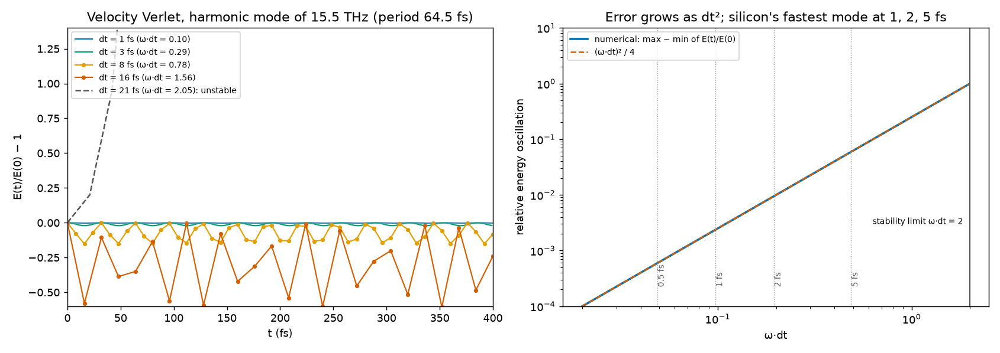
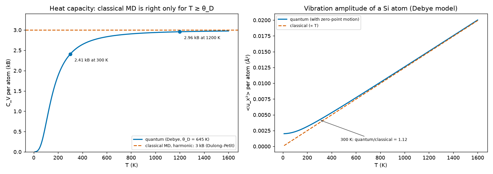
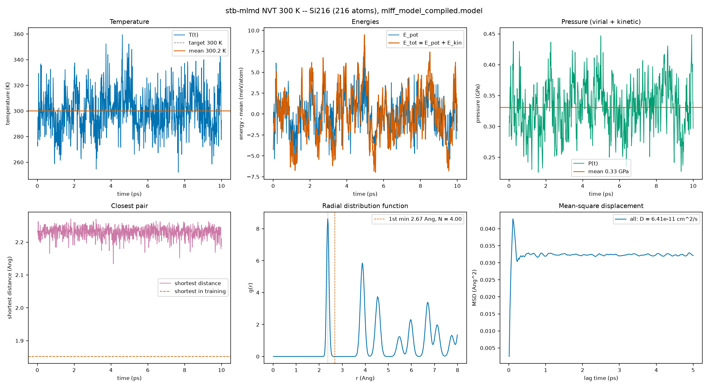
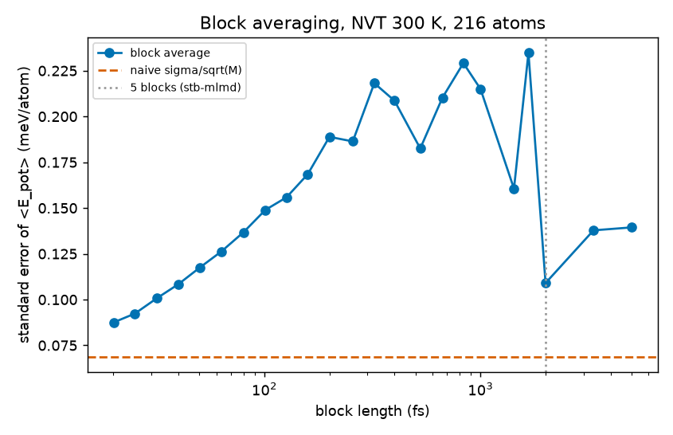
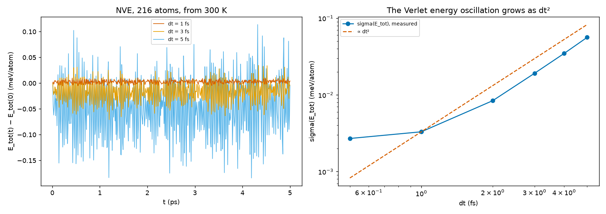
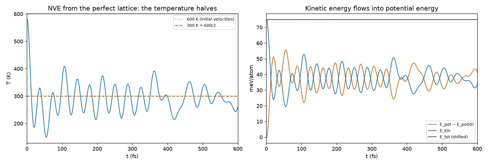
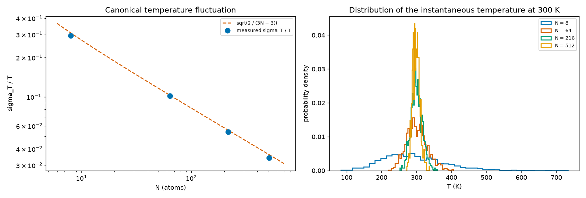
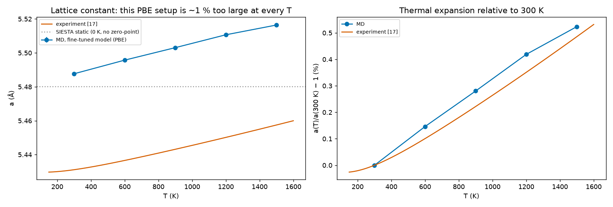
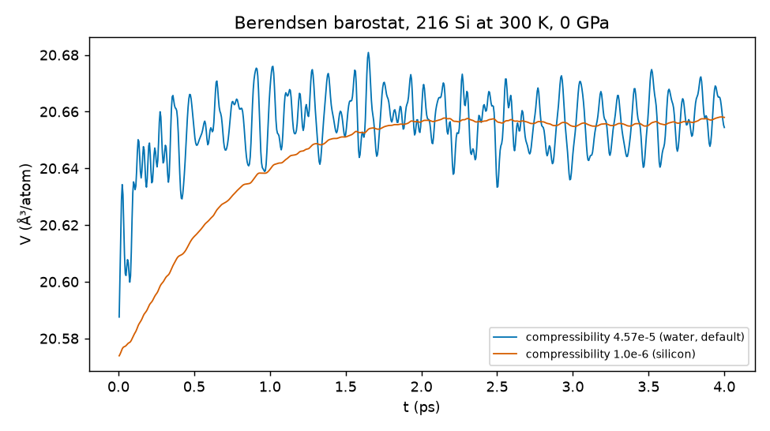
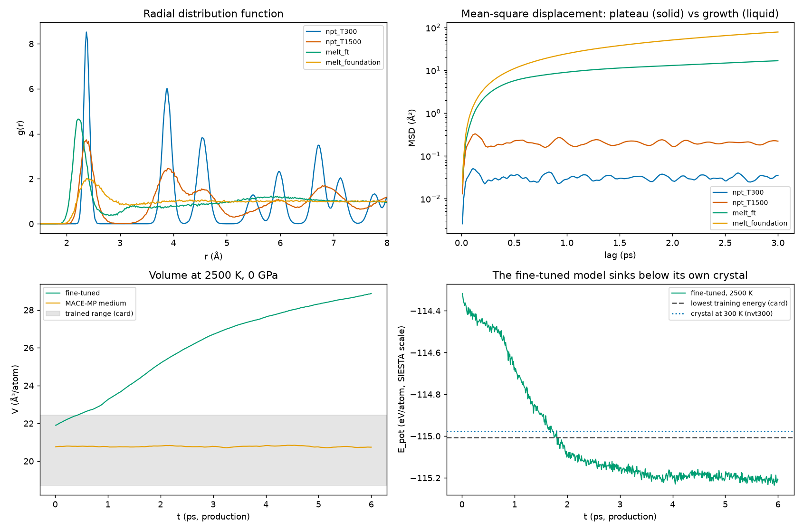

# 7.2 — ML Molecular Dynamics (`stb-mlmd`)

`stb-mlmd` runs **molecular dynamics** (MD) of a periodic structure with a MACE machine-learned potential: either
the MACE-MP-0 foundation model, or a model you fine-tuned on your own SIESTA calculations with the MLFF workflow
(`7.1`), which always comes with its **model card**. It integrates Newton's equations in one of three ensembles:
NVE (constant energy), NVT (Langevin thermostat) or NPT (Berendsen thermostat and barostat). It reports what
the trajectory says about the material, and whether to trust it:

- thermodynamic averages with statistical error bars;
- checks that the ensemble was sampled as intended;
- the structure along the run: shortest distance, `g(r)`, coordination, mean-square displacement and diffusion,
  Lindemann ratio;
- whether the run stayed inside the range of structures the model was trained on.

Plots, gnuplot files and data files are written only when you ask for them.

It answers questions that a static calculation cannot: what a crystal does **at a finite temperature** — how much
its atoms vibrate, how it expands, how its heat capacity and pressure compare with the harmonic picture, when it
stops behaving like a solid. One SIESTA force calculation of 216 silicon atoms took 1.8 hours on 6 cores in this
example; the same step with a fine-tuned MACE model takes 75 ms on a mid-range GPU (RTX 3060). That speed-up is what makes MD of hundreds of atoms
over tens of picoseconds possible at the level of theory of your own SIESTA setup. It is also the source of
the main risk: the model is only as good as the structures it was trained on, which is why this tool reads the
model card and checks the run against it.

The worked example (section 5) runs it for real, on a GPU, for bulk silicon, using the model trained in the `7.1`
example's silicon run (shipped in `model/`). The runs:

- a 10 ps reference run at 300 K;
- energy conservation against the timestep;
- the equipartition of energy;
- finite-size effects;
- thermal expansion from 300 to 1500 K, compared with experiment;
- a melt at 2500 K, far outside the training data, judged against a SIESTA calculation of one of its frames;
- the same runs with the raw foundation model, for comparison.

## 1. Theory

**Symbols at a glance**

| Symbol | Meaning |
|---|---|
| `N` | number of atoms in the cell |
| `r_i`, `v_i`, `p_i = m_i v_i`, `m_i` | position, velocity, momentum and mass of atom `i` |
| `U(r_1 … r_N)` | potential energy (the model's energy), eV |
| `F_i = −∂U/∂r_i` | force on atom `i`, eV/Å |
| `K = Σ p_i²/2m_i` | kinetic energy; `E = K + U` total energy |
| `Δt` | MD timestep, fs |
| `N_dof` | number of degrees of freedom: `3N − 3` once the net momentum is removed |
| `T = 2K / (N_dof k_B)` | instantaneous (kinetic) temperature, K |
| `k_B` | Boltzmann constant, 8.617 × 10⁻⁵ eV/K |
| `γ` | Langevin friction, fs⁻¹ |
| `τ_T`, `τ_P` | Berendsen thermostat and barostat coupling times, fs |
| `β_T` | isothermal compressibility, 1/bar (`= 1/B`, with `B` the bulk modulus) |
| `P`, `V`, `ρ` | pressure (GPa), volume (ų), number density (atoms/ų) |
| `⟨A⟩`, `σ_A` | time average of a quantity `A` over the production run, and its standard deviation |
| `C_V` | heat capacity at constant volume, in `k_B` per atom |
| `g(r)`, `N(r)` | radial distribution function and running coordination number |
| `MSD(t)`, `D` | mean-square displacement and self-diffusion coefficient |
| `δ_L` | Lindemann ratio, the RMS vibration amplitude over the nearest-neighbour distance |
| `θ_D` | Debye temperature (645 K for silicon) |

### 1.1 What molecular dynamics computes

MD follows the motion of every atom by integrating Newton's equations,

```
m_i d²r_i/dt² = F_i = −∂U/∂r_i                                                     (1)
```

for a potential energy `U` that depends only on the positions of the nuclei. This is the Born–Oppenheimer picture:
the electrons are assumed to adjust instantly to the nuclei, and `U` is their ground-state energy at each
geometry. In ab initio MD (SIESTA's `MD.TypeOfRun Verlet/Nose/…`), `U` and `F_i` come from a full DFT calculation
at every step. Here they come from a machine-learned model of that same energy surface (section 1.2).

A trajectory of `M` steps is a sequence of microscopic states. Statistical mechanics turns it into
**thermodynamics**: under the ergodic hypothesis, the time average of a quantity along a long enough trajectory
equals its average over the statistical ensemble the dynamics samples [3, 4]:

```
⟨A⟩_time = (1/M) Σ_k A(t_k)   →   ⟨A⟩_ensemble        (for a long run)             (2)
```

So MD gives what static calculations cannot:

- finite-temperature averages such as the thermal pressure, the thermal expansion and the heat capacity;
- the size of the thermal vibrations;
- anharmonic effects, to every order the potential contains, with no harmonic or quasi-harmonic approximation;
- transport, such as diffusion;
- phase changes, such as melting.

It is also **classical**: the nuclei move as point particles, not wave packets. Section 1.14 explains what that
leaves out, which matters for silicon at room temperature.

### 1.2 Where the forces come from: a MACE potential and its model card

A machine-learned interatomic potential writes the energy as a sum of atomic contributions, each a learned
function of the atom's neighbourhood within a cutoff radius `r_max`:

```
U = Σ_i ε(environment of atom i within r_max)            F_i = −∂U/∂r_i  (exact derivative)     (3)
```

The forces are the exact derivatives of one energy function, so the dynamics conserves energy exactly as in the
continuous equations: a requirement for NVE (section 1.9). MACE [15] builds `ε` from equivariant message passing:

- each layer passes information between atoms closer than `r_max` (6 Å here);
- two layers give each atom a receptive field of about 12 Å.

The model is **local**, which is why a model trained on 8- and 64-atom cells can drive a 216- or 512-atom cell:
every atom's environment in the big cell looks like environments the model has seen, as long as the material is
in the same state.

Two kinds of model can be used:

- **MACE-MP-0 foundation models** (`--model small|medium|large`) [16]. They are trained on about 1.6 million
  PBE/PBE+U structures from the Materials Project, mostly near-equilibrium crystals. They cover 89 elements and
  need no training of your own. Their accuracy for a given material and level of theory is unknown until it is
  measured: for the silicon of this example, the medium model's force error is about 450 meV/Å against our
  SIESTA labels.
- **A model fine-tuned with `7.1`** (`--custom-model` + `--custom-model-card`). It starts from a foundation
  model and is retrained on your SIESTA single points, so it reproduces *your* level of theory: functional, basis,
  pseudopotential, mesh and k-sampling. The example's model has a force error of 29 meV/Å on held-out SIESTA
  configurations, against 517 meV/Å for the raw foundation model on the same configurations.

A fine-tuned model is always handed over with its **model card**, `mlff_model_card.json`, which `stb-mlmd`
checks and prints in full in report section `[2]`. It contains:

- the model's SHA-256: the card must belong to this exact file;
- the level of theory of its labels;
- the energy scale (SIESTA's absolute energies, so never mix them with another model's);
- the **trained domain**: elements, volume per atom, shortest interatomic distance, force, energy and pressure
  ranges of the training set;
- the training recipe;
- every error measured against SIESTA: train, validation, held-out test set, phonons, MD frames;
- an MD stability test and the speed.

During the run the tool compares the trajectory with that domain (report section `[8]`). A structure outside it
is not necessarily predicted badly, but nothing was measured there. Section 5.8 shows what happens when the run
leaves it: a melt at 2500 K, far from the crystals the model was trained on.

### 1.3 Integrating the equations: velocity Verlet and the timestep

`stb-mlmd` (through ASE [25]) integrates Eq. 1 with the **velocity Verlet** algorithm [1, 2]:

```
v_i(t + Δt/2) = v_i(t) + (Δt / 2m_i) F_i(t)
r_i(t + Δt)   = r_i(t) + Δt · v_i(t + Δt/2)                                         (4)
v_i(t + Δt)   = v_i(t + Δt/2) + (Δt / 2m_i) F_i(t + Δt)
```

It needs one force evaluation per step, is accurate to second order in `Δt`, and has two properties that matter
more than its order:

- it is **time-reversible**;
- it is **symplectic**: it preserves phase-space volume.

Because of them, Verlet does not conserve the true energy `E` exactly. It conserves a nearby "shadow" energy
`Ẽ = E + O(Δt²)` [5]. The error of `E` therefore oscillates with an amplitude that grows as `Δt²`, but does not
accumulate: an integrator without these properties (Runge–Kutta, for example) lets the energy drift away
steadily.

Fig. 1 shows it for a single harmonic mode with silicon's highest phonon frequency, 15.5 THz (period 64.5 fs):

- the relative energy oscillation is `(ω Δt)²/4`;
- the integration becomes **unstable** at `ω Δt = 2`, about 20 fs here.

The practical rule is 10–20 steps or more per period of the fastest vibration:

| Material | Fastest vibration | Usual timestep |
|---|---|---|
| silicon (mass 28) | 64.5 fs | 1–2 fs is comfortable; 5 fs is near the limit of accuracy (section 5.4) |
| hydrogen-containing systems | about 10 fs (O–H, C–H stretches) | 0.5 fs |

In a real run with a machine-learned potential, a slow energy drift can also come from:

- float32 arithmetic (MD runs in float32, the card's recommendation);
- small non-smoothnesses of the model.

The NVE check of section 1.9 measures all of these together.



*Fig. 1 — Velocity Verlet on a harmonic oscillator of 15.5 THz (`theory_figures.py`). Left: the energy error is
bounded and oscillates; at `ω Δt > 2` (dt = 21 fs) the integration explodes. Right: the amplitude of the energy
oscillation follows `(ω Δt)²/4`; the dotted lines mark silicon's fastest mode at 0.5, 1, 2 and 5 fs.*

### 1.4 Temperature, degrees of freedom and equipartition

The temperature of an MD run is the **kinetic temperature**, from the equipartition theorem — every quadratic
degree of freedom carries `k_B T / 2` on average:

```
T(t) = 2 K(t) / (N_dof k_B)               N_dof = 3N − 3  when the net momentum is zero               (5)
```

It is an instantaneous quantity that fluctuates (section 1.8): only its average is the thermodynamic temperature.

Degrees of freedom are counted as follows:

- The initial velocities are drawn from a **Maxwell–Boltzmann** distribution at `--temperature`, and the net
  momentum is removed, so the centre of mass does not drift. That leaves `3N − 3` degrees of freedom; the report
  prints the number.
- ASE's temperature divides by `3N`. In NVT its Langevin thermostat compensates: the random force is scaled so
  that the reported temperature matches the target.
- In NVE the reported temperature is `(3N − 3)/3N` of the true one. That is 0.5 % for 216 atoms, but 12.5 % for 8
  atoms: one more reason not to run NVE on a tiny cell.

**Equipartition at the start of a run.** If the atoms start exactly at their lattice sites with velocities drawn
at `T₀`, all the energy is kinetic. For a harmonic solid, equipartition then shares it equally between kinetic and
potential energy (the virial theorem: `⟨K⟩ = ⟨U − U_min⟩`). Without a thermostat (NVE), the temperature therefore
drops to `T₀/2` within a few vibrational periods (section 5.5). With a thermostat, the system has to absorb that
energy from the bath, which takes a few coupling times. Either way the first part of the run is a **transient**
that is not the equilibrium state. `--equilibration-steps` runs it and throws it away before the production run,
whose statistics are reported.

### 1.5 Ensembles and thermostats

The ensembles:

| Ensemble | Held fixed | Integrator in `stb-mlmd` | Use it for |
|---|---|---|---|
| **NVE** (microcanonical) | number of atoms, volume, energy | velocity Verlet | checking energy conservation (model + timestep), dynamics with no artificial forces (vibrational spectra, diffusion) |
| **NVT** (canonical) | number of atoms, volume, temperature | Langevin [6] | averages and fluctuations at a given temperature in a given cell: heat capacity, thermal pressure, structure |
| **NPT** (isothermal–isobaric) | number of atoms, pressure, temperature | Berendsen thermostat + barostat [7] | the equilibrium volume at a temperature and pressure: thermal expansion, density, melting at constant pressure |

**Langevin thermostat (NVT).** Each atom feels a friction and a random force, besides the force from the potential:

```
m_i dv_i/dt = F_i − γ m_i v_i + R_i(t)          ⟨R_i(t) R_j(t′)⟩ = 2 γ m_i k_B T δ_ij δ(t − t′)        (6)
```

The fluctuation–dissipation relation on the right fixes the size of the random force so that the dynamics samples
the **canonical** distribution exactly, fluctuations included. That is why the report can compare the temperature
fluctuation and compute `C_V` in NVT. The friction (`--friction`, default 0.01 fs⁻¹) sets the coupling time
`1/γ = 100 fs`:

- the temperature relaxes to its target on that time scale;
- the dynamics is perturbed less the smaller `γ` is. Diffusion coefficients, for example, are slightly reduced
  when `1/γ` is comparable to the velocity correlation time.

For transport properties, equilibrate in NVT and measure in NVE.

**Berendsen thermostat and barostat (NPT).** Berendsen's "weak coupling" rescales the velocities and the cell at
every step so that `T` and `P` relax exponentially towards their targets:

```
λ_T = [1 + (Δt/τ_T)(T₀/T − 1)]^(1/2)           (velocities × λ_T)                                      (7)
μ   = [1 − β_T (Δt/τ_P)(P₀ − P)]^(1/3)          (cell vectors and positions × μ)                         (8)
```

It reaches the right **averages** quickly and robustly, which is what an equilibrium volume or density needs. It
does not sample the right **fluctuations** [7]: it suppresses them. The report says so and does not compute `C_V`
or a compressibility from an NPT run.

**The compressibility in Eq. 8.** It controls how fast the barostat moves the cell. The pressure responds to a
volume change as `dP = −B dV/V`, so the pressure relaxes with an effective time constant

```
τ_P,eff = τ_P · (β_T,material / β_T,input)                                          (9)
```

The default `--compressibility` is water's, 4.57 × 10⁻⁵ bar⁻¹, a generic placeholder:

- Silicon's is 45 times smaller, about 1.0 × 10⁻⁶ bar⁻¹ (`1/(B[GPa] × 10⁴)` with `B ≈ 98 GPa`).
- With the placeholder, the barostat acts on silicon with `τ_P,eff ≈ 11 fs` instead of 500 fs: a coupling stiffer
  than the lattice vibrations themselves.
- The report warns when the placeholder is used. Section 5.7 compares both settings.

A thermostat that samples the canonical ensemble with a global rescaling (Bussi's stochastic velocity rescaling
[8]), and barostats that sample the isothermal–isobaric ensemble (Martyna–Tobias–Klein [9], Parrinello–Rahman),
exist but are not offered by this tool.

### 1.6 Pressure in MD

The pressure is the trace of the stress tensor, which has two parts:

- a kinetic, ideal-gas part `N k_B T / V`;
- the **virial** part from the forces, `(1/3V) Σ r_i · F_i` (computed by the model as the derivative of `U` with
  respect to the cell).

```
P = N_dof k_B T / (3V) + (1/3V) ⟨Σ_i r_i · F_i⟩      (periodic form: −(1/3V) tr(∂U/∂ε))             (10)
```

`stb-mlmd` reports the full pressure, kinetic part included. In an NVT run at the static equilibrium volume
(SIESTA's relaxed lattice), the pressure is not zero: it is the **thermal pressure**, the pressure the crystal
would relieve by expanding. For a solid it is about `α_V B T`, with `α_V` the volume thermal-expansion
coefficient. Section 1.15 checks the 300 K value by hand.

### 1.7 Statistical errors: correlated samples and block averaging

Consecutive MD frames are **correlated**: a vibration lasts tens of femtoseconds, a thermostat relaxes in 100 fs.
The standard error of a mean of `M` correlated samples is therefore not `σ/√M` but

```
σ_⟨A⟩ = σ_A / √M_eff,        M_eff = M / (2 τ_int / Δt_sample)                          (11)
```

where `τ_int` is the integrated autocorrelation time. **Block averaging** [11] estimates it without computing
`τ_int`:

1. Split the series into `n_b` blocks, each much longer than `τ_int`.
2. Average each block: the block means are nearly independent.
3. Take the standard error of the mean of those block means.

```
σ_⟨A⟩ ≈ std(block means) / √n_b                                                      (12)
```

`stb-mlmd` uses `n_b = 5` blocks for every `±` of the report. With only five blocks the error estimate itself is
uncertain by about ±35 %: read it as "the second digit is not reliable", not as an exact figure. Section 5.2 shows
how the naive `σ/√M` underestimates the error in the reference run.

**Stationarity.** The same idea gives a drift test: the report compares the mean of the last third of the run
with the first third, with their combined block errors. A difference above three errors means the run was still
relaxing — a too-short equilibration, a barostat still moving the cell, or something happening, such as melting.

### 1.8 Fluctuations are physics

In the canonical ensemble the size of the fluctuations is a thermodynamic property, not noise [3, 10]:

```
σ_T / ⟨T⟩      = √(2 / N_dof)                         (kinetic temperature, NVT)                  (13)
C_V            = (⟨E²⟩ − ⟨E⟩²) / (k_B T²)             (total-energy fluctuations, NVT)           (14)
```

**Temperature fluctuation (Eq. 13).** For 216 atoms at 300 K, `σ_T = 300 × √(2/645) = 16.7 K`; for 8 atoms it is
93 K. A small cell is not "at" its temperature at any instant. The report compares the measured `σ_T` with Eq. 13:
a ratio near 1 means the thermostat samples the canonical distribution. Berendsen's ratio is well below 1 (section
1.5); in NVE the ratio is not expected to be 1 either, since the total energy is fixed.

**Heat capacity (Eq. 14).** For a classical harmonic solid it is exactly `3 k_B` per atom, the Dulong–Petit value.
Anharmonicity adds a small positive correction at high temperature. Eq. 14 converges slowly: several picoseconds
for a few percent. The report gives `C_V` only for NVT runs of 8 atoms or more, in a condensed system.

### 1.9 Energy conservation: the NVE drift

In NVE the total energy must stay constant up to the bounded Verlet oscillation (section 1.3). `stb-mlmd` fits a
straight line to `E(t)` per atom and reports its slope:

```
drift = d(E/N)/dt   in meV/atom/ps                    (warns above 1 meV/atom/ps)                      (15)
```

A drift is caused by one of three things:

- a timestep too long for the fastest vibration;
- forces that are not the exact derivative of the energy (not the case for MACE);
- numerical noise: float32, discontinuities at the cutoff.

For reference, 1 meV/atom/ps is about 8 K/ps of heating: a 10 ps run would end 80 K off if a thermostat did not
remove it. The report also gives the ratio of the total-energy fluctuation to the potential-energy fluctuation. A
small ratio (10⁻³ at 1 fs for silicon) means the integrator follows the motion closely.

The drift used to be reported relative to the absolute total energy. With SIESTA's energy scale (−24 826 eV for 216
silicon atoms) that was always 0.0000 %, so it could never warn; it is now the slope per atom above.

### 1.10 Structure: `g(r)`, coordination and the shortest distance

The **radial distribution function** is the density of atoms at a distance `r` from an average atom, relative to
the mean density `ρ`:

```
g(r) = (1 / 4πr² ρ N) ⟨ Σ_i Σ_{j≠i} δ(r − |r_ij|) ⟩          N(r) = 4πρ ∫₀ʳ g(r′) r′² dr′              (16)
```

Its peaks are the coordination shells; `N(r)` up to the first minimum is the coordination number:

| Silicon phase | `g(r)` features | Coordination |
|---|---|---|
| crystal (diamond) | first peak at the bond length (2.373 Å for this level of theory), second shell of 12 at `a/√2 ≈ 3.88 Å`, a deep minimum between them | 4 |
| liquid | first peak near 2.45–2.5 Å, shallow minimum | 5–6.5, depending on temperature and measurement [18, 19]: a metallic liquid, denser than the crystal [26] |

`stb-mlmd` averages `g(r)` over up to 100 frames, out to `r = 8 Å` or half the shortest cell width.

The **shortest interatomic distance** along the run is the most direct check of the model's domain: two atoms
closer than anything in the training set are in a region where the model has never seen a SIESTA force.

### 1.11 Dynamics: mean-square displacement and diffusion

The mean-square displacement over a time lag `t`, averaged over atoms and over every time origin, is

```
MSD(t) = ⟨ |r_i(t₀ + t) − r_i(t₀)|² ⟩_{i, t₀}                                             (17)
D      = lim_{t→∞} MSD(t) / 6t              (Einstein relation [13], 3D)                          (18)
```

**Unwrapping.** It needs positions that do not jump when an atom crosses the cell boundary. `stb-mlmd` unwraps the
saved frames by the minimum-image convention and removes the drift of the centre of mass.

The two phases look different:

- **In a solid** the MSD rises during the first vibrational period and then levels off at a plateau of twice the
  mean-square vibration amplitude. A slope fitted to that plateau is noise, not diffusion; the report says so when
  the Lindemann ratio is solid-like.
- **In a liquid** the MSD grows linearly, and `D` is its slope over 6.

A diffusion coefficient from a periodic cell of side `L` is smaller than the infinite-system value by about
`2.837 k_B T / (6π η L)` (with `η` the viscosity) [14]: a few percent for a few hundred atoms. The coefficient
needs runs much longer than the time an atom takes to move one bond length.

### 1.12 The Lindemann ratio and melting

Lindemann's criterion [12]: a crystal melts when the RMS vibration amplitude reaches about 10–15 % of the
nearest-neighbour distance. `stb-mlmd` reports

```
δ_L = √⟨|u_i − ⟨u_i⟩|²⟩ / d_nn                                                            (19)
```

It is computed from the unwrapped trajectory, as the RMS displacement about each atom's mean position, divided by
the first peak of `g(r)`. A value below about 0.1 is solid-like (atoms vibrating about fixed sites). A value well
above it, together with a growing MSD and a coordination that is no longer 4, means the material is liquid or
disordered.

**Superheating.** A perfect periodic crystal has no surface or defect from which melting can start, so MD
superheats it well above the melting point before it melts [4]. Heating a crystal until it melts in a small cell
gives an upper bound, not the melting temperature; the coexistence method is the proper tool. For orientation:

- the experimental melting point of silicon is 1687 K;
- PBE puts it near 1500 K [21].

### 1.13 Thermal expansion from NPT runs

At constant pressure the equilibrium volume rises with temperature because the potential is anharmonic. The linear
thermal-expansion coefficient is

```
α(T) = (1/a) da/dT          α_V = 3α (cubic)                                               (20)
```

and the fractional change of the lattice constant between two temperatures is `∫ α dT`. The NPT runs of section 5.7
give the average lattice constant at each temperature. Their differences give `α`, which is compared with
experiment:

- Okada and Tokumaru measured silicon's lattice constant from 300 to 1500 K to a few ppm [17]:
  `α(T) = {3.725[1 − exp(−5.88 × 10⁻³ (T − 124))] + 5.548 × 10⁻⁴ T} × 10⁻⁶ K⁻¹`.
- Only *differences* are compared: PBE's lattice constant is 0.9 % larger than experiment at every temperature
  (5.4802 Å for this level of theory, against 5.4307 Å for the real crystal at 273 K [17]).

### 1.14 What classical nuclei leave out

MD treats the nuclei classically. A vibrational mode of frequency `ν` is classical only when `hν ≪ k_B T`. For
silicon the phonons extend to 15.5 THz (`hν/k_B = 745 K`) and the Debye temperature is `θ_D = 645 K` [23]. At room
temperature the quantum character of the vibrations is still large (Fig. 2):

- **Heat capacity.**
  - Classical MD gives `3 k_B` per atom at every temperature.
  - The quantum Debye value at 300 K is `2.41 k_B`; the experimental `C_p` is 20.0 J mol⁻¹ K⁻¹ = 2.41 `k_B` [22].
  - MD's `C_V` is right only above `θ_D`.
- **Vibration amplitude.**
  - Quantum mechanics adds zero-point motion. At 300 K the quantum mean-square amplitude is 12 % larger than the
    classical one; at 100 K it is 87 % larger.
  - The classical Lindemann ratio, and every quantity that depends on the vibration amplitude, is too small at
    low temperature.
- **Thermal expansion.**
  - Below about 120 K real silicon *contracts* on heating: negative `α`, from the transverse acoustic modes and
    their Grüneisen parameters [27]. Classical MD cannot reproduce it.
  - Near and above room temperature the classical expansion is close to the real one (section 5.7), because the
    modes that dominate `α` there are nearly classical.

Path-integral MD, or a quantum thermostat [24], adds the quantum nuclear effects; that is outside this tool. Above
`θ_D` (silicon above about 600 K), classical MD is a good approximation for every quantity in this report.



*Fig. 2 — What classical MD leaves out, in the Debye model of silicon (`θ_D = 645 K`, `theory_figures.py`). Left: heat
capacity, quantum (Debye) against the classical `3 k_B`. Right: mean-square vibration amplitude along one axis,
quantum (with zero-point motion) against classical.*

### 1.15 A calculation you can check by hand

The reference run of section 5.2 (216 Si atoms, NVT at 300 K, the fine-tuned model) reports
`⟨T⟩ = 300.18 K`, `σ_T = 16.20 K`, `⟨E_kin⟩ = 0.038802 eV/atom`, `σ(E_tot) = 2.940 meV/atom`, `⟨P⟩ = +0.331 GPa`.
Each can be predicted on paper:

- **Kinetic energy:**
  - `⟨E_kin⟩ / N = (3/2) k_B ⟨T⟩ = 1.5 × 8.6173 × 10⁻⁵ × 300.18 = 0.038802 eV`. It matches to the last digit,
    because ASE's temperature is defined with `3N` (section 1.4).
- **Temperature fluctuation (Eq. 13):**
  - `σ_T = 300 × √(2/645) = 16.7 K`.
  - Measured: 16.2 K (ratio 0.97, within the few-percent uncertainty of a 10 ps run's fluctuation).
- **Heat capacity (Eq. 14):**
  - A harmonic solid has `σ(E)/N = k_B T √(C_V/(N k_B))`, so `C_V = 3 k_B` gives
    `σ(E)/N = 0.025852 × √(3/216) = 3.05 meV/atom`.
  - Measured: 2.94 meV, which is `C_V = 3 × (2.94/3.05)² = 2.79 k_B`.
- **Thermal pressure:**
  - The NPT run at 300 K (section 5.7) expands the lattice by +0.137 % relative to SIESTA's static
    `a = 5.48024 Å`, so `ΔV/V = 0.41 %`.
  - With `B ≈ 80–90 GPa`, holding the cell at the static volume costs `P ≈ B ΔV/V = 0.33–0.37 GPa`.
  - Measured: +0.331 GPa.
- **Lindemann ratio:**
  - The classical Debye model gives `⟨u_x²⟩ = 3ħ²T/(m k_B θ_D²) = 0.0037 Ų` at 300 K, a 3D RMS amplitude of
    0.106 Å, so `δ_L = 0.106/2.37 = 0.045`.
  - Measured: 0.054. The Debye model with the calorimetric `θ_D` is a crude picture of silicon's phonons, and the
    model's own phonons are on average 0.3 THz softer than SIESTA's (card: phonon mean shift); both make the
    measured value larger.

### 1.16 What this tool simplifies — explicitly

- **Classical nuclei** (section 1.14): no zero-point motion, classical `C_V`.
- **One thermostat per ensemble**:
  - Langevin in NVT: canonical, but it perturbs the dynamics;
  - Berendsen in NPT: right averages, wrong fluctuations;
  - no Nosé–Hoover, Bussi or MTK (section 1.5).
- **Isotropic NPT**. ASE's `NPTBerendsen` scales the whole cell by one factor from the mean pressure: the cell's
  shape (angles and axis ratios) never changes. Anisotropic expansion and phase transitions that need a change of
  shape cannot happen.
- **No electronic temperature effects beyond those in the labels.** The model reproduces the SIESTA energy at the
  electronic temperature of the training data, 300 K here.
- **Statistics from five blocks** (section 1.7): honest error bars, but rough.
- **Domain checks against the card's ranges, not a committee.** The tool runs one model, so it cannot estimate the
  error frame by frame. `7.1.4` (`stb-mlffActiveLearning --sampling-method md`) runs the whole committee along an
  MD and picks the frames worth labelling with SIESTA.

## 2. Libraries and external dependencies used

| Library | Used for |
|---|---|
| ASE [25] | `Atoms`, the MD drivers (`VelocityVerlet`, `Langevin`, `NPTBerendsen`), Maxwell–Boltzmann velocities, neighbour lists for `g(r)`, trajectory writers (xsf, pdb, extended xyz) |
| mace-torch [15, 16] | the MACE calculator, foundation models (downloaded once and cached) and custom `.model` files |
| PyTorch | runs the model on `cpu` or `cuda` (`--device`) |
| NumPy | statistics, block averages, linear fits, MSD |
| matplotlib | the optional dashboard (`--png`, `--show`) |
| gnuplot (optional) | renders the optional `.gplot` file written by `--save-gnuplot` |
| `stb.core` | `.fdf` reading (`structure_io`), the model card (`model_card`), the calculator and device checks (`mace_relax`), the PBC unwrap (`md_traj`), library-noise capture (`cli`) |

Install the `ml` extra: `pip install stb_suite[ml]`. The first use of a foundation model downloads it (tens of MB) into
`~/.cache/mace/`.

## 3. What `stb-mlmd` does

### 3.1 The run

1. **Read** the structure (`--file`, `.fdf`), determine its dimensionality (vacuum-padded axes, from
   `--vacuum-gap`) and whether it is a condensed system or a molecule/slab in a box (any empty gap of 5 Å or more,
   the model card's criterion). With `--supercell NA NB NC` the cell is then repeated NA × NB × NC times
   (`ase.Atoms.repeat`: the same cell and atom order as `stb-supercell -d NA NB NC`); everything after this step —
   degrees of freedom, statistics, `g(r)`, the domain table, the trajectory and `md_final.fdf` — refers to the
   supercell.
2. **Load the model**: a foundation model (`--model`) or a custom model with its card (`--custom-model` +
   `--custom-model-card`). The card is checked: it must exist, be readable, and its SHA-256 must match the model
   file. Then the elements: the structure may contain only elements the model was trained on, otherwise it stops
   with a clean error. The model runs in float32 for MD (the card's recommendation); a foundation model gets no
   card checks.
3. **Draw the initial velocities**: Maxwell–Boltzmann at `--temperature`, net momentum removed, reproducible with
   `--seed`.
4. **Equilibrate** for `--equilibration-steps` (discarded), then run the **production** steps (`--n-steps`). Every
   `--stride` steps the tool samples:
   - temperature, potential/kinetic/total energy, pressure (with the ideal-gas term), volume, cell lengths;
   - shortest distance, largest force;
   - a trajectory frame.
5. **Analyse** the samples and write the report, the trajectory, the final structure (`md_final.fdf`, wrapped into
   the cell) and, on request, the dashboard, data and gnuplot files.

Output from the libraries (mace's dtype notices, torch's deprecation warnings, ASE's messages) is captured during
loading and integration: it is counted in the last section and never mixed into the report.

### 3.2 The report, section by section

| Section | Content |
|---|---|
| `[0] RUN METADATA` | date, software versions (stb, mace-torch, torch, ase), device (GPU name), input, supercell, ensemble, temperature, timestep and steps, model |
| `[1] STRUCTURE` | atoms (and, with `--supercell`, input → supercell atom count), formula, dimensionality, cell, volume per atom and density, shortest and median nearest-neighbour distance, degrees of freedom; a note when the cell is a molecule/slab in a box |
| `[2] MODEL` | the **model card**, printed in full (next table), the elements check, load time and dtype; or the foundation model's identity |
| `[3] MD SETUP` | integrator and its parameters (friction / coupling times / compressibility and the bulk modulus it implies), initial velocities and seed, length in steps and picoseconds, sampling |
| `[4] EQUILIBRATION` | energy and temperature at the end of the discarded part |
| `[5] PRODUCTION RUN` | a progress table every 10 % of the run (T, `E_pot`/atom, P, V/atom, max force), initial and final state, number of frames, **speed** (ms/step, µs/atom/step, ns/day) |
| `[6] THERMODYNAMICS` | table of means with block-average errors, standard deviations and ranges (T, `E_pot`, `E_kin`, `E_tot`, P, and in NPT V and density); NPT: mean volume and lattice parameters vs the input; NVT: heat capacity from Eq. 14 |
| `[7] ENSEMBLE CHECKS` | NVE: drift (Eq. 15), total- vs potential-energy fluctuation, start→end; NVT/NPT: `⟨T⟩` vs target, `σ_T` vs Eq. 13, `⟨P⟩` vs target; stationarity (last vs first third) of T, `E_pot` and, in NPT, the volume |
| `[8] STRUCTURE ALONG THE RUN & MODEL DOMAIN` | shortest distance (minimum, when, mean), `g(r)` first peak/minimum and coordination, MSD and `D`, RMS displacements, Lindemann ratio with its reading; with a card, the **domain table**: each trained range against this run (`inside`, `inside (within the tolerance)`, `OUTSIDE`, or `larger` for a bigger cell, which is fine for a local model). A potential energy *below* the lowest training energy (by more than 20 meV/atom) is flagged too: the model calls those structures more stable than anything in its SIESTA data, the signature of a hole in the learned surface (section 5.8) |
| `[9] SUMMARY & FILES` | status, the headline numbers, time, every file written, and what else could have been written |
| `[10] WARNINGS` | every warning of the run in one place (setup, domain, model card, stationarity, drift), numbered; then the count of distinct library messages captured |

The model card in `[2]` is printed in five blocks:

| Block | Content |
|---|---|
| Identity | card file and format, model name and file, SHA-256 verified against the card, committee membership and spread, architecture (MACE, `r_max`, layers, parameters, foundation it was fine-tuned from) |
| Level of theory | code and version, every SIESTA setting of the labels, whether DFT-D3 is in them, pseudopotentials (md5), energy scale and E0s |
| Training data and trained domain | number and kinds of configurations, labels, and the trained-range table |
| Recipe and accuracy | epochs, learning rate, loss weights; errors vs SIESTA for train, validation, out-of-sample committee, held-out test set, and the raw foundation model; fine-tuning gain; per-kind test errors; phonons; MD-check frames; committee calibration; the `7.1.3` verdict |
| Stability, speed and usage | the `7.1.2` MD stability test, speed, recommended dtypes, usage notes, software it was trained with |

The card's own alarms go to `[10] WARNINGS`:

- no validation;
- a verdict other than STOP;
- a failed stability test;
- training warnings about this model.

So do the domain warnings raised while the model runs (`model_card.collect_warnings`).

### 3.3 Plots and data, on request

Nothing but the report, the trajectory and `md_final.fdf` is written by default. On request:

| Flag | Writes |
|---|---|
| `--png [FILE]` | `<stem>_md_dashboard.png`: six panels: T(t), energies per atom, P(t), volume (NPT) or shortest distance (NVT/NVE), `g(r)` with `N(r)`, MSD |
| `--show` | the same dashboard on screen (needs a display; without one it is a warning, not an error) |
| `--save-data` | `<stem>_md_thermo.dat` (12 columns per sampled frame: t, T, `E_pot`, `E_kin`, `E_tot` per atom, P, V/atom, a, b, c, `d_min`, `F_max`), `<stem>_md_rdf.dat` (r, g, N), `<stem>_md_msd.dat` (lag, MSD) |
| `--save-gnuplot` | the data files plus `<stem>_md.gplot`: `gnuplot <stem>_md.gplot` draws the same six panels into `<stem>_md.pdf` |
| `--save-report` | the report as `stb_mlmd_report.txt` |

`<stem>` is the input file name without `.fdf`.

### 3.4 Guard rails

| Situation | Behaviour |
|---|---|
| `--custom-model` without `--custom-model-card`, a missing/unreadable card, or a card whose SHA-256 does not match the file | clean error before anything runs |
| an element of the structure is not in the card | clean error naming the missing elements |
| `--supercell` with a value below 1 | clean error before anything runs |
| `--supercell` repeating a vacuum-padded axis | warning: the vacuum grows with it and adds only empty space |
| `--ensemble npt` on a structure with a vacuum-padded axis | refused: a barostat on a slab squeezes the vacuum |
| a molecule or slab in a box (gap ≥ 5 Å, below `--vacuum-gap`) | runs, but the bulk-only analyses (density, pressure, `g(r)`, `C_V`, Lindemann) are skipped with a note; NPT warns |
| `--compressibility` left at the placeholder in NPT | warning (section 1.5) |
| `--timestep` > 2 fs | warning: check the NVE drift |
| no `--equilibration-steps` in NVT/NPT | warning: the start-up transient is inside the averages |
| `--device cuda` with no usable GPU | clean error (`core.mace_relax.resolve_device`) |
| `--show` without a display | warning; the run is not affected |

## 4. Running it both ways

**Command line:**

```bash
stb-mlmd --file si8.fdf --supercell 3 3 3 \
         --custom-model model/mlff_model_compiled.model --custom-model-card model/mlff_model_card.json \
         --ensemble nvt --temperature 300 --equilibration-steps 1000 --n-steps 10000 \
         --device cuda --seed 1 --png --save-gnuplot --save-report
```

**Interactive menu:** run `stb-suite` and type `7.2`. It asks, in this order:

1. the structure;
2. a custom model path, or Enter for a foundation model and then its size. With a custom model it asks for the
   card and offers `mlff_model_card.json` next to the model as the default;
3. the supercell `NA NB NC` (Enter keeps the input cell, `1 1 1`);
4. the ensemble;
5. the temperature, and the pressure for NPT;
6. the equilibration steps, production steps and timestep;
7. optionally the advanced settings (coupling times, compressibility, device);
8. the trajectory name;
9. one question per optional output (PNG, show, gnuplot, data only, report).

The menu builds the same command line and calls `stb-mlmd`; the guided script (Case 9) drives it with piped answers.

## 5. Worked example: bulk silicon on a GPU

### 5.1 Set-up

The structure:

- `si8.fdf`, the 8-atom conventional diamond cell at SIESTA's relaxed lattice constant (5.48024 Å);
- `stb-supercell -d N N N` makes the 64-, 216- and 512-atom cells (`make_reference.sh`). `stb-mlmd --file si8.fdf
  --supercell N N N` builds the same cells on the fly (Case 3 of the guided script); the only difference is the
  output stem, `si8_md_*` instead of `si216_md_*`.

The model, in `model/`:

- `best_model/` of the `7.1` silicon run: round 2, seed 125;
- fine-tuned from MACE-MP-0 medium on 57 SIESTA single points (8 and 64 atoms: rattled, strained, and 1400 K MD
  frames);
- level of theory: PBE, DZP, PAO.EnergyShift 0.01 Ry, Mesh.Cutoff 300 Ry, k × a ≈ 32 Å;
- its card reports, against SIESTA:

| Error measure | Value |
|---|---|
| test-set force RMSE | 28.7 meV/Å (1.5 % of the RMS force) |
| test-set energy error | 1.1 meV/atom |
| stress error | 0.18 GPa |
| phonons | 1.10 THz RMSE |
| 64-atom MD frames at 800 K | 30–39 meV/Å |

The runs:

- every run uses `--device cuda` on one NVIDIA RTX 3060, float32, `--seed` fixed;
- NVT and NVE use the defaults (1 fs, friction 0.01 fs⁻¹);
- NPT uses `--compressibility 1.0e-6` unless stated;
- `make_reference.sh` lists every command. Section 6 explains how to regenerate them.

**Speed** (runs alone on the GPU):

| Atoms | ms/step | µs/atom/step | ns/day at 1 fs |
|---|---|---|---|
| 8 | 20.4 | 2556 | 4.2 |
| 64 | 27.2 | 425 | 3.2 |
| 216 | 74 | 343 | 1.17 |
| 512 | 164 | 321 | 0.53 |

- Small cells are dominated by fixed overheads; the cost per atom settles near 320 µs from a few hundred atoms on.
- NPT costs about twice as much per step: the stress is computed at every step.
- The 216-atom NVT reports in `reference_results/` show about 150 ms/step: those runs shared the GPU with a second
  run, which halves the speed of each (and gains nothing overall).

### 5.2 The reference run: 216 atoms, NVT at 300 K, 10 ps

```bash
stb-mlmd --file si216.fdf --custom-model model/mlff_model_compiled.model --custom-model-card model/mlff_model_card.json \
         --ensemble nvt --temperature 300 --equilibration-steps 1000 --n-steps 10000 --device cuda --seed 1 \
         --png --save-gnuplot --save-report
```

Report sections `[6]`–`[8]`, abridged (`reference_results/nvt300/stb_mlmd_report.txt`):

```
Temperature (K) | 300.18 +/- 1.31          | 16.20        | 252.1 .. 359.4
E_pot (eV/atom) | -114.976395 +/- 0.000109 | 2.175 meV    | -114.98225 .. -114.96742
E_kin (eV/atom) | 0.038802 +/- 0.000169    | 2.094 meV    | 0.03259 .. 0.04646
E_tot (eV/atom) | -114.937594 +/- 0.000275 | 2.940 meV    | -114.94457 .. -114.92810
Pressure (GPa)  | 0.331 +/- 0.005          | 0.039        | 0.23 .. 0.45
Heat capacity     : 2.79 kB/atom from the total-energy fluctuations (classical harmonic solid: 3, ...)
T fluctuation     : 16.20 K vs canonical T sqrt(2/N_dof) = 16.71 K (ratio 0.97)
Shortest distance : min 2.1339 Ang at t = 4.130 ps, mean 2.2303 Ang (start 2.3730)
g(r)              : first peak 2.370 Ang (g = 8.61), first minimum 2.670 Ang, coordination 4.00
Lindemann ratio   : 0.054 (RMS about the mean / nearest-neighbour distance 2.370 Ang) -- solid-like
volume per atom (Ang^3) | 18.722 .. 22.425       | 20.574 .. 20.574       | inside
shortest distance (Ang) | >= 1.852               | min 2.134              | inside
max force (eV/Ang)      | <= 14.70               | max 4.10               | inside
[10] WARNINGS: None.
```



*Fig. 3 — The dashboard of the reference run (`--png`). The `g(r)` is the diamond lattice broadened by thermal
motion. The MSD jumps within the first vibrational period and then stays on a plateau of 0.032 Ų, twice the
mean-square vibration amplitude: atoms vibrate, nothing diffuses.*

How to read it, number by number (section 1.15 does the arithmetic):

- **Temperature.** `⟨T⟩ = 300.2 ± 1.3 K`, and the fluctuation 16.2 K is 0.97 of the canonical value: Langevin
  samples the canonical ensemble.
- **Heat capacity.** `C_V = 2.79 k_B` per atom.
  - The classical harmonic value is 3. From a 10 ps run, the variance in Eq. 14 is uncertain by about 20 % (with a
    correlation time near `1/γ = 100 fs`, 10 ps hold about 50 independent samples), so 2.79 is consistent with 3.
  - Real silicon at 300 K has 2.41 (section 1.14): this is the classical answer, not the real one.
- **Pressure.** +0.33 GPa at the static lattice: the thermal pressure (sections 1.6 and 5.7).
- **Structure.** Four neighbours at 2.37 Å; the Lindemann ratio of 0.054 is far from melting. The shortest distance
  reached, 2.13 Å, is well above the shortest in the training set (1.85 Å). Every quantity of the domain table is
  inside; the cell (216 atoms) is `larger`, which is fine for a local model.

**Error bars.** The `±` comes from five blocks of 2 ps (Eq. 12). Fig. 4 repeats the block analysis of `E_pot`
for every block length:

- the naive `σ/√M` = 0.069 meV/atom is three times too small;
- the error estimate rises with the block length and levels off near 0.2 meV/atom from blocks of about 300 fs on;
- the five-block value printed in the report, 0.11, falls below that plateau. It is a scatter of the expected size
  for an estimate from five blocks (section 1.7), but a reminder to read the `±` of a short run as indicative only.
  Doubling it is a safe habit.



*Fig. 4 — Standard error of `⟨E_pot⟩` against block length (`results_figures.py`). Short blocks are correlated and
underestimate the error; the plateau (~0.2 meV/atom) is the honest value; the five-block estimate of the report
(dotted line) is noisy.*

### 5.3 Is the model right here? SIESTA on MD frames

Inside the MD, nothing compares the model with SIESTA. To check, the final frame of a run was taken
(`md_final.fdf`, 216 atoms) and a SIESTA single point was run on it at the level of theory of the training data
(`siesta_calc.fdf` + `siesta_config_extra.fdf`: the reference's k-grid divided by the 3×3×3 supercell, 2×2×2).
Then both models were evaluated on the same structure (`siesta_check.py`, float64;
`reference_results/siesta_check/`).

The energy error `ΔE` is model minus SIESTA per atom, after removing each model's constant offset measured on the
300 K frame (only energy differences are meaningful). Each SIESTA single point took 1.8 hours on 6 cores; the melt
frame needed 59 SCF iterations (about 8 hours) instead of 14.

| Frame | SIESTA RMS force | Fine-tuned: F RMSE (max) | Fine-tuned: ΔE | MACE-MP medium: F RMSE (max) | MACE-MP medium: ΔE |
|---|---|---|---|---|---|
| crystal, 300 K (`nvt300`) | 576 | **25.1** (90) | 0 (reference) | 242.0 (660) | 0 (reference) |
| crystal, 1500 K (`npt_T1500`) | 1224 | **70.9** (259) | −1.5 | 405.5 (1256) | −52.8 |
| melt, fine-tuned model (`melt_ft`) | 3377 | **3663** (8628) | **−1639** | 518.6 (2496) | −301 |

*Forces in meV/Å, energies in meV/atom.*

**300 K: the model is SIESTA, to within 4 %.**

- Force RMSE 25 meV/Å, 4.4 % of the RMS force, close to the card's 29 meV/Å on its held-out test set.
- The model's absolute energy agrees with SIESTA's to 2 meV/atom: the E0s were fitted to SIESTA's scale.
- The foundation model is 10 times worse on the same frame.

**1500 K: still good, a little worse.**

- 71 meV/Å (5.8 % of the larger forces), against 30–39 meV/Å on the card's 800 K frames. The superheated crystal
  vibrates beyond anything in the training set (its 1400 K frames were 64-atom cells).
- The energy difference between the 300 and 1500 K frames is right to 1.5 meV/atom; the foundation model misses it
  by 53 meV/atom.
- Errors grow smoothly as the run moves away from the training data, and the domain table still said `inside`.

**The melt: the model is meaningless there.**

- The force error is 3.7 eV/Å, larger than the forces themselves. Its worst atom is off by 8.6 eV/Å.
- The energy is 1.64 eV/atom too low. By SIESTA, this frame lies 1.41 eV/atom *above* the 300 K crystal
  (−113.57 against −114.98 eV/atom); the model put it 0.23 eV/atom *below*.
- That is the hole of section 5.8, measured.
- The raw foundation model, never trained on this SIESTA setup, does far better on the same frame (519 meV/Å): broad
  training data is what protects a model outside a narrow domain.

**The lesson of the table.** A fine-tuned model is excellent where it was trained, degrades gradually at the
edges, and fails without limit beyond them. The domain table and the warnings of section 5.8 were the only
indication in the MD output. The single point here is the proof, and it is the check to run before believing any
MD that leaves the trained range.


### 5.4 Energy conservation and the timestep

The structure at the end of the reference run, with fresh Maxwell–Boltzmann velocities at 300 K, was run in NVE for
5 ps at each timestep (`reference_results/nve_dt*`):

| dt (fs) | drift (meV/atom/ps) | σ(E_tot) (meV/atom) | σ(E_tot)/σ(E_pot) | ⟨T⟩ (K) |
|---|---|---|---|---|
| 0.5 | +0.0001 | 0.0027 | 0.002 | 297.2 |
| 1 | +0.0002 | 0.0033 | 0.002 | 297.1 |
| 2 | +0.0003 | 0.0084 | 0.006 | 296.6 |
| 3 | +0.0007 | 0.0191 | 0.012 | 295.8 |
| 4 | +0.0011 | 0.0347 | 0.021 | 294.6 |
| 5 | +0.0011 | 0.0562 | 0.034 | 293.1 |



*Fig. 5 — Left: total energy along the NVE runs at 1, 3 and 5 fs. Right: its fluctuation against the timestep, with
a `dt²` line through the 1 fs point.*

- **No drift at any timestep.** All drifts are a thousand times below the 1 meV/atom/ps warning. The model is a
  smooth, conservative force field, and silicon (mass 28, fastest mode 64.5 fs) is gentle on the integrator: even 5
  fs is 13 steps per period.
- **The oscillation grows as about `dt²`** (Fig. 5), as the shadow-energy picture predicts (section 1.3):
  - from 1 to 5 fs it grows 17 times, against 25 for a pure `dt²`;
  - **below 1 fs it stops shrinking**: 0.0027 at 0.5 fs. That is the float32 floor: the rounding of a sum of 216
    atomic energies of −115 eV each.
- **The temperature drifts with `dt`.** It is 4 K lower at 5 fs than at 1 fs from the same initial conditions. The
  velocities of a Verlet trajectory carry an `O(dt²)` error, so the kinetic energy it reports does too.

Practical reading:

- 1–2 fs is safe for silicon;
- 3 fs costs 1 % in temperature and is still clean;
- for light atoms, the same analysis would put the limit at 0.5–1 fs.

One short NVE run like this checks a new model or material before any long production.

### 5.5 Equipartition: the start-up transient

The perfect 216-atom crystal, velocities drawn at 600 K (the actual draw was 590 K), NVE for 2 ps
(`reference_results/nve_equipartition`):

| t (fs) | 0 | 10 | 20 | 40 | 60 | 100 | 200 | 500 | 1000 |
|---|---|---|---|---|---|---|---|---|---|
| T (K) | 590 | 385 | 185 | 314 | 175 | 354 | 228 | 331 | 326 |



*Fig. 6 — NVE from the perfect lattice. Left: the temperature falls from 590 K to about half within 20 fs and then
oscillates about 300 K. Right: kinetic energy flows into potential energy and back, while the total stays constant.*

- **The halving.** All the energy starts as kinetic. Within a quarter of a vibrational period (20 fs) half of it
  has become potential energy. The mean over the second half of the run is 291.7 K, close to 590/2 = 295 K. The
  small difference is anharmonicity: the potential energy rises faster than a harmonic one.
- **The oscillation** has a period of about 36 fs. Kinetic energy oscillates at twice the frequency of the mode, so
  this is a mode of about 14 THz: silicon's optical phonons, which dominate the vibrational density of states.
  Every atom starts at its lattice site, so the modes start in phase; anharmonic coupling dephases them over a few
  hundred femtoseconds.
- **The lesson.** The first few hundred femtoseconds of any run that starts from a perfect lattice are not
  equilibrium. With a thermostat the energy deficit is refilled over a few coupling times. That is what
  `--equilibration-steps` discards, and why the report warns when there is none.

### 5.6 Finite size

NVT at 300 K, the same model, cells of 8 to 512 atoms (`reference_results/size_N*`, `nvt300`):

| N | ⟨T⟩ (K) | σ_T (K) | `√(2/N_dof)·T` (K) | ratio | C_V (k_B) | ⟨P⟩ (GPa) | σ_P (GPa) | Lindemann |
|---|---|---|---|---|---|---|---|---|
| 8 | 290.2 ± 5.4 | 88.2 | 92.6 | 0.95 | 3.56 | +0.197 ± 0.016 | 0.239 | 0.047 |
| 64 | 300.3 ± 2.8 | 30.4 | 30.9 | 0.99 | 2.70 | +0.330 ± 0.004 | 0.070 | 0.052 |
| 216 | 300.2 ± 1.3 | 16.2 | 16.7 | 0.97 | 2.79 | +0.331 ± 0.005 | 0.039 | 0.054 |
| 512 | 298.4 ± 1.5 | 10.2 | 10.8 | 0.95 | 2.66 | +0.328 ± 0.003 | 0.023 | 0.054 |



*Fig. 7 — Left: relative temperature fluctuation against the number of atoms, with Eq. 13. Right: distribution of
the instantaneous temperature for each size.*

- **Fluctuations shrink as `1/√N`, exactly as Eq. 13 says.**
  - At 8 atoms the instantaneous temperature spans 80–730 K; at 512 atoms ±10 K.
  - The pressure fluctuates in the same way: 0.24 GPa for 8 atoms, 0.023 for 512.
  - A small cell is not wrong, but every average needs `N` times more steps for the same error bar.
- **Averages converge by 64 atoms.**
  - The 8-atom cell has a lower thermal pressure (0.20 against 0.33 GPa) and smaller vibrations (Lindemann 0.047
    against 0.054). Its periodicity only admits phonons whose wavelength fits the 5.5 Å cell (Γ and X); the
    long-wavelength acoustic modes, which carry the largest amplitudes, are missing.
  - From 64 atoms on, pressure and Lindemann ratio agree within their errors.
- **Heat capacity.**
  - It scatters between 2.66 and 3.56. That is the slow convergence of Eq. 14, not physics: 5–20 ps are not
    enough for a variance to better than about 20 %.
  - For `C_V`, run long, or take `dE/dT` from runs at several temperatures.
- **Short-run warnings.** The 64- and 512-atom runs end with stationarity warnings (the last third 12.5 K and
  2.7 K warmer than the first). With 5 ps and five blocks the error bars are optimistic (section 5.2), and the warning errs on
  the side of caution.

### 5.7 Thermal expansion (NPT) and the barostat

NPT at 0 GPa, 216 atoms, `--compressibility 1.0e-6` (silicon's), 2 ps of equilibration and 6 ps of production at
each temperature (`reference_results/npt_T*`). The lattice constant is the mean cell length over 3:

| T (K) | a, MD (Å) | a, experiment [17] (Å) | Δa/a from 300 K, MD | Δa/a from 300 K, experiment | Lindemann | volume stationary? |
|---|---|---|---|---|---|---|
| 300 | 5.48769 ± 0.00005 | 5.43110 | — | — | 0.052 | yes |
| 600 | 5.49572 ± 0.00021 | 5.43656 | +0.146 % | +0.101 % | 0.075 | yes |
| 900 | 5.50308 ± 0.00025 | 5.44315 | +0.280 % | +0.222 % | 0.096 | yes |
| 1200 | 5.51067 ± 0.00036 | 5.45016 | +0.419 % | +0.351 % | 0.113 | drifting |
| 1500 | 5.51642 ± 0.00032 | 5.45747 | +0.524 % | +0.486 % | 0.134 | drifting |

| Interval (K) | α, MD (10⁻⁶ K⁻¹) | α, experiment at the midpoint (10⁻⁶ K⁻¹) |
|---|---|---|
| 300–600 | 4.87 | 3.43 |
| 600–900 | 4.46 | 4.05 |
| 900–1200 | 4.59 | 4.29 |
| 1200–1500 | 3.48 | 4.47 |



*Fig. 8 — Left: lattice constant from NPT MD and from experiment [17]; the dotted line is SIESTA's static (0 K)
value. Right: expansion relative to 300 K.*

**The absolute lattice constant** is about 1 % above experiment at every temperature: 5.4877 against 5.4311 Å at
300 K. That is the level of theory, which the model reproduces: PBE with this DZP basis relaxes silicon to
5.4802 Å (section 1.13). No MD can fix it; a better functional or basis would.

**The expansion** is what MD adds, and it is close to experiment:

- 300 → 1200 K: +0.42 % against +0.35 %.
- From 300 to 600 K, MD's α is 40 % too large. This is the expected signature of classical nuclei (section 1.14):
  at those temperatures the real crystal's modes are not fully excited (`C_V` = 2.4–2.8 instead of 3 `k_B`), so
  they expand it less.
- From 600 to 1200 K, where the modes are nearly classical, the two agree within 10 %.
- The 1200 and 1500 K volumes were still drifting at the end of the run (stationarity warning), so the last interval
  is not reliable. Near 1500 K the crystal is also superheated: Lindemann 0.134, above PBE's melting point (about
  1500 K [21]).

**Thermal pressure, revisited.** The 300 K lattice is 0.137 % larger than the static one (`ΔV/V = 0.41 %`). The NVT
run of section 5.2, held at the static lattice, felt +0.331 GPa. The ratio, `0.331/0.0041 ≈ 80 GPa`, is the
crystal's isothermal bulk modulus at 300 K in this model: a little below the static value of this level of theory
(about 90 GPa, `5.15` example). It closes the loop between the NVT and NPT runs.

**The barostat's compressibility.** Two NPT runs at 300 K start from the static cell, 4 ps each
(`reference_results/npt_T300_waterbeta`, `npt_T300_sibeta`):

| `--compressibility` (bar⁻¹) | B the barostat assumes | ⟨V⟩ after 1 ps (ų/atom) | σ_V (ų/atom) | σ_P (GPa) |
|---|---|---|---|---|
| 4.57 × 10⁻⁵ (water, the default) | 2.2 GPa | 20.6575 | 0.0087 | 0.034 |
| 1.0 × 10⁻⁶ (silicon) | 100 GPa | 20.6543 | 0.0039 | 0.087 |



*Fig. 9 — Volume against time. With water's compressibility the cell jumps to its new volume within 0.2 ps and then
oscillates; with silicon's it relaxes smoothly over about 1.5 ps (`τ_P = 500 fs`) and stays put.*

The mean volume is the same either way (0.015 % apart): the placeholder does not bias the average. What it does
(section 1.5) is make the barostat respond as if silicon were 45 times softer:

- the cell overreacts to every pressure fluctuation;
- the volume fluctuates twice as much and the pressure half as much, both unphysical;
- the volume's time series carries the barostat's own oscillation.

With the right compressibility the cell relaxes on the time scale you chose with `--taup`. That takes longer:
equilibrate for at least four `τ_P`. The report warns about the placeholder for that reason.

### 5.8 Far outside the training data: a melt at 2500 K

Both models, NPT at 2500 K and 0 GPa, 3 ps of equilibration and 6 ps of production, from the 216-atom crystal
(`reference_results/melt_ft`, `melt_foundation`). Silicon melts at 1687 K. The fine-tuned model's training data
holds crystals only: rattled, strained, and 64-atom MD frames at 1400 K, all still diamond.

| run | density (g/cm³) | `g(r)` first peak | coordination | D (cm²/s) | Lindemann | OUTSIDE the trained range |
|---|---|---|---|---|---|---|
| crystal, 300 K (`npt_T300`) | 2.258 | 2.370 Å | 4.00 | — (plateau) | 0.052 | none |
| crystal, 1500 K (`npt_T1500`) | 2.223 | 2.370 Å | 4.00 | — (plateau) | 0.134 | none |
| **fine-tuned, 2500 K** | **1.80, still falling** | 2.230 Å | 4.11 | 6 × 10⁻⁵ | 1.12 | volume per atom, E_pot per atom |
| MACE-MP medium, 2500 K | 2.245 | 2.390 Å | 6.08 | 4.5 × 10⁻⁴ | 2.11 | (no card) |

For reference, experiment gives:

- the liquid just above the melting point: 2.57 g/cm³ [26], about 10 % denser than the crystal;
- coordination 5–6.4 from X-ray diffraction [18, 19];
- ab initio MD near the melting point: D ≈ 2 × 10⁻⁴ cm²/s and coordination 6.5 [20].



*Fig. 10 — Top: `g(r)` and MSD of the crystal at 300 and 1500 K and of the two 2500 K runs. Bottom: volume (the grey
band is the card's trained range) and, for the fine-tuned model, potential energy against time.*

**The foundation model gives a liquid**, and a reasonable one:

- six neighbours at 2.39 Å, a broad first peak, an MSD growing linearly;
- a diffusion coefficient of the right order for a hotter liquid;
- no warnings: the run is stationary and the barostat holds 0 GPa.

Its density (2.245 g/cm³ at 2500 K) is below the 2.57 g/cm³ measured at the melting point. Part of that is the
800 K higher temperature; this run is too short, and the model unvalidated in the liquid, to say more.

**The fine-tuned model does not.**

- The crystal melts during equilibration, but instead of densifying the cell swells and keeps swelling: +27 % in
  volume on average over the production run, +40 % at its end, still growing (Fig. 10).
- The potential energy falls by 0.9 eV/atom during the run and ends **0.23 eV/atom below the crystal**.
- The structure is an open network with four short bonds (2.23 Å), nothing like liquid silicon.

The model has found a region of configuration space that its SIESTA data never constrained: low density, short
bonds. There it predicts an energy far too low, a hole in the learned energy surface. The dynamics then falls into
the hole and keeps going. Nothing in the run itself (temperature, pressure, a stable integration) says that this
is wrong.

**The report does say it.** `[8]` and `[10]` give:

```
volume per atom (Ang^3) | 18.722 .. 22.425       | 21.903 .. 28.873       | OUTSIDE
shortest distance (Ang) | >= 1.852               | min 1.781              | inside (within the 5% tolerance)
E_pot per atom (eV)     | -115.0069 .. -114.2504 | -115.2353 .. -114.3175 | OUTSIDE (below the lowest trained energy)
 1. Barostat: <P> = 2.30 GPa is off the 0 GPa target -- the cell is still relaxing ...
 2.-4. Stationarity: Temperature / E_pot / Volume still drifts between the first and last third of the run ...
 5. Model domain: the volume per atom (Ang^3) reached 21.903-28.873, outside the trained 18.722-22.425 ...
 6. Model domain: the potential energy per atom fell to -115.2353 eV, 228 meV/atom below the lowest-energy training
    configuration (-115.0069 eV) -- the model calls these structures more stable than anything in its SIESTA data,
    typically a hole in the learned energy surface: check a frame with SIESTA before believing any of it.
 7. Model card check: volume per atom (Ang^3) is 22.887, outside the trained range ... (first of 138 such warnings, ...)
```

This run exposed two weaknesses of `stb-mlmd`, which were fixed:

- The card's run-time check used to print one warning per new cell size: 153 near-identical lines in `[10]`. It now
  groups them by kind, with a count (warning 7).
- The domain table only checked the energy against the *top* of the trained range. An energy below the *bottom*,
  which for a crystal-trained model means below the relaxed crystal, is now flagged (warning 6).

**What it takes to simulate liquid silicon with a fine-tuned model:** put the liquid in the training data. Run
`7.1.4` with `--sampling-method md` at temperatures above melting, label the picked frames with SIESTA, retrain,
and validate on held-out liquid frames (`7.1.3 --md-check`). Section 5.3 measures how wrong the current model is
on a frame of this run.

### 5.9 The raw foundation model at 300 K

The reference run of section 5.2 repeated with `--model medium` (`reference_results/nvt300_foundation`):

| | fine-tuned (with card) | MACE-MP-0 medium (raw) |
|---|---|---|
| ⟨T⟩, σ_T (K) | 300.2, 16.2 | 298.4, 15.9 |
| ⟨E_pot⟩ (eV/atom) | −114.9764 (SIESTA's scale) | −5.3029 (the Materials Project's scale) |
| ⟨P⟩ at SIESTA's lattice (GPa) | +0.331 | −0.462 |
| C_V (k_B) | 2.79 | 2.93 |
| `g(r)` first peak (height) | 2.370 Å (8.61) | 2.370 Å (6.78) |
| RMS vibration, Lindemann | 0.127 Å, 0.054 | 0.155 Å, 0.066 |
| forces vs SIESTA (card's test set / section 5.3) | 29 meV/Å | 517 meV/Å |

Both runs are stable and look like silicon at 300 K. Without a reference, nothing in the foundation run would raise
a flag. Against this SIESTA setup, though:

- **Pressure.** At the same cell the pressure has the opposite sign: the foundation model's own lattice is smaller
  than SIESTA's DZP lattice, so the cell wants to shrink.
- **Vibrations.** The atoms vibrate 22 % more (mean-square amplitude 50 % larger, a lower and broader `g(r)` peak).
  Its phonons are softer, by about `0.127/0.155 ≈ 18 %` in frequency. MACE-MP-0's softening of phonons is a known
  trait of the foundation models.
- **Energy scale.** Its energies live on a different scale altogether: never compare the absolute energies of
  two models.

That is the case for fine-tuning: the foundation model gives a plausible trajectory at another level of theory,
with errors you cannot see from inside the run.

### 5.10 What to take from the example

1. **Inside its training domain, a fine-tuned model gives MD at the level of theory of your own SIESTA setup**, for
   a cost 10⁴–10⁵ times lower. Here:
   - forces within about 4 % of SIESTA's on an MD frame at 300 K (section 5.3);
   - a thermal expansion within 10 % of experiment wherever classical nuclei are a fair approximation;
   - textbook fluctuations, equipartition and energy conservation.
2. **Classical MD gives classical answers.** `C_V ≈ 3 k_B` and a too-large α at 300 K are not model errors
   (section 1.14). Know which of your quantities need quantum nuclei.
3. **The level of theory sets the absolute numbers.** The lattice constant is 1 % too large at every temperature
   because PBE/DZP puts it there. MD adds the temperature dependence, not a correction of the functional.
4. **Check the run before trusting it**, in this order:
   - the NVE drift for the timestep (section 5.4);
   - equilibration and stationarity (section 5.5);
   - the size: 64+ atoms for silicon (section 5.6);
   - the compressibility in NPT (section 5.7);
   - the error bars, read generously (section 5.2).
5. **Outside the training domain anything can happen, and the trajectory will not tell you.** The 2500 K run is
   stable, thermostatted and wrong (section 5.8). The model card, the domain table and the warnings are what catch
   it, and a SIESTA single point on a frame is what proves it (section 5.3).
6. **A foundation model is a plausible, uncalibrated guess.** It is stable and qualitatively right here, even for
   the liquid, but at another level of theory, with softer phonons and the opposite sign of thermal pressure. Its
   errors are invisible without a reference.


## 6. Reproducing the reference data

`reference_results/` holds what `make_reference.sh` copies out of its work folder:

- each run's report, data files (`*_md_thermo.dat`, `*_md_rdf.dat`, `*_md_msd.dat`), gnuplot script and final
  structure. The trajectories (7 MB each) are left out;
- `siesta_check/`: each SIESTA frame check (structure, input, `siesta.out`, `siesta.FA`) with its
  `forces_compare.json`.

To regenerate:

```bash
bash make_reference.sh ~/scratch/mlmd_ref A &      # lane A: NVT 300 K, NVE timestep series, equipartition, sizes, 1500 K, melt
bash make_reference.sh ~/scratch/mlmd_ref B &      # lane B: foundation 300 K, NPT 300-1200 K, barostat test, foundation melt
wait
bash make_reference.sh ~/scratch/mlmd_ref collect  # reports + data into reference_results/
bash make_reference.sh ~/scratch/mlmd_ref siesta   # SIESTA single points on three final frames, then siesta_check.py
python3 results_figures.py                         # tables of section 5 and the figures
```

| Step | Cost | Notes |
|---|---|---|
| MD lanes | about 4 h on one RTX 3060 run one after the other, about 2.5 h side by side | each case is skipped when its report exists, so an interrupted run resumes where it stopped |
| SIESTA checks | about 2 h per frame on 6 cores (`NP=6`) | SIESTA 5.4.2; the pseudopotential is PseudoDojo's `Si.psml`, the one the model's card records (md5 `878e1f00`) |

Seeds are fixed (`--seed`), but GPU arithmetic is not bit-reproducible: a rerun gives the same numbers within
their error bars, not to the last digit.

## 7. Known, deliberate limitations

- **Classical nuclei** (section 1.14). Below the Debye temperature, heat capacity, vibration amplitudes and thermal
  expansion differ from the real material. That is physics left out on purpose, not a model error.
- **Thermostats** (section 1.5). Langevin perturbs the dynamics; measure transport in NVE after an NVT
  equilibration. Berendsen does not sample fluctuations; do not read `C_V` or compressibilities from NPT.
- **NPT keeps the cell shape.** One isotropic scaling factor: no anisotropic expansion, no shape-changing phase
  transitions.
- **One model, no error bar per frame.** The domain checks compare with the card's ranges, which is necessary but
  not sufficient. Inside every range, an unusual local environment can still be predicted badly. A committee
  (`7.1.4`, `--sampling-method md`) or a SIESTA single point on a frame (section 5.3) is the real check.
- **Statistics from five blocks.** The error bars are honest about the correlation but rough, about ±35 % on the
  error itself.
- **The foundation model's energies are on its own scale.** Compare energy differences only, and never mix them
  with a fine-tuned model's SIESTA-scale energies.
- **Melting in a periodic cell superheats** (section 1.12). Heating until it melts is not a melting temperature.

## 8. Step-by-step: running MD on your own material

1. **Get a model you can trust for the job.**
   - For a qualitative look, the foundation model (`--model medium`) needs nothing.
   - For your level of theory, train one with `7.1` on configurations like the ones the MD will visit: rattled,
     strained and MD-sampled at the temperatures you care about. Validate it with `7.1.3`, ideally with
     `--md-check` frames.
   - Keep the model and its card together.
2. **Build a cell large enough.** At least a few hundred atoms for fluctuation-based quantities;
   `--supercell NA NB NC` repeats your cell on the fly, or `stb-supercell` (`4.2`) writes the supercell file. The
   model is local, so a bigger cell than the training cells is fine (the domain table says `larger`).
3. **Check the timestep with a short NVE.** Equilibrate briefly, then run NVE for 1–2 ps. The drift should be well
   below 1 meV/atom/ps and the total-energy fluctuation a small fraction of the potential-energy one (section 5.4).
4. **Equilibrate, then produce.**
   - `--equilibration-steps` of a few coupling times (≥ 1 ps); in NPT, until the volume is stationary.
   - Then a production run long enough for the quantity you want: picoseconds for averages, tens of picoseconds
     for heat capacities or diffusion.
5. **NPT: give the barostat your material's compressibility**, `--compressibility 1/(B[GPa] × 10⁴)`.
6. **Read the report from the bottom.**
   - `[10] WARNINGS` first: drift, stationarity, domain, card alarms.
   - Then `[8]`: did the run stay inside the trained range, and is the phase what you think it is (coordination,
     Lindemann, MSD)?
   - Then the numbers of `[6]`–`[7]` with their error bars.
7. **Check one frame against SIESTA** when the result matters, especially if `[8]` says `OUTSIDE` anywhere: a
   single point at the same level of theory (`siesta_calc.fdf` and `siesta_check.py` here show how).
8. **Keep the data:** `--save-data` or `--save-gnuplot` writes the time series behind every number, and
   `--save-report` writes the report.

## 9. Files in this folder

| File | What it is |
|---|---|
| `README.md` | this tutorial |
| `example_7.2.sh` | the guided walk-through (CPU, about 10 minutes; `DEVICE=cuda` for a GPU) |
| `si8.fdf` | bulk silicon, 8-atom conventional cell at SIESTA's relaxed lattice constant (5.48024 Å) |
| `model/mlff_model_compiled.model` | the fine-tuned MACE model (`best_model/` of the `7.1` silicon run: round 2, seed 125) |
| `model/mlff_model_card.json` | its model card (SHA-256, level of theory, trained range, errors, phonons, selection) |
| `make_reference.sh` | regenerates `reference_results/` (GPU MD lanes, collect, SIESTA checks) |
| `siesta_calc.fdf`, `siesta_config_extra.fdf` | input of the SIESTA single points on MD frames (same level of theory as the training data) |
| `siesta_check.py` | evaluates both models on those frames against SIESTA → `forces_compare.json` (needs the `ml` extra) |
| `results_figures.py` | reads `reference_results/`, prints the tables of section 5, draws `figures/*.png` (numpy + matplotlib only) |
| `theory_figures.py` | draws the figures of section 1 |
| `figures/` | every figure of this README |
| `reference_results/` | reports, data and SIESTA checks of the GPU runs (section 6) |

## 10. Running the script

```bash
cd examples/7.2-mlmd
bash example_7.2.sh               # CPU, ~10 min; press Enter between cases
DEVICE=cuda bash example_7.2.sh   # on a GPU
```

Each case writes into `output/<case>/`, which is wiped at every start. Case 7 downloads the MACE-MP-0 medium model
on first use. Case 10 needs no MACE: it only reads `reference_results/`.

## 11. Flag reference

**`stb-mlmd`** — `--file FILE` (`.fdf`, required) · `--supercell NA NB NC` (repeat the cell before the run, default
`1 1 1`) · `--model {small,medium,large}` (default medium) · `--custom-model PATH` + `--custom-model-card JSON` (always
both) · `--ensemble {nve,nvt,npt}` (default nvt) · `--temperature K` (default 300; NVE: initial velocities only) ·
`--pressure GPa` (NPT, default 0) · `--timestep fs` (default 1.0) · `--n-steps N` (production, default 1000) ·
`--equilibration-steps N` (default 0) · `--friction fs⁻¹` (NVT Langevin, default 0.01) · `--taut fs` (NPT, default
100) · `--taup fs` (NPT, default 500) · `--compressibility 1/bar` (NPT, default 4.57e-5, water's placeholder) ·
`--stride N` (default 10) · `--vacuum-gap Å` (default 10) · `-of {xsf,pdb,xyz}` · `-o FILE` (trajectory, default
`<stem>_md_traj.<ext>`) · `--output-structure FILE` (default `md_final.fdf`) · `--device {cpu,cuda}` · `--seed N` ·
`--png [FILE]` · `--show` · `--save-gnuplot` · `--save-data` · `--save-report` · `--no-intro` · `-v`.

## 12. What's next

- **`7.1` (MLFF workflow)** trains the model this tutorial uses. Its Stage 3 `--md-check` runs exactly the check
  of section 5.3 on frames of an MD, and Stage 4 `--sampling-method md` picks MD frames for the next training
  round.
- **`7.3` (`stb-mlphonons`)** gives the harmonic and quasi-harmonic picture (`--qha`) that the MD of section 5.7
  goes beyond: compare its thermal expansion with the NPT runs.
- **`2.18` (`stb-aimdAnalysis`)** analyses any trajectory: RDF, MSD and the vibrational density of states. It reads
  the `.xsf`/`.xyz` written here as well as SIESTA's own `.ANI`.
- **`4.11` (`stb-amorphize`)** uses the same MD engine for a melt-quench.

## 13. References

1. L. Verlet, "Computer 'experiments' on classical fluids. I.", *Phys. Rev.* **159**, 98 (1967).
2. W. C. Swope, H. C. Andersen, P. H. Berens, K. R. Wilson, "A computer simulation method for the calculation of
   equilibrium constants…", *J. Chem. Phys.* **76**, 637 (1982).
3. M. P. Allen, D. J. Tildesley, *Computer Simulation of Liquids*, 2nd ed. (Oxford University Press, 2017).
4. D. Frenkel, B. Smit, *Understanding Molecular Simulation*, 3rd ed. (Academic Press, 2023).
5. E. Hairer, C. Lubich, G. Wanner, "Geometric numerical integration illustrated by the Störmer–Verlet method",
   *Acta Numerica* **12**, 399 (2003).
6. T. Schneider, E. Stoll, "Molecular-dynamics study of a three-dimensional one-component model for distortive phase
   transitions", *Phys. Rev. B* **17**, 1302 (1978).
7. H. J. C. Berendsen, J. P. M. Postma, W. F. van Gunsteren, A. DiNola, J. R. Haak, "Molecular dynamics with coupling
   to an external bath", *J. Chem. Phys.* **81**, 3684 (1984).
8. G. Bussi, D. Donadio, M. Parrinello, "Canonical sampling through velocity rescaling", *J. Chem. Phys.* **126**,
   014101 (2007).
9. G. J. Martyna, D. J. Tobias, M. L. Klein, "Constant pressure molecular dynamics algorithms", *J. Chem. Phys.*
   **101**, 4177 (1994).
10. J. L. Lebowitz, J. K. Percus, L. Verlet, "Ensemble dependence of fluctuations with application to machine
    computations", *Phys. Rev.* **153**, 250 (1967).
11. H. Flyvbjerg, H. G. Petersen, "Error estimates on averages of correlated data", *J. Chem. Phys.* **91**, 461 (1989).
12. F. A. Lindemann, "Über die Berechnung molekularer Eigenfrequenzen", *Phys. Z.* **11**, 609 (1910).
13. A. Einstein, "Über die von der molekularkinetischen Theorie der Wärme geforderte Bewegung von in ruhenden
    Flüssigkeiten suspendierten Teilchen", *Ann. Phys.* **17**, 549 (1905).
14. I.-C. Yeh, G. Hummer, "System-size dependence of diffusion coefficients and viscosities from molecular dynamics
    simulations with periodic boundary conditions", *J. Phys. Chem. B* **108**, 15873 (2004).
15. I. Batatia, D. P. Kovács, G. N. C. Simm, C. Ortner, G. Csányi, "MACE: Higher order equivariant message passing
    neural networks for fast and accurate force fields", *Advances in Neural Information Processing Systems* **35**
    (2022).
16. I. Batatia et al., "A foundation model for atomistic materials chemistry", arXiv:2401.00096 (2023).
17. Y. Okada, Y. Tokumaru, "Precise determination of lattice parameter and thermal expansion coefficient of silicon
    between 300 and 1500 K", *J. Appl. Phys.* **56**, 314 (1984), doi:10.1063/1.333965.
18. Y. Waseda, K. Shinoda, K. Sugiyama, S. Takeda, K. Terashima, J. M. Toguri, "High temperature X-ray diffraction
    study of melt structure of silicon", *Jpn. J. Appl. Phys.* **34**, 4124 (1995), doi:10.1143/jjap.34.4124.
19. T. H. Kim et al., "In situ high-energy x-ray diffraction study of the local structure of supercooled liquid Si",
    *Phys. Rev. Lett.* **95**, 085501 (2005), doi:10.1103/physrevlett.95.085501.
20. I. Štich, R. Car, M. Parrinello, "Bonding and disorder in liquid silicon", *Phys. Rev. Lett.* **63**, 2240 (1989).
21. D. Alfè, M. J. Gillan, "Exchange-correlation energy and the phase diagram of Si", *Phys. Rev. B* **68**, 205212
    (2003).
22. M. W. Chase, *NIST-JANAF Thermochemical Tables*, 4th ed., *J. Phys. Chem. Ref. Data Monograph* **9** (1998).
23. C. Kittel, *Introduction to Solid State Physics*, 8th ed. (Wiley, 2005).
24. M. Ceriotti, G. Bussi, M. Parrinello, "Nuclear quantum effects in solids using a colored-noise thermostat",
    *Phys. Rev. Lett.* **103**, 030603 (2009).
25. A. H. Larsen et al., "The atomic simulation environment — a Python library for working with atoms", *J. Phys.:
    Condens. Matter* **29**, 273002 (2017).
26. Y. Sato, T. Nishizuka, K. Hara, T. Yamamura, Y. Waseda, "Density measurement of molten silicon by a pycnometric
    method", *Int. J. Thermophys.* **21**, 1463 (2000).
27. K. G. Lyon, G. L. Salinger, C. A. Swenson, G. K. White, "Linear thermal expansion measurements on silicon from 6
    to 340 K", *J. Appl. Phys.* **48**, 865 (1977), doi:10.1063/1.323747.
