# 7.3 — ML Phonons (`stb-mlphonons`)

`stb-mlphonons` computes the **phonons** of a crystal — its vibrational normal modes — with a MACE machine-learned
potential: either the MACE-MP-0 foundation model, or a model you fine-tuned on your own SIESTA calculations with the
MLFF workflow (`7.1`), which always comes with its **model card**. It uses the finite-displacement method through
phonopy: move one atom of a supercell by a hundredth of an ångström, compute the forces on every atom, build the
force constants, and diagonalize the dynamical matrix. From that one calculation it reports:

- the phonon band structure, the frequencies and symmetry labels at the special points, dynamical stability;
- the sound velocities, which are elastic constants in disguise;
- the density of states (total and per species) and the Debye temperature;
- the harmonic thermodynamics — zero-point energy, free energy, entropy, heat capacity — with quantum statistics;
- optionally, a vibration as an animated trajectory, or the structure displaced along an unstable mode.

Two more modes:

- `--qha`, the **quasi-harmonic approximation**: the same calculation at several volumes, which gives the thermal
  expansion, the bulk modulus against temperature, the heat capacity at constant pressure and the Grüneisen
  parameters;
- `--check-convergence`: the same calculation in several supercells, compared q-point by q-point.

With a fine-tuned model it repeats the calculation with the raw foundation model, so you see what fine-tuning
changed. Plots, gnuplot files and data files are written only when you ask for them.

**Why use a potential for phonons?** A phonon calculation is many force calculations on a supercell. For the silicon of
this example, one SIESTA force calculation of the 64-atom supercell takes 2 min 15 s on 6 cores; the fine-tuned model
takes about 3 s on one CPU, including building and diagonalizing everything. For crystalline silicon that hardly
matters: its symmetry reduces the job to one displaced supercell, and the SIESTA phonons of `5.4` are cheap. It
matters as soon as the calculation multiplies:

| Job | SIESTA (6 cores) | Fine-tuned model (CPU) |
|---|---|---|
| silicon, 2×2×2 supercell (64 atoms, 1 displacement + the undisplaced cell) | ≈ 4.5 min | 14 s |
| the same in a 4×4×4 supercell (512 atoms) | hours to a day (cost grows as N² to N³) | 36 s |
| quasi-harmonic scan, 7 volumes | ≈ 30 min | 26 s |
| a structure with no symmetry: 48 displacements (section 5.8) | ≈ 2 h | 87 s |
| a defect, an alloy, a surface: hundreds of displacements | days | minutes |

The price is the same as for every machine-learned quantity: the model is only as good as the structures it was
trained on, and phonons are second derivatives of its energy surface, a demanding test (section 1.11). This tool
prints the model card and the comparison with the foundation model so you can judge.

The worked example (section 5) runs it for bulk silicon, with the fine-tuned model of the `7.2` example (trained in
the `7.1` example's silicon run), against experiment and against SIESTA:

- the band structure against inelastic neutron scattering;
- sound velocities against measured elastic constants, and against the same model's stress-strain constants;
- heat capacity and entropy against calorimetry;
- three foundation models, all too soft;
- supercell size and displacement size;
- a structure that is not at a minimum;
- the SIESTA reference phonons of `7.1`, whose imaginary modes come from one bad force;
- the quasi-harmonic thermal expansion against experiment and against the MD of `7.2`.

## 1. Theory

**Symbols at a glance**

| Symbol | Meaning |
|---|---|
| `N`, `n` | atoms in the supercell; atoms in the primitive cell (2 for silicon) |
| `u_iα` | displacement of atom `i` along Cartesian direction `α`, Å |
| `F_iα = −∂E/∂u_iα` | force on atom `i` along `α`, eV/Å |
| `Φ_iα,jβ` | force constant: second derivative of the energy, eV/Ų |
| `m_i` | mass of atom `i` |
| `q`, `ω(q) = 2πν(q)` | phonon wavevector; angular frequency; `ν` frequency in THz (1 THz = 33.36 cm⁻¹ = 4.136 meV) |
| `D(q)` | dynamical matrix, `3n × 3n` |
| `e_s(q)` | eigenvector (polarization) of branch `s` |
| `g(ν)` | phonon density of states, normalized to `3n` per primitive cell |
| `ħ`, `h`, `k_B` | reduced and full Planck constant, Boltzmann constant |
| `E_ZP`, `F_vib`, `S`, `C_V` | zero-point energy, vibrational free energy, entropy, heat capacity at constant volume |
| `θ_D` | Debye temperature (645 K for silicon from calorimetry) |
| `C_ij`, `ρ`, `v` | elastic constants (Voigt), mass density, sound velocity |
| `V`, `B`, `B′` | volume, bulk modulus, its pressure derivative |
| `γ_s(q)`, `γ` | mode Grüneisen parameter; thermodynamic Grüneisen parameter |
| `α_V`, `α_L` | volume and linear thermal-expansion coefficients (`α_L = α_V / 3` for a cubic crystal) |
| `u` (in section 1.5) | the finite-displacement amplitude, `--distance`, Å |

### 1.1 The harmonic crystal

At low temperature the atoms of a crystal vibrate about their equilibrium positions by a few hundredths of an
ångström. Expand the potential energy — here, the model's energy — in the displacements `u_iα` from equilibrium:

```
E = E₀ + Σ_iα (∂E/∂u_iα) u_iα + ½ Σ_iα,jβ Φ_iα,jβ u_iα u_jβ + O(u³)                                   (1)
Φ_iα,jβ = ∂²E / ∂u_iα ∂u_jβ = −∂F_jβ / ∂u_iα
```

At equilibrium the first-order term vanishes: every force is zero. Stopping at second order is the **harmonic
approximation**: the crystal is a set of masses joined by springs, and `Φ` is the matrix of spring constants
[1–4]. `Φ_iα,jβ` answers one question: if atom `i` moves by 1 Å along `α`, what force appears on atom `j` along `β`?
Newton's equations become linear:

```
m_i ü_iα = −Σ_jβ Φ_iα,jβ u_jβ                                                                          (2)
```

The harmonic approximation is exact in the limit of small vibrations and good for most solids well below their
melting point. What it leaves out — the terms of third and higher order — gives phonons a finite lifetime, makes the
frequencies drift with temperature and makes the crystal expand. Section 1.10 brings back the part needed for thermal
expansion.

### 1.2 Phonons: waves in a periodic crystal

In a crystal every unit cell is the same, so the solutions of Eq. 2 are waves. Atom `κ` of the cell at lattice vector
`R_l` moves as

```
u_lκ(t) = (1/√m_κ) e_κ(q) exp[i(q·R_l − ωt)]                                                         (3)
```

Substituting into Eq. 2 leaves a `3n × 3n` eigenvalue problem for each wavevector `q`, with `n` the number of atoms in
the primitive cell:

```
D_κα,κ′β(q) = (1/√(m_κ m_κ′)) Σ_l Φ_0κα,lκ′β exp(iq·R_l)          D(q) e_s(q) = ω_s²(q) e_s(q)          (4)
```

`D(q)` is the **dynamical matrix**: the mass-weighted Fourier transform of the force constants. Its `3n` eigenvalues
`ω_s²(q)` are the squared frequencies of the `3n` **branches**; the eigenvectors `e_s(q)` say how each atom moves in that
mode. A plot of `ω_s(q)` along lines between high-symmetry points of the Brillouin zone is the **phonon band
structure**. Fig. 1 shows the simplest case, a one-dimensional chain with two atoms per cell:

- **Acoustic branches** (3 of them in 3D): at `q → 0` the whole cell moves together. The frequency goes to zero
  linearly, `ω = v|q|`: these are sound waves, and `v` is the speed of sound (section 1.7).
- **Optical branches** (`3n − 3`): the atoms of a cell move against each other. Their frequency stays finite at
  `q = 0`. In an ionic crystal they couple to light, hence the name.
- With **two different masses** a gap opens between the branches at the zone boundary. With equal masses (silicon:
  two identical atoms in the cell) the two branches meet there.

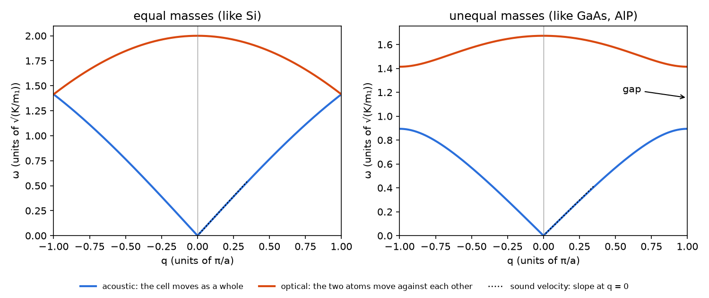

*Fig. 1 — The 1D diatomic chain with nearest-neighbour springs (`theory_figures.py`). Left: equal masses, like
silicon. Right: unequal masses, like GaAs or AlP: a gap between the branches. The dotted line is the sound velocity,
the slope of the acoustic branch at `q = 0`.*

Silicon has `n = 2`, so it has 6 branches: 3 acoustic, 3 optical. Its primitive cell is face-centred cubic; the path
`stb-mlphonons` follows through the FCC Brillouin zone is `Γ–X–W–K–Γ–L–U–W–L–K | U–X` (`Γ` is the zone centre, `X` the
centre of the square face, `L` the centre of the hexagonal face, `K` and `U` the middle of an edge — equivalent points).

### 1.3 Finite displacements: from forces to force constants

There are two ways to get `Φ` from first principles:

- density-functional perturbation theory, which computes the second derivatives analytically [7];
- the **finite-displacement** (direct, "frozen-phonon supercell") method [5, 6], which differentiates the forces
  numerically. It needs nothing but forces, so it works with any code and any potential — SIESTA (`5.4`) or MACE
  (this tool).

Finite displacements work as follows [5]:

1. Build a **supercell** of the primitive cell (`--dim`, default `2 2 2` of the input cell).
2. Move one atom `i` by a small `u` along `α` (`--distance`, default 0.01 Å).
3. Compute the forces on every atom of the supercell. To first order in `u`:

```
Φ_iα,jβ ≈ −[F_jβ(u_iα = u) − F_jβ(0)] / u                                                             (5)
```

Two refinements matter in practice:

- **Symmetry.** Displacements related by a symmetry operation of the crystal give no new information. phonopy (through
  spglib [26]) generates only the symmetry-inequivalent ones and reconstructs every other force constant by symmetry.
  For diamond-structure silicon (space group `Fd-3m`, 1536 operations in the 2×2×2 supercell), **one** displaced
  supercell gives every force constant — instead of `64 atoms × 3 directions × 2 signs = 384`. When the site symmetry
  does not already relate `+u` to `−u`, phonopy adds the opposite displacement, which turns Eq. 5 into a central
  difference.
- **Residual forces.** Eq. 5 subtracts `F(0)`, the forces on the undisplaced supercell. They should be zero, but a
  structure relaxed to `--fmax 0.05 eV/Å` still has small forces, and summed over a sublattice even 0.005 eV/Å per atom
  can shift an optical mode by several THz (graphene, `7.1`). `stb-mlphonons` always computes and subtracts them
  (report `[3]`).

The force constants then satisfy one exact condition of physics, the **acoustic sum rule**: translating the whole
crystal rigidly costs no energy, so

```
Σ_j Φ_iα,jβ = 0          for every i, α, β                                                            (6)
```

Numerical force constants violate it slightly, which shows up as small imaginary or non-zero acoustic frequencies at
`Γ`. `stb-mlphonons` reports the violation and then imposes the rule (`symmetrize_force_constants`).

### 1.4 What a supercell can see

A supercell of `L` cells along an axis sees an atom and all its periodic images together: the force on atom `j` is the
sum of the force constants to `j` and to every image of `j`, `Σ_k Φ(R_j + k L a)`. phonopy assigns that sum to the
nearest image and interpolates the dispersion from it. Two consequences (Fig. 2):

- At wavevectors **commensurate** with the supercell (`q = m/L` in units of the reciprocal lattice vector), the
  phase `exp(iq·kLa)` is 1 for every image, so the sum is exactly what Eq. 4 needs: **these frequencies are exact**,
  whatever the range of the force constants.
- Everywhere else the dispersion is an interpolation. It converges as the supercell grows past the range of the force
  constants.

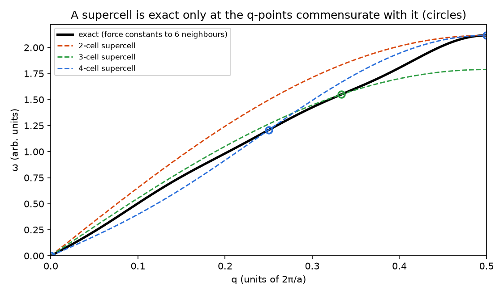

*Fig. 2 — A 1D chain whose force constants reach 6 neighbours, computed in supercells of 2, 3 and 4 cells
(`theory_figures.py`). Each supercell is exact at its commensurate points (circles; those of the 2-cell supercell,
`q = 0` and `½`, coincide with the 4-cell ones) and interpolates in between.*

For silicon's 8-atom cubic input cell, `Γ` and `X` are commensurate even with the 1×1×1 cell; `L` needs 2×2×2. So the
convergence check (section 5.6) must look at the whole band path, not at `Γ` (where every supercell agrees by
construction). The range of the force constants of a MACE model is bounded: each of its 2 message-passing layers
reaches `r_max = 6 Å`, so a displaced atom can change forces up to 12 Å away (report `[2]`, "Model range"). A
supercell much wider than 12 Å gains nothing from the model's side; the physics may still need it in metals and polar
materials, whose real force constants are long-ranged.

### 1.5 The displacement size

Eq. 5 is a finite difference, and it has two errors of opposite trend (Fig. 3):

- **Anharmonicity** grows with `u`. The cubic term of the energy biases a one-sided difference by an amount
  proportional to `u`; a central difference cancels it and leaves the quartic term, proportional to `u²`.
- **Noise** in the forces is divided by `u`. A force error `σ` gives a force-constant error `σ/u`.

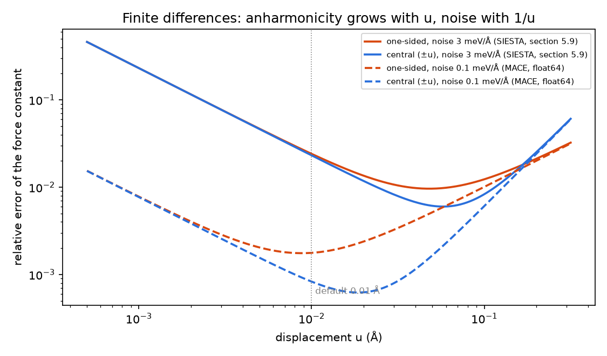

*Fig. 3 — Relative error of a force constant against the displacement, for a silicon-like stiffness (13 eV/Ų)
(`theory_figures.py`). Solid: force noise of 3 meV/Å, the size SIESTA's forces show in section 5.9; dashed: 0.1
meV/Å. One-sided (orange) and central (blue) differences.*

The default 0.01 Å is a good compromise for DFT forces. A MACE model in float64 has almost no noise — its forces are
the exact derivative of a smooth function — so for it any displacement from 0.001 to 0.03 Å gives the same result
(section 5.7). Its weak point is not noise but a smooth, **systematic** error: the curvature of its energy surface may
differ from SIESTA's.

### 1.6 Reading a band structure: degeneracies, symmetry labels, LO–TO

- **Degeneracies.** Symmetry forces branches together. In silicon at `Γ` the three optical modes are one triply
  degenerate mode; at `X` the branches come in pairs. A degeneracy that is split by more than numerical noise means the
  structure has lost the symmetry you think it has (section 5.8).
- **Irreducible representations at Γ** (report `[4]`). phonopy labels each `Γ` mode by the irreducible representation
  of the point group it transforms as. The acoustic modes transform as a vector (`T1u` in `m-3m`). An optical mode
  of the same representation as a vector is **infrared-active**; the report marks it so. Silicon's optical mode is
  `T2g`: symmetric under inversion, so infrared-inactive but **Raman-active**. It is the 520 cm⁻¹ (15.6 THz) Raman line
  every silicon wafer shows.
- **LO–TO splitting.** In a polar crystal (GaAs, AlP, oxides) the longitudinal optical mode at `q → 0` carries a
  macroscopic electric field that raises its frequency above the transverse one. This needs Born effective charges and
  the dielectric constant (the non-analytic correction). A MACE model has neither, so **this tool shows no LO–TO
  splitting**: for polar materials the optical modes near `Γ` are those of the short-range force constants only.
  Silicon is non-polar, so nothing is missing here.

### 1.7 Sound velocities and elastic constants

Near `Γ` the acoustic branches are straight lines, `ω = v|q|`. Their slopes are the speeds of sound, and the speed of
sound is set by the elastic constants (the Christoffel equation, `ρ v² = C_eff` for each polarization) [3]. For a cubic
crystal, along the three high-symmetry directions:

| Direction | Mode (polarization) | `ρ v²` |
|---|---|---|
| [100] (`Γ→X`) | LA | `C11` |
| [100] | TA (degenerate) | `C44` |
| [110] (`Γ→K`) | LA | `(C11 + C12 + 2C44)/2` |
| [110] | TA1 (along [1-10]) | `(C11 − C12)/2` |
| [110] | TA2 (along [001]) | `C44` |
| [111] (`Γ→L`) | LA | `(C11 + 2C12 + 4C44)/3` |
| [111] | TA (degenerate) | `(C11 − C12 + C44)/3` |

`stb-mlphonons` takes each slope at `|q| = 0.01 Å⁻¹` from every special point back towards `Γ` (report `[5]`). This
gives the **relaxed** elastic constants, the ones that include the relaxation of the atoms inside the cell under strain
— exactly what a stress-strain calculation with relaxed internal coordinates gives (`stb-mlelastic`, `7.4`). Section 5.3
compares the two.

### 1.8 Dynamical stability and imaginary modes

`ω²` is the eigenvalue; if it is negative, `ω` is imaginary, and by convention it is printed as a **negative frequency**.
It means the energy *decreases* along that mode: the structure is not at a minimum. Three causes, in order of how often
they occur:

1. **The structure is not at a minimum of this model.** It was relaxed with another method (SIESTA, another model), or
   not at all. The default pre-relax (positions only, `--fmax 0.05`) removes most of it.
2. **Numerical errors** in the force constants: noise (section 1.5), too small a supercell, a broken acoustic sum
   rule. Usually small imaginary acoustic frequencies near `Γ`.
3. **A real instability**: the crystal wants to distort — a soft mode near a phase transition, a charge-density wave, a
   high-symmetry structure that is not the ground state.

The report does not call `−0.00 THz` unstable: it uses a tolerance of −0.01 THz (shared with `5.4`), and leaves the
three acoustic modes at `Γ` out of the mesh count. For case 3, `--freeze-unstable-mode` writes the structure displaced
along the softest mode (`frozen_mode.fdf`): relax it and see whether the energy drops.

### 1.9 Thermodynamics of the harmonic crystal

Each phonon is a quantum harmonic oscillator of frequency `ν`. Its energy levels are `(n + ½) hν`, so even at 0 K it
keeps a **zero-point energy** `½ hν`. Summing over every branch `s` and every wavevector `q` on a uniform mesh
(`--mesh`, default 20×20×20) gives, per primitive cell [3, 4]:

```
E_ZP  = Σ_qs ½ h ν_qs                                                                                    (7)
F_vib = Σ_qs [ ½ h ν_qs + k_B T ln(1 − e^(−hν_qs / k_B T)) ]                                             (8)
S     = Σ_qs k_B [ x_qs / (e^(x_qs) − 1) − ln(1 − e^(−x_qs)) ]                 x_qs = h ν_qs / k_B T      (9)
C_V   = Σ_qs k_B x_qs² e^(x_qs) / (e^(x_qs) − 1)²                                                        (10)
```

each divided by the number of q-points. Fig. 4 shows one mode:

- the **heat capacity** rises from 0 to the classical `k_B` (per mode) around `T ≈ hν/(3k_B)`;
- at high temperature `F_vib` and `S` reach their classical forms, but the zero-point energy never disappears from
  the energy.

A crystal of `N` atoms has `3N` modes, so the classical limit is `C_V = 3 k_B` per atom (**Dulong–Petit**). Silicon's
phonons reach 15.5 THz, `hν/k_B = 745 K`: at room temperature its highest modes are still largely frozen, and
`C_V(300 K) = 2.41 k_B`, not 3. This is what classical MD (`7.2`) cannot reproduce, and what phonons give for free.

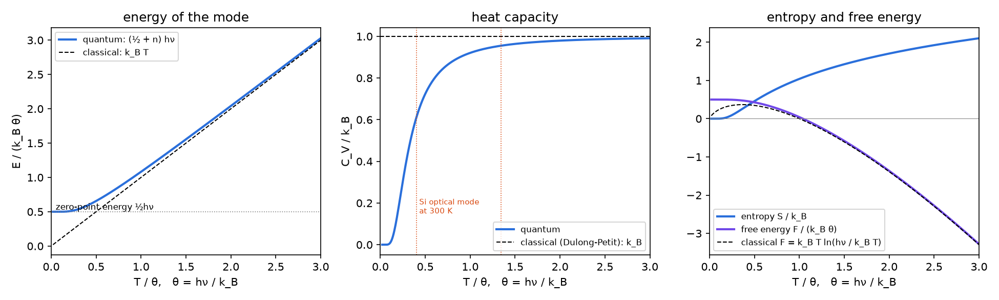

*Fig. 4 — One harmonic mode of frequency `ν`, against `T/θ` with `θ = hν/k_B` (`theory_figures.py`). The dotted lines
in the middle panel mark silicon's optical mode at 300 and 1000 K.*

**Debye temperature.** The report gives `θ_D = (h/k_B) √(5/3 ⟨ν²⟩)`, from the second moment of the DOS (Eq. 11). It
is the Debye model whose `⟨ν²⟩` matches, which makes the high-temperature heat capacity right. The calorimetric value
(645 K for silicon) is fitted to the low-temperature heat capacity instead; the two differ by a few percent.

```
θ_D = (h / k_B) √(5/3 · ⟨ν²⟩)            ⟨ν²⟩ = ∫ ν² g(ν) dν / ∫ g(ν) dν                                  (11)
```

**Units.** phonopy works in the primitive cell (2 atoms for silicon, even when the input is the 8-atom cubic cell).
Its thermal properties are per mole of primitive cells; the report gives them that way **and per atom** (`kB/at`,
`meV/at`), which is what you compare with experiment (J K⁻¹ mol⁻¹ of atoms = `kB/at × 8.314`).

### 1.10 Thermal expansion: the quasi-harmonic approximation

A purely harmonic crystal does not expand: its energy surface is symmetric about the minimum. Real crystals expand
because their frequencies depend on volume. The **quasi-harmonic approximation** (QHA) keeps the harmonic form of
Eq. 8 at each volume but lets the frequencies change with `V` [15, 16, 25]:

```
F(V, T) = E_static(V) + F_vib(V, T)               V(T) = the V that minimizes F(V, T) at P = 0          (12)
```

`--qha` computes the phonons at `--n-volumes` isotropically scaled volumes (`--strain-range`, ± % of the input
volume), fits an equation of state (`--eos`, Vinet by default [17]) to `F(V, T)` at every temperature, and follows the
minimum. That gives `V(T)`, `α_V(T) = (1/V) dV/dT`, `B_T(T)`, the heat capacity at constant pressure `C_P` and the
Gibbs energy.

How much a mode feels the volume is measured by its **Grüneisen parameter**:

```
γ_s(q) = −d ln ν_s(q) / d ln V                                                                         (13)
```

Most modes stiffen under compression (`γ > 0`). The thermal expansion follows from the **Grüneisen relation** [14, 25]:

```
α_V = γ C_V / (B_T V)              γ = Σ_qs γ_qs c_qs / Σ_qs c_qs   (c_qs: heat capacity of each mode)   (14)
```

The expansion is the heat-capacity-weighted average of the mode Grüneisen parameters, divided by the stiffness. Two
consequences that silicon shows (section 5.10):

- **Negative thermal expansion.** Silicon's transverse acoustic modes near the zone boundary have `γ ≈ −1.4`: they
  *soften* under compression, a sign of the open diamond structure. Being the lowest-frequency modes, they are the
  first to be excited, so between about 20 and 120 K the weighted `γ` is negative and silicon **contracts** on heating
  [27]. Only quantum statistics can show this: in classical MD every mode is excited equally at any temperature.
- **Zero-point expansion.** Even at 0 K the zero-point energy depends on volume and pushes outward with a pressure
  `−dE_ZP/dV`. The 0 K volume is larger than the static minimum (report `[5]`, "Zero-point motion").

The QHA is good up to roughly half to two thirds of the melting temperature. Above that, the frequencies change with
temperature at fixed volume (intrinsic anharmonicity), which only MD (`7.2`) or methods beyond this tool capture.

### 1.11 Phonons from a machine-learned potential

A MACE model writes the energy as a sum of atomic contributions, each a smooth learned function of the atom's
neighbourhood within `r_max`; its forces are exact derivatives (`7.2`, section 1.2). For phonons that has three
consequences:

- **No numerical noise.** The forces are smooth functions of the positions, computed in float64 here, so Eq. 5 is
  essentially exact. The noise problem of DFT forces (section 5.9) disappears.
- **Second derivatives are demanding.** A model is trained on energies, forces and stresses of distorted
  configurations: first derivatives. The force constants are the slope of the forces against the displacements, a
  quantity the training only constrains indirectly. A model with a small force error can still have the wrong
  curvature.
- **Foundation models are soft.** Universal models trained on near-equilibrium structures of the Materials Project
  systematically **underestimate the curvature** of the energy surface — energies, forces and phonon frequencies too
  low away from the minimum [20]. For silicon this is large (section 5.5): every MACE-MP-0 size puts the optical modes
  25–35 % too low. Fine-tuning on SIESTA data of rattled, strained and MD-sampled cells fixes it.

What the tool checks, and what it cannot:

- The **model card** (report `[2]`) is printed in full: level of theory of the labels, trained range, errors against
  SIESTA — including a phonon comparison when `7.1.3` ran one —, recipe, stability, provenance. The structure is
  checked against the card's elements and ranges.
- With a fine-tuned model the **foundation model** runs the same calculation (report section `FINE-TUNED vs FOUNDATION`): the difference is what
  fine-tuning taught the model.
- No error bar on each frequency: one model, no committee. A SIESTA phonon calculation (`5.4`) on the same supercell,
  or `stb-mlffValidate --phonon-ref` (`7.1.3`), is the real test (section 5.9).

### 1.12 A calculation you can check by hand

The reference run of section 5.2 (silicon, 2×2×2, fine-tuned model) and the QHA of section 5.10 report numbers that can
be predicted from each other:

- **Zero-point energy (Eq. 7).** Per atom it is `(3/2) h⟨ν⟩`. The report gives a mean frequency of 9.885 THz:
  `1.5 × 9.885 × 4.1357 = 61.32 meV/atom`. Reported: 61.32.
- **Heat capacity at high temperature.** Expanding Eq. 10 for `x ≪ 1`: `C_V/3k_B ≈ 1 − ⟨x²⟩/12`, and
  `⟨x²⟩ = (h/k_BT)² ⟨ν²⟩ = (3/5)(θ_D/T)²` by Eq. 11. With `θ_D = 666 K` at 1000 K: `1 − 0.6 × 0.4436/12 = 0.978`,
  so `C_V = 2.933 k_B`. Reported: 2.935.
- **Free energy.** `F = U − TS`, per atom at 300 K: `U = 18.415 kJ/mol / 2 = 95.4 meV`, `TS = 300 × 2.321 × 0.08617 =
  60.0 meV`, so `F = 35.4 meV`. Reported: 35.43.
- **Bulk modulus from sound (section 1.7).** From the 4×4×4 velocities and `ρ = 2266.8 kg/m³`:
  `C11 = ρ v_LA[100]² = 148.0 GPa`, `C44 = ρ v_TA[100]² = 65.1 GPa`, `C12 = 2ρ v_LA[110]² − C11 − 2C44 = 70.2 GPa`,
  `B = (C11 + 2C12)/3 = 96.1 GPa`. The QHA's static equation of state, a different calculation with the same model,
  gives 93.5 GPa (3 % apart).
- **Grüneisen relation (Eq. 14).** At 300 K the QHA reports `γ = 0.575`, `C_P ≈ C_V = 2.406 k_B` per atom,
  `B_T = 88.07 GPa`, `V = 20.695 ų` per atom. `α_V = 0.575 × 2.406 × 1.3806 × 10⁻²³ / (88.07 × 10⁹ × 20.695 × 10⁻³⁰)
  = 1.048 × 10⁻⁵ K⁻¹`. Reported: 1.0465 × 10⁻⁵.
- **Zero-point expansion.** Across the scan the zero-point energy falls from 63.56 to 58.81 meV/atom as the volume grows
  from 19.75 to 21.40 ų/atom: a pressure `−dE_ZP/dV = 2.89 meV/ų = 0.46 GPa`, which expands the crystal by
  `ΔV/V = P/B₀ = 0.46/93.5 = 0.49 %`. Reported: +0.516 %.

### 1.13 What this tool simplifies — explicitly

- **Harmonic, or quasi-harmonic, only.** No phonon–phonon scattering: no lifetimes, linewidths or thermal
  conductivity; no temperature-dependent frequencies at fixed volume.
- **No LO–TO splitting** (section 1.6): no Born charges, no dielectric constant. For polar materials the optical modes
  near `Γ` are incomplete.
- **Isotropic volume scan.** `--qha` scales the whole cell by one factor. Right for cubic crystals; for a hexagonal or
  layered crystal the axes expand differently, which needs a scan per lattice parameter.
- **Positions relaxed, cell fixed.** The pre-relax moves atoms only, so the single-volume phonons are at the input
  volume. If the model's own equilibrium volume is different (the foundation model's is 1.35 % smaller here), the
  phonons are at a slightly strained lattice; `stb-mlrelax --relax-cell` fixes that first.
- **One model, no error bars** on the frequencies (section 1.11).
- **No electronic contribution** to the free energy and heat capacity: fine for an insulator like silicon, not for a
  metal at high temperature.

## 2. Libraries and external dependencies used

| Library | Used for |
|---|---|
| phonopy [5, 16] | displacements, force constants, symmetrization, band structure, mesh, DOS/PDOS, thermal properties, irreducible representations, modulations (animation, mode freeze), the QHA (`PhonopyQHA`) |
| spglib [26] | symmetry of the crystal and its supercell (through phonopy) |
| ASE [22] | `Atoms`, the FCC/BCC/... Bravais lattice and its band path (`Cell.bandpath`), trajectory writers (xsf, pdb, xyz) |
| mace-torch [18, 19] | the MACE calculator, the foundation models (downloaded once, cached in `~/.cache/mace/`) and custom `.model` files |
| PyTorch | runs the model on `cpu` or `cuda` (`--device`) |
| pymatgen | structure conversion |
| NumPy | everything numerical |
| matplotlib | the PNG figures (always written), `--show` |
| gnuplot (optional) | renders the `.gplot` files written by `--save-gnuplot` |
| `stb.core` | `.fdf` reading (`structure_io`), the model card (`model_card`), the calculator, the pre-relax and device checks (`mace_relax`), displacements and force constants (`mace_phonons`), the band path (`phonons_pos`), library-noise capture (`cli`) |

Install the `ml` extra: `pip install stb_suite[ml]`.

## 3. What `stb-mlphonons` does

### 3.1 One volume (the default)

1. **Read** the structure (`--file`, `.fdf`), find its dimensionality (vacuum-padded axes, from `--vacuum-gap`) and the
   supercell (`--dim`). A supercell thinner than 10 Å along a periodic axis, or repeated along a vacuum axis, gives a
   warning.
2. **Load the model**: a foundation model (`--model small|medium|large`) or a custom model with its card
   (`--custom-model` + `--custom-model-card`). The card must exist, be readable and match the model file's SHA-256;
   then it is printed in full and the structure is checked against it.
3. **Pre-relax** the atomic positions with the model (cell fixed, `--fmax`, default 0.05 eV/Å), unless `--no-relax`.
4. **Generate the displacements** (`--distance`) with phonopy, reduced by symmetry.
5. **Compute the forces** on every displaced supercell and on the undisplaced one, subtract the latter (Eq. 5), build
   the force constants, report the acoustic-sum-rule violation and impose the rule.
6. **Band structure** along the path of the lattice's Bravais type (`--band-points` per segment); frequencies and
   irreducible representations at the special points; stability on the band path and on the mesh; sound velocities.
7. **Mesh** (`--mesh`): DOS, projected DOS per species, thermal properties from `--tmin` to `--tmax` every `--tstep`.
8. Optionally **freeze** the softest imaginary mode (`--freeze-unstable-mode`, `--freeze-amplitude`) and **animate** a
   mode (`--animate-mode`: a band index, or no value for the first optical mode; `--animate-qpoint`, `--animate-dim`,
   `--animate-amplitude`, `--animate-frames`, `--animate-format`).
9. With a custom model, repeat 3–7 with the **foundation model** (`--model`) unless
   `--skip-foundation-comparison`, and compare.

The force constants are always saved, ASR-corrected, in `phonopy_disp.yaml`: `phonopy-load phonopy_disp.yaml` (or
`phonopy.load` in Python) reuses them for anything phonopy can do.

### 3.2 `--qha`

Steps 1–5 and 7 at `--n-volumes` volumes (≥ 4: the equations of state have 4 parameters), scaled isotropically over
`± --strain-range` % of the input volume, positions relaxed at each; then `PhonopyQHA` with the chosen `--eos`. phonopy's
per-primitive-cell free energies are converted to the input cell, the cell whose volumes and energies are fitted (they
were once mixed up; `--qha` then gave thermal expansions 4 times too small). Each volume's force constants are kept in
`vol_NN/phonopy_disp.yaml`. The mode Grüneisen parameters at the special points come from a straight-line fit of
`ln ν` against `ln V` over the scan.

### 3.3 `--check-convergence`

Steps 1–7 (quietly) in every supercell of `--convergence-dims` (default: `--dim` and `--dim + 1` on every periodic
axis), compared with the largest along the band path (RMSE, largest difference) and at the special points; plus ZPE,
`C_V` and `S` at 300 K. The smallest supercell within `--convergence-tol` (default 0.1 THz) of the largest is reported
as converged.

### 3.4 The report, section by section

Sections are numbered in order; optional sections that do not apply are left out, so the numbers after them shift.
The table numbers every section as if all were present; the reference run of section 5.2 has no `MODE FREEZE`, so its
`MODE ANIMATION` is `[6]` and its `WARNINGS` `[11]`. Sections `[0]`–`[5]` never move.

**One volume:**

| Section | Content |
|---|---|
| `[0] RUN METADATA` | date, software versions (stb, phonopy, mace-torch, torch, ase), device, input, mode, supercell, displacement, mesh and path density, temperatures, model, the comparison |
| `[1] STRUCTURE` | atoms, dimensionality, formula, cell, volume per atom and density, shortest distance, supercell size and its face-to-face widths |
| `[2] MODEL` | the **model card** in full (identity and SHA-256, level of theory, trained range, recipe and every error against SIESTA, stability and usage), or the foundation model's identity; the model's range (`r_max` × layers); load time |
| `[3] DISPLACEMENTS & FORCE CONSTANTS` | per model: input forces, pre-relax (forces before/after, steps, largest shift), space group and operations, number of displacements against the brute-force count, residual forces subtracted, acoustic-sum-rule violation, time; the primitive cell; the saved force constants |
| `[4] FREQUENCIES AT HIGH-SYMMETRY POINTS` | every branch at every special point, for each model; the `Γ` modes with their irreducible representations, in THz, cm⁻¹ and meV, marked acoustic / optical / IR-active |
| `[5] BAND STRUCTURE & STABILITY` | Bravais lattice and path; per model: frequency range of the path, imaginary modes on the path and on the mesh (softest mode and where), gaps between branches, the sound-velocity table |
| `[6] MODE FREEZE` | `--freeze-unstable-mode` only: the softest mode, the achieved displacement, the structure written |
| `[7] MODE ANIMATION` | `--animate-mode` only: q-point, band and its frequency, frames, file |
| `[8] DENSITY OF STATES` | per model: highest and mean frequency, Debye temperature (Eq. 11), the DOS integral against `3n`, the projected DOS per species (states, share, mean frequency, upper edge) |
| `[9] THERMAL PROPERTIES` | per model: zero-point energy; F, S, C_V, U at 100–1000 K per primitive cell and per atom, and `C_V` as a fraction of Dulong–Petit |
| `[10] FINE-TUNED vs FOUNDATION` | with a custom model: frequency differences on the path and the mesh (acoustic, optical), highest frequency, `C_V`, `S`, `F` at 300 K and at `--tmax` |
| `[11] SUMMARY & FILES` | status, headline numbers, every file written, the optional outputs not asked for, wall time |
| `[12] WARNINGS` | every warning in one place, numbered; the count of library messages captured |

**`--qha`:** `[0]–[2]` as above, then `[3] VOLUME SCAN` (per volume: strain, volume, lattice ratio, static energy,
lowest and highest frequency, ZPE, `F_vib` at 300 K, time), `[4] EQUILIBRIUM FIT` (static `E₀`, `V₀`, `B₀`, `B′`),
`[5] THERMAL EXPANSION SUMMARY` (zero-point expansion; `V`, `a/a₀`, `α_V`, `α_L`, `B_T`, `C_P`, `γ`, `G` at 0–2000 K; the
values at 300 K and `--tmax`; the negative-expansion range), `[6] MODE GRUENEISEN PARAMETERS`, `[7] SUMMARY & FILES`,
`[8] WARNINGS`.

**`--check-convergence`:** `[0]–[2]`, `[3] SUPERCELL CONVERGENCE CHECK` (per supercell: atoms, displacements, width,
time, RMSE and largest difference against the largest, ZPE, `C_V` and `S` at 300 K, imaginary q-points; the special
points per supercell; the verdict), `[4] SUMMARY & FILES`, `[5] WARNINGS`.

### 3.5 Files

| Written | When |
|---|---|
| `bands.png`, `dos.png`, `thermal.png` (both models overlaid) | always (one volume) |
| `phonopy_disp.yaml` (force constants) | always (one volume) |
| `qha.png`, `vol_NN/phonopy_disp.yaml` | `--qha` |
| `convergence.png` | `--check-convergence` |
| `bands.dat`, `bands_foundation.dat`, `dos.dat`, `thermal.dat` / `qha_thermal_expansion.dat` / `convergence.dat` | `--save-data` |
| `plot/*.dat`, `plot/*.gplot`, and `plot/*.pdf` when gnuplot is installed | `--save-gnuplot` |
| `stb_mlphonons_report.txt` | `--save-report` |
| `mode_<band>.<xsf/pdb/xyz>` | `--animate-mode` |
| `frozen_mode.fdf` | `--freeze-unstable-mode`, when there is an imaginary mode |
| the figures on screen | `--show` (needs a display; without one it is a warning) |

Everything goes into `-o/--output-dir` (default `mlphonons_out`).

### 3.6 Guard rails

| Situation | Behaviour |
|---|---|
| `--custom-model` without `--custom-model-card`, a missing or unreadable card, or a card whose SHA-256 does not match | clean error before anything runs |
| an element or a geometry outside the card's trained range | warning (`Model card check`), and run-time domain warnings from the calculator |
| `--qha` with fewer than 4 volumes; `--qha` with `--check-convergence` | clean error |
| `--animate-mode` or `--freeze-unstable-mode` with `--qha` or `--check-convergence` | clean error |
| `--convergence-dims` not a multiple of 3, or fewer than 2 supercells | clean error |
| `--animate-mode` with a negative index or an unknown word | clean error |
| `--animate-mode` index out of range, or the first optical mode of a 1-atom primitive cell (there is none) | warning, animation skipped |
| `--no-relax` | warning: expect spurious modes if the structure is not at a minimum |
| a supercell thinner than 10 Å along a periodic axis; `--dim` repeating a vacuum axis | warning |
| imaginary modes on the mesh | warning naming the softest mode and the three usual causes |
| QHA: an imaginary mode at some volume, the static minimum at the edge of the scan, the model's `V₀` more than 1 % from the input, `V(T)` leaving the scan or in its top 15 % | warning |
| `--device cuda` with no usable GPU; a missing input file | clean error |
| `--show` without a display | warning; the PNGs are written anyway |
| an isolated molecule (every axis vacuum) | the band structure is skipped with a note; DOS and thermal properties are computed |

## 4. Running it both ways

**Command line:**

```bash
stb-mlphonons --file si8.fdf --dim 2 2 2 \
              --custom-model model/mlff_model_compiled.model --custom-model-card model/mlff_model_card.json \
              --animate-mode --save-data --save-gnuplot --save-report
stb-mlphonons --file si8.fdf --custom-model ... --custom-model-card ... --qha --n-volumes 7 --strain-range 4 --tmax 1500
stb-mlphonons --file si8.fdf --custom-model ... --custom-model-card ... --check-convergence --convergence-dims 1 1 1 2 2 2 3 3 3
```

**Interactive menu:** run `stb-suite` and type `7.3`. It asks, in this order:

1. the structure;
2. a custom model path, or Enter for a foundation model and then its size. With a custom model it asks for the card and
   offers `mlff_model_card.json` next to the model as the default;
3. the device (`cpu`/`cuda`; it checks the GPU);
4. the supercell (Enter: `2 2 2`) and the output folder;
5. the mode: 1 single volume, 2 QHA (then the number of volumes, the strain range and the equation of state), 3
   convergence (then the supercells);
6. single volume only: whether to compare with the foundation model (custom model only), whether to freeze an unstable
   mode, whether to animate one (band — Enter for the first optical mode —, q-point, modulation supercell, amplitude,
   frames, format);
7. one question per optional output (show, gnuplot, data, report).

The menu builds the same command line and calls `stb-mlphonons`; the guided script (Case 11) drives it with piped
answers.

## 5. Worked example: bulk silicon

### 5.1 Set-up

The structure, `si8.fdf`: the 8-atom conventional diamond cell at SIESTA's relaxed lattice constant, 5.48024 Å (PBE,
DZP; experiment 5.4310 Å at 300 K — PBE is 0.9 % too large). `si8_rattled.fdf` is the same cell with every atom moved
at random by about 0.03 Å (section 5.8).

The model, `../7.2-mlmd/model/` (shared with the `7.2` example, not copied):

- `best_model/` of the `7.1` silicon run: round 2, seed 125, fine-tuned from MACE-MP-0 medium on 57 SIESTA single
  points (8 and 64 atoms: rattled, strained, 1400 K MD frames);
- level of theory: PBE, DZP, PAO.EnergyShift 0.01 Ry, Mesh.Cutoff 300 Ry, k × a ≈ 32 Å;
- its card: test-set force error 28.7 meV/Å, energy 1.1 meV/atom, stress 0.18 GPa; phonons against SIESTA 1.10 THz RMSE
  (acoustic 1.51, optical 0.37) — section 5.9 explains why the acoustic number says more about SIESTA than about the
  model.

Every calculation ran on the CPU (one desktop, 12 cores); `make_reference.sh` lists them, and section 6 explains how
to regenerate them. Wall times: 14 s for the reference run with both models, 36 s for 4×4×4, 26 s for a 7-volume QHA,
49 s for the 1×1×1–4×4×4 convergence check.

Experimental references: phonon frequencies from inelastic neutron scattering at 296 K [8]; elastic constants at 298 K
[9]; heat capacity and entropy at 298 K [12, 13]; thermal expansion [10, 27].

### 5.2 The reference run: bands against experiment

```bash
stb-mlphonons --file si8.fdf --custom-model ../7.2-mlmd/model/mlff_model_compiled.model \
              --custom-model-card ../7.2-mlmd/model/mlff_model_card.json --animate-mode \
              --save-data --save-gnuplot --save-report
```

Report section `[3]` (`reference_results/base/stb_mlphonons_report.txt`):

```
Input forces      : max |F| 0.0000 eV/Ang
Pre-relax         : max |F| 0.0000 eV/Ang after 0 step(s) (converged, --fmax 0.05); largest atomic shift 0.0000 Ang
Symmetry          : Fd-3m (227) (point group m-3m, 1536 operations in the supercell)
Displacements     : 1 of 0.01 Ang (vs. 384 without symmetry: 99.7 % fewer evaluations)
Residual forces   : max 8.10e-15 eV/Ang per atom in the undisplaced supercell -- subtracted from every displacement's
Acoustic sum rule : largest violation 6.91e-14 eV/Ang^2 before symmetrization (imposed afterwards)
Primitive cell    : 2 atoms (phonopy, spglib); supercell 64 atoms
```

The model puts the atoms exactly at their sites (zero force: the structure is at its minimum), the symmetry reduces
the job to one displaced supercell, and the acoustic sum rule holds to 10⁻¹³ before it is even imposed — the forces are
noise-free (section 1.11).

Section `[4]` against experiment [8], THz:

| q | experiment | fine-tuned | MACE-MP-0 medium |
|---|---|---|---|
| Γ (optical) | 15.53 | 15.16 | 10.89 |
| X | 4.49 / 12.32 / 13.90 | 4.42 / 12.05 / 13.66 | 4.67 / 8.76 / 9.76 |
| L | 3.43 / 11.35 / 12.60 / 14.68 | 3.60 / 10.93 / 12.35 / 14.34 | 3.38 / 8.09 / 8.91 / 10.38 |

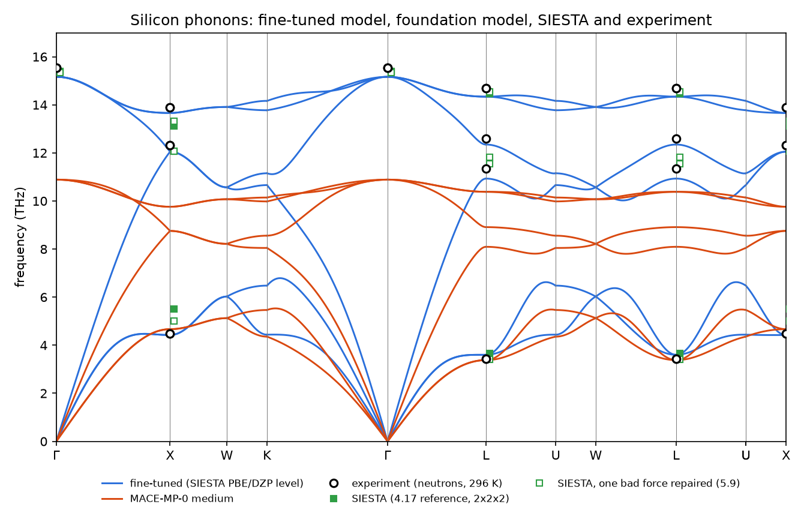

*Fig. 5 — The band structure of both models (`reference_results/base/`), the experimental frequencies at `Γ`, `X`, `L`
(circles), and SIESTA's frequencies from the `7.1` reference calculation, as it is and with one bad force repaired
(section 5.9) (`results_figures.py`).*

- **The fine-tuned model** is within −3.7 to +5.0 % of experiment over the 15 measured modes (mean −1.2 %, RMS 2.8 %).
  Most modes are 1–3 % low: PBE's lattice is 0.9 % too large and its bonds slightly too soft, and the model reproduces
  PBE. The `Γ` optical mode, 15.16 THz = 505.8 cm⁻¹, is the Raman line (520 cm⁻¹ measured).
- **At `Γ`**: the acoustic triplet `T1u` at zero, the optical triplet `T2g` (Raman-active, infrared-inactive), as
  section 1.6 says.
- **No imaginary mode** on the path or on the 8000-point mesh; softest non-zero mode 0.37 THz, the acoustic branch next
  to `Γ`.
- **The foundation model** gets the acoustic modes at the zone boundary about right and every optical mode 25–35 % too
  low (section 5.5).

### 5.3 Sound velocities and elastic constants

Section `[5]` gives the slopes of the acoustic branches. From the 2×2×2 and 4×4×4 runs (`base`, `base_444`), m/s, with
the experimental values computed from the measured elastic constants [9] (section 1.7):

| | Γ→X [100] TA / LA | Γ→K [110] TA1 / LA | Γ→L [111] TA / LA |
|---|---|---|---|
| fine-tuned, 2×2×2 | 5345 / 8199 | 4239 / 8812 | 4632 / 9020 |
| fine-tuned, 4×4×4 | 5361 / 8081 | 4122 / 8768 | 4566 / 8994 |
| MACE-MP-0 medium, 2×2×2 | 3681 / 6506 | 3410 / 6647 | 3501 / 6698 |
| experiment | 5843 / 8433 | 4673 / 9134 | 5093 / 9356 |

- **Supercell.** The slopes change by up to 3 % from 2×2×2 to 4×4×4: the acoustic branches near `Γ` are an
  interpolation (section 1.4), so sound velocities need a larger supercell than the zone-boundary frequencies.
- **Elastic constants.** With the model's density (2266.8 kg/m³) the 4×4×4 slopes give `C11 = 148.0`, `C12 = 70.2`,
  `C44 = 65.1 GPa`, and the check `C11 − C12 = 77.8` against `2ρv²_TA1[110] = 77.0` closes (section 1.12).
- **Cross-check with a different method.** `stb-mlelastic` (`7.4`) fits the same model's stresses under small strains,
  with the atoms relaxed: `C11 = 144.8`, `C12 = 68.0`, `C44 = 65.0 GPa`, `B = 93.6 GPa`
  (`reference_results/elastic/`). Phonon slopes and stress-strain agree within 2–3 %. That is a consistency check of the
  phonon machinery, not of the physics: both measure the same model.
- **Against experiment** (`C11 = 165.6`, `C12 = 63.9`, `C44 = 79.5 GPa`): the model's `C11` is 11 % low and `C44` 18 %
  low. Part of this is PBE at its own, larger lattice constant; part may be the model — the training set had only 6
  strained cells. The foundation model's constants are much lower still (`C11 = 103`, `C44 = 29 GPa` from
  `stb-mlelastic`).

### 5.4 Density of states and thermal properties

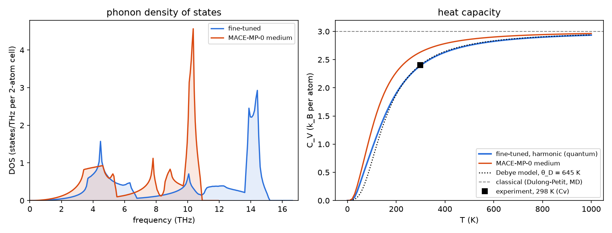

*Fig. 6 — Left: the DOS of both models. Right: the heat capacity per atom, with the Debye model at the calorimetric
`θ_D = 645 K`, the classical limit, and experiment at 298 K (`results_figures.py`).*

Section `DENSITY OF STATES`: highest frequency 15.16 THz, mean 9.885 THz, Debye temperature 666 K (second moment, Eq. 11), the DOS
integrates to 5.98 of 6 states. The two sharp peaks are the flat regions of the band structure: the TA modes near the
zone boundary (4–4.5 THz) and the TO band (14–14.5 THz).

Section `THERMAL PROPERTIES`, per atom:

| T (K) | C_V (k_B) | C_V (J K⁻¹ mol⁻¹) | S (k_B) | S (J K⁻¹ mol⁻¹) | F (meV) |
|---|---|---|---|---|---|
| 100 | 0.904 | 7.51 | 0.483 | 4.01 | 60.04 |
| 300 | 2.395 | 19.91 | 2.321 | 19.30 | 35.43 |
| 500 | 2.753 | 22.89 | 3.647 | 30.33 | −16.71 |
| 1000 | 2.935 | 24.40 | 5.632 | 46.82 | −221.08 |

- **Heat capacity at 300 K**: 19.91 J K⁻¹ mol⁻¹. The measured `C_P` is 20.00 [13]; for a solid `C_P − C_V = α_V² B V T`
  is only 0.02 here, so `C_V ≈ 19.98`. The model is within 0.4 %. Classical MD (`7.2`) gives 24.9 (3 `k_B`), 25 % too
  high.
- **Entropy at 300 K**: 19.30 against 18.81 measured [13], 2.6 % high: the model's frequencies are slightly low, and
  lower frequencies mean more entropy.
- **Debye temperature**: 666 K from the DOS against 645 K calorimetric [12]; the two are defined differently (section
  1.9), and the heat-capacity curve follows the 645 K Debye model closely (Fig. 6).
- **Zero-point energy**: 61.3 meV/atom, 1.3 % of silicon's cohesive energy (4.6 eV/atom). It shifts relative energies of polymorphs
  and defects, and it expands the lattice (section 5.10).

The foundation model, with frequencies 30 % low, has the right high-temperature limit but reaches it too early (Fig. 6),
and its entropy at 300 K is 2.95 `k_B` instead of 2.32 (section `FINE-TUNED vs FOUNDATION`): **a phonon error is a free-energy error** — 24
meV/atom at 300 K here, enough to reverse the order of two polymorphs.

### 5.5 The foundation models are soft

The same calculation with the three MACE-MP-0 sizes (`foundation_small/medium/large`), THz:

| model | Γ optical | X TA | X TO | L TA | L TO | v_LA[100] (m/s) | θ_D (K) |
|---|---|---|---|---|---|---|---|
| MACE-MP-0 small | 11.38 | 4.61 | 10.40 | 3.23 | 10.95 | 6311 | 517 |
| MACE-MP-0 medium | 10.89 | 4.67 | 9.76 | 3.38 | 10.38 | 6506 | 495 |
| MACE-MP-0 large | 9.88 | 4.41 | 8.85 | 3.04 | 9.39 | 5978 | 457 |
| fine-tuned | 15.16 | 4.42 | 13.66 | 3.60 | 14.34 | 8199 | 666 |
| experiment | 15.53 | 4.49 | 13.90 | 3.43 | 14.68 | 8433 | 645 |

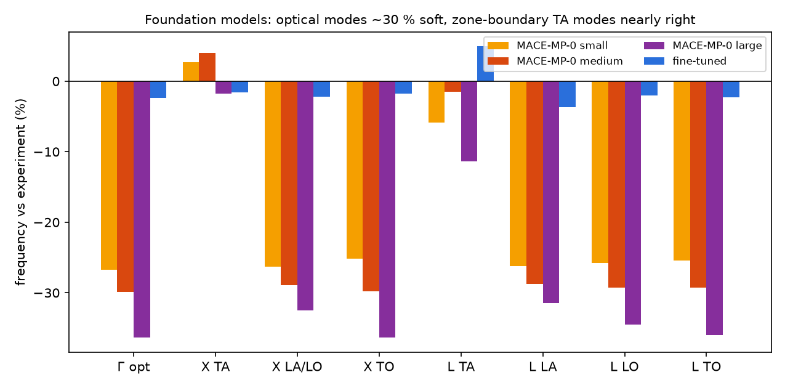

*Fig. 7 — Frequency error against experiment at the measured modes, for the three foundation models and the fine-tuned
one (`results_figures.py`).*

- Every optical mode is 25–36 % low in every size; **the largest model is the softest**. A bigger foundation model is
  not a better one for a given material.
- The transverse acoustic modes at `X` and `L` are nearly right (−11 to +4 %). Those modes bend bonds, the optical ones
  stretch them: the foundation models underestimate the bond-stretching curvature most.
- The foundation models are trained on PBE, the same functional as our SIESTA labels. The softening is a property of
  the models — the systematic softening of universal potentials trained mostly on near-equilibrium structures [20] —
  not a difference of level of theory. The card records it in another form: the raw foundation model's force error on
  the SIESTA training configurations is 448 meV/Å, against 46 for the fine-tuned model.
- An independent check confirms the tool: a hand-made finite difference of the medium model on the 2-atom cell gives
  10.89 THz at `Γ`, the same as the report.

Fine-tuning on 57 SIESTA configurations brought every mode to within a few percent of experiment. For phonons this is
the strongest argument for `7.1`.

### 5.6 The supercell size

```bash
stb-mlphonons --file si8.fdf --custom-model ... --custom-model-card ... --check-convergence \
              --convergence-dims 1 1 1 2 2 2 3 3 3 4 4 4
```

| supercell | atoms | band-path RMSE vs 4×4×4 (THz) | largest difference (THz) | ZPE (meV/atom) | C_V(300 K) (k_B/atom) | S(300 K) (k_B/atom) |
|---|---|---|---|---|---|---|
| 1×1×1 | 8 | 0.412 | 1.415 | 60.95 | 2.3938 | 2.4025 |
| 2×2×2 | 64 | 0.055 | 0.260 | 61.32 | 2.3948 | 2.3209 |
| 3×3×3 | 216 | 0.014 | 0.059 | 61.31 | 2.3948 | 2.3235 |
| 4×4×4 | 512 | — | — | 61.31 | 2.3948 | 2.3236 |

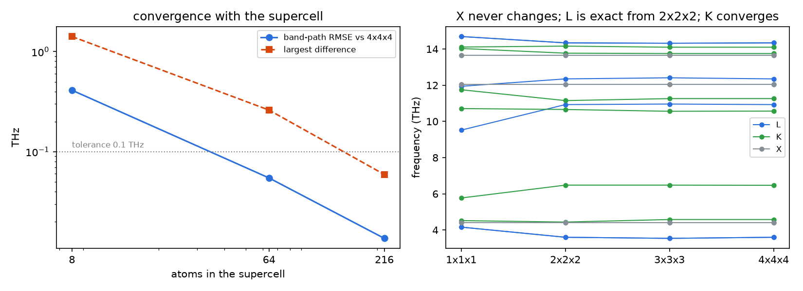

*Fig. 8 — Left: band-path difference against the 4×4×4 supercell. Right: frequencies at `L`, `K` and `X` per
supercell (`results_figures.py`).*

- **`X` never changes**: it is commensurate with the 8-atom cubic cell (section 1.4). Neither does `Γ`.
- **`L` is exact from 2×2×2** and the 3×3×3 supercell, which is not commensurate with it, is slightly *worse* there
  (3.54 against 3.60 THz) — commensurability, not size, decides the special points.
- **`K` converges smoothly** (it is commensurate with none of these).
- The 1×1×1 cell is wrong by up to 1.4 THz at `L`; 2×2×2 is within the 0.1 THz tolerance (RMSE 0.055); 3×3×3 is
  within 0.015.
- **Thermal properties converge faster than the bands**: `C_V` at 300 K is the same to 0.05 % in every supercell, and
  the entropy to 3.5 % even in the 1×1×1 cell. They average over the whole zone, where the errors partly cancel.

The model's force constants reach 12 Å (two layers × 6 Å); the 4×4×4 supercell (22 Å wide) holds all of them. For a
DFT calculation the same test would cost a 512-atom SIESTA run (section 1); here it costs 25 seconds, which is why the
tool offers it.

### 5.7 The displacement size

Six runs, `--distance` 0.001 to 0.2 Å (`dist_*`), THz:

| u (Å) | Γ optical | X TA | L TA | X TO |
|---|---|---|---|---|
| 0.001 | 15.16 | 4.42 | 3.60 | 13.66 |
| 0.003 | 15.16 | 4.42 | 3.60 | 13.66 |
| 0.01 | 15.16 | 4.42 | 3.60 | 13.66 |
| 0.03 | 15.16 | 4.41 | 3.59 | 13.66 |
| 0.1 | 15.09 | 4.31 | 3.52 | 13.62 |
| 0.2 | 14.95 | 3.99 | 3.29 | 13.58 |

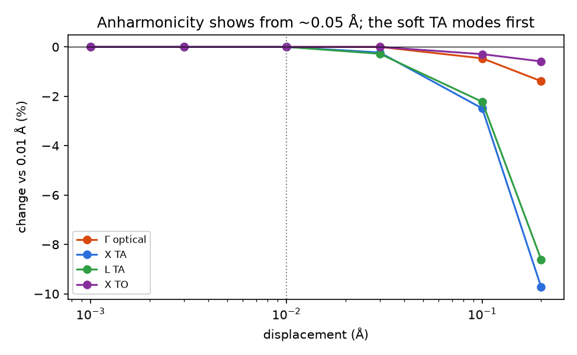

*Fig. 9 — Change of each frequency relative to the 0.01 Å run (`results_figures.py`).*

- **From 0.001 to 0.03 Å nothing changes**, to the last printed digit. Even 0.001 Å, where a DFT force set would be
  dominated by noise, works: the model's forces are smooth (section 1.5).
- **From 0.1 Å the anharmonicity shows**, and the soft transverse acoustic modes feel it first: −2.5 % at 0.1 Å, −10 %
  at 0.2 Å for X-TA, against −1.4 % for the optical mode. The same modes have the most negative Grüneisen parameters
  (section 5.10): both are signs of a strongly anharmonic bond-bending potential.
- The default 0.01 Å is safe for any model. With a model, prefer it to the larger values sometimes used to fight DFT
  noise.

### 5.8 A structure that is not at a minimum

`si8_rattled.fdf` has every atom moved by about 0.03 Å; the largest force is 0.85 eV/Å. Three runs:

| pre-relax | max \|F\| before → after (eV/Å) | steps | space group | displacements | Γ optical triplet (THz) | imaginary q |
|---|---|---|---|---|---|---|
| none (`--no-relax`) | 0.850 | — | P1 | 48 | 14.08 … 15.81 | 0 |
| default (`--fmax 0.05`) | 0.850 → 0.034 | 16 | P1 | 48 | 15.14 … 15.18 | 0 |
| tight (`--fmax 0.001`) | 0.850 → 0.0008 | 46 | P1 | 48 | 15.16 … 15.16 | 0 |

Three lessons, one of them unexpected:

- **No imaginary mode, even without the pre-relax.** Subtracting the residual forces (Eq. 5) makes the force constants
  the curvature *at* the given geometry, and for a small rattle of a stiff crystal that curvature is still positive.
  So a phonon spectrum free of imaginary modes does **not** prove the structure is relaxed. A larger distortion, or a
  structure near a saddle point, would give imaginary modes.
- **But the frequencies are wrong.** Without the pre-relax, silicon's triply degenerate optical mode is spread over
  1.7 THz, and every degeneracy is split: these are the phonons of a disordered snapshot, not of the crystal. The
  default pre-relax brings the triplet within 0.04 THz; the tight one restores it exactly.
- **The symmetry does not come back.** phonopy finds symmetry with a tolerance of 10⁻⁵ Å, and the relaxed atoms are
  still ~10⁻⁴ Å from their ideal sites (`F/k ≈ 0.001/13 Å`). The structure stays P1: 48 displacements instead of 1,
  the 8-atom cell treated as primitive (24 branches folded into the band structure), 87 s instead of 14. For a
  structure that should have symmetry, **symmetrize it first** (`stb-unitcell`, `4.7`, with a tolerance) and the cost
  and the band structure come back.

`--freeze-unstable-mode` was on in the unrelaxed run; with no imaginary mode it reports "nothing to freeze".

### 5.9 Against SIESTA: one bad force and its imaginary modes

The `7.1` example computed silicon's phonons with SIESTA itself (`5.4`: `stb-phononsCreate`, 2×2×2 supercell, one
displacement of 0.01 Å, the training level of theory; `reference_results/siesta_phonons/`). `siesta_compare.py` evaluates
both models on the *same* displaced supercell, so the three force sets differ only in where the forces come from.

| | Γ opt | X TA | X TO | L TA | lowest f (THz) | imaginary q (12³ mesh) | RMSE vs SIESTA, acoustic / optical (THz) |
|---|---|---|---|---|---|---|---|
| SIESTA | 15.38 | 5.50 | 13.13 | 3.66 | −2.93 | 148 / 864 | — |
| SIESTA, one atom repaired | 15.33 | 5.01 | 13.33 | 3.41 | 0.37 | 0 / 864 | 1.27 / 0.23 |
| fine-tuned | 15.16 | 4.42 | 13.66 | 3.60 | 0.61 | 0 / 864 | 1.50 / 0.35 |
| MACE-MP-0 medium | 10.89 | 4.67 | 9.76 | 3.38 | 0.46 | 0 / 864 | 1.94 / 3.61 |
| experiment | 15.53 | 4.49 | 13.90 | 3.43 | — | 0 | — |

**SIESTA's phonons are unstable** — transverse acoustic modes down to −2.9 THz near `Γ` on 148 of 864 q-points, which
real silicon does not have — while the model trained on SIESTA's own data is stable and closer to experiment. The
model's card reports "phonons vs SIESTA: 1.10 THz RMSE, acoustic 1.51": most of that is this. Tracking it down:

1. **Forces by distance** from the displaced atom (RMS per component, meV/Å):

| r (Å) | atoms | SIESTA | model | difference |
|---|---|---|---|---|
| 0 | 1 | 75.66 | 76.65 | 1.00 |
| 2.37 | 4 | 25.98 | 25.83 | 4.07 |
| 3.88 | 12 | 2.08 | 1.84 | 0.74 |
| 4.54 | 12 | 0.68 | 0.44 | 0.61 |
| 5.48 | 3 | 0.73 | 0.42 | 0.58 |
| **5.97** | **12** | **5.92** | **0.39** | **5.90** |
| 6.71 | 12 | 0.64 | 0.38 | 0.56 |

   The model reproduces SIESTA's large forces within 1–4 meV/Å. Beyond the second shell the true forces are below
   2 meV/Å — and one shell, at 5.97 Å, is 15 times larger in SIESTA.

2. **Symmetry.** The displacement along `x` keeps 4 operations of the site symmetry, so symmetry-equivalent atoms must
   feel symmetry-equivalent forces. Within that shell, **one atom (#28) carries (1.9, 30.0, −18.0) meV/Å**; its 11
   partners carry 1.3 meV/Å (median). The model's force sets obey the symmetry to 10⁻¹³ meV/Å.

3. **The net force.** SIESTA's own forces (`disp-001.FA`) sum to (8.1, 40.1, −9.2) meV/Å — a 41 meV/Å violation of
   Newton's third law, which the `Tot` line of `siesta.out` shows directly; the undisplaced supercell's sum to 0.6.
   phonopy removes the mean force from each force set, spreading the error over all 64 atoms (0.6 meV/Å each, as large as
   the real forces at long range).

4. **Repair.** Replacing atom 28's force by the value its symmetry partners imply removes **every** imaginary mode
   (table, "one atom repaired"); L-TA moves from 3.66 to 3.41 THz (experiment 3.43).

How sensitive is a single 0.01 Å displacement? `siesta_compare.py` adds Gaussian noise of a given size to the model's
clean forces, 20 random draws each:

| displacement | noise 1 meV/Å | 2 meV/Å | 3 meV/Å | 5 meV/Å |
|---|---|---|---|---|
| 0.01 Å: draws with imaginary modes | 0 % | 35 % | 55 % | 90 % |
| 0.01 Å: X-TA (THz) | 4.36 ± 0.68 | 4.20 ± 1.83 | 2.79 ± 2.80 | 1.28 ± 4.26 |
| 0.03 Å: draws with imaginary modes | 0 % | 0 % | 5 % | 15 % |
| 0.03 Å: X-TA (THz) | 4.44 ± 0.14 | 4.41 ± 0.31 | 4.33 ± 0.55 | 4.31 ± 0.71 |

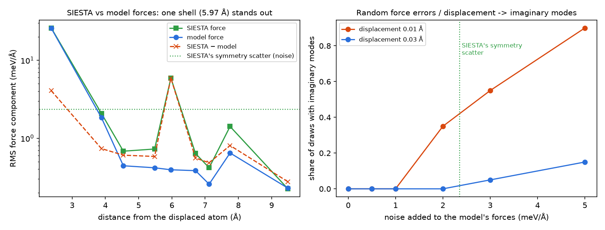

*Fig. 10 — Left: forces by distance from the displaced atom. Right: share of noisy force sets with imaginary modes,
at two displacements (`results_figures.py`).*

Random errors of 2 meV/Å on every force already make a 0.01 Å calculation unstable a third of the time; a single error
of 35 meV/Å does it every time. Three times the displacement makes it three times more robust (Fig. 3). Where the bad
force comes from was not traced: the SCF converged normally (8 iterations, `DM.Tolerance 1e-5`), and an egg-box force
from the real-space mesh (Mesh.Cutoff 300 Ry) would sit on the displaced atom, not 6 Å away. What it teaches holds
anyway:

- **Check a DFT phonon force set before trusting its imaginary modes**: the net force (`Tot` in `siesta.out`) should be
  close to that of the undisplaced supercell; symmetry-equivalent atoms should carry equivalent forces.
- **For DFT, 0.01 Å is fragile**: use 0.02–0.03 Å, tight SCF tolerances, and ± displacements.
- **A model trained on DFT can be cleaner than the DFT phonons it is compared with**: training on many configurations
  averages out errors like this one. Its own error is different — smooth and systematic, like the 11–18 % low elastic
  constants of section 5.3 — and the remaining difference to the repaired SIESTA phonons (X-TA 4.42 against 5.01 THz;
  experiment 4.49) cannot be settled with one SIESTA displacement. A repeated SIESTA calculation with ± 0.03 Å
  displacements would.

### 5.10 Thermal expansion: the quasi-harmonic approximation

```bash
stb-mlphonons --file si8.fdf --custom-model ... --custom-model-card ... --qha --n-volumes 7 --strain-range 4 --tmax 1500
```

Report `[3]`, the scan (per atom; `reference_results/qha/`):

```
 Strain%   V (Ang^3)   V/atom   a/a_in    E-Emin    f_min    f_max      ZPE F_vib(300K)   time
   -4.00    158.0045  19.7506  0.98648    10.069    0.361   15.748    63.56       37.84    4.0
   -1.33    162.3935  20.2992  0.99554     1.034    0.366   15.360    62.10       36.33    3.1
    0.00    164.5880  20.5735  1.00000     0.000    0.366   15.157    61.32       35.43    3.2
    1.33    166.7825  20.8478  1.00442     1.104    0.366   14.947    60.49       34.43    3.2
    4.00    171.1716  21.3964  1.01316     9.184    0.364   14.523    58.81       32.27    2.7
```

(7 volumes; 4 shown.) Then the results, with the foundation model for comparison (`qha_foundation_v0`: its cell first
relaxed with `stb-mlrelax --relax-cell`, so that the scan is centred on its own minimum):

| | V₀ (ų/atom) | B₀ (GPa) | zero-point ΔV | α_L(300 K) (10⁻⁶ K⁻¹) | α_L(1000 K) | B_T 300 / 1000 K (GPa) | γ (300 K) |
|---|---|---|---|---|---|---|---|
| fine-tuned | 20.566 | 93.5 | +0.52 % | 3.49 | 6.17 | 88.1 / 78.2 | 0.58 |
| MACE-MP-0 medium | 20.296 | 74.7 | +0.87 % | 9.29 | 8.11 | 72.6 / 89.0 | 1.14 |
| experiment | 20.02 (300 K) | 97.8 | — | 2.57 | 4.26 | 97.8 (298 K) | 0.46 |

The experimental `γ` follows from Eq. 14: `3 × 2.57 × 10⁻⁶ × 97.8 GPa × 20.02 ų / 2.40 k_B = 0.46`.

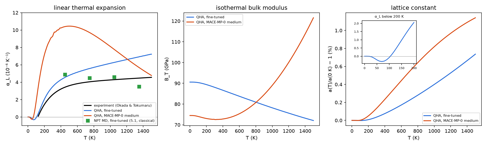

*Fig. 11 — QHA of both models against experiment [10] and the NPT molecular dynamics of the `7.2` example (same
fine-tuned model, classical nuclei). Inset: the fine-tuned model's negative expansion below 100 K
(`results_figures.py`).*

**The fine-tuned model.**

- **`V₀` and `B₀`.** The static minimum is 0.04 % from SIESTA's relaxed cell. `B₀ = 93.5 GPa` is 4 % below
  experiment, but 5 % above SIESTA's own 89.0 GPa at this level of theory: the `E(V)` of the perfect cell, `7.4`
  section 5.11. (The 94.4 of the `7.1` benchmark is fitted over its strained test cells, which are also rattled.)
- **Negative thermal expansion below 100 K**, minimum −0.32 × 10⁻⁶ K⁻¹ at 70 K. Real silicon contracts between about 20
  and 120 K [27]. The cause is in report `[6]`: the transverse acoustic modes have negative Grüneisen parameters.

| mode | γ, fine-tuned | γ, experiment [11] |
|---|---|---|
| Γ optical | +1.01 | ≈ +1.0 |
| X TA | −1.74 | ≈ −1.4 |
| L TA | −1.04 | ≈ −1.3 |

- **The expansion is 36–45 % above experiment** (3.49 against 2.57 × 10⁻⁶ K⁻¹ at 300 K). Eq. 14 says where it comes
  from: the model's `γ` is 26 % higher (0.58 against 0.46) and its `B_T` 10 % lower (88 against 98 GPa). Both are
  properties of the model's energy surface at this level of theory, not of the method.
- **QHA against MD with the same model** (green squares in Fig. 11): from 600 to 1200 K classical MD gives
  α_L ≈ 4.5 × 10⁻⁶, QHA 5.2–6.6. MD is classical but includes every anharmonic term; above `θ_D` it is the better
  method, and the difference is what QHA leaves out (section 1.10). Below about 400 K it is the other way round: MD's
  classical nuclei overestimate the expansion (`7.2`, section 5.7), and only the QHA reproduces the negative expansion.
- **Hand checks** (section 1.12): the Grüneisen relation reproduces `α_V` at 300 K to 0.2 %, and the zero-point
  pressure the zero-point expansion to 5 %.

**The foundation model** gives an unphysical QHA: `α_L` peaks at 500 K and then *falls*, and `B_T` *rises* from 73 to
122 GPa between 300 and 1500 K. No real solid stiffens on heating like that. The scan explains it: across ± 4 % its
highest frequency drops by 0.29, 0.30, 0.30, 0.29, 0.25, 0.20 THz per step (`qha_foundation_v0`, report `[3]`), so its
`γ` falls with volume,
and that volume dependence adds a large positive curvature to `F_vib(V)` that grows with T. The fine-tuned model's
steps are uniform (0.19–0.21 THz). Centring the scan on the foundation model's own minimum (`qha_foundation_v0`) gives
the same result as using the fine-tuned model's volumes (`qha_foundation`), with two warnings:

```
1. QHA: the model's static equilibrium volume is -1.35 % from the input structure. The scan is centred on the input;
   relax the cell with the same model first for a scan centred on V0.
2. QHA: at 1500 K V(T) is in the top 15 % of the scanned range; widen --strain-range to keep the fit away from the edge.
```

So the QHA tests a model harder than the phonons at one volume: it needs the *volume derivative* of the force
constants, a third derivative of the energy. Before trusting a QHA, look at the shape of `α(T)` and `B_T(T)`: `α` should
rise and level off, `B_T` should fall.

### 5.11 A vibration as a movie

The reference run animated the first optical mode at `Γ` (`--animate-mode` with no value; report section `MODE ANIMATION`):

```
Mode              : first optical mode (band 3; bands 0-2 are acoustic)
q-point           : [0.0, 0.0, 0.0]
Band index        : 3 (15.1639 THz)
Frames            : 30 (xsf format)
[OK] Saved ./mode_3.xsf
```

`reference_results/base/mode_3.xsf` opens in VESTA, XCrySDen, OVITO or `ase gui`: one period in 30 frames, the two atoms
of the primitive cell moving against each other along a bond direction, amplitude 0.5 Å (exaggerated to be seen).
Bands 0–2 at `Γ` are rigid translations of the whole crystal and make dull movies, which is why they are not the
default. A zone-boundary mode needs a modulation supercell commensurate with its wavevector: X-TA of the FCC cell,
`--animate-qpoint 0.5 0 0.5 --animate-dim 2 2 2 --animate-mode 0`.

### 5.12 What to take from the example

- A model fine-tuned on 57 SIESTA configurations gives silicon's phonons within a few percent of experiment, its heat
  capacity within 0.5 % and its entropy within 3 %, in seconds. The foundation model alone is 30 % too soft in the
  optical modes; the largest foundation model is the softest.
- Check the supercell with `--check-convergence`: special points depend on commensurability, sound velocities and
  interpolated regions on size; thermal properties converge first.
- With a model, the displacement size does not matter between 0.001 and 0.03 Å; above 0.05 Å anharmonicity shows.
- No imaginary mode does not mean relaxed, and relaxed does not mean symmetric: pre-relax, and symmetrize a structure
  that should have symmetry.
- A DFT force set can be wrong in one atom; the net force and the symmetry of the forces show it. The model trained on
  that DFT gave the cleaner phonons.
- The QHA is a harder test than the phonons themselves: a foundation model can give plausible bands and an absurd
  `B_T(T)`. The fine-tuned model reproduces the negative expansion of silicon and overestimates `α` by 36 %, the
  combination of its `γ` and `B`.

## 6. Reproducing the reference data

`reference_results/` holds what `make_reference.sh` copies out of its work folder: each case's report and data files
(`--save-data`), the gnuplot scripts of the `base`, `conv` and `qha` cases, `base/phonopy_disp.yaml` (the force
constants of the reference run) and `base/mode_3.xsf`; `elastic/` (`stb-mlelastic`); `siesta_phonons/` (the SIESTA
reference of `7.1`: `phonopy_disp.yaml`, `FORCE_SETS`, `FORCE_SETS.raw`, the `.FA` force files of the displaced and
undisplaced supercells and the SIESTA input); `siesta_compare.json`.

```bash
source ~/.anaconda3/etc/profile.d/conda.sh && conda activate stb   # or any environment with stb_suite[ml]
bash make_reference.sh                  # every case into ./reference_run/, then collect into reference_results/
python3 results_figures.py              # the tables of section 5 and figures/*.png (numpy + matplotlib only)
python3 theory_figures.py               # the figures of section 1
```

| Step | Cost |
|---|---|
| `make_reference.sh` | about 10 minutes on a 12-core CPU (`DEVICE=cuda` for a GPU); each case is skipped when its report exists |
| `siesta_compare.py` (called by it) | about 1 minute: two models on two displacements, 240 noisy phonon calculations |
| the SIESTA reference itself | not rerun: it is the `7.1` example's phonon calculation (SIESTA 5.4.2, 6 cores, 2 min 15 s per supercell) |

The foundation models are downloaded on first use. The numbers are deterministic on the CPU; on a GPU they agree to the
printed digits.

## 7. Known, deliberate limitations

- **Harmonic and quasi-harmonic only** (section 1.13): no lifetimes, no thermal conductivity, no temperature-dependent
  frequencies at fixed volume. For strongly anharmonic crystals use MD (`7.2`) and its vibrational spectrum
  (`2.18`, `stb-aimdAnalysis`).
- **No LO–TO splitting** for polar materials: MACE has no Born charges.
- **Isotropic QHA**: one scaling factor for the whole cell.
- **The phonons are those of the model**, not of SIESTA. The card's numbers tell you how far to trust it; one SIESTA
  phonon calculation on the same supercell, done carefully (section 5.9), is the real test.
- **Symmetry is detected with phonopy's tight default tolerance**: a slightly distorted input stays low-symmetry
  (section 5.8).

## 8. Step-by-step: phonons of your own material

1. **Choose the model.**
   - For a quick, qualitative look, the foundation model (`--model medium`) needs nothing — but expect frequencies too
     low, possibly by tens of percent (section 5.5).
   - For numbers you will use, train a model with `7.1` on configurations around your structure: rattled cells (they
     teach the curvature), strained cells (they teach the volume dependence the QHA needs), and MD frames. Validate it
     with `7.1.3`, ideally with `--phonon-ref` against one SIESTA phonon calculation (`5.4`). Keep the model and its
     card together.
2. **Relax the structure with the same model.** `stb-mlrelax --relax-cell` with the same `--custom-model`: the phonons
   must be computed at the model's own minimum, not at SIESTA's or at experiment's. If the structure should have
   symmetry, symmetrize it (`stb-unitcell`) afterwards.
3. **Check the supercell**: `--check-convergence` with two or three sizes. Take the smallest within 0.1 THz; use a larger
   one for sound velocities.
4. **Run the single-volume calculation** with `--save-report --save-data`, and read the report from the bottom:
   `WARNINGS` (the last section) first, then `[5]` (imaginary modes, and whether they could be any of the three causes
   of section 1.8), then `[4]`, `DENSITY OF STATES`, `THERMAL PROPERTIES`. With a custom model, `FINE-TUNED vs
   FOUNDATION` says how much the fine-tuning matters.
5. **For thermal expansion, run `--qha`** with 7 or more volumes over ± 3–5 %, and `--tmax` well below the melting
   point. Check `[4]` (is `V₀` inside the scan?), the warnings, and the shapes of `α(T)` and `B_T(T)`.
6. **Compare with SIESTA where it matters**: one `5.4` calculation on the same supercell. If its imaginary modes and
   the model's disagree, check the DFT force set (section 5.9) before blaming either.

## 9. Files in this folder

| File | What it is |
|---|---|
| `README.md` | this tutorial |
| `example_7.3.sh` | the guided walk-through (CPU, about 3 minutes; `DEVICE=cuda` for a GPU) |
| `si8.fdf` | bulk silicon, 8-atom conventional cell at SIESTA's relaxed lattice constant (5.48024 Å) |
| `si8_rattled.fdf` | the same with every atom moved by about 0.03 Å (section 5.8) |
| `make_reference.sh` | regenerates `reference_results/` (every case of section 5, CPU, about 10 minutes) |
| `siesta_compare.py` | the SIESTA phonons of `7.1` against both models on the same supercell, the force analysis and the noise experiment → `siesta_compare.json` (needs the `ml` extra) |
| `results_figures.py` | reads `reference_results/`, prints the tables of section 5, draws `figures/*.png` (numpy + matplotlib only) |
| `theory_figures.py` | draws the figures of section 1 |
| `figures/` | every figure of this README |
| `reference_results/` | reports, data and the SIESTA reference (section 6) |
| `../7.2-mlmd/model/` | the fine-tuned model and its card, shared with `7.2` |

## 10. Running the script

```bash
cd examples/7.3-mlphonons
bash example_7.3.sh               # CPU, ~3 min; press Enter between cases
DEVICE=cuda bash example_7.3.sh   # on a GPU
```

Each case writes into `output/<case>/`, which is wiped at every start. Cases 1 and 9 download the MACE-MP-0 medium model
on first use. Case 12 needs no MACE: it only reads `reference_results/`.

## 11. Flag reference

**`stb-mlphonons`** — `--file FILE` (`.fdf`, required) · `--model {small,medium,large}` (default medium) ·
`--custom-model PATH` + `--custom-model-card JSON` (always both) · `--skip-foundation-comparison` · `--dim NA NB NC`
(default `2 2 2`) · `--distance Å` (default 0.01) · `--no-relax` · `--fmax eV/Å` (pre-relax, default 0.05) ·
`--vacuum-gap Å` (default 10) · `--band-points N` (per segment, default 101) · `--mesh NA NB NC` (default
`20 20 20`) · `--tmin`, `--tmax`, `--tstep` K (default 0, 1000, 10) · `--qha` · `--n-volumes N` (≥ 4, default 5) ·
`--strain-range %` (default 3) · `--eos {vinet,murnaghan,birch_murnaghan}` (default vinet) · `--check-convergence` ·
`--convergence-dims N...` (triples) · `--convergence-tol THz` (default 0.1) · `--freeze-unstable-mode` ·
`--freeze-amplitude Å` (default 0.05) · `--animate-mode [BAND|optical]` (no value: the first optical mode) ·
`--animate-qpoint QA QB QC` (default Γ) · `--animate-dim NA NB NC` (default `1 1 1`) · `--animate-amplitude Å`
(default 0.5) · `--animate-frames N` (default 30) · `--animate-format {xsf,pdb,xyz}` · `--device {cpu,cuda}` ·
`-o/--output-dir DIR` (default `mlphonons_out`) · `--show` · `--save-gnuplot` · `--save-data` · `--save-report` ·
`--no-intro` · `-v`.

## 12. What's next

- **`5.4` (Phonons workflow)** computes the same phonons with SIESTA: the reference to validate a model against, and the
  method for a material you have no model for. Section 5.9 shows what to check in its force sets.
- **`7.1` (MLFF workflow)** trains the model. Its Stage 3 `--phonon-ref` compares the committee's phonons with a
  finished `5.4` calculation q-point by q-point.
- **`7.2` (`stb-mlmd`)** gives the full anharmonic, classical picture: compare its NPT thermal expansion with the QHA
  (section 5.10), and its heat capacity with the quantum one of section 5.4.
- **`7.4` (`stb-mlelastic`)** gives the elastic constants by stress-strain: compare them with the sound velocities
  (section 5.3).
- **`5.15` (equation of state)** fits SIESTA's static `E(V)`, the curve the QHA adds `F_vib` to.

## 13. References

1. M. Born, K. Huang, *Dynamical Theory of Crystal Lattices* (Oxford University Press, 1954).
2. A. A. Maradudin, E. W. Montroll, G. H. Weiss, I. P. Ipatova, *Theory of Lattice Dynamics in the Harmonic
   Approximation*, 2nd ed. (Academic Press, 1971).
3. N. W. Ashcroft, N. D. Mermin, *Solid State Physics* (Saunders, 1976), chapters 22, 23 and 25.
4. M. T. Dove, *Introduction to Lattice Dynamics* (Cambridge University Press, 1993).
5. A. Togo, I. Tanaka, "First principles phonon calculations in materials science", *Scr. Mater.* **108**, 1 (2015).
6. K. Parlinski, Z. Q. Li, Y. Kawazoe, "First-principles determination of the soft mode in cubic ZrO₂", *Phys. Rev.
   Lett.* **78**, 4063 (1997).
7. S. Baroni, S. de Gironcoli, A. Dal Corso, P. Giannozzi, "Phonons and related crystal properties from
   density-functional perturbation theory", *Rev. Mod. Phys.* **73**, 515 (2001).
8. G. Nilsson, G. Nelin, "Study of the homology between silicon and germanium by thermal-neutron spectrometry",
   *Phys. Rev. B* **6**, 3777 (1972).
9. J. J. Hall, "Electronic effects in the elastic constants of n-type silicon", *Phys. Rev.* **161**, 756 (1967).
10. Y. Okada, Y. Tokumaru, "Precise determination of lattice parameter and thermal expansion coefficient of silicon
    between 300 and 1500 K", *J. Appl. Phys.* **56**, 314 (1984).
11. B. A. Weinstein, G. J. Piermarini, "Raman scattering and phonon dispersion in Si and GaP at very high pressure",
    *Phys. Rev. B* **12**, 1172 (1975).
12. P. Flubacher, A. J. Leadbetter, J. A. Morrison, "The heat capacity of pure silicon and germanium and properties of
    their vibrational frequency spectra", *Philos. Mag.* **4**, 273 (1959).
13. M. W. Chase Jr., *NIST-JANAF Thermochemical Tables*, 4th ed., *J. Phys. Chem. Ref. Data, Monograph* **9** (1998).
14. E. Grüneisen, "Theorie des festen Zustandes einatomiger Elemente", *Ann. Phys.* **344**, 257 (1912).
15. S. Baroni, P. Giannozzi, E. Isaev, "Density-functional perturbation theory for quasi-harmonic calculations",
    *Rev. Mineral. Geochem.* **71**, 39 (2010).
16. A. Togo, L. Chaput, I. Tanaka, G. Hug, "First-principles phonon calculations of thermal expansion in Ti₃SiC₂,
    Ti₃AlC₂, and Ti₃GeC₂", *Phys. Rev. B* **81**, 174301 (2010).
17. P. Vinet, J. R. Smith, J. Ferrante, J. H. Rose, "Temperature effects on the universal equation of state of solids",
    *Phys. Rev. B* **35**, 1945 (1987).
18. I. Batatia, D. P. Kovács, G. N. C. Simm, C. Ortner, G. Csányi, "MACE: Higher order equivariant message passing
    neural networks for fast and accurate force fields", *Adv. Neural Inf. Process. Syst.* **35**, 11423 (2022).
19. I. Batatia et al., "A foundation model for atomistic materials chemistry", arXiv:2401.00096 (2023).
20. B. Deng, Y. Choi, P. Zhong, J. Riebesell, S. Anand, Z. Li, K. Jun, K. A. Persson, G. Ceder, "Systematic softening in
    universal machine learning interatomic potentials", *npj Comput. Mater.* **11**, 9 (2025).
21. J. M. Soler et al., "The SIESTA method for ab initio order-N materials simulation", *J. Phys.: Condens. Matter*
    **14**, 2745 (2002).
22. A. H. Larsen et al., "The atomic simulation environment — a Python library for working with atoms", *J. Phys.:
    Condens. Matter* **29**, 273002 (2017).
23. A. García et al., "Siesta: Recent developments and applications", *J. Chem. Phys.* **152**, 204108 (2020).
24. A. Togo, L. Chaput, T. Tadano, I. Tanaka, "Implementation strategies in phonopy and phono3py", *J. Phys.: Condens.
    Matter* **35**, 353001 (2023).
25. D. C. Wallace, *Thermodynamics of Crystals* (Wiley, 1972).
26. A. Togo, K. Shinohara, I. Tanaka, "Spglib: a software library for crystal symmetry search", *Sci. Technol. Adv.
    Mater.: Methods* **4**, 2384822 (2024).
27. K. G. Lyon, G. L. Salinger, C. A. Swenson, G. K. White, "Linear thermal expansion measurements on silicon from 6 to
    340 K", *J. Appl. Phys.* **48**, 865 (1977).
