# 7.4 — ML Elastic Constants (`stb-mlelastic`)

`stb-mlelastic` computes the **elastic constants** of a crystal — its stiffness tensor `C` — with a MACE
machine-learned potential: either the MACE-MP-0 foundation model, or a model you fine-tuned on your own SIESTA
calculations with the MLFF workflow (`7.1`), which always comes with its **model card**. It uses the stress-strain
method: relax the cell, strain it along each of the six independent directions at a few amplitudes up to ±1 %, relax
the atoms inside every strained cell, and fit stress against strain. From `C` it reports:

- the constants the crystal's symmetry allows, and how far the raw fit is from that symmetry;
- mechanical stability (Born criteria);
- polycrystal bulk, shear and Young's moduli and Poisson's ratio (Voigt, Reuss, Hill), and the usual ratios;
- how much the relaxation of the atoms inside the cell softens each constant (clamped vs relaxed ions);
- sound velocities along [100], [110], [111] and the Debye temperature;
- the directional Young's modulus and linear compressibility;
- for a 2D sheet, the in-plane constants in N/m;
- with a fine-tuned model, the same with the raw foundation model, constant by constant.

A second mode, `--check-convergence`, repeats the fit at several strain amplitudes. Plots, gnuplot files and data files
are written only when you ask for them.

**Why a potential for elastic constants?** The SIESTA route (`5.2`) needs one calculation per strained cell — a few
dozen for a full tensor, each a relaxation of the atoms — and fights the real-space mesh
("egg-box") noise of SIESTA's stress. A MACE stress costs milliseconds and has no such noise: the whole tensor, with
the foundation-model comparison and the clamped-ion scan, takes half a minute. The price is the usual one: the model is
only as good as what it was trained on, and elastic constants are second derivatives of its energy surface — a
demanding test (section 1.10).

The worked example (section 5) runs it on a GPU for bulk silicon, with the fine-tuned model of the `7.2` example
(trained in the `7.1` example's silicon run), against experiment and against the phonons of the `7.3` example:

- the constants and moduli against ultrasonic measurements, and what the derived ratios say;
- sound velocities against the slopes of the `7.3` phonons;
- the internal relaxation, and why the force threshold of the relaxation matters;
- the strain amplitude, the cell size, and a structure that is not at a minimum;
- three foundation models, all too soft;
- hcp magnesium (five independent constants) and graphene (a 2D sheet) with the foundation model.

## 1. Theory

**Symbols at a glance**

| Symbol | Meaning |
|---|---|
| `σ_ij`, `ε_kl` | stress (GPa) and strain (dimensionless) tensors |
| `C_ijkl`, `C_mn` | stiffness tensor; its 6×6 Voigt form (`m, n` = 1..6) |
| `S_mn` | compliance, `S = C⁻¹` (1/GPa; reported in 1/TPa) |
| `ε_m` | Voigt strain: `ε_1..3 = ε_xx, ε_yy, ε_zz`; `ε_4..6 = 2ε_yz, 2ε_xz, 2ε_xy` (engineering shear) |
| `B`, `G`, `E`, `ν` | bulk, shear and Young's moduli, Poisson's ratio |
| `_V`, `_R`, `_H` | Voigt, Reuss and Hill averages |
| `A`, `A^U` | Zener ratio (cubic), universal anisotropy index |
| `u` | internal coordinate: a displacement of the atoms inside the cell at fixed strain |
| `ρ`, `v` | mass density, sound velocity |
| `θ_D` | Debye temperature |
| `n` | atoms per unit volume |

### 1.1 Hooke's law and the stiffness tensor

For small deformations stress is linear in strain [1]:

```
σ_ij = Σ_kl C_ijkl ε_kl                                                                                   (1)
```

`C_ijkl` has 81 components, but `σ` and `ε` are symmetric, so only 36 are distinct; and because `C` is the second
derivative of an energy, `C_ijkl = C_klij`, which leaves **21**. The Voigt notation stores them in a symmetric 6×6
matrix (`xx → 1`, `yy → 2`, `zz → 3`, `yz → 4`, `xz → 5`, `xy → 6`) [1]:

```
σ_m = Σ_n C_mn ε_n          ε_4,5,6 = 2 ε_yz, 2 ε_xz, 2 ε_xy  (engineering shear strains)                        (2)
E_elastic / V = ½ Σ_mn C_mn ε_m ε_n                                                                       (3)
```

The factor 2 in the shear strains is a convention, but it decides the numbers: with it, `C44` is the ratio of shear
stress to the *engineering* shear angle, which is what ultrasonic measurements and every table report. `stb-mlelastic`
uses the same deformation matrices as the SIESTA workflow (`elastic_inputs.get_strain_matrix`), so a strain called
`xy` means the same thing in both tools.

### 1.2 The stress-strain method

Apply a strain `ε` to the relaxed cell (`h' = h (1 + ε)`), relax the atoms at that fixed cell, compute the stress, and
repeat at several amplitudes. For each of the six Voigt directions `n`, the stress components against the strain
amplitude are straight lines whose slopes are the column `n` of `C` [4]:

```
C_mn = ∂σ_m / ∂ε_n                  (a linear fit of σ_m against ε_n, at --steps points in ±--max %)             (4)
```

- **Symmetric points** (`-ε … +ε`) cancel the second-order (quadratic) terms of the stress in the fitted slope; the
  first error left is of order `ε²` and comes from the third-order elastic constants (section 5.5).
- **The intercept** of each fit is the stress of the unstrained cell. It should be ≈ 0: the reference must be at a
  stress-free minimum of *this* model, which is why every model first relaxes the cell and the atoms (`--fmax`). A
  non-zero intercept means a residual stress that contaminates every constant.
- `C_mn` and `C_nm` come from two different directions; their agreement (`C = Cᵀ`) is a check of the fits.

The alternative, the energy-strain method, fits `E(ε)` (Eq. 3) instead. It needs larger strains, because the energy is
quadratic, and it is what the SIESTA workflow offers to avoid SIESTA's stress noise. A MACE stress is the exact
derivative of a smooth energy, so the stress method, with small strains, is the better choice here.

### 1.3 Internal relaxation: clamped and relaxed ions

When a crystal with more than one atom per primitive cell is strained, the atoms do not in general stay where the
homogeneous strain puts them. In diamond-structure silicon, a shear `ε_yz` pushes the two atoms of the primitive cell
along `x` in opposite directions, because the strain makes one of the four bonds shorter than the others. At fixed
strain the energy has an extra internal coordinate `u` (Fig. 1) [11, 12]:

```
E / V = ½ C⁰ ε² − D ε u + ½ K u²      →      u* = (D / K) ε,       C = C⁰ − D² / K                            (5)
```

- `C⁰` is the **clamped-ion** constant (`u = 0`); `C` is the **relaxed-ion** constant, the one measured by any
  experiment slower than a lattice vibration.
- Where the symmetry pins every atom (silicon under `xx`, `yy`, `zz` strain; any crystal with all atoms at inversion
  centres), `D = 0` and the two coincide.
- In silicon, Kleinman's internal-strain parameter describes `u*`; the relaxation lowers `C44` by about a third (section
  5.4).

`stb-mlelastic` relaxes the atoms at every strained cell (`--no-relax` turns it off), and by default also runs the scan
without relaxation (`--no-clamped` skips it) to report both.

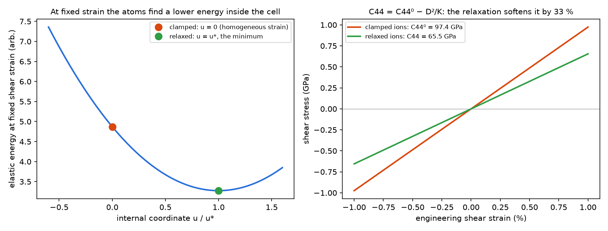

*Fig. 1 — Left: energy against the internal coordinate at a fixed shear strain; clamped (`u = 0`) and relaxed (`u = u*`)
positions. Right: the stress-strain lines of the clamped- and relaxed-ion constants, with the silicon model's numbers
(`theory_figures.py`).*

**Why the force threshold matters.** Under a 1 % shear, the silicon atoms move by only ~0.008 Å. A relaxation that
stops at a residual force `f` leaves them `~f/k` away from `u*`, with `k ≈ 13 eV/Ų` the on-site stiffness:
`f = 0.02 eV/Å` is 0.0015 Å, a fifth of the effect being measured. This is why `--fmax` defaults to 0.001 eV/Å
(section 5.4).

### 1.4 Symmetry: which constants are independent

Neumann's principle: a physical property tensor has at least the symmetry of the crystal's point group [1]. For each
rotation `R` of the point group, `C_ijkl = R_ia R_jb R_kc R_ld C_abcd`. That reduces the 21 constants:

| Crystal system | Independent constants | Example |
|---|---|---|
| cubic | 3: `C11 = C22 = C33`, `C12 = C13 = C23`, `C44 = C55 = C66` | Si, Al, NaCl |
| hexagonal | 5: `C11 = C22`, `C12`, `C13 = C23`, `C33`, `C44 = C55`; `C66 = (C11 − C12)/2` | Mg, graphite, wurtzite |
| tetragonal | 6 or 7 | TiO₂ rutile |
| trigonal | 6 or 7 | α-quartz, Al₂O₃ |
| orthorhombic | 9 | olivine |
| monoclinic | 13 | |
| triclinic | 21 | |

(in the standard orientation; for hexagonal, `c` along `z`.)

`stb-mlelastic` finds the space and point group of the pre-relaxed cell with spglib [21], and **projects** the fitted
tensor on the point group — averages `C` over every rotation, in the cell's own Cartesian frame, so it works for any
orientation:

```
C_sym = (1 / |G|) Σ_{R ∈ G} R ⋆ C          (R ⋆ C: the rotation applied to all four indices)                     (6)
```

The report then gives:

- the largest difference `|C − C_sym|` — a fit with the crystal's symmetry has none; a large one means noisy fits, an
  unrelaxed reference, or a symmetry found too high or too low;
- the independent constants, as groups of equal entries of `C_sym`. A linear relation that is not an equality — the
  hexagonal `C66 = (C11 − C12)/2` — is recognized and marked `= (C11 - C12)/2, not independent`, and not counted.

The numbers derived from `C` (moduli, velocities, stability) use the fitted tensor itself; the projection is a check.
The symmetry tolerance of spglib is fixed at 10⁻³ Å.

### 1.5 Mechanical stability: Born's criteria

A crystal is mechanically stable when every small homogeneous strain raises its energy, i.e. when the quadratic form
of Eq. 3 is positive definite: **all six eigenvalues of `C` are positive** — necessary and sufficient for any crystal
system [5]. For the common systems this takes explicit forms [5], which the report lists too:

```
cubic:                 C11 − C12 > 0,    C11 + 2 C12 > 0,    C44 > 0                                             (7)
hexagonal, tetragonal: C11 > |C12|,      2 C13² < C33 (C11 + C12),    C44 > 0   (tetragonal also C66 > 0)
2D sheet:              C11 > 0,          C66 > 0,            C11 C22 − C12² > 0
```

### 1.6 Polycrystal moduli: Voigt, Reuss and Hill

A polycrystal of randomly oriented grains is isotropic and has two constants, the bulk modulus `B` and the shear modulus
`G`. They depend on how the grains share the load, and two limits bracket them [6, 7]:

- **Voigt**: every grain has the same strain (an upper bound);
- **Reuss**: every grain carries the same stress (a lower bound);
- **Hill**: their mean, the usual estimate [6].

```
B_V = [(C11 + C22 + C33) + 2 (C12 + C13 + C23)] / 9
G_V = [(C11 + C22 + C33) − (C12 + C13 + C23) + 3 (C44 + C55 + C66)] / 15
1/B_R = (S11 + S22 + S33) + 2 (S12 + S13 + S23)                                                                (8)
15/G_R = 4 (S11 + S22 + S33) − 4 (S12 + S13 + S23) + 3 (S44 + S55 + S66)
E = 9 B G / (3 B + G)            ν = (3 B − 2 G) / [2 (3 B + G)]
```

For a cubic crystal `B_V = B_R = (C11 + 2 C12)/3`; only the shear moduli differ, and the more anisotropic the crystal,
the further apart they are (Fig. 2).

**Ratios** the report gives, with their usual reading:

| Quantity | Formula | Reading |
|---|---|---|
| Zener ratio (cubic) | `A = 2 C44 / (C11 − C12)` | 1 = isotropic |
| universal anisotropy | `A^U = 5 G_V/G_R + B_V/B_R − 6` [8] | 0 = isotropic, for any crystal system |
| Pugh ratio | `B / G` [9] | above ~1.75 ductile, below brittle (an empirical rule for metals and covalent solids) |
| Cauchy pressure (cubic) | `C12 − C44` | negative: directional (covalent) bonding; positive: metallic. Zero for central pair forces |
| Vickers hardness | `H_V = 2 (k² G)^0.585 − 3`, `k = G/B` [10] | an empirical correlation, ±30 % at best |
| linear compressibility | `β_i = Σ_j S_ij` | fractional shortening of axis `i` per unit hydrostatic pressure |

These ratios are rules of thumb built on the constants. They amplify the constants' errors (section 5.2).

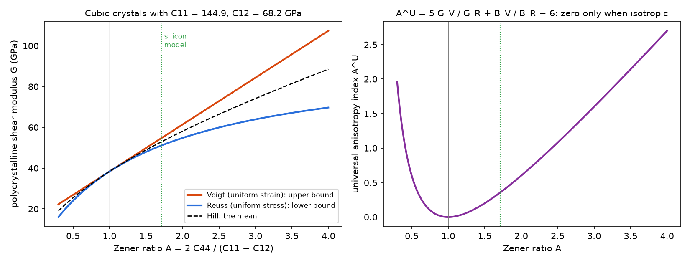

*Fig. 2 — Left: the Voigt and Reuss shear moduli of cubic crystals with the silicon model's `C11` and `C12`, against
the Zener ratio; they meet only for an isotropic crystal. Right: the universal anisotropy index (`theory_figures.py`).*

### 1.7 Directional properties

The Young's modulus along a unit direction `n` — the stiffness of a thin bar cut along `n` — and the linear
compressibility along `n` follow from the compliance tensor [1]:

```
1 / E(n) = Σ_ijkl s_ijkl n_i n_j n_k n_l              β(n) = Σ_ijk s_ijkk n_i n_j                                 (9)
```

(`s_ijkl` is the 4-index compliance, with the factors ½ per engineering shear index). A cubic crystal is stiffest along
`<111>` when `A > 1` and along `<100>` when `A < 1` (Fig. 3); its linear compressibility is the same in every
direction. The report gives the extremes of `E(n)` over a sphere with their directions, and `directional_moduli.png`
draws `E` and `β` in two Cartesian planes of the cell: `xy`, and the plane containing `z` and `x + y` (for a cubic
cell, the (001) and (1-10) planes; for a hexagonal cell with `c` along `z`, the basal plane and a plane containing `c`).

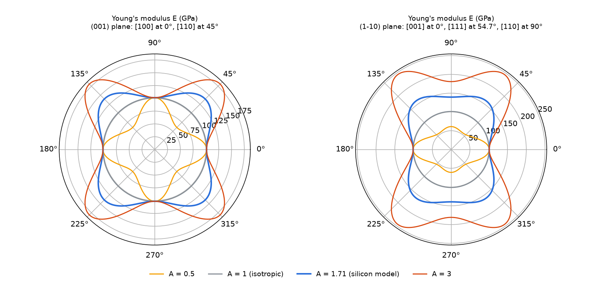

*Fig. 3 — `E(n)` of cubic crystals with the silicon model's `C11`, `C12` and four Zener ratios (`theory_figures.py`).*

### 1.8 Sound velocities and the Debye temperature

A plane elastic wave along `n` obeys the **Christoffel equation** [14]:

```
Σ_k (Σ_jl C_ijkl n_j n_l − ρ v² δ_ik) p_k = 0                                                                (10)
```

Its three eigenvalues `ρv²` give one quasi-longitudinal and two quasi-transverse velocities. For a cubic crystal along
`[100]`, `ρv_L² = C11` and `ρv_T² = C44`; along `[110]`, `ρv_T1² = (C11 − C12)/2`; and so on (`7.3`, section 1.7). These
are the slopes of the acoustic phonon branches at `q → 0`, an independent measurement of the same constants (section
5.3).

The report also gives the isotropic (Hill) velocities and the **elastic Debye temperature** [13]:

```
v_L = √[(B + 4G/3)/ρ],   v_T = √(G/ρ),   3 / v_m³ = 1/v_L³ + 2/v_T³,   θ_D = (ħ/k_B) (6π² n)^(1/3) v_m         (11)
```

It is the Debye model's cutoff fitted to the long-wavelength sound — the low-temperature heat capacity. For silicon the
experimental constants give 649 K, the calorimetric value is 645 K. It differs from the "second-moment" `θ_D` of the
phonon DOS that `7.3` reports, which weighs all frequencies.

### 1.9 Two-dimensional materials

For a sheet with vacuum along `z`, straining `zz`, `yz` or `xz` would only stretch empty space: those directions are
skipped. The stress of the cell is an average over its height `L_z`, vacuum included, so `σ × L_z` is the force per
unit length of the sheet, and the in-plane constants are reported **per area, in N/m**, independent of the vacuum:

```
E_x = (C11 C22 − C12²) / C22,    ν_xy = C12 / C22,    G_xy = C66,    γ = (C11 + C22 + 2 C12) / 4  (layer modulus)  (12)
```

A hexagonal sheet (graphene, hBN, MoS₂) is isotropic in-plane: `C11 = C22`, `C66 = (C11 − C12)/2`, `E(θ)` constant. A 1D
wire along `c` has a single constant, the axial stiffness `C33` in nN (stress × cross-section).

### 1.10 Elastic constants from a machine-learned potential

- **No noise.** The stress is the exact derivative of a smooth energy, so small strains (±1 %) and few points work. The
  limits are the relaxation threshold (section 1.3) and the strain amplitude (third-order terms).
- **Second derivatives are demanding.** The training fits energies, forces and stresses of distorted cells; the
  stiffness is the slope of the stress, constrained only by the strained configurations in the training set (6 of 57
  in the example's model).
- **Foundation models are soft.** Universal potentials trained on near-equilibrium structures underestimate the
  curvature of the energy surface [19]. For silicon every MACE-MP-0 size puts `C44` ~60 % below experiment (section
  5.6).
- **The model card** (report section `MODEL`) is printed in full, and the strained cells are compared with its trained
  range of volume, pressure and interatomic distance (section `TRAINED RANGE`).

### 1.11 A calculation you can check by hand

From the reference run (section 5.2): `C11 = 144.88`, `C12 = 68.15`, `C44 = 65.47 GPa`, `ρ = 2267.5 kg/m³`,
8 atoms in 164.5 ų.

- **Bulk modulus (Eq. 8):** `B = (144.88 + 2 × 68.15)/3 = 93.73 GPa`. Reported: 93.73 (Voigt = Reuss for a cubic crystal).
- **Voigt shear modulus:** `G_V = (144.88 − 68.15 + 3 × 65.47)/5 = 54.63 GPa`. Reported: 54.63.
- **Zener ratio:** `A = 2 × 65.47/(144.88 − 68.15) = 1.707`. Reported: 1.707.
- **Sound along [100]:** `v_L = √(144.88 × 10⁹ / 2267.5) = 7993 m/s`, `v_T = √(65.47 × 10⁹ / 2267.5) = 5373 m/s`. Reported:
  7993 and 5374.
- **Linear compressibility:** for a cubic crystal `β = 1/(3B) = 1000/(3 × 93.73) = 3.556 /TPa`. Reported: 3.556 on
  every axis.
- **Young's modulus along [100]:** `E = (C11 − C12)(C11 + 2C12)/(C11 + C12) = 76.73 × 281.18 / 213.03 = 101.28 GPa`.
  Reported: 101.27.

### 1.12 What this tool simplifies — explicitly

- **Static, 0 K constants.** No temperature: no thermal expansion of the reference cell, no vibrational
  contribution (adiabatic vs isothermal constants differ by ~1 % in solids).
- **Linear elasticity.** Small strains; the third-order constants appear only as the drift of `--check-convergence`.
- **The derived quantities use the fitted tensor**, not its symmetry projection; the projection is reported as a check.
- **spglib tolerance fixed** at 10⁻³ Å. A cell distorted beyond it is treated as lower symmetry.
- **Empirical ratios** (Pugh, Cauchy, hardness) are reported as such, without error bars.
- **One model, no error bars** on the constants; the fit's R² measures the stress noise, not the model's error.

## 2. Libraries and external dependencies used

| Library | Used for |
|---|---|
| ASE [22] | `Atoms`, strained cells, the relaxations (through `stb.core.mace_relax`), neighbour lists |
| mace-torch [17, 18] | the MACE calculator, the foundation models (downloaded once, cached in `~/.cache/mace/`) and custom `.model` files |
| PyTorch | runs the model on `cpu` or `cuda` (`--device`) |
| spglib [21] | space group, point group and its rotations |
| pymatgen | structure conversion |
| NumPy | fits, tensors, eigenvalues, Christoffel |
| matplotlib | the PNG figures (always written), `--show` |
| gnuplot (optional) | renders the `.gplot` files written by `--save-gnuplot` |
| `stb.elastic_analysis`, `stb.elastic_inputs` | the stiffness fit, fit diagnostics and strain matrices shared with the SIESTA workflow (`5.2`) |
| `stb.core` | `.fdf` reading, the model card, the calculator, relaxations and device checks, library-noise capture |

Install the `ml` extra: `pip install stb_suite[ml]`.

## 3. What `stb-mlelastic` does

### 3.1 One fit (the default)

1. **Read** the structure (`--file`, `.fdf`), find its dimensionality (vacuum-padded axes, from `--vacuum-gap`;
   `--dimensionality` overrides it: 2D expects the vacuum along `z`, 1D a wire along `c`), its symmetry.
2. **Load the model**: a foundation model (`--model`) or a custom model with its card (`--custom-model` +
   `--custom-model-card`; the card must match the model's SHA-256). Print the card; check the structure against it.
3. **Pre-relax** the cell and the atoms to the model's own minimum (`--fmax`, `--max-steps`; vacuum axes fixed), unless
   `--no-pre-relax`.
4. **Strain scan**: for each Voigt direction not blocked by a vacuum axis, `--steps` strains in `±--max` %; at each,
   relax the atoms at fixed cell (unless `--no-relax`) and record the stress, the volume, the pressure, the shortest
   distance and the largest internal shift. Then the same without relaxation (clamped ions), unless `--no-clamped`.
5. **Fit** each direction (Eq. 4): `C`, R² and intercept per direction; symmetrize `(C + Cᵀ)/2`.
6. **Analyse**: symmetry projection, Born criteria, moduli and ratios, clamped vs relaxed, Christoffel and Debye,
   directional properties (3D); in-plane moduli (2D).
7. With a custom model, repeat 3–6 with the **foundation model** (`--model`) unless `--skip-foundation-comparison`.

Each model is strained about **its own** relaxed cell: the comparison is between the two models' minima, not at a common
lattice.

### 3.2 `--check-convergence`

Steps 1–5 at every amplitude of `--convergence-strains` (default: half, the given, and double `--max`), compared
constant by constant (every independent constant, the smallest R², `B` and `G`), with the largest relative change and a
warning above 2 %.

### 3.3 The report, section by section

Sections are numbered in order; those that do not apply (3D-only, a single model, the convergence mode) are left out.

| Section | Content |
|---|---|
| `RUN METADATA` | date, versions, device (GPU name), input, mode, strains, relaxation settings, model, comparison |
| `STRUCTURE` | atoms, formula, cell, volume and density, shortest distance, space group, units of the constants |
| `MODEL` | the **model card** in full, or the foundation model's identity; load time |
| `REFERENCE STATE` | per model: pre-relax (forces, steps), lattice before → after and volume change, stress before → after; normalization (2D/1D) |
| `STRESS-STRAIN FITS` | per model and direction: the diagonal constant, R², intercept, largest stress, largest internal shift and per %, relaxation steps; skipped directions |
| `TRAINED RANGE` | volume per atom, pressure and shortest distance over all strained cells; with a card, each against its trained range |
| `STIFFNESS TENSOR & CRYSTAL SYMMETRY` | `C`, `C = Cᵀ` check, space/point group, projection and its deviation, the independent constants, the compliance `S` |
| `MECHANICAL STABILITY` | per model: the Born criteria and the verdict |
| `ELASTIC MODULI` | Voigt/Reuss/Hill `B`, `G`, `E`, `ν`; Pugh, Cauchy, Zener, `A^U`, hardness, linear compressibilities (3D) |
| `INTERNAL RELAXATION` | clamped vs relaxed constants and their difference (3D, 2+ atoms) |
| `SOUND VELOCITIES & DEBYE TEMPERATURE` | density; Christoffel velocities along [100], [110], [111]; isotropic velocities; `θ_D` (3D) |
| `DIRECTIONAL ANISOTROPY` | `E(n)` extremes and their directions, `β(n)` extremes, `E` along the axes (3D) |
| `IN-PLANE MODULI` | `E_x`, `E_y`, `ν`, `G_xy`, layer modulus, `E(θ)` range (2D) |
| `FINE-TUNED vs FOUNDATION` | every independent constant, `B`, `G`, `E`, `ν` and the lattice of both models, with the difference |
| `SUMMARY & FILES` | status, headline numbers, files, the outputs not asked for, wall time |
| `WARNINGS` | every warning, numbered; the count of library messages captured |

With `--check-convergence`: `RUN METADATA`, `STRUCTURE`, `MODEL`, `STRAIN-AMPLITUDE CONVERGENCE CHECK`, `SUMMARY & FILES`,
`WARNINGS`.

### 3.4 Files

| Written | When |
|---|---|
| `stress_strain.png` (every direction, both models) | always |
| `directional_moduli.png` (polar `E` and `β`), `anisotropy_surface.png` (3D `E` surface, `--skip-anisotropy-surface` omits it) | 3D |
| `inplane_youngs.png` | 2D |
| `strain_convergence.png` | `--check-convergence` |
| `stress_strain.dat`, `elastic_tensor.dat` (`C`, its projection, `S`), `directional.dat` / `strain_convergence.dat` | `--save-data` |
| `plot/*.dat`, `plot/*.gplot`, and `plot/*.pdf` when gnuplot is installed | `--save-gnuplot` |
| `stb_mlelastic_report.txt` | `--save-report` |
| the figures on screen | `--show` (needs a display; without one it is a warning) |

Everything goes into `-o/--output-dir` (default `mlelastic_out`).

### 3.5 Guard rails

| Situation | Behaviour |
|---|---|
| `--custom-model` without `--custom-model-card`, an unreadable card, or a SHA-256 mismatch | clean error |
| `--steps` below 2, `--max` not positive, `--convergence-strains` with one value | clean error |
| an isolated molecule (vacuum along every axis) | clean error: no elastic constants |
| vacuum along an axis the 2D/1D conventions do not expect | warning, treated as 3D (`--dimensionality` overrides) |
| a direction touching a vacuum axis | skipped and listed |
| the pre-relax hits `--max-steps`; a residual stress above 0.2 GPa at zero strain | warning |
| a model's own equilibrium volume more than 1 % from the input | warning (the constants are at the model's minimum) |
| a fit with R² below `--fit-quality-tolerance` or a large intercept | warning naming the directions |
| `C ≠ Cᵀ` by more than 1 %; a tensor departing from the crystal's symmetry by more than 1 % | warning |
| no symmetry found (P1) | warning: no projection, 21 free constants |
| strained cells outside the card's trained volume or pressure | warning |
| Born criteria failed; an imaginary sound velocity; a singular tensor | warning; dependent sections skipped |
| `--device cuda` with no usable GPU; a missing input or model file | clean error |
| `--show` without a display; gnuplot not installed | warning; files written anyway |

## 4. Running it both ways

**Command line:**

```bash
stb-mlelastic --file si8.fdf \
              --custom-model model/mlff_model_compiled.model --custom-model-card model/mlff_model_card.json \
              --device cuda --steps 7 --save-data --save-gnuplot --save-report
stb-mlelastic --file si8.fdf --custom-model ... --custom-model-card ... --check-convergence --convergence-strains 0.25 0.5 1 2 3
stb-mlelastic --file graphene.fdf --model medium --max 0.5
```

**Interactive menu:** run `stb-suite` and type `7.4`. It asks, in this order:

1. the structure;
2. a custom model path, or Enter for a foundation model and then its size. With a custom model it asks for the card and
   offers `mlff_model_card.json` next to the model as the default;
3. the device (`cpu`/`cuda`; it checks the GPU) — for a custom model too;
4. the strain amplitude, the points per direction, the dimensionality, the output folder;
5. whether to run the convergence check instead (then the amplitudes); otherwise, with a custom model, whether to
   compare with the foundation model, and whether to skip the 3D surface;
6. one question per optional output (show, gnuplot, data, report).

The menu builds the same command line and calls `stb-mlelastic`; the guided script (Case 11) drives it with piped
answers.

## 5. Worked example: silicon, magnesium, graphene

### 5.1 Set-up

The structures:

- `si8.fdf`, the 8-atom conventional diamond cell at SIESTA's relaxed lattice constant (5.48024 Å; experiment 5.4310 Å
  at 300 K); `si8_rattled.fdf`, the same with every atom moved by about 0.03 Å (section 5.8);
- `mg_hcp.fdf`, hcp magnesium at the experimental lattice, `c` along `z` (section 5.9);
- `graphene.fdf`, a graphene sheet with 20 Å along `c` (section 5.10).

The model, `../7.2-mlmd/model/` (shared with `7.2` and `7.3`): round 2 of the `7.1` silicon run, fine-tuned from
MACE-MP-0 medium on 57 SIESTA single points (PBE, DZP, 8 and 64 atoms: rattled, strained, MD frames); test-set force
error 28.7 meV/Å, stress error 0.18 GPa. It knows only silicon: Mg and graphene run with the foundation model.

Every run used `--device cuda` on one RTX 3060, float64; `make_reference.sh` lists them, section 6 explains how to
regenerate them. The reference run (two models, 7 strains, clamped ions too: 126 relaxed cells) took 33 s.

Experimental references: silicon's constants by ultrasound at 298 K [15]; Mg [16]; graphene by nanoindentation [20].

### 5.2 The reference run: silicon's constants

```bash
stb-mlelastic --file si8.fdf --custom-model ../7.2-mlmd/model/mlff_model_compiled.model \
              --custom-model-card ../7.2-mlmd/model/mlff_model_card.json --device cuda --steps 7 \
              --save-data --save-gnuplot --save-report
```

Report sections `REFERENCE STATE` and `STRESS-STRAIN FITS` (`reference_results/base/`), abridged:

```
--- fine-tuned
Pre-relax         : cell + atoms, max |F| 0.0000 -> 0.0000 eV/Ang in 6 step(s) (converged, --fmax)
Lattice a, b, c   : 5.48024 5.48024 5.48024 -> 5.47970 5.47970 5.47970 Ang (volume -0.029 %)
Stress            : pressure -0.034 -> -0.006 GPa; largest component after 0.006 GPa
--- MACE-MP-0 medium
Lattice a, b, c   : 5.48024 5.48024 5.48024 -> 5.45542 5.45542 5.45542 Ang (volume -1.353 %)

dir. | column | diagonal (GPa) | R^2      | intercept | max|σ| GPa | max shift Ang | Ang per % | relax steps
xx   | C11    | 144.88         | 0.999963 | -0.000    | 1.46       | 0.0000        | 0.0000    | 0
yz   | C44    | 65.47          | 0.999997 | -0.000    | 1.31       | 0.0079        | 0.0079    | 110
```

- **The reference.** The fine-tuned model keeps SIESTA's lattice (−0.03 % in volume: it reproduces the level of theory
  it was trained on). The foundation model shrinks it by 1.35 % — its own silicon — and the report warns that its
  constants are at its own minimum.
- **The fits.** R² ≥ 0.99996 and intercepts of 0.000 GPa: a stress-free reference and noise-free stresses. Under the
  normal strains the atoms do not move (0 relaxation steps, diamond's symmetry pins them); under the shears they move
  by 0.0079 Å per % strain.
- **Trained range.** Every strained cell is inside the model's trained volume (20.36–20.77 against 18.72–22.43 ų/atom)
  and pressure (±0.95 against −5.8…+10.5 GPa).

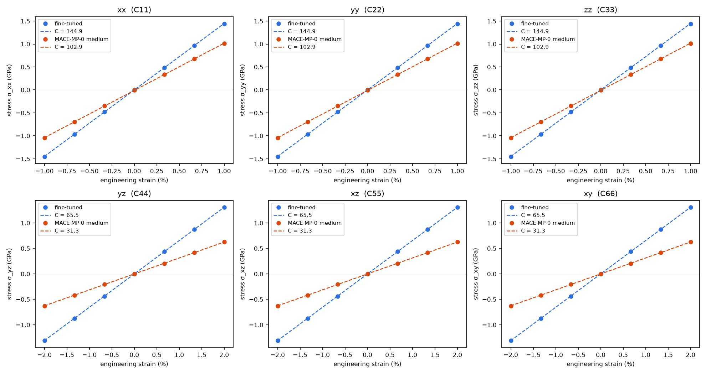

*Fig. 4 — The six stress-strain lines of both models (`--steps 7`). Each slope is a diagonal constant; the shear panels
use the engineering strain.*

Section `STIFFNESS TENSOR & CRYSTAL SYMMETRY`:

```
Crystal symmetry  : Fd-3m (227), point group m-3m (cubic, 48 rotations, spglib on the pre-relaxed cell)
Projection        : C averaged over the point group; max |C - C_sym| = 0.000 GPa (0.00 % of the largest constant)
Independent       : 3 non-zero independent constant(s) under m-3m:
  C11 = C22 = C33                         144.88 GPa
  C12 = C13 = C23                          68.15 GPa
  C44 = C55 = C66                          65.47 GPa
```

The six directions were fitted independently, yet the tensor has exact cubic symmetry — a measure of how clean the
stresses are. The constants against experiment [15] and against the phonon slopes of `7.3` (same model, a different
calculation):

| | fine-tuned | `7.3` phonons | MACE-MP-0 medium | experiment | fine-tuned vs experiment |
|---|---|---|---|---|---|
| C11 | 144.88 | 148.0 | 102.90 | 165.6 | −12.5 % |
| C12 | 68.15 | 70.2 | 60.61 | 63.9 | +6.6 % |
| C44 | 65.47 | 65.1 | 31.31 | 79.5 | −17.7 % |
| B (Hill) | 93.73 | 93.5 (QHA `B₀`) | 74.71 | 97.8 | −4.2 % |
| G (Hill) | 52.84 | — | 26.75 | 66.5 | −20.5 % |
| E (Hill) | 133.44 | — | — | 162.6 | −17.9 % |
| Poisson ν | 0.263 | — | — | 0.223 | |

*GPa. The experimental moduli are the Hill averages of the measured constants.*

- **Consistency.** Three calculations with the same model agree: the stress-strain constants, the phonon slopes of `7.3`
  (within 0.5–3 %, the phonon slopes coming from an interpolated 4×4×4 dispersion), and the curvature of the energy in
  the `7.3` QHA (`B₀ = 93.5` against 93.7). Consistent with itself, but not with SIESTA: at the same level of theory
  SIESTA gives `B = 87.5–89.0` (section 5.11).
- **Against experiment.** The bulk modulus is 4 % low, the shear constants further off: `C44` 18 % low, `G` 21 %.
  Section 5.11 splits this between PBE/DZP and the model: the shear errors are mostly the model's, and its `B` is
  closer to experiment than SIESTA's for the wrong reason.
- **The derived ratios amplify that.** Section `ELASTIC MODULI` reports a Pugh ratio of 1.77 ("ductile") and a Cauchy
  pressure of +2.7 GPa ("metallic"). Real silicon has 1.47 and −15.6 GPa: brittle and covalent, as it is. A 20 % error in
  `G` and an 18 % error in `C44` are enough to flip both rules of thumb. The empirical hardness, 7.4 GPa, is low for the
  same reason (silicon: about 10–12 GPa). Read these ratios as properties of the model — SIESTA itself gets both rules
  right (section 5.11).

### 5.3 Sound velocities

Section `SOUND VELOCITIES & DEBYE TEMPERATURE` against the acoustic slopes of the `7.3` phonons (4×4×4 supercell) and
the velocities from the measured constants [15], m/s:

| direction | Christoffel L / T1 / T2 | `7.3` phonon slopes | experiment | largest difference vs `7.3` |
|---|---|---|---|---|
| [100] | 7993 / 5374 / 5374 | 8081 / 5361 / 5361 | 8433 / 5843 / 5843 | 1.1 % |
| [110] | 8709 / 5374 / 4113 | 8768 / 5365 / 4122 | 9134 / 5843 / 4673 | 0.7 % |
| [111] | 8935 / 4572 / 4572 | 8994 / 4566 / 4566 | 9356 / 5093 / 5093 | 0.7 % |

- Two different routes to the same physics: the curvature of the stress under homogeneous strain, and the slope of the
  phonon dispersion at `q → 0`. They agree within 1.1 %.
- Along [110] the two transverse waves split: the one polarized along [001] travels at `√(C44/ρ)`, the one along
  [1-10] at `√((C11 − C12)/2ρ)` — slower, since silicon's Zener ratio is 1.7.
- **Debye temperature** (Eq. 11): 583 K, against 649 K from the measured constants. The 10 % gap is that of the shear
  velocities, which dominate `v_m`.

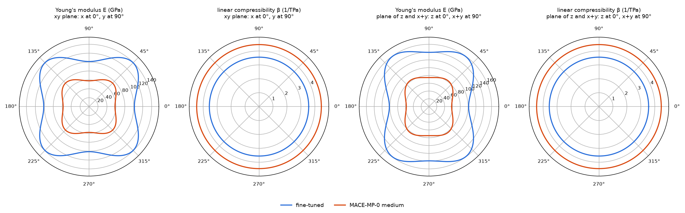

*Fig. 5 — `E(n)` and `β(n)` in two planes of the cubic cell (`directional_moduli.png`). Silicon is stiffest along
<111> (159 GPa) and softest along <100> (101 GPa); its compressibility is isotropic, as for every cubic crystal.*

The same `E(n)` over the whole sphere is drawn in `anisotropy_surface.png` (`figures/si_anisotropy_surface.png`): the
lobes point along the eight <111> directions.

### 5.4 Internal relaxation and the force threshold

Section `INTERNAL RELAXATION`:

```
constant        | clamped (GPa) | relaxed (GPa) | relaxation
C11 = C22 = C33 | 144.88        | 144.88        | +0.0 %
C12 = C13 = C23 | 68.15         | 68.15         | +0.0 %
C44 = C55 = C66 | 97.36         | 65.47         | -32.8 %
```

- Under the normal strains nothing moves inside the cell, so clamped and relaxed constants are the same.
- Under shear the internal relaxation lowers `C44` by a third (Eq. 5, Fig. 1). DFT calculations of silicon find the
  same order: a clamped-ion `C44⁰` of about 110 GPa against a relaxed one of about 85 [12]. A calculation that forgets to relax the atoms
  overestimates the shear stiffness of every crystal without inversion at its atoms.

The precision of `C44` therefore depends on how well the atoms are relaxed. Four runs with different `--fmax`
(`fmax_*`, 5 strains, no comparison):

| `--fmax` (eV/Å) | C44 (GPa) | R² (yz) | relaxation steps (yz) | C11 (GPa) |
|---|---|---|---|---|
| 0.02 | 63.29 | 0.999461 | 28 | 144.77 |
| 0.005 | 65.67 | 0.999871 | 40 | 144.77 |
| 0.001 (default) | 65.47 | 0.999997 | 74 | 144.87 |
| 0.0002 | 65.30 | 0.999999 | 98 | 144.89 |

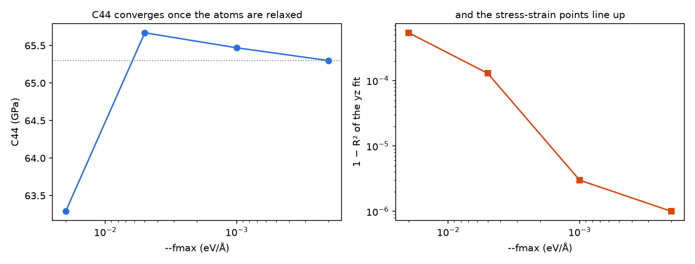

*Fig. 6 — `C44` and the quality of the `yz` fit against `--fmax` (`results_figures.py`).*

At 0.02 eV/Å (the previous default) the atoms stop ~0.0015 Å short of their relaxed positions — a fifth of the
displacement being measured — and `C44` is 3 % low with scattered points. From 0.001 down, `C44` is stable to 0.3 % and
the points line up (1 − R² = 3 × 10⁻⁶). `C11` does not care: nothing relaxes. Each tightening costs a few dozen
relaxation steps, milliseconds with MACE.

### 5.5 The strain amplitude

```bash
stb-mlelastic --file si8.fdf --custom-model ... --custom-model-card ... --steps 7 --check-convergence \
              --convergence-strains 0.25 0.5 1 2 3
```

```
max strain % | C11 = C22 ... | C12 = C13 ... | C44 = C55 ... | min R^2 | B Hill | G Hill
0.25         | 144.99        | 68.16         | 66.02         | 0.99994 | 93.77  | 53.13
0.5          | 144.97        | 68.16         | 65.80         | 0.99999 | 93.76  | 53.01
1            | 144.88        | 68.15         | 65.47         | 0.99996 | 93.73  | 52.84
2            | 144.52        | 68.12         | 64.90         | 0.99985 | 93.59  | 52.47
3            | 143.95        | 68.08         | 64.12         | 0.99968 | 93.37  | 51.95
Largest change    : C44 varies by 2.91 % over the scan
```

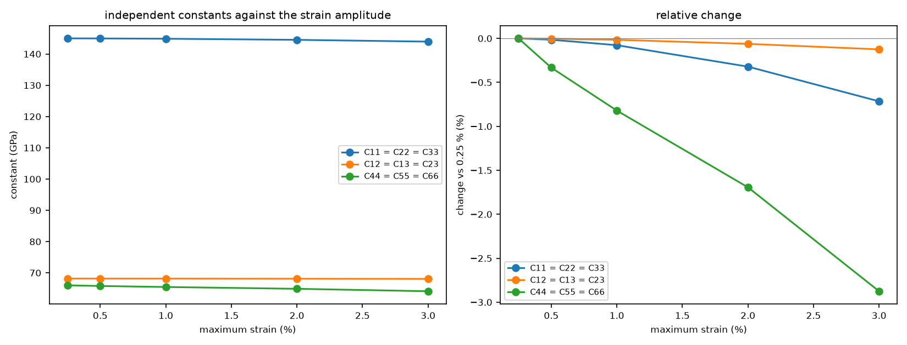

*Fig. 7 — Every independent constant against the largest strain of the fit (`strain_convergence.png`).*

- The constants drift smoothly with the amplitude: this is the third-order (anharmonic) response, not noise. `C44`
  drifts most — shear is the softest, most anharmonic deformation of the diamond lattice, as the negative Grüneisen
  parameters of its transverse acoustic phonons (`7.3`, section 5.10) also show.
- At the default 1 %, `C44` is 0.8 % below its small-strain limit, `C11` 0.1 %. Below 0.5 % nothing changes beyond the
  last digit; at 0.25 % the smallest R² drops a little: the stresses become small (0.4 GPa) next to the relaxation's
  residual.
- The report warns above 2 % change over the scan: here the 3 % amplitude is the one to avoid.

### 5.6 The foundation models

The same calculation with the three MACE-MP-0 sizes (`foundation_*`), GPa:

| model | a (Å) | C11 | C12 | C44 | B | G | ν |
|---|---|---|---|---|---|---|---|
| MACE-MP-0 small | 5.4646 | 95.7 | 58.0 | 29.4 | 70.6 | 24.6 | 0.344 |
| MACE-MP-0 medium | 5.4554 | 102.9 | 60.6 | 31.3 | 74.7 | 26.8 | 0.340 |
| MACE-MP-0 large | 5.4872 | 84.4 | 49.9 | 33.7 | 61.4 | 25.7 | 0.316 |
| fine-tuned | 5.4797 | 144.9 | 68.2 | 65.5 | 93.7 | 52.8 | 0.263 |
| experiment | 5.4310 | 165.6 | 63.9 | 79.5 | 97.8 | 66.5 | 0.223 |

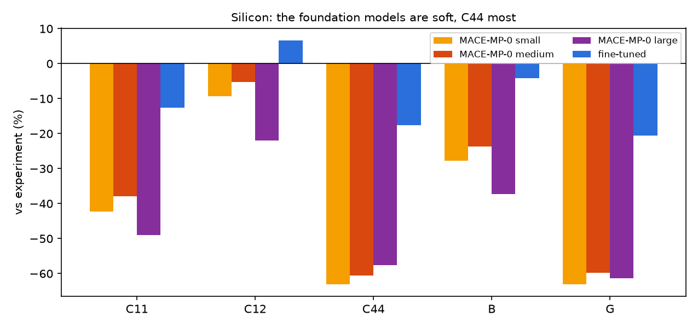

*Fig. 8 — Each constant and modulus against experiment (`results_figures.py`).*

- Every foundation model is soft: `C44` and `G` ~60 % low, `B` 24–37 %. The largest model is again not the best —
  softest in `C11` and `B`, as it was in the phonons of `7.3`.
- The Poisson ratio of 0.32–0.34 is that of a metal, not of a covalent semiconductor.
- These models are trained on the same functional (PBE) as our SIESTA labels: the softening is a property of universal
  potentials trained mostly on near-equilibrium structures [19], not a difference in the level of theory. Fine-tuning on
  57 SIESTA configurations brings `C44` from 31 to 65 GPa.

### 5.7 The cell size

The 216-atom supercell (`stb-supercell -d 3 3 3`, `si216`) gives `C11 = 144.87`, `C12 = 68.16`, `C44 = 65.47 GPa` —
the 8-atom values to 0.01 GPa. A homogeneous strain of a perfect crystal does not depend on the cell, which is a good
check of the setup; the supercell only matters for a defect, an alloy or a disordered structure, whose environments
need it. It took 82 s on the GPU against 34 s for 8 atoms.

### 5.8 A structure that is not at a minimum

`si8_rattled.fdf`, every atom moved by ~0.03 Å (largest force 0.85 eV/Å), with and without the pre-relax:

| case | C11 | C12 | C44 | symmetry found | independent | residual stress (GPa) | time |
|---|---|---|---|---|---|---|---|
| 8 atoms, reference | 144.88 | 68.15 | 65.47 | Fd-3m | 3 | 0.01 | 34 s |
| rattled, `--no-pre-relax` | 144.77 | 68.04 | 65.33 | P1 | 21 (no symmetry) | 0.67 | 48 s |
| rattled, pre-relaxed (default) | 144.87 | 68.15 | 65.47 | Fd-3m | 3 | 0.01 | 18 s |

- **With the pre-relax** the atoms return to their sites, spglib finds Fd-3m again (its tolerance, 10⁻³ Å, is looser
  than phonopy's in `7.3`), and the constants are those of the crystal.
- **Without it**, the constants are still close — the atoms are relaxed at every strained cell anyway — but the reference
  carries 0.67 GPa of stress (the fits' intercepts), no symmetry is found, so there is nothing to project on and no
  check, and two warnings say so. The run is also slower: every strained cell relaxes the rattle away first.

### 5.9 A hexagonal crystal: hcp magnesium

With MACE-MP-0 medium (the fine-tuned model knows only silicon), `mg_hcp`:

```
Crystal symmetry  : P6_3/mmc (194), point group 6/mmm (hexagonal, 24 rotations, spglib on the pre-relaxed cell)
Projection        : C averaged over the point group; max |C - C_sym| = 0.052 GPa (0.08 % of the largest constant)
  C11 = C22                                57.42 GPa
  C12                                      30.27 GPa
  C13 = C23                                22.60 GPa
  C33                                      65.11 GPa
  C44 = C55                                13.04 GPa
  C66                                      13.57 GPa  = (C11 - C12)/2, not independent
```

| constant | MACE-MP-0 medium | experiment (≈, room temperature) [16] | difference |
|---|---|---|---|
| C11 | 57.5 | 59.4 | −3 % |
| C12 | 30.2 | 25.6 | +18 % |
| C13 | 22.6 | 21.4 | +6 % |
| C33 | 65.1 | 61.6 | +6 % |
| C44 | 13.0 | 16.4 | −20 % |
| C66 = (C11 − C12)/2 | 13.6 | 16.9 | |

- The point group 6/mmm leaves five independent constants. `C66` is tied to the others by a linear relation, not an
  equality — 13.57 = (57.42 − 30.27)/2 — and the report marks it as not independent.
- The hexagonal Born criteria (Eq. 7) all pass.
- The foundation model does well on the normal constants of this metal (within 6 % except `C12`) and is again soft in
  shear (`C44` −20 %). It also shrinks the cell by 2 % in volume.
- In the basal plane (`xy`) the Young's modulus is the same in every direction, as hexagonal symmetry demands (Fig. 9,
  left); it varies only with the angle from `c`.

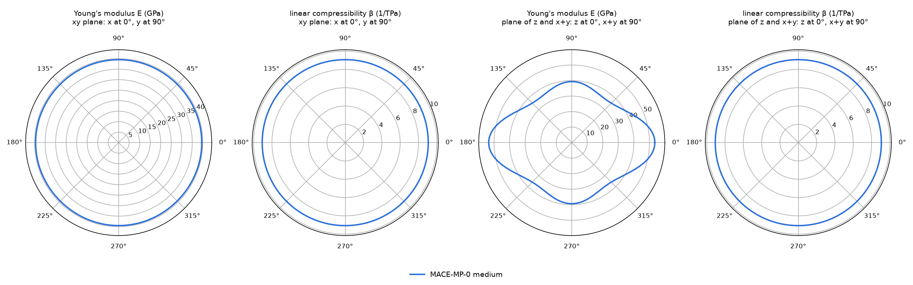

*Fig. 9 — `E(n)` and `β(n)` of hcp Mg: isotropic in the basal plane `xy`, anisotropic in a plane containing `c` (`z`).*

### 5.10 A 2D sheet: graphene

With MACE-MP-0 medium, strains up to ±0.5 % (`graphene`):

```
Skipped           : zz, yz, xz -- touch a vacuum axis (no physical deformation)
Normalization     : cell height Lz = 20.0000 Ang (stress x Lz: per-area stiffness)
  C11 = C22                               303.44 N/m
  C12                                     105.16 N/m
  C66                                      99.14 N/m  = (C11 - C12)/2, not independent
Young's modulus E_x = (C11 C22 - C12^2)/C22 | 266.99 N/m
Poisson ratio ν_xy = C12/C22                | 0.346
```

- The directions that would strain the vacuum are skipped, and the constants are per area, independent of the 20 Å of
  vacuum chosen.
- In-plane isotropy holds: two independent constants, `E_x = E_y`, `C66 = (C11 − C12)/2` and `E(θ)` is a circle
  (Fig. 10).
- The values do not: experiment gives `E_2D = 340 ± 50 N/m` [20], and DFT calculations find about 345 N/m with a Poisson
  ratio near 0.17. The foundation model is 22 % soft, and its Poisson ratio is twice too large — `C12` far too high. A
  graphene model fine-tuned with `7.1` would be needed for numbers.

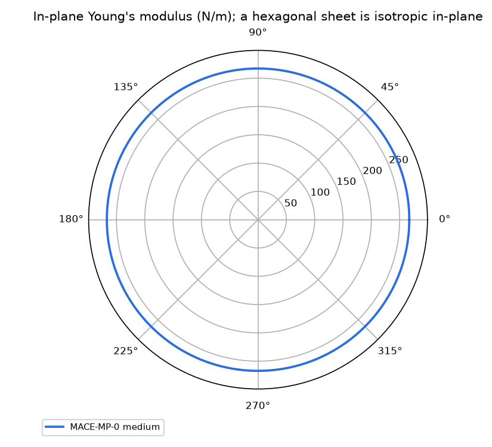

*Fig. 10 — `E(θ)` of graphene in the plane: a circle, as for every hexagonal sheet.*

### 5.11 SIESTA at the model's own level of theory

Every comparison above with experiment mixes two errors: that of PBE with a DZP basis, which the model was trained to
reproduce, and that of the model itself. To separate them, the same tensor is computed with SIESTA and the **training
`calc.fdf`** (`reference_results/siesta_elastic/calc.fdf`: PBE, DZP, `PAO.EnergyShift 0.01 Ry`, `Mesh.Cutoff 300 Ry`,
k 6×6×6, 300 K smearing, the PseudoDojo `Si.psml` — the settings and md5 the model card records), on `si8.fdf`, which is
SIESTA's own minimum at these settings (residual pressure +0.016 GPa). The runs go through the SIESTA elastic workflow
(`5.2`):

```bash
bash siesta_elastic.sh       # stb-elasticInputs -> SIESTA -> stb-elasticAnalysis; 37 runs of 8 atoms, ~6 min on 6 cores
python3 siesta_compare.py    # the tables below and figures/siesta_vs_model.png (numpy + ase + matplotlib)
```

| set | what | runs |
|---|---|---|
| `clamped` | `xx` and `xy` strains, ±1 %, 7 points, single points (`stb-elasticInputs` forces them) | 14 |
| `relaxed` | the same cells, atoms relaxed by CG at fixed cell to 0.001 eV/Å — the model's `--fmax` | 14 |
| `hydro` | isotropic strains, ±2 % in lattice, 9 points: `B` from `E(V)` and from the pressure | 9 |

`stb-elasticInputs` writes single points only; for relaxed ions each folder's `config_extra.fdf` is replaced by
`config_extra_relaxed.fdf` (`MD.TypeOfRun CG`, `MD.MaxForceTol 0.001 eV/Ang`, `MD.VariableCell false`) — the
first-occurrence-wins `%include` at the top of `calc.fdf` makes it override everything else.

**First, how precise is SIESTA here?** The same runs give the constants two ways — from the stress, and from the
curvature of the energy:

| GPa | from the stress | from the energy |
|---|---|---|
| `C11` | 150.03 | 148.53 |
| `C44` (relaxed) | 74.40 | 73.74 |
| `C44⁰` (clamped) | 102.42 | 101.90 |
| `B` | 87.49 = (C11 + 2 C12)/3 | 88.98 (Birch–Murnaghan, ±2 %) |
| `C12` | 56.22 | 59.21 = (3B − C11)/2 |

- The two routes agree to 1 % for the diagonal constants. `C12` and `B` are the weak points: `−V dP/dV` between
  symmetric pairs of the isotropic scan gives 87.4, 90.3, 89.7 and 88.7 GPa at ±0.5, 1, 1.5 and 2 %. SIESTA's stress
  scatters by ~0.05 GPa at 300 Ry (the mesh and the SCF tolerance), a few percent of the stress at ±0.5 %. The fits show
  it too: R² 0.9997–0.9998 against the model's 0.99996+.
- So SIESTA's constants carry 1–3 % of numerical noise at the training settings; the ranges below are the two routes.
- The `E(V)` of the perfect cell gives `V₀ = 20.570 ų/atom` and `B₀ = 89.0 GPa`, against the all-electron PBE reference
  of the Delta test, 20.453 ų/atom and 88.5 GPa [23]: DZP is close to the PBE limit here. (`7.3` quoted `B₀ = 94.4` from
  the `7.1` benchmark: that fit runs over the test set's strained cells, which are also rattled; the clean value is 89.0.)

**SIESTA, the model and experiment** (`siesta_compare.py`; ranges are stress / energy route):

| GPa | SIESTA | fine-tuned | model vs SIESTA | experiment [15] | SIESTA vs experiment |
|---|---|---|---|---|---|
| `C11` | 150.0 / 148.5 | 144.9 | −3.4 / −2.5 % | 165.6 | −9.4 / −10.3 % |
| `C12` | 56.2 / 59.2 | 68.2 | +21 / +15 % | 63.9 | −12.0 / −7.3 % |
| `C44` | 74.4 / 73.7 | 65.5 | −12.0 / −11.2 % | 79.5 | −6.4 / −7.2 % |
| `C44⁰` (clamped) | 102.4 / 101.9 | 97.4 | −4.9 / −4.5 % | — | — |
| `C' = (C11 − C12)/2` | 46.9 / 44.7 | 38.4 | −18 / −14 % | 50.9 | −8 / −12 % |
| `B` (Hill) | 87.5 / 89.0 | 93.7 | +7.1 / +5.3 % | 97.8 | −10.5 / −9.0 % |
| `G` (Hill) | 61.8 / 60.3 | 52.8 | −14.6 / −12.4 % | 66.5 | −7.0 / −9.3 % |
| `E` (Hill) | 150.1 / 147.6 | 133.4 | −11.1 / −9.6 % | 162.6 | −7.6 / −9.2 % |
| Poisson ν | 0.214 / 0.224 | 0.263 | | 0.223 | |
| Pugh `B/G` | 1.41 / 1.48 | 1.77 | | 1.47 | |
| Cauchy `C12 − C44` | −18.2 / −14.5 | +2.7 | | −15.6 | |
| Debye temperature (K) | 627 / 620 | 583 | | 648 | |

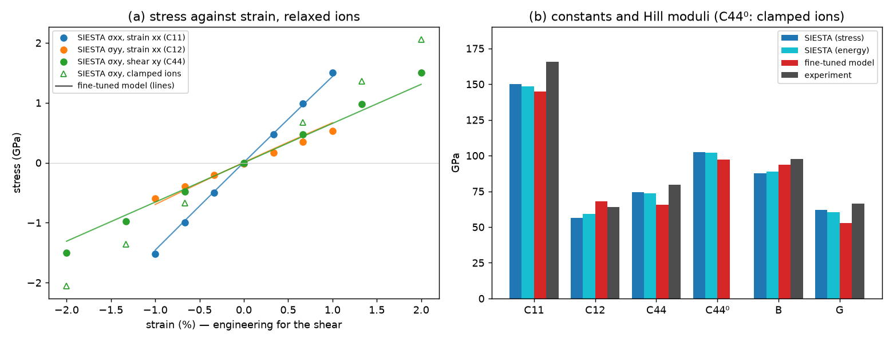

*Fig. 11 — (a) SIESTA's stresses (points) against the model's stress-strain lines, same strains; the open triangles are
SIESTA's clamped-ion shear. (b) The constants and Hill moduli: SIESTA by both routes, the model, experiment.*

- **The error against experiment splits in two.** PBE/DZP puts silicon's constants 6–12 % below experiment — the usual
  softening of PBE at its 0.9 % larger lattice. On top of that the model adds its own error, and that error is not
  uniform. In `C11` and the clamped `C44⁰` it is only 3–5 %. In the shear constants it is larger: `C44` 11–12 % low,
  `C'` 14–18 % low. Of the 18 % by which the model's `C44` misses experiment, about 7 points are PBE/DZP and 11 are the
  model.
- **`C12` and `B` go the other way.** The model's `C12` is 15–21 % too high, and so is its `B`, by 5–7 %. It lands 4 %
  below experiment, closer than SIESTA's 9–11 %, but for the wrong reason: the model is not reproducing its own level of
  theory there. The `7.3` QHA gives the same 93.5, so this is the model's equation of state, not a fitting accident.
- **Most of the `C44` error is in the internal relaxation.** With the atoms clamped, the model is 5 % low; letting them
  relax lowers SIESTA's `C44` by 27 % (102.4 → 74.4) and the model's by 33 % (97.4 → 65.5). Under shear the model's
  atoms move 0.0079 Å per % strain, SIESTA's 0.0073: the model's internal relaxation is ~8 % too large. That response
  couples a homogeneous shear to the relative displacement of the two fcc sublattices. Only 6 of the 57 training
  configurations are strained cells, so the training set constrains it weakly.
- **The flipped rules of thumb are the model's.** SIESTA gives Pugh 1.41–1.48 and a Cauchy pressure of −18 to −15 GPa —
  brittle and covalent, as in experiment. The model's 1.77 and +2.7 GPa (section 5.2) come from its too-high `C12` and
  too-low shear constants, not from PBE.
- **What the model card does not tell you.** The card's stress error is 0.18 GPa on its test set. At ±1 % strain the
  stresses here are 0.5–1.5 GPa: an error of 0.1 GPa per % of strain is already 7 % of `C11` and 14 % of `C44` — and
  an error proportional to the strain hides easily in the RMS over a random test set. For elastic constants, check the model against
  SIESTA on the property itself, as here, and train with strained cells (`7.1`, `--volume-strains` and Stage 4
  `--sampling-method strain`).

### 5.12 What to take from the example

- A model fine-tuned on 57 SIESTA configurations gives silicon's elastic tensor with exact cubic symmetry, consistent
  with its own phonons and equation of state to 1 %; `B` is within 4 % of experiment, the shear constants ~20 % low.
- Against SIESTA at its own level of theory (section 5.11) the model is within 3–5 % in `C11` and the clamped `C44`, but
  12–18 % low in the shear constants and 15–21 % high in `C12`. PBE/DZP itself is 6–12 % below experiment. Compare a
  model with its own level of theory before comparing it with experiment.
- Relax the atoms tightly: the internal relaxation is a third of `C44`, and a loose threshold makes it wrong.
- Use ±0.5–1 % strain; check with `--check-convergence`.
- The foundation models are 25–60 % soft; the largest is not the best.
- The symmetry analysis tells you what is independent and whether the fit respects it; a structure that is not at its
  minimum loses it.
- Rules of thumb built on the constants (Pugh, Cauchy, hardness) amplify their errors: a 20 % low `G` turned silicon
  "ductile" and "metallic".

## 6. Reproducing the reference data

`reference_results/` holds what `make_reference.sh` copies out of its work folder: each case's report and data files
(`stress_strain.dat`, `elastic_tensor.dat`, `directional.dat` or `strain_convergence.dat`), and the gnuplot files of the
`base` and `mg_hcp` cases. `figures/` holds the theory figures, the summary figures of `results_figures.py`, and the
tool's own figures of the reference runs, copied by `make_reference.sh`.

```bash
source ~/.anaconda3/etc/profile.d/conda.sh && conda activate stb   # or any environment with stb_suite[ml]
bash make_reference.sh                  # every case into ./reference_run/ (GPU; DEVICE=cpu works), then collect
python3 results_figures.py              # the tables of section 5 and figures/*.png (numpy + matplotlib only)
python3 theory_figures.py               # the figures of section 1
```

All the cases take about 7 minutes on one RTX 3060; each is skipped when its report exists. On a CPU the 8-atom cases
take about as long, the 216-atom one several minutes. The foundation models are downloaded on first use. A rerun gives
the same constants to the printed digits.

The SIESTA runs of section 5.11 need a `siesta` executable (5.4.2 here, from conda-forge) and `mpirun`:

```bash
NP=6 bash siesta_elastic.sh             # 37 runs into ./siesta_run/ (~6 min on 6 cores), then collect
python3 siesta_compare.py               # the tables of section 5.11 and figures/siesta_vs_model.png
```

`reference_results/siesta_elastic/` keeps what they produce, without the SIESTA output files: `calc.fdf` and the two
`config_extra` variants, `siesta_runs.dat` (strain measured from each cell, energy, stress tensor, residual force, CG
steps and internal shift of every run), the two `stb-elasticAnalysis` reports and `siesta_compare.json`.

## 7. Known, deliberate limitations

- **0 K, static constants** (section 1.12): no temperature dependence, adiabatic and isothermal not distinguished.
- **Linear elasticity only.** Third-order constants appear only as the amplitude drift.
- **One model, no error bars.** The model card's stress error (0.18 GPa here) does not bound the constants; a SIESTA
  calculation of the constants themselves (`5.2`, section 5.11) does. It found the shear constants 12–18 % low.
- **The symmetry projection is a check**, not the tensor the moduli are computed from.
- **Empirical ratios** are rules of thumb, reported without uncertainty.

## 8. Step-by-step: elastic constants of your own material

1. **Choose the model.** The foundation model for a first look — expect soft shear constants. For numbers, a model
   trained with `7.1` that includes **strained cells** (`--volume-strains`, Stage 4 `--sampling-method strain`) —
   stiffness is what they teach.
2. **Start from a relaxed, symmetric structure.** The pre-relax finds the model's own minimum; `STRUCTURE` and
   `STIFFNESS TENSOR` say which symmetry it found. If it is lower than expected, symmetrize first (`stb-unitcell`).
3. **Run the reference fit** with `--save-report --save-data`, 5–7 strains in ±1 % (±0.5 % for soft or 2D materials).
4. **Read the report from the bottom**: `WARNINGS`, then `STRESS-STRAIN FITS` (R², intercepts), `TRAINED RANGE`,
   `STIFFNESS TENSOR` (projection deviation), `MECHANICAL STABILITY`, then the moduli.
5. **Check the amplitude** with `--check-convergence` and two or three amplitudes.
6. **Compare** with a fine-tuned model against the foundation one, with the phonon slopes (`7.3`), with the equation of
   state (`5.15`), and where it matters with SIESTA (`5.2`).

## 9. Files in this folder

| File | What it is |
|---|---|
| `README.md` | this tutorial |
| `example_7.4.sh` | the guided walk-through (CPU, about 6 minutes; `DEVICE=cuda` for a GPU) |
| `si8.fdf`, `si8_rattled.fdf` | bulk silicon, 8-atom cell; the same with every atom moved by ~0.03 Å |
| `mg_hcp.fdf` | hcp magnesium, `c` along `z` |
| `graphene.fdf` | graphene sheet, 20 Å along `c` |
| `make_reference.sh` | regenerates `reference_results/` and the tool figures in `figures/` (GPU, about 7 minutes) |
| `results_figures.py` | reads `reference_results/`, prints the tables of section 5, draws the summary figures (numpy + matplotlib) |
| `siesta_elastic.sh` | the SIESTA runs of section 5.11 at the training level of theory (`5.2` workflow; needs `siesta`, ~6 min) |
| `siesta_compare.py` | SIESTA against the model and experiment: the tables of section 5.11, `figures/siesta_vs_model.png` |
| `theory_figures.py` | draws the figures of section 1 |
| `figures/` | every figure of this README |
| `reference_results/` | reports and data of the reference runs; `siesta_elastic/` holds the SIESTA inputs and results |
| `../7.2-mlmd/model/` | the fine-tuned silicon model and its card, shared with `7.2` and `7.3` |

## 10. Running the script

```bash
cd examples/7.4-mlelastic
bash example_7.4.sh               # CPU, ~6 min; press Enter between cases
DEVICE=cuda bash example_7.4.sh   # on a GPU
```

Each case writes into `output/<case>/`, which is wiped at every start. Cases 1, 7 and 8 download MACE-MP-0 medium on
first use. Cases 12 and 13 need no MACE: they only read `reference_results/` (Case 13 the SIESTA runs of section 5.11).

## 11. Flag reference

**`stb-mlelastic`** — `--file FILE` (`.fdf`, required) · `--model {small,medium,large}` (default medium) ·
`--custom-model PATH` + `--custom-model-card JSON` (always both) · `--skip-foundation-comparison` · `--no-pre-relax` ·
`--no-relax` (clamped ions only) · `--no-clamped` (skip the clamped-ion scan) · `--fmax eV/Å` (both relaxations,
default 0.001) · `--max-steps N` (default 200) · `--max %` (default 1.0) · `--steps N` (default 5, ≥ 2) ·
`--check-convergence` · `--convergence-strains PCT...` · `--dimensionality {auto,3d,2d,1d}` · `--vacuum-gap Å`
(default 10) · `--fit-quality-tolerance R²` (default 0.995) · `--skip-anisotropy-surface` · `--device {cpu,cuda}` ·
`-o/--output-dir DIR` (default `mlelastic_out`) · `--show` · `--save-gnuplot` · `--save-data` · `--save-report` ·
`--no-intro` · `-v`.

## 12. What's next

- **`5.2` (Elastic workflow)** computes the same tensor with SIESTA — the reference to check a model against
  (section 5.11 does it for this model).
- **`7.1` (MLFF workflow)** trains the model; include strained cells for elastic constants.
- **`7.3` (`stb-mlphonons`)** gives the same constants from the acoustic phonon slopes (section 5.3 here) and the
  temperature dependence through the QHA.
- **`5.15` (equation of state)** fits SIESTA's `E(V)`: its `B₀` is this tool's `B`, a cross-check.
- **`7.2` (`stb-mlmd`)** gives the finite-temperature behaviour the static constants leave out.

## 13. References

1. J. F. Nye, *Physical Properties of Crystals* (Oxford University Press, 1957; reprinted 1985).
2. M. Born, K. Huang, *Dynamical Theory of Crystal Lattices* (Oxford University Press, 1954).
3. D. C. Wallace, *Thermodynamics of Crystals* (Wiley, 1972).
4. Y. Le Page, P. Saxe, "Symmetry-general least-squares extraction of elastic data for strained materials from ab initio
   calculations of stress", *Phys. Rev. B* **65**, 104104 (2002).
5. F. Mouhat, F.-X. Coudert, "Necessary and sufficient elastic stability conditions in various crystal systems",
   *Phys. Rev. B* **90**, 224104 (2014).
6. R. Hill, "The elastic behaviour of a crystalline aggregate", *Proc. Phys. Soc. A* **65**, 349 (1952).
7. A. Reuss, "Berechnung der Fließgrenze von Mischkristallen auf Grund der Plastizitätsbedingung für Einkristalle",
   *Z. Angew. Math. Mech.* **9**, 49 (1929); W. Voigt, *Lehrbuch der Kristallphysik* (Teubner, 1928).
8. S. I. Ranganathan, M. Ostoja-Starzewski, "Universal elastic anisotropy index", *Phys. Rev. Lett.* **101**, 055504
   (2008).
9. S. F. Pugh, "Relations between the elastic moduli and the plastic properties of polycrystalline pure metals",
   *Philos. Mag.* **45**, 823 (1954).
10. X.-Q. Chen, H. Niu, D. Li, Y. Li, "Modeling hardness of polycrystalline materials and bulk metallic glasses",
    *Intermetallics* **19**, 1275 (2011).
11. L. Kleinman, "Deformation potentials in silicon. I. Uniaxial strain", *Phys. Rev.* **128**, 2614 (1962).
12. O. H. Nielsen, R. M. Martin, "Quantum-mechanical theory of stress and force", *Phys. Rev. B* **32**, 3780 (1985).
13. O. L. Anderson, "A simplified method for calculating the Debye temperature from elastic constants", *J. Phys. Chem.
    Solids* **24**, 909 (1963).
14. M. J. P. Musgrave, *Crystal Acoustics* (Holden-Day, 1970).
15. J. J. Hall, "Electronic effects in the elastic constants of n-type silicon", *Phys. Rev.* **161**, 756 (1967).
16. G. Simmons, H. Wang, *Single Crystal Elastic Constants and Calculated Aggregate Properties: A Handbook*, 2nd ed.
    (MIT Press, 1971): room-temperature values of magnesium, rounded.
17. I. Batatia, D. P. Kovács, G. N. C. Simm, C. Ortner, G. Csányi, "MACE: Higher order equivariant message passing
    neural networks for fast and accurate force fields", *Adv. Neural Inf. Process. Syst.* **35**, 11423 (2022).
18. I. Batatia et al., "A foundation model for atomistic materials chemistry", arXiv:2401.00096 (2023).
19. B. Deng, Y. Choi, P. Zhong, J. Riebesell, S. Anand, Z. Li, K. Jun, K. A. Persson, G. Ceder, "Systematic softening in
    universal machine learning interatomic potentials", *npj Comput. Mater.* **11**, 9 (2025).
20. C. Lee, X. Wei, J. W. Kysar, J. Hone, "Measurement of the elastic properties and intrinsic strength of monolayer
    graphene", *Science* **321**, 385 (2008).
21. A. Togo, K. Shinohara, I. Tanaka, "Spglib: a software library for crystal symmetry search", *Sci. Technol. Adv.
    Mater.: Methods* **4**, 2384822 (2024).
22. A. H. Larsen et al., "The atomic simulation environment — a Python library for working with atoms", *J. Phys.:
    Condens. Matter* **29**, 273002 (2017).
23. K. Lejaeghere et al., "Reproducibility in density functional theory calculations of solids", *Science* **351**,
    aad3000 (2016); all-electron PBE reference (WIEN2k) of silicon from the Delta-codes DFT repository,
    https://github.com/molmod/DeltaCodesDFT, file `WIEN2k.txt`: `V0 = 20.4530 ų/atom`, `B0 = 88.545 GPa`.
