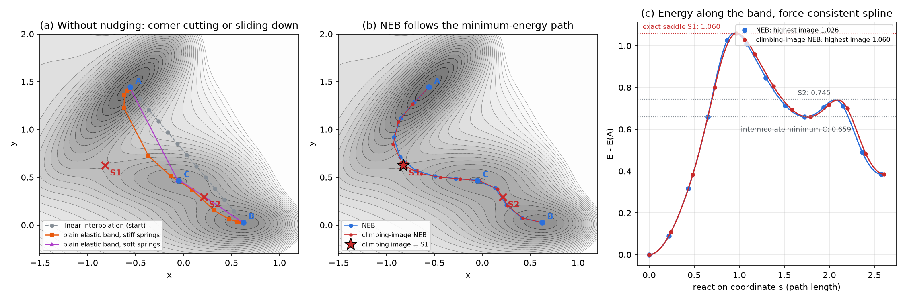
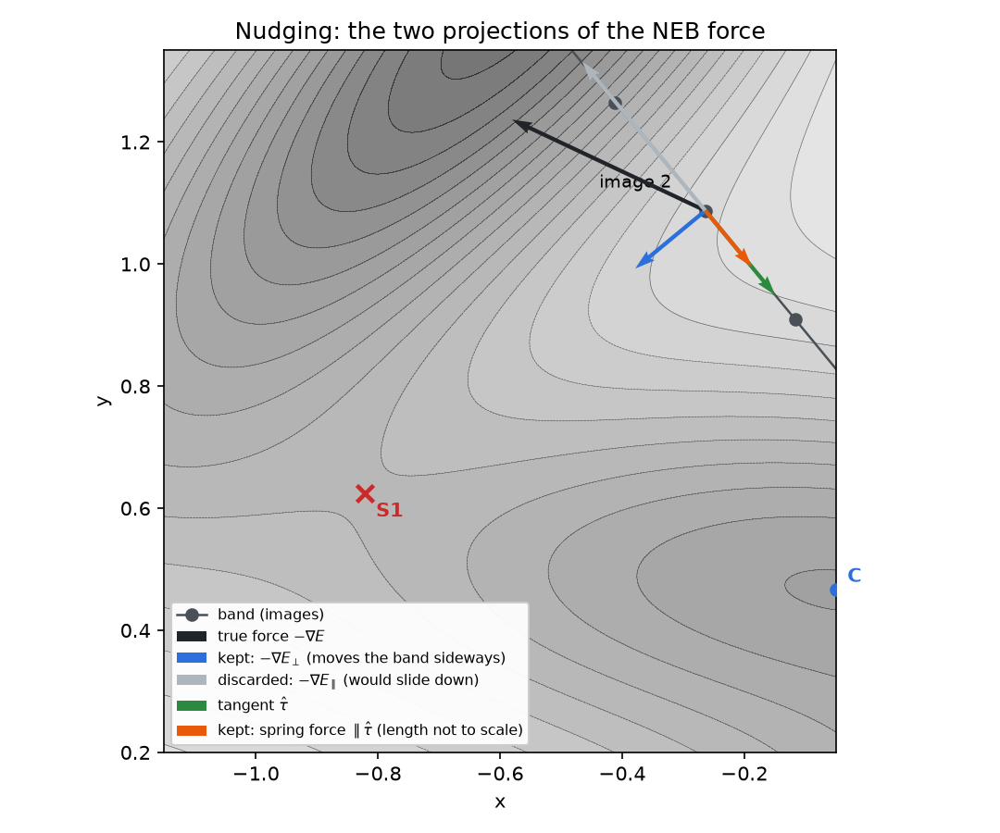
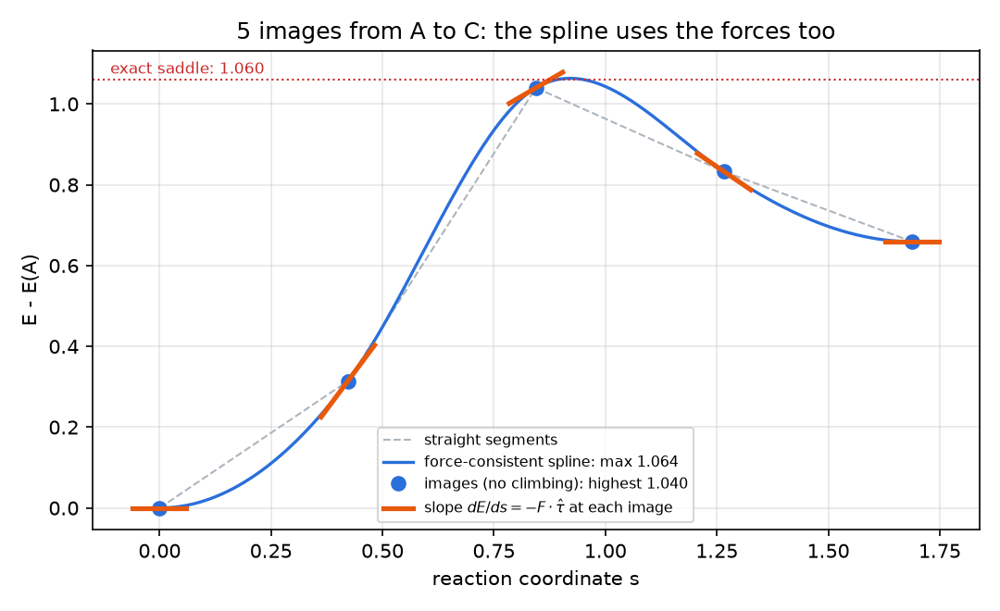
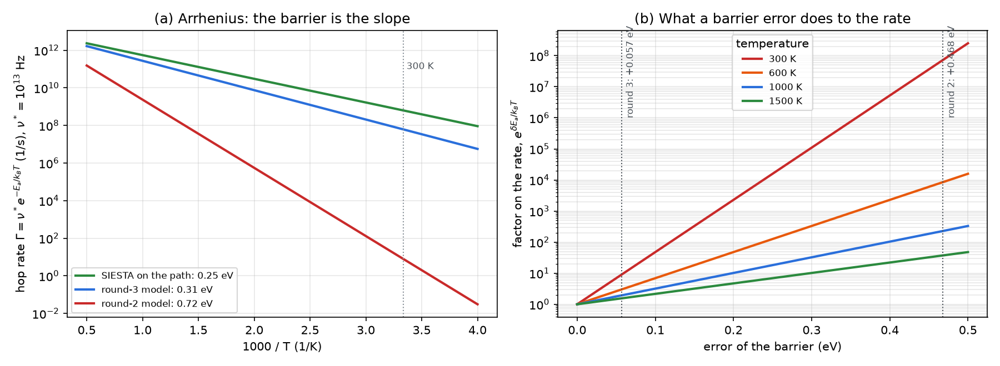
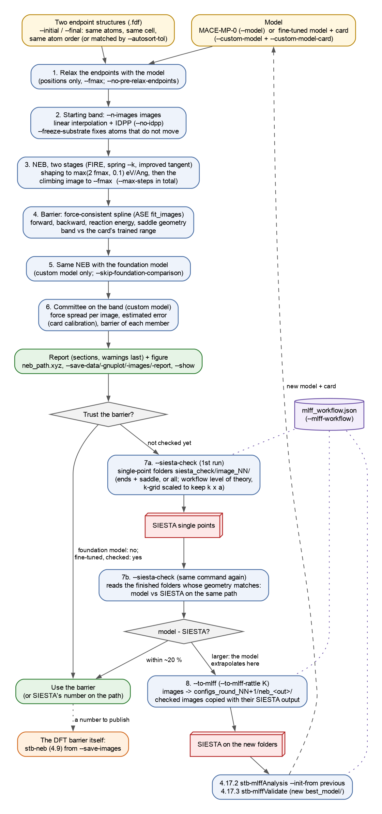
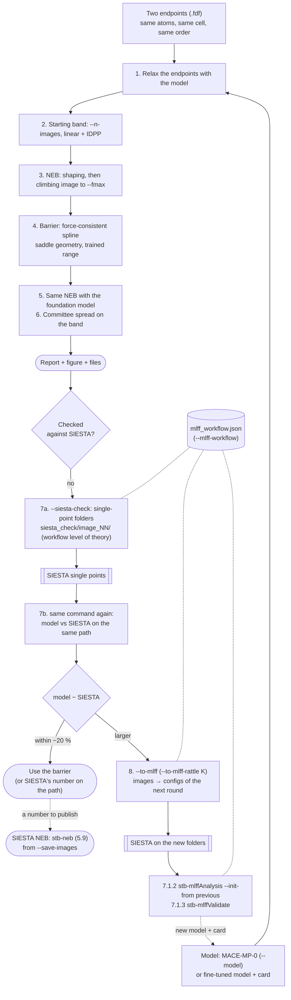
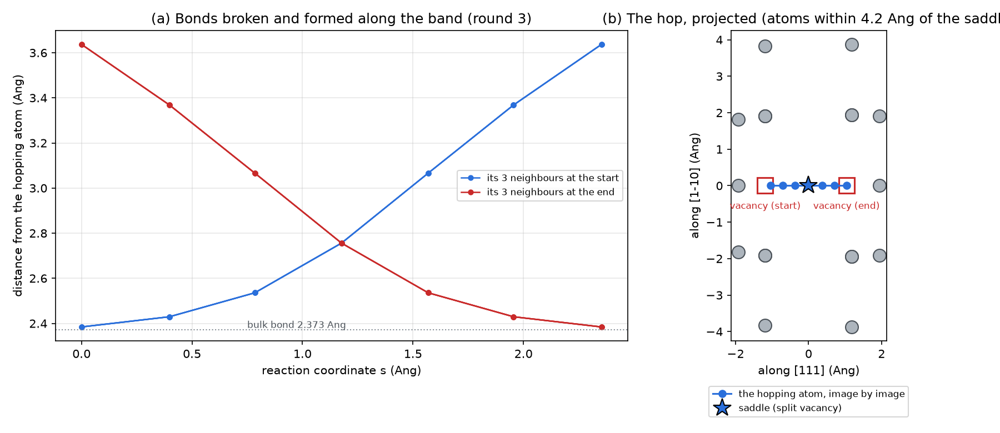
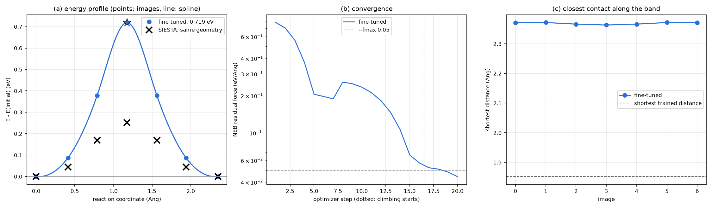
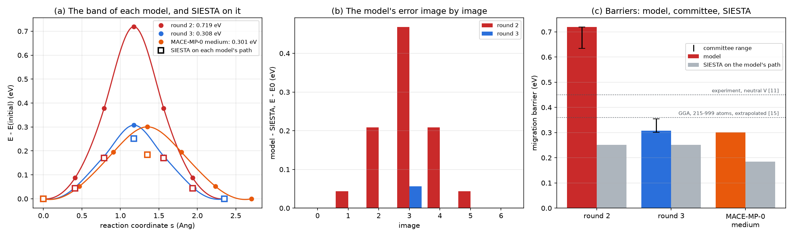
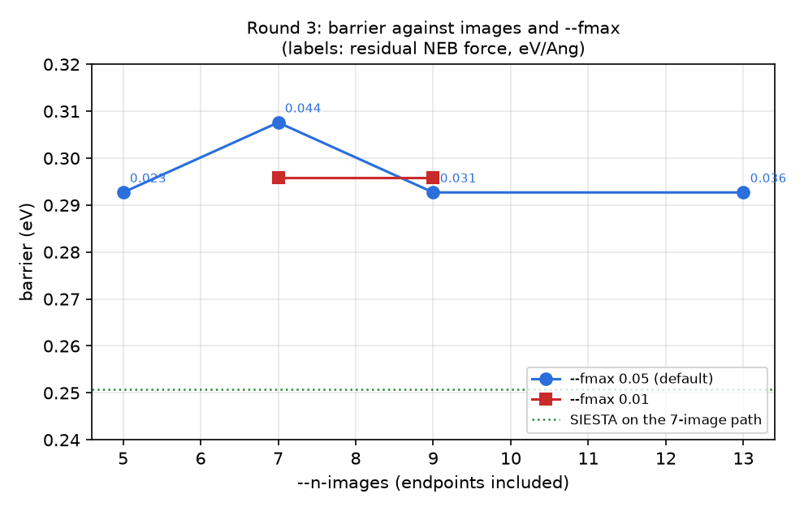

# 7.5 — ML Nudged Elastic Band (`stb-mlneb`)

`stb-mlneb` finds the **minimum-energy path** between two stable structures and the **energy barrier** along it with
the climbing-image nudged elastic band method (CI-NEB), with every energy and force from a MACE machine-learned
potential: the MACE-MP-0 foundation model, or a model you fine-tuned on your own SIESTA calculations with the MLFF
workflow (`7.1`), which always comes with its **model card**. You give it the two endpoints — a vacancy before and
after a hop, an adsorbate on two sites, the two sides of a small rearrangement — and it reports:

- the atoms that move, the endpoints relaxed with the model, and the starting path;
- the band image by image, the barrier forward and backward and the reaction energy, the saddle-point geometry;
- the band against the model card's trained range;
- with a fine-tuned model: the same NEB with the foundation model, and the spread of the model's committee on the band.

It also closes the loop with SIESTA. `--siesta-check` writes SIESTA single points of the endpoints and the saddle at the
model's own level of theory, and compares the model with SIESTA on the same geometries when they are done. `--to-mlff`
adds the band's images to the training set of the next round of the MLFF workflow.

**Why a potential for a barrier?** A SIESTA NEB (`5.9`) costs one SIESTA calculation per image per optimizer step:
seven images, a few dozen steps, a few hundred single points of a 63-atom supercell — a day of a small cluster. With a
MACE model the same band converges in under a minute on a GPU. The price is the usual one: the model is only as good as
its training data near the saddle. A transition state is the least likely structure in a training set built from
perfect crystals, rattles and molecular dynamics.

The worked example (section 6) is a real loop on a GPU and 6 CPU cores: a vacancy hop in a 63-atom silicon supercell with
the fine-tuned model of the `7.2`–`7.4` examples.

- The model, validated on the perfect crystal (test force error 28.7 meV/Å), gives a barrier of **0.72 eV**.
- Neither its trained range nor its committee sees anything wrong.
- **Seven SIESTA single points** on its own path give **0.25 eV**.
- Fourteen of those configurations, added to the training set, give a round-3 model with **0.31 eV**. Round 3 is also
  better on the perfect crystal.

That loop — NEB, check, retrain, NEB — is the main lesson of this example.

## 1. Theory

**Symbols at a glance**

| Symbol | Meaning |
|---|---|
| `R` | the 3N atomic coordinates of a configuration; `E(R)` its energy, `F = −∇E` its forces |
| `R_0 … R_P` | the images of the band; `R_0` and `R_P` are the endpoints (fixed), `P + 1` = `--n-images` |
| `τ̂_i` | unit tangent to the band at image `i` |
| `F⊥`, `F∥` | components of a force perpendicular and parallel to the band (`F∥ = (F·τ̂) τ̂`) |
| `k` | spring constant between neighbouring images (`--k`, eV/Ų) |
| `s` | reaction coordinate: the path length along the band from `R_0` (Å) |
| `E_a`, `ΔE` | barrier (`E(saddle) − E(initial)`) and reaction energy (`E(final) − E(initial)`) |
| `H` | Hessian matrix `∂²E/∂R∂R`; its eigenvalues are `k_B T`-independent curvatures |
| `ν*`, `Γ` | attempt frequency and hop rate of transition-state theory |
| `f_max` | convergence threshold on the largest force component of the band (`--fmax`, eV/Å) |

### 1.1 The potential energy surface: minima and saddle points

In the Born–Oppenheimer approximation the atoms move on a potential energy surface `E(R)`. Two kinds of stationary
points (`∇E = 0`) matter here:

- a **minimum**: every eigenvalue of the Hessian `H` is positive. A stable or metastable structure: the vacancy before
  and after the hop;
- a **first-order saddle point**: exactly one negative eigenvalue. Along its eigenvector the energy is a maximum; along
  every other direction a minimum. It is the **transition state** between two minima.

A **minimum-energy path** (MEP) connects two minima through a saddle point. At every point of it the force has no
component perpendicular to the path [1]:

```
F⊥(R) = −∇E(R) + (∇E(R)·τ̂) τ̂ = 0        on the MEP                                                      (1)
```

The MEP is the most probable route of a thermally activated jump at low temperature. Its highest point is the saddle,
and the **barrier** is `E_a = E(saddle) − E(initial)`. Forward and backward barriers differ by the reaction energy:
`E_a^back = E_a − ΔE`. A path may also cross more than one saddle with intermediate minima in between (Fig. 1c).
Then the transition is two steps, and each step is its own barrier.

### 1.2 Why the barrier: transition-state theory

Harmonic transition-state theory (Vineyard [2]) gives the rate of a jump over a saddle point:

```
Γ = ν* exp(−E_a / k_B T),          ν* = Π_{j=1}^{3N} ν_j^(min) / Π_{j=1}^{3N−1} ν_j^(saddle)                  (2)
```

- The prefactor `ν*` is a ratio of the normal-mode frequencies at the minimum and at the saddle, the unstable mode left
  out. It is of the order of a phonon frequency, 10¹²–10¹³ Hz. `stb-mlneb` does not compute it: it needs the Hessian
  at both points (a phonon calculation, `7.3`, of each).
- **The barrier enters an exponential.** An error `δE_a` multiplies the rate by `exp(δE_a / k_B T)` (Fig. 4b):
  0.1 eV is a factor 48 at 300 K and 3 at 1000 K. This is why a barrier needs an accuracy of a few hundredths of an
  eV, much tighter than the error a potential is usually judged by.

For a vacancy in the diamond lattice, each hop moves the vacancy by one bond length `d = √3 a / 4` to one of `Z = 4`
neighbours. A random walk of such hops gives the vacancy diffusion coefficient [3]:

```
D_V = (1/6) Z d² Γ = (2/3) d² ν* exp(−E_m / k_B T)                                                      (3)
```

`E_m`, the migration barrier, is what the NEB of section 6 computes.

### 1.3 The elastic band: a chain of states

Searching for the saddle directly is hard: a minimizer runs away from it, and a saddle search must know which mode to
climb. The **chain-of-states** methods instead discretize the whole path [1, 4]. `P − 1` intermediate images `R_1 …
R_{P−1}` between the fixed endpoints are relaxed *together*, each one held to its neighbours by springs:

```
F_i^plain = −∇E(R_i) + k (R_{i+1} − 2 R_i + R_{i−1})          a plain elastic band (do not use)             (4)
```

This simple form fails in two opposite ways (Fig. 1a):

- **Corner cutting.** With stiff springs, the spring force perpendicular to a curved path pulls the band straight. It
  cuts across the corner, misses the saddle, and overestimates the barrier.
- **Sliding down.** With soft springs, the true force parallel to the band pushes images down into the minima. Too few
  are left near the saddle, and the barrier is underestimated.

### 1.4 Nudging

The **nudged** elastic band [4] removes both problems with two projections (Fig. 2). Each image keeps only the part of
the true force perpendicular to the band, and only the part of the spring force along it:

```
F_i^NEB = F⊥_i  +  F∥,spring_i
        = [−∇E(R_i) + (∇E(R_i)·τ̂_i) τ̂_i]  +  k (|R_{i+1} − R_i| − |R_i − R_{i−1}|) τ̂_i                     (5)
```

- **The perpendicular true force** moves each image sideways, towards the MEP. It is zero on the MEP (Eq. 1), so a
  converged band lies on it, whatever `k`.
- **The parallel spring force** only keeps the images evenly spaced along the band. It never pulls the band off the MEP.
  The value of `k` changes the spacing, not the converged path. `--k` defaults to 0.1 eV/Ų.

**The tangent.** The projections need `τ̂_i`, and its definition matters. The simple bisector of the two neighbouring
segments gives kinks on a band where the force along the path is large compared with the perpendicular one. The
**improved tangent** [5], the one used here, points toward the *higher-energy* neighbour:

```
τ_i = R_{i+1} − R_i   if E_{i+1} > E_i > E_{i−1};      τ_i = R_i − R_{i−1}   if E_{i+1} < E_i < E_{i−1}            (6)
```

At an extremum of the band, the two segments are mixed with weights `ΔE_max = max(|E_{i+1} − E_i|, |E_{i−1} − E_i|)`
and `ΔE_min`, the larger weight on the side of the higher neighbour.

### 1.5 The climbing image

A converged NEB samples the MEP at discrete images, and none of them sits exactly on the saddle. In the
**climbing-image** variant [6], once the band is roughly in place, the highest image `i_max` drops its springs. Its
force along the band is also inverted:

```
F_{i_max}^CI = −∇E(R_{i_max}) + 2 (∇E(R_{i_max})·τ̂) τ̂                                                     (7)
```

- The image now **climbs** up along the band and **relaxes down** perpendicular to it. At convergence it sits exactly on
  the saddle point, so its energy is the barrier.
- The neighbouring images keep their springs. They space themselves evenly on each side of the climbing image, so the
  spacing differs on the two sides.
- Climbing from the start can send the image to a wrong maximum. `stb-mlneb` therefore climbs in a second stage.

### 1.6 The starting path: linear interpolation and IDPP

The band must start from somewhere. A **linear interpolation** of the Cartesian coordinates, `R_i = R_0 + (i/P)(R_P −
R_0)`, can put two atoms on top of each other when one moves past another. The **image-dependent pair potential**
(IDPP) [7] fixes that before any energy is computed. Each image is relaxed on an artificial surface that makes its
interatomic distances `d_ab` close to the linearly interpolated distances `d_ab^(i)`:

```
S^(i)(R) = Σ_{a<b} w(d_ab) [d_ab^(i) − d_ab(R)]²,     d_ab^(i) = d_ab^(0) + (i/P)(d_ab^(P) − d_ab^(0)),   w(d) = 1/d⁴      (8)
```

The weights `w = 1/d⁴` favour the short distances. IDPP costs nothing (no model evaluation) and gives a path that keeps
bond lengths reasonable. For the single-atom hop of section 6 it changes almost nothing; for concerted moves of many
atoms it is the difference between a band that converges and one that does not. `--no-idpp` skips it (section 6.7).

**Atom correspondence.** Image `i` interpolates atom `j` of the initial structure to atom `j` of the final one. The two
`.fdf` files must therefore list the same atoms in the same order. `stb-mlneb` checks the composition and re-matches
the order by distance (`--autosort-tol`); the report lists the atoms that move and flags a jump in the starting path
that looks like a wrong match.

### 1.7 The optimizer and convergence

All the images move together under the NEB forces, with the FIRE optimizer [8]: a velocity-Verlet integration with the
velocity mixed toward the force and reset when the motion goes uphill. It is robust for NEB, where the forces are not
the gradient of any single function, so a line search is ill-defined. Convergence is reached when the largest NEB
force component on the band is below `f_max`. Note what is and is not converged:

- on an ordinary image, the **perpendicular** force (plus the spring). The raw force `|F|` of an interior image stays
  large, because its component along the path is never relaxed. The report prints the raw force, and a value above
  `f_max` there is normal;
- on the climbing image, the **full** force. It is a stationary point, so its raw `|F|` is below `f_max`.

`stb-mlneb` runs two stages:

1. **Shaping**: a plain NEB to `max(2 f_max, 0.1)` eV/Å, in at most half of `--max-steps`.
2. **Climbing**: the climbing image to `f_max` (`--fmax`, default 0.05 eV/Å), with the rest of the steps.

The endpoints are relaxed with the model first (`--fmax`, positions only), so that the barrier is measured from the
model's own minima (section 6.7 shows what happens without it).

### 1.8 Reading the barrier off the band: the force-consistent spline

The band gives the energy at `P + 1` points. Between them, `stb-mlneb` uses ASE's `fit_images` [9]: a cubic polynomial
on each segment that matches the two image energies and the two **slopes**. The slope comes from the force along the
band, which the NEB computes anyway:

```
dE/ds |_i = −F_i · τ̂_i       (Hermite cubic on each segment [s_i, s_{i+1}])                                      (9)
```

The spline's maximum is the **reported barrier**; the highest image is a lower bound. With a converged climbing image
the two coincide, because the climbing image *is* the maximum. They differ when the band is too coarse, or when the
climbing image did not converge (Fig. 3). A difference above 0.05 eV is a warning: use more images. The same spline,
with the reaction energy, gives the backward barrier, and its minima between the images reveal an **intermediate
minimum** — a two-step transition that needs two NEBs.



*Fig. 1 — The Müller–Brown surface [10] (energies ×0.01), three minima A, C, B and two saddles S1, S2. Every band here
was computed by `theory_figures.py` with Eqs. 4–7 and FIRE, 13 images from A to B. (a) A plain elastic band (Eq. 4):
stiff springs cut the corner past S1, soft springs let the images slide into the minima. (b) NEB (Eq. 5) follows the
MEP through C. The climbing image (Eq. 7) lands on S1 to 10⁻³ in the coordinates. (c) The energy along the band and the
force-consistent spline (Eq. 9). The NEB's highest image is 0.03 below the exact saddle; the climbing image is exact.
The intermediate minimum C makes this a two-step path.*



*Fig. 2 — The force on one image of a band that is not converged yet. The true force (black) is split along the
tangent (green). Its perpendicular part (blue) is kept and moves the band toward the MEP. Its parallel part (grey) is
discarded: it would slide the image downhill. The spring force acts only along the tangent (orange).*



*Fig. 3 — Five images from A to C, without climbing. The highest image (1.040) misses the saddle (1.060). The
force-consistent spline, which uses the slope `−F·τ̂` at each image (orange ticks), finds 1.064. Straight segments
would only reproduce the highest image.*

### 1.9 The test case: a vacancy hop in silicon

A vacancy in diamond-structure silicon leaves four atoms with one dangling bond each. It migrates when one of those
four neighbours jumps into the empty site. The vacancy then sits where the neighbour was, one bond length away (`d =
√3 a / 4 = 2.37 Å` at SIESTA's `a = 5.48 Å`).

- **At the endpoints**, the hopping atom has three bonds to its own neighbours (2.37–2.38 Å in the relaxed models) and
  faces the vacancy.
- **At the saddle**, it sits halfway, at the centre of two half-vacancies (the *split vacancy*, `D3d` symmetry). It is
  at the same distance, 2.76–2.78 Å, from six atoms, the three of each side; the report lists the four nearest.
- The path is symmetric: `ΔE = 0`, the saddle at 50 % of the path.

This is one of the best-studied defects in semiconductors, and its numbers are hard ones:

- **Experiment** (electron paramagnetic resonance after irradiation at cryogenic temperature [11, 12]) gives a
  migration energy of 0.45 eV for the neutral vacancy, 0.32 eV for V²⁺ and 0.18 eV for V²⁻.
- **DFT** is notoriously slow to converge with the supercell. The vacancy's levels are deep and its distortions long
  ranged (Jahn–Teller), so 64-atom cells and dense k-grids give scattered results [13, 14]. Well-converged GGA
  calculations, extrapolated from 215–999-atom cells, give 0.36 eV for the neutral vacancy [15]; SIESTA with a
  216-atom cell gave 0.40 eV [16].

The 63-atom cell of section 6 (a 2×2×2 supercell, non-spin-polarized, 3×3×3 k-points) is therefore **not** a converged
vacancy calculation: its SIESTA barrier on the model's path, 0.25 eV, is a property of this cell and these settings. It
is the right test for what this example asks — does the model reproduce SIESTA *at the training settings, in this
cell*? — because model and SIESTA see exactly the same cell. Section 6.8 comes back to this.

### 1.10 Barriers from a machine-learned potential

A MACE model is fitted to energies, forces and stresses of the training configurations. Its predictions are reliable
where its training data are dense, and degrade gracefully, without any built-in warning, away from them. For a barrier
this has three consequences:

1. **The saddle is out of distribution by nature.** Rattled crystals, strained cells and MD frames rarely contain a
   five-fold-coordinated atom between two half-vacancies. The model card can show how far the band is from the trained
   range in cell size, bond length, force and energy (report section `TRAINED RANGE`). It cannot show whether a *kind*
   of structure was in the training set. In section 6 the band is inside every range and the barrier is still 3× too
   high.
2. **A committee is a lower bound of the error.** Models fine-tuned with different seeds from the same foundation model
   share most of their errors. The spread of their forces measures how much the seeds disagree, not how wrong they all
   are. `stb-mlffValidate` calibrates the ratio error/spread on the test set (1.3–1.7 here), and `stb-mlneb` uses that
   calibration. Even so, the round-2 committee gave 0.63–0.72 eV against SIESTA's 0.25.
3. **The only real check is the reference method itself.** SIESTA single points on the model's own band cost a few
   minutes per image. They measure the model's error at exactly those geometries.

**What a SIESTA single point on the model's path measures.** Call `R*` the true SIESTA stationary point (minimum or
saddle) and `R_m = R* + δ` the model's. Expanding SIESTA's energy around `R*`, where its gradient vanishes:

```
E_SIESTA(R_m) = E_SIESTA(R*) + ½ δᵀ H δ + O(δ³)                                                            (10)
```

- The error is **second order** in the geometry error. SIESTA's barrier *on the model's path* approaches SIESTA's own
  barrier quadratically as the model improves.
- The SIESTA force on the model's geometry, `F = −H δ`, measures `δ`. The report prints SIESTA's `max|F|` for each
  checked image: a small one means the model's geometry is close to SIESTA's own stationary point.
- At a minimum the correction is positive: an endpoint that is not at SIESTA's minimum sits **too high**, which makes
  the barrier on that path look **too low**. At the saddle the correction can have either sign (one curvature is
  negative).

This is why the foundation model's path gives SIESTA only 0.185 eV in section 6.6: its endpoints are 0.05 eV above the
fine-tuned ones in SIESTA's energy.

**Closing the loop.** The checked images are exactly the configurations the model lacks. Added to the training set
(`--to-mlff`), with a few randomly displaced copies to sample their neighbourhood (`--to-mlff-rattle`), they teach it
the region of the saddle in one round (section 6.5). This is active learning driven by the property of interest, and it
complements the committee-driven sampling of `7.1.4`.



*Fig. 4 — (a) Hop rate (Eq. 2, `ν* = 10¹³` Hz) for the three barriers of section 6: the slope of each line is the
barrier. (b) The factor an error in the barrier puts on the rate. The round-2 model's +0.47 eV is a factor 7 × 10⁷ at
300 K; round 3's +0.06 eV is 9 at 300 K and 2 at 1000 K.*

### 1.11 A calculation you can check by hand

- **Hop length.** `d = √3/4 × 5.48024 = 2.3730 Å`. Report section `STRUCTURES`: one atom moves 2.3730 Å.
- **Rate error.** `k_B T` at 300 K is 0.025852 eV. Round 2's barrier error, 0.7193 − 0.2512 = 0.468 eV, gives
  `exp(0.468/0.025852) = 7.3 × 10⁷` (Fig. 4b).
- **Vacancy diffusion (Eq. 3)** with SIESTA's 0.2512 eV and `ν* = 10¹³` Hz: `D_V = (2/3)(2.373 × 10⁻⁸ cm)² × 10¹³ ×
  exp(−0.2512/0.025852) = 2.3 × 10⁻⁷ cm²/s` at 300 K. With round 3's 0.3076 eV it is `2.6 × 10⁻⁸`, with round 2's
  0.7193 eV `3.1 × 10⁻¹⁵` — eight orders of magnitude below SIESTA.
- **The k-grid of the check folders.** The training cell (`a = 5.48` Å) used 6×6×6, `k × a = 32.9` Å; the 2×2×2
  supercell (`10.96` Å) keeps it with 3×3×3: `3 × 10.96 = 32.9` Å. Each folder's `config_extra.fdf` says
  `kgrid.MonkhorstPack [3 3 3]`.
- **Committee calibration.** Round 2's largest per-image force spread is 57.5 meV/Å (image 2). Times the card's
  calibration of 1.3, that is an estimated error of 75 meV/Å; report section `COMMITTEE UNCERTAINTY`: 75.

### 1.12 What this tool simplifies — explicitly

- **0 K energy barriers**, not free-energy barriers. There is no prefactor, no entropy and no temperature: Eq. 2 needs
  the frequencies at the minimum and at the saddle.
- **One path, the one the endpoints define.** NEB finds the MEP nearest to the starting band. A different mechanism (a
  ring exchange, a reorientation) needs its own endpoints. Use more images, or an intermediate image, for a path you
  suspect has two steps.
- **Fixed cell.** The band lives in the initial cell. A lattice mismatch between the endpoints only warns.
- **Neutral, non-magnetic, same electron count.** The model knows no charge state or spin. A charged vacancy has
  another barrier (section 1.9).
- **The SIESTA check is single points on the model's geometries**, not a SIESTA NEB. It measures the model's error on
  that path and approximates SIESTA's barrier to second order (Eq. 10). For SIESTA's own barrier use `stb-neb` (`5.9`),
  starting from `--save-images`.
- **The committee spread is a lower bound** of the error (section 1.10).

## 2. The loop at a glance





`stb-mlneb` itself is steps 1–8. Steps 7 and 8 talk to the MLFF workflow through its state file,
`mlff_workflow.json` (`--mlff-workflow`). From it they take the level of theory: the reference `calc.fdf`, the
pseudopotentials, the dispersion setting and the k-grid, scaled to keep `k × a`. `--to-mlff` also writes back to it:
the new configs, their round and kind, and a history entry. The SIESTA runs and the training are yours to start, as
everywhere in the suite.

## 3. Libraries and external dependencies used

| Library | Used for |
|---|---|
| ASE [9] | `Atoms`, the NEB (`ase.mep.NEB`: improved tangent, climbing image), IDPP, FIRE, `fit_images` (the spline), neighbour distances, extended XYZ |
| mace-torch [17, 18] | the MACE calculator, the foundation models (downloaded once, cached in `~/.cache/mace/`) and custom `.model` files |
| PyTorch | runs the model on `cpu` or `cuda` (`--device`) |
| pymatgen | structure conversion |
| NumPy | geometry, the committee statistics |
| matplotlib | `neb_profile.png` (always written), `--show` |
| gnuplot (optional) | renders the `.gplot` file written by `--save-gnuplot` |
| `stb.neb` | composition check, wrapping into the cell, atom matching — shared with the SIESTA NEB (`5.9`) |
| `stb.core` | `.fdf` reading and writing, the model card, the calculator and the relaxations (`mace_relax`), device checks, pseudopotential banks, the workflow file (`mlff_workflow`), SIESTA log parsing, library-noise capture, report sections, gnuplot |

Install the `ml` extra: `pip install stb_suite[ml]`. SIESTA is never called by the tool: `--siesta-check` and
`--to-mlff` write input folders and read finished ones.

## 4. What `stb-mlneb` does

### 4.1 Step by step

1. **Read** `--initial` and `--final` (`.fdf`). Check that they hold the same atoms (else a clean error). Match the atom
   order by distance (`--autosort-tol`, 0.5 Å). List the atoms that move by more than 0.1 Å. A lattice mismatch warns,
   and the band takes the initial cell.
2. **Load the model**: a foundation model (`--model small|medium|large`) or a custom model with its card
   (`--custom-model` + `--custom-model-card`; the card must match the model's SHA-256). Print the card in full.
3. **Relax both endpoints** with the model, positions only, to `--fmax` (`--no-pre-relax-endpoints` skips it). Report
   the force before and after, the largest move and the energy gained.
4. **Build the starting band**: `--n-images` images, endpoints included (default 7, at least 3), linear interpolation
   then IDPP (`--idpp-fmax`, `--idpp-steps`; `--no-idpp` skips it). With `--freeze-substrate`, the atoms that move
   less than `--freeze-threshold` (0.3 Å) between the endpoints are fixed. Report each image's step from the previous
   one and its shortest distance, and flag jumps.
5. **NEB** in two stages (section 1.7): shaping, then climbing. FIRE, spring `--k`, improved tangent, `--max-steps`
   in total. The residual force is recorded at every step.
6. **Barrier** (section 1.8): the spline through energies and forces, forward and backward, the reaction energy and
   the position of the saddle. Then the saddle geometry: the nearest neighbours of the atom that moves most, at the
   initial state, the saddle and the final state.
7. **Trained range** (custom model): volume per atom, shortest distance, largest force and energy per atom of the
   band against the card.
8. With a custom model, **repeat 3–6 with the foundation model** (`--model`) unless `--skip-foundation-comparison`.
   Each model relaxes its own endpoints, in the same cell.
9. **Committee** (custom model, unless `--no-committee`). Look for the card's committee next to the card's run folder,
   then in `--mlff-workflow`'s run, or take `--committee-models PATH...`. Every member evaluates the relaxed band.
   Report per image the energy and force spread (the largest per-atom deviation from the committee mean, as in
   `stb-mlffValidate`), the estimated error (spread × the card's calibrated error/spread ratio), the spread relative
   to the test set's, and each member's barrier.
10. **SIESTA check** (`--siesta-check`; needs `--mlff-workflow` or `--calc`). For each image of
    `--siesta-check-images` (`ends-saddle`, default, or `all`), look at `<out>/siesta_check/image_NN/`, then compare
    the model's profile with SIESTA's, image by image, and the barrier on that path:
    - **missing**: write it — the structure file the template `%include`s, `calc.fdf` with `config_extra.fdf` on top
      (k-grid, `NumberOfAtoms`, D3 if the workflow has it, single point), the pseudopotentials, and the stamp
      `stb_mlneb_image.xyz`;
    - **finished**, with the same geometry (0.02 Å): read SIESTA's energy and largest force;
    - **written for another geometry** (`stale`): leave it untouched and warn;
    - **not finished** (`pending`): say so.
11. **Export** (`--to-mlff`, needs `--mlff-workflow`). Write every image, and `--to-mlff-rattle K` copies of each
    displaced by a Gaussian of `--to-mlff-stdev` (0.05 Å; seed `--to-mlff-seed`), as training configs of the
    workflow's next round: `configs_round_NN/neb_<out>/image_II[_rattle_K]/`, kind `neb` / `neb-rattle`, stage `neb`.
    An image already finished by the check is copied with its SIESTA output, so it is not computed twice. A config
    already in the workflow is left alone, so the export can be repeated safely. The JSON is backed up and the call
    recorded in its history.
12. **Report, figure, files** (section 4.3).

The order matters for the SIESTA check: the check folders take the band of *this* run. Run the second pass with the
same options and output folder. If the band changed (another model, other settings), the stamps no longer match: the
folders are `stale`, and the report says so instead of comparing two different paths.

### 4.2 The report, section by section

Sections are numbered in order; those that do not apply (no card, no comparison, no committee, no check, no export) are
left out.

| Section | Content |
|---|---|
| `RUN METADATA` | date, versions, device (GPU name), endpoints, band and NEB settings, model, comparison |
| `STRUCTURES` | composition check, cell and volume per atom, shortest distance of each endpoint, the atoms that move and by how much |
| `MODEL` | the **model card** in full (identity and SHA-256, level of theory, training data and trained range, errors against SIESTA, calibration, stability, notes), or the foundation model's identity; load time |
| `ENDPOINTS` | per model: `max\|F\|` before and after, steps, largest move, energy gained, absolute energy; `E(final) − E(initial)` |
| `STARTING PATH` | per model: step between images and shortest distance after IDPP, with a check of each |
| `NEB BAND` | per model: converged or not, shaping and climbing steps, residual force, time; then each image: `s`, `E − E0`, raw `max\|F\|`, shortest distance, shift from the initial image, role (initial, climbing image, final) |
| `BARRIER` | per model: forward, backward and reaction energy from the spline and from the highest image; position of the saddle |
| `SADDLE POINT` | the four nearest neighbours of the largest mover at the initial state, the saddle and the final state; the saddle image's force and shortest distance |
| `TRAINED RANGE` | the band against the card: volume, shortest distance, largest force, energy per atom, each inside or outside |
| `FINE-TUNED vs FOUNDATION` | barrier (spline and image), backward barrier, reaction energy, saddle position, path length, shortest distance, NEB steps and time of both models |
| `COMMITTEE UNCERTAINTY` | where the members were found; per image `E − E0`, energy and force spread, worst atom, estimated error, spread vs the test set; each member's barrier; the calibration used |
| `SIESTA CHECK` | the template and k-grid; per image the model and SIESTA energies, their difference, SIESTA's `max\|F\|`, status; the barrier on the path, model vs SIESTA |
| `EXPORT TO THE MLFF WORKFLOW` | workflow, round, folder, how many configs were written, copied or skipped; the k-grid; the next commands |
| `SUMMARY & FILES` | status, headline numbers of every model, committee and check; the files; the outputs not asked for; wall time |
| `WARNINGS` | every warning, numbered; the count of library messages captured |

The warnings include:

- an endpoint relaxation that hit `--max-steps`, or moved atoms far (the input was not a minimum of this model);
  `--no-pre-relax-endpoints` (the barrier is then not measured from the model's minima);
- an atom that moves very far between the endpoints (a wrong atom order), no atom that moves at all, consecutive
  images nearly identical, or one step of the starting path more than 3× the mean (atom correspondence);
- an NEB stopped at `--max-steps`;
- an intermediate minimum along the band (a two-step transition), or a band with no barrier;
- a spline barrier far from the highest image (too few images);
- the band outside the card's trained range: atoms closer than the shortest trained distance, energies below the
  lowest trained one, and the card's own domain checks;
- a committee spread far above the test set's, or members that disagree on the barrier;
- the SIESTA check: `stale` or `pending` folders, and a model–SIESTA difference that is "not reliable" (above
  `max(0.05 eV, 50 %)` of SIESTA's barrier) or "right in kind, not yet in value" (above `max(0.05 eV, 20 %)`);
- export folders that still need SIESTA; `--show` without a display.

### 4.3 Files

| Written | When |
|---|---|
| `neb_profile.png` (energy profile of every model with the spline; NEB convergence; with a check, SIESTA's points) | always; `--show` opens it |
| `neb_path.xyz` (the relaxed band, extended XYZ; `neb_path_foundation.xyz` for the comparison) | always |
| `neb_band.dat` (`neb_band_foundation.dat`): image, `s`, `E − E0`, `max\|F\|`, shortest distance, shift | `--save-data` |
| `plot/band_K.dat`, `plot/spline_K.dat`, `plot/convergence_K.dat`, `plot/neb_profile.gplot`, `plot/neb_profile.pdf` | `--save-gnuplot` (the PDF when gnuplot is installed) |
| `image_NN.fdf` (bare structures, e.g. for `stb-neb`) | `--save-images` |
| `stb_mlneb_report.txt` | `--save-report` |
| `siesta_check/image_NN/` (SIESTA inputs + stamp) | `--siesta-check` |
| `<workflow run>/configs_round_NN/neb_<out>/image_II[_rattle_K]/`, and the updated `mlff_workflow.json` (+ `.bak`) | `--to-mlff` |

Everything else goes into `-o/--output-dir` (default `mlneb_out`).

### 4.4 Guard rails

| Situation | Behaviour |
|---|---|
| `--custom-model` without `--custom-model-card`, an unreadable card, a SHA-256 mismatch | clean error |
| `--n-images` below 3; `--to-mlff` without `--mlff-workflow`; a workflow file that does not exist | clean error |
| a missing endpoint or model file; endpoints with a different composition | clean error |
| `--siesta-check`/`--to-mlff` without `--calc` or `--mlff-workflow`; a `calc.fdf` that does not `%include` a structure file; no pseudopotential for an element | clean error, before the NEB |
| a lattice mismatch between the endpoints | warning; the band uses the initial cell |
| identical endpoints | warnings: no atom moves, images nearly identical, no barrier |
| an endpoint relaxation or the NEB hits its step limit | warning |
| a band outside the card's trained range; an element outside the model | warning; error |
| check folders written for another band, or not finished | `stale` / `pending`, left untouched, warning |
| `--device cuda` with no usable GPU | clean error |
| `--show` without a display; gnuplot not installed | warning; files written anyway |

## 5. Running it both ways

**Command line:**

```bash
# a first look with the foundation model
stb-mlneb --initial vac_initial.fdf --final vac_final.fdf --model medium --device cuda --save-report

# a fine-tuned model, its committee and a SIESTA check of every image (first pass: writes the folders)
stb-mlneb --initial vac_initial.fdf --final vac_final.fdf \
          --custom-model best_model/mlff_model_compiled.model --custom-model-card best_model/mlff_model_card.json \
          --mlff-workflow mlff_runs/mlff_workflow.json --siesta-check --siesta-check-images all \
          --device cuda -o neb_r2 --save-data --save-gnuplot --save-report
for d in neb_r2/siesta_check/image_*/; do (cd $d && mpirun -np 6 siesta < calc.fdf > siesta.out); done

# second pass: the same command reads them; --to-mlff sends the band to the next training round
stb-mlneb ... the same options ... --to-mlff --to-mlff-rattle 1

# without a workflow: any calc.fdf that %includes the structure, a pseudopotential folder or bank, a k-grid
stb-mlneb --initial i.fdf --final f.fdf --custom-model ... --custom-model-card ... \
          --siesta-check --calc calc.fdf --pseudo-dir dojo --kgrid 3 3 3
```

**Interactive menu:** run `stb-suite` and type `7.5`. It asks, in this order:

1. the initial and the final structure;
2. a custom model path, or Enter for a foundation model. With a custom model it asks for the card, offering
   `mlff_model_card.json` next to the model as the default;
3. the MACE-MP-0 size (with a custom model: the one of the comparison);
4. the device (`cpu`/`cuda`; it checks the GPU) and the number of images;
5. whether to freeze the substrate; with a custom model, whether to compare with the foundation model;
6. with a custom model, the `mlff_workflow.json` of its run (Enter to skip). With one: whether to write the SIESTA
   check (and of every image), whether to export to training (and how many rattled copies);
7. the output folder, then one question per optional output (show, gnuplot, data, images, report).

The menu builds the same command line and calls `stb-mlneb`; the guided script (Case 10) drives it with piped answers.
The options without a menu question (`--k`, `--fmax`, `--max-steps`, `--calc`, `--kgrid`, `--committee-models`, ...)
are for the command line.

## 6. Worked example: a vacancy hop in silicon, and one round to fix it

### 6.1 Set-up

- **The cell.** `structure.fdf` is the 8-atom diamond cell at SIESTA's own lattice constant at the training settings,
  `a = 5.48024 Å` (experiment: 5.431 Å; PBE is 0.9 % too large). `make_endpoints.py` builds a 2×2×2 supercell
  (64 Si, `10.96 Å`), removes the atom at the origin (`vac_initial.fdf`, 63 atoms), and moves its neighbour at
  `(1/8, 1/8, 1/8)` into the hole (`vac_final.fdf`). One atom moves, by `d = 2.373 Å`; both files list the atoms in
  the same order.
- **The model of round 2** (`../7.2-mlmd/model/`, the model of `7.2`–`7.4`): the best model of the `7.1` silicon run,
  fine-tuned from MACE-MP-0 medium on 57 SIESTA single points of the **perfect crystal** — 39 rattled cells, 6
  strained cells, 12 frames of an 800 K MD in a 64-atom cell. Test-set force error 28.7 meV/Å, phonons 1.10 THz RMS
  from SIESTA's. No vacancy, no transition state.
- **The level of theory**: `calc.fdf`, the training template (PBE, DZP, `PAO.EnergyShift 0.01 Ry`, `Mesh.Cutoff 300
  Ry`, 300 K smearing, non-spin-polarized, PseudoDojo `Si.psml`). The check folders use it with `kgrid 3×3×3`, the
  training `k × a`.
- **Hardware**: every NEB on one RTX 3060 (`--device cuda`, float64), 45–60 s per band of the fine-tuned model,
  about 2 min with the foundation model. On a CPU (12 threads) the same band takes 9 min and comes out identical.
  Each SIESTA single point: about 3 min on 6 MPI processes (SIESTA 5.4.2).

The loop below was run once, by hand, in a copy of the `7.1` run folder (2 GB). `reference_results/loop_round2/` and
`loop_round3/` keep its `stb-mlneb` reports, bands and the SIESTA single points (inputs, `siesta.out`, `siesta.FA`,
stamp). `reference_results/mlff_round3/` keeps the training and validation reports of round 3. The guided script
replays it without the 2 GB (section 11).

### 6.2 Round 2: the band

```bash
stb-mlneb --initial vac_initial.fdf --final vac_final.fdf \
          --custom-model best_model/mlff_model_compiled.model --custom-model-card best_model/mlff_model_card.json \
          --mlff-workflow mlff_runs/mlff_workflow.json --siesta-check --siesta-check-images all \
          --skip-foundation-comparison --device cuda -o neb_r2 --save-data --save-report
```

**Endpoints.** The hand-built vacancy is not a minimum: the model relaxes the three atoms around it by 0.13 Å
(`max|F|` 0.31 → 0.023 eV/Å in 22 steps) and gains 0.110 eV. Both endpoints relax identically: they are the same
defect, seen from two sites.

**The band.** IDPP gives seven images 0.355 Å apart, with nothing closer than 2.37 Å. The NEB converges in 16 shaping
and 4 climbing steps (44 s):

| image | `s` (Å) | `E − E0` (eV) | raw `max\|F\|` (eV/Å) | role |
|---|---|---|---|---|
| 0 | 0.000 | 0.000 | 0.023 | initial |
| 1 | 0.411 | +0.088 | 0.472 | |
| 2 | 0.789 | +0.379 | 1.063 | |
| 3 | 1.175 | **+0.719** | 0.048 | climbing image (saddle) |
| 4–6 | | mirror of 2–0 | | final |

- The barrier is **0.719 eV**, forward and backward (`ΔE = 0`). The spline and the highest image agree, since the
  climbing image is converged.
- The raw force on images 1, 2, 4, 5 is large (up to 1.06 eV/Å) — the component along the path, which the NEB never
  relaxes (section 1.7).
- **Saddle**: the hopping atom has its three starting bonds stretched from 2.372 to 2.776 Å, and three new ones at the
  same 2.776 Å: the split vacancy (Fig. 5). The path is symmetric, the saddle at 50 %.
- **Trained range**: volume, shortest distance (2.364 Å against the trained 1.852), forces (0.31 against 14.7 eV/Å)
  and energy per atom are all **inside** the card's range. Nothing in the report says the model is extrapolating.



*Fig. 5 — (a) Distances from the hopping atom along the round-3 band: three bonds break while three form, and all six
are 2.756 Å at the saddle. (b) The hopping atom image by image, projected on the plane of [111] (the hop) and [1-10],
with the atoms within 4.2 Å of the saddle (`results_figures.py`).*

### 6.3 The committee

The card records a committee of three (seeds 123–125, round 2). `stb-mlneb` found their models in the workflow's run
folder and evaluated each on the band:

| image | E spread (eV) | force spread (meV/Å) | estimated force error | vs the test set's spread |
|---|---|---|---|---|
| 0 | 0.000 | 24.4 | 32 | 0.9× |
| 1 | 0.010 | 44.6 | 58 | 1.6× |
| 2 | 0.025 | 57.5 | 75 | 2.0× |
| 3 | 0.040 | 17.2 | 22 | 0.6× |

- **Member barriers: 0.634, 0.636, 0.719 eV.** Their spread, 0.04 eV, is a tenth of the error the SIESTA check is about
  to show.
- The force spread doubles on the flanks of the barrier, but only to 2× the test set's — no warning (the threshold is 3×).
- At the saddle itself the members agree *better* than at the endpoints (0.6×). The saddle is a high-symmetry point,
  where all three are wrong in the same way.

The committee says "a bit less certain on the flanks". It does not say "wrong by 0.47 eV" (section 1.10).

### 6.4 The SIESTA check

The first run wrote seven folders, `neb_r2/siesta_check/image_00` … `image_06`: the workflow's `calc.fdf` with a
`config_extra.fdf` on top (`kgrid 3×3×3`, `NumberOfAtoms 63`, single point), `Si.psml`, the structure, and the stamp.
SIESTA ran in each (7 × 2.8 min on 6 cores), and the same command, run again, read them:

| image | model `E − E0` (eV) | SIESTA `E − E0` (eV) | model − SIESTA | SIESTA `max\|F\|` (eV/Å) |
|---|---|---|---|---|
| 0 | 0.000 | 0.000 | 0.000 | 0.231 |
| 1 | +0.088 | +0.044 | +0.044 | 0.236 |
| 2 | +0.379 | +0.170 | +0.209 | 0.439 |
| 3 | +0.719 | **+0.251** | **+0.468** | 0.167 |

- **On its own path, SIESTA's barrier is 0.251 eV. The model is +186 % off.** The error grows from the endpoints to the
  saddle: the farther from the crystal, the worse.
- **SIESTA's forces on the model's geometries** (0.17–0.44 eV/Å) show that even the model's relaxed vacancy is not
  SIESTA's minimum. Its endpoints sit 0.23 eV/Å away from equilibrium in SIESTA's eyes. By Eq. 10 they are a little too
  high in SIESTA's energy, so 0.251 eV, if anything, slightly underestimates SIESTA's barrier.
- The report's verdict, in `WARNINGS`: "the model is not reliable for this transition. Add the images to the training
  set (--to-mlff), retrain (stb-mlffAnalysis) and run the NEB again."



*Fig. 6 — `neb_profile.png` of the round-2 run with the check read back (`reference_results/round2/`). (a) The band,
the spline, the climbing image (star) and SIESTA's energies on the same geometries (crosses). (b) The NEB residual
force: shaping, then climbing from the dotted line, until `--fmax`. (c) The shortest distance along the band against the
card's shortest trained distance: far inside it.*

### 6.5 Retraining with the band

```bash
stb-mlneb ... the same options ... --to-mlff --to-mlff-rattle 1
for d in mlff_runs/configs_round_03/neb_r2/*_rattle_1/; do (cd $d && mpirun -np 6 siesta < calc.fdf > siesta.out); done
stb-mlffAnalysis --workflow mlff_runs/mlff_workflow.json --init-from previous --device cuda
stb-mlffValidate --workflow mlff_runs/mlff_workflow.json
```

- **The export**: 14 configs in `configs_round_03/neb_r2/` — the 7 checked images, copied with their SIESTA output, and
  one copy of each displaced by 0.05 Å (Gaussian, per Cartesian component). Only the 7 copies needed SIESTA: 21 min.
  In the workflow they are training configs of round 3, kinds `neb` and `neb-rattle`. (The real run's folder is called
  `neb_neb_r2`: that run predates a fix that keeps an `-o` name already starting with `neb`.)
- **Round 3**: `stb-mlffAnalysis` trained three members from round 2's model on 71 configs (64 train / 7 valid), about
  10 min each on the GPU. `stb-mlffValidate` scored all three rounds on the same 16 held-out configs of the perfect
  crystal:

| round | training configs | test F RMSE (meV/Å) | ± | phonons vs SIESTA (THz) | verdict |
|---|---|---|---|---|---|
| 1 | 45 | 23.2 | 4.3 | 1.14 | |
| 2 | 57 | 28.7 | 6.8 | 1.10 | |
| 3 | 71 (+14 NEB) | **22.7** | 2.9 | **1.09** | STOP, new best model |

The band made the model better on the crystal too. Round 3 is the new `best_model/` (selected on the test set pooled
with the 800 K MD frames), and its card lists `neb 7, neb-rattle 7` among the training kinds. It is shipped here as
`model_round3/`.

### 6.6 Round 3, and the foundation model

The same NEB with round 3, now with the foundation-model comparison and the committee, and a SIESTA check of the ends
and the saddle (3 single points):

| | model barrier | committee barriers | SIESTA on the same path | SIESTA `max\|F\|`, endpoint / saddle |
|---|---|---|---|---|
| round 2 | 0.719 eV | 0.634–0.719 eV | 0.251 eV (+186 %) | 0.23 / 0.17 eV/Å |
| round 3 (+14 NEB configs) | **0.308 eV** | 0.301–0.354 eV | 0.251 eV (**+23 %**) | **0.04** / 0.09 eV/Å |
| MACE-MP-0 medium | 0.301 eV | — | 0.185 eV (+63 %) | 0.16 / 0.11 eV/Å |



*Fig. 7 — (a) The relaxed band of each model (points and spline) and SIESTA's energies on it (open squares).
(b) model − SIESTA image by image. (c) The barriers: each model, its committee's range, SIESTA on its path, and
two literature values for a converged cell (section 6.8). `results_figures.py`.*

- **One round with 14 configs took the error from 0.47 eV to 0.06 eV.** The model's relaxed vacancy is now close to
  SIESTA's: the SIESTA force on its endpoints fell from 0.23 to 0.04 eV/Å.
- The verdict is now "right in kind, not yet in value": another round with the round-3 images would close the rest, or
  use SIESTA's 0.25 eV on this path.
- **The committee still does not bound the error.** Its members now span 0.30–0.35 eV and bracket the model, but
  SIESTA's 0.25 lies outside the range.
- **SIESTA gives 0.25 eV on both fine-tuned paths.** It does so although the two paths differ: their saddles are 2.776
  and 2.756 Å from the six neighbours. This is Eq. 10 at work: near a stationary point the energy is insensitive to
  small geometry errors.
- **The foundation model's 0.30 eV is close by chance.** On its own path SIESTA gives 0.185 eV, because its endpoints
  are 0.047 eV *higher* in SIESTA's energy than round 2's (SIESTA force 0.16 eV/Å). A too-high minimum lowers the
  barrier measured from it (section 1.10). Its saddle is in fact 0.020 eV lower in SIESTA's energy than round 2's. The
  lowest SIESTA saddle minus the lowest SIESTA endpoint of all the checked geometries is 0.232 eV.

From all the single points, SIESTA's barrier in this cell at these settings is **0.23–0.25 eV**. Only a SIESTA NEB
(`stb-neb`, `5.9`) would pin it down further.

### 6.7 Settings: images, IDPP, endpoints, foundation models

`make_reference.sh` repeats the NEB with other settings (all on the GPU, `reference_results/<case>/`):

| case | barrier, spline = highest image (eV) | NEB steps | NEB time (s) |
|---|---|---|---|
| round 3, 7 images (the default) | 0.3076 | 21 | 49 |
| round 3, 5 images | 0.2927 | 25 | 41 |
| round 3, 9 images | 0.2927 | 25 | 67 |
| round 3, 13 images | 0.2927 | 25 | 94 |
| round 3, 7 images, `--no-idpp` | 0.3076 | 21 | 48 |
| round 3, 7 images, `--fmax 0.01` | **0.2958** | 34 | 73 |
| round 3, 9 images, `--fmax 0.01` | **0.2958** | 34 | 92 |
| round 3, `--no-pre-relax-endpoints` | 0.1792 (warnings) | 29 | 58 |
| MACE-MP-0 small | 0.1505 | 28 | 44 |
| MACE-MP-0 medium | 0.3006 | 25 | 130 |
| MACE-MP-0 large | 0.0850 (warnings) | 15 | 151 |



*Fig. 8 — Round 3's barrier against `--n-images` at the default `--fmax 0.05` (labels: the residual force where the
NEB stopped) and at `--fmax 0.01`; SIESTA's barrier on the 7-image path for scale.*

- **The number of images does not matter here.** The path is a single symmetric hop with one saddle. The climbing image
  finds the saddle with 5 images as with 13, and the spline and the highest image coincide in every run. More images
  cost time (linearly) and give a smoother profile, not a different barrier. They matter for long or curved paths,
  where too few images cut corners or miss an intermediate minimum (Fig. 1).
- **`--fmax` does matter, at the 0.01 eV level.** At the default 0.05 eV/Å the barrier scatters between 0.293 and
  0.308 eV with the image count. The difference is not the images but where FIRE happened to stop: the 7-image band
  crossed the threshold after 5 climbing steps (residual 0.044), the others after 10 (0.023–0.036). In a 63-atom cell a
  residual force of a few hundredths of an eV/Å on many atoms still holds ~0.01 eV of relaxation energy. At `--fmax
  0.01` the endpoints relax 7 meV further, and 7 and 9 images agree: **0.2958 eV**. Use 0.01 when the second decimal
  matters. For the comparison with SIESTA (+23 %) the difference is immaterial.
- **IDPP changes nothing for a one-atom hop**: only one atom moves, and the linear path keeps every distance above
  2.37 Å. The numbers are identical to the last digit. IDPP is for concerted moves, where a linear path pushes atoms
  through each other.
- **Unrelaxed endpoints give a wrong barrier.** With `--no-pre-relax-endpoints` the band starts from the hand-built
  vacancy, 0.11 eV above the model's minimum. Images 1 and 5 relax 0.096 eV *below* the endpoints, and the report warns
  of an intermediate minimum there. The reported "barrier" (0.18 eV) is measured from a point that is not a minimum;
  from images 1 and 5 it would be 0.275 eV, close to the right one.
- **The foundation models disagree by a factor of 3.5**: small 0.15, medium 0.30, large 0.085 eV. The large model even
  rebuilds the vacancy: its endpoints move by 0.40 Å during the relaxation (two warnings), and two of the dangling bonds
  pair up (the fourth neighbour at 3.23 Å instead of 3.66–3.78 Å). The saddle, the path (1.9 Å instead of 2.4–2.9 Å) and
  the barrier change with it. None of the three is SIESTA. As in `7.3` and `7.4`, a larger foundation model is not a
  better one for a given level of theory.

### 6.8 Is 0.25 eV silicon's vacancy migration barrier?

No — and the example does not claim it. It is the barrier of a neutral, non-spin-polarized vacancy in a 63-atom cell
with a 3×3×3 k-grid. That is the level of theory the model was trained on, so it is the right reference for the model,
and the wrong one for silicon:

- **Cell size.** The vacancy's relaxation is long ranged and its gap levels interact with their periodic images. Formation
  energies and barriers move by tenths of an eV between 64 and 216 atoms [13, 14, 19]. Converged GGA calculations,
  extrapolated from 215–999 atoms, give 0.36 eV for the neutral vacancy [15]; SIESTA with 216 atoms gave 0.40 eV [16].
- **Charge state.** Experiment separates the charge states: 0.45 eV for V⁰, 0.32 for V²⁺, 0.18 for V²⁻ [11, 12].
  The model has no notion of charge.
- **Spin and symmetry.** The neutral vacancy's Jahn–Teller distortion (`D2d`) is subtle and cell-dependent; the
  non-spin-polarized calculation here keeps the high-symmetry relaxation.

For a converged barrier: train with vacancy configurations in a larger cell (Stage 4 of `7.1` with `--supercell 3 3
3` on a vacancy structure, plus `--to-mlff` from a 215-atom NEB), check with `--siesta-check` there, and confirm with
a SIESTA NEB. The model makes the large cell affordable: a 215-atom band costs minutes on a GPU, while each SIESTA
image costs hours.

### 6.9 What to take from the example

- **A model is validated for the structures it was tested on.** A force error of 28.7 meV/Å on the perfect crystal said
  nothing about a vacancy at the saddle: the barrier was 3× too high.
- **The trained-range check and the committee are necessary, not sufficient.** The band was inside every range. The
  committee's spread (0.04 eV in the barrier) was a tenth of the error.
- **SIESTA single points on the model's own band are cheap and decisive**: 7 single points (20 min on 6 cores), against
  hundreds for a SIESTA NEB. Check at least the ends and the saddle; with `all`, you also see where the error grows.
- **The checked images are the best training data there is** for this property: 14 configs, one round, the error from
  0.47 to 0.06 eV — and a model that also got better on the crystal.
- **Read SIESTA's forces in the check.** A model endpoint that is not SIESTA's minimum biases the barrier measured on
  its path (Eq. 10). The foundation model's "0.30 eV" was close by chance.
- **A barrier at the training settings is not the physical barrier.** Converge the cell, the charge and the spin as in
  any DFT defect calculation.

## 7. Reproducing the reference data

`reference_results/` holds:

- `loop_round2/`, `loop_round3/`: the real loop of sections 6.2–6.6 — reports (`loop_round2/stb_mlneb_report_pass1.txt`
  is the first pass, which wrote the folders), bands, figures, and `siesta_check/image_NN/` with SIESTA's inputs,
  `siesta.out`, `siesta.FA` and the stamp (the large SIESTA files are left out);
- `foundation_siesta/`: the single points of section 6.6 on the foundation model's endpoint and saddle (`fd_*`) and on
  round 2's (`ft_*`), with `compare.txt`;
- `mlff_round3/`: the `stb-mlffAnalysis` and `stb-mlffValidate` reports of round 3;
- one folder per case of `make_reference.sh` (section 6.7 and the round-2/round-3 bands): report, band data, figure,
  relaxed band, and the gnuplot files of `round2` and `round3`.

```bash
source ~/.anaconda3/etc/profile.d/conda.sh && conda activate stb   # or any environment with stb_suite[ml]
bash make_reference.sh                  # every case into ./reference_run/ (GPU; DEVICE=cpu works, ~20 min per band)
python3 results_figures.py              # the tables of section 6 and figures/loop.png, vacancy_hop.png, images.png
python3 theory_figures.py               # the figures of section 1 (numpy + matplotlib, seconds)
dot -Tpng -Gdpi=150 figures/mlneb_flowchart.dot -o figures/mlneb_flowchart.png    # the flowchart (graphviz)
```

`make_reference.sh` needs no SIESTA. For `round2` and `round3` it writes the check folders, copies SIESTA's output from
`loop_round*/siesta_check/` into those whose stamp matches its own band (within 0.02 Å; in practice identical), and
runs the same command again to read them. All the cases take about 20 minutes on one RTX 3060; each is skipped
when its report exists (`FORCE=1` reruns). The foundation models are downloaded on first use. A rerun gives the same
barriers to the printed digits.

The loop itself (sections 6.2–6.5) needs the `7.1` silicon run and SIESTA (5.4.2 here, from conda-forge). It is
documented by its reports, not scripted: it is the commands of sections 6.2 and 6.5, plus SIESTA in each new folder.

## 8. Known, deliberate limitations

- **0 K barriers**, no prefactor: the rate needs the frequencies at the minimum and the saddle (section 1.2).
- **One path per run**, the one nearest to the starting band. Other mechanisms need other endpoints.
- **Fixed cell**, taken from `--initial`.
- **The SIESTA check is single points on the model's band.** It measures the model's error there and approximates
  SIESTA's barrier to second order (Eq. 10); a SIESTA NEB (`5.9`) gives SIESTA's own path.
- **The committee spread is a lower bound** of the error, calibrated on the test set, not on transition states.
- **No charge, no spin**: the model reproduces whatever its labels were.

## 9. Step-by-step: a barrier of your own

1. **Build the endpoints** with the same atoms in the same order (a script like `make_endpoints.py`, or `stb-defect`
   and an edit of one coordinate). Relax them first if you can; `stb-mlneb` relaxes them with the model anyway.
2. **A first look with the foundation model** (`--model medium`): does the band converge, is the path the one you
   expect, is there an intermediate minimum? The number itself is not trustworthy (section 6.6).
3. **With a fine-tuned model** (`7.1`), add `--mlff-workflow` of its run: the committee, the level of theory for the
   check. Read `TRAINED RANGE` and `COMMITTEE UNCERTAINTY`, but do not stop there.
4. **Check with SIESTA**: `--siesta-check` (ends and saddle; `all` to see where the error grows). Run SIESTA, run the
   same command again.
5. **If the model is off** by more than ~20 %: `--to-mlff --to-mlff-rattle 1`, SIESTA in the new folders,
   `stb-mlffAnalysis --init-from previous`, `stb-mlffValidate`, and the NEB again with the new `best_model/`.
   Repeat until the check agrees.
6. **Converge the physics**: the number of images (spline ≈ highest image), the cell size (the defect's images), and,
   for a number to publish, a SIESTA NEB (`stb-neb`, `5.9`) from `--save-images`.

## 10. Files in this folder

| File | What it is |
|---|---|
| `README.md` | this tutorial |
| `example_7.5.sh` | the guided walk-through (about 30 min on a CPU, 5 min with `DEVICE=cuda`) |
| `structure.fdf`, `calc.fdf` | the 8-atom silicon cell at SIESTA's lattice constant, and the training `calc.fdf` of the `7.1` run (`%include structure.fdf`) |
| `make_endpoints.py` | builds `vac_initial.fdf` / `vac_final.fdf` from `structure.fdf` |
| `vac_initial.fdf`, `vac_final.fdf` | the two endpoints of the hop (63 Si) |
| `model_round3/` | the round-3 model (compiled, 11 MB) and its card; round 2 is `../7.2-mlmd/model/` |
| `make_reference.sh` | regenerates the cases of `reference_results/` (GPU, no SIESTA) |
| `results_figures.py` | reads `reference_results/`, prints the tables of section 6, draws `loop.png`, `vacancy_hop.png`, `images.png` |
| `theory_figures.py` | the figures of section 1: a NEB on the Müller–Brown surface, the force projections, the spline, the rate |
| `figures/` | every figure of this README; `mlneb_flowchart.dot` is the flowchart's source |
| `reference_results/` | the real loop, the SIESTA single points, the round-3 reports and every `make_reference.sh` case (section 7) |

## 11. Running the script

```bash
cd examples/7.5-mlneb
bash example_7.5.sh               # CPU, ~30 min (three NEBs of 9 min); press Enter between cases
DEVICE=cuda bash example_7.5.sh   # on a GPU, ~5 min
```

Each case writes into `output/<case>/`, which is wiped at every start. The script never runs SIESTA. Case 4 copies the
finished single points of the real loop into the folders Case 3 wrote, after comparing the stamps, and Case 7 puts
those of round 3 in place before its run. `stb-mlneb` reads them as it would read your own. Case 2 builds a small
workflow with `stb-mlff` (seconds), so that the export of Case 5 has somewhere to go. Cases 6 and 9 only read
`reference_results/`. Case 10 (the menu) runs only with `DEVICE=cuda`.

## 12. Flag reference

**`stb-mlneb`** — `--initial FILE` and `--final FILE` (`.fdf`, required) · `--model {small,medium,large}` (default
medium) · `--custom-model PATH` + `--custom-model-card JSON` (always both) · `--skip-foundation-comparison` ·
`--mlff-workflow JSON` · `--no-committee` · `--committee-models PATH...` · `--siesta-check` ·
`--siesta-check-images {ends-saddle,all}` · `--calc FILE` · `--pseudo-dir DIR|BANK` · `--kgrid KA KB KC` ·
`--to-mlff` · `--to-mlff-rattle N` (default 0) · `--to-mlff-stdev Å` (0.05) · `--to-mlff-seed N` (7) · `--n-images N`
(default 7, ≥ 3) · `--autosort-tol Å` (0.5) · `--no-idpp` · `--idpp-fmax eV/Å` (0.1) · `--idpp-steps N` (100) ·
`--no-pre-relax-endpoints` · `--freeze-substrate` · `--freeze-threshold Å` (0.3) · `--k eV/Ų` (0.1) · `--fmax eV/Å`
(0.05) · `--max-steps N` (200, both stages) · `--device {cpu,cuda}` · `-o/--output-dir DIR` (default `mlneb_out`) ·
`--show` · `--save-gnuplot` · `--save-data` · `--save-images` · `--save-report` · `--no-intro` · `-v`.

## 13. What's next

- **`5.9` (NEB / reaction path)** runs the NEB with SIESTA, starting from this band (`--save-images`): SIESTA's own
  path and barrier.
- **`7.1` (MLFF workflow)** trains the model; `--to-mlff` feeds it the band. Stage 4 (`--supercell`) samples larger
  cells around a defect.
- **`7.3` (`stb-mlphonons`)** gives the frequencies the prefactor of Eq. 2 needs, at the minimum (and, on an image
  saved with `--save-images`, at the saddle).
- **`7.2` (`stb-mlmd`)** shows the hop happening at high temperature — a check of the barrier from the jump rate.

## 14. References

1. H. Jónsson, G. Mills, K. W. Jacobsen, "Nudged elastic band method for finding minimum energy paths of transitions",
   in *Classical and Quantum Dynamics in Condensed Phase Simulations*, ed. B. J. Berne, G. Ciccotti, D. F. Coker
   (World Scientific, 1998), p. 385.
2. G. H. Vineyard, "Frequency factors and isotope effects in solid state rate processes", *J. Phys. Chem. Solids*
   **3**, 121 (1957).
3. H. Mehrer, *Diffusion in Solids* (Springer, 2007).
4. G. Mills, H. Jónsson, "Quantum and thermal effects in H₂ dissociative adsorption: evaluation of free energy
   barriers in multidimensional quantum systems", *Phys. Rev. Lett.* **72**, 1124 (1994).
5. G. Henkelman, H. Jónsson, "Improved tangent estimate in the nudged elastic band method for finding minimum energy
   paths and saddle points", *J. Chem. Phys.* **113**, 9978 (2000).
6. G. Henkelman, B. P. Uberuaga, H. Jónsson, "A climbing image nudged elastic band method for finding saddle points
   and minimum energy paths", *J. Chem. Phys.* **113**, 9901 (2000).
7. S. Smidstrup, A. Pedersen, K. Stokbro, H. Jónsson, "Improved initial guess for minimum energy path calculations",
   *J. Chem. Phys.* **140**, 214106 (2014).
8. E. Bitzek, P. Koskinen, F. Gähler, M. Moseler, P. Gumbsch, "Structural relaxation made simple", *Phys. Rev. Lett.*
   **97**, 170201 (2006).
9. A. H. Larsen et al., "The atomic simulation environment — a Python library for working with atoms", *J. Phys.:
   Condens. Matter* **29**, 273002 (2017).
10. K. Müller, L. D. Brown, "Location of saddle points and minimum energy paths by a constrained simplex optimization
    procedure", *Theor. Chim. Acta* **53**, 75 (1979).
11. G. D. Watkins, "EPR studies of the lattice vacancy and low-temperature damage processes in silicon", in *Lattice
    Defects in Semiconductors 1974*, Inst. Phys. Conf. Ser. **23**, 1 (1975).
12. G. D. Watkins, "The vacancy in silicon: Identical diffusion properties at cryogenic and elevated temperatures",
    *J. Appl. Phys.* **103**, 106106 (2008), doi:10.1063/1.2937198.
13. M. J. Puska, S. Pöykkö, M. Pesola, R. M. Nieminen, "Convergence of supercell calculations for point defects in
    semiconductors: Vacancy in silicon", *Phys. Rev. B* **58**, 1318 (1998).
14. F. Corsetti, A. A. Mostofi, "System-size convergence of point defect properties: The case of the silicon vacancy",
    *Phys. Rev. B* **84**, 035209 (2011).
15. A. F. Wright, "Density-functional-theory calculations for silicon vacancy migration", *J. Appl. Phys.* **103**
    (2008), doi:10.1063/1.2906342.
16. F. El-Mellouhi, N. Mousseau, P. Ordejón, "Sampling the diffusion paths of a neutral vacancy in silicon with
    quantum mechanical calculations", *Phys. Rev. B* **70**, 205202 (2004).
17. I. Batatia, D. P. Kovács, G. N. C. Simm, C. Ortner, G. Csányi, "MACE: Higher order equivariant message passing
    neural networks for fast and accurate force fields", *Adv. Neural Inf. Process. Syst.* **35**, 11423 (2022).
18. I. Batatia et al., "A foundation model for atomistic materials chemistry", arXiv:2401.00096 (2023).
19. M. I. J. Probert, M. C. Payne, "Improving the convergence of defect calculations in supercells: An ab initio study
    of the neutral silicon vacancy", *Phys. Rev. B* **67**, 075204 (2003).
