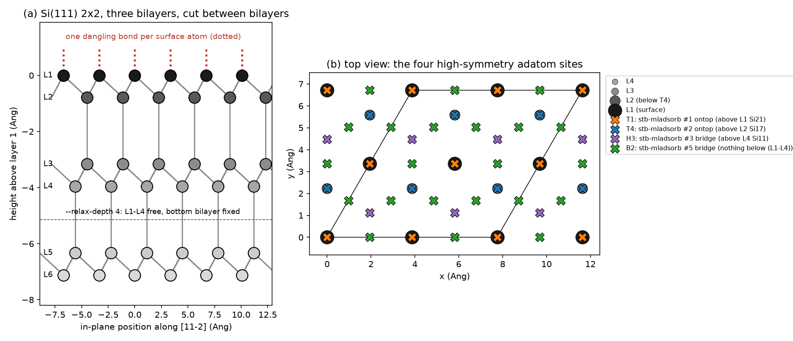
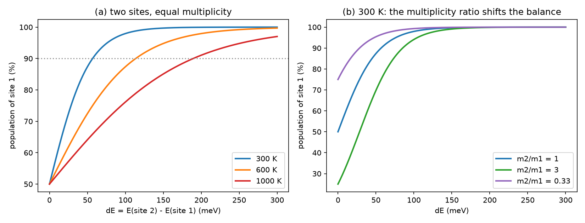
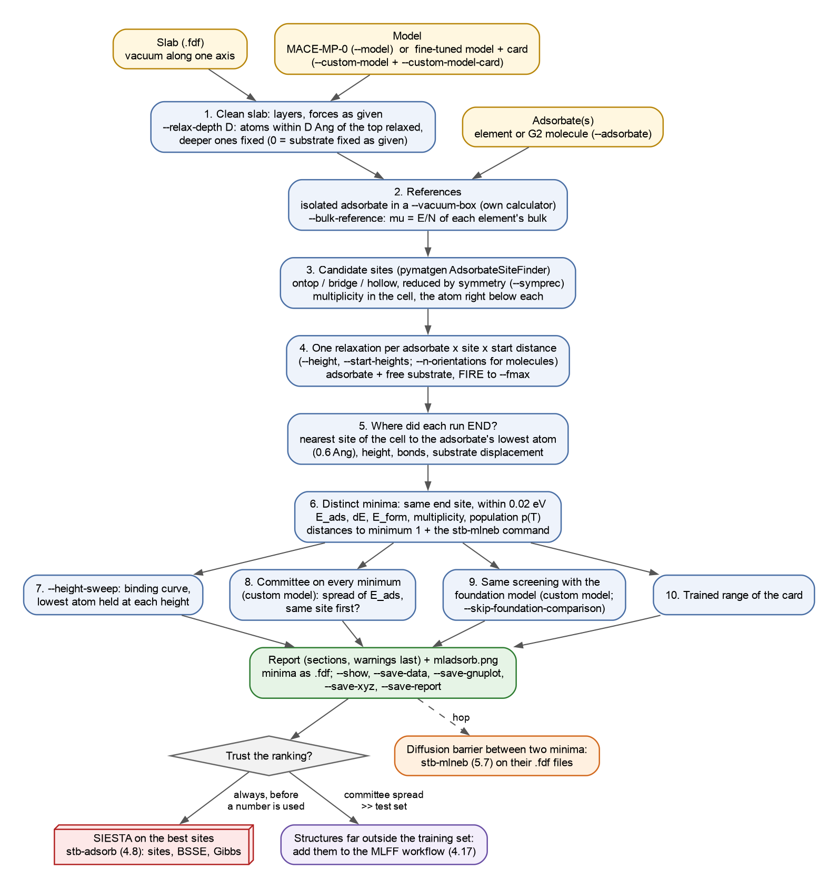
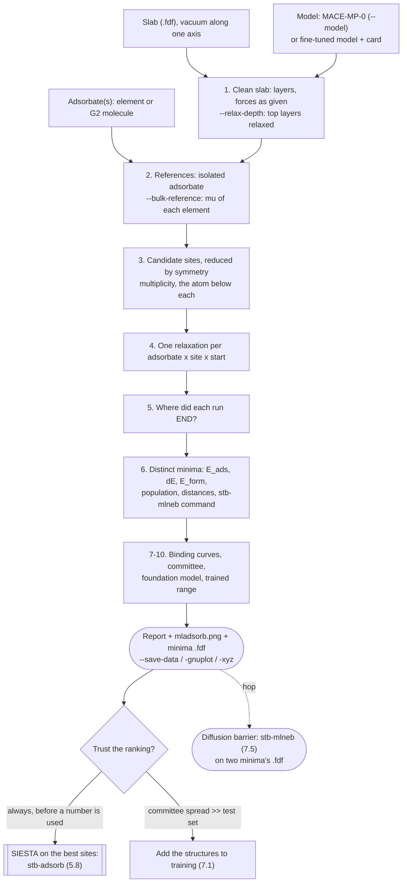
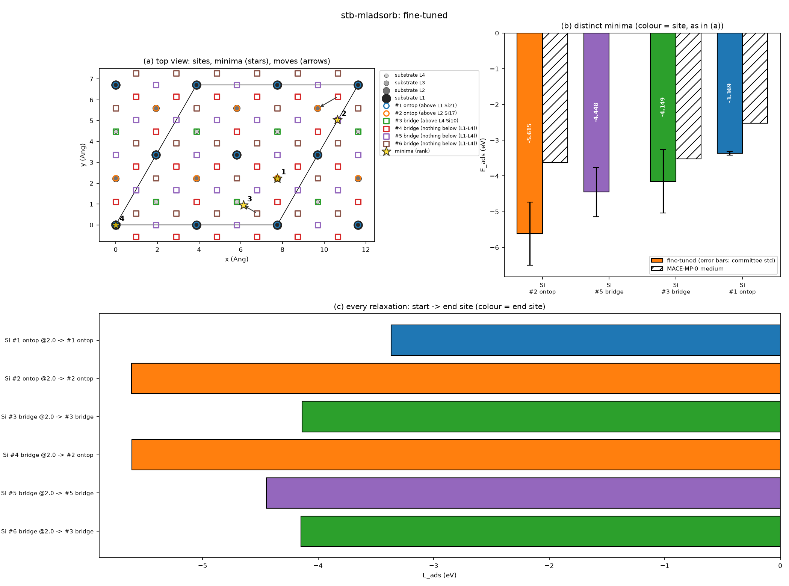
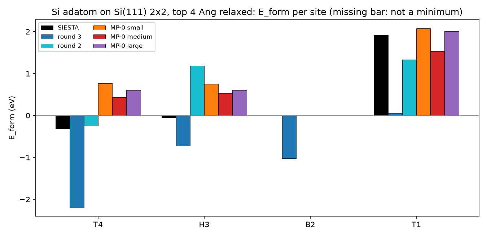
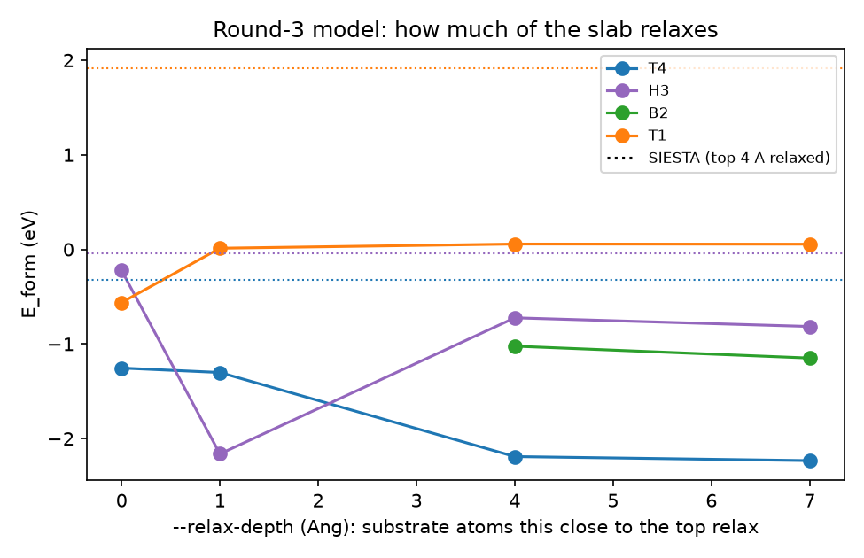
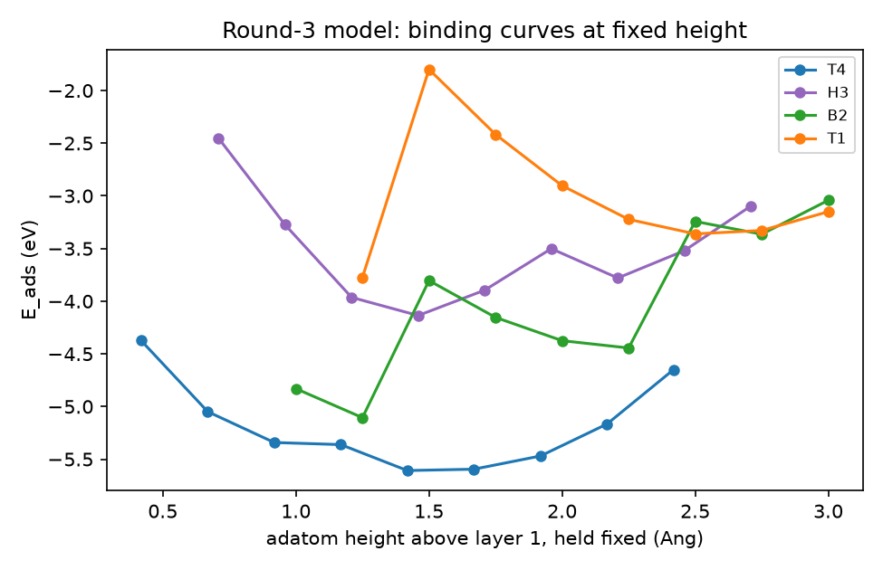
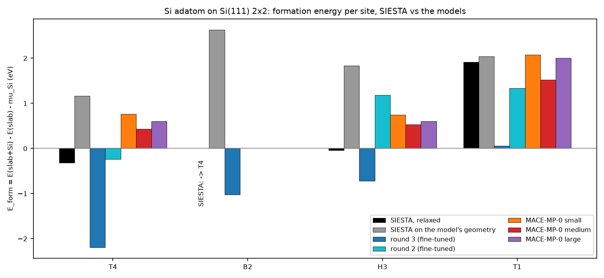
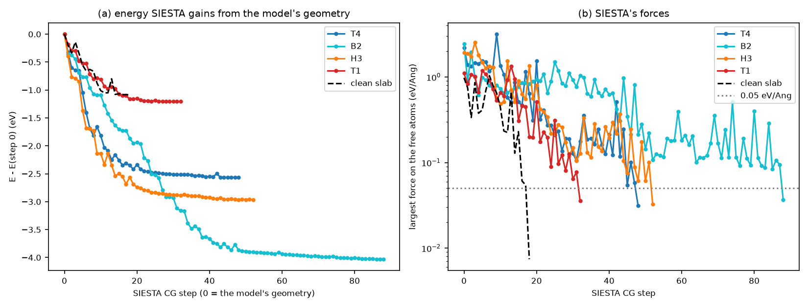

# 7.6 — ML Adsorption-Site Screening (`stb-mladsorb`)

`stb-mladsorb` answers **where an atom or a molecule sits on a surface**, with every energy and force from a MACE
machine-learned potential: the MACE-MP-0 foundation model, or a model fine-tuned on your own SIESTA calculations with the
MLFF workflow (`7.1`), which always comes with its **model card**. You give it a slab and an adsorbate; it finds the
candidate sites, relaxes the adsorbate on each, and reports:

- the clean slab, its layers and, with `--relax-depth`, its relaxation with the model;
- every candidate site, reduced by the slab's symmetry, with its multiplicity in the cell and the atom right below it;
- every relaxation, and **where it ended** — an adsorbate placed on a bridge that slides into a hollow is reported as a
  hollow;
- the **distinct minima**: their adsorption energy against the isolated adsorbate (`E_ads`) and, with
  `--bulk-reference`, against the element's bulk (`E_form`), the energy above the most stable one, the population at a
  temperature, the bonds, how far each is from the most stable one;
- with a fine-tuned model: the same screening with the foundation model, and the spread of the model's committee on every
  minimum;
- every structure against the model card's trained range, and all warnings in a last section.

It writes no SIESTA input. Its job is to say which sites deserve a SIESTA calculation (`stb-adsorb`, `5.8`), and to hand
`stb-mlneb` (`7.5`) the minima between which a diffusion barrier is wanted.

**Why a potential for a site screening?** Six candidate sites of a 25-atom slab, each relaxed with the top layers free,
cost six SIESTA relaxations: an afternoon on a workstation. With a MACE model on a GPU the same screening takes two
minutes, and a dozen variations of it (how much of the slab relaxes, where the adsorbate starts, which model) cost less
than one SIESTA run. The price is the one of every ML number: the model is only as good as its training data near the
structures it is asked about — and a model trained on a bulk crystal has never seen a surface.

The worked example (sections 6 and 7) puts a silicon adatom on Si(111) with the round-3 silicon model of the `7.5`
example, trained on bulk silicon only, and checks every minimum with SIESTA at the model's own level of theory.

- In two minutes on a GPU the model finds the right first site, **T4**, as the literature and SIESTA do.
- Almost everything else it reports is wrong:
  - its second minimum (B2, +1.17 eV) is not a minimum of SIESTA, which relaxes it into T4;
  - it puts H3 1.47 eV above T4, against SIESTA's **0.27 eV**;
  - it gives T4 a formation energy of −2.19 eV, against SIESTA's **−0.32 eV**;
  - it relaxes the clean surface by −2.2 eV, against SIESTA's −0.14 eV.
- Its isolated atom, the reference of `E_ads`, is 2.5 eV off.
- The trained-range check flags only the dimensionality. The **committee** is the alarm: a force spread 37–78 times its
  test-set value, and a spread of `E_form` (0.85 eV) of the size of the error.
- Five SIESTA relaxations at the model's level of theory (a few hours on 6 cores) settle it.

---

## Contents

1. [Theory](#1-theory)
2. [The screening at a glance](#2-the-screening-at-a-glance)
3. [Libraries and external dependencies used](#3-libraries-and-external-dependencies-used)
4. [What `stb-mladsorb` does](#4-what-stb-mladsorb-does)
5. [Running it both ways](#5-running-it-both-ways)
6. [Worked example: a silicon adatom on Si(111)](#6-worked-example-a-silicon-adatom-on-si111)
7. [The SIESTA check](#7-the-siesta-check)
8. [What to take from the example](#8-what-to-take-from-the-example)
9. [Reproducing the reference data](#9-reproducing-the-reference-data)
10. [Known, deliberate limitations](#10-known-deliberate-limitations)
11. [Step-by-step: a surface of your own](#11-step-by-step-a-surface-of-your-own)
12. [Files in this folder](#12-files-in-this-folder)
13. [Running the script](#13-running-the-script)
14. [Flag reference](#14-flag-reference)
15. [What's next](#15-whats-next)
16. [References](#16-references)

---

## 1. Theory

### 1.1 What a site screening answers

An adsorbate on a crystal surface moves on a potential energy surface that has the periodicity of the surface. Its local
minima are the **adsorption sites**: the lowest is where the adsorbate sits at low temperature, the others are metastable
sites it visits on the way, and the saddle points between neighbouring minima set how fast it diffuses (a barrier is a
`stb-mlneb` calculation, `7.5`). A screening samples this surface: it places the adsorbate on a set of candidate
positions, relaxes each, and collects the minima the relaxations end in.

Two facts shape how the result must be read.

- **A relaxation finds the minimum of the basin it starts in, not the global one.** Starting points are the
  high-symmetry positions of the surface (on top of an atom, between two, in a hollow between three), because the
  minima of a crystalline surface usually sit there. Where a relaxation ends is a result; which site it started from is
  not.
- **A run that stays at a high-symmetry site proves the site is stationary, not that it is a minimum.** On a site whose
  symmetry has a three-fold axis or two mirror planes, the in-plane force on the adsorbate is zero by symmetry; an
  optimizer started exactly there cannot leave it even if it is a saddle or a maximum. Small asymmetries (the substrate
  relaxing, numerical noise, a lower-symmetry cell) usually let a run slide off a maximum — section 6.3 shows two that
  did — but not always. The test is a run started off the site (`--start-heights` changes only the height), the
  binding curve, or a SIESTA phonon calculation of the adsorbate.

### 1.2 The slab model

A surface is modelled by a **slab**: a few atomic layers, periodic in the plane, with vacuum above and below so that
the periodic images along the normal do not interact. Three choices define it.

- **How it is cut.** The example's Si(111) slab is cut *between* two bilayers, through the long bonds along [111] that
  connect one bilayer to the next: every surface atom keeps three bonds and loses one (one *dangling bond*). A cut
  through the short bonds inside a bilayer would leave three dangling bonds per surface atom — a surface no calculation
  should start from (`make_slabs.py` drops those two single-atom layers; Figure 1).
- **How much of it may relax.** The deepest layers stand for the bulk below and are fixed; the top layers relax, alone
  first (the clean slab) and then with the adsorbate. `--relax-depth D` frees every atom within `D` Å of the top
  surface. A slab cut from the bulk is not at its minimum: with the round-3 model the example's slab relaxes by −2.2 eV
  (SIESTA: −0.14 eV, section 6.2). With `--relax-depth 0` (the default) the substrate stays exactly as given and only the adsorbate
  moves — fast, but the surface cannot respond to the adsorbate, and an unrelaxed surface makes every number an upper
  bound (section 6.6).
- **How large it is.** One adsorbate in an `n × n` surface cell is a periodic array of adsorbates at a coverage of
  `1/n²` monolayer (ML), each `n a` from its neighbours. The example's 2×2 cell is ¼ ML, adatoms 7.75 Å apart; the 3×3
  cell (1/9 ML) and a thicker slab check what the choice changes (section 6.6).

The slab also has a bottom surface, here as dangling as the top one; it is fixed, far below (7.5 Å of silicon), and the
same in every run, so it cancels in every energy difference.



*Figure 1. (a) The Si(111) 2×2 slab of the example, seen along [1‑10]: three bilayers (L1–L2, L3–L4, L5–L6), cut
between bilayers so every surface atom keeps one dangling bond (dotted). With `--relax-depth 4` the top four layers relax,
the bottom bilayer is fixed. (b) Top view with the four high-symmetry adatom sites as `stb-mladsorb` finds them: T1 on
top of a first-layer atom, T4 above a second-layer atom, H3 above a fourth-layer atom (a hollow with nothing below it in
the top three layers), B2 between two first-layer atoms. The legend gives the tool's own names (section 1.4).*

### 1.3 Adsorption energy, and its two references

With all three energies from the same model,

```
E_ads  = E(slab + X) − E(slab) − E(X, isolated)
E_form = E(slab + X) − E(slab) − Σ_i n_i μ_i ,     μ_i = E(bulk of element i) / N
```

`E_ads` is the energy released when the adsorbate X comes from vacuum (negative = bound). `E_form` measures the same
structure from a reservoir: each atom of X taken from the bulk of its element, at chemical potential `μ_i`. For an
adatom of the substrate's own element, `E_form` is the formation energy of the adatom (taken from a kink or a step, whose
energy is the bulk's); for a Si adatom on the ideal Si(111) surface it is negative, because one adatom saturates three
dangling bonds of a surface that is very far from its minimum.

The two are related by the **cohesive energy** of the element: for one atom,
`E_ads − E_form = μ − E(atom) = −E_coh`. This identity is a check of the model: at the training level of theory SIESTA puts
the cohesive energy of silicon at 5.95 eV against a spin-unpolarized atom (the setting of the training set) and 5.09 eV
against a spin-polarized one (section 6.2; plane-wave PBE gives ~4.6 eV, the localized DZP basis overbinds the solid).
A model whose `E_ads − E_form` is far from that has a wrong isolated atom.

**Why the isolated adsorbate is the weak reference of a fine-tuned model.** A model fine-tuned on condensed SIESTA
configurations (crystals, rattled cells, MD frames) has never seen an atom or a molecule alone in vacuum. Its energy
there is little more than its E0s — the per-element constants fitted to SIESTA's absolute energy scale — plus whatever
the network predicts for "no neighbours", which nothing constrained. `E_ads` inherits that error in full; the energies
of the sites *relative to each other* (`ΔE`) do not, and neither does `E_form`, whose reference (the bulk) is the centre
of the training set. The report gives all three and says so; the example measures the error (section 6.2).

Neither number includes zero-point energy, vibrational entropy or the configurational entropy of a partial coverage:
they are electronic energies at 0 K of one adsorbate per cell.

### 1.4 Finding candidate sites

The tool uses pymatgen's `AdsorbateSiteFinder` [11], built for high-throughput adsorption studies:

1. **Surface atoms.** Every atom within 0.9 Å (along the surface normal) of the topmost one.
2. **Triangulation.** The in-plane projections of the surface atoms, with their periodic images, are triangulated
   (Delaunay). An **ontop** site lies over each surface atom, a **bridge** at the midpoint of each edge, a **hollow** at
   the centroid of each triangle.
3. **Symmetry reduction.** The slab's space-group operations (`--symprec`) that keep the surface normal map sites onto
   each other; one representative of each class is kept. `stb-mladsorb` also counts how many sites of the cell each
   representative stands for — its **multiplicity**, used for the populations (section 1.6).
4. **Placement.** The adsorbate goes `--height` Å above the surface along the normal (for a molecule, pymatgen aligns its
   own axis with the normal; `--n-orientations` samples rotations, section 4.1).

**The names can mislead — read what is below.** Step 1 counts as "surface" every atom within 0.9 Å of the top. On
Si(111) the second layer is only 0.79 Å below the first (0.58 Å once the slab relaxes), so both count, and their
projections form a honeycomb: the finder's "ontop" sites lie over first- *and* second-layer atoms, and its "bridges" over
midpoints of the honeycomb's edges and diagonals. The site names of the surface-science literature — T1, T4, H3, B2
(Figure 1b) — are about what lies *below* the site, and `stb-mladsorb` describes every site by the topmost atom within
0.5 Å below it:

| Literature | Where | `stb-mladsorb` (this slab) | Description in the report |
|---|---|---|---|
| T1 | on top of a first-layer atom | #1 ontop | above L1 |
| T4 | above a second-layer atom, between three first-layer atoms | #2 ontop | above L2 |
| H3 | above a fourth-layer atom, the "empty" hollow | #3 bridge | above L4 |
| — | between a first- and a second-layer atom | #4 bridge | nothing below (L1–L4) |
| B2 | between two first-layer atoms | #5 bridge | nothing below (L1–L4) |
| — | between T1 and H3 | #6 bridge | nothing below (L1–L4) |

The two unnamed bridges are no high-symmetry adatom site; on this surface both relaxations started there slid away
(section 6.3). On an fcc(111) metal the same column separates the two hollows: above L2 is the hcp hollow, above L3 the
fcc hollow.

### 1.5 The Si(111) adatom sites

On the ideal Si(111) surface every first-layer atom has one dangling bond. An adatom has four electrons and can bond to
up to three of them; where it does so decides the site.

- **T1** (on top): one bond to one surface atom — two of the adatom's electrons stay unbonded, and the three dangling
  bonds around it are untouched.
- **T4** and **H3**: three bonds, one to each of three first-layer atoms. They differ in what lies below: at T4 a
  second-layer atom sits right under the adatom, ~2.5 Å away; at H3 there is nothing below in the top three layers.
- **B2**: two bonds, between two surface atoms.

Three bonds beat two beat one, so T4 and H3 should both be far below T1, and B2 in between. Between T4 and H3, the
calculations of the 1980s settled the question for group-III and group-IV adatoms on Si(111): **T4** has the lower
energy — for Al, Ga and In [3], and for Ge, Sn and Pb by 0.3–0.6 eV [5]. The extra interaction with the second-layer atom
below (Figure 1) is what favours it [2, 4]. It is also the site of the silicon adatoms in nature: the 7×7 reconstruction
of clean Si(111) — the dimer–adatom–stacking-fault (DAS) model [1] — places its twelve adatoms per cell on T4-like sites
in local 2×2 arrangements, and quenched Si(111) shows 2×2 and c(4×2) arrays of adatoms on T4 sites [6]. One adatom per
2×2 cell on T4 is the simplest of these structures [7]. The example is therefore a test with a known answer: T4 first,
H3 second (a few tenths of an eV above), B2 and T1 well above.

### 1.6 From runs to minima, and their populations

Each relaxation is classified by **where it ended**: the adsorbate's lowest atom (its anchor, the one bonded to the
surface) is matched to the nearest site of the whole cell, within 0.6 Å in-plane (else "off-site"). Runs of one
adsorbate that end at symmetry-equivalent sites with energies within 0.02 eV are one **minimum**; runs that end at the
same site with different energies (a molecule in two orientations) are two.

At temperature `T`, if the adsorbate can move between the minima (if the barriers are low enough for the time scale of
interest), the fraction of time it spends in minimum `i` is the Boltzmann population

```
p_i = m_i exp(−ΔE_i / k_B T) / Σ_j m_j exp(−ΔE_j / k_B T)
```

with `ΔE_i` its energy above the most stable minimum and `m_i` its **multiplicity** — how many equivalent copies of the
site the cell has. At 300 K, `k_B T` = 25.9 meV: a minimum 60 meV up holds ~9 % if the two have the same multiplicity
(Figure 2), and a minimum three times as numerous needs about 28 meV more to be as rare. The populations are
configurational only — no vibrational entropy, no zero-point energy — and say nothing about the time needed to reach
equilibrium.



*Figure 2. (a) Population of the more stable of two sites of equal multiplicity against their energy difference, at
three temperatures. (b) At 300 K, the multiplicity ratio shifts the balance by `k_B T ln(m₂/m₁)`.*

### 1.7 Binding curves at fixed height

`--height-sweep MIN MAX STEP` computes, for each site, the energy as a function of the adsorbate's height: at each height
the anchor atom is **held** — vertically and laterally — while the rest of the adsorbate and the free substrate relax.
The curve's minimum (a parabola through its three lowest points) is the equilibrium height on that site; its curvature is
the stiffness of the bond along the normal; a curve that falls all the way to the lowest height means the adsorbate wants
to go *into* the surface. Held laterally, the adsorbate stays on its site at every height, so the curve exists even for a
site that is not a minimum in the plane — the curve of T1, for example, is defined even if T1 is a saddle.

### 1.8 Energies from a machine-learned potential

Every number above comes from a MACE model [8], an equivariant message-passing network that predicts a local energy per
atom from its neighbourhood within a cutoff (6 Å here); forces are its exact gradient. Two kinds of model can be used.

- The **MACE-MP-0 foundation models** [9] (`--model small|medium|large`), trained on ~1.5 million DFT relaxation frames of
  the Materials Project (PBE/PBE+U, VASP). They know every element, but not your level of theory (functional,
  pseudopotential, basis), and their energies are on their own absolute scale.
- A **fine-tuned model** (`--custom-model`), trained on your own SIESTA calculations with the MLFF workflow (`7.1`). It
  reproduces your level of theory where its training set reaches, and nothing guarantees it elsewhere. Its card records
  what that set covered (`Model card -- training data and trained domain`), and the report compares every structure with
  it (`TRAINED RANGE`).

A surface is the textbook case of "elsewhere" for a model trained on a bulk crystal: atoms with three neighbours instead
of four, a dangling bond, a vacuum on one side. The trained-range check flags the dimensionality (`2D slab`), but it
cannot say how wrong the model is there. The **committee** can bound it from below: the 7.1 workflow trains several
members with different seeds, and where they disagree the training set did not constrain them. The report evaluates
every member on every minimum (the spread of `E_ads`, of `ΔE` and of `E_form`, the force spread, and whether all members
put the same site first). Members fine-tuned from the same foundation model share its habits and can be wrong together —
the `7.5` example had a committee agree within 0.09 eV on a barrier that was 0.47 eV too high — so the spread is a lower
bound of the error, and only SIESTA gives the error itself (section 7).

### 1.9 What this tool simplifies — explicitly

- No reconstruction search: the slab is used as given (ideal here), the adsorbate is one atom or molecule per cell.
- No zero-point energy, no vibrational or configurational entropy in `E_ads`/`E_form`; populations are configurational.
- No spin, no charge, no dipole correction, no dispersion beyond what the model learned.
- The starting points are pymatgen's high-symmetry sites; nothing samples the surface between them, and a site where a
  run stays is stationary, not proven a minimum (section 1.1).
- A molecule's orientations are sampled at random by a single-point energy before the relaxation (`--n-orientations`),
  not exhaustively.

---

## 2. The screening at a glance





`stb-mladsorb` itself is steps 1–10. It runs no SIESTA and writes no SIESTA input: the SIESTA side of the same
question is the adsorption workflow `5.8` (`stb-adsorb` → `stb-adsorbBsse` → `stb-adsorbAnalysis` → `stb-adsorbGibbs`),
whose own `--ml-rank` option uses the same site finder and the foundation model to pre-screen its candidates.

## 3. Libraries and external dependencies used

| Library | Used for |
|---|---|
| pymatgen [12] | `AdsorbateSiteFinder` [11] (surface atoms, Delaunay triangulation, symmetry reduction, placing the adsorbate), `SpacegroupAnalyzer` (spglib: the slab's symmetry operations, for the multiplicities), structure conversion |
| ASE [10] | `Atoms`, FIRE [13] relaxations with `FixAtoms`, the G2 molecule database, neighbour distances, extended XYZ |
| mace-torch [8, 9] | the MACE calculator, the foundation models (downloaded once, cached in `~/.cache/mace/`) and custom `.model` files |
| PyTorch | runs the model on `cpu` or `cuda` (`--device`) |
| NumPy, SciPy | geometry, random orientations of a molecule (`scipy.spatial.transform.Rotation`) |
| matplotlib | `mladsorb.png` (always written), `--show` |
| gnuplot (optional) | renders the `.gplot` files written by `--save-gnuplot` |
| `stb.adsorb` | slab orientation, the adsorbate database, the isolated-adsorbate box — shared with the SIESTA workflow (`5.8`) |
| `stb.core` | `.fdf` reading and writing, the model card, the calculator and the relaxations (`mace_relax`), library-noise capture, report sections, gnuplot |

Install the `ml` extra: `pip install stb_suite[ml]`.

## 4. What `stb-mladsorb` does

### 4.1 Step by step

1. **Read the slab** (`.fdf`) and find its vacuum axis (`--vacuum-gap`, 10 Å); a slab whose vacuum is not along `c` is
   relabelled (warning). Split it into layers along the normal (0.35 Å tolerance).
2. **Load the model**: a foundation model (`--model`) or a custom model with its card (`--custom-model` +
   `--custom-model-card`; the card must match the model's SHA-256). Print the card in full.
3. **Clean slab.** Energy and forces as given; with `--relax-depth D`, relax the atoms within `D` Å of the top (FIRE,
   `--fmax`, `--max-steps`), the deeper ones fixed. The relaxed slab is the substrate of every run and the reference of
   every energy.
4. **References.** Each adsorbate alone in a cubic box of `--vacuum-box` Å, relaxed if it has more than one atom, with a
   calculator of its own (a compiled MACE model on CUDA fails on every later call once it has seen a structure with no
   neighbour in its cutoff). With `--bulk-reference FILE...`, each element's bulk is relaxed, positions and cell, and
   `μ = E/N`.
5. **Candidate sites** on the relaxed slab (section 1.4): `--site-type all|ontop|bridge|hollow`, reduced at `--symprec`.
   Equivalent positions are merged even when pymatgen labels them differently, and every site of the cell is generated
   as the orbit of its class under the slab's symmetry operations — the multiplicity is the orbit's size.
6. **Relaxations.** For each adsorbate, each site and each starting distance (`--height`, or `--start-heights H...`):
   place the adsorbate (for a molecule, the best of `--n-orientations` random rotations by single-point energy, seed
   `--seed`), relax it and the free substrate. Record energy, steps, residual force.
7. **Where each run ended** (section 1.6): the anchor atom's nearest site, its in-plane shift, its height above layer 1,
   its substrate neighbours (within 1.25× the sum of covalent radii) and bonds, the largest substrate displacement.
8. **Minima**, grouped and ranked; `E_ads`, `ΔE`, `E_form`, multiplicity, population at `--temperature`; the distance from
   the most stable minimum to every other one and the `stb-mlneb` command for the nearest.
9. **Binding curves** (`--height-sweep MIN MAX STEP`): the same sites with the anchor held at each height (section 1.7).
10. **Committee** (custom model, unless `--no-committee`): the card's members (next to its run folder, or
    `--mlff-workflow`'s, or `--committee-models`) evaluate the clean slab, the references and every minimum.
11. **Foundation comparison** (custom model, unless `--skip-foundation-comparison`): steps 3–8 again with `--model`,
    from the same sites.
12. **Trained range** (custom model): the structures against the card.
13. **Report, figure, files** (section 4.3).

### 4.2 The report, section by section

Sections are numbered in order; those that do not apply are left out.

| Section | Content |
|---|---|
| `RUN METADATA` | date, versions, device, slab, adsorbates, sites and starting distances, substrate treatment, relaxation settings, extras, temperature |
| `MODEL` | the model card in full, or the foundation model's identity; load time |
| `CLEAN SLAB` | atoms, surface cell and area, thickness and vacuum; one row per layer (height as given and relaxed, spacing, atoms, free or fixed); energy and largest force as given; the relaxation (energy gained, forces before and after, steps, largest move) |
| `REFERENCES` | the isolated adsorbate (atoms, extent, box, energy, steps); with `--bulk-reference`, each element's volume per atom before and after and `μ` |
| `CANDIDATE SITES` | how many sites in the cell, how many distinct, how many symmetry operations; per site: label, type, what is below, multiplicity, in-plane fractional position |
| `RELAXATIONS` | one row per run: start and starting distance, where it ended, in-plane shift, height, coordination, nearest distance, `E_ads`, substrate displacement, steps, residual force; runs that left their site in cyan |
| `DISTINCT MINIMA` | rank, site, what is below, `E_ads`, `ΔE`, `E_form`, multiplicity, population, height, coordination, bonds, the runs that ended there; the gap between the two best; the sites no run ended at; the distances from minimum 1 and the `stb-mlneb` command |
| `BINDING CURVES (FIXED HEIGHT)` | per site: heights, energies, the minimum (parabola) and how it was found |
| `COMMITTEE` | per minimum: every member's `E_ads`, `ΔE` and `E_form` with their spread, the force spread and the estimated force error; whether every member puts the same site first |
| `FOUNDATION MODEL COMPARISON` | per run: where it ended and `ΔE`/`E_form` with each model; the most stable site and the gap to the second, both models |
| `TRAINED RANGE` | elements, dimensionality, shortest distance, largest force, energy per atom against the card |
| `SUMMARY & FILES` | status, the most stable site of each adsorbate, the committee's largest spread, the files, the outputs not asked for, the wall time of each stage |
| `WARNINGS` | every warning, numbered; the count of library messages captured |

The warnings include: a clean slab whose relaxation hit its limit, or with every atom free; a fixed substrate under large
forces; an adsorbate wider than half the box; sites the symmetry could not map; relaxations that hit `--max-steps`; an
adsorbate ending closer than 1 Å to an atom; two minima closer than 50 meV; a binding curve whose minimum is at the edge
of the sweep; a committee spread far above the test set's, members that disagree on the best site or on the gap; the
fine-tuning changing the most stable site; structures outside the trained range; a bulk reference whose volume changes
by more than 3 %; `--show` without a display.

### 4.3 Files

| Written | When |
|---|---|
| `mladsorb.png`: (a) top view — substrate, every site coloured by class, minima (stars) and moves (arrows); (b) the minima, with the committee's spread and the foundation model; (c) every run, start → end; (d) binding curves | always; `--show` opens it |
| `rankNN_<type>_site<K>_<adsorbate>.fdf`: each minimum (bare structure, positions in the cell) | always; `--top-k N` keeps the first N |
| `mladsorb_configs.dat` (every run), `mladsorb_minima.dat` (the minima), `mladsorb_binding_curve.dat`, `mladsorb_configs_foundation.dat` | `--save-data` |
| `mladsorb_runs.xyz`, `mladsorb_minima.xyz`, `mladsorb_slab.xyz`, `mladsorb_binding_curve.xyz`: extended XYZ with energy, forces, fixed atoms, per-atom `adsorbate` and `layer`, and the run's data in each frame | `--save-xyz` |
| `plot/`: `substrate.dat`, `sites.dat`, `minima_xy.dat`, `cell.dat`, `minima.dat`, `binding_curve.dat`, the `.gplot` scripts (`top_view`, `site_energies`, `binding_curve`) and their PDFs | `--save-gnuplot` (the PDFs when gnuplot is installed) |
| `stb_mladsorb_report.txt` | `--save-report` |

Everything goes into `-o/--output-dir` (default `mladsorb_out`).

### 4.4 Guard rails

| Situation | Behaviour |
|---|---|
| `--custom-model` without `--custom-model-card`, an unreadable card, a SHA-256 mismatch | clean error |
| a missing slab, bulk-reference or workflow file; an unknown adsorbate; `--relax-depth` below 0 | clean error |
| a "slab" with no vacuum axis | clean error |
| no site of the requested type | clean error |
| a slab whose vacuum is not along `c` | relabelled, warning |
| a relaxation that hits `--max-steps` | warning; the energy is an upper bound |
| `--relax-depth` deeper than the slab | warning: nothing is fixed |
| an element outside the model | error from the calculator |
| `--device cuda` with no usable GPU | clean error |
| `--show` without a display; gnuplot not installed | warning; files written anyway |

## 5. Running it both ways

**Command line:**

```bash
# a first look with the foundation model, substrate fixed (fast)
stb-mladsorb --slab slab.fdf --adsorbate H --model medium --save-report

# a fine-tuned model, the top layers relaxed, a bulk reference, every output
stb-mladsorb --slab si111_2x2.fdf --adsorbate Si --relax-depth 4 --bulk-reference si_bulk.fdf \
             --custom-model best_model/mlff_model_compiled.model --custom-model-card best_model/mlff_model_card.json \
             --mlff-workflow mlff_runs/mlff_workflow.json --device cuda \
             --save-data --save-gnuplot --save-xyz --save-report --show

# a molecule: random orientations; several adsorbates; binding curves
stb-mladsorb --slab slab.fdf --adsorbate H2O --n-orientations 8 --seed 1
stb-mladsorb --slab slab.fdf --adsorbate O,H --site-type hollow --height-sweep 1.0 3.0 0.25

# then the barrier between the two best minima, with the command the report prints
stb-mlneb --initial mladsorb_out/rank01_....fdf --final mladsorb_out/rank03_....fdf --autosort-tol 0 ...
```

**Interactive menu:** run `stb-suite` and type `7.6`. It asks, in this order:

1. the slab and the adsorbate(s);
2. a custom model path, or Enter for a foundation model. With a custom model it asks for the card (offering
   `mlff_model_card.json` next to the model) and whether to compare with the foundation model; without one, the
   MACE-MP-0 size;
3. the device (`cpu`/`cuda`; it checks the GPU);
4. the site type, the starting distance, the relaxation depth (Enter: substrate fixed), the bulk reference (Enter: none),
   how many minima to write;
5. the number of orientations for a molecule;
6. the output folder, then one question per optional output (show, data, gnuplot, XYZ, report).

The menu builds the same command line and calls `stb-mladsorb`; the guided script (Case 9) drives it with piped
answers. The options without a menu question (`--start-heights`, `--height-sweep`, `--temperature`, `--symprec`,
`--fmax`, `--max-steps`, `--committee-models`, ...) are for the command line.

## 6. Worked example: a silicon adatom on Si(111)

### 6.1 Set-up

- **Slab:** `si111_2x2.fdf`, the ideal Si(111) surface in a 2×2 cell, three bilayers (24 atoms), cut between bilayers,
  at the lattice constant of the `7.1` training set (5.4802 Å; `make_slabs.py`). 7.5 Å of vacuum on each side.
- **Adsorbate:** one Si atom per cell, ¼ ML.
- **Model:** round 3 of the silicon MLFF run (`../7.5-mlneb/model_round3/`): fine-tuned from MACE-MP-0 medium on 71
  SIESTA configurations of **bulk** silicon (rattled and strained 8-atom cells, MD frames of 64 atoms, and the 14
  vacancy-hop configurations the `7.5` example added). Test-set force error 22.7 meV/Å, phonons within 1.1 THz of SIESTA.
  It has never seen a surface.
- **Settings of the main case:** `--relax-depth 4` (the top two bilayers relax, the bottom bilayer is fixed),
  `--bulk-reference si_bulk.fdf` (the 8-atom training cell), the committee of round 3 (`--mlff-workflow`), the foundation
  comparison (MACE-MP-0 medium), all outputs. 2–3 minutes on an RTX 3060.

```bash
stb-mladsorb --slab si111_2x2.fdf --adsorbate Si --relax-depth 4 --bulk-reference si_bulk.fdf \
             --custom-model ../7.5-mlneb/model_round3/mlff_model_compiled.model \
             --custom-model-card ../7.5-mlneb/model_round3/mlff_model_card.json \
             --mlff-workflow <4.17 run>/mlff_workflow.json --device cuda \
             --save-data --save-gnuplot --save-xyz --save-report -o main
```

### 6.2 The clean slab and the references

```
layer | height as given (Ang) | height relaxed (Ang) | spacing (Ang) | atoms | in the relaxations
L1    | +0.000                | +0.000               | -             | 4     | free
L2    | -0.791                | -0.581               | 0.581         | 4     | free
L3    | -3.164                | -3.288               | 2.707         | 4     | free
L4    | -3.955                | -4.088               | 0.800         | 4     | free
L5    | -6.328                | -6.745               | 2.657         | 4     | fixed
L6    | -7.119                | -7.536               | 0.791         | 4     | fixed
As given          : E = -2743.310247 eV, largest force 2.2474 eV/Ang (atom 6, L5)
Relaxed           : --relax-depth 4 Ang -> 16 atom(s) free, 8 fixed; E = -2745.533265 eV
                    (relaxation -2.2230 eV), max|F| on the free atoms 2.2474 -> 0.0443 eV/Ang,
                    29 steps (converged), largest move 0.626 Ang
```

The model relaxes the surface strongly inwards: the first bilayer flattens (0.79 → 0.58 Å) and the slab gains 2.2 eV.
Its largest force on the ideal slab, 2.25 eV/Å, is on the bottom bilayer (fixed); on the top layer it is 0.13 eV/Å.
**SIESTA disagrees from the start**: on the same ideal slab its largest force is 0.69 eV/Å (also at the bottom), and
its own relaxation of the top 4 Å gains only 0.14 eV — the model's relaxed slab is 0.94 eV *above* the ideal one in
SIESTA (`reference_results/siesta/slab_ideal/`, section 7). The other models are closer to SIESTA here: round 2
sees 0.44 eV/Å and gains 0.06 eV, the foundation models see 0.08 eV/Å. The round-3 model has learned something about
three-coordinated silicon that is wrong for a surface.

The references (`REFERENCES`): the model's isolated Si atom has E = −111.583 eV, its bulk `μ` = −115.008 eV/atom at
20.594 ų/atom (the file's 20.574). So the model's cohesive energy is `E(atom) − μ` = **3.43 eV**. SIESTA at the same
level of theory gives `μ` = −115.018 eV/atom — the model's bulk is right to 9 meV — and an isolated, spin-unpolarized Si
atom (the training's own setting) of −109.065 eV: a cohesive energy of **5.95 eV** (5.09 eV against a spin-polarized
atom; `reference_results/siesta/atom*/`). The model's isolated atom is 2.5 eV too low: every `E_ads` below carries that
error, `E_form` does not (section 1.3).

### 6.3 Where the runs ended

`CANDIDATE SITES` finds 48 sites in the cell, six distinct (24 symmetry operations keep the normal): T1, T4, H3, and
three bridges with nothing below them in the top four layers, among them B2. One run per site:

```
run | start     | ended at  | moved (A) | height (A) | CN | d_nn (A) | E_ads (eV) | substrate (A) | steps
1   | #1 ontop  | #1 ontop  | 0.00      | 2.574      | 1  | 2.376    | -3.3689    | 0.199         | 44
2   | #2 ontop  | #2 ontop  | 0.00      | 1.541      | 4  | 2.472    | -5.6155    | 1.075         | 51
3   | #3 bridge | #3 bridge | 0.00      | 1.444      | 3  | 2.666    | -4.1393    | 0.248         | 52
4   | #4 bridge | #2 ontop  | 1.05      | 1.536      | 4  | 2.471    | -5.6126    | 1.053         | 68
5   | #5 bridge | #5 bridge | 0.02      | 2.259      | 3  | 2.352    | -4.4483    | 1.123         | 61
6   | #6 bridge | #3 bridge | 0.76      | 1.578      | 5  | 2.615    | -4.1486    | 0.476         | 59
```

Two runs left their site: the bridge between a first- and a second-layer atom (#4) slid 1.05 Å into T4, and the bridge
between T1 and H3 (#6) slid into H3 (0.36 Å short of its centre, 9 meV below run 3, which stayed at the centre). Four
sites held their runs; section 1.1 says what that proves, and section 7 shows one of them was not a minimum of SIESTA.
The substrate column shows how much the surface responds: more than 1 Å for T4 and B2.



*Figure 3. `mladsorb.png` of the main case: (a) top view, every site of the cell coloured by class, the four minima
(stars, by rank) and the two runs that moved (arrows); (b) the minima with the committee's spread (error bars) and
the foundation model (hatched); (c) every run, start → end, coloured by where it ended.*

### 6.4 The minima

```
rank | site      | what is below | E_ads (eV) | dE (eV) | E_form (eV) | in cell | pop. 300 K (%) | height (A) | CN
1    | #2 ontop  | above L2 Si17 | -5.6155    | +0.0000 | -2.1904     | 4       | 100.0          | 1.541      | 4
2    | #5 bridge | nothing below | -4.4483    | +1.1671 | -1.0233     | 12      | 0.0            | 2.259      | 3
3    | #3 bridge | above L4 Si10 | -4.1486    | +1.4669 | -0.7235     | 4       | 0.0            | 1.578      | 5
4    | #1 ontop  | above L1 Si21 | -3.3689    | +2.2466 | 0.0562      | 4       | 0.0            | 2.574      | 1
```

T4 first, as section 1.5 expects: three bonds of 2.47 Å to the first layer and the second-layer atom below at 2.51 Å
(coordination 4). Then B2 (+1.17 eV), H3 (+1.47 eV) and T1 (+2.25 eV, one bond). At 300 K everything sits on T4. The
order of the first two is not the literature's (H3 second), and the gaps are large; the committee and SIESTA will say
why.

The report ends the section with the distances from T4 to the other minima and the `stb-mlneb` command for the nearest
one as written in its file — H3, 2.08 Å away. That barrier is a `stb-mlneb` run (`7.5`); with this model, outside its
domain on a surface, it is not worth computing before the model is fixed (section 8).

### 6.5 The committee, the trained range, and the foundation model

The three members of round 3, evaluated on the four minima (`COMMITTEE`):

```
rank | site      | members E_ads (eV)   | std   | members dE (eV)      | members E_form (eV)  | std   | F spread
1    | #2 ontop  | -5.111 -3.544 -5.615 | 0.882 | +0.000 +0.000 +0.000 | -1.685 -0.199 -2.190 | 0.845 | 1141
2    | #5 bridge | -3.592 -2.764 -4.448 | 0.688 | +1.519 +0.780 +1.167 | -0.166 0.581 -1.023  | 0.655 | 1951
3    | #3 bridge | -2.205 -2.332 -4.149 | 0.888 | +2.906 +1.212 +1.467 | 1.220 1.013 -0.723   | 0.872 | 2443
4    | #1 ontop  | -3.256 -3.260 -3.369 | 0.052 | +1.855 +0.284 +2.247 | 0.170 0.085 0.056    | 0.048 | 167
(F spread in meV/Ang)
```

All three put T4 first, but nothing else agrees: `E_form` of T4 spans −2.19 to −0.20 eV, and the force spread reaches
1.1–2.4 eV/Å on the three multiply-bonded sites — 37 to 78 times the 31 meV/Å the same members show on their test set.
Only T1, one ordinary bond above an ideal surface atom, is in agreement (0.17 eV/Å). The report turns this into
warnings: the model is far outside what its training set constrains. The trained-range table says only half of it —
`dimensionality 3D vs 2D slab: OUTSIDE`, everything else "inside": distances, forces and energies per atom of a surface
are within the bulk's ranges; the *environments* are not.

The foundation model (MACE-MP-0 medium, `FOUNDATION MODEL COMPARISON`) agrees on T4 first and disagrees on the rest: H3
only 0.10 eV above T4, T1 1.10 eV, and no B2 minimum (run 5 slides into T4). Its `E_form` of T4 is +0.43 eV — the adatom
*costs* energy instead of releasing it. Its clean slab hardly relaxes (−0.01 eV, largest force 0.08 eV/Å on the
ideal slab), where round 3 gains 2.2 eV and SIESTA 0.14 eV.

### 6.6 Settings: how much relaxes, where the run starts, slab size, other models

`make_reference.sh` runs the main case with one setting changed at a time; `results_figures.py` collects the lowest
minimum at each named site:

```
E_form = E(slab+Si) - E(slab) - mu_Si (eV), lowest minimum at each site   |   energy above T4 (eV)
case                                     T4       H3       B2       T1   |      H3      B2      T1
round 3, top 4 A relaxed (main)      -2.190   -0.723   -1.023    0.056   |   1.467   1.167   2.247
round 3, substrate fixed             -1.255   -0.223        -   -0.562   |   1.031       -   0.692
round 3, top 1 A relaxed             -1.301   -2.162        -    0.012   |  -0.861       -   1.313
round 3, top 7 A relaxed             -2.233   -0.815   -1.149    0.055   |   1.418   1.084   2.288
round 3, 4 start heights             -2.190   -0.723   -1.024    0.054   |   1.467   1.166   2.244
round 3, 4 bilayers                  -1.472   -0.472   -0.196    0.109   |   1.000   1.276   1.581
round 3, 3x3 cell (1/9 ML)           -2.470   -1.189        -    0.012   |   1.281       -   2.482
round 2                              -0.240    1.187        -    1.335   |   1.427       -   1.575
MACE-MP-0 small                       0.766    0.747        -    2.075   |  -0.019       -   1.310
MACE-MP-0 medium                      0.430    0.531        -    1.526   |   0.101       -   1.096
MACE-MP-0 large                       0.602    0.606        -    2.007   |   0.004       -   1.405
SIESTA, relaxed (section 7)          -0.318   -0.044        -    1.918   |   0.275       -   2.236
'-': no run ended at that site (not a minimum of that model there; for SIESTA: its relaxation from the model's
     geometry ended at another site).
```

- **How much of the slab relaxes** (Figure 5). With the substrate fixed as cut, T4 is bound 0.9 eV less than with the
  top two bilayers free, and T1 comes out *below* zero: on a surface that cannot relax, any bond helps. Freeing only the
  first bilayer (`--relax-depth 1`) is worse than either: the model then puts H3 0.86 eV *below* T4 — half-relaxing a
  slab traps it in a strained state. Between 4 and 7 Å the numbers move by less than 0.13 eV: four layers are enough.
- **Where the run starts** (`--start-heights 1.5 2.0 2.5 3.0`, 24 runs): the same four minima, within 2 meV; 8 runs
  slid to another site. One H3 run ended in a second, higher H3 structure (+0.63 eV) — two minima at one site, kept apart
  by the energy criterion.
- **Thickness and coverage**: a fourth bilayer moves `E_form` of T4 by 0.72 eV and H3−T4 by 0.47 eV; a 3×3 cell (1/9 ML)
  by 0.28 eV and loses the B2 minimum. With SIESTA these would be convergence tests; with this model they mostly measure
  how differently it extrapolates on two slabs.
- **Other models**: round 2 — the same training set without the 14 vacancy configurations of `7.5` — gives a T4 `E_form`
  of −0.24 eV and a clean slab that barely relaxes (−0.06 eV); the three foundation models put T4 and H3 within 0.1 eV of
  each other and every `E_form` above zero.



*Figure 4. `E_form` of each site with every model, top 4 Å relaxed, and with SIESTA (section 7). A missing bar: no
run of that model ended at that site.*



*Figure 5. `E_form` of each site with the round-3 model against `--relax-depth` (0, 1, 4, 7 Å); dotted: SIESTA with
the top 4 Å relaxed.*

**Binding curves** (`--height-sweep 1.0 3.0 0.25`, the adatom held at each height): for T4 and H3 the minimum of the
curve falls where the free relaxation ended (1.53 vs 1.54 Å, −5.634 vs −5.616 eV; 1.44 vs 1.44 Å, −4.137 vs −4.139 eV) —
a consistency check of both. The other curves show the model at its limit: at 1.0 Å above T1 the adatom is 0.82 Å from
the surface atom below and the model returns −278 eV with forces of 257 eV/Å (left out of the curve and warned); the
B2 and T1 curves jump by 1–2 eV between neighbouring heights as the free substrate falls into different arrangements.



*Figure 6. Binding curves of the round-3 model, the adatom held at each height (points closer than 0.8 × the bond
length to an atom left out).*

## 7. The SIESTA check

Each minimum of the main case, and its clean slab, relaxed with SIESTA at the training level of theory: PBE, DZP,
`Mesh.Cutoff` 300 Ry, the training `calc.fdf`, k-grid 4×4×1 (`k × a` ≈ 31 Å in-plane, the training's 33 Å), CG to
0.05 eV/Å (the model's `--fmax`), fixed cell, the bottom bilayer fixed, each starting from the model's own geometry
(`siesta/make_inputs.py`; 33–89 CG steps, 30–90 minutes each on 6 cores). Step 0 of each relaxation is SIESTA on the
model's geometry. `siesta_compare.py`:

```
site  steps  F0 (eV/A)  Fend   E_form SIESTA  @ML geom   relax | round 3  round 2  MP-0 medium
T4       49      2.206  0.031         -0.318     1.162  -1.481 |  -2.190   -0.240        0.430
B2       89      2.427  0.037         -0.316     2.629  -2.945 |  -1.023        -            -
H3       53      1.922  0.033         -0.044     1.836  -1.880 |  -0.724    1.187        0.531
T1       33      1.106  0.036          1.918     2.041  -0.123 |   0.056    1.335        1.526

Where SIESTA's relaxation ended:
  T4: ended at T4 (0.00 Ang from it), 0.979 Ang above layer 1, bonds 2.516 2.516 2.516 2.547
  B2: ended at T4 (0.04 Ang from it), 0.959 Ang above layer 1, bonds 2.517 2.517 2.522 2.542
  H3: ended at H3 (0.06 Ang from it), 1.345 Ang above layer 1, bonds 2.471 2.474 2.474
  T1: ended at T1 (0.00 Ang from it), 2.059 Ang above layer 1, bonds 2.292
```



*Figure 7. `E_form` of each site: SIESTA relaxed, SIESTA on the model's geometry, and every model. B2 has no SIESTA
bar: from the model's B2 geometry SIESTA relaxes into T4.*



*Figure 8. The SIESTA relaxations from the model's geometries: (a) energy gained, (b) SIESTA's largest force. Step 0 is
the model's minimum.*

What it shows:

1. **The site order is the literature's, and the model got only the first place right.** SIESTA: T4, then H3
   **0.27 eV** above (within the 0.3–0.6 eV calculated for Ge, Sn, Pb on the same site pair [5]), then T1 **2.24 eV**
   above. Round 3: T4, B2, H3 (1.47 eV), T1 (2.25 eV). The T1 gap agrees to 10 meV; the H3 gap is 5 times too large.
2. **B2 is not a minimum.** From the model's B2 geometry SIESTA's relaxation moves the adatom 1.1 Å into T4 (it ends
   0.04 Å from T4, 2.5 meV above SIESTA's own T4). Round 3's second-best minimum is an artefact of the model; the
   foundation models and round 2 had no B2 minimum at all.
3. **The model's geometries are far from SIESTA's minima.** SIESTA's forces on them are 1.1–2.4 eV/Å (the model's own:
   below 0.05), and relaxing them gains 0.1 (T1) to 2.9 eV (B2). At T4 SIESTA puts the adatom 0.98 Å above the first
   layer, the model 1.54 Å: SIESTA's adatom sits deeper, its three bonds 2.52 Å and the second-layer atom below it at
   2.55 Å.
4. **`E_form` is off by up to 2 eV.** SIESTA: T4 −0.32, H3 −0.04, T1 +1.92 eV. Round 3 overbinds every multiply-bonded
   site by 0.7–1.9 eV; round 2, without the vacancy configurations, is within 0.08 eV on T4 but has no H3 minimum; the
   foundation models put every site 0.6–0.8 eV too high. None is usable for a number.
5. **The round-3 model on SIESTA's own geometries** (single points): T4 −1.58 eV against SIESTA's −0.32, with forces of
   1.8 eV/Å on the free atoms — it does not recognise SIESTA's minima as minima either.
6. **The committee was right to warn.** Its spread (std 0.85 eV in `E_form` of T4) is the size of the error (1.9 eV),
   and one member (−0.20 eV) was close to SIESTA — but the members still all chose T4, for the right reason or not.

## 8. What to take from the example

- **A screening reports where each relaxation ended.** Two of six runs left their starting site; on Si(111) the names
  pymatgen gives the sites (ontop, bridge) say little — the atom below says which site it is.
- **A run that stays at a site proves only that the site is stationary.** B2 held the model's run and is not a minimum of
  SIESTA.
- **Relax the top of the slab, and enough of it.** A slab cut from the bulk is far from any model's minimum; freeing the
  first bilayer only gave a wrong first site.
- **Measure energies from a reference the model knows.** The isolated atom of a fine-tuned model is off by 2.5 eV here;
  `E_form` against the bulk removes that, though not the error of the slab itself.
- **A model validated on the bulk is not validated on a surface.** Test error 22.7 meV/Å, phonons within 1 THz, and an
  `E_form` off by 2 eV on the first surface it sees. The trained-range check flags the dimensionality and nothing else;
  the committee spread (37–78× its test-set value) is the real alarm.
- **What to do with it**: use the screening to choose which sites to compute with SIESTA (`stb-adsorb`, `5.8`), and, if
  the model is to be used on surfaces, put the SIESTA-relaxed slabs and adatoms of section 7 into its training set
  (`7.1`) — the same loop that fixed the vacancy barrier in `7.5`.

## 9. Reproducing the reference data

`reference_results/` holds one folder per case of `make_reference.sh` (report, figure, data tables, minima as `.fdf` and
extended XYZ, gnuplot files of the main case) and `siesta/` with the SIESTA relaxations of section 7 (inputs, `siesta.out`, the final geometry and `compare.txt`).

```bash
source ~/.anaconda3/etc/profile.d/conda.sh && conda activate stb   # or any environment with stb_suite[ml]
python3 make_slabs.py                   # the three slabs (seconds; identical to the files shipped)
MLFF_RUN=<4.17 run folder> bash make_reference.sh   # every case into reference_run/ (GPU, ~30 min)
python3 results_figures.py              # the summary of section 6; relax_depth.png, models.png, binding_curves.png
python3 siesta_compare.py               # section 7: compare.txt, figures/siesta_vs_ml.png, siesta_relaxation.png
python3 theory_figures.py               # the figures of section 1 (seconds)
dot -Tpng -Gdpi=150 figures/mladsorb_flowchart.dot -o figures/mladsorb_flowchart.png    # the flowchart (graphviz)
```

Each case is skipped when its report exists (`FORCE=1` reruns). The foundation models are downloaded on first use. The
SIESTA relaxations are not scripted in `make_reference.sh` (about an hour each on 6 cores): `siesta/make_inputs.py`
writes their folders from the main case's minima, and `siesta/run_siesta.sh` runs them.

## 10. Known, deliberate limitations

- **Starting points are high-symmetry sites**; nothing samples the surface between them, and a run that stays at a site
  proves it stationary, not a minimum (section 1.1).
- **One adsorbate per cell**: the coverage is set by the cell; adsorbate–adsorbate interactions are those of the periodic
  array (the 3×3 cell of section 6.6 measures them).
- **0 K electronic energies**: no zero-point energy, no vibrational entropy; populations are configurational.
- **No reconstruction**: the slab is used as given.
- **No barrier**: the diffusion barrier between two minima is a `stb-mlneb` run (`7.5`).
- **The committee spread is a lower bound** of the error.
- **No charge, no spin, no dipole correction**: the model reproduces whatever its labels were.

## 11. Step-by-step: a surface of your own

1. **Build the slab** with whole layers and the termination you mean (here: between bilayers), enough vacuum (≥ 10 Å)
   and a bottom you will fix. `stb-slab` (`2.x`) or a script like `make_slabs.py`.
2. **A first look with the foundation model**, `--relax-depth` set to the top layers: which sites exist, where runs end,
   how far apart the minima are. Read the sites by what is below them.
3. **With a fine-tuned model** (`7.1`), add `--mlff-workflow` of its run (the committee) and `--bulk-reference` (a
   reference inside its domain). Read `TRAINED RANGE` and `COMMITTEE`: a model trained without surfaces is
   extrapolating, and its spread says how much at least.
4. **Converge the model's answer**: `--relax-depth`, `--start-heights`, the slab thickness and the cell (section 6.6).
5. **Check with SIESTA** the best two or three sites (`stb-adsorb`, `5.8`, or a relaxation from the minima's `.fdf`,
   as in section 7). If the model is far off, add those structures to the training set and train another round.
6. **The barrier** between neighbouring minima: `stb-mlneb` with the command the report prints.

## 12. Files in this folder

| File | What it is |
|---|---|
| `README.md` | this tutorial |
| `example_7.6.sh` | the guided walk-through (about 15 min on a CPU, 3 min with `DEVICE=cuda`) |
| `make_slabs.py` | builds the three slabs below from the diamond structure |
| `si111_2x2.fdf`, `si111_2x2_4bl.fdf`, `si111_3x3.fdf` | Si(111) 2×2 with three and four bilayers, 3×3 with three (24, 32, 54 atoms) |
| `si_bulk.fdf` | the 8-atom silicon cell of the `7.1` training set, the bulk reference |
| `make_reference.sh` | regenerates the cases of `reference_results/` (GPU) |
| `results_figures.py` | reads `reference_results/`, prints the summary of section 6, draws `relax_depth.png`, `models.png`, `binding_curves.png` |
| `siesta_compare.py` | section 7: SIESTA against the models |
| `theory_figures.py` | the figures of section 1: the slab and its sites, the populations |
| `siesta/` | `make_inputs.py` and `run_siesta.sh`: the SIESTA relaxations of section 7 |
| `figures/` | every figure of this README; `mladsorb_flowchart.dot` is the flowchart's source |
| `reference_results/` | every `make_reference.sh` case and the SIESTA relaxations (section 9) |

The model is `../7.5-mlneb/model_round3/` (round 3 of the silicon run), round 2 is `../7.2-mlmd/model/`; neither is
copied.

## 13. Running the script

```bash
cd examples/7.6-mladsorb
bash example_7.6.sh               # CPU, ~15 min; press Enter between cases
DEVICE=cuda bash example_7.6.sh   # on a GPU, ~3 min
```

Each case writes into `output/<case>/`, which is wiped at every start. The script never runs SIESTA: Case 7 reads the
relaxations in `reference_results/siesta/`. Cases 1, 6 and 7 only read files; Cases 2, 4, 5 and 9 run the tool; Case 8
shows the guard rails.

## 14. Flag reference

**`stb-mladsorb`** — `--slab FILE` (`.fdf`, required) · `--adsorbate NAME[,NAME...]` (element or G2 molecule, required)
· `--model {small,medium,large}` (default medium) · `--custom-model PATH` + `--custom-model-card JSON` (always both) ·
`--skip-foundation-comparison` · `--mlff-workflow JSON` · `--no-committee` · `--committee-models PATH...` ·
`--site-type {all,ontop,bridge,hollow}` (all) · `--height Å` (2.0) · `--start-heights Å...` · `--height-sweep MIN MAX
STEP` · `--relax-depth Å` (0) · `--bulk-reference FILE...` · `--temperature K` (300) · `--n-orientations N` (1) ·
`--seed N` · `--symprec` (0.01) · `--vacuum-gap Å` (10) · `--vacuum-box Å` (20) · `--fmax eV/Å` (0.05) · `--max-steps N`
(300) · `--top-k N` · `--device {cpu,cuda}` · `-o/--output-dir DIR` (default `mladsorb_out`) · `--show` · `--save-data`
· `--save-gnuplot` · `--save-xyz` · `--save-report` · `--no-intro` · `-v`.

## 15. What's next

- **`5.8` (Adsorption)** computes the best sites with SIESTA, with the BSSE correction (`stb-adsorbBsse`) and the free
  energy (`stb-adsorbGibbs`) that this screening leaves out.
- **`7.5` (`stb-mlneb`)** gives the diffusion barrier between two minima, from their `.fdf` files, with its own
  committee, SIESTA check and export to training.
- **`7.1` (MLFF workflow)** trains the model; the minima and relaxations of a screening (`--save-xyz`, or the `.fdf`
  files) are the structures a surface-aware training set needs.
- **`7.2` (`stb-mlmd`)** shows the adatom moving between the sites at high temperature.

## 16. References

1. K. Takayanagi, Y. Tanishiro, M. Takahashi, S. Takahashi, "Structural analysis of Si(111)-7×7 by UHV-transmission
   electron diffraction and microscopy", *J. Vac. Sci. Technol. A* **3**, 1502 (1985), doi:10.1116/1.573160.
2. J. E. Northrup, "Si(111)√3×√3-Al: An adatom-induced reconstruction", *Phys. Rev. Lett.* **53**, 683 (1984),
   doi:10.1103/PhysRevLett.53.683.
3. J. M. Nicholls, B. Reihl, J. E. Northrup, "Unoccupied surface states revealing the Si(111)√3×√3-Al, -Ga, and -In
   adatom geometries", *Phys. Rev. B* **35**, 4137 (1987), doi:10.1103/PhysRevB.35.4137.
4. R. D. Meade, D. Vanderbilt, "Adatoms on Si(111) and Ge(111) surfaces", *Phys. Rev. B* **40**, 3905 (1989),
   doi:10.1103/PhysRevB.40.3905.
5. S. Özkaya et al., "Atomic and electronic structures of the group-IV elements on Si(111)-(√3×√3)
   surface", *J. Phys.: Conf. Ser.* **100**, 072025 (2008), doi:10.1088/1742-6596/100/7/072025.
6. R. S. Becker et al., "Dimer-adatom-stacking-fault (DAS) and non-DAS (111)
   semiconductor surfaces: A comparison of Ge(111)-c(2×8) to Si(111)-(2×2), -(5×5), -(7×7), and -(9×9) with scanning
   tunneling microscopy", *Phys. Rev. B* **39**, 1633 (1989), doi:10.1103/PhysRevB.39.1633.
7. J. E. Northrup et al., "Total energy of the adatom and pyramidal-cluster models for Si(111)", *Phys. Rev. B*
   **29**, 1966 (1984), doi:10.1103/PhysRevB.29.1966.
8. I. Batatia, D. P. Kovács, G. N. C. Simm, C. Ortner, G. Csányi, "MACE: Higher order equivariant message passing
   neural networks for fast and accurate force fields", *Adv. Neural Inf. Process. Syst.* **35**, 11423 (2022).
9. I. Batatia et al., "A foundation model for atomistic materials chemistry", arXiv:2401.00096 (2023).
10. A. H. Larsen et al., "The atomic simulation environment — a Python library for working with atoms", *J. Phys.:
    Condens. Matter* **29**, 273002 (2017).
11. J. H. Montoya, K. A. Persson, "A high-throughput framework for determining adsorption energies on solid surfaces",
    *npj Comput. Mater.* **3**, 14 (2017), doi:10.1038/s41524-017-0017-z.
12. S. P. Ong et al., "Python Materials Genomics (pymatgen): A robust, open-source python library for materials
    analysis", *Comput. Mater. Sci.* **68**, 314 (2013).
13. E. Bitzek, P. Koskinen, F. Gähler, M. Moseler, P. Gumbsch, "Structural relaxation made simple", *Phys. Rev. Lett.*
    **97**, 170201 (2006).
14. J. M. Soler et al., "The SIESTA method for ab initio order-N materials simulation", *J. Phys.: Condens. Matter*
    **14**, 2745 (2002).
15. J. P. Perdew, K. Burke, M. Ernzerhof, "Generalized gradient approximation made simple", *Phys. Rev. Lett.* **77**,
    3865 (1996).
